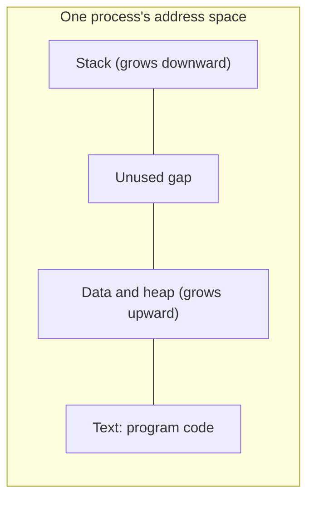
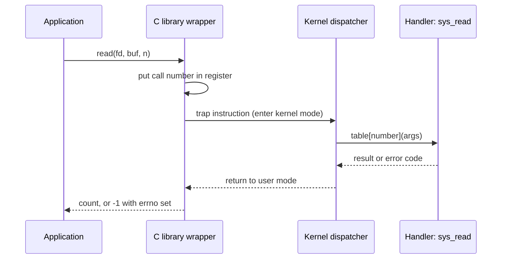

# Core concepts, system calls and kernel structure

> **Before this lesson:** [What an operating system is, its history and its many forms](#/lesson/os/what-is-an-os) and [Hardware review: CPUs, memory, devices and booting](#/lesson/os/hardware-review), for kernel mode, user mode and traps.

## In plain words

This lesson introduces the handful of ideas that every operating system is built from, the way programs ask the operating system for help, and the main ways the operating system itself can be organised inside.

Think of a bank. Customers cannot go into the vault. They stand at the counter and make requests from a fixed list: pay in, withdraw, check the balance. A teller, who *is* allowed into the vault, carries out each request and reports back. A computer program is in the customer's position. It is not allowed to touch the disk or other devices directly. It makes a request from a fixed list to the operating system, and such a request is called a **system call**.

The things a program can ask about are a small set of inventions: a **process** (a running program), an **address space** (the memory one process can use), and a **file** (a named piece of stored data). They are the nouns of the whole subject.

Why it matters for a job: every time your code opens a file, starts another program or sends data over a network, it makes system calls. Knowing what they are and what they cost explains a great deal about how real software behaves, and "what happens during a system call?" is a standard interview question.

## Motivation

The previous lessons said *what* an operating system is for and *what* it runs on. This one introduces the vocabulary that the rest of the track spends eleven modules refining: the handful of abstractions every OS offers, the precise mechanism by which a program asks for a service, and the main ways a kernel can be organised internally. Think of it as a map of the whole territory at low resolution. Later lessons zoom in; this one makes sure you always know where you are.

## The core abstractions

### Processes

A **process** is a program in execution. That phrase hides an important distinction: a *program* is a passive file of instructions on disk; a *process* is an activity with a current position, current register values, a stack that has grown to some depth, a set of open files and a region of memory with particular contents. Run the same program twice and you get two processes.

The kernel keeps what it knows about each process in a record called the **process table entry** (or process control block). When a process is paused, everything needed to resume it later as though nothing had happened is saved there.

Processes form a **tree**: a process can create children, which can create their own. Each process usually carries the identity (**UID**) of the user who started it, and children inherit that identity. Related processes that cooperate need ways to talk and coordinate, collectively called **interprocess communication**.

Sometimes the kernel needs to tell a process something it was not waiting for — a timer went off, the user pressed the interrupt key. It does so with a **signal**, a software analogue of a hardware interrupt: the process's normal flow is suspended, a handler runs, and then the flow resumes.

### Address spaces

Each process sees memory as its own private range of addresses, from zero up to some maximum. This is the process's **address space**. It normally holds three regions: the program **text** (code), the **data** (variables and heap, growing upward) and the **stack** (growing downward toward the data).



The address space is decoupled from physical RAM. It may be larger than the machine's memory, in which case the OS keeps part of it on disk and shuffles pieces in and out on demand — **virtual memory**, the subject of module 3.

### Files

A **file** is a named collection of bytes that outlives the process that created it. Files are grouped into **directories**, and directories may contain other directories, giving a tree. A file is identified by a **path name**: an absolute path starts at the **root directory**; a relative path starts at the process's **working directory**.

Before using a file a process *opens* it, at which point the kernel checks permissions and hands back a small integer, the **file descriptor**, used in all later operations.

UNIX-like systems add two characteristic ideas:

- **Mounting.** A file system on another device is attached at some directory of the existing tree, so that everything appears as one hierarchy instead of a set of lettered drives.
- **Special files.** Devices appear as entries in the file tree (conventionally under `/dev`), so that the same read and write calls work on a disk, a terminal or a file. *Block special files* model devices made of randomly addressable blocks; *character special files* model devices that produce or consume a stream.

A **pipe** is a kind of pseudo-file connecting two processes: bytes written at one end are read at the other. It is how shell pipelines are plumbed together.

### Protection

Files and other objects carry access rules. The classic UNIX scheme attaches nine bits to each file: read, write and execute permission for the **owner**, for members of the file's **group**, and for **everyone else**. For a directory, "execute" means permission to search it. Protection also includes defending the system from intruders and malicious code, treated in the security module.

### The shell

The **shell** is the command interpreter: a user-mode program that reads a line, starts the requested program as a child process, waits for it and prompts again. It can redirect a program's input and output to files, connect programs with pipes, and run jobs in the background. A graphical desktop does the same job with pictures. Neither is part of the kernel — both are heavy users of system calls.

## System calls

### What actually happens

The interface between user programs and the kernel is the set of **system calls**. They look like ordinary function calls in C because a library wraps each one, but underneath they are quite different: a function call stays inside your program; a system call crosses the protection boundary.

Take `count = read(fd, buffer, nbytes)`. The sequence is:

1. The program places the arguments where the calling convention requires and calls the library procedure `read`.
2. The library procedure puts the **system-call number** for read in an agreed register.
3. It executes a **trap** instruction. The CPU switches to kernel mode and jumps to a fixed kernel entry point.
4. The kernel's dispatcher uses the number as an index into a table of handler addresses and calls the read handler.
5. The handler does the work — possibly blocking the process if the data is not yet available.
6. Control returns to the library procedure in user mode, which returns to the program like any other function. On failure, the library conventionally returns −1 and stores an error code in a global variable named `errno`.



> [!INTERVIEW]
> "Walk me through what happens on a system call." Hit these points in order: arguments set up → library stub loads the call number → trap instruction switches to kernel mode at a fixed entry → kernel saves user registers, validates arguments (never trust pointers from user space), dispatches through the system-call table → handler runs, may block → result placed in a register → return-from-trap restores user mode. Mention that it is far more expensive than a function call (mode switch, cache and TLB effects), which is why libraries buffer I/O to make fewer calls.

A toy model makes the dispatch table concrete:

```python-run
class Kernel:
    """A pretend kernel: the only way in is trap(number, *args)."""
    def __init__(self):
        self.files = {"/etc/motd": b"Welcome aboard.\n"}
        self.open_files = {}          # fd -> [path, position]
        self.next_fd = 3              # 0, 1, 2 are reserved for stdin/stdout/stderr
        self.table = {0: self.sys_read, 1: self.sys_write, 2: self.sys_open, 3: self.sys_close}
        self.mode = "user"

    def trap(self, number, *args):
        self.mode = "kernel"                      # the trap flips the mode bit
        handler = self.table.get(number)
        result = handler(*args) if handler else -38   # unknown call: an error code
        self.mode = "user"                        # return-from-trap flips it back
        return result

    def sys_open(self, path):
        if path not in self.files:
            return -2                              # "no such file"
        fd, self.next_fd = self.next_fd, self.next_fd + 1
        self.open_files[fd] = [path, 0]
        return fd

    def sys_read(self, fd, nbytes):
        if fd not in self.open_files:
            return -9                              # "bad file descriptor"
        path, pos = self.open_files[fd]
        chunk = self.files[path][pos:pos + nbytes]
        self.open_files[fd][1] += len(chunk)
        return chunk

    def sys_write(self, fd, data):
        print(f"[fd {fd}] {data.decode()}", end="")
        return len(data)

    def sys_close(self, fd):
        return 0 if self.open_files.pop(fd, None) else -9

kernel = Kernel()

# "Library wrappers": the part an application actually calls.
def open_(path):   return kernel.trap(2, path)
def read(fd, n):   return kernel.trap(0, fd, n)
def write(fd, b):  return kernel.trap(1, fd, b)
def close(fd):     return kernel.trap(3, fd)

fd = open_("/etc/motd")
print("got descriptor", fd)
while True:
    chunk = read(fd, 6)            # read in small pieces; the kernel remembers the position
    if not chunk:
        break
    write(1, chunk)
close(fd)
print("reading a closed descriptor ->", read(fd, 6))
print("opening a missing file     ->", open_("/nope"))
```

**What the code does.** The `Kernel` class is a pretend operating-system core. `self.files` is its private store of files; `self.open_files` records which files are open and how far each has been read; `self.table` maps a call number to the function that handles it. The only way in is `trap(number, *args)`: it sets the mode to `"kernel"`, looks up the handler for that number, runs it, sets the mode back to `"user"` and returns the result. The four `sys_...` functions do the actual work and return negative numbers to signal errors. Below the class, `open_`, `read`, `write` and `close` are the "library wrappers" — the ordinary-looking functions an application calls, each of which does nothing except call `trap` with the right number. The last lines are the application: it opens a file, reads it six bytes at a time in a loop until nothing is left, and writes each piece to the screen.

**The output.** The descriptor returned is 3 (0, 1 and 2 are reserved). The file's text is printed in pieces of six characters. Reading after closing returns -9, the pretend code for "bad file descriptor", and opening a file that does not exist returns -2.

Notice that the application never touches `kernel.files`; it holds only an integer and the kernel tracks everything else. That is the essence of the design: user programs hold *names* for kernel objects, never the objects themselves.

### The POSIX calls worth knowing

POSIX defines roughly a hundred calls. A small number carry most of the weight.

**Process management**

| Call | Purpose |
|---|---|
| `fork()` | Create a child that is a duplicate of the caller. Returns 0 in the child and the child's process id in the parent. |
| `execve(path, argv, envp)` | Replace the calling process's memory image with a new program. |
| `waitpid(pid, &status, opts)` | Wait for a child to terminate and collect its exit status. |
| `exit(status)` | Terminate the caller. |

The split between creating a process (`fork`) and loading a program (`exec`) is a UNIX hallmark. It seems odd at first, but it gives the child a window, between the two calls, in which to rearrange its own file descriptors — which is exactly how a shell implements redirection and pipes without any special kernel support.

```python-run
# A shell in miniature, with fork/exec/wait simulated by ordinary function calls.
PROGRAMS = {
    "date":  lambda args, out: out.append("Fri 20 Nov 2026"),
    "echo":  lambda args, out: out.append(" ".join(args)),
    "upper": lambda args, out: out.append(" ".join(args).upper()),
}

def run_command(line, files):
    # parse:  cmd arg arg > file
    parts = line.split()
    target = None
    if ">" in parts:
        i = parts.index(">")
        target, parts = parts[i + 1], parts[:i]
    name, args = parts[0], parts[1:]
    # --- "fork": the child gets a copy of the shell's descriptors
    child_stdout = []                    # stands for descriptor 1 in the child
    # --- between fork and exec the child can redirect its own output
    # --- "exec": the child becomes the requested program
    if name not in PROGRAMS:
        return f"{name}: command not found", 127
    PROGRAMS[name](args, child_stdout)
    # --- "exit" in the child, "waitpid" in the parent
    if target:
        files[target] = child_stdout
        return "", 0
    return "\n".join(child_stdout), 0

files = {}
for line in ["date", "echo hello world", "upper keep calm > shout.txt", "frobnicate"]:
    out, status = run_command(line, files)
    print(f"$ {line}\n{out}   (exit status {status})" if out else f"$ {line}   (exit status {status})")
print("files:", files)
```

**What the code does.** `PROGRAMS` is a table of three tiny "programs", each a function that puts its output into a list. `run_command` imitates what a shell does with one line. It splits the line into words; if one of them is `>`, the word after it is taken as the name of a file to receive the output. It then creates `child_stdout`, standing for the place the new process will write to; looks the program up (returning status 127 if there is no such program); runs it; and finally either stores the output under the file name or returns it for display. The comments mark where the real system calls `fork`, `exec`, `exit` and `waitpid` would happen.

**The output.** `date` and `echo` print their results with status 0. The third command prints nothing on screen, because its output was redirected: the final line shows it stored under `shout.txt`. The unknown command fails with status 127.

**File management**

| Call | Purpose |
|---|---|
| `open(path, how, ...)` | Open (or create) a file; returns a descriptor. |
| `close(fd)` | Release a descriptor. |
| `read(fd, buf, n)` / `write(fd, buf, n)` | Transfer bytes at the current position. |
| `lseek(fd, offset, whence)` | Move the current position, allowing random access. |
| `stat(path, &buf)` | Fetch metadata: size, owner, permissions, timestamps. |

**Directory and file-system management**

| Call | Purpose |
|---|---|
| `mkdir` / `rmdir` | Create or remove an empty directory. |
| `link(old, new)` | Create another directory entry for an existing file. |
| `unlink(path)` | Remove a directory entry; the file disappears when its last entry is gone. |
| `mount` / `umount` | Attach or detach a file system. |

`link` is worth a moment. In UNIX a directory entry is a (name, **i-number**) pair, where the i-number identifies the file's metadata record. Two entries can carry the same i-number; the file then has two names of equal standing, and the record keeps a count of how many names point at it.

**Miscellaneous:** `chdir` (change working directory), `chmod` (change permission bits), `kill` (send a signal — despite the name, not necessarily a fatal one), `time`.

### The Windows way

Windows separates two things UNIX keeps close together. Programmers code against a large, documented library called the **Win32 API**; the true kernel calls underneath are not a public interface and change between releases. Many Win32 functions do their work entirely in user mode. The concepts line up reasonably well — `CreateProcess` does the job of fork plus exec in one step, `WaitForSingleObject` resembles waitpid, `CreateFile` opens files — but Windows has no single-rooted mounted hierarchy in the UNIX sense by default, no links in quite the same form, and no signals.

> [!TIP]
> The lesson for portability: target the documented *library* interface (POSIX, Win32), not raw kernel entry points. The library is the contract; the trap numbers behind it are an implementation detail.

## How kernels are structured

Given the services above, how should the code that provides them be organised? Six designs are worth knowing.

### Monolithic systems

The whole OS is one large program running in kernel mode. Every procedure can call every other; there are no internal walls. This is fast — a file-system routine calls a disk driver with a plain function call — and it is how Linux, the BSDs and classic UNIX are built. The cost is fragility: a bug in an obscure driver can corrupt anything, because nothing separates it from the rest. Most monolithic kernels support **loadable modules**, so that drivers and file systems can be added at run time without rebuilding, but a loaded module is still part of the one big privileged program.

### Layered systems

Organise the system as a stack of layers, each built only on the one below: the bottom layer multiplexes the processor, the next manages memory, the next handles operator communication, then I/O, with user programs at the top. An early research system from the 1960s pioneered this. The discipline is attractive — each layer can be reasoned about on its own — but real systems rarely fit a strict hierarchy, and every layer crossing costs time.

### Microkernels

Bugs are roughly proportional to code size, and kernel-mode bugs are fatal. The **microkernel** philosophy follows directly: put as little as possible in kernel mode — only address spaces, scheduling, basic interprocess communication and interrupt forwarding — and run everything else (drivers, file systems, network stacks) as ordinary user-mode processes. A crashed audio driver then takes down the sound, not the machine, and can be restarted automatically.

A recurring design principle here is the separation of **mechanism** from **policy**: the kernel provides the mechanism (for example, "run the highest-priority runnable process") while a user-mode component decides the policy (what the priorities should be).

The price is performance: what was a function call becomes a message exchange with two or more context switches. Microkernels dominate where reliability is worth that price — avionics, industrial control, the baseband processors in phones — and are rare on general-purpose desktops.

### Client–server

A small step from microkernels: structure services as **server** processes and users of services as **client** processes, communicating by messages. Because the client need not know whether the server is on the same machine or across a network, the same structure extends naturally to distributed systems.

### Virtual machines

Rather than offering processes, a **virtual machine monitor** (hypervisor) offers exact copies of the bare hardware, each able to run a complete, unmodified operating system. The idea came from mainframes in the 1960s and returned in force when companies wanted to consolidate many servers onto one box. A *type 1* hypervisor runs directly on the hardware; a *type 2* hypervisor runs as a program on top of a host OS. A related idea is the **language virtual machine**, such as the Java virtual machine, which defines an imaginary instruction set and interprets or compiles it on each real platform. Module 7 covers all this in depth.

### Exokernels and unikernels

Instead of cloning the machine, an **exokernel** partitions it: its only job is to hand out resources securely and keep the tenants apart, leaving every abstraction to libraries linked into each application. A **unikernel** takes that to its conclusion: one application plus only the library OS code it needs, built into a single small image that boots directly on a hypervisor.

| Structure | Main strength | Main weakness |
|---|---|---|
| Monolithic | Speed, simplicity of internal calls | One bug can crash everything |
| Layered | Clean reasoning | Hard to fit reality; overhead |
| Microkernel | Fault isolation, small trusted base | Message-passing overhead |
| Client–server | Extends to networks | Same as microkernel |
| Virtual machine | Runs whole unmodified OSes | Another layer to manage |
| Exokernel | Applications control their own abstractions | Little shared infrastructure |

Real systems mix these. Windows and macOS are often called **hybrid**: they have a microkernel-flavoured internal design but keep most services in kernel mode for speed.

## Pitfalls

- **Confusing a library call with a system call.** `printf` is a library function that formats text into a buffer; only occasionally does it issue a `write` system call. Tools that trace system calls will show far fewer of them than the number of library calls in your source.
- **Forgetting that `fork` returns twice.** Both parent and child continue from the same point; only the return value tells them apart. Code that ignores this runs everything after the fork in both.
- **Assuming a file disappears on `unlink`.** It disappears when the last name *and* the last open descriptor are gone; a process holding it open can keep using it.
- **Trusting user-supplied pointers in the kernel.** Every address passed in a system call must be validated before use, otherwise a program could trick the kernel into reading or overwriting kernel memory.
- **Believing "microkernel" means "slow".** Decades of work on fast message passing have narrowed the gap considerably; the trade-off today is more about engineering effort and ecosystem than raw speed.

## Summary

- The four pillars are **processes** (running programs with saved state), **address spaces** (private memory views), **files** (persistent named byte collections in a directory tree) and **protection**.
- UNIX adds unifying ideas: mounting, devices as special files, pipes, and a shell that is one more ordinary program.
- A **system call** is a controlled entry into the kernel: library stub → call number → trap → dispatch table → handler → return, with errors reported through `errno`.
- The essential POSIX calls are fork, exec, waitpid, exit; open, close, read, write, lseek, stat; mkdir, link, unlink, mount; chdir, chmod, kill.
- Windows programmers use the Win32 library; the kernel calls beneath it are private.
- Kernel structures range from **monolithic** through **layered**, **microkernel**, **client–server**, **virtual machine** and **exokernel** designs, trading speed against isolation.

## Glossary

- **Process** — a program in execution, together with its memory, open files and current position.
- **Process table** — the kernel's list of all processes and what it knows about each.
- **Signal** — a notification sent to a process, interrupting what it was doing.
- **Address space** — the range of memory addresses a process may use.
- **Virtual memory** — a technique that lets a process's address space be larger than the real memory.
- **File** — a named collection of bytes that outlives the program that created it.
- **Directory** — a container of files and other directories.
- **Path name** — the full name of a file: *absolute* if it starts at the root, *relative* if it starts at the working directory.
- **File descriptor** — the small number a program receives when it opens a file and uses in later operations.
- **Mounting** — attaching a file system on another device at some point in the directory tree.
- **Special file** — a file-system entry that stands for a device.
- **Pipe** — a channel that carries the output of one process to the input of another.
- **Shell** — the program that reads commands and runs them.
- **System call** — a request from a program to the kernel.
- **fork / exec / waitpid** — the UNIX calls to duplicate the current process / replace its program / wait for a child to finish.
- **Monolithic kernel** — an operating system built as one large privileged program.
- **Microkernel** — a design with a very small privileged core and most services running as ordinary processes.
- **Mechanism / policy** — how something is done / what is to be done.
- **Hypervisor** — a program that makes one computer look like several, each able to run its own operating system.

## Check yourself

```quiz
[
  {"q": "What distinguishes a process from a program?",
   "options": ["A program is written in C; a process is written in assembly", "A program is a passive file; a process is that code in execution together with its current state", "A process is stored on disk; a program lives in memory", "There is no difference"],
   "answer": 1,
   "explain": "A process includes the program counter, registers, stack, memory contents and open files of one execution. One program can be running as many processes at once."},
  {"q": "In the sequence for read(fd, buf, n), which step switches the CPU into kernel mode?",
   "options": ["Calling the library procedure", "Loading the system-call number into a register", "Executing the trap instruction", "Returning the byte count"],
   "answer": 2,
   "explain": "Only the trap instruction changes mode, and it simultaneously transfers control to a fixed kernel entry point so user code cannot choose where it lands."},
  {"q": "After a successful fork(), what does the call return?",
   "options": ["0 in both processes", "The child's pid in both processes", "0 in the child and the child's pid in the parent", "The parent's pid in the child and 0 in the parent"],
   "answer": 2,
   "explain": "The differing return value is how the two otherwise identical processes discover which one they are."},
  {"q": "Why does separating fork from exec make shell redirection easy to implement?",
   "options": ["Because exec can only run shell scripts", "Because between the two calls the child can rearrange its own file descriptors before the new program starts", "Because fork closes all files automatically", "Because the kernel parses the > symbol"],
   "answer": 1,
   "explain": "The child, still running shell code, opens the target file onto descriptor 1 and then execs. The new program inherits the descriptor and writes to the file without knowing it."},
  {"q": "A file has two directory entries created with link(). What happens when one is removed with unlink()?",
   "options": ["The file's data is deleted immediately", "Both names disappear", "The link count drops by one and the file remains reachable through the other name", "The operation fails"],
   "answer": 2,
   "explain": "Directory entries are (name, i-number) pairs; the file's metadata keeps a count of names. The data is freed only when that count reaches zero and nobody has the file open."},
  {"q": "What is the central argument for a microkernel?",
   "options": ["Message passing is faster than function calls", "Less code in kernel mode means fewer bugs that can crash the whole system", "It removes the need for device drivers", "It allows programs to skip system calls"],
   "answer": 1,
   "explain": "Drivers and services run as isolated user processes, so a fault in one is contained and the component can often be restarted. The cost is extra communication overhead."},
  {"q": "Which design gives each tenant something that looks like bare hardware, able to boot an unmodified operating system?",
   "options": ["Layered system", "Exokernel", "Virtual machine monitor", "Monolithic kernel"],
   "answer": 2,
   "explain": "A hypervisor presents virtual copies of the real machine. An exokernel, by contrast, partitions resources and leaves abstractions to application-level libraries."},
  {"q": "On Windows, what is the stable interface application programmers are meant to use?",
   "options": ["The raw kernel trap numbers", "The Win32 API library", "The interrupt vector", "The boot loader"],
   "answer": 1,
   "explain": "Win32 is the documented contract. The underlying kernel calls are private and may change between versions, and many Win32 functions never enter the kernel at all."}
]
```

> **Source:** Tanenbaum & Bos, Modern Operating Systems 4e, §1.5 (Operating system concepts), §1.6 (System calls), §1.7 (Operating system structure)
