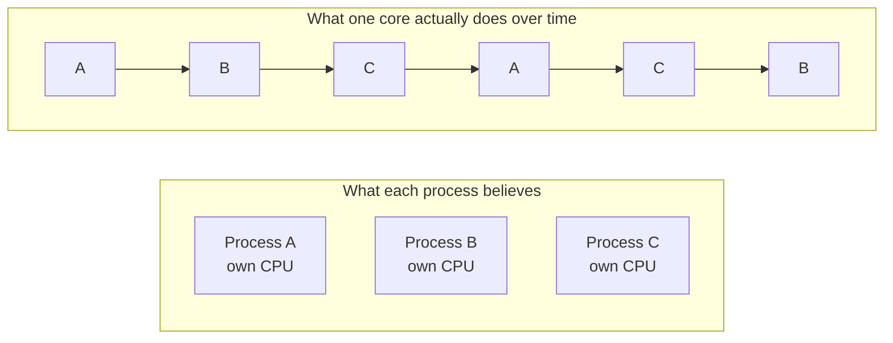
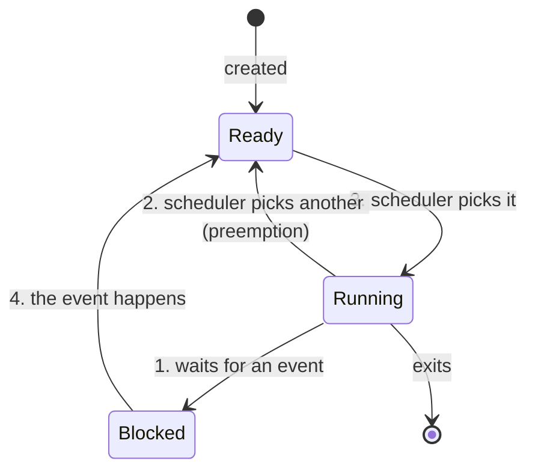

# Processes and threads

> **Before this lesson:** [Core concepts, system calls and kernel structure](#/lesson/os/concepts-syscalls-structure), for what a process and a system call are, and [Hardware review](#/lesson/os/hardware-review), for registers and interrupts.

## In plain words

A computer with one processor can do only one thing at a time, yet you can listen to music, download a file and type a document together. The trick is speed: the operating system lets each program run for a few thousandths of a second and then switches to the next, so quickly that they all seem to run at once.

Think of a chess master playing twenty opponents in a hall, walking from board to board and making one move at each. No game is ever abandoned; each board holds the full state of its game, so the master can pick it up again later. Each game is like a **process**: a program that is running, together with everything needed to pause it and continue it later.

Sometimes a single program wants to do several things at once — a word processor that accepts typing while it also checks spelling. Each such activity inside one program is a **thread**. Threads of one program share the same data, like several people working on one shared document.

Why it matters for a job: every application you build is a process, and most use several threads. "What is the difference between a process and a thread?" is probably the most frequently asked operating-system interview question.

## Motivation

A web server receives a request, starts reading a file from disk, and — while the disk is busy for a few milliseconds — picks up another request from a different client. On your laptop a music player, a browser with thirty tabs, a chat client and a file-sync daemon all appear to run at once on perhaps eight cores. None of this "at once" is literally true. What you are seeing is the operating system's oldest and most important illusion: the **process**, and its lighter relative, the **thread**.

This lesson builds the model carefully, because scheduling, synchronisation, memory management and deadlock all sit on top of it.

## The process model

### One CPU pretending to be many

Conceptually, each process has its own virtual CPU. In reality the physical CPU switches rapidly from one to another — tens or hundreds of times per second — a technique called **multiprogramming**. Each process has its own logical program counter, registers and variables; when it is its turn, those values are loaded into the real hardware; when its turn ends, they are saved again.



Two consequences follow. First, a process cannot make assumptions about timing: the rate at which it makes progress depends on what else is running, and is not even reproducible from one run to the next. Second, the distinction between program and process becomes practical. A recipe is a program; the activity of a particular cook following it with particular ingredients, who may be interrupted to deal with a crying child and then resume at the right step, is a process.

### How processes are born

Four kinds of events create processes:

1. **System start-up.** Booting launches a number of processes. Some are foreground programs; many are background **daemons** waiting to handle mail, print jobs, scheduled tasks and so on.
2. **A running process asks for one.** A build tool spawning compilers, a server spawning workers.
3. **A user asks for one,** by typing a command or clicking an icon.
4. **A batch job is started** on systems that queue work.

Technically all four come down to the same thing: some existing process executes a process-creation system call. In UNIX that call is `fork`, which clones the caller; the clone typically then calls `exec` to become a different program. In Windows a single `CreateProcess` call both creates the process and loads a program into it.

After creation, parent and child have **separate address spaces**. A write by one is not visible to the other. (Implementations avoid physically copying memory at fork time by sharing pages until one side writes — *copy-on-write* — but the logical separation is absolute.)

### How processes die

- **Normal exit** — the work is finished (voluntary).
- **Error exit** — the program detects a problem it cannot continue past, such as a missing input file (voluntary).
- **Fatal error** — a bug: an illegal instruction, a reference to memory it does not own, division by zero (involuntary).
- **Killed by another process** with sufficient authority (involuntary).

### Hierarchies

In UNIX a process and all its descendants form a **process group**, and a keyboard signal is delivered to the whole group attached to that terminal. At boot one special process (traditionally called `init`) is the root of the entire tree, so every process on the system is its descendant. Windows has no such hierarchy: a creator receives a **handle** to the new process, but handles can be passed to others, so "parent" has no lasting meaning.

### The three states

A process is always in one of three basic states:

- **Running** — actually using a CPU at this instant.
- **Ready** — able to run, but waiting because the CPU is busy with another process.
- **Blocked** — unable to run until some external event occurs, such as input arriving.



Read the four transitions carefully. Transition 1 is the only one a process causes itself — by asking for something that is not yet available. Transitions 2 and 3 are decisions of the **scheduler**, about which the process knows nothing. Transition 4 is triggered from outside, typically by an interrupt. Note what is *missing*: there is no arrow from Blocked directly to Running (a woken process must queue as Ready, unless the CPU happens to be idle) and none from Ready to Blocked (you must be running to ask for something).

> [!INTERVIEW]
> "What is the difference between ready and blocked?" Both are not running. A **ready** process lacks only the CPU; give it a core and it proceeds immediately. A **blocked** process could not proceed even on an idle machine, because it is waiting for an event — I/O completion, a lock, a message. Schedulers only ever choose among ready processes.

### Implementation: the process table and what an interrupt does

For each process the kernel keeps a **process table entry**, holding everything that must survive while the process is not running:

| Process management | Memory management | File management |
|---|---|---|
| Registers, program counter, stack pointer, status word | Pointers to text, data and stack segments (or page tables) | Root and working directories |
| State, priority, scheduling parameters | | Open file descriptors |
| Process id, parent, process group | | User and group ids |
| Signals, CPU time used, start time, next alarm | | |

With that table in mind, here is how one CPU keeps up the illusion of many sequential processes when a disk interrupt arrives while user process 3 is running:

1. The hardware pushes the program counter and status word onto the current stack and loads a new program counter from the **interrupt vector**.
2. A small assembly-language routine saves the remaining registers into process 3's table entry and sets up a fresh stack for the kernel.
3. The C-language interrupt service routine for that device runs — for example, noting that the data process 7 was waiting for has arrived, and marking process 7 ready.
4. The scheduler is called to decide which process should run next.
5. Assembly code loads the chosen process's registers and memory map and starts it.

Steps 2 and 5 together are a **context switch**. The details cannot be written in C because they manipulate the stack pointer and registers directly.

### Simulating the state machine

```python-run
from collections import deque

# Each process is a script of ("cpu", n) and ("io", n) steps.
scripts = {
    "editor":   [("cpu", 1), ("io", 4), ("cpu", 1), ("io", 4), ("cpu", 1)],
    "compiler": [("cpu", 6), ("io", 1), ("cpu", 5)],
    "backup":   [("cpu", 2), ("io", 6), ("cpu", 2)],
}
QUANTUM = 3

ready = deque(scripts)                 # names, in arrival order
blocked = {}                           # name -> time at which its I/O completes
pos = {p: 0 for p in scripts}          # index of current step
left = {p: scripts[p][0][1] for p in scripts}
clock, log = 0, []

def advance(p):
    """Move p to its next step; return its new state."""
    pos[p] += 1
    if pos[p] == len(scripts[p]):
        return "done"
    kind, n = scripts[p][pos[p]]
    left[p] = n
    return "blocked" if kind == "io" else "ready"

while ready or blocked:
    for p in [p for p, t in blocked.items() if t <= clock]:   # transition 4
        del blocked[p]
        state = advance(p)
        if state == "ready":
            ready.append(p)
    if not ready:
        clock = min(blocked.values())                          # CPU idle
        continue
    p = ready.popleft()                                        # transition 3
    run = min(QUANTUM, left[p])
    log.append(f"{clock:2d}-{clock + run:2d} {p}")
    clock += run
    left[p] -= run
    if left[p] > 0:
        ready.append(p)                                        # transition 2
    else:
        state = advance(p)
        if state == "blocked":
            blocked[p] = clock + left[p]                       # transition 1
        elif state == "ready":
            ready.append(p)

print("\n".join(log))
print("all done at t =", clock)
```

**What the code does.** `scripts` describes three programs as lists of steps: `("cpu", 6)` means "compute for 6 time units" and `("io", 4)` means "wait 4 units for a device". `ready` is a queue of programs able to run (a `deque` is a list that is efficient to add to and remove from at both ends); `blocked` records, for each waiting program, the time at which its wait ends; `pos` and `left` record which step each program is on and how much of it remains. The helper `advance` moves a program to its next step and reports its new state. The main `while` loop repeats until nothing is left: it first moves any program whose wait has ended back to the ready queue (transition 4); if nothing is ready it jumps the clock forward; otherwise it takes the first ready program (transition 3) and lets it compute for at most `QUANTUM` units. If the program still has computing to do it goes to the back of the queue (transition 2); if its computing step is finished and the next step is a wait, it becomes blocked (transition 1).

**The output.** Each line shows a time interval and which program had the processor, for example `0- 1 editor`. The editor, which computes only one unit at a time, gets back on the processor soon after each wait, while the compiler is repeatedly cut off after three units.

Change `QUANTUM` to 1 and to 100 and watch how the editor's responsiveness changes. That experiment is the scheduling lesson in miniature.

## Threads

### Why one process is sometimes not enough

Consider a word processor. One activity reacts to keystrokes. Another reformats the document after an edit, which may take seconds for a long book. A third saves a backup copy every few minutes. If these were three separate processes they could not conveniently share the document, because processes have separate address spaces. If they were one sequential program, the user would be frozen out while reformatting ran.

What we want is several independent flows of control *inside one address space*. Those flows are **threads**. There are four standard reasons for wanting them:

1. **Structure.** Many applications are naturally several activities that sometimes block. Writing each as a simple sequential thread is easier than weaving them into one event loop.
2. **Cost.** Threads are far cheaper to create and destroy than processes — often ten to a hundred times — because there is no new address space to build.
3. **Performance with I/O.** While one thread waits for a disk, another can compute.
4. **Real parallelism** on multicore machines.

A multithreaded web server illustrates the pattern: a *dispatcher* thread accepts each incoming request and hands it to an idle *worker* thread, which may block on disk without stopping the others. The alternatives are a single-threaded server (simple, but one slow disk read stalls everyone) or a **finite-state machine** built on non-blocking I/O and events (fast, but each request's state must be saved and restored by hand, which is hard to write and debug).

| Model | Parallelism | Blocking calls allowed | Programming difficulty |
|---|---|---|---|
| Threads | Yes | Yes | Moderate |
| Single-threaded process | No | Yes | Easy |
| Event-driven state machine | Yes | No — everything must be non-blocking | Hard |

### What is shared and what is private

A process is a unit of **resource ownership**; a thread is a unit of **execution**.

| Shared by all threads in a process | Private to each thread |
|---|---|
| Address space (code, globals, heap) | Program counter |
| Open files | Registers |
| Child processes | Stack |
| Signals and signal handlers, alarms | State (running / ready / blocked) |
| Accounting information | |

Each thread needs its own **stack** because each has its own history of procedure calls that have not yet returned. Everything else is common property. There is no protection between threads of one process: any thread can overwrite another's stack. That is acceptable because they belong to one program written by one author and are supposed to cooperate — but it is also the root of every race condition you will ever debug.

> [!INTERVIEW]
> "Process versus thread?" A process owns an address space and resources; threads are flows of execution within it. Threads share memory and open files but each has its own stack, registers and program counter. Creating and switching threads is cheaper (no address-space switch, so no TLB flush). Processes are isolated from each other; threads are not — one bad pointer can corrupt the whole process. Communication between threads is by shared memory; between processes it needs an explicit IPC mechanism.

The POSIX standard thread package, **Pthreads**, offers calls such as `pthread_create`, `pthread_exit`, `pthread_join` (wait for a specific thread to finish) and `pthread_yield` (voluntarily give up the CPU).

### Where threads are implemented

**In user space.** A library inside the process keeps a private **thread table** and switches threads itself; the kernel sees only one ordinary process.

- *For:* a thread switch is a few instructions with no trap — far faster than entering the kernel. It works on kernels that know nothing about threads. Each process can have its own scheduling policy.
- *Against:* if one thread makes a blocking system call, the kernel blocks the *whole process*, stopping every thread. The same happens on a page fault. And since no timer interrupt reaches the thread library, a thread that never yields runs forever. There is also no parallelism: the kernel will assign the process to at most one core at a time.

**In the kernel.** The kernel keeps the thread table and schedules threads individually.

- *For:* a blocking call stops only the calling thread; threads of one process can run on different cores.
- *Against:* every creation, destruction and switch involves a system call, which is costlier. (To soften this, kernels often *recycle* thread data structures instead of freeing them.)

**Hybrid.** Multiplex many user-level threads over a smaller number of kernel threads, aiming for the flexibility of one and the non-blocking behaviour of the other.

**Scheduler activations** were a research attempt to get user-level speed with kernel-level awareness: the kernel assigns virtual processors to a process and makes an *upcall* into the user-level run-time whenever a thread blocks or unblocks, so that the run-time can reschedule its own threads. **Pop-up threads** take a different angle for server workloads: the arrival of a message causes a brand-new thread to be created to handle it, with no old state to restore.

Mainstream systems today — Linux, Windows, macOS — use kernel threads, sometimes with user-level task systems layered on top.

### A user-level thread package in thirty lines

Python generators are a neat way to see what a user-space thread library does: each generator keeps its own position and locals (its "stack"), and `yield` is `thread_yield`.

```python-run
from collections import deque

def worker(name, steps):
    for i in range(steps):
        print(f"  {name} step {i}")
        yield                      # voluntarily give up the CPU

def hog(name):
    total = 0
    for i in range(3):
        total += i
    print(f"  {name} finished without ever yielding")
    yield

def run(threads):
    """A round-robin, purely cooperative user-level scheduler."""
    ready = deque(threads)
    switches = 0
    while ready:
        t = ready.popleft()
        try:
            next(t)                # "context switch" into the thread
            ready.append(t)        # it yielded: back of the queue
            switches += 1
        except StopIteration:
            pass                   # thread exited
    print(f"done after {switches} user-level switches, zero system calls")

run([worker("A", 3), hog("H"), worker("B", 2)])
```

**What the code does.** In Python, a function containing `yield` is a *generator*: when called it does not run to the end but pauses at each `yield` and can be continued later from that exact point, with all its variables intact. That is precisely what a thread needs. `worker` prints a line and yields, several times. `hog` does all its work without yielding until the very end. `run` is the scheduler: it keeps the threads in a queue, takes the first, lets it run until its next `yield` with `next(t)`, and puts it at the back. When a generator finishes, Python raises `StopIteration`, which the `try ... except` catches so that the thread is dropped.

**The output.** A's and B's steps are interleaved (`A step 0`, then `H finished...`, then `B step 0`, `A step 1`, and so on), and the final line reports how many switches were made — with no help from the operating system at all. `H` ran from start to finish in one go because it never yielded.

Everything happens inside one process; the kernel schedules nothing. And you can see the weakness: `hog` runs to completion before anyone else gets a turn, because nothing can force it to stop.

### Retrofitting threads onto old code

Converting an existing single-threaded program is notoriously treacherous.

- **Global variables.** Classic library code reports errors through a single global, `errno`. If thread 1 makes a failing call and is switched out before reading the error, and thread 2 then makes another call that overwrites it, thread 1 reads the wrong value. The usual fix is per-thread ("thread-local") storage.
- **Non-reentrant library procedures.** A routine that builds its result in a fixed internal buffer cannot be entered by a second thread while the first is in the middle of it.
- **Signals.** Which thread should receive a signal aimed at the process? What if one thread wants to catch it and another wants to ignore it?
- **Stack growth.** The kernel can grow a process's single stack automatically; it may know nothing of the many stacks of user-level threads.

None of these is unsolvable, but they show that threads are not a free add-on: the whole run-time environment has to be designed with them in mind.

## Pitfalls

- **Thinking "blocked" means "slow".** A blocked process consumes no CPU at all; a system with a thousand blocked processes can be completely idle.
- **Expecting deterministic interleavings.** A multithreaded program that passes a test a thousand times can fail on the thousand-and-first because the scheduler happened to switch at a different instruction.
- **Sharing by accident.** Globals, static locals and heap objects reachable from several threads are all shared. Only data that lives purely on one thread's stack is private — and only as long as no pointer to it escapes.
- **Assuming more threads means more speed.** Beyond the number of cores, extra CPU-bound threads only add switching overhead; and threads that all contend for one lock run no faster than one.
- **Confusing fork with thread creation.** A forked child gets a *copy* of memory; a new thread shares the *same* memory.

## Summary

- A **process** is a running program plus its state; multiprogramming switches one CPU among many, so each appears to have its own.
- Processes are created at boot, by other processes, by users or as batch jobs, and terminate voluntarily or involuntarily. UNIX arranges them in a tree; Windows does not.
- The three states are **running**, **ready** and **blocked**, with four legal transitions.
- The **process table** stores the saved context; an interrupt triggers save → service → schedule → restore.
- **Threads** are multiple flows of control in one address space, sharing memory and files but owning their own stack and registers.
- Threads may be implemented in **user space** (fast, but one blocking call stops all), in the **kernel** (flexible, costlier), or as a **hybrid**.
- Making legacy code thread-safe means confronting globals, non-reentrant libraries and signals.

## Glossary

- **Process** — a running program, together with its memory, open files and saved state.
- **Multiprogramming** — switching one processor rapidly among several processes.
- **Daemon** — a process that runs in the background, not attached to a user.
- **Running / ready / blocked** — using the processor now / able to run but waiting for the processor / unable to run until some event happens.
- **Scheduler** — the part of the operating system that decides which process runs next.
- **Preemption** — taking the processor away from a running process.
- **Process table entry (process control block)** — the kernel's record of one process.
- **Context switch** — saving the state of one process or thread and restoring that of another.
- **Interrupt vector** — the table giving the address of the handler for each kind of interrupt.
- **Thread** — one flow of execution inside a process.
- **Stack** — the memory where a thread keeps track of the functions it is in the middle of.
- **User-level thread** — a thread managed by a library inside the process, unknown to the kernel.
- **Kernel-level thread** — a thread the kernel knows about and schedules.
- **Yield** — for a thread to give up the processor voluntarily.
- **Reentrant** — said of code that can safely be executed by several threads at once.
- **Copy-on-write** — sharing memory between parent and child until one of them changes it.

## Check yourself

```quiz
[
  {"q": "A process issues a read on a socket that has no data yet. Which state transition occurs?",
   "options": ["Running to Ready", "Running to Blocked", "Ready to Blocked", "Blocked to Running"],
   "answer": 1,
   "explain": "Only a running process can make a request; because the data is unavailable it cannot continue and becomes blocked until the event occurs."},
  {"q": "Which transition can never happen directly?",
   "options": ["Ready to Running", "Running to Ready", "Ready to Blocked", "Blocked to Ready"],
   "answer": 2,
   "explain": "A process must be executing in order to ask for something that makes it wait, so it can only block from the Running state."},
  {"q": "Which of the following is private to each thread rather than shared by the process?",
   "options": ["The heap", "Open file descriptors", "The stack", "Global variables"],
   "answer": 2,
   "explain": "Every thread has its own call history and therefore its own stack (plus program counter and registers). Heap, globals and open files belong to the process."},
  {"q": "A program uses a pure user-level thread library. One thread calls a blocking read. What happens?",
   "options": ["Only that thread blocks", "The kernel schedules another thread of the same process", "The entire process blocks, stopping all its threads", "The read returns an error"],
   "answer": 2,
   "explain": "The kernel is unaware of user-level threads. It sees one process making a blocking call and suspends that process as a whole."},
  {"q": "Why are thread switches inside a user-level package faster than kernel thread switches?",
   "options": ["They skip saving registers", "They need no trap into the kernel or change of protection mode", "They use a faster CPU", "They do not need a stack"],
   "answer": 1,
   "explain": "The library saves and loads registers with ordinary procedure calls. Avoiding the kernel entry and exit is the whole saving."},
  {"q": "After fork(), the child assigns x = 5 to a global variable that had the value 1. What does the parent now see in x?",
   "options": ["5", "1", "Undefined", "0"],
   "answer": 1,
   "explain": "Parent and child have separate address spaces. Copy-on-write is an optimisation that preserves this: the child's write goes to its own private copy of the page."},
  {"q": "What problem does the global variable errno illustrate when adding threads to old code?",
   "options": ["It uses too much memory", "Two threads can overwrite each other's error codes because the variable is shared", "It cannot be read in kernel mode", "It slows down system calls"],
   "answer": 1,
   "explain": "A single process-wide error variable assumes one flow of control. The remedy is to give each thread its own copy."},
  {"q": "In the five-step handling of an interrupt, which steps together make up the context switch?",
   "options": ["The hardware pushing the PC and the device handler running", "Saving the old process's registers and loading the new process's registers", "Calling the scheduler twice", "Looking up the interrupt vector"],
   "answer": 1,
   "explain": "Saving the outgoing state into its table entry and restoring the incoming state from another entry is the switch itself; the scheduler merely decides which state to load."}
]
```

> **Source:** Tanenbaum & Bos, Modern Operating Systems 4e, §2.1 (Processes), §2.2 (Threads)
