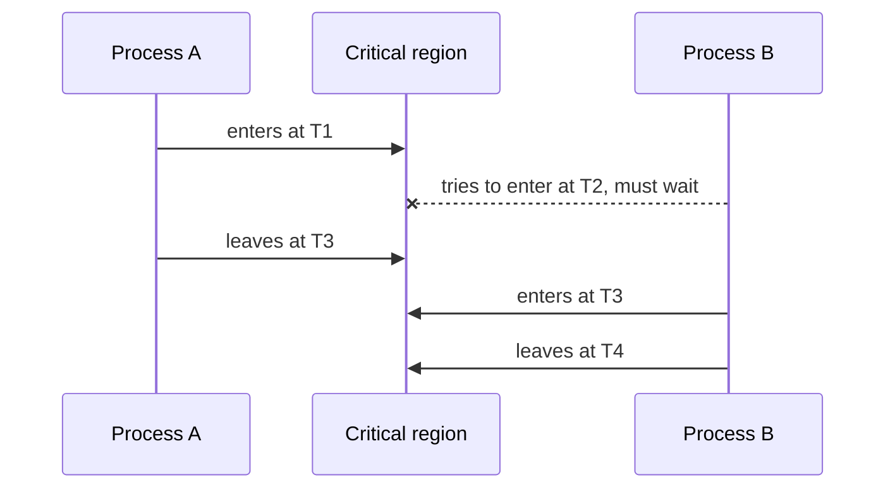

# Race conditions and mutual exclusion

> **Before this lesson:** [Processes and threads](#/lesson/os/processes-threads), for threads sharing memory and for the idea that the operating system can switch between them at any moment.

## In plain words

When two activities use the same thing at the same time, they can get in each other's way.

Picture a shared family calendar on the kitchen wall. Two people look at Saturday, both see it is free, and both walk off to phone a friend. Each then writes an appointment in the same square. Neither did anything wrong individually; the trouble is that each *looked* and then *wrote*, and the other slipped in between. In computing, when the result depends on such an accident of timing, it is called a **race condition**.

The cure is a rule: only one person may be at the calendar at a time, and that person both looks and writes before stepping away. In a program, the piece of code that must not be run by two threads together is called a **critical region**, and the rule that keeps others out is **mutual exclusion**. A **lock** is the usual tool: like the bolt on a bathroom door, it shows that the place is occupied.

Why it matters for a job: these bugs are the hardest in all of programming. They appear rarely, vanish when you try to observe them, and can lie hidden for years. Any program with more than one thread — which today means nearly every program — can have them.

## Motivation

Two bank tellers serve two customers who are both depositing into the same joint account. Each teller reads the balance (£500), adds the deposit (£100 and £50 respectively) and writes the result back. If the second teller reads the balance before the first has written, the account ends at £550 or £600 instead of £650. No one made an arithmetic error. The result is wrong purely because of *timing*.

Software has exactly this problem whenever two flows of control touch the same data — two threads updating a counter, two processes appending to a log, an interrupt handler and the code it interrupted both manipulating a queue. Bugs of this kind are the worst sort: they appear rarely, vanish when you add a print statement, and cannot be reproduced on demand. This lesson explains precisely what goes wrong and works through the classic attempts to prevent it, including the ones that *don't* work, because the failures are as instructive as the successes.

## Race conditions

Take a print spooler. Processes that want a file printed put its name in the next free slot of a shared directory. Two shared variables track the queue: `out`, the next slot to print, and `in`, the next free slot. Suppose `in` is 7.

1. Process A reads `in` and stores 7 in a local variable.
2. A timer interrupt fires; the scheduler switches to process B.
3. B reads `in` (still 7), writes its file name into slot 7, and sets `in` to 8.
4. Eventually A resumes. It still believes the free slot is 7, so it overwrites B's file name with its own and sets `in` to 8.

The spooler's data structures are perfectly consistent, so nothing notices. B's document is never printed.

A situation in which two or more processes read or write shared data and the final result depends on the precise order in which they run is called a **race condition**.

The same thing happens with the innocent-looking statement `count = count + 1`. It is not one action; the processor does three things:

```
load  count into a register
add   1 to the register
store the register back into count
```

A switch between any two of those steps lets another thread slip in. The simulation below enumerates every possible interleaving of two threads each doing one increment.

```python-run
from itertools import permutations

def run(schedule):
    """schedule: a sequence of thread ids (0 or 1); each thread executes load, add, store in order."""
    count = 0
    reg = [None, None]
    step = [0, 0]
    for t in schedule:
        if step[t] == 0:
            reg[t] = count          # load
        elif step[t] == 1:
            reg[t] += 1             # add
        else:
            count = reg[t]          # store
        step[t] += 1
    return count

outcomes = {}
for schedule in set(permutations([0, 0, 0, 1, 1, 1])):
    outcomes.setdefault(run(schedule), []).append("".join("AB"[t] for t in schedule))

for value in sorted(outcomes):
    examples = sorted(outcomes[value])
    print(f"final count = {value}: {len(examples):2d} interleavings, e.g. {examples[0]}")
```

**What the code does.** Adding 1 to a shared counter takes three machine steps: *load* the value into a private slot, *add* 1, *store* it back. `run(schedule)` plays out one particular ordering. `schedule` is a sequence of thread numbers (0 or 1) saying whose step comes next; `step[t]` remembers how far thread `t` has got; `reg[t]` is that thread's private slot. `permutations([0, 0, 0, 1, 1, 1])` produces every possible order of three steps by thread 0 and three by thread 1, and wrapping it in `set(...)` removes duplicates, leaving the 20 distinct interleavings. The loop runs each one and groups the schedules by the final value of the counter.

**The output.** Only 2 of the 20 interleavings give the correct answer 2 — the two in which one thread finishes completely before the other starts (shown as `AAABBB`). The other 18 give 1: one of the two additions was lost.

Of the twenty possible interleavings only two — the ones in which a thread completes all three steps before the other starts — give the correct answer of 2. On a real machine the bad interleavings are *improbable*, since the window is a few nanoseconds wide, which is exactly why such bugs survive testing and then strike in production under load.

## Critical regions

The cure is to make sure that whenever one process is using the shared data, the others are kept out. That is **mutual exclusion**. The stretch of code that accesses shared state is the **critical region** (or critical section). If no two processes are ever inside their critical regions for the same data at once, races are impossible.

Mutual exclusion alone is not enough for a usable solution. A good scheme satisfies four conditions:

1. **Mutual exclusion.** No two processes may be inside their critical regions simultaneously.
2. **No timing assumptions.** Nothing may be assumed about processor speeds or the number of CPUs.
3. **No outside interference.** A process that is *not* in its critical region must not be able to block another from entering.
4. **Bounded waiting.** No process should wait forever to get in.



> [!INTERVIEW]
> Interviewers love "what properties must a mutual-exclusion solution have?" The modern phrasing is three properties: **mutual exclusion** (safety), **progress** (if the region is free and someone wants in, a decision is made, and processes outside the region do not take part in blocking it), and **bounded waiting** (no starvation). The "no assumptions about speed" condition is the ground rule under which the other three must hold.

## Attempts at mutual exclusion with busy waiting

### Disabling interrupts

On a single-processor machine a process could turn off interrupts on entering its critical region and turn them back on when leaving. With no clock interrupt there can be no involuntary switch, so no one else can run.

This is unacceptable as a tool for user programs: a process that forgets to re-enable interrupts freezes the machine forever. It also fails outright on a multiprocessor, because disabling interrupts affects only the CPU that executed the instruction; other CPUs carry on and can touch the shared memory. Inside the kernel itself, briefly disabling interrupts while updating a few variables is a legitimate and common technique — but it is not a general solution.

### A lock variable

Use a shared variable `lock`, initially 0. To enter, a process tests it; if it is 0, the process sets it to 1 and goes in; otherwise it waits.

This has *exactly the same bug as the spooler*. Process A reads `lock` and sees 0. Before it can set it to 1, it is switched out. B reads 0, sets 1, enters. A resumes, sets 1, enters. Two processes inside. Testing and setting are two separate steps, and the race has merely moved from the data to the lock.

### Strict alternation

Use a shared variable `turn`. Process 0 may enter only when `turn == 0`, and sets it to 1 on leaving; process 1 does the reverse. Each waits in a tight loop, continuously testing the variable — **busy waiting**. A lock that uses busy waiting is called a **spin lock**.

Mutual exclusion holds, but condition 3 is violated. Suppose process 0 finishes its critical region quickly, sets `turn = 1`, does its other work and comes back wanting to enter again — while process 1 is busy with a long non-critical computation and has no interest in the region at all. Process 0 must wait until process 1 takes its turn. A process outside its critical region is blocking another. Strict alternation only works if the processes naturally take perfectly alternating turns.

### Peterson's solution

In 1981 G. L. Peterson published a remarkably short software-only algorithm that actually works for two processes. It combines the two failed ideas: an *interest* flag per process and a shared *turn* variable used as a tie-breaker.

```
enter_region(me):
    other = 1 - me
    interested[me] = TRUE          # announce interest
    turn = other                   # politely offer the other one priority
    while interested[other] and turn == other:
        pass                       # busy wait

leave_region(me):
    interested[me] = FALSE
```

Why it works: if only one process is interested, the other's flag is false and the loop is skipped. If both become interested at nearly the same moment, both write `turn`; one write lands last and its value sticks. The process whose write landed *last* has given away priority and waits; the other proceeds. Since `turn` holds a single value, they cannot both pass.

You do not have to take this on trust. With two processes and a handful of variables, the number of reachable states is tiny, and a computer can visit them all. The following mini **model checker** explores every possible interleaving of the lock-variable scheme and of Peterson's algorithm.

```python-run
def explore(step, start, in_critical):
    """Visit every state reachable under any interleaving. Return (states, a violating state or None)."""
    seen, frontier, violation = {start}, [start], None
    while frontier:
        s = frontier.pop()
        if in_critical(s, 0) and in_critical(s, 1):
            violation = violation or s
        for who in (0, 1):
            t = step(s, who)
            if t not in seen:
                seen.add(t)
                frontier.append(t)
    return len(seen), violation

# --- Broken: plain lock variable. state = (pc0, pc1, lock)
def lock_variable(s, i):
    pc, lock = list(s[:2]), s[2]
    if pc[i] == 0:                 # test the lock
        if lock == 0:
            pc[i] = 1
    elif pc[i] == 1:               # set the lock  (separate step!)
        lock, pc[i] = 1, 2
    elif pc[i] == 2:               # critical region
        pc[i] = 3
    else:                          # release
        lock, pc[i] = 0, 0
    return (pc[0], pc[1], lock)

# --- Peterson. state = (pc0, pc1, interested0, interested1, turn)
def peterson(s, i):
    pc, flag, turn = list(s[:2]), list(s[2:4]), s[4]
    other = 1 - i
    if pc[i] == 0:
        flag[i], pc[i] = 1, 1
    elif pc[i] == 1:
        turn, pc[i] = other, 2
    elif pc[i] == 2:               # the while loop
        if not (flag[other] and turn == other):
            pc[i] = 3
    elif pc[i] == 3:               # critical region
        pc[i] = 4
    else:
        flag[i], pc[i] = 0, 0
    return (pc[0], pc[1], flag[0], flag[1], turn)

n, bad = explore(lock_variable, (0, 0, 0), lambda s, i: s[i] == 2)
print(f"lock variable: {n} reachable states, both inside? {'YES, e.g. ' + str(bad) if bad else 'never'}")

n, bad = explore(peterson, (0, 0, 0, 0, 0), lambda s, i: s[i] == 3)
print(f"Peterson:      {n} reachable states, both inside? {'YES, e.g. ' + str(bad) if bad else 'never'}")
```

**What the code does.** This is a small *model checker*: a program that tries every possible ordering instead of hoping to stumble on a bad one. `explore` starts from the initial state and repeatedly asks "what state results if process 0 takes one step? if process 1 does?", remembering every state it has seen (`seen`) and keeping a to-do list of states still to expand (`frontier`). Along the way it tests each state for the forbidden situation: both processes in the critical region. Each algorithm is written as a function that takes a state and a process number and returns the next state. A state is a tuple of small numbers: where each process is in its code (`pc`), and the shared variables. In `lock_variable`, testing the lock (`pc == 0`) and setting it (`pc == 1`) are two separate steps. In `peterson`, a process announces interest, gives the other priority, and waits while the other is interested and has priority.

**The output.** The plain lock reaches a state such as `(2, 2, 1)`: both processes at position 2, the critical region. For Peterson's algorithm the checker visits every reachable state and reports `never`.

Exhaustive exploration of this kind is how real concurrent algorithms and protocols are verified; testing by running threads many times is no substitute, because the scheduler will not obligingly try the rare bad interleaving.

> [!WARNING]
> Peterson's algorithm assumes that each read and write of a shared variable takes effect immediately and in program order. Modern processors and compilers reorder memory operations for speed, so the textbook code is *not* safe as written on real hardware unless the shared variables are accessed with proper atomic or memory-barrier operations. Treat it as a proof that software-only mutual exclusion is possible, not as code to paste into a project.

### Hardware help: test-and-set and exchange

The lock variable failed because *test* and *set* were separate. So processor designers supply an instruction that does both indivisibly. **TSL** (test and set lock) copies a memory word into a register and stores a non-zero value into that word as one atomic action; the memory bus is locked for its duration, so no other CPU can sneak in between.

```
enter_region:
    TSL  REGISTER, LOCK     ; copy LOCK to the register and set LOCK to 1, atomically
    CMP  REGISTER, #0       ; was it free?
    JNE  enter_region       ; no: someone holds it, so try again
    RET                     ; yes: we now hold the lock

leave_region:
    MOVE LOCK, #0
    RET
```

If the old value was 0 the caller acquired the lock; if it was 1, setting it to 1 again did no harm and the caller loops. x86 processors offer an atomic exchange instruction, **XCHG**, that swaps a register with a memory word and serves the same purpose; other families offer compare-and-swap. Every lock in every modern operating system rests, at the bottom, on an atomic instruction like these.

Note the difference from disabling interrupts: locking the bus works on multiprocessors, because it stops *all* CPUs from accessing the lock word during that one instruction.

## The trouble with busy waiting

Peterson's algorithm and TSL-based spin locks are correct, but both burn CPU while waiting. That is acceptable when the wait is expected to be a few instructions long — which is why kernels do use spin locks on multiprocessors — and wasteful when it might be long.

Busy waiting also interacts badly with priorities. Suppose a low-priority process L is inside its critical region when a high-priority process H becomes ready and tries to enter. With a rule that H runs whenever it is ready, H spins forever waiting for L, and L never runs to release the lock, because H is hogging the CPU. This is the **priority inversion problem**: a high-priority activity is effectively held hostage by a low-priority one. A famous instance stalled a spacecraft's computer on the surface of Mars in the 1990s; the standard remedy, *priority inheritance*, temporarily lends the lock holder the priority of whoever is waiting for it.

## Sleep and wakeup

The alternative to spinning is to **block**: a process that cannot proceed asks the kernel to suspend it (`sleep`) until another process issues a matching `wakeup`. No CPU is consumed while it waits.

The classic vehicle for exploring this is the **producer–consumer** (bounded buffer) problem. A producer puts items into a buffer of N slots; a consumer removes them. The producer must sleep when the buffer is full; the consumer must sleep when it is empty. A first attempt keeps a shared `count`:

```
producer:                                consumer:
    loop:                                    loop:
        item = produce()                         if count == 0: sleep()
        if count == N: sleep()                   item = remove()
        insert(item)                             count = count - 1
        count = count + 1                        if count == N-1: wakeup(producer)
        if count == 1: wakeup(consumer)          consume(item)
```

It has a fatal race, the **lost wakeup**:

1. The buffer is empty. The consumer reads `count`, sees 0 — and is switched out *immediately before* calling `sleep`.
2. The producer inserts an item, sets `count` to 1, and, since the count became 1 a moment ago, sends a wakeup to the consumer.
3. The consumer is not asleep yet, so the wakeup has no effect and is lost.
4. The consumer resumes, acts on its stale observation and goes to sleep.
5. The producer eventually fills the buffer and goes to sleep too. Both sleep forever.

```python-run
def lost_wakeup_trace():
    N = 3
    count, consumer_asleep, producer_asleep = 0, False, False
    events = []

    # Step 1: consumer tests count
    saw_zero = (count == 0)
    events.append(f"consumer reads count={count}; decides to sleep; PREEMPTED before sleeping")

    # Step 2-3: producer runs
    while not producer_asleep:
        if count == N:
            producer_asleep = True
            events.append("producer finds buffer full -> sleeps")
            break
        count += 1
        if count == 1:
            woke = consumer_asleep
            events.append(f"producer inserts; count=1; wakeup(consumer) -> {'delivered' if woke else 'LOST (consumer is not asleep)'}")
        else:
            events.append(f"producer inserts; count={count}")

    # Step 4: consumer resumes with its stale decision
    if saw_zero:
        consumer_asleep = True
        events.append("consumer resumes and sleeps, although the buffer is full")

    for e in events:
        print("-", e)
    print("both asleep forever:", consumer_asleep and producer_asleep)

lost_wakeup_trace()
```

**What the code does.** The function replays, step by step, the unlucky ordering described above. `count` is the number of items in the buffer; the two `..._asleep` variables record who is sleeping. First the consumer looks at `count`, finds 0 and decides to sleep — but is interrupted before it does (`saw_zero` remembers its decision). Then the producer runs in a loop: each pass adds an item; when the count becomes 1 it sends a wake-up, which is recorded as lost because `consumer_asleep` is still `False`; when the buffer is full, the producer sleeps. Finally the consumer continues, acts on its out-of-date decision, and sleeps.

**The output.** The trace lists each event, including the line saying the wake-up was `LOST`, and ends with `both asleep forever: True`.

The essence of the bug is, once again, a check and an action that are not atomic: "test the condition" and "go to sleep" can be separated by a switch. One could patch it with a *wakeup waiting bit* that remembers a wakeup sent to a process that is still awake, but with three processes you need two bits, and so on. A principled fix needs a primitive in which the *counting of wakeups* is built in. That primitive is the semaphore, and it is where the next lesson begins.

## Pitfalls

- **"It's only one line of code."** One line of source is several machine instructions. Unless a statement is documented as atomic, assume it can be interrupted in the middle.
- **Protecting writes but not reads.** A reader that sees a half-updated structure is as broken as two writers.
- **Check-then-act.** `if file does not exist: create it`, `if count < limit: count += 1`, `if lock is free: take it`. Any time a decision and the action based on it can be separated, there is a race. This pattern is behind many security holes as well as crashes.
- **Assuming a single core makes you safe.** Preemption gives you all the same interleavings on one core; it only removes true simultaneity.
- **Holding a spin lock for a long time**, or across a blocking operation. Everyone waiting burns a CPU for the duration.
- **Debugging by adding prints.** Output changes timing and can hide the race; its disappearance proves nothing.

## Summary

- A **race condition** exists when the result depends on the relative timing of flows that share data. Even `count = count + 1` is three interruptible steps.
- A **critical region** is the code that touches shared data; **mutual exclusion** keeps processes from being in it together. A good solution also makes no timing assumptions, lets no outsider block entry, and guarantees no one waits forever.
- **Disabling interrupts** works only on one CPU and only inside the kernel. A plain **lock variable** fails because test and set are separate. **Strict alternation** lets an uninterested process block an interested one.
- **Peterson's algorithm** achieves two-process mutual exclusion in software; **TSL/XCHG** achieve it with an atomic instruction and underlie all practical locks.
- Busy waiting wastes CPU and can cause **priority inversion**. Blocking with **sleep/wakeup** avoids the waste but introduces the **lost-wakeup** race, which motivates semaphores.

## Glossary

- **Race condition** — a situation where the result depends on the exact timing of threads or processes sharing data.
- **Critical region (critical section)** — a piece of code that uses shared data and must not be executed by two threads at once.
- **Mutual exclusion** — ensuring that only one thread at a time is in a critical region.
- **Lock** — a marker showing that a critical region is occupied.
- **Atomic** — happening as one indivisible step, with no chance of interruption partway through.
- **Busy waiting** — waiting by repeatedly testing a condition in a loop, using the processor all the while.
- **Spin lock** — a lock for which waiting threads busy-wait.
- **Strict alternation** — a flawed scheme in which two processes must take turns.
- **Peterson's algorithm** — a correct software-only way for two processes to achieve mutual exclusion.
- **TSL (test and set lock)** — a processor instruction that reads a memory word and sets it in one atomic step.
- **Priority inversion** — a high-priority activity held up by a low-priority one that holds a lock.
- **Sleep / wakeup** — operations that block a process and make it runnable again.
- **Producer–consumer problem** — one process puts items into a shared buffer of limited size and another takes them out.
- **Lost wakeup** — a wake-up signal sent to a process that has not yet gone to sleep, and therefore has no effect.
- **Model checker** — a program that examines every possible ordering of events to prove a property or find a counter-example.

## Check yourself

```quiz
[
  {"q": "Two threads each execute count = count + 1 once, starting from count = 0, with no locking. Which final values are possible?",
   "options": ["Only 2", "1 or 2", "0, 1 or 2", "Only 1"],
   "answer": 1,
   "explain": "If one thread's load-add-store completes before the other's load, the result is 2. If both load 0 before either stores, one update is lost and the result is 1. Zero is impossible because every store writes at least 1."},
  {"q": "Why does a simple lock variable (test whether it is 0, then set it to 1) fail to provide mutual exclusion?",
   "options": ["Because integers cannot be shared between processes", "Because a switch can occur between the test and the set, letting two processes both see 0", "Because it uses busy waiting", "Because it requires kernel mode"],
   "answer": 1,
   "explain": "The test and the set are separate steps, so the race has only moved from the protected data to the lock itself."},
  {"q": "Which of the four conditions does strict alternation violate?",
   "options": ["Mutual exclusion", "No assumptions about speed", "A process outside its critical region must not block others", "It violates none of them"],
   "answer": 2,
   "explain": "If it is process 1's turn but process 1 is busy elsewhere and not interested, process 0 cannot enter although the region is free."},
  {"q": "In Peterson's algorithm, both processes set their interested flags and write the turn variable almost simultaneously. Which one enters first?",
   "options": ["The one whose write to turn happened last", "The one whose write to turn happened first", "Neither; they deadlock", "Both enter"],
   "answer": 1,
   "explain": "Each process writes the other's id into turn, yielding priority. The later write survives, so the later writer is the one that waits; the earlier writer finds the loop condition false and enters."},
  {"q": "What makes the TSL instruction suitable for building a lock?",
   "options": ["It disables interrupts on all CPUs", "It reads the old value and writes a non-zero value as one indivisible operation", "It puts the process to sleep", "It is faster than a normal load"],
   "answer": 1,
   "explain": "Atomicity of read-and-set closes the window that broke the lock variable. The bus is locked during the instruction, so it also works on multiprocessors."},
  {"q": "Why does disabling interrupts not provide mutual exclusion on a multiprocessor?",
   "options": ["Interrupts cannot be disabled on modern CPUs", "It only stops switches on the CPU that executed the instruction; other CPUs keep running and can access the shared data", "It makes the clock run backwards", "It works, but is slow"],
   "answer": 1,
   "explain": "The technique prevents preemption on one processor. Code on another processor is unaffected and can enter the critical region in parallel."},
  {"q": "A high-priority process spins waiting for a lock held by a low-priority process that never gets to run. What is this called?",
   "options": ["Starvation of the scheduler", "Lost wakeup", "Priority inversion", "Strict alternation"],
   "answer": 2,
   "explain": "The high-priority process is effectively waiting on the low-priority one. Priority inheritance, which temporarily raises the holder's priority, is the usual cure."},
  {"q": "What is the essence of the lost-wakeup problem in the naive producer-consumer code?",
   "options": ["The buffer is too small", "The consumer can be preempted between testing the count and going to sleep, so a wakeup sent in that window has no effect", "wakeup is slower than sleep", "The producer never checks the count"],
   "answer": 1,
   "explain": "Test and sleep are not atomic. A wakeup aimed at a process that has not yet gone to sleep is discarded, and the process then sleeps on stale information."}
]
```

> **Source:** Tanenbaum & Bos, Modern Operating Systems 4e, §2.3.1–2.3.4 (Race conditions, critical regions, mutual exclusion with busy waiting, sleep and wakeup)
