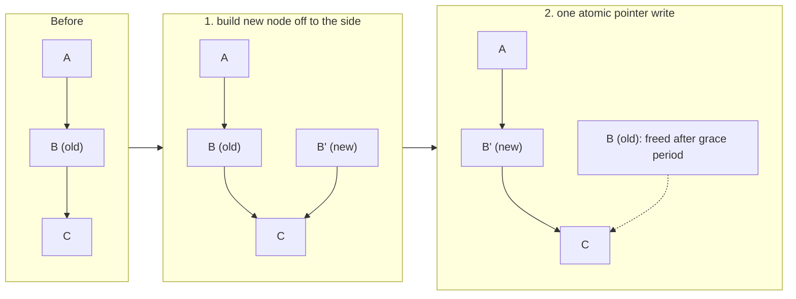
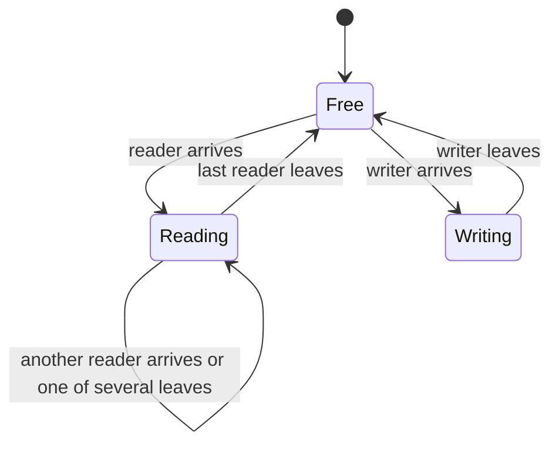

# Semaphores, monitors, message passing and the classic problems

> **Before this lesson:** [Race conditions and mutual exclusion](#/lesson/os/races-mutual-exclusion), for race conditions, critical regions, locks and the lost-wakeup problem that this lesson solves.

## In plain words

The previous lesson showed that threads sharing data need rules, and ended with a problem: how can a thread wait for something to happen without either wasting the processor or missing the signal?

A small car park gives the idea. A sign at the entrance shows the number of free spaces. A car arriving when the number is above zero drives in and the number goes down by one. A car arriving when it shows zero waits at the barrier. Each car that leaves lets one waiting car in, or, if nobody is waiting, puts the number up by one. Nobody circles the block, and no space is ever given to two cars. That counter-with-a-queue is exactly a **semaphore**, the first tool in this lesson.

The other tools are refinements of the same idea. A **mutex** is the simplest case — a car park with one space, in other words a lock. A **monitor** builds the locking into the programming language so that it cannot be forgotten. **Message passing** drops shared data altogether: threads cooperate by sending each other notes.

Why it matters for a job: these are the standard tools provided by every programming language and library for writing programs that do several things at once, and questions such as "mutex or semaphore?" are interview regulars.

## Motivation

The previous lesson ended with a broken producer–consumer program: a wakeup sent to a process that was not yet asleep evaporated. Atomic instructions give us locks, but locks alone do not let a process *wait for a condition* ("the buffer is no longer empty") without either spinning or racing.

This lesson covers the tools that were invented to close that gap, in roughly the order history produced them: semaphores, mutexes with condition variables, monitors and message passing. They are equivalent in power — each can be built from any other — but they differ enormously in how easy they are to use correctly. We finish with two famous puzzles, the dining philosophers and the readers and writers, which exist to expose the ways synchronisation code goes wrong.

## Semaphores

In 1965 Edsger Dijkstra proposed an integer variable that *counts saved wakeups*. A **semaphore** has a non-negative value and two operations:

- **down** (historically *P*, also called *wait*): if the value is greater than zero, decrement it and continue. If it is zero, the caller is put to sleep without completing the down.
- **up** (historically *V*, also called *signal*): if any processes are sleeping on the semaphore, one of them is chosen and allowed to complete its down. Otherwise the value is incremented.

The crucial property is that checking the value, changing it and possibly going to sleep are done as **one indivisible action**. No wakeup can be lost, because an up that arrives "too early" is remembered in the count. Implementations make these few instructions atomic by briefly disabling interrupts on a single CPU, or by guarding the semaphore with a TSL-style spin lock on a multiprocessor. Spinning there is fine — the protected section is a handful of instructions.

### Producer–consumer, solved

Three semaphores do the job for a buffer of N slots:

- `mutex`, initially 1 — guards the buffer so only one process touches it at a time.
- `empty`, initially N — counts free slots.
- `full`, initially 0 — counts occupied slots.

```
producer:                         consumer:
    loop:                             loop:
        item = produce()                  down(full)
        down(empty)                       down(mutex)
        down(mutex)                       item = remove()
        insert(item)                      up(mutex)
        up(mutex)                         up(empty)
        up(full)                          consume(item)
```

The example shows the two distinct uses of semaphores. `mutex` provides **mutual exclusion**: it is initialised to 1 and every process does down before and up after its critical region. A semaphore used this way is a *binary semaphore*. `full` and `empty` provide **synchronisation**: they make sure certain event sequences do or do not happen — here, that the producer stops when the buffer is full and the consumer stops when it is empty.

The simulation below runs real semaphore logic under a randomised scheduler. Processes are generators that yield the operation they want to perform; the scheduler picks any ready process at each step, which is harsher than a real system.

```python-run
import random
from collections import deque

class Sem:
    def __init__(self, value):
        self.value, self.sleepers = value, deque()

def simulate(seed, swapped=False, N=3, items=8):
    mutex, empty, full = Sem(1), Sem(N), Sem(0)
    buf, consumed, peak = deque(), [], [0]

    def producer():
        for i in range(items):
            first, second = (mutex, empty) if swapped else (empty, mutex)
            yield "down", first
            yield "down", second
            buf.append(i)
            peak[0] = max(peak[0], len(buf))
            yield "up", mutex
            yield "up", full

    def consumer():
        for _ in range(items):
            yield "down", full
            yield "down", mutex
            consumed.append(buf.popleft())
            yield "up", mutex
            yield "up", empty

    rng = random.Random(seed)
    ready = [producer(), consumer()]
    alive = 2
    while ready:
        p = rng.choice(ready)
        try:
            op, sem = next(p)
        except StopIteration:
            ready.remove(p)
            alive -= 1
            continue
        if op == "down":
            if sem.value > 0:
                sem.value -= 1
            else:
                sem.sleepers.append(p)      # block: leave the ready list
                ready.remove(p)
        else:
            if sem.sleepers:
                ready.append(sem.sleepers.popleft())   # hand the permit straight over
            else:
                sem.value += 1
    return alive == 0, consumed, peak[0]

ok = all(simulate(seed)[0] and simulate(seed)[1] == list(range(8)) for seed in range(300))
print("correct order, 300 random schedules, never stuck:", ok)
print("largest buffer occupancy seen:", max(simulate(seed)[2] for seed in range(300)), "(limit 3)")

stuck = [seed for seed in range(300) if not simulate(seed, swapped=True)[0]]
print(f"with the producer's two downs swapped: deadlock in {len(stuck)} of 300 schedules")
```

**What the code does.** `Sem` is a semaphore: a number (`value`) and a queue of sleeping processes (`sleepers`). The producer and the consumer are written as generators — functions that pause at each `yield` and can be continued later — and each `yield` hands the scheduler a request: `("down", some_semaphore)` or `("up", some_semaphore)`. Between requests they do their real work: `buf.append(i)` puts an item in the buffer and `buf.popleft()` takes one out. The loop near the end of `simulate` is the scheduler. It picks any ready process at random (`rng.choice(ready)`), asks for its next request with `next(p)`, and carries it out: a *down* on a positive semaphore subtracts one; a *down* on zero moves the process from the ready list to the semaphore's queue; an *up* wakes the first sleeper if there is one and otherwise adds one. `random.Random(seed)` makes the "random" choices repeatable, so each seed is one particular schedule.

**The output.** Across 300 different schedules the items always arrive in order and the buffer never holds more than 3. With the producer's two downs swapped, a substantial number of the 300 schedules end with both processes asleep forever.

The last line demonstrates how fragile semaphore code is. If the producer does `down(mutex)` *before* `down(empty)` and the buffer happens to be full, it goes to sleep holding the mutex. The consumer then blocks on the mutex, and both sleep forever. One swapped pair of lines, and the bug appears only in some schedules.

> [!WARNING]
> With semaphores the *order of downs matters*; the order of ups generally does not. Always acquire the "resource-counting" semaphore before the mutex, so that you never sleep while holding the lock.

## Mutexes

When counting is not needed, a simplified semaphore called a **mutex** is used: it is either unlocked or locked. A thread calls `mutex_lock` before a critical region and `mutex_unlock` after. In a user-level thread package a mutex can be implemented in a few instructions with TSL: if the lock is taken, instead of spinning (pointless when no clock will preempt you) the thread calls `thread_yield` and tries again later. No kernel entry is needed at all.

### Futexes

On a modern multicore machine, neither pure spinning nor pure blocking is ideal. Spinning is fast when the lock is released quickly and wasteful otherwise; blocking needs a costly trip into the kernel even when there is no contention. A **futex** ("fast user-space mutex") combines them. The lock is an ordinary integer in user memory. In the common, uncontended case a thread grabs it with one atomic instruction and never enters the kernel. Only when the lock is already held does the thread make a system call asking the kernel to put it on a wait queue; the thread that releases the lock makes a system call only if someone is waiting.

### Mutexes and condition variables in Pthreads

Pthreads provides mutexes (`pthread_mutex_lock`, `pthread_mutex_trylock`, `pthread_mutex_unlock`) and a second mechanism, **condition variables**, for waiting until some condition holds. The two are always used together:

```
pthread_mutex_lock(&m);
while (buffer_is_empty)                 /* note: while, not if */
    pthread_cond_wait(&nonempty, &m);   /* atomically unlocks m and sleeps; relocks on wakeup */
take_item();
pthread_mutex_unlock(&m);
```

`pthread_cond_wait` atomically releases the mutex and blocks — closing exactly the window that caused the lost wakeup — and reacquires the mutex before returning. `pthread_cond_signal` wakes one waiter; `pthread_cond_broadcast` wakes all.

Unlike semaphores, condition variables have **no memory**. A signal sent when nobody is waiting is lost. That is why the waiting thread must test the actual condition under the mutex, and must do so in a `while` loop: it may be woken spuriously, or another thread may have consumed the item between the signal and the moment it reacquires the lock.

> [!INTERVIEW]
> "Mutex versus semaphore?" A mutex is a lock with an owner: the thread that locked it must unlock it, and it protects a critical region. A semaphore is a counter with no owner: any thread may up it, and it can represent N identical resources or signal events between threads. A binary semaphore can imitate a mutex, but lacks ownership — and therefore cannot support features like priority inheritance or detecting an unlock by the wrong thread.

## Monitors

Semaphores work, but they rely on programmers getting every down and up exactly right everywhere. In the 1970s Brinch Hansen and Hoare proposed moving the burden to the compiler. A **monitor** is a language construct — a package of procedures and data — with one rule: *only one process can be active inside a monitor at any instant*. The compiler inserts the locking, so the programmer cannot forget it.

For waiting, monitors provide condition variables with `wait` and `signal`. A process that cannot proceed waits on a condition, which releases the monitor so another can enter. What happens on `signal` needs a rule, since otherwise both the signaller and the awakened process would be active at once:

- **Hoare:** the awakened process runs immediately; the signaller is suspended.
- **Brinch Hansen:** a signal may only appear as the last statement of a monitor procedure, so the signaller leaves at once.
- **Mesa style (signal-and-continue):** the signaller keeps running; the awakened process becomes ready and competes for the monitor again later. This is what Java and Pthreads do, and it is the reason for the `while` loop above.

Java builds a modest version into the language: a method declared `synchronized` holds the object's lock for its duration, and `wait` / `notify` act as a single anonymous condition variable per object.

Monitors have two limitations. They are a *language* feature, so languages without them (C, for instance) cannot use them. And, like semaphores, they assume shared memory — useless for processes on different machines.

## Message passing

When there is no shared memory, processes coordinate by exchanging messages with two primitives, `send(destination, &message)` and `receive(source, &message)`. A receive with nothing available blocks.

Message passing brings its own design questions:

- **Reliability.** Across a network, messages can be lost. The receiver returns an *acknowledgement*; if none arrives, the sender retransmits. If the acknowledgement itself was lost, the receiver sees a duplicate, so messages carry sequence numbers so duplicates can be discarded.
- **Naming and authentication.** How are processes identified, and how does a receiver know a message really came from who it claims?
- **Addressing.** Messages may be sent to a specific process, or to a **mailbox** — a queue that buffers a number of messages, so that sender and receiver need not be ready at the same moment.
- **Buffering.** With no buffering at all, the sender blocks until the receiver is ready and the message is copied directly — a **rendezvous**. It is simple and needs no storage, but ties the two processes tightly together.

Producer–consumer with messages needs no shared variables: the consumer primes the system by sending N empty messages; the producer waits for an empty, fills it and sends it back; the total number of messages in circulation stays at N. The best-known message-passing library for parallel scientific computing is MPI.

## Two more tools

**Barriers** synchronise *groups*. Some computations proceed in phases, and no process may start phase k+1 until all have finished phase k. Each process calls the barrier primitive when it finishes a phase and is blocked; when the last one arrives, all are released together.

**Read-copy-update (RCU)** avoids locks for readers entirely. Suppose many readers traverse a tree while occasionally a writer changes it. The writer never modifies a node in place: it builds the new version of a node off to the side and then swings a single pointer to it with one atomic write. Any reader sees either the complete old version or the complete new one, never a mixture. The old node cannot be freed immediately, because some reader may still be standing on it; the writer waits for a *grace period* — until every reader that might have held a reference has finished — and then reclaims it. RCU is used heavily inside the Linux kernel for data that is read constantly and updated rarely.



## Classic problem 1: the dining philosophers

Five philosophers sit at a round table, each with a plate of slippery spaghetti that needs two forks. One fork lies between each pair of neighbours. A philosopher alternates thinking and eating; to eat, she must hold both adjacent forks.

The first program most people write — take the left fork, then the right, eat, put both down — is wrong. If all five pick up their left forks at the same moment, each waits forever for a right fork: **deadlock**.

A tempting patch: after taking the left fork, check whether the right is available; if not, put the left one down, wait a while and retry. Now imagine perfect bad luck: all five pick up left, see right is taken, put down left, wait, pick up left again… forever. Everyone is active but nobody makes progress. This is **starvation** (the pattern is also called *livelock*). Random waiting times make it improbable, which is good enough for a network protocol but not for a safety-critical controller.

Protecting the whole "take forks, eat, put down" sequence with one mutex is correct but allows only one philosopher to eat at a time, when two could.

The standard solution keeps a `state` (thinking, hungry, eating) per philosopher, one global mutex for the state array, and one semaphore per philosopher on which she blocks if her forks are unavailable. A philosopher may move to *eating* only if neither neighbour is eating; when she finishes, she tests whether either neighbour is hungry and can now eat, and if so ups that neighbour's semaphore. It is deadlock-free and allows maximum parallelism.

A simpler cure breaks the symmetry: number the forks and require everyone to pick up the **lower-numbered fork first**. The last philosopher then reaches for fork 0 before fork 4, and the circular chain cannot close.

```python-run
import random

def dinner(n, schedule, ordered):
    owner, held, meals = [-1] * n, [0] * n, [0] * n
    for p in schedule:
        first, second = p, (p + 1) % n
        if ordered and first > second:
            first, second = second, first
        if held[p] == 0 and owner[first] == -1:
            owner[first], held[p] = p, 1
        elif held[p] == 1 and owner[second] == -1:
            owner[second], held[p] = p, 2
        elif held[p] == 2:
            owner[first] = owner[second] = -1
            held[p], meals[p] = 0, meals[p] + 1
    return meals, all(h == 1 for h in held)

rng = random.Random(7)
for ordered in (False, True):
    deadlocks, total_meals = 0, 0
    for trial in range(2000):
        schedule = [rng.randrange(5) for _ in range(400)]
        meals, dead = dinner(5, schedule, ordered)
        deadlocks += dead
        total_meals += sum(meals)
    label = "lowest fork first" if ordered else "left fork first  "
    print(f"{label}: deadlocked in {deadlocks:4d} of 2000 random evenings, {total_meals} meals served")

print("worst case, everyone grabs once in turn:", dinner(5, [0, 1, 2, 3, 4] * 3, False))
```

**What the code does.** `dinner` replays a list of turns. `owner[f]` is the philosopher holding fork `f` (or -1 for nobody); `held[p]` is how many forks philosopher `p` holds; `meals[p]` counts meals. On a turn, a philosopher with no forks tries to take the first one; with one fork, tries to take the second; with two, eats and puts both down. With `ordered` set, the two forks are swapped whenever the first would have the higher number, so that everyone reaches for the lower-numbered fork first. The function returns the meal counts and whether everyone ended up holding exactly one fork. The loop then tries 2,000 random evenings of 400 turns each under both rules.

**The output.** With "left fork first" every one of the 2,000 random evenings ends in deadlock sooner or later, and few meals are served; with "lowest fork first" the count of deadlocks is 0 and more than ten times as many meals are eaten. The last line shows the worst case directly: if each philosopher takes one fork in turn, nobody ever eats and the result is `True` for deadlock.

## Classic problem 2: readers and writers

A database is shared by many processes. Any number may *read* at once, but a *writer* needs exclusive access: no other writer and no readers.

The simple solution keeps a count of active readers. The first reader to arrive does a down on the database semaphore; later readers merely increment the count; the last reader to leave does the up, letting a waiting writer in.

It has a hidden bias. As long as there is a steady stream of readers arriving, each one is admitted, the count never reaches zero and the writer waits indefinitely. The cure is to hold back newly arriving readers once a writer is waiting — which in turn reduces concurrency and can delay readers. There is no free lunch: every policy trades reader throughput against writer latency, and the right choice depends on the workload.



## Pitfalls

- **Sleeping while holding a lock.** The swapped-downs bug in miniature; in general, never block on one thing while holding the lock others need to unblock you.
- **`if` instead of `while` around a condition wait.** With signal-and-continue semantics the condition may no longer hold when you get the lock back.
- **Signalling without holding the mutex,** or changing the condition without holding it — reopens the lost-wakeup window.
- **Assuming fairness.** Unless documented, neither semaphores nor mutexes promise first-come, first-served wake-ups.
- **Confusing deadlock with starvation.** In deadlock nobody in the cycle can ever move. In starvation the system as a whole keeps moving, but some unlucky process is passed over indefinitely.
- **Using a semaphore where a mutex is meant.** You lose ownership checks and priority inheritance.

## Summary

- A **semaphore** counts wakeups; **down** and **up** are atomic. Binary semaphores give mutual exclusion; counting semaphores give synchronisation. Producer–consumer needs `mutex`, `empty` and `full`, and the order of downs is critical.
- A **mutex** is a two-state lock; **futexes** keep the uncontended path out of the kernel. **Condition variables** let a thread wait for a predicate; they have no memory, so always re-test in a `while` loop.
- **Monitors** make mutual exclusion automatic at the language level; **message passing** works without shared memory and raises issues of acknowledgement, addressing and buffering.
- **Barriers** release a group together; **RCU** lets readers run lock-free by replacing data with atomic pointer updates and deferring reclamation.
- The **dining philosophers** illustrate deadlock and starvation; the **readers–writers** problem illustrates the trade-off between concurrency and fairness.

## Glossary

- **Semaphore** — a counter with a queue: *down* takes one or waits; *up* returns one or wakes a waiter.
- **down / up (P / V, wait / signal)** — the two operations on a semaphore.
- **Binary semaphore** — a semaphore used with only the values 0 and 1, as a lock.
- **Mutex** — a lock: either locked or unlocked, released by the thread that locked it.
- **Futex** — a lock that is taken without entering the kernel unless a thread has to wait.
- **Condition variable** — an object on which a thread can wait until another thread signals that something has changed.
- **Monitor** — a language construct in which only one thread at a time can be executing inside a group of procedures.
- **Message passing** — cooperating by sending and receiving messages instead of sharing data.
- **Acknowledgement** — a reply confirming that a message arrived.
- **Mailbox** — a queue that holds messages until the receiver takes them.
- **Rendezvous** — message passing with no buffering: sender and receiver must meet.
- **Barrier** — a point where every member of a group must arrive before any may continue.
- **Read-copy-update (RCU)** — letting readers proceed without locks by replacing data with a new copy in one atomic step.
- **Dining philosophers** — a classic puzzle about several processes competing for pairs of shared resources.
- **Readers–writers problem** — allowing many simultaneous readers but only one writer.
- **Deadlock** — a set of processes each waiting for something only another of them can provide.
- **Starvation (livelock)** — a process never getting what it needs although the system keeps running.

## Check yourself

```quiz
[
  {"q": "A semaphore has value 0 and two processes are asleep on it. A third process performs one up. What is the result?",
   "options": ["The value becomes 1 and both sleepers remain asleep", "One sleeper is woken and the value stays 0", "Both sleepers are woken", "The value becomes -1"],
   "answer": 1,
   "explain": "An up with sleepers present lets one of them complete its down. The permit is consumed immediately, so the value remains 0."},
  {"q": "In the semaphore solution to producer-consumer, what goes wrong if the producer does down(mutex) before down(empty)?",
   "options": ["Items are consumed out of order", "If the buffer is full the producer sleeps while holding the mutex, and the consumer can never get in to free a slot", "The buffer can overflow", "Nothing; the order is irrelevant"],
   "answer": 1,
   "explain": "Sleeping while holding the lock that the other side needs in order to wake you is a deadlock."},
  {"q": "Why must a thread re-test its condition in a while loop after pthread_cond_wait returns?",
   "options": ["Because the mutex is not reacquired on return", "Because condition variables count signals", "Because another thread may have changed the state between the signal and this thread regaining the mutex, or the wakeup may be spurious", "Because while loops are faster than if statements"],
   "answer": 2,
   "explain": "With signal-and-continue semantics a wakeup is only a hint. The predicate must be confirmed under the lock before proceeding."},
  {"q": "What is the defining rule of a monitor?",
   "options": ["Only one process may be active inside it at a time, enforced by the compiler", "It can only be used across a network", "It never blocks", "It must contain exactly one semaphore"],
   "answer": 0,
   "explain": "Mutual exclusion on entry is automatic. Condition variables with wait and signal are added for processes that must pause inside."},
  {"q": "A futex improves on a kernel-only mutex mainly because...",
   "options": ["It never blocks", "Uncontended lock and unlock operations complete in user space without a system call", "It disables interrupts", "It is implemented in hardware"],
   "answer": 1,
   "explain": "The kernel is involved only when there is contention and a thread must actually sleep or be woken."},
  {"q": "Five philosophers each pick up the left fork, find the right fork busy, put the left down, wait the same amount of time and repeat forever. What is this situation called?",
   "options": ["Deadlock", "Starvation (livelock)", "Mutual exclusion", "Rendezvous"],
   "answer": 1,
   "explain": "Every process is running and changing state, yet none makes progress. In a deadlock, by contrast, they would all be blocked."},
  {"q": "Why does requiring every philosopher to pick up the lower-numbered fork first prevent deadlock?",
   "options": ["It lets two philosophers share a fork", "It makes a circular chain of waiting impossible, because resources are always acquired in increasing order", "It reduces the number of philosophers", "It removes the need for forks"],
   "answer": 1,
   "explain": "A cycle would require someone to hold a higher-numbered fork while waiting for a lower one, which the rule forbids."},
  {"q": "In the simple readers-writers solution that admits every arriving reader while any reader is active, what is the weakness?",
   "options": ["Two writers can write simultaneously", "Readers can see half-written data", "A continuous stream of readers can keep a writer waiting forever", "Only one reader can be active"],
   "answer": 2,
   "explain": "The reader count never drops to zero, so the writer is never admitted. Holding back new readers when a writer is waiting fixes this at some cost in concurrency."}
]
```

> **Source:** Tanenbaum & Bos, Modern Operating Systems 4e, §2.3.5–2.3.10 (Semaphores, mutexes, monitors, message passing, barriers, avoiding locks), §2.5 (Classical IPC problems)
