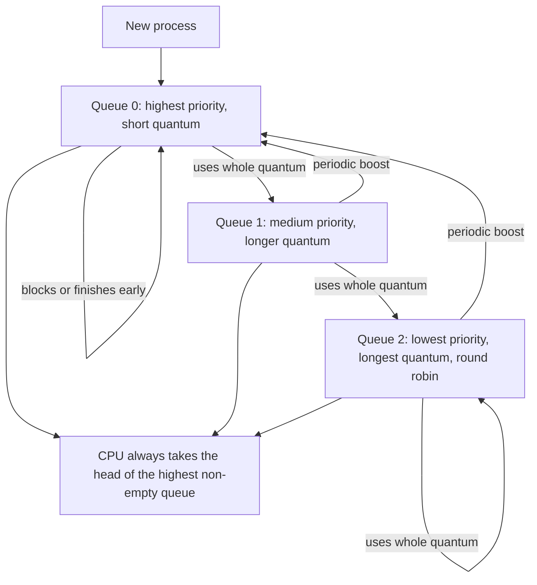

# CPU scheduling

> **Before this lesson:** [Processes and threads](#/lesson/os/processes-threads), for the running, ready and blocked states and for what a context switch is.

## In plain words

When several programs are ready to run and there is only one processor, something has to choose which goes next. That chooser is the **scheduler**, and the rule it follows is a **scheduling algorithm**.

Everyday life is full of scheduling. A supermarket has an express lane so that someone buying a bottle of milk does not wait behind a month's shopping. A hospital emergency room sees the most seriously ill first, not whoever arrived first. A bakery gives out numbered tickets so that everyone is served in turn. None of these is "the right way"; each suits a different goal — short waits on average, urgent cases first, or fairness.

A computer faces the same choices. A phone must respond instantly to a tap, a server must get through as many requests per second as possible, and a robot must act before a deadline. Different goals call for different rules.

Why it matters for a job: scheduling decides whether a system feels quick or sluggish. The standard algorithms (first come first served, shortest job first, round robin, priorities) and the terms used to judge them are a staple of interviews, usually with a small table of jobs to work through by hand.

## Motivation

Whenever more processes are ready than there are CPUs, something has to choose. That something is the **scheduler**, and the rule it follows is the **scheduling algorithm**. The choice looks minor — any order gets all the work done eventually — yet it decides whether your keystrokes echo instantly while a backup runs, whether a batch cluster finishes fifty jobs an hour or thirty, and whether a robot arm stops before it hits the wall.

Scheduling also has a cost. Switching from one process to another means saving and loading registers, changing the memory map, and — the expensive part — losing the benefit of everything the old process had warmed up in the caches and the TLB. A scheduler that switches too eagerly spends the machine on bookkeeping.

## Process behaviour

Nearly every process alternates between **CPU bursts** (computing) and **I/O waits** (blocked until a device or the network responds). Two broad temperaments emerge:

- **CPU-bound** (compute-bound) processes have long bursts and seldom wait: video encoding, scientific simulation.
- **I/O-bound** processes have short bursts between frequent waits: editors, shells, most servers.

What makes a process I/O-bound is the *shortness of its CPU bursts*, not the length of its I/O. As processors get faster relative to disks and networks, more and more workloads become I/O-bound, and a good scheduler gives such a process the CPU promptly when it becomes ready: it will only use it for a moment before issuing its next request, and keeping devices busy is good for everyone.

## When does the scheduler run?

1. When a process is **created** (run the parent or the child?).
2. When a process **exits**.
3. When a process **blocks** on I/O, a semaphore or anything else.
4. When an **I/O interrupt** arrives, possibly making some blocked process ready.
5. On a **clock interrupt**, if the algorithm uses one.

That last case divides algorithms into two families. A **non-preemptive** algorithm lets the chosen process run until it blocks or voluntarily gives up the CPU. A **preemptive** one lets it run for at most some fixed time and then forcibly suspends it — which needs a clock interrupt to hand control back to the scheduler.

## Goals depend on the environment

| Environment | Typical goals |
|---|---|
| **All systems** | Fairness (comparable processes get comparable service); policy enforcement; balance (keep all parts of the system busy) |
| **Batch** | High **throughput** (jobs per hour); low **turnaround time** (submission to completion); high CPU utilisation |
| **Interactive** | Low **response time**; **proportionality** (meeting users' expectations — things that feel simple should be quick) |
| **Real-time** | Meeting **deadlines**; **predictability** |

These goals conflict. Favouring short jobs maximises throughput but can make a long job wait forever. Minimising response time means frequent switches, which reduces throughput. There is no best algorithm, only a best fit to the workload.

Some definitions used below, for a job with arrival time $a$, total CPU need (burst) $b$ and completion time $c$:

$$\text{turnaround} = c - a, \qquad \text{waiting} = \text{turnaround} - b.$$

## Batch algorithms

### First-come, first-served (FCFS)

A single queue; each job runs until it blocks or finishes. It is trivially simple and fair in the queueing sense. Its weakness is the **convoy effect**: one long CPU-bound job at the head makes every short job behind it wait, and I/O-bound jobs get to issue requests only rarely, leaving devices idle.

### Shortest job first (SJF)

If run times are known in advance, run the shortest job first. For jobs that are all available at the same moment this is *provably optimal* for mean turnaround. With four jobs of lengths $a, b, c, d$ run in that order, the turnaround times are $a$, $a+b$, $a+b+c$ and $a+b+c+d$, so the mean is $(4a + 3b + 2c + d)/4$. The first job's length is counted four times and the last only once, so the smallest value should go first.

The proof breaks when jobs arrive over time: a short job that arrives right after a long one has started must wait.

### Shortest remaining time next (SRTN / SRTF)

The preemptive version: always run the job whose *remaining* time is smallest; a newly arrived job with less remaining time than the current one preempts it. New short jobs get excellent service; long jobs risk **starvation** if short ones keep coming.

```python-run
import heapq

def simulate(jobs, policy):
    """jobs: list of (arrival, burst). policy: 'fcfs', 'sjf' or 'srtf'. Returns (mean turnaround, mean waiting, gantt)."""
    n = len(jobs)
    order = sorted(range(n), key=lambda i: (jobs[i][0], i))
    rem = [b for _, b in jobs]
    done = [0] * n
    ready, clock, k, finished, gantt = [], 0, 0, 0, []
    while finished < n:
        while k < n and jobs[order[k]][0] <= clock:
            i = order[k]
            key = jobs[i][0] if policy == "fcfs" else rem[i]
            heapq.heappush(ready, (key, jobs[i][0], i))
            k += 1
        if not ready:
            clock = jobs[order[k]][0]
            continue
        _, _, i = heapq.heappop(ready)
        nxt = jobs[order[k]][0] if k < n else float("inf")
        run = min(rem[i], nxt - clock) if policy == "srtf" else rem[i]
        if gantt and gantt[-1][0] == i:
            gantt[-1][2] = clock + run
        else:
            gantt.append([i, clock, clock + run])
        clock += run
        rem[i] -= run
        if rem[i] == 0:
            done[i] = clock
            finished += 1
        else:
            heapq.heappush(ready, (rem[i], jobs[i][0], i))
    tat = [done[i] - jobs[i][0] for i in range(n)]
    wait = [tat[i] - jobs[i][1] for i in range(n)]
    return sum(tat) / n, sum(wait) / n, gantt

jobs = [(0, 9), (1, 2), (2, 6), (3, 1), (9, 3)]
for policy in ("fcfs", "sjf", "srtf"):
    tat, wait, gantt = simulate(jobs, policy)
    chart = " ".join(f"J{i}[{s}-{e}]" for i, s, e in gantt)
    print(f"{policy:5s} mean turnaround {tat:5.2f}  mean waiting {wait:5.2f}\n      {chart}")
```

**What the code does.** `simulate(jobs, policy)` runs a list of jobs, each given as `(arrival time, amount of processor time needed)`, under one of three rules. `rem` holds each job's remaining work. `ready` is a *heap* — a list kept arranged so that its smallest item can be removed quickly — holding the jobs that have arrived and not finished. The sort key decides the rule: for first come first served the key is the arrival time; for the other two it is the remaining work. The main loop admits newly arrived jobs, takes the best one, and runs it. Under `srtf` (shortest remaining time first) it runs only until the next arrival (`nxt - clock`), so that a shorter newcomer can take over; under the other rules it runs the job to the end. `gantt` records who ran when. At the end, turnaround is finish time minus arrival time, and waiting is turnaround minus the job's own length.

**The output.** For the five sample jobs, first come first served gives the worst averages because the short jobs J1 and J3 wait behind the nine-unit J0. Shortest job first improves the averages, and the preemptive version improves them again, at the cost of interrupting J0 — its name appears more than once in the last chart.

Notice how FCFS makes the tiny jobs J1 and J3 sit behind the nine-unit J0, and how SRTF fixes that at the price of interrupting J0 several times.

## Interactive algorithms

### Round robin

Each process gets a time slice, the **quantum**. If it is still running when the quantum expires, it is preempted and placed at the back of the ready queue; if it blocks or finishes earlier, the switch happens then.

The only parameter is the quantum length, and it is a real trade-off. Suppose a switch costs 1 ms. With a 4 ms quantum, 20% of CPU time is overhead. With a 100 ms quantum the overhead is 1%, but if fifty users press a key at once, the last one waits five seconds for a response. A quantum somewhat longer than a typical CPU burst is the sweet spot — most interactive processes then block before being preempted, so preemption (and its cost) becomes rare. Values of a few tens of milliseconds are common.

```python-run
from collections import deque

def round_robin(bursts, quantum, switch_cost):
    """All jobs arrive at 0. Returns (mean response time, mean turnaround, fraction of time lost to switching)."""
    queue = deque(range(len(bursts)))
    rem = list(bursts)
    first_run, done = {}, {}
    clock = overhead = 0
    while queue:
        i = queue.popleft()
        first_run.setdefault(i, clock)
        run = min(quantum, rem[i])
        clock += run
        rem[i] -= run
        if rem[i]:
            queue.append(i)
        else:
            done[i] = clock
        if queue:
            clock += switch_cost
            overhead += switch_cost
    n = len(bursts)
    return sum(first_run.values()) / n, sum(done.values()) / n, overhead / clock

bursts = [30, 4, 4, 60, 8, 4, 20, 4]
print("quantum  response  turnaround  switching overhead")
for q in (1, 2, 5, 10, 20, 50, 100):
    resp, tat, ovh = round_robin(bursts, q, switch_cost=1)
    print(f"{q:7d}  {resp:8.1f}  {tat:10.1f}  {ovh:8.1%}")
```

**What the code does.** `round_robin` gives each job in turn a time slice of length `quantum`. `queue` holds the jobs waiting for a turn. `first_run` records when each job first got the processor (its response time; `setdefault` stores the value only the first time). After each turn, a job with work left goes to the back of the queue; otherwise its finishing time is recorded. If another job is waiting, `switch_cost` is added to the clock and to the running total of `overhead`. The loop at the bottom tries seven slice lengths on the same eight jobs.

**The output.** With a quantum of 1, the average response time is tiny but about half of all processor time is spent switching. With a quantum of 100 the overhead is negligible, but jobs wait a long time for their first turn, because the scheduler has in effect become first come, first served.

Small quanta give superb response and dreadful overhead; huge quanta turn round robin into FCFS.

### Priority scheduling

Give each process a priority and always run the highest-priority ready process. Priorities may be assigned **statically** (by who the user is or what the job costs) or **dynamically** by the system. A classic dynamic rule sets priority to $1/f$, where $f$ is the fraction of its last quantum the process actually used: a process that used only a tenth of its slice before blocking is clearly I/O-bound and gets priority 10; one that used it all gets priority 1.

To stop high-priority processes running forever, schedulers either decay the running process's priority at each clock tick or cap the time it may run. Commonly processes are grouped into **priority classes**, with priority scheduling between classes and round robin within each class. Without periodic adjustment, the lowest classes can **starve**.

### Multiple queues

An influential early timesharing system could keep only one process in memory, so every switch meant a swap to disk. Its designers wanted CPU-bound processes to get *long* quanta (few swaps) without ruining response time. Their answer: priority classes with *different* quanta — the top class gets 1 quantum, the next 2, the next 4, and so on. A process that uses up its whole allotment is moved **down** a class. A long computation therefore sinks quickly, running less and less often but for longer each time, while interactive processes stay at the top.

The modern descendant is the **multilevel feedback queue**: the scheduler learns each process's nature from its behaviour, demoting those that use full quanta and (in most variants) promoting those that block early or have waited a long time. One historical wrinkle is instructive: a rule that boosted a process whenever the user pressed the return key was quickly discovered by users, who took to tapping the key periodically to speed up their computations. Any policy based on observable behaviour will be gamed.

### Shortest process next

Shortest-job-first works well, so can we apply it to interactive processes? Treat each command as a "job" and *estimate* its run time from the past. With $T_0$ the previous estimate and $T_1$ the latest measured burst, the new estimate is the weighted average

$$E = a\,T_0 + (1-a)\,T_1.$$

Applying this repeatedly makes old measurements fade geometrically — a technique called **aging**. With $a = 1/2$ it costs one addition and one shift.

```python-run
def estimates(bursts, a=0.5, initial=10):
    est, out = initial, []
    for b in bursts:
        out.append(round(est, 2))
        est = a * est + (1 - a) * b
    return out

measured = [6, 4, 6, 4, 13, 13, 13, 2, 2]
print("measured :", measured)
print("predicted:", estimates(measured))
```

**What the code does.** `estimates` predicts the length of the next burst of computing from past ones. `est` starts at an initial guess of 10. For each measured burst `b`, the current estimate is recorded *before* the burst is seen, and then updated as a weighted average: half the old estimate plus half the new measurement.

**The output.** The measured bursts jump from around 5 to 13 and then drop to 2. The predicted values follow with a delay: after the first 13 the prediction rises only part of the way, and it takes two or three bursts to catch up.

The prediction lags behind a change in behaviour by a few bursts and then catches up.

### Guaranteed, lottery and fair-share scheduling

- **Guaranteed scheduling** makes an explicit promise — with $n$ processes each gets $1/n$ of the CPU — tracks how much each has actually received, and runs whichever has the lowest ratio of received to entitled time.
- **Lottery scheduling** hands out tickets; at each decision a ticket is drawn at random and its holder runs. A process holding a fraction $f$ of the tickets gets about a fraction $f$ of the CPU. It is simple, responsive (a newcomer has a chance at the very next draw), and tickets can be transferred — a client blocked on a server can lend the server its tickets.
- **Fair-share scheduling** allocates to *users* rather than processes: if two users are each promised half the machine, a user running nine processes gets no more than a user running one.

## Real-time scheduling

A real-time system must react to external events within a fixed time. **Hard** real time means deadlines are absolute; **soft** means an occasional miss is tolerable. Events are **periodic** (occurring at regular intervals) or **aperiodic**.

If there are $m$ periodic events, where event $i$ recurs with period $P_i$ and needs $C_i$ seconds of CPU each time, the load can be handled only if

$$\sum_{i=1}^{m} \frac{C_i}{P_i} \le 1.$$

A system meeting this test is **schedulable**. For example, events with periods 100, 200 and 500 ms needing 50, 30 and 100 ms respectively use $0.5 + 0.15 + 0.2 = 0.85$ of the CPU, so a fourth event with a 1-second period could be added only if it needs at most 150 ms.

Real-time schedules are **static** (decided before the system runs, which needs full advance knowledge) or **dynamic** (decided at run time).

## Policy versus mechanism

A database server with several child processes knows which of its children is urgent; the kernel does not. The principle of separating **mechanism** from **policy** addresses this: the kernel provides a parameterised scheduling mechanism (for instance, priority scheduling), and a system call lets a process set the parameters for its own children. The mechanism is in the kernel; the policy is chosen by whoever has the knowledge.

## Thread scheduling

With **user-level threads** the kernel picks a process and its run-time system picks a thread. The kernel is unaware of the threads, so a thread may consume the process's whole quantum, and there is no clock interrupt to rotate threads within it — but a switch needs only a handful of instructions, and the application can use a scheduler tailored to its needs.

With **kernel-level threads** the kernel picks a thread directly, possibly from a different process than the previous one. That flexibility costs a full context switch when the process changes, and the kernel can take this into account by preferring, other things being equal, a thread from the process that is already running.

> [!INTERVIEW]
> Common scheduling questions and the one-line answers. *Which algorithm minimises average waiting time?* SJF (SRTF when preemption is allowed) — but it needs burst estimates and can starve long jobs. *How do you prevent starvation?* Aging: gradually raise the priority of waiting processes. *How do you pick a quantum?* Slightly longer than a typical interactive burst; too short wastes time switching, too long hurts response. *Why MLFQ?* It approximates SJF without knowing burst lengths by observing behaviour. *Preemptive vs non-preemptive?* Preemption needs a timer and costs more switches, but is essential for responsiveness and for defending against a process that never yields.

## How the pieces fit



## Pitfalls

- **Computing waiting time as "start − arrival".** That is only right for non-preemptive schedules. In general use turnaround − burst.
- **Forgetting idle time.** If nothing has arrived, the clock must jump to the next arrival.
- **Ambiguous ties.** Exam and interview answers differ only because of tie-breaking (by arrival? by id? does a newly arrived job go ahead of the one preempted a moment ago?). State your rule.
- **Assuming SJF is always optimal.** Only for mean turnaround, and only when all jobs are present at the start and their lengths are known.
- **Ignoring switch cost.** An algorithm that looks best on paper can lose once each switch costs a millisecond and a cold cache.
- **Believing priorities are safe on their own.** Strict priority without aging starves; priority with locks invites priority inversion.

## Summary

- Processes alternate CPU bursts and I/O waits; **I/O-bound** ones should get the CPU quickly.
- Scheduling decisions occur at creation, exit, blocking, I/O completion and clock ticks; **preemptive** algorithms can take the CPU away, **non-preemptive** ones cannot.
- Batch: **FCFS** (simple, convoy effect), **SJF** (optimal mean turnaround when all jobs are present), **SRTF** (preemptive SJF, may starve long jobs).
- Interactive: **round robin** (quantum trade-off), **priority** (needs aging), **multilevel feedback queues** (learn behaviour), **shortest process next** (exponential averaging), **guaranteed**, **lottery** and **fair-share**.
- Real-time: periodic tasks are schedulable only if $\sum C_i/P_i \le 1$.
- Keep **mechanism** in the kernel and let applications supply **policy**; thread scheduling differs for user-level and kernel-level threads.

## Glossary

- **Scheduler** — the part of the operating system that chooses which process or thread runs next.
- **CPU burst** — a stretch of computing between two waits for input or output.
- **CPU-bound / I/O-bound** — mostly computing / mostly waiting for devices, with only short bursts of computing.
- **Preemptive / non-preemptive** — able / not able to take the processor away from a running process.
- **Throughput** — the number of jobs completed per unit of time.
- **Turnaround time** — the time from a job's arrival to its completion.
- **Waiting time** — turnaround time minus the job's own processing time.
- **Response time** — the time from a request until the system first reacts.
- **First come, first served (FCFS)** — run jobs in order of arrival.
- **Convoy effect** — short jobs stuck behind a long one.
- **Shortest job first (SJF)** — run the job needing the least processor time.
- **Shortest remaining time first (SRTF)** — the preemptive form of shortest job first.
- **Round robin** — give each process a fixed time slice in turn.
- **Quantum (time slice)** — the length of one turn.
- **Priority scheduling** — run the most important ready process first.
- **Starvation** — a process waiting indefinitely because others are always chosen first.
- **Aging** — letting old information fade, or raising the priority of a process the longer it waits.
- **Multilevel feedback queue** — several queues of different priority, with processes moved between them according to their behaviour.
- **Lottery scheduling** — choosing the next process by drawing a ticket at random.
- **Schedulable** — said of a set of real-time tasks whose deadlines can all be met.

## Check yourself

```quiz
[
  {"q": "Three jobs arrive at time 0 with bursts 8, 2 and 4. What is the mean turnaround time under SJF?",
   "options": ["8.0", "7.33", "9.33", "4.67"],
   "answer": 1,
   "explain": "Order 2, 4, 8 gives completion times 2, 6 and 14. The mean is 22 / 3 = 7.33."},
  {"q": "What is the convoy effect?",
   "options": ["Many processes being created at once", "Short jobs stuck waiting behind a long CPU-bound job under FCFS", "Processes moving between queues in MLFQ", "Several disks spinning up together"],
   "answer": 1,
   "explain": "With no preemption, a long job at the head of the queue delays every short job behind it and keeps I/O devices idle."},
  {"q": "A context switch costs 1 ms and the quantum is 9 ms. If every process uses its full quantum, what fraction of CPU time is spent switching?",
   "options": ["1%", "9%", "10%", "11%"],
   "answer": 2,
   "explain": "Each cycle is 9 ms of work plus 1 ms of switching, so 1 / 10 = 10% is overhead."},
  {"q": "Using E = a*T0 + (1-a)*T1 with a = 1/2, the previous estimate was 8 ms and the measured burst was 4 ms. What is the new estimate?",
   "options": ["4 ms", "6 ms", "8 ms", "12 ms"],
   "answer": 1,
   "explain": "0.5 * 8 + 0.5 * 4 = 6 ms. Older history fades by half at every step."},
  {"q": "Periodic real-time tasks have (C, P) = (20, 100), (30, 150) and (50, 250) in milliseconds. Is the set schedulable in principle?",
   "options": ["Yes, the utilisation is 0.6", "Yes, the utilisation is exactly 1.0", "No, the utilisation is 1.2", "It cannot be determined"],
   "answer": 0,
   "explain": "0.2 + 0.2 + 0.2 = 0.6, which does not exceed 1, so the necessary condition holds."},
  {"q": "In a multilevel feedback queue, which processes tend to sink to the lowest-priority queue?",
   "options": ["Processes that block frequently for I/O", "Processes that repeatedly use their entire quantum", "Newly created processes", "Processes owned by the administrator"],
   "answer": 1,
   "explain": "Using a full quantum is taken as evidence of CPU-bound behaviour, so the process is demoted to a queue with lower priority and a longer quantum."},
  {"q": "A process holds 20 of the 200 lottery tickets currently outstanding. About what share of the CPU does it receive over time?",
   "options": ["5%", "10%", "20%", "It depends on its priority class"],
   "answer": 1,
   "explain": "Each draw picks a ticket uniformly at random, so the long-run share equals the fraction of tickets held: 20 / 200 = 10%."},
  {"q": "Why can a user-level thread package not preempt a thread that never yields?",
   "options": ["Because user-level threads have no stack", "Because clock interrupts are delivered to the kernel, which knows nothing about the threads inside the process", "Because the quantum is infinite", "Because threads cannot be blocked"],
   "answer": 1,
   "explain": "The run-time system only gets control when a thread calls into it. Without a timer signal there is no way to interrupt a running thread."}
]
```

> **Source:** Tanenbaum & Bos, Modern Operating Systems 4e, §2.4 (Scheduling)
