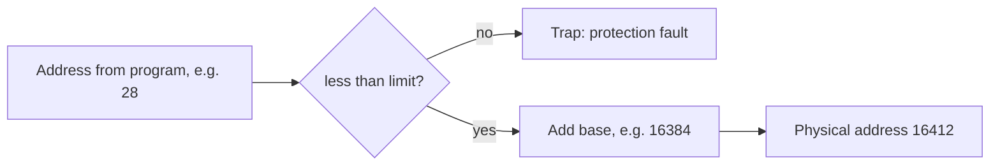
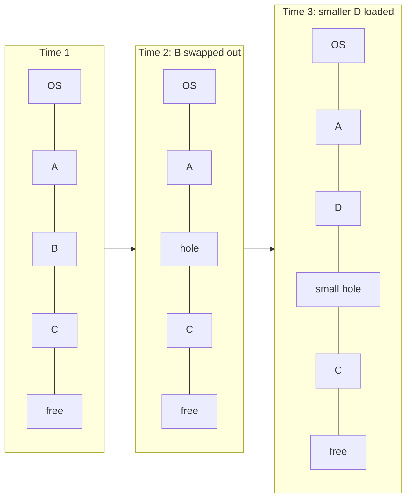

# Address spaces, swapping and free-space management

> **Before this lesson:** [Core concepts, system calls and kernel structure](#/lesson/os/concepts-syscalls-structure), for the idea of an address space, and [Hardware review](#/lesson/os/hardware-review), for what main memory is.

## In plain words

A computer's memory is a long row of numbered storage cells. Every running program needs some of them, and there are never enough for everyone to have all they want. The part of the operating system that decides who gets which cells is the **memory manager**.

Picture a long street-side car park with no marked spaces, used by vehicles of every length. Cars and lorries come and go. After a while the free kerb is broken into many gaps: plenty of free space in total, but perhaps no single gap long enough for the lorry that is arriving now. Someone has to keep a record of the gaps and decide where each new arrival goes. That is this lesson in a picture: the scattered gaps are called **fragmentation**, the record is a **free list** or a **bitmap**, and the rules for choosing a gap have names like *first fit* and *best fit*.

There is one more problem. Two programs must not use the same cells, and neither should need to know where the other is. The answer is to give each program its own private set of addresses, an **address space**.

Why it matters for a job: memory is the resource programs run out of most often. The ideas here — fragmentation, free lists, allocation strategies — also apply directly to how every programming language manages memory for you.

## Motivation

Memory is the resource programs are greediest for. However much RAM a machine has, software grows to fill it, and then several programs want it at once. The operating system's memory manager has to answer, continuously: where in physical memory does each program live, how are programs kept from trampling one another, what happens when they do not all fit, and how do we keep track of which parts of memory are free?

This lesson follows the problem from the simplest possible answer (no abstraction at all) through the first real abstraction (the address space) to the bookkeeping techniques — bitmaps and free lists — that every allocator in every kernel and every `malloc` library still uses. Paging, the modern solution, builds directly on these ideas in the next lesson.

## Life with no memory abstraction

Early machines exposed physical memory directly. A program that executed "store 7 at address 1000" changed physical cell 1000, full stop. With one program in memory at a time this is fine. The trouble begins the moment you want two.

Suppose two programs were each written assuming they are loaded at address 0. Load the first at 0 and the second at 16,384. The second program's instruction "jump to address 28" now lands in the *first* program's code. Every absolute address in the second program is wrong by 16,384.

One historic fix was **static relocation**: as the loader placed a program at address 16,384, it added 16,384 to every address in it. This works but is slow at load time and requires the executable to carry a list of which words are addresses and which merely look like them.

Worse, nothing protected programs from each other or the OS from programs: a buggy store could wipe out anything. Small embedded systems still work this way — the code in a washing machine controller is fixed, tested as a unit and trusted — but for general-purpose computing it is untenable.

## The address space abstraction

The remedy is the memory counterpart of the process. In the same way that a process is an abstract CPU, an **address space** is an abstract memory: the set of addresses a process may use, private to that process. Address 28 in one process and address 28 in another are different physical locations.

### Base and limit registers

The simplest implementation is **dynamic relocation** using two special CPU registers:

- the **base** register holds the physical address where the program starts;
- the **limit** register holds the program's length.

On *every* memory reference the hardware checks the address the program generated against the limit — trapping if it is out of range — and adds the base before sending it to memory. The program is loaded into any contiguous stretch of memory without modification and never learns where it really is.



```python-run
class Machine:
    def __init__(self, size):
        self.ram = [0] * size
        self.base = self.limit = 0

    def switch_to(self, base, limit):       # done by the OS at every context switch
        self.base, self.limit = base, limit

    def translate(self, vaddr):
        if not 0 <= vaddr < self.limit:
            raise MemoryError(f"protection fault: address {vaddr} outside limit {self.limit}")
        return self.base + vaddr

    def store(self, vaddr, value):
        self.ram[self.translate(vaddr)] = value

    def load(self, vaddr):
        return self.ram[self.translate(vaddr)]

m = Machine(64)
A, B = (0, 16), (32, 24)                    # (base, limit) for two processes

m.switch_to(*A); m.store(5, 111)            # both use "address 5" ...
m.switch_to(*B); m.store(5, 222)
m.switch_to(*A); print("A reads address 5 ->", m.load(5), "at physical", m.translate(5))
m.switch_to(*B); print("B reads address 5 ->", m.load(5), "at physical", m.translate(5))

m.switch_to(*A)
try:
    m.store(20, 999)                         # A tries to reach beyond its 16 cells
except MemoryError as e:
    print("A:", e)
```

**What the code does.** `Machine` imitates a processor with two special registers. `ram` is the real memory: a list of cells. `switch_to(base, limit)` is what the operating system does when it starts running a process: it loads the starting position of that process's memory (`base`) and its length (`limit`). `translate` is done by the hardware on *every* memory access: it refuses any address that is not between 0 and the limit by raising an error, and otherwise adds the base. `store` and `load` use `translate` before touching `ram`. Two processes are described by the pairs `A = (0, 16)` and `B = (32, 24)`; `*A` unpacks the pair into the two arguments. The `try ... except` at the end catches the error raised when process A reaches beyond its own cells.

**The output.** Both processes use "address 5", yet A reads back 111 from real cell 5 and B reads back 222 from real cell 37. A's attempt to use address 20 is stopped with a protection fault, because its limit is 16.

The cost is an addition and a comparison on every single memory access. Comparisons are fast; additions are slower because of carry propagation, which mattered on early hardware. The scheme's real limitation is that each process must occupy one *contiguous* block of physical memory, and that it must fit entirely in RAM. Both limitations are removed by paging — but first, what do we do when the processes do not all fit?

## Swapping

The combined memory demand of all processes commonly exceeds RAM. Two families of solution exist. **Virtual memory** lets a process run while only partly in memory; it is the subject of the next three lessons. The simpler one, **swapping**, brings in each process *in its entirety*, runs it for a while, and then writes it back to disk to make room for another. Idle processes thus live mostly on disk and use no RAM.

### Fragmentation and compaction

Processes come and go and have different sizes, so over time memory develops a pattern of holes between allocated regions. This is **external fragmentation**: plenty of free memory in total, but chopped into pieces too small to be useful.



The holes can be merged by sliding all processes down to one end of memory — **memory compaction** — but copying gigabytes takes real time, so it is done rarely if at all.

### Room to grow

How much memory should be allocated to a process that is being swapped in? If processes never changed size, exactly what they need. But heaps and stacks grow. If a hole happens to be adjacent, the process can expand into it; otherwise it must be moved to a larger hole, or other processes must be swapped out to create one. To avoid that overhead it is common to allocate some extra room at creation. A neat arrangement places the stack at the top of the process's allocation growing downward and the data segment directly above the program text growing upward, with the spare room between them usable by either.

## Keeping track of free memory

Whether memory is handed out to whole processes, to pages or to `malloc` requests, the manager needs a data structure recording what is free. There are two classic choices.

### Bitmaps

Divide memory into **allocation units** — anything from a few words to several kilobytes — and keep one bit per unit: 0 for free, 1 for occupied.

The unit size is a design decision. Small units mean a larger bitmap; but even with units of only 4 bytes, one bit per 32 bits of memory means the bitmap consumes only 1/32 of memory. Large units shrink the bitmap but waste part of the last unit of each allocation when the request is not an exact multiple (this waste *inside* an allocated block is **internal fragmentation**).

A bitmap is compact and its size is fixed. Its drawback: bringing in a process of $k$ units requires searching the map for a run of $k$ consecutive 0 bits, which is slow.

### Linked lists

Alternatively keep a list of segments, each either a process (P) or a hole (H), with a start address, a length and a pointer to the next entry — sorted by address.

Sorting by address makes freeing easy. A terminating process has two neighbours (except at the ends of memory), and each neighbour is either a process or a hole, giving four cases: no merging, merge with the hole after, merge with the hole before, or merge all three into one hole. A doubly linked list makes finding the predecessor trivial.

```python-run
def release(segments, index):
    """segments: list of [kind, start, length] sorted by address. Free the process at index and coalesce."""
    segments[index][0] = "H"
    # merge with the following hole
    if index + 1 < len(segments) and segments[index + 1][0] == "H":
        segments[index][2] += segments[index + 1][2]
        del segments[index + 1]
    # merge with the preceding hole
    if index > 0 and segments[index - 1][0] == "H":
        segments[index - 1][2] += segments[index][2]
        del segments[index]
    return segments

def show(segments):
    return " ".join(f"{k}({s},{n})" for k, s, n in segments)

mem = [["P", 0, 5], ["H", 5, 3], ["P", 8, 6], ["P", 14, 4], ["H", 18, 2], ["P", 20, 6], ["H", 26, 6]]
print("start      :", show(mem))
print("free at 8  :", show(release(mem, 2)))     # hole before, process after
print("free at 14 :", show(release(mem, 2)))     # holes on both sides -> three become one
print("free at 0  :", show(release(mem, 0)))     # hole after only
```

**What the code does.** Memory is described as a list of segments in address order, each `[kind, start, length]`, where the kind is `"P"` for a region belonging to a process and `"H"` for a hole (free). `release` frees the process at a given position: it relabels the segment as a hole, then checks the segment *after* it and the segment *before* it; if either is also a hole, the two are joined into one by adding the lengths and deleting one entry. `show` prints the list compactly.

**The output.** Freeing the region at address 8 joins it to the hole before it, giving `H(5,9)`. Freeing the region at 14 then has holes on both sides, and three entries collapse into the single hole `H(5,15)`. Freeing the region at 0 joins it to that hole as well.

### Placement algorithms

With a list of holes, which one should a request of a given size be carved from?

- **First fit** scans from the beginning and takes the first hole that is large enough, splitting it into the allocated part and a smaller leftover hole. It is fast because it searches as little as possible.
- **Next fit** is first fit that resumes scanning where the previous search stopped, instead of always starting from the beginning. Simulations show it performs slightly *worse* than first fit.
- **Best fit** searches the whole list and takes the smallest hole that is adequate. It is slower, and — counter-intuitively — tends to waste *more* memory than first fit, because it leaves behind slivers too small to be of any use.
- **Worst fit** always takes the largest hole, hoping the leftover will still be useful. Simulation shows this is not a good idea either.
- **Quick fit** keeps separate lists for commonly requested sizes (a list of 4 KB holes, one of 8 KB holes, and so on). Finding a hole is extremely fast; the price is that when a block is freed, finding its neighbours to merge with is expensive, and without merging memory quickly shatters into tiny useless pieces.

Keeping separate lists for processes and holes speeds allocation (only holes are examined) at the cost of slower deallocation. If the hole list is sorted by size, best fit becomes as fast as first fit. A further trick is to store the hole list *inside the holes themselves*: the first word of each hole gives its size and the second points to the next hole, so the bookkeeping costs no extra memory at all.

```python-run
import random

def run(policy, capacity, requests):
    """Simulate allocations/frees over a memory of `capacity` units. Returns (failed requests, holes at end)."""
    holes = [[0, capacity]]                 # [start, length], sorted by start
    live, failed, cursor = {}, 0, 0
    for step, (op, ident, size) in enumerate(requests):
        if op == "alloc":
            candidates = [i for i, (_, n) in enumerate(holes) if n >= size]
            if not candidates:
                failed += 1
                continue
            if policy == "first":
                i = candidates[0]
            elif policy == "best":
                i = min(candidates, key=lambda i: holes[i][1])
            elif policy == "worst":
                i = max(candidates, key=lambda i: holes[i][1])
            else:                           # next fit
                after = [i for i in candidates if holes[i][0] >= cursor]
                i = (after or candidates)[0]
            start = holes[i][0]
            live[ident] = (start, size)
            holes[i][0] += size
            holes[i][1] -= size
            cursor = start + size
            if holes[i][1] == 0:
                del holes[i]
        elif ident in live:
            start, size = live.pop(ident)
            holes.append([start, size])
            holes.sort()
            merged = [holes[0]]
            for s, n in holes[1:]:
                if merged[-1][0] + merged[-1][1] == s:
                    merged[-1][1] += n
                else:
                    merged.append([s, n])
            holes = merged
    return failed, holes

rng = random.Random(4)
requests, alive = [], []
for i in range(4000):
    if alive and rng.random() < 0.48:
        requests.append(("free", alive.pop(rng.randrange(len(alive))), 0))
    else:
        requests.append(("alloc", i, rng.choice([2, 3, 5, 8, 13, 21, 34])))
        alive.append(i)

print("policy  failed  holes  largest  free-total")
for policy in ("first", "next", "best", "worst"):
    failed, holes = run(policy, 1200, requests)
    sizes = [n for _, n in holes] or [0]
    print(f"{policy:6s} {failed:6d} {len(holes):6d} {max(sizes):8d} {sum(sizes):10d}")
```

**What the code does.** `run` plays a long sequence of requests against a memory of `capacity` units under one of four placement rules. `holes` is the list of free regions as `[start, length]`. For an allocation, `candidates` lists the holes that are large enough; the rule then picks one: the first, the smallest (`min` by length), the largest (`max`), or — for next fit — the first one at or after the place where the previous search ended (`cursor`). The chosen hole is shortened from the front. For a free, the region is put back, the list is sorted by address, and neighbouring holes are merged. The request sequence is generated once from a fixed seed so that all four rules face exactly the same workload.

**The output.** A small table with one row per rule: how many requests could not be satisfied, how many holes remain at the end, the largest hole, and the total free space. The rules leave the same total free but distribute it differently, and none is best on every column.

Run it with different seeds and capacities. No policy wins every time — which is precisely the lesson of decades of allocator research — but first fit is hard to beat for its simplicity.

> [!INTERVIEW]
> "Internal versus external fragmentation?" **Internal**: wasted space *inside* an allocated block, because allocation is done in fixed units larger than the request (a 5 KB request rounded up to 8 KB wastes 3 KB). **External**: free space that exists but is split into pieces too small to satisfy a request. Fixed-size schemes such as paging eliminate external fragmentation and accept a little internal fragmentation; variable-size schemes such as pure segmentation or `malloc` free lists do the opposite. Compaction cures external fragmentation at a high copying cost.

### A note on the buddy system

Many kernels manage physical memory with the **buddy** scheme: all blocks have sizes that are powers of two. A request is rounded up to the next power of two; if no block of that size is free, a larger one is split in half repeatedly. When a block is freed and its "buddy" — the other half it was split from — is also free, the two are merged, and so on upward. Merging is fast because the buddy's address can be computed directly. The price is internal fragmentation: a request for 65 units consumes 128. You will implement this allocator in the problems for this module, and meet it again in the Linux case study.

## Worked example

Memory has holes, in address order, of 10, 4, 20, 18, 7, 9, 12 and 15 MB. Three requests arrive in turn: 12 MB, 10 MB, 9 MB.

| Policy | 12 MB goes to | 10 MB goes to | 9 MB goes to |
|---|---|---|---|
| First fit | 20 (leaving 8) | 10 | 18 (leaving 9) |
| Best fit | 12 | 10 | 9 |
| Worst fit | 20 (leaving 8) | 18 (leaving 8) | 15 (leaving 6) |
| Next fit | 20 (leaving 8) | 18 (leaving 8) | 9 |

Best fit uses three exact matches here and leaves the large holes intact; worst fit has nibbled at all three large holes and could no longer satisfy a 16 MB request. In other workloads the ranking reverses, as the simulation shows.

## Pitfalls

- **Confusing relocation with protection.** Adding a base relocates; comparing with a limit protects. You need both.
- **Thinking compaction is cheap.** Moving a few gigabytes at memory-copy speed stalls everything for a noticeable time, and every pointer-like register must be updated.
- **Assuming best fit is best.** It minimises the leftover of each individual allocation, not the overall waste.
- **Forgetting to coalesce.** A free list that never merges adjacent holes degenerates into dust.
- **Ignoring the cost of the search.** An allocation policy that needs a scan of a million-entry list on every request is useless in a kernel fast path, however tidy its fragmentation.

## Summary

- Without abstraction, programs use physical addresses directly: no relocation without rewriting the program, no protection.
- An **address space** gives each process a private range of addresses. **Base and limit registers** implement it by adding and checking on every reference.
- **Swapping** moves entire processes between RAM and disk; it creates **external fragmentation**, curable by expensive **compaction**. Processes should be given room to grow.
- Free memory is tracked with **bitmaps** (compact, slow to search for runs) or **linked lists** (easy coalescing when sorted by address).
- Placement policies: **first fit**, **next fit**, **best fit**, **worst fit**, **quick fit** — first fit is the usual pragmatic choice.
- The **buddy system** trades internal fragmentation for very fast splitting and merging.

## Glossary

- **Physical memory** — the real memory chips, seen as a row of numbered cells.
- **Address** — the number identifying one memory cell.
- **Address space** — the private set of addresses belonging to one process.
- **Relocation** — adjusting a program's addresses to suit the place where it is loaded.
- **Base and limit registers** — hardware registers holding where a process's memory starts and how long it is.
- **Protection fault** — the error raised when a process uses an address it has no right to.
- **Swapping** — moving an entire process between memory and disk.
- **Hole** — a free region of memory between allocated ones.
- **External fragmentation** — free memory broken into pieces too small to be useful.
- **Internal fragmentation** — memory wasted inside an allocated block that is larger than was needed.
- **Compaction** — moving allocated regions together so that the free space becomes one piece.
- **Bitmap** — a row of bits, one per unit of memory, recording which units are in use.
- **Free list** — a linked list describing the allocated and free regions.
- **Coalescing** — merging neighbouring free regions into one.
- **First fit / next fit / best fit / worst fit** — choosing the first adequate hole / the first after the previous choice / the smallest adequate one / the largest.
- **Buddy system** — an allocator using blocks whose sizes are powers of two, split and merged in pairs.

## Check yourself

```quiz
[
  {"q": "A process has base = 40000 and limit = 12000. It references virtual address 12500. What happens?",
   "options": ["Physical address 52500 is accessed", "Physical address 12500 is accessed", "The hardware traps because the address is not below the limit", "The limit register is increased automatically"],
   "answer": 2,
   "explain": "The address is compared with the limit before the base is added. 12500 is not less than 12000, so a protection fault is raised."},
  {"q": "With the same registers, what physical address does virtual address 300 map to?",
   "options": ["300", "12300", "40300", "52300"],
   "answer": 2,
   "explain": "300 is within the limit, so the hardware adds the base: 40000 + 300 = 40300."},
  {"q": "Memory is managed in 4 KB allocation units with a bitmap. How large is the bitmap for 1 GB of memory?",
   "options": ["4 KB", "32 KB", "256 KB", "1 MB"],
   "answer": 1,
   "explain": "1 GB / 4 KB = 262,144 units, one bit each. 262,144 bits / 8 = 32,768 bytes = 32 KB."},
  {"q": "A terminating process sits between two holes in an address-ordered list. How many list entries describe that region afterwards?",
   "options": ["Three", "Two", "One", "Zero"],
   "answer": 2,
   "explain": "The freed segment merges with both neighbouring holes, so three entries collapse into a single hole."},
  {"q": "Holes in address order are 6, 14, 9 and 20 units. A request for 8 units arrives. Which hole does best fit choose?",
   "options": ["6", "14", "9", "20"],
   "answer": 2,
   "explain": "Best fit takes the smallest hole that is large enough. 6 is too small; of 14, 9 and 20 the smallest is 9."},
  {"q": "Why does best fit often waste more memory than first fit in practice?",
   "options": ["It allocates more than was requested", "It leaves many tiny leftover holes that are too small to be reused", "It never merges holes", "It only works with bitmaps"],
   "answer": 1,
   "explain": "Choosing the tightest hole tends to leave a sliver. Over time these accumulate as unusable fragments."},
  {"q": "What kind of fragmentation does swapping variable-sized processes in and out produce?",
   "options": ["Internal fragmentation", "External fragmentation", "No fragmentation", "Disk fragmentation only"],
   "answer": 1,
   "explain": "Holes appear between allocated regions. The free memory exists in total but is not contiguous."},
  {"q": "In a buddy allocator managing 64 units, a process requests 9 units. How much is allocated and how much is internal fragmentation?",
   "options": ["9 allocated, 0 wasted", "12 allocated, 3 wasted", "16 allocated, 7 wasted", "32 allocated, 23 wasted"],
   "answer": 2,
   "explain": "Requests are rounded up to the next power of two. 16 is the smallest power of two that is at least 9, leaving 7 units unused inside the block."}
]
```

> **Source:** Tanenbaum & Bos, Modern Operating Systems 4e, §3.1 (No memory abstraction), §3.2 (A memory abstraction: address spaces)
