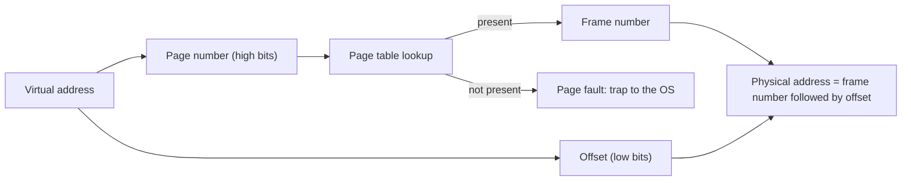
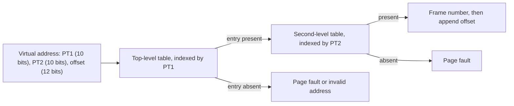

# Virtual memory: paging, page tables and TLBs

> **Before this lesson:** [Address spaces, swapping and free-space management](#/lesson/os/address-spaces-swapping), for address spaces and base-and-limit registers, and [Hardware review](#/lesson/os/hardware-review), for caches.

## In plain words

The previous lesson gave each program its own private set of addresses, but required the program to sit in one unbroken stretch of real memory and to fit there entirely. **Virtual memory** removes both restrictions, and is used by essentially every computer and phone today.

Picture a large library whose catalogue lists millions of books. The reading room has only a few hundred shelves. Readers ask for a book by its catalogue number; a librarian looks up which reading-room shelf currently holds it, or, if it is not there, fetches it from the basement store, putting some other book back to make room. Readers never learn shelf numbers, and they can use a catalogue far larger than the room.

In a computer, the catalogue numbers are **virtual addresses** (what the program uses), the shelves are **physical memory**, the basement is the disk, and the librarian's look-up list is the **page table**. Memory is handled in equal-sized chunks called **pages**. Because the look-up happens on every single memory access, a small notebook of recent look-ups, the **TLB**, keeps it fast.

Why it matters for a job: virtual memory explains why programs cannot corrupt each other, why a machine slows to a crawl when it runs short of memory, and what a "segmentation fault" is. Walking through an address translation is a standard interview exercise.

## Motivation

Base-and-limit registers require every process to sit in one contiguous chunk of RAM and to fit there entirely. Both requirements became painful decades ago: programs outgrew memory, and swapping whole multi-gigabyte processes to disk is hopelessly slow. A typical disk moves perhaps a few hundred megabytes per second, so writing out and reading back a few gigabytes takes tens of seconds.

**Virtual memory** removes both requirements with one idea. Split each program's address space into fixed-size chunks called **pages**, split physical memory into chunks of the same size called **page frames**, and let *any* page sit in *any* frame — or in no frame at all, if it is not currently needed. The program sees a large, contiguous, private address space. Physical memory holds a scattered, ever-changing subset of it.

This is a generalisation of the base-register idea: instead of one relocation for the whole program, there is a separate relocation for every page.

## Paging

### The MMU

When virtual memory is in use, addresses generated by the program — **virtual addresses** — do not go straight to the memory bus. They go to the **memory management unit** (MMU), a part of the CPU that maps each one to a **physical address**.

Take a machine with 16-bit virtual addresses (64 KB of address space) but only 32 KB of RAM, and a page size of 4 KB. There are 16 virtual pages and 8 page frames. A virtual address splits into two fields:

- the high-order bits are the **virtual page number** (here 4 bits, for 16 pages);
- the low-order bits are the **offset** within the page (here 12 bits, for 4,096 bytes).

The page number is used as an index into the **page table**, which yields the frame number. The frame number is glued onto the *unchanged* offset to form the physical address. Because the page size is a power of two, "splitting" and "gluing" are a matter of routing wires.



### Page faults

Sixteen virtual pages cannot all live in eight frames. Each page-table entry therefore has a **present/absent bit**. If a program touches a page whose bit says "absent", the MMU traps to the operating system: a **page fault**. The OS picks a frame (evicting its current page to disk if necessary), reads the wanted page from disk into it, updates the page table, and restarts the instruction that faulted. The program never notices, apart from the delay.

```python-run
PAGE = 4096
OFFSET_BITS = 12

# page table for a 16-page address space on a machine with 8 frames; None = not in memory
page_table = [2, 1, 6, 0, 4, 3, None, None, None, 5, None, 7, None, None, None, None]

def translate(vaddr):
    page, offset = vaddr >> OFFSET_BITS, vaddr & (PAGE - 1)
    frame = page_table[page]
    if frame is None:
        return f"virtual {vaddr:6d} = page {page:2d}, offset {offset:4d} -> PAGE FAULT"
    return f"virtual {vaddr:6d} = page {page:2d}, offset {offset:4d} -> frame {frame}, physical {(frame << OFFSET_BITS) | offset}"

for v in (0, 20, 4100, 8192, 20500, 32780, 49151):
    print(translate(v))
```

**What the code does.** `PAGE = 4096` is the size of a page in bytes, and `OFFSET_BITS = 12` because 4096 is 2 to the power 12. `page_table` is a list in which position `p` holds the number of the frame of real memory containing page `p`, or `None` if the page is not in memory. In `translate`, `vaddr >> OFFSET_BITS` shifts the address right by 12 binary places, which leaves the page number, and `vaddr & (PAGE - 1)` keeps only the lowest 12 bits, which is the position inside the page (the offset). If the page has no frame, the function reports a page fault. Otherwise `(frame << OFFSET_BITS) | offset` shifts the frame number left by 12 places and joins the unchanged offset on to it.

**The output.** Address 20 is page 0, offset 20; page 0 is in frame 2, so the real address is 2 × 4096 + 20 = 8212. Address 20,500 is page 5, offset 20, in frame 3: 12,308. Address 32,780 falls in page 8, which is not in memory: a page fault.

Work one by hand to be sure you can: virtual address 20,500 is page 5 (since 5 × 4096 = 20,480) with offset 20. Page 5 is in frame 3, which starts at 12,288, so the physical address is 12,308.

### What a page-table entry contains

The layout is machine-specific, but the ingredients are universal:

| Field | Purpose |
|---|---|
| **Page frame number** | Where the page is. The whole point of the entry. |
| **Present/absent** | If 0, any access causes a page fault. |
| **Protection** | What access is allowed: at least read-only versus read/write, usually also execute, and user versus kernel. |
| **Modified** (dirty) | Set by hardware when the page is written. A dirty page must be saved to disk before its frame is reused; a clean one can be dropped. |
| **Referenced** | Set by hardware on any access. Helps the OS pick a victim: pages not referenced recently are better candidates. |
| **Caching disabled** | Needed for pages that map device registers, where a stale cached copy would be wrong. |

Note what is *not* there: the disk address of an absent page. The hardware needs only what it takes to translate; where a page lives on disk is the OS's private business, kept in its own tables.

> [!INTERVIEW]
> "What is virtual memory and why do we need it?" Three benefits, in order of importance today: **isolation** (each process has its own page table, so it cannot name another's memory); **flexibility** (physical memory need not be contiguous, pages can be shared, files can be mapped, copy-on-write is possible); and **over-commitment** (the total of all address spaces may exceed RAM, with the excess on disk). Then describe the mechanism: virtual address = page number + offset; page table maps page to frame; TLB caches the mapping; a missing page raises a fault that the OS services.

## Two problems: speed and size

Any paging design faces two demands that pull against each other:

1. **The mapping must be fast.** It is performed on *every* memory reference — one or more per instruction. If an instruction takes a nanosecond, the lookup must take a fraction of that.
2. **The page table can be huge.** With 32-bit addresses and 4 KB pages there are about a million pages; with 48-bit addresses, about 2³⁶ ≈ 69 billion. And each process needs its own table.

The simplest design, one array of fast hardware registers indexed by page number, is quick to use but impossibly expensive to build and to reload at every context switch. Keeping the table entirely in main memory is cheap, but then every reference needs an *extra* memory reference to read the table, halving performance at best. Real systems solve the speed problem with a cache and the size problem with cleverer table structures.

## Speed: the translation lookaside buffer

Programs make a large number of references to a *small* number of pages — a fact known as **locality of reference**. So a small cache of recent translations covers most lookups. That cache is the **translation lookaside buffer** (TLB), a hardware device inside the MMU holding typically from a few dozen to a couple of thousand entries. Each entry holds a virtual page number, the corresponding frame number, the protection and modified bits, and a valid bit.

On each reference the MMU compares the page number with *all* TLB entries simultaneously.

- **TLB hit:** the frame number comes straight from the TLB, with no page-table access. If the access violates the protection bits, a protection fault is raised.
- **TLB miss:** the page table must be consulted (a *page-table walk*); the result replaces some TLB entry so that the next reference to the same page is a hit.

### Who handles a miss?

On many architectures (x86, ARM) the MMU hardware walks the page table itself. On some RISC designs the TLB is **software-managed**: a miss traps to the OS, which looks up the mapping and loads the entry. This makes the hardware simpler, at the cost of a slower miss path, so the OS takes great care to make it fast and sometimes pre-loads entries it predicts will be needed.

Not all misses are equal:

- A **soft miss**: the page is in memory but its translation is not in the TLB. Fixing it takes a table walk — on the order of tens of nanoseconds.
- A **hard miss**: the page itself is not in memory and must be fetched from disk — milliseconds, a hundred thousand times slower or more.

Between those lie *minor* page faults (the page is in memory but not yet in this process's page table — say, another process already loaded the shared library) and, at the other extreme, a **segmentation fault**: the address is invalid, and the program is usually terminated.

### How much does the TLB buy?

Let a TLB lookup cost $e$, a memory access cost $m$, and suppose a miss requires $k$ extra memory accesses to walk the table. With hit ratio $h$:

$$T = h\,(e + m) + (1 - h)\,(e + m + k\,m).$$

```python-run
from collections import OrderedDict
import random

def effective(h, e=1, m=100, k=4):
    return h * (e + m) + (1 - h) * (e + m + k * m)

print("hit ratio -> effective access time (ns), 4-level walk, m = 100 ns")
for h in (0.80, 0.95, 0.99, 0.999):
    t = effective(h)
    print(f"  {h:6.1%} -> {t:6.1f} ns  ({t / 100 - 1:+.1%} versus no translation at all)")

def tlb_hits(addresses, entries, page=4096):
    tlb, hits = OrderedDict(), 0
    for a in addresses:
        vpn = a // page
        if vpn in tlb:
            hits += 1
            tlb.move_to_end(vpn)
        else:
            if len(tlb) == entries:
                tlb.popitem(last=False)
            tlb[vpn] = True
    return hits / len(addresses)

rng = random.Random(1)
sequential = [i * 8 for i in range(200_000)]                      # walking an array of 8-byte items
scattered = [rng.randrange(1 << 30) for _ in range(200_000)]      # random pointers over 1 GB
print("\n64-entry TLB hit ratio")
print(f"  sequential array walk : {tlb_hits(sequential, 64):.4%}")
print(f"  random access over 1GB: {tlb_hits(scattered, 64):.4%}")
```

**What the code does.** The first function, `effective`, averages two cases: with probability `h` the translation is found in the TLB and the access costs a look-up plus one memory access (`e + m`); otherwise it costs that plus `k` extra memory accesses to walk the page table. The second function, `tlb_hits`, simulates a TLB with a fixed number of entries. It uses an `OrderedDict`, a table that remembers the order in which entries were added: on a hit the entry is moved to the "recent" end; on a miss, if the table is full, the entry at the "old" end is removed, and the new page is added. It returns the fraction of accesses that were hits. Two lists of addresses are then tried: 200,000 addresses stepping through memory 8 bytes at a time, and 200,000 addresses chosen at random from a gigabyte.

**The output.** In the first table, a 99% hit ratio costs only a few percent extra, while 80% costs about 80% extra. In the second, walking through memory in order gives a hit ratio above 99.9%, and jumping about at random gives a hit ratio close to zero.

The second experiment is the practical lesson: data structures that jump around a huge heap (linked lists, hash tables with poor locality, pointer-heavy trees) can miss the TLB on almost every access, and each miss costs a multi-level walk.

A blunt but effective remedy is **larger pages**. A 2 MB page covers 512 times as much memory per TLB entry as a 4 KB page. Most modern systems support such *huge pages* alongside normal ones.

### The TLB and context switches

TLB entries describe one address space. When the OS switches to a different process, they are wrong for the newcomer. Either the whole TLB is flushed — making the first references after every switch slow — or each entry is tagged with an address-space identifier so that entries of several processes can coexist. This is a large part of why switching between *processes* costs more than switching between *threads* of one process.

## Size: page tables for large memories

### Multilevel page tables

The key observation is that a process does not use most of its address space. A typical program has some code and data near the bottom, a stack near the top, and a gigantic unused gap between. There is no need to keep table entries for the gap.

In a **two-level** scheme for a 32-bit address, the page number is split into two 10-bit fields. The first indexes a *top-level* table of 1,024 entries; each entry points to a *second-level* table (also 1,024 entries) describing one 4 MB slice of the address space — or is marked absent if nothing in that slice is used.



A process using 4 MB of code, 4 MB of data and 4 MB of stack needs the top-level table plus only three second-level tables: four tables of 1,024 entries each, instead of a million entries. 64-bit processors extend the same idea to four levels (and more recently five), each indexed by 9 bits, on top of a 12-bit offset.

```python-run
def flat_table_bytes(vbits, page_bits, pte_bytes):
    return (1 << (vbits - page_bits)) * pte_bytes

def multilevel_bytes(used_ranges, level_bits, page_bits, pte_bytes):
    """used_ranges: list of (start, length) in bytes. Count the table pages actually needed."""
    pages = set()
    for start, length in used_ranges:
        pages.update(range(start >> page_bits, (start + length - 1 >> page_bits) + 1))
    tables, groups = 0, pages
    for bits in reversed(level_bits):           # walk from the leaf level upward
        groups = {p >> bits for p in groups}
        tables += len(groups)
    return tables * (1 << level_bits[-1]) * pte_bytes

MB, GB = 1 << 20, 1 << 30
print("flat table, 32-bit, 4 KB pages, 4-byte entries :", flat_table_bytes(32, 12, 4) // MB, "MB per process")
print("flat table, 48-bit, 4 KB pages, 8-byte entries :", flat_table_bytes(48, 12, 8) // GB, "GB per process (!)")

small = [(0x400000, 4 * MB), (0x10000000, 4 * MB), (0xBF000000, 4 * MB)]
print("two-level, 12 MB actually used                 :", multilevel_bytes(small, [10, 10], 12, 4) // 1024, "KB")

big = [(0x400000, 64 * MB), (0x7F0000000000, 8 * MB), (0x100000000, 2 * GB)]
print("four-level (9,9,9,9), about 2 GB used          :", round(multilevel_bytes(big, [9, 9, 9, 9], 12, 8) / MB, 2), "MB")
```

**What the code does.** `flat_table_bytes` computes the size of a single-level page table: the number of pages (2 to the power of the address width minus the offset width) times the size of one entry. `multilevel_bytes` counts how many small tables a tree-shaped page table needs for a given set of used memory ranges. It first collects the numbers of all pages in use into a set; then, working from the lowest level upward, it groups those pages by the table that would contain them (`p >> bits` drops the bits that select an entry *within* a table) and counts the distinct tables at each level.

**The output.** A flat table for 32-bit addresses is 4 megabytes per process; for 48-bit addresses it would be 512 gigabytes per process, which is absurd. A two-level table for a process using 12 megabytes needs only 16 kilobytes, and a four-level table for a process using about 2 gigabytes needs a few megabytes.

The trade-off is that a TLB miss now costs one memory access *per level*, which is exactly the $k$ in the formula above — and why the TLB matters even more on 64-bit machines.

### Inverted page tables

A different approach turns the table inside out. Instead of one entry per *virtual page*, an **inverted page table** has one entry per *physical frame*, recording which (process, virtual page) pair currently occupies it. Its size is proportional to RAM, not to the virtual address space: with 4 GB of RAM and 4 KB pages, about a million entries regardless of how vast the virtual addresses are.

The catch is that translation runs the wrong way. Given (process, virtual page) we would have to search the whole table for a matching entry. Two things make it workable: the TLB absorbs most lookups, and on a miss a **hash table** keyed on the virtual page finds the entry quickly, with all pages hashing to the same bucket chained together.

## Worked example: decoding an address

A system has 4 KB pages and a two-level table with 10 + 10 bits. Translate virtual address `0x00403004`.

1. Offset = low 12 bits = `0x004` = 4.
2. Remaining bits: `0x00403`. PT2 = low 10 bits of that = 3. PT1 = the rest = 1.
3. Top-level entry 1 covers virtual addresses 4 MB to 8 MB. Follow it to its second-level table and read entry 3.
4. If that entry says frame 9, the physical address is 9 × 4096 + 4 = 36,868.

Two table reads were needed on this miss; with the result cached in the TLB, the next access to the same page needs none.

## Pitfalls

- **Translating the offset.** The offset is never changed. Only the page number is swapped for a frame number.
- **Treating frame number 0 as "invalid".** Validity is the present bit's job; frame 0 is an ordinary frame.
- **Confusing a TLB miss with a page fault.** A TLB miss means the *translation* was not cached; the page may be sitting in RAM. A page fault means the *page* is not usable from the page table.
- **Forgetting per-process tables.** Each process has its own page table; a context switch changes the register that points to the top-level table (and invalidates or re-tags the TLB).
- **Ignoring the cost of sparsity done wrong.** A flat table for a 64-bit address space is not merely large; it is impossible.
- **Assuming more levels is free.** Each level is another memory access on a TLB miss.

## Summary

- Paging divides virtual address spaces into **pages** and physical memory into **frames**; a **page table** maps one to the other, and the **MMU** applies it on every reference.
- A virtual address is page number + offset. The offset passes through; the page number indexes the table.
- A **page-table entry** holds the frame number plus present, protection, modified, referenced and caching bits.
- Accessing an absent page raises a **page fault**, which the OS services by bringing the page in and restarting the instruction.
- The **TLB** caches recent translations; hits avoid the table entirely. Misses are **soft** (walk the table) or **hard** (go to disk). Locality and huge pages keep the hit ratio high.
- **Multilevel page tables** avoid storing entries for unused regions; **inverted page tables** store one entry per frame and rely on hashing plus the TLB.

## Glossary

- **Virtual memory** — giving each process a private address space that is mapped, piece by piece, onto real memory and disk.
- **Virtual address / physical address** — an address as the program sees it / the real location in memory.
- **Page / page frame** — a fixed-size piece of a virtual address space / of real memory.
- **MMU (memory management unit)** — the part of the processor that translates virtual addresses.
- **Page table** — the table recording which frame, if any, holds each page.
- **Offset** — the position of a byte within its page.
- **Page fault** — the event raised when a program uses a page that is not in memory.
- **Present/absent bit** — the bit in a page-table entry saying whether the page is in memory.
- **Modified (dirty) bit** — the bit recording that a page has been changed since it was loaded.
- **Referenced bit** — the bit recording that a page has been used recently.
- **TLB (translation lookaside buffer)** — a small cache of recent page-to-frame translations.
- **TLB hit / miss** — finding / not finding a translation in the TLB.
- **Soft miss / hard miss** — the page is in memory but not in the TLB / the page must be fetched from disk.
- **Locality of reference** — the tendency of programs to use a small set of pages repeatedly over a short time.
- **Multilevel page table** — a page table arranged as a tree so that unused regions need no entries.
- **Inverted page table** — a table with one entry per frame of real memory instead of one per virtual page.
- **Huge page** — a much larger page size, used to make each TLB entry cover more memory.

## Check yourself

```quiz
[
  {"q": "A system uses 4 KB pages. Virtual address 13,000 lies in which page and at what offset?",
   "options": ["Page 3, offset 712", "Page 3, offset 1000", "Page 4, offset 712", "Page 2, offset 4808"],
   "answer": 0,
   "explain": "13000 // 4096 = 3 and 13000 - 3 * 4096 = 712."},
  {"q": "Continuing: page 3 is mapped to frame 6. What is the physical address?",
   "options": ["6712", "24,576", "25,288", "28,672"],
   "answer": 2,
   "explain": "Frame 6 starts at 6 * 4096 = 24,576. Adding the unchanged offset 712 gives 25,288."},
  {"q": "Which bit lets the OS avoid writing a page back to disk when its frame is reclaimed?",
   "options": ["Referenced", "Present", "Modified (dirty)", "Caching disabled"],
   "answer": 2,
   "explain": "If the modified bit is clear, the copy on disk is still accurate, so the page can be discarded."},
  {"q": "A page is in physical memory and correctly mapped in the page table, but its translation is not in the TLB. What happens on access?",
   "options": ["A hard page fault and a disk read", "A soft TLB miss resolved by walking the page table", "A segmentation fault", "The process is swapped out"],
   "answer": 1,
   "explain": "Only the cached translation is missing. A table walk finds it and loads it into the TLB; no disk I/O is needed."},
  {"q": "TLB lookup takes 1 ns, a memory access 100 ns, and a miss needs 2 extra memory accesses. With a 98% hit ratio, what is the effective access time?",
   "options": ["101 ns", "105 ns", "121 ns", "301 ns"],
   "answer": 1,
   "explain": "0.98 * 101 + 0.02 * 301 = 98.98 + 6.02 = 105 ns."},
  {"q": "Why do multilevel page tables save memory compared with a single flat table?",
   "options": ["Their entries are smaller", "Second-level tables for unused regions of the address space are not allocated at all", "They compress the frames", "They remove the need for a TLB"],
   "answer": 1,
   "explain": "Most of a typical address space is unused. An absent top-level entry stands in for a whole second-level table."},
  {"q": "What determines the size of an inverted page table?",
   "options": ["The size of the virtual address space", "The number of processes", "The amount of physical memory", "The size of the TLB"],
   "answer": 2,
   "explain": "It has one entry per physical frame, so it scales with RAM rather than with the virtual address space."},
  {"q": "Why does switching between two processes usually cost more than switching between two threads of the same process?",
   "options": ["Threads have no registers to save", "The address space changes, so the page-table pointer is switched and TLB entries must be flushed or become useless", "Processes must be reloaded from disk", "Threads do not use the stack"],
   "answer": 1,
   "explain": "Threads share one address space, so cached translations remain valid. A process switch changes the mappings, costing TLB misses afterwards."}
]
```

> **Source:** Tanenbaum & Bos, Modern Operating Systems 4e, §3.3 (Virtual memory: paging, page tables, speeding up paging, page tables for large memories)
