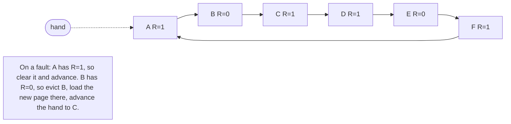

# Page replacement algorithms

> **Before this lesson:** [Virtual memory: paging, page tables and TLBs](#/lesson/os/paging-tlb), for pages, frames, page faults and the referenced and modified bits.

## In plain words

With virtual memory, a program can use more pages than fit in real memory; the extra ones wait on disk. When the program needs a page that is not in memory and memory is full, some page already there must be sent away to make room. Which one?

Think of a small desk and a big bookshelf across the room. You can keep five books open on the desk. When you need a sixth, one has to go back on the shelf. If you put back the book you are about to need again, you will be walking to the shelf constantly. If you put back one you finished with an hour ago, you will hardly notice. Choosing well is the whole problem, and the rule used to choose is called a **page replacement algorithm**.

The walk to the shelf matters because, for a computer, the "shelf" is the disk, which is thousands of times slower than memory. A poor choice repeated many times makes a machine feel frozen.

Why it matters for a job: the same question — *what do I throw out when my fast storage is full?* — arises in every cache: in web browsers, databases, content delivery networks and your own programs. The algorithms in this lesson (first in first out, least recently used, clock) are the standard answers, and counting page faults by hand is a classic interview and exam exercise.

## Motivation

A page fault arrives and every frame is occupied. Some page must be thrown out to make room. Which one?

The question matters because of an enormous asymmetry. A memory access takes around a hundred nanoseconds; fetching a page from disk takes milliseconds on a spinning drive and still tens or hundreds of microseconds on flash. Evict a page that is needed again a moment later and you pay that price twice. A system that chooses badly spends its life waiting for the disk, a condition aptly called **thrashing**. A system that chooses well can run workloads far larger than its RAM with barely noticeable slowdown.

The same problem appears wherever there is a cache: CPU caches, the file-system buffer cache, web caches, database buffer pools. The algorithms here are the vocabulary for all of them.

Two preliminaries. First, if the victim page has been **modified** since it was loaded, it must be written to disk before its frame is reused; a clean page can be overwritten. Clean victims are therefore cheaper. Second, the victim may be chosen from the faulting process's own pages or from all pages in the system — a policy question for the next lesson.

Throughout, a workload is summarised as a **reference string**: the sequence of page numbers touched.

## The optimal algorithm

The best possible policy is easy to state: evict the page whose next use lies furthest in the future. If one page will not be needed for eight million instructions and another for six million, removing the first postpones the next fault longest.

It is also impossible to implement, because the OS cannot see the future. Its value is as a **yardstick**: run a program once, record its reference string, replay it through the optimal policy in a simulator, and you know the lower bound. If your practical algorithm is within a few percent of optimal, further cleverness is pointless.

## Not recently used (NRU)

Hardware keeps two status bits per page: **R** (referenced), set on any access, and **M** (modified), set on a write. The OS periodically clears all R bits — say on each clock interrupt — so that R distinguishes pages touched recently from those that were not. M is never cleared this way, since it is needed to know whether the page must be saved.

At a fault, pages fall into four classes:

| Class | R | M | Meaning |
|---|---|---|---|
| 0 | 0 | 0 | not referenced, not modified |
| 1 | 0 | 1 | not referenced recently, but dirty |
| 2 | 1 | 0 | referenced, clean |
| 3 | 1 | 1 | referenced and dirty |

Class 1 looks odd but arises naturally when a clock tick clears the R bit of a class 3 page. NRU evicts a random page from the lowest-numbered non-empty class. It is crude, cheap, and often adequate.

## First-in, first-out (FIFO)

Keep pages in a list by load time and evict the oldest. Simple — and blind. The oldest page may well be the most heavily used one in the system. Imagine a shop that makes room for new products by discontinuing whatever it has stocked longest: out go bread and salt. Pure FIFO is rarely used.

## Second chance and clock

A small change rescues FIFO. Inspect the R bit of the oldest page. If it is 0, the page is both old and unused: evict it. If it is 1, clear the bit, move the page to the back of the list as though it were newly arrived, and look at the next-oldest. If every page has been referenced, the algorithm goes all the way round, clears every bit and then evicts the original oldest page — degenerating gracefully into FIFO.

Shuffling list nodes is wasteful, so the standard implementation arranges the frames in a circle with a **hand** pointing at the oldest page. On a fault: if the page under the hand has R = 0, replace it and advance the hand; otherwise clear R and advance, repeating until a victim is found. This is the **clock** algorithm, and variants of it run in most real kernels.



## Least recently used (LRU)

A good approximation to optimal follows from an observation about programs: pages used heavily in the last few instructions will probably be used heavily in the next few, and pages untouched for ages will probably stay untouched. So evict the page that has gone unused for the longest time.

LRU performs very well. The problem is cost. A faithful implementation must update something on **every memory reference**: either move the page to the front of a linked list, or stamp its page-table entry with a 64-bit counter that the hardware increments per instruction and then, on a fault, search for the smallest stamp. Very few machines have had such hardware, and doing it in software on each reference is unthinkable. So real systems *approximate* LRU.

## Simulating LRU in software: NFU and aging

**Not frequently used (NFU)** keeps a software counter per page. At each clock tick the R bit (0 or 1) is added to the counter; at a fault the page with the lowest count is evicted. Its flaw is that it never forgets. A page hammered during an early phase of the program keeps a high count forever and outlives pages that are in active use now.

A two-line modification, **aging**, fixes this. At each tick:

1. shift every counter right by one bit;
2. insert the page's R bit at the *leftmost* position.

Read a counter as a history: the leftmost bit says whether the page was used in the most recent tick, the next bit the tick before, and so on. A page not referenced for four ticks has four leading zeros and so a smaller value than one not referenced for three. The page with the lowest counter is evicted.

Aging differs from true LRU in two ways. Within a single tick it cannot tell which of two pages was used *later* — both have the bit set and nothing more. And with, say, 8-bit counters its memory reaches back only eight ticks: a page unused for nine ticks is indistinguishable from one unused for a thousand. In practice 8 bits with a tick of around 20 ms is usually enough.

```python-run
def aging(ticks, pages, bits=8):
    counters = [0] * pages
    top = 1 << (bits - 1)
    for t, touched in enumerate(ticks):
        for p in range(pages):
            counters[p] >>= 1
            if p in touched:
                counters[p] |= top
        row = "  ".join(f"p{p}:{counters[p]:0{bits}b}" for p in range(pages))
        print(f"tick {t}: R bits for {sorted(touched)!s:15} {row}")
    victim = min(range(pages), key=lambda p: (counters[p], p))
    print("evict page", victim, "(smallest counter)")

aging([{0, 2, 4, 5}, {0, 1, 4}, {0, 1, 3}, {0, 4}, {1, 2}], pages=6)
```

**What the code does.** `aging` keeps one small counter per page, written out in binary so that its history can be read directly. `top = 1 << (bits - 1)` is a number with a single 1 in the leftmost position (for 8 bits, `10000000`). `ticks` is a list with one entry per clock tick: the set of pages used during that tick. On every tick, every page's counter is shifted one place to the right with `>>= 1`, which pushes its whole history along and drops the oldest bit; and if the page was used in this tick, `|= top` puts a 1 in the freshly vacated leftmost position. After each tick the counters are printed with `:0{bits}b`, meaning "as a binary number padded with zeros to this width". At the end, `min(...)` finds the page with the smallest counter.

**The output.** You can watch each 1 drift to the right as the ticks go by. Page 0, used in nearly every tick, has a counter starting with several 1s. Page 5 was used only in the very first tick, so its single 1 has moved furthest right, giving the smallest number: it is the page chosen for removal.

Trace it by eye: page 3 was touched only once, in tick 2; page 5 only in the very first tick, so its single 1 bit has drifted furthest right and it is the victim.

## The working set

With **demand paging**, a process starts with no pages in memory and faults them in as it goes. After a while it has most of what it needs and runs with few faults. This works because of **locality of reference**: during any phase of execution, a process touches only a small fraction of its pages.

The set of pages a process is currently using is its **working set**. If the whole working set is in memory, the process runs without faulting until it moves to a new phase. If memory is too small to hold it, the process faults every few instructions and crawls — it is **thrashing**.

Formally, $w(k, t)$ is the set of pages used by the most recent $k$ references at time $t$. As $k$ grows, $w$ grows quickly at first and then levels off, because programs reuse pages; there is a wide range of $k$ over which the working set hardly changes. Many systems track each process's working set and, before resuming a process that was swapped out, load those pages in advance (**prepaging**) rather than taking a storm of faults.

Tracking the exact last-$k$ references is far too costly, so implementations use time instead: the working set is the set of pages referenced during the last $\tau$ seconds of the process's *own* execution time (its **current virtual time**). The basic working-set replacement algorithm scans the page table at a fault:

- If R = 1, the page was used in this tick: record the current virtual time as its *time of last use* and move on.
- If R = 0 and its age (current virtual time minus time of last use) exceeds $\tau$, it is outside the working set: evict it.
- If R = 0 but the age is at most $\tau$, it is still in the working set; remember the oldest such page in case nothing better turns up.

```python-run
def working_set_sizes(refs, k):
    count, sizes = {}, []
    for t, p in enumerate(refs):
        count[p] = count.get(p, 0) + 1
        if t >= k:
            old = refs[t - k]
            count[old] -= 1
            if not count[old]:
                del count[old]
        sizes.append(len(count))
    return sizes

# A program with three phases, each living in a different small set of pages.
import random
rng = random.Random(3)
refs = [rng.choice([0, 1, 2, 3]) for _ in range(40)] \
     + [rng.choice([10, 11, 12, 13, 14, 15]) for _ in range(40)] \
     + [rng.choice([20, 21]) for _ in range(40)]

for k in (5, 15, 30):
    s = working_set_sizes(refs, k)
    print(f"k={k:2d}: " + "".join(str(min(x, 9)) for x in s))
print("       " + "^phase 1".ljust(40) + "^phase 2".ljust(40) + "^phase 3")
```

**What the code does.** `working_set_sizes` slides a window of the last `k` page uses along the list `refs` and records, at each moment, how many *different* pages the window contains. `count` is a dictionary from page number to how many times that page appears in the window. Each new use adds one to its page's count; once the window is longer than `k`, the use that has now fallen off the left edge (`refs[t - k]`) is subtracted, and a page whose count reaches zero is deleted, so that `len(count)` is always the number of distinct pages. The test data imitates a program with three phases, each using its own small group of pages. Each printed line shows the size at every moment as a digit, for three window lengths.

**The output.** Within a phase the digits settle at the number of pages that phase uses (4, then 6, then 2). Shortly after each change of phase the number is briefly larger, because the window still contains pages from the old phase. A longer window makes that bulge wider.

Each printed digit is the working-set size at that moment. Notice the bulge right after each phase change, when the window still contains pages of the old phase as well as the new. A larger window smooths the measurement and reacts more slowly.

## WSClock

Scanning the entire page table at every fault is slow. **WSClock** combines the clock structure with working-set information: frames form a circular list, each entry carrying the time of last use plus R and M bits. At a fault the hand examines the page it points to:

- R = 1: used recently. Clear R, advance.
- R = 0, age greater than $\tau$, and **clean**: not in the working set and a valid copy exists on disk. Claim this frame.
- R = 0, age greater than $\tau$, but **dirty**: schedule the page to be written to disk and keep moving — there may be a clean old page further on, and waiting for the write would stall the fault.

If the hand comes all the way round, either some writes were scheduled (keep going until one finishes and its page is clean) or none were (every page is in some working set; take any clean page, or failing that the current one). WSClock is simple, performs well and is widely used.

## Comparing the algorithms

```python-run
from collections import OrderedDict, deque

def fifo(refs, n):
    mem, order, faults = set(), deque(), 0
    for p in refs:
        if p not in mem:
            faults += 1
            if len(mem) == n:
                mem.discard(order.popleft())
            mem.add(p)
            order.append(p)
    return faults

def lru(refs, n):
    mem, faults = OrderedDict(), 0
    for p in refs:
        if p in mem:
            mem.move_to_end(p)
        else:
            faults += 1
            if len(mem) == n:
                mem.popitem(last=False)
            mem[p] = 1
    return faults

def clock(refs, n):
    slots, rbit, where, hand, faults = [None] * n, [0] * n, {}, 0, 0
    for p in refs:
        if p in where:
            rbit[where[p]] = 1
            continue
        faults += 1
        while slots[hand] is not None and rbit[hand]:
            rbit[hand] = 0
            hand = (hand + 1) % n
        if slots[hand] is not None:
            del where[slots[hand]]
        slots[hand], rbit[hand], where[p] = p, 1, hand
        hand = (hand + 1) % n
    return faults

def optimal(refs, n):
    mem, faults = set(), 0
    for i, p in enumerate(refs):
        if p in mem:
            continue
        faults += 1
        if len(mem) == n:
            def next_use(q):
                try:
                    return refs.index(q, i + 1)
                except ValueError:
                    return float("inf")
            mem.discard(max(mem, key=next_use))
        mem.add(p)
    return faults

import random
rng = random.Random(8)
refs, centre = [], 0
for _ in range(3000):                       # a workload with locality: a slowly drifting hot spot
    if rng.random() < 0.02:
        centre = rng.randrange(60)
    refs.append((centre + rng.choice([0, 0, 0, 1, 1, 2, 3, 5])) % 60)

print("frames  FIFO  clock   LRU   optimal")
for n in (2, 4, 6, 8, 12, 16):
    print(f"{n:6d} {fifo(refs, n):5d} {clock(refs, n):6d} {lru(refs, n):5d} {optimal(refs, n):9d}")

belady = [1, 2, 3, 4, 1, 2, 5, 1, 2, 3, 4, 5]
print("\nBelady's string under FIFO:", {n: fifo(belady, n) for n in (3, 4)}, "<- more frames, MORE faults")
print("Same string under LRU     :", {n: lru(belady, n) for n in (3, 4)})
```

**What the code does.** Four functions each take a list of page uses (`refs`) and a number of frames `n`, and return how many page faults occur. `fifo` keeps the loaded pages in a set for quick membership tests and in a queue in order of loading; a page already loaded causes nothing, and on a fault with memory full the page at the front of the queue is removed. `lru` uses an `OrderedDict`: a hit moves the page to the "recent" end, and the victim is taken from the other end. `clock` keeps the frames in a circle with a hand: on a fault the hand skips over pages whose used-bit is set, clearing the bit as it passes, and replaces the first page whose bit is clear. `optimal` cheats by looking ahead: for each loaded page it finds where that page is next used (`refs.index(q, i + 1)`), treating "never again" as infinitely far, and removes the one used furthest in the future. The test data is 3,000 uses that cluster around a slowly moving centre, like a real program.

**The output.** For every memory size the fault counts fall in the same order: optimal lowest, then least recently used and clock close together, then first in first out. The last two lines show a curiosity: for one particular sequence, first in first out has *more* faults with four frames (10) than with three (9), which never happens with least recently used.

Three things to observe. The ordering optimal ≤ LRU ≤ clock ≤ FIFO usually (not always) holds. Clock gets most of LRU's benefit for a fraction of the cost. And the last two lines show **Belady's anomaly**: under FIFO this string causes 9 faults with three frames and 10 with four. LRU can never do this, for a reason explained in the next lesson.

| Algorithm | Verdict |
|---|---|
| Optimal | Unimplementable; the benchmark |
| NRU | Crude approximation of LRU |
| FIFO | May evict important pages |
| Second chance | Big improvement on FIFO |
| Clock | Realistic and efficient |
| LRU | Excellent but needs special hardware to do exactly |
| NFU | Poor approximation of LRU (never forgets) |
| Aging | Efficient, good approximation of LRU |
| Working set | Sound but expensive to implement directly |
| WSClock | Efficient and good |

> [!INTERVIEW]
> Expect to be handed a reference string and a frame count and asked for the fault count under FIFO, LRU and optimal. Method: draw a column per reference showing the frames' contents; mark hits and faults; for FIFO track load order, for LRU track last-use order, for optimal look ahead. Then be ready for: *Why isn't LRU used directly?* (needs an update on every reference). *What is used instead?* (clock / aging / two-list schemes using the R bit). *What is thrashing?* (working sets do not fit; the fix is fewer processes in memory or more RAM, not a cleverer algorithm).

## Pitfalls

- **Counting the initial loads.** Filling empty frames at the start *are* page faults; do not skip them.
- **Updating FIFO order on a hit.** FIFO ignores hits; refreshing on a hit turns it into LRU.
- **Confusing LRU with LFU.** "Least *recently*" is about time since last use; "least *frequently*" is about counts.
- **Loading a page with R = 0 in clock.** A freshly loaded page was referenced a moment ago; with R = 0 it would be the next victim.
- **Blaming the algorithm for thrashing.** When the combined working sets exceed RAM, no replacement policy helps.
- **Forgetting dirty pages cost more.** Eviction order should prefer clean pages when all else is equal.

## Summary

- Page replacement decides which page to evict at a fault; the **optimal** choice (furthest next use) is a benchmark only.
- **NRU** classifies by R and M bits; **FIFO** evicts the oldest; **second chance / clock** spare recently referenced pages.
- **LRU** is near-optimal but too costly to do exactly; **aging** approximates it with shifted counters.
- The **working set** is the set of pages a process is actively using; keeping it in memory avoids **thrashing**. **WSClock** applies the idea with a clock structure.
- FIFO can suffer **Belady's anomaly**; LRU and optimal cannot.

## Glossary

- **Page replacement algorithm** — the rule for choosing which page to remove from memory when room is needed.
- **Reference string** — the sequence of page numbers a program uses, in order.
- **Page fault** — a use of a page that is not in memory.
- **Victim** — the page chosen for removal.
- **Dirty / clean page** — a page that has / has not been changed since it was loaded; a dirty page must be written to disk before its frame is reused.
- **Optimal algorithm** — remove the page whose next use is furthest in the future; impossible in practice, useful as a yardstick.
- **NRU (not recently used)** — remove a page from the lowest class according to its referenced and modified bits.
- **FIFO (first in, first out)** — remove the page that has been in memory longest.
- **Second chance / clock** — like FIFO, but a page that has been used since it was last inspected is spared once.
- **LRU (least recently used)** — remove the page that has gone unused for the longest time.
- **NFU (not frequently used)** — remove the page with the lowest count of uses.
- **Aging** — an approximation of LRU that shifts each page's counter and inserts its referenced bit at each clock tick.
- **Demand paging** — loading a page only when it is first used.
- **Working set** — the set of pages a process is currently using.
- **Thrashing** — spending most of the time moving pages to and from disk because memory is too small for the working sets.
- **Prepaging** — loading a process's working set before it resumes.
- **WSClock** — a clock-style algorithm that uses working-set information.
- **Belady's anomaly** — the surprising case where adding memory increases the number of page faults under FIFO.

## Check yourself

```quiz
[
  {"q": "Reference string 1 2 3 4 1 2 5 with 3 frames under FIFO: how many page faults?",
   "options": ["5", "6", "7", "4"],
   "answer": 2,
   "explain": "1, 2, 3 fault (3). 4 evicts 1 (4). 1 evicts 2 (5). 2 evicts 3 (6). 5 evicts 4 (7). Every reference faults."},
  {"q": "Same string 1 2 3 4 1 2 5 with 3 frames under LRU: how many faults?",
   "options": ["5", "6", "7", "4"],
   "answer": 2,
   "explain": "1, 2, 3 fault. 4 evicts 1. 1 evicts 2. 2 evicts 3. 5 evicts 4, the least recently used of 4, 1, 2. Seven faults; this string defeats LRU as well."},
  {"q": "In NRU, which page is the preferred victim?",
   "options": ["R=1, M=1", "R=1, M=0", "R=0, M=1", "R=0, M=0"],
   "answer": 3,
   "explain": "Class 0 is neither recently referenced nor dirty, so it is unlikely to be needed and costs nothing to evict."},
  {"q": "The clock hand points at a page with R = 1. What does the algorithm do?",
   "options": ["Evict it immediately", "Clear R and advance the hand to the next page", "Set M to 1", "Stop and report failure"],
   "answer": 1,
   "explain": "A referenced page gets a second chance: its bit is cleared and inspection continues. It is evicted only if it is still unreferenced when the hand returns."},
  {"q": "An 8-bit aging counter holds 01000000 and the page is not referenced during the next tick. What is its new value?",
   "options": ["10000000", "00100000", "01000001", "10100000"],
   "answer": 1,
   "explain": "The counter shifts right by one and the R bit, which is 0, enters on the left."},
  {"q": "What is the main weakness of NFU that aging corrects?",
   "options": ["NFU requires special hardware", "NFU never forgets, so pages that were busy long ago keep high counts", "NFU ignores the R bit", "NFU evicts dirty pages first"],
   "answer": 1,
   "explain": "Without decay, old activity counts as much as recent activity. Shifting the counter makes history fade."},
  {"q": "A system is thrashing. Which action is most likely to help?",
   "options": ["Switch from LRU to FIFO", "Reduce the number of processes competing for memory, or add RAM", "Increase the quantum", "Shrink the TLB"],
   "answer": 1,
   "explain": "Thrashing means the active working sets do not fit in memory. Only reducing demand or increasing supply addresses that."},
  {"q": "Why does WSClock skip over an old dirty page instead of evicting it at once?",
   "options": ["Dirty pages can never be evicted", "It schedules the write and keeps looking for an old clean page that can be reused immediately", "Dirty pages are always in the working set", "The M bit is unreliable"],
   "answer": 1,
   "explain": "Waiting for a disk write would stall the faulting process. A clean page outside the working set can be taken with no I/O."}
]
```

> **Source:** Tanenbaum & Bos, Modern Operating Systems 4e, §3.4 (Page replacement algorithms)
