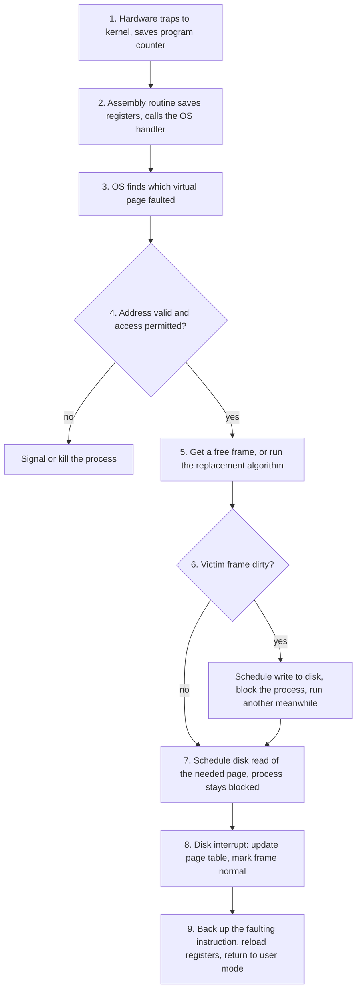

# Paging design, implementation issues and segmentation

> **Before this lesson:** [Virtual memory: paging, page tables and TLBs](#/lesson/os/paging-tlb) and [Page replacement algorithms](#/lesson/os/page-replacement), for pages, page tables, page faults and working sets.

## In plain words

The last two lessons explained the machinery of virtual memory: memory cut into equal-sized **pages**, a table saying where each page is, and a rule for which page to send to disk when memory is full. A working system needs more than the machinery. It needs decisions.

Think of running a library. Knowing how shelves and index cards work is not enough. Someone must decide how big a shelf should be, whether each department gets a fixed number of shelves or they all share one pool, what to do when the building is too full, and how two departments can share one copy of a popular book. Those are the questions of this lesson, applied to memory.

It ends with a different way of dividing memory. Paging cuts it into equal pieces with no regard to meaning, like cutting a book into chapters of exactly twenty pages each. **Segmentation** divides it along natural lines — the program's instructions in one piece, its data in another, each able to grow separately and to have its own protection.

Why it matters for a job: ideas from this lesson appear constantly in practice — *copy-on-write* (why starting a new process is cheap), *shared libraries*, *memory-mapped files*, and the exact sequence of events in a *page fault*, which interviewers love to ask about.

## Motivation

Knowing the page replacement algorithms is like knowing the rules of chess: necessary, and a long way from playing well. A working virtual memory system has to settle a dozen further questions. Should a faulting process steal frames from other processes or only from itself? How big should a page be? How do two processes share code without sharing private data? What exactly happens, step by step, between the trap and the restarted instruction? And is a single flat address space per process even the right abstraction?

This lesson collects those design and implementation issues and ends with **segmentation**, the alternative (and complement) to paging.

## Design issues

### Local versus global allocation

Suppose process A faults and needs a frame. A **local** policy picks the victim only among A's own pages, so every process has a fixed slice of memory. A **global** policy picks among all pages in memory, so the number of frames a process holds changes over time.

Global policies generally work better, because working sets grow and shrink. Under a local policy, a process whose working set grows will thrash even if plenty of frames are sitting idle in other processes; one whose working set shrinks wastes memory. With a global policy the system must keep deciding how many frames each process deserves. A fair start is to allocate in proportion to process size, with a minimum so that even tiny processes can run.

A direct way to manage the allocation is the **page fault frequency** (PFF) algorithm: measure each process's fault rate. Above an upper threshold, the process has too little memory — give it more frames. Below a lower threshold, it has more than it needs — take some away. PFF controls the *size* of the allocation and is independent of which page is evicted.

Some algorithms make sense either way (FIFO, LRU); the working-set algorithms are inherently local, since a working set belongs to one process.

### Load control

Even the best policy thrashes when the combined working sets exceed memory. If PFF reports that some processes need more memory and none can spare any, the only real fix is to **reduce the number of processes competing**: swap some out entirely and share their frames among the rest. This is two-level scheduling again — and when choosing whom to swap out, the system should keep a sensible mix of CPU-bound and I/O-bound processes so the CPU does not go idle.

### Page size

Page size is a parameter the OS can choose (within what the hardware supports). The pressures:

- On average, half of the last page of each segment is wasted — **internal fragmentation**. Small pages waste less.
- Small pages let memory hold exactly the bits a program is using, rather than large pages that are mostly idle.
- But small pages mean many pages, hence a **large page table**, and more TLB entries needed to cover the same memory.
- Transfer time to or from disk is dominated by seek and rotational delay, not size, so many small transfers cost more than a few large ones.

A simple model captures the first trade-off. Let the average process size be $s$ bytes, the page size $p$ and each page-table entry $e$ bytes. The table costs about $se/p$ bytes; fragmentation wastes about $p/2$. Total overhead:

$$\text{overhead}(p) = \frac{s\,e}{p} + \frac{p}{2}.$$

Setting the derivative to zero gives the optimum

$$p = \sqrt{2\,s\,e}.$$

```python-run
from math import sqrt

def overhead(s, e, p):
    return s * e / p + p / 2

s, e = 1 << 20, 8                  # 1 MB average process, 8-byte entries
best = sqrt(2 * s * e)
print(f"formula optimum: {best:,.0f} bytes  (nearest power of two: {1 << round(best).bit_length() - 1:,})")
for p in (512, 1024, 2048, 4096, 8192, 16384, 65536):
    print(f"  page {p:6d} B -> table {s * e / p:9.0f} B + waste {p / 2:7.0f} B = {overhead(s, e, p):9.0f} B")

for mb in (1, 16, 256, 4096):
    print(f"avg process {mb:5d} MB -> optimal page about {sqrt(2 * (mb << 20) * e) / 1024:7.1f} KB")
```

**What the code does.** `overhead(s, e, p)` adds two costs for a process of `s` bytes using pages of `p` bytes with page-table entries of `e` bytes: the table itself (`s * e / p` — a process of `s` bytes has `s / p` pages, each needing an entry) and the space wasted in the last, partly filled page (on average half a page, `p / 2`). `sqrt(2 * s * e)` is the page size that makes the sum smallest. `1 << 20` is 2 to the power 20, about a million (one megabyte). The first loop prints both costs for several page sizes; the second prints the best page size for bigger and bigger processes.

**The output.** For a 1-megabyte process the best size is about 4 kilobytes: smaller pages make the table large, bigger pages waste more at the end. As the average process grows to 16, 256 and 4096 megabytes, the best page size grows too, to 16, 64 and 256 kilobytes.

As programs have grown, the model's optimum has grown with them — one reason 4 KB pages are now complemented by 2 MB and 1 GB "huge" pages. (The model ignores the TLB, which pushes even harder towards large pages.)

### Separate instruction and data spaces

Some older machines offered two address spaces per process: **I-space** for program text and **D-space** for data, each starting at zero and each with its own page table. It doubled the usable address space when addresses were only 16 bits wide. The idea survives today in split instruction and data TLBs and caches.

### Shared pages

When several users run the same editor, keeping one copy of its code in memory is better than several. Read-only **text** pages can be shared freely; data pages cannot.

Sharing interacts with process lifetimes: if process A exits, the system must not free pages that B still uses, so shared pages need reference counts.

Data can be shared too, with care. After a UNIX `fork`, parent and child are supposed to have separate copies of everything. Rather than copy, the kernel gives each its own page table pointing at the *same* frames, all marked **read-only**. As long as both only read, nothing more happens. The moment either writes, the protection fault traps to the kernel, which copies that one page, gives each process its own private copy marked read/write, and resumes. This is **copy-on-write**: pages that are never written are never copied.

```python-run
class Frame:
    def __init__(self, data):
        self.data, self.refs = list(data), 1

class Process:
    def __init__(self, name, pages):
        self.name, self.pages, self.copies = name, pages, 0      # pages: list of [frame, writable]

    def fork(self, child_name):
        for entry in self.pages:
            entry[1] = False                                     # parent loses write permission
            entry[0].refs += 1
        return Process(child_name, [[f, False] for f, _ in self.pages])

    def write(self, page, offset, value):
        frame, writable = self.pages[page]
        if not writable:                                         # protection fault -> kernel
            if frame.refs > 1:
                frame.refs -= 1
                frame = Frame(frame.data)                        # copy just this page
                self.copies += 1
            self.pages[page] = [frame, True]
        frame.data[offset] = value

    def read(self, page, offset):
        return self.pages[page][0].data[offset]

parent = Process("parent", [[Frame([0] * 4), True] for _ in range(100)])
child = parent.fork("child")
print("frames shared right after fork:", sum(a[0] is b[0] for a, b in zip(parent.pages, child.pages)), "of 100")

child.write(7, 0, 42)
child.write(7, 1, 43)        # second write to the same page: no further copy
parent.write(3, 0, 99)
print("child sees page 7 ->", child.read(7, 0), " parent sees page 7 ->", parent.read(7, 0))
print("pages copied: child", child.copies, "parent", parent.copies)
print("frames still shared:", sum(a[0] is b[0] for a, b in zip(parent.pages, child.pages)), "of 100")
```

**What the code does.** `Frame` stands for one piece of real memory: its contents and a count (`refs`) of how many processes are using it. A `Process` has a list of pages, each entry being `[frame, writable]`. `fork` creates a child that points at the *same* frames as the parent — nothing is copied — and marks every page as not writable in both. `write` is where the work happens: if the page is not writable and the frame is still shared (`refs > 1`), the frame's contents are copied into a new frame for this process alone, and the page is then marked writable. A second write to the same page finds it writable and copies nothing.

**The output.** Right after the fork, all 100 frames are shared. After the child writes twice to page 7 and the parent writes once to page 3, the child reads 42 from page 7 while the parent still reads 0. Only one page was copied by each, and 98 of the 100 frames are still shared.

### Shared libraries

Large libraries (graphics, C run-time) are used by nearly every program. Linking a private copy into each executable wastes disk and RAM. With **shared libraries** (DLLs on Windows), the executable contains only a small stub; at load time or first use the library is mapped into the process, paged in on demand and shared with every other process using it. A bonus: fixing a bug in the library fixes every program without relinking.

There is a catch. Two processes may map the same library at *different* virtual addresses, so the library's code cannot contain absolute addresses. It must be compiled as **position-independent code**, using only relative jumps and offsets.

### Memory-mapped files

Shared libraries are a special case of a general facility: a process can ask to **map a file** onto a region of its address space. No bytes are read at the time; pages are faulted in from the file as touched, and modified pages are written back when the mapping ends or the pages are evicted. The file can then be treated as a big in-memory array. If two processes map the same file, they can communicate through it — a high-bandwidth form of shared memory.

### Cleaning policy

Paging works best when there is a stock of free frames to hand out at fault time. Many systems run a background **paging daemon** that wakes periodically, and if too few frames are free, selects victims using the replacement algorithm, writes dirty ones to disk and adds them to the free pool. The contents of a freed frame are kept until it is actually reused, so a page needed again soon can be reclaimed without any disk access. A two-handed clock is a common implementation: a front hand cleans pages, a back hand evicts — and usually finds them already clean.

## Implementation issues

### When the OS gets involved

The paging system has work to do at four moments:

1. **Process creation:** size the program, create and initialise its page table, reserve swap space, record where the program text lives.
2. **Process execution** (when scheduled): reset the MMU for the new process, flush or re-tag the TLB, make its page table current.
3. **Page fault:** find the faulting page, locate it on disk, find or free a frame, read the page in, restart the instruction.
4. **Process termination:** release page table, frames and swap space — except for shared pages still in use by others.

### Anatomy of a page fault



Note that the process is **blocked** during both disk operations and other processes run in the meantime — a page fault is, from the scheduler's viewpoint, one more I/O wait.

> [!INTERVIEW]
> "What happens on a page fault?" (1) The MMU finds the entry not present (or the access not permitted) and traps. (2) The kernel saves state and determines the faulting address. (3) It checks the address is legal; if not, segmentation fault. (4) It finds a free frame or chooses a victim; a dirty victim is written out first. (5) It reads the page from the backing store — or zero-fills it, or copies it, for copy-on-write. (6) It updates the page table and TLB. (7) It restarts the faulting instruction. Distinguish **minor** faults (no disk I/O) from **major** ones.

### Instruction backup

After the fault is serviced, the instruction that caused it must be re-executed from the start. That is harder than it sounds. An instruction can occupy several words and reference memory several times, and the fault can occur at any of those references; the saved program counter may point somewhere in the middle. Some addressing modes also modify registers as a side effect (auto-increment), and that side effect may or may not have happened yet. Some CPUs help by keeping a hidden copy of the program counter as it was at the start of the instruction, plus a record of which registers were changed; without that, the OS must reverse-engineer the state.

### Locking pages in memory

Consider a process that has asked for data to be read from a device straight into its buffer and is now blocked. Another process faults, and a global algorithm picks the page containing that buffer as its victim. If a DMA device is in the middle of writing into the frame, part of the incoming data lands in the *new* page that replaces it. The cure is to **pin** (lock) pages involved in I/O so they cannot be evicted, or to do all I/O into kernel buffers and copy afterwards.

### Backing store

Where does an evicted page go? The traditional answer is a dedicated **swap partition** with its own simple layout and no file-system overhead. Two bookkeeping strategies exist:

- **Static:** when a process starts, reserve a swap area as large as the process; a page's disk address is the area's start plus the page's offset. Simple, but awkward when the process grows.
- **Dynamic:** allocate disk space only when a page is actually evicted, and free it when the page comes back. This needs a per-process **disk map** recording where each page is, but wastes no space on pages that never leave memory.

Program text needs no swap at all: it can be paged straight from the executable file, which serves as its backing store. The same goes for shared libraries.

### Separating policy from mechanism

Memory management can be split so that most of it runs outside the kernel: a low-level **MMU handler** (machine-dependent), a **page fault handler** in the kernel (machine-independent mechanism), and an **external pager** in user space that decides policy — which page to evict and where to store it. The benefit is modularity; the cost is extra crossings between user and kernel mode.

## Segmentation

### The problem with one address space

Paging gives a process one linear address space. But a program is naturally several *logical* units that grow and shrink independently. A compiler has source text, a symbol table, a constant table, a parse tree and a call stack. In one linear space each gets a fixed region; if the symbol table fills its region while others have room, the program fails despite free space — or the programmer must manage moving tables about.

**Segmentation** provides many completely independent address spaces, called **segments**. Each starts at address 0, has its own length (which can change during execution) and may have its own protection. An address has two parts: a **segment number** and an **offset within the segment**.

Benefits beyond independent growth:

- **Linking is simpler.** If each procedure occupies its own segment starting at 0, modifying one procedure does not change anyone else's starting address.
- **Sharing is natural.** A shared library can be a segment mapped into many processes.
- **Protection is meaningful.** Because a segment is a logical entity the programmer knows about — a procedure, an array, a stack — it makes sense to mark it execute-only or read-only. A page, by contrast, is an arbitrary slice.

| Question | Paging | Segmentation |
|---|---|---|
| Must the programmer be aware of it? | No | Yes |
| How many linear address spaces? | One | Many |
| Can the address space exceed physical memory? | Yes | Yes |
| Can code and data be distinguished and protected separately? | No | Yes |
| Can tables of fluctuating size be accommodated easily? | No | Yes |
| Is sharing procedures between users facilitated? | No | Yes |
| Why was it invented? | To get a large linear address space without buying more physical memory | To break programs and data into logically independent spaces and aid sharing and protection |

### Pure segmentation and its flaw

Implemented alone, segments are variable-sized blocks of physical memory. As they are created, grown and removed, memory develops holes between them — external fragmentation, here called **checkerboarding** — which must be dealt with by compaction, exactly as with swapping.

```python-run
def seg_translate(table, seg, offset, access):
    """table[seg] = (base, limit, permissions) or None."""
    if seg >= len(table) or table[seg] is None:
        return "fault: no such segment"
    base, limit, perms = table[seg]
    if offset >= limit:
        return f"fault: offset {offset} beyond segment length {limit}"
    if access not in perms:
        return f"fault: '{access}' not permitted on a segment with '{perms}'"
    return f"physical address {base + offset}"

table = [
    (4000, 1200, "rx"),     # 0: code
    (9000, 3000, "rw"),     # 1: data
    None,                   # 2: unused
    (20000, 500, "rw"),     # 3: stack
]
for seg, off, acc in [(0, 100, "x"), (0, 100, "w"), (1, 2999, "w"), (1, 3000, "r"), (2, 0, "r"), (3, 20, "r")]:
    print(f"segment {seg}, offset {off:4d}, access {acc}: {seg_translate(table, seg, off, acc)}")
```

**What the code does.** `table` describes four segments, each as `(base, limit, permissions)`: where the segment starts in real memory, how long it is, and which kinds of access are allowed (`r` read, `w` write, `x` execute). Segment 2 is `None`: unused. `seg_translate` checks, in order, that the segment exists, that the offset is within its length, and that the requested kind of access is among its permissions; only then does it add the base to the offset. The loop tries six accesses.

**The output.** Executing at offset 100 of the code segment succeeds, giving address 4100. Writing to the same place is refused, because the code segment is marked `rx`. Offset 2999 of the data segment is its last byte and is fine; offset 3000 is one past the end and faults. Segment 2 does not exist.

Compare this with the base-and-limit machine of lesson 8: a segment table is *several* base/limit pairs, each with its own permissions.

### Segmentation with paging

The two ideas combine well: let the programmer see segments, and implement each segment as a *paged* virtual memory, so that segments need not be contiguous in RAM and need not be entirely resident.

**MULTICS** did this in the 1960s. Each program had a segment table; each segment had its own page table. An address consisted of a segment number plus an address within the segment, the latter split into a page number and an offset. Translation looked up the segment descriptor, then the page table, then added the offset — with a small associative cache of recent (segment, page) translations to make it fast: a TLB by another name.

The **Intel x86** architecture in 32-bit mode offered a similar combination: segment registers held *selectors* indexing descriptor tables (a global one shared by all, and a local one per process); each descriptor gave a base, a limit and protection attributes; adding the base to the offset produced a *linear address*, which was then translated by ordinary two-level paging. Operating systems for it almost universally set every segment to cover the whole address space, effectively switching segmentation off and using pure paging. Acknowledging this, the 64-bit version of the architecture treats segmentation as obsolete except for a couple of special-purpose registers. Flat paged address spaces won — though the *ideas* of segmentation live on in the way systems manage regions of an address space, with per-region permissions and independent growth.

## Stack algorithms: why LRU has no Belady anomaly

Call an algorithm a **stack algorithm** if, for every reference string and every moment, the set of pages it would hold with $m$ frames is a subset of the set it would hold with $m+1$ frames. For LRU this is easy to see: with $m$ frames it holds the $m$ most recently used pages, which are among the $m+1$ most recently used. A stack algorithm can never fault more with more memory. FIFO lacks the property — which page is "oldest" depends on past faults, which depend on the frame count — and that is exactly why it can exhibit Belady's anomaly.

## Pitfalls

- **Mixing up policy layers.** PFF and load control decide *how much* memory a process gets; the replacement algorithm decides *which* page goes.
- **Assuming fork copies memory.** With copy-on-write, a fork followed immediately by exec copies almost nothing.
- **Forgetting that shared library code must be position-independent.**
- **Evicting pages under I/O.** Always pin buffers involved in device transfers.
- **Equating segmentation faults with segmentation.** Today the term means "invalid memory access" on a paged system.
- **Thinking huge pages are free.** They need large contiguous physical regions and waste memory when sparsely used.

## Summary

- **Global** allocation adapts to changing working sets; **PFF** tunes allocation sizes; **load control** swaps processes out when memory is over-committed.
- Page size balances table size and TLB reach against internal fragmentation: roughly $p = \sqrt{2se}$.
- Sharing appears as shared text, **copy-on-write**, **shared libraries** (position-independent) and **memory-mapped files**. A **paging daemon** keeps free frames available.
- A page fault is a nine-step dance ending in **instruction restart**; pages under I/O must be **pinned**; evicted pages go to a **swap area**, allocated statically or dynamically.
- **Segmentation** gives many independent, protected, growable address spaces; pure segmentation fragments memory, so it is combined with paging (MULTICS, 32-bit x86). Modern 64-bit systems use flat paging.
- **Stack algorithms** such as LRU cannot suffer Belady's anomaly.

## Glossary

- **Local / global allocation** — choosing a page to remove only from the faulting process's own pages / from all pages in memory.
- **Page fault frequency (PFF)** — adjusting how much memory a process has according to how often it faults.
- **Load control** — reducing the number of processes in memory when there is not enough for all of them.
- **Internal fragmentation** — space wasted in the unused part of a process's last page.
- **Shared pages** — pages of real memory that appear in more than one process.
- **Copy-on-write** — sharing pages read-only and copying one only when a process first writes to it.
- **Shared library (DLL)** — code used by many programs, loaded once and shared.
- **Position-independent code** — code that works wherever in memory it is placed.
- **Memory-mapped file** — a file made to appear as part of a process's address space.
- **Paging daemon** — a background task that keeps a supply of free frames.
- **Instruction backup** — restoring the processor's state so that an instruction interrupted by a page fault can be run again.
- **Pinning (locking) a page** — forbidding its removal from memory, for example while a device is writing into it.
- **Backing store / swap area** — the disk space where pages are kept when not in memory.
- **Segment** — a logically separate region of a program's memory, such as its code or its stack, with its own length and protection.
- **Segmentation** — organising memory as a set of such segments.
- **Checkerboarding** — external fragmentation caused by segments of different sizes.
- **Stack algorithm** — a replacement algorithm that never causes more faults when given more memory.

## Check yourself

```quiz
[
  {"q": "Under a local page replacement policy, what happens to a process whose working set grows beyond its fixed allocation?",
   "options": ["It takes frames from other processes", "It thrashes even if other processes have idle frames", "It is automatically given huge pages", "Nothing; the policy adapts"],
   "answer": 1,
   "explain": "A local policy only considers the faulting process's own pages, so it cannot borrow unused memory from elsewhere."},
  {"q": "Using p = sqrt(2 s e) with average process size s = 2 MB and page-table entry size e = 4 bytes, the optimal page size is about...",
   "options": ["1 KB", "4 KB", "16 KB", "64 KB"],
   "answer": 1,
   "explain": "2 * 2,097,152 * 4 = 16,777,216, whose square root is 4,096 bytes."},
  {"q": "After fork with copy-on-write, the child writes to exactly one page and then calls exec. How many pages were physically copied?",
   "options": ["All of them", "None", "One", "Half"],
   "answer": 2,
   "explain": "Pages are copied only when written. A single write triggers a single protection fault and a single page copy."},
  {"q": "Why must shared-library code be position-independent?",
   "options": ["So it can run in kernel mode", "Because different processes may map the library at different virtual addresses", "Because it is stored compressed", "So it can be written to by any process"],
   "answer": 1,
   "explain": "Absolute addresses would be right for at most one mapping. Relative addressing works wherever the library lands."},
  {"q": "A device is transferring data by DMA into a user buffer when the page holding that buffer is chosen for eviction. What prevents corruption?",
   "options": ["The TLB", "Pinning (locking) the page in memory for the duration of the I/O", "Copy-on-write", "The referenced bit"],
   "answer": 1,
   "explain": "A pinned page is excluded from replacement, so the frame cannot be reassigned while the device is writing into it."},
  {"q": "Which statement about segmentation versus paging is correct?",
   "options": ["Pages are logical units visible to the programmer", "Segments have fixed size and pages have variable size", "Segments are logical units of variable size that can be protected individually; pages are fixed-size and invisible to the programmer", "Paging causes external fragmentation"],
   "answer": 2,
   "explain": "Segments correspond to things like code, a stack or a table. Pages are an implementation device; they cause internal, not external, fragmentation."},
  {"q": "What problem does pure segmentation suffer that paging avoids?",
   "options": ["Internal fragmentation", "External fragmentation (checkerboarding) of physical memory", "TLB misses", "Position-independent code"],
   "answer": 1,
   "explain": "Variable-sized segments leave holes between them as they come and go. Fixed-size frames never do."},
  {"q": "Why can LRU never exhibit Belady's anomaly?",
   "options": ["It uses the modified bit", "It is a stack algorithm: the pages held with m frames are always a subset of those held with m+1 frames", "It never evicts pages", "It requires a TLB"],
   "answer": 1,
   "explain": "The inclusion property guarantees that any hit with m frames is also a hit with m+1, so faults cannot increase when memory is added."}
]
```

> **Source:** Tanenbaum & Bos, Modern Operating Systems 4e, §3.5 (Design issues for paging systems), §3.6 (Implementation issues), §3.7 (Segmentation)
