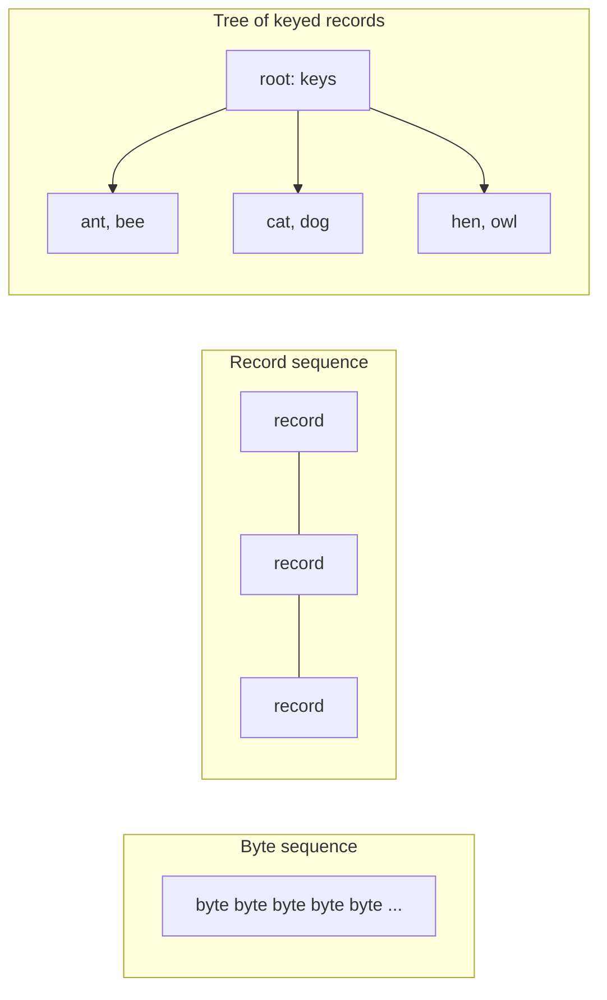
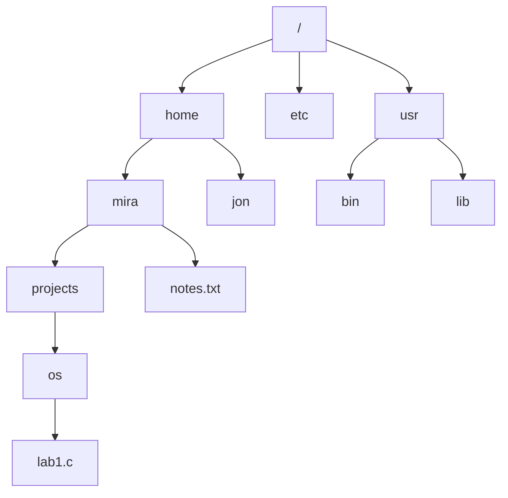

# Files and directories

> **Before this lesson:** [Core concepts, system calls and kernel structure](#/lesson/os/concepts-syscalls-structure), for what a file, a directory and a system call are.

## In plain words

Everything a running program holds in memory disappears when the program ends or the power goes off. To keep anything — a photo, a document, the program itself — it must be stored on a device that remembers without power, such as a disk. A **file** is a named piece of data stored that way.

Think of an office filing cabinet. Each document goes in a labelled folder; folders go in drawers; drawers are grouped by department. To find a paper you follow labels — *Accounts*, then *2026*, then *Invoices* — and never need to know which sheet of metal it is resting on. A computer's **file system** is the same arrangement: files have names, **directories** (also called folders) group them, and a **path** such as `/home/mira/notes.txt` is the list of labels to follow.

This lesson looks at files and directories as a user or programmer sees them: how they are named, what can be done with them, and how one file can be reached by more than one name.

Why it matters for a job: every program reads and writes files. The details here — the difference between absolute and relative paths, why a read may return fewer bytes than requested, hard links versus symbolic links — are behind a great many everyday bugs and are common interview questions.

## Motivation

A process's address space vanishes when the process ends, is limited in size, and is private. Yet almost everything useful a computer does involves information that must outlive the program that produced it, may be far bigger than memory, and often has to be reached by several programs at once. Airline bookings, source code, photographs, the operating system itself — all of it needs long-term storage with three properties:

1. it can hold a very large amount of information;
2. the information survives the termination of the process using it (and crashes, and power loss);
3. multiple processes can access it concurrently.

Disks and SSDs supply raw persistence, but only as a long array of fixed-size blocks supporting "read block k" and "write block k". That immediately raises questions an application should not have to answer: How do you find a piece of information again? How do you stop one user reading another's data? How do you know which blocks are free?

The **file** is the abstraction that answers them. In the same way that a process abstracts the processor and an address space abstracts RAM, a file abstracts the disk: a named, persistent unit of information, managed by the part of the OS called the **file system**. This lesson looks at files and directories from the outside — the user's view. The next looks inside.

## Files

### Naming

A file's name is how a process that did not create it can still find it. Rules vary: some systems distinguish upper and lower case (UNIX-like systems: `Report`, `report` and `REPORT` are three files), some do not (the MS-DOS family, and Windows by default for compatibility).

Many names have two parts separated by a period; the part after it is the **extension** and conventionally indicates what kind of file it is: `.c`, `.jpg`, `.pdf`, `.zip`. How seriously the extension is taken differs:

- In UNIX, extensions are merely conventions. The kernel does not care; a C compiler may insist on `.c`, but that is the compiler's rule.
- In Windows, extensions are registered with the system, each tied to the program that "owns" it, so that double-clicking a file launches the right application.

### Structure

What does the OS believe is inside a file? Three answers have been tried.



- **An unstructured sequence of bytes.** The OS neither knows nor cares what the bytes mean; all meaning is imposed by user programs. UNIX and Windows both do this, and it gives maximum flexibility: programs can put anything in files and name them as they please.
- **A sequence of fixed-length records,** each with internal structure, where reads and writes transfer whole records. This came from the era of 80-column punched cards and 132-character printer lines, and is essentially extinct as a primary model.
- **A tree of records,** each containing a **key** at a known position, kept sorted so that the record with a given key can be found quickly. The system, not the user, decides where records are placed. This is found on large mainframe systems for commercial data processing, and is a short step from a database.

### File types

Operating systems typically distinguish:

- **Regular files** — the ones holding user information.
- **Directories** — system files that maintain the file system's structure.
- **Character special files** — model serial I/O devices such as terminals and printers.
- **Block special files** — model disks.

Regular files are either text or binary. A text file consists of lines of printable characters and can be displayed, printed and edited with any editor, which makes it the universal glue between programs: one program's output feeds another's input. Binary files have internal structure known to the programs that use them.

Even an OS that treats files as byte streams must recognise *one* format: its own executables. A typical executable begins with a **header** containing a **magic number** identifying it as executable, followed by the sizes of its sections, the entry point and flags, then the program text and data, relocation information and a symbol table for debugging. The OS will refuse to run a file without the right magic number, a small defence against executing garbage.

Strongly typed files can backfire. If the system insists that only files ending in a certain extension may be compiled and refuses to let the output of a preprocessor (which has a different extension) be treated as source, the "helpfulness" becomes an obstacle. Protection against user error is welcome for novices and maddening for experts.

### Access

Early systems offered only **sequential access**: read the bytes or records in order from the start, with the option to rewind. That matched magnetic tape. Disks made it possible to read bytes or records out of order — **random access** — which is essential for applications like databases, where a clerk asking about one flight must not wait while the system reads thousands of other records first. The usual mechanism is a `seek` operation that sets the current position, after which reading proceeds sequentially from there.

### Attributes

Besides name and data, every file has **attributes** (metadata). The exact list varies, but typical ones fall into groups:

| Group | Examples |
|---|---|
| Protection | Owner, creator, access permissions, password |
| Flags | Read-only, hidden, system, archive (needs backup), temporary (delete on process exit), lock flags |
| Record structure | Record length, key position, key length (only on systems with keyed files) |
| Times | Creation, last access, last modification — the last lets a build tool know whether an object file is older than its source |
| Sizes | Current size, and on some systems the maximum size |

### Operations

The common system calls on files:

- **Create** — make an empty file and set some attributes.
- **Delete** — free its disk space.
- **Open** — let the system fetch the attributes and the list of disk addresses into memory for fast access on later calls.
- **Close** — release that table space; also forces the last, partially filled block to be written.
- **Read** — bytes from the current position into a buffer supplied by the caller.
- **Write** — at the current position; writing at the end grows the file, writing in the middle overwrites.
- **Append** — a restricted write that only adds at the end.
- **Seek** — reposition for random access.
- **Get attributes / set attributes** — for example, a build tool comparing modification times, or changing the protection mode.
- **Rename** — not strictly necessary (copy then delete would do) but much cheaper.

Why open before use at all? Because it lets the expensive work — path lookup, permission check, loading metadata — happen once rather than on every read.

A program copying one file to another shows the whole pattern: open the source, create the destination, then loop reading a buffer and writing it out until read returns 0 (end of file) or a negative value (error), then close both. Reading returns the number of bytes actually obtained, which may be less than requested at the end of the file — code that ignores that count is a classic source of bugs.

```python-run
MAGIC = {
    b"\x7fELF": "ELF executable (Linux, BSD)",
    b"MZ": "Windows/DOS executable",
    b"\x89PNG": "PNG image",
    b"%PDF": "PDF document",
    b"PK\x03\x04": "ZIP archive (also .docx, .jar, .apk)",
    b"#!": "script with an interpreter line",
}

def identify(first_bytes):
    for magic, kind in MAGIC.items():
        if first_bytes.startswith(magic):
            return kind
    try:
        first_bytes.decode("ascii")
        return "plain text (no magic number)"
    except UnicodeDecodeError:
        return "unknown binary data"

samples = {
    "holiday.txt":  b"\x89PNG\r\n\x1a\n....",       # an image wearing the wrong extension
    "notes.png":    b"Buy milk, call the bank.\n",    # text wearing the wrong extension
    "run-me":       b"#!/bin/sh\necho hello\n",
    "app.bin":      b"\x7fELF\x02\x01\x01",
    "report.docx":  b"PK\x03\x04\x14\x00",
    "mystery":      b"\xff\xfe\x00\x12",
}
for name, head in samples.items():
    print(f"{name:12s} -> {identify(head)}")
```

**What the code does.** `MAGIC` is a table from a *prefix of bytes* to a description. The `b"..."` notation writes raw bytes; `\x7f` is the single byte whose value is 7F in base sixteen. Many file formats always begin with the same few bytes, known as a magic number. `identify` checks whether the start of the file matches any known prefix with `startswith`. If none matches, it tries to interpret the bytes as plain text using `decode("ascii")`; if that fails with an error, the `except` branch reports unknown binary data. `samples` gives six pretend files: a name and the first few bytes of each.

**The output.** `holiday.txt` is identified as a PNG image and `notes.png` as plain text — the names were misleading in both cases. The script, the executable and the document are recognised by their opening bytes, and the last file is reported as unknown binary data.

The contents, not the name, are the truth. That is why tools that inspect files look at the first bytes, and why an operating system checks the header before executing anything.

## Directories

### Single-level and hierarchical systems

To keep track of files, file systems have **directories** (folders), which in many systems are themselves files.

The simplest arrangement is a single **root directory** containing every file. It was common on early personal computers and survives on simple embedded devices — a digital camera, a music player — where the number of files is small and one owner is assumed.

With thousands of files and many users, a flat namespace is unworkable: names collide and nothing can be found. The solution is a **hierarchy** — a tree of directories — so that each user can have a private root for their own files and can group related files as they see fit.



### Path names

In a tree, files need unambiguous names. Two methods exist.

An **absolute path name** lists the directories from the root to the file. In UNIX the components are separated by `/`, as in `/home/mira/projects/os/lab1.c`; Windows uses `\`. An absolute path always starts at the root and is unique.

A **relative path name** is interpreted from the process's **working directory** (current directory). If the working directory is `/home/mira`, the same file is `projects/os/lab1.c`. Each process has its own working directory, so one process changing it does not affect others — though a library routine that changes the working directory and forgets to restore it can break the program that called it.

Most hierarchical systems have two special entries in every directory: `.` (dot) refers to the directory itself, and `..` (dot-dot) to its parent. From `/home/mira/projects`, the path `../notes.txt` names `/home/mira/notes.txt`.

> [!TIP]
> Programs that must work regardless of where they are started from should use absolute paths for anything critical. A background service that assumes a particular working directory is a bug waiting for the day someone launches it differently.

### Directory operations

The calls for managing directories differ more between systems than those for files. A UNIX-flavoured set:

- **Create** — a new directory is empty except for dot and dot-dot.
- **Delete** — allowed only on an empty directory.
- **Opendir / closedir / readdir** — list a directory. `readdir` returns the next entry in a standard format, so programs do not depend on the directory's internal layout.
- **Rename.**
- **Link** — make an existing file appear in another directory as well.
- **Unlink** — remove a directory entry. If the file appears in only one directory, it is removed from the file system; otherwise only that path name goes.

### Hard links and symbolic links

Linking lets one file be reachable by several names. There are two varieties and the difference matters.

A **hard link** is a second directory entry referring to the same underlying file record (the i-node, in UNIX terms). Both names are equal; neither is "the original". The record keeps a **link count**, incremented by link and decremented by unlink; the file's storage is freed only when the count reaches zero.

A **symbolic link** (soft link) is a tiny file whose content is the *path name* of another file. When the system encounters one during a lookup, it substitutes that path and continues. Symbolic links can cross file-system boundaries — even name files on other machines — and can point at directories, but they are less efficient (an extra file and an extra lookup) and can **dangle**: if the target is removed, the link remains and points at nothing.

```python-run
class Inode:
    counter = 0
    def __init__(self, kind, data=None):
        Inode.counter += 1
        self.num, self.kind, self.links = Inode.counter, kind, 0
        self.data = data if data is not None else ({} if kind == "dir" else "")

class FS:
    def __init__(self):
        self.root = Inode("dir")
        self.root.data = {".": self.root, "..": self.root}

    def resolve(self, path, cwd=None, follow=True, depth=0):
        if depth > 8:
            raise OSError("too many levels of symbolic links")
        node = self.root if path.startswith("/") else (cwd or self.root)
        parts = [p for p in path.split("/") if p]
        for i, name in enumerate(parts):
            if node.kind != "dir":
                raise OSError(f"not a directory on the way to {path}")
            if name not in node.data:
                raise OSError(f"no such file or directory: {path}")
            parent, node = node, node.data[name]
            last = i == len(parts) - 1
            if node.kind == "symlink" and (follow or not last):
                node = self.resolve(node.data, cwd=parent, depth=depth + 1)
        return node

    def _split(self, path):
        head, _, name = path.rstrip("/").rpartition("/")
        return self.resolve(head or "/"), name

    def mkdir(self, path):
        parent, name = self._split(path)
        d = Inode("dir")
        d.data = {".": d, "..": parent}
        parent.data[name] = d

    def create(self, path, text):
        parent, name = self._split(path)
        f = Inode("file", text)
        f.links = 1
        parent.data[name] = f

    def link(self, old, new):                       # hard link
        target = self.resolve(old)
        parent, name = self._split(new)
        parent.data[name] = target
        target.links += 1

    def symlink(self, target_path, new):
        parent, name = self._split(new)
        parent.data[name] = Inode("symlink", target_path)

    def unlink(self, path):
        parent, name = self._split(path)
        node = parent.data.pop(name)
        if node.kind == "file":
            node.links -= 1
            if node.links == 0:
                node.data = None                    # storage reclaimed

fs = FS()
for d in ("/home", "/home/mira", "/home/jon"):
    fs.mkdir(d)
fs.create("/home/mira/plan.txt", "ship on Friday")
fs.link("/home/mira/plan.txt", "/home/jon/plan-copy.txt")
fs.symlink("/home/mira/plan.txt", "/home/jon/shortcut")

a, b = fs.resolve("/home/mira/plan.txt"), fs.resolve("/home/jon/plan-copy.txt")
print("same i-node?", a is b, "| i-number", a.num, "| link count", a.links)
print("via symlink :", fs.resolve("/home/jon/shortcut").data)
print("via dot-dot :", fs.resolve("/home/jon/../mira/./plan.txt").data)

fs.unlink("/home/mira/plan.txt")
print("after unlinking the first name, link count =", b.links, "| data still there:", repr(b.data))
try:
    fs.resolve("/home/jon/shortcut")
except OSError as e:
    print("symlink now dangles ->", e)
```

**What the code does.** `Inode` stands for the record the system keeps for each file or directory: a number (`num`), a kind, a count of how many names refer to it (`links`) and its contents. For a directory, the contents are a dictionary from names to inodes. `FS.resolve` turns a path into an inode: it starts at the root (for a path beginning with `/`) and, for each part of the path, looks the name up in the current directory. If what it finds is a symbolic link, it resolves the path stored in the link and carries on from there; the `depth` counter stops endless loops of links. `mkdir` creates a directory containing `.` (itself) and `..` (its parent). `create` makes a file with one link. `link` adds a second name for an existing inode and increases its link count. `symlink` creates a small inode whose content is a path. `unlink` removes a name, decreases the count, and discards the data only when the count reaches zero.

**The output.** The two hard-linked names turn out to be the very same inode, with link count 2. Reading through the symbolic link and through a path containing `..` and `.` both reach the same text. After the first name is removed, the count is 1 and the data is still there under the second name. The symbolic link, which stored the old path, now leads nowhere and produces an error.

Three behaviours to take from the output: the two hard-linked names are one object; removing a name merely decrements the count; and the symbolic link, which stored a path rather than a reference, broke as soon as that path stopped existing.

> [!INTERVIEW]
> "Hard link versus symbolic link?" A hard link is another directory entry for the same i-node: it works only within one file system, usually cannot refer to a directory (to avoid cycles), survives the deletion of the other names, and is indistinguishable from the "original". A symbolic link is a separate small file containing a path: it can cross file systems and point to directories, but breaks if the target is moved or deleted, and costs an extra lookup. Follow-up: "when is a file's data actually freed?" — when its link count reaches zero *and* no process still has it open.

### A subtlety: links turn the tree into a graph

With links, the directory structure is no longer a tree but a directed acyclic graph, and that creates practical problems. A backup program that walks the hierarchy may copy a linked file twice and, on restore, produce two independent files where there was one. A program that searches all directories may visit the same file by several routes. Ownership becomes awkward too: if you remove your name for a file to which someone else hard-linked, the file lives on, still charged to you as owner until the other name goes.

## Pitfalls

- **Trusting the extension.** A name is a hint, not a guarantee of content.
- **Ignoring the return value of read and write.** Both may transfer fewer bytes than requested.
- **Assuming delete means erased.** Unlinking removes a name; the blocks are merely marked free and their contents persist until overwritten — good news for forensic tools, bad news for secrets.
- **Mixing case conventions across systems.** A project with both `Makefile` and `makefile` works on one system and collides on another.
- **Following symbolic links blindly.** Loops (a link pointing at one of its own ancestors) must be cut off by a depth limit, and in privileged programs a link planted by an attacker can redirect a write to a sensitive file.
- **Relying on the working directory** in long-running or library code.

## Summary

- Files provide persistent, shareable, large-capacity storage addressed by **name** rather than by block number.
- Systems may view a file as a **byte sequence** (the dominant choice), a **record sequence** or a **tree of keyed records**. File types include regular files, directories and character/block special files; executables are recognised by a header with a **magic number**.
- Access is **sequential** or **random** (via seek). Files carry **attributes** such as owner, permissions, times and size, and support create, delete, open, close, read, write, append, seek, rename and attribute operations.
- **Directories** organise files, from a single flat level to a full **hierarchy**. Names are **absolute** (from the root) or **relative** (from the working directory), with `.` and `..` as built-in entries.
- **Hard links** are extra names for one i-node with a link count; **symbolic links** are files containing a path, more flexible and more fragile.

## Glossary

- **File** — a named collection of data kept on a storage device.
- **File system** — the part of the operating system that manages files.
- **Extension** — the part of a file name after the last dot, hinting at the kind of file.
- **Regular file** — an ordinary file holding user data.
- **Magic number** — a fixed value at the start of a file identifying its format.
- **Sequential / random access** — reading a file in order from the start / jumping directly to any position.
- **Seek** — the operation that moves the current position in a file.
- **Attribute (metadata)** — information about a file other than its contents, such as its owner, size and times.
- **Directory (folder)** — a container of files and other directories.
- **Root directory** — the directory at the top of the tree.
- **Path name** — the sequence of directory names leading to a file.
- **Absolute / relative path** — a path starting from the root / from the working directory.
- **Working directory** — the directory a process is currently "in".
- **`.` and `..`** — entries in every directory referring to the directory itself and to its parent.
- **I-node** — the record holding a file's attributes and the location of its data.
- **Hard link** — an additional directory entry referring to the same i-node.
- **Link count** — the number of names referring to an i-node.
- **Symbolic link** — a small file containing the path of another file.
- **Dangling link** — a symbolic link whose target no longer exists.

## Check yourself

```quiz
[
  {"q": "Which view of file contents do UNIX and Windows take?",
   "options": ["A tree of keyed records", "A sequence of fixed-length records", "An unstructured sequence of bytes whose meaning is left to programs", "A relational table"],
   "answer": 2,
   "explain": "Both treat a regular file as a byte stream. Any structure is imposed by the applications that read and write it."},
  {"q": "The working directory is /home/mira/projects. Which absolute path does ../notes.txt name?",
   "options": ["/home/mira/projects/notes.txt", "/home/mira/notes.txt", "/home/notes.txt", "/notes.txt"],
   "answer": 1,
   "explain": "Dot-dot refers to the parent of the working directory, which is /home/mira."},
  {"q": "Why does an operating system check a magic number before running a file?",
   "options": ["To decide which user owns it", "To verify that the file really has the executable format rather than arbitrary data", "To compute its size", "To decrypt it"],
   "answer": 1,
   "explain": "The header identifies the file as a valid executable in a known format, so the loader does not attempt to run random bytes."},
  {"q": "A file has link count 2. One of its names is unlinked. What happens to the data?",
   "options": ["It is freed immediately", "It remains; the link count drops to 1", "Half of it is freed", "The other name becomes a symbolic link"],
   "answer": 1,
   "explain": "Storage is reclaimed only when the count reaches zero and no process has the file open."},
  {"q": "Which of these can a symbolic link do that a hard link normally cannot?",
   "options": ["Share the same i-node", "Refer to a file on a different file system", "Keep the file alive after the original name is removed", "Increase the link count"],
   "answer": 1,
   "explain": "A symbolic link stores a path, which may lead anywhere. A hard link is a directory entry holding an i-number, meaningful only within one file system."},
  {"q": "What is the purpose of the open call, given that read could in principle take a path name each time?",
   "options": ["To copy the file into memory", "To do path lookup and permission checking once and keep the file's metadata handy for later calls", "To lock the file permanently", "To convert the file to text"],
   "answer": 1,
   "explain": "Open returns a descriptor that later calls use directly, avoiding repeated directory searches and checks."},
  {"q": "A read call asks for 4096 bytes and returns 1200. What is the most likely meaning?",
   "options": ["An error occurred", "The end of the file was reached after 1200 bytes", "The buffer was too small", "The file is a directory"],
   "answer": 1,
   "explain": "Read returns the number of bytes actually transferred. A short count is normal at the end of a file; zero signals end of file and a negative value signals an error."},
  {"q": "Why can hard links complicate a backup program that walks the directory tree?",
   "options": ["Hard links cannot be read", "The same file can be reached by several paths, so it may be copied more than once and restored as separate files", "Hard links have no permissions", "They always point to deleted files"],
   "answer": 1,
   "explain": "With links the hierarchy is a graph, not a tree. A naive traversal treats each path as a distinct file unless it tracks i-numbers."}
]
```

> **Source:** Tanenbaum & Bos, Modern Operating Systems 4e, §4.1 (Files), §4.2 (Directories)
