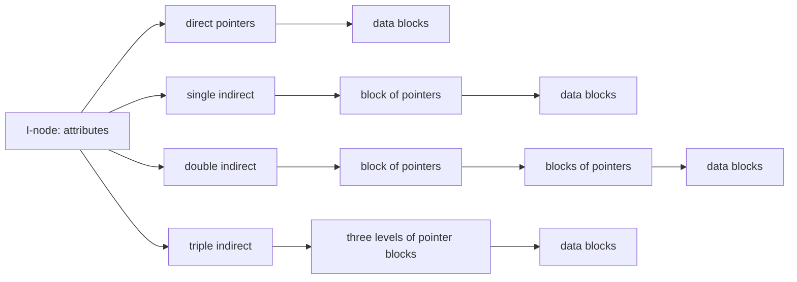
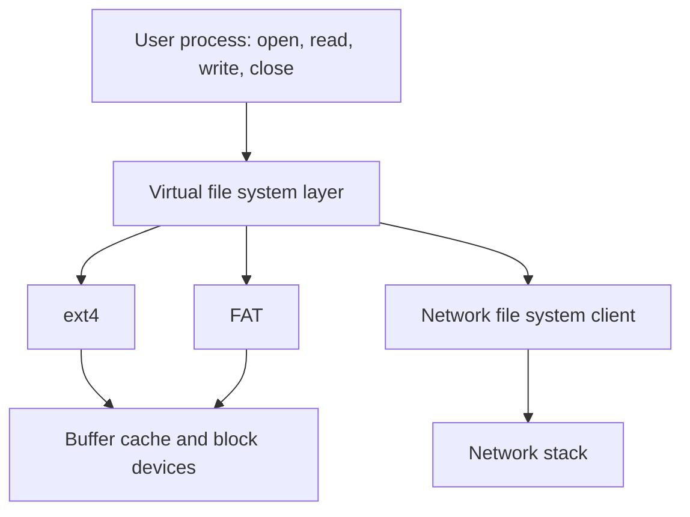

# File-system implementation

> **Before this lesson:** [Files and directories](#/lesson/os/files-directories), for files, directories, paths, i-nodes and links as a user sees them.

## In plain words

The previous lesson looked at files from the outside. This one opens the box. A disk knows nothing about files: it is a long row of equal-sized compartments called **blocks**, each identified by a number. The question is how to build named files of any size out of numbered blocks.

Think of a warehouse with thousands of identical numbered shelves and goods that arrive in consignments of every size. One consignment may need fifty shelves; another, one. The warehouse needs a record of which shelves hold which consignment, in what order. It could insist that each consignment occupy neighbouring shelves; it could leave a note on each shelf saying where the next part is; or it could keep an index card per consignment listing all its shelves. Those are, in essence, the methods file systems use — known as contiguous allocation, linked allocation and i-nodes.

The warehouse also needs to survive a power cut in the middle of moving things about. File systems handle that with a **journal**: a diary of what they are about to do.

Why it matters for a job: the way a file system is built explains real limits and behaviours you will meet — maximum file sizes, why memory cards use one format and servers another, and why a machine that crashed does not usually lose its files.

## Motivation

Users see names, folders and byte streams. The disk offers numbered blocks. Everything in between — deciding which blocks belong to which file, finding them again quickly, surviving a power cut in the middle of an update, supporting several file-system formats behind one set of system calls — is the implementer's problem, and the subject of this lesson.

The central design question is deceptively simple: *given a file, how do we record which disk blocks hold its data?* Four answers have been used, each with a characteristic strength and weakness. Once that is settled we look at how directories are stored, and then at three ideas that shaped modern file systems: log-structured writing, journaling and the virtual file system layer.

## Disk layout

A disk is usually divided into **partitions**, each holding an independent file system. Under the classic PC scheme, sector 0 of the disk is the **master boot record** (MBR), containing boot code and, at its end, the **partition table** with the start and end of each partition; one partition is marked active. At power-on the firmware runs the MBR code, which locates the active partition and loads its first block, the **boot block**, which in turn loads the operating system. (Newer machines use UEFI with a GUID partition table, which removes the old limits on disk size and partition count; the principle is unchanged.)

Inside a partition the layout varies by file system, but a UNIX-style one looks like this:


The **superblock** holds the key parameters: a magic number identifying the file-system type, the number of blocks, the block size and other administrative information. It is read into memory when the file system is first used. After it come structures recording free space (a bitmap or a list), then the **i-nodes** — one fixed-size record per file — then the root directory, then everything else.

## Implementing files

### Contiguous allocation

Store each file as one unbroken run of blocks. A 50 KB file on a disk with 1 KB blocks gets 50 consecutive blocks.

Two virtues: it is trivial to describe (first block and length) and reading is as fast as it can be, since after one seek the whole file streams off the disk.

One crippling flaw: as files are created and deleted the disk fragments into holes, exactly like memory under swapping. Reusing a hole requires knowing a new file's final size at creation — which a word processor cannot know. Compaction means copying the whole disk. Contiguous allocation was used on early magnetic disks, abandoned, and then found a perfect home on **write-once media** such as CD-ROMs and DVDs, where every file's size is known in advance and nothing is ever deleted. (Modern file systems also revive the idea in a softer form, as *extents* — a file is described as a small number of contiguous runs.)

### Linked-list allocation

Keep each file as a linked list of blocks, the first few bytes of each block holding the number of the next. Every disk block can be used; there is no external fragmentation, and the directory entry need store only the first block's address.

The costs: **random access is painfully slow** — to reach block n the system must read the n blocks before it, one disk read each. And because the pointer occupies part of each block, the usable data per block is no longer a power of two, which is awkward for programs that read and write in power-of-two chunks.

### Linked-list allocation with a table in memory: FAT

Both drawbacks disappear if the pointers are taken out of the blocks and collected in a table in main memory, indexed by block number: the **file allocation table** (FAT). Entry k holds the number of the block that follows block k in its file, or a special end marker.

Now whole blocks hold data, and although the chain must still be followed to find a given offset, it is followed *in memory*, with no disk reads.

The disadvantage is that the entire table must be in memory all the time. It has one entry per disk block, so it grows with the disk:

```python-run
def fat_table_size(disk_bytes, block_bytes, entry_bytes=4):
    return disk_bytes // block_bytes * entry_bytes

GB, TB = 1 << 30, 1 << 40
print("disk size   block   FAT size held in RAM")
for disk, block in ((32 * GB, 4096), (500 * GB, 4096), (2 * TB, 4096), (2 * TB, 32768)):
    size = fat_table_size(disk, block)
    print(f"{disk // GB:7d} GB  {block // 1024:3d} KB  {size / (1 << 20):9.1f} MB")

# Following a chain in the table
fat = {4: 7, 7: 2, 2: 10, 10: 12, 12: -1, 6: 3, 3: 11, 11: 14, 14: -1}
def chain(start):
    out = []
    while start != -1:
        out.append(start)
        start = fat[start]
    return out
print("\nfile A occupies blocks", chain(4))
print("file B occupies blocks", chain(6))
print("to read byte 9000 of file A with 4 KB blocks, follow", 9000 // 4096, "links ->", chain(4)[9000 // 4096])
```

**What the code does.** `fat_table_size` works out the size of a file allocation table: one entry per block on the disk, so the disk size divided by the block size (`//` is whole-number division), times the bytes per entry. `1 << 30` is 2 to the power 30, a gigabyte. The loop prints the table size for several disks. The second part shows the table in use: `fat` is a dictionary in which each block number leads to the number of the next block of the same file, or to -1 at the end. `chain(start)` follows those links from a file's first block and collects the blocks in order.

**The output.** A 32-gigabyte disk needs a 32-megabyte table in memory, and a 2-terabyte disk needs 2 gigabytes unless bigger blocks are used. File A occupies blocks 4, 7, 2, 10 and 12 in that order. Byte 9000 lies in the third block of the file (9000 // 4096 = 2, counting from 0), which is found by following two links to block 2.

FAT was the MS-DOS file system and is still the common denominator for memory cards and USB sticks precisely because it is simple enough for every camera and car stereo to implement.

### I-nodes

The fourth method associates with each file a data structure called an **i-node** (index node), which lists the file's attributes and the disk addresses of its blocks.

The decisive advantage over the FAT: an i-node need be in memory **only while its file is open**. If each i-node occupies n bytes and at most k files are open at once, the memory cost is k·n — proportional to the number of open files, not to the size of the disk.

An i-node has room for only a fixed number of block addresses. For larger files, the last few addresses point not at data but at blocks *full of more addresses*:



Small files — the overwhelming majority — are reached straight from the i-node. Large files pay one, two or three extra block reads, and the reachable size grows geometrically with each level.

```python-run
def inode_capacity(block, ptr, direct=12):
    n = block // ptr
    levels = [direct, n, n * n, n ** 3]
    names = ["direct", "single indirect", "double indirect", "triple indirect"]
    total = 0
    for name, count in zip(names, levels):
        total += count
        print(f"  + {name:16s}: {count:>13,} blocks -> cumulative {total * block / (1 << 30):14,.3f} GB")
    return total * block

def lookup(block_no, direct, n):
    if block_no < direct:
        return ("direct", block_no), 1
    b = block_no - direct
    if b < n:
        return ("single", b), 2
    b -= n
    if b < n * n:
        return ("double", b // n, b % n), 3
    b -= n * n
    return ("triple", b // (n * n), b // n % n, b % n), 4

print("4 KB blocks, 4-byte block numbers, 12 direct pointers:")
inode_capacity(4096, 4)
print()
for offset in (10_000, 3_000_000, 500_000_000, 20_000_000_000):
    path, reads = lookup(offset // 4096, 12, 1024)
    print(f"byte {offset:>14,}: {str(path):26s} {reads} block read(s) after the i-node")
```

**What the code does.** `inode_capacity` adds up how many blocks a file can have. `n = block // ptr` is how many block numbers fit in one block (4096 / 4 = 1024). The four kinds of pointer reach 12 blocks directly, `n` through one extra level, `n * n` through two and `n ** 3` (n cubed) through three. `lookup` goes the other way: given the position of a block within the file, it reports which route leads to it and how many blocks must be read. It subtracts the capacity of each earlier region in turn; inside the two-level region, `b // n` and `b % n` (division and remainder) give the entry to follow at each level.

**The output.** The direct pointers cover the first 48 kilobytes; one level of indirection takes the limit to about 4 megabytes, two to about 4 gigabytes and three to about 4 terabytes. Byte 10,000 is reached directly with 1 block read; byte 3,000,000 needs 2; byte 500,000,000 needs 3; byte 20,000,000,000 needs 4.

> [!INTERVIEW]
> Be ready to compute a maximum file size: with block size B and pointer size P there are B/P pointers per block; the file can have `direct + B/P + (B/P)² + (B/P)³` blocks. Also expect "how many disk accesses to read byte X?" — count the pointer blocks on the path plus the data block (and add the i-node itself and the directory lookups if nothing is cached). Finally, know the comparison: contiguous (fast, fragments), linked (no fragmentation, slow random access), FAT (fast random access, table must be in RAM), i-node (memory proportional to open files, scalable).

## Implementing directories

Opening a file means mapping its path name to the information needed to find its blocks. A directory entry therefore holds the name plus either the disk address of the whole file (contiguous), the first block number (linked/FAT) or the **i-node number**.

Where do the attributes live? Either directly in the directory entry (simple fixed-size entries, as in the oldest PC systems) or in the i-node, leaving the directory entry as only a name and an i-node number. The second design is cleaner — and necessary for hard links, since two names must share one set of attributes.

**Variable-length names.** Reserving 255 characters in every entry would waste enormous space. Two alternatives: make entries variable-length, each beginning with its own length (but removing a file then leaves an odd-sized gap that the next entry may not fit); or keep entries fixed-length and store the names together in a heap at the end of the directory, with each entry pointing to its name.

**Lookup speed.** Searching a directory linearly is fine for dozens of entries and awful for hundreds of thousands. Large directories use a **hash table** (hash the name to a bucket and search a short chain) or a balanced tree, and systems also cache the results of recent lookups so that a path used a moment ago is not searched again.

### Shared files, revisited

When a file appears in two directories the on-disk structure must support it. If directory entries contained the block list itself, a change made through one name would be invisible through the other. With i-nodes the problem vanishes: both entries carry the same i-number, and the i-node carries the **link count**. Symbolic links avoid the shared structure entirely at the cost of an extra file and a path traversal on every use.

## Log-structured file systems

Hardware trends in the late 1980s changed the picture. CPUs and RAM grew quickly, so large in-memory caches could satisfy most *reads* without touching the disk. Disk *seek* time barely improved. The bottleneck became small, scattered writes: creating one small file on a UNIX file system touches the directory's i-node, the directory block, the file's i-node and the file's data block — four writes in four places.

The **log-structured file system** (LFS) takes a radical position: treat the whole disk as an append-only **log**. All pending writes — data blocks, i-nodes, directory blocks — are collected in memory and periodically written together as one large contiguous **segment** at the end of the log, using the full bandwidth of the disk with no seeks in between.

I-nodes are now scattered through the log, so an **i-node map**, indexed by i-number, records each one's current location (it is kept on disk and cached in memory). Since the disk is finite, a **cleaner** thread scans old segments, works out which blocks in them are still live (most have been superseded by newer versions further along the log), copies the live ones to the head of the log and marks the segment free.

LFS performs dramatically better for workloads with many small writes. It never became mainstream on magnetic disks, mainly because it was incompatible with existing systems, but its central idea — never overwrite in place; append and clean up later — is exactly how flash storage works internally, and it reappears in copy-on-write file systems and in many databases.

## Journaling file systems

A less radical idea borrowed from LFS has become universal: robustness through logging.

Consider removing a file in UNIX. Three things must happen:

1. remove the file from its directory;
2. release the i-node to the pool of free i-nodes;
3. return all its disk blocks to the pool of free blocks.

A crash between steps leaves the disk inconsistent. After only step 1, the i-node and blocks are reachable from nowhere yet not free: leaked space. Had the steps been done in another order, a crash could leave a directory entry pointing at a freed i-node — far worse, since that i-node may soon be reused for someone else's file.

A **journaling file system** first writes a log entry describing all three intended actions and forces it to disk. Only after the log entry is safely stored does it carry out the operations. When they are complete, the entry is erased. After a crash, the system inspects the journal on reboot: any entry found there describes work that may be half done, and the work is done again.

For this to be safe the logged operations must be **idempotent** — repeatable any number of times without harm. "Mark block n as free in the bitmap" is idempotent. "Append block n to the end of the free list" is not: doing it twice puts the block on the list twice. Such operations must be restated in a repeatable form ("search the list and add block n if it is absent").

For extra reliability a group of operations can be bracketed as an **atomic transaction** (begin … end): either all of them take effect or none.

```python-run
import copy

def fresh_disk():
    return {
        "directory": {"report.txt": 7},
        "inode_free": {7: False},
        "block_free": {40: False, 41: False},
        "journal": [],
    }

OPS = [
    ("directory", "remove", "report.txt"),
    ("inode_free", "set", 7),
    ("block_free", "set", 40),
    ("block_free", "set", 41),
]

def apply(disk, op):
    area, action, key = op
    if action == "remove":
        disk[area].pop(key, None)          # idempotent: removing twice is harmless
    else:
        disk[area][key] = True             # idempotent: setting a bit twice is harmless

def consistent(disk):
    named = set(disk["directory"].values())
    for ino, free in disk["inode_free"].items():
        if free and ino in named:
            return "directory entry points at a FREE i-node"
        if not free and ino not in named:
            return "i-node allocated but unreachable (leak)"
    if not all(disk["block_free"].values()) and disk["inode_free"][7]:
        return "blocks still marked used by a freed file (leak)"
    return "consistent"

def delete(disk, crash_after, journaling):
    if journaling:
        disk["journal"] = list(OPS)        # step 0: the intent reaches the disk first
    for i, op in enumerate(OPS):
        if i == crash_after:
            return disk                    # power fails here
        apply(disk, op)
    disk["journal"] = []
    return disk

def recover(disk):
    for op in disk["journal"]:             # redo everything in the log
        apply(disk, op)
    disk["journal"] = []
    return disk

print("crash point   without journal                              with journal + recovery")
for crash in range(1, 4):
    plain = delete(fresh_disk(), crash, journaling=False)
    logged = recover(delete(fresh_disk(), crash, journaling=True))
    print(f"after op {crash}    {consistent(plain):48s} {consistent(logged)}")
```

**What the code does.** `fresh_disk` builds a tiny disk as a dictionary: a directory with one file, a record of which i-nodes and blocks are free, and an empty journal. `OPS` is the list of four changes needed to delete the file. `apply` performs one change, in a way that is harmless if repeated. `consistent` inspects the disk and reports any contradiction, such as an i-node that is in use but that no name points to. `delete` carries out the operations but stops at `crash_after` to imitate a power failure; with journaling switched on, it first writes the whole list of intended changes into the journal. `recover` is what happens at the next start-up: every change found in the journal is applied again, and the journal is cleared.

**The output.** Without a journal, every crash point leaves the disk in a contradictory state — a leak. With a journal followed by recovery, all three crash points end `consistent`.

Most production file systems journal only *metadata* by default (directories, i-nodes, bitmaps), which guarantees a consistent structure but not that the last few seconds of file *contents* survive. NTFS, ext3/ext4 and others all work this way.

## Virtual file systems

One machine routinely uses several file systems at once: the main disk in one format, a USB stick in FAT, a DVD in the optical-disc format, a remote server over a network protocol. Windows identifies each by a drive letter. UNIX-like systems integrate them all into a single tree, so a program need not know or care which is which.

The mechanism is the **virtual file system** (VFS). The idea is to factor out everything common to all file systems into a layer that sits directly below the system-call interface, and have it call the concrete file systems through a fixed interface.



The VFS has an **upper interface** to user processes — the standard POSIX calls — and a **lower interface** that each concrete file system must implement: a few dozen function calls for operations such as "read the superblock", "look up a name in this directory", "read these blocks of this file".

Internally it works with a handful of object types: a **superblock** (one mounted file system), a **v-node** (one file), a **directory** object, each with a table of function pointers supplied by the concrete file system. When a file system is registered at boot or module load, it hands the VFS its list of functions. When one is mounted, the VFS calls it to fetch the superblock. When a process opens `/usb/photo.jpg`, the VFS walks the path, notices the mount point, asks the FAT code to look up the name, creates a v-node, and records it in the process's file-descriptor table. A later `read` on that descriptor is routed through the v-node's function table to the FAT implementation — and the VFS itself never knows whether the bytes came from a local disk, a memory card or a server on another continent.

```python-run
class FileSystem:
    """The 'lower interface' every concrete file system must provide."""
    def lookup(self, name): raise NotImplementedError
    def read(self, handle, offset, n): raise NotImplementedError

class RamFS(FileSystem):
    def __init__(self, files): self.files = files
    def lookup(self, name): return name if name in self.files else None
    def read(self, handle, offset, n): return self.files[handle][offset:offset + n]

class UpperCaseFS(FileSystem):          # stands in for a format with quite different rules
    def __init__(self, files): self.files = {k.upper(): v for k, v in files.items()}
    def lookup(self, name): return name.upper() if name.upper() in self.files else None
    def read(self, handle, offset, n): return self.files[handle][offset:offset + n]

class VFS:
    def __init__(self): self.mounts, self.fds = {}, []
    def mount(self, point, fs): self.mounts[point] = fs
    def open(self, path):
        point = max((m for m in self.mounts if path.startswith(m)), key=len)   # longest matching mount point
        fs = self.mounts[point]
        handle = fs.lookup(path[len(point):].lstrip("/"))
        if handle is None:
            return -1
        self.fds.append((fs, handle))          # the v-node: which fs, which file
        return len(self.fds) - 1
    def read(self, fd, offset, n):
        fs, handle = self.fds[fd]
        return fs.read(handle, offset, n)      # dispatch through the fs's own function

vfs = VFS()
vfs.mount("/", RamFS({"etc/hostname": "saturn\n"}))
vfs.mount("/usb", UpperCaseFS({"photo.txt": "a picture of a cat"}))
for path in ("/etc/hostname", "/usb/Photo.TXT", "/usb/missing"):
    fd = vfs.open(path)
    print(f"{path:16s} -> fd {fd:2d}", "" if fd < 0 else f"-> {vfs.read(fd, 0, 12)!r}")
```

**What the code does.** `FileSystem` lists the two operations every kind of file system must supply. `RamFS` and `UpperCaseFS` are two different kinds with different rules (the second turns all names into capitals). `VFS` is the common layer. `mount` records which file system is attached at which point in the directory tree. `open` finds the *longest* mount point that the path begins with, asks that file system to look the rest of the name up, and returns a small number (a file descriptor) under which it remembers which file system and which file were meant. `read` uses that record to pass the request to the right file system.

**The output.** `/etc/hostname` is found by the first file system. `/usb/Photo.TXT` is found by the second, although the name was typed in mixed case, because that file system ignores case. `/usb/missing` returns -1. The program that called `open` and `read` used the same two operations throughout.

## Pitfalls

- **Forgetting the cost of the FAT in RAM**, or the cost of chain-following for large files.
- **Miscounting indirect capacity** — double indirect reaches (B/P)², not 2·(B/P).
- **Assuming journaling protects data.** Metadata journaling guarantees structural consistency; recently written contents can still be lost unless the application explicitly forces them to disk.
- **Logging non-idempotent operations.** Redo-based recovery is only safe if redoing is harmless.
- **Believing "deleted" space is immediately reusable in a log-structured system** — it is only reclaimed when the cleaner gets to that segment.
- **Hard-coding assumptions about the file system** (case sensitivity, maximum name length, atomic rename) in applications that will run above a VFS.

## Summary

- A partition holds a boot block, a **superblock**, free-space structures, **i-nodes**, the root directory and data.
- Block allocation: **contiguous** (fast, fragments; ideal for read-only media), **linked list** (no fragmentation, slow random access), **FAT** (linked list in memory; table scales with the disk), **i-nodes** (per-file index with direct and indirect pointers; memory scales with open files).
- Directories map names to file records; attributes live in the entry or, better, in the i-node. Long names and large directories need variable-length storage and hashing.
- **LFS** turns all writes into sequential appends to a log, with an i-node map and a cleaner.
- **Journaling** logs intended metadata changes before making them; recovery replays the log, which requires **idempotent** operations.
- The **VFS** gives all file systems one upper interface by dispatching through per-file-system function tables.

## Glossary

- **Block** — one of the equal-sized, numbered units into which a disk is divided.
- **Partition** — a section of a disk treated as a separate disk.
- **Master boot record (MBR)** — the first sector of a disk, holding start-up code and the list of partitions.
- **Boot block** — the first block of a partition, which loads the operating system.
- **Superblock** — the block holding the key facts about a file system.
- **Contiguous allocation** — storing each file in one unbroken run of blocks.
- **Linked-list allocation** — storing in each block the number of the next block of the file.
- **File allocation table (FAT)** — a table in memory holding, for each block, the number of the next block of its file.
- **I-node** — a per-file record listing the file's attributes and the blocks holding its data.
- **Direct / indirect block pointer** — a block number stored in the i-node / the number of a block that itself holds block numbers.
- **Directory entry** — a record pairing a file name with the information needed to find the file.
- **Log-structured file system** — a file system that writes all changes one after another at the end of a log.
- **Cleaner** — the task that reclaims space occupied by out-of-date data in a log-structured file system.
- **Journaling** — writing down intended changes before making them, so that they can be completed after a crash.
- **Idempotent** — having the same effect whether done once or several times.
- **Virtual file system (VFS)** — a layer that lets programs use different kinds of file system in the same way.
- **Mount point** — the directory at which another file system is attached.

## Check yourself

```quiz
[
  {"q": "Which allocation method gives the best sequential read performance but suffers badly from fragmentation as files are deleted and created?",
   "options": ["I-nodes", "Linked list", "Contiguous allocation", "FAT"],
   "answer": 2,
   "explain": "A contiguous file needs one seek and then streams. But freed runs leave holes, and new files must fit a hole whose size must be known in advance."},
  {"q": "A 200 GB disk uses 4 KB blocks and a FAT with 4-byte entries. How much memory does the table need?",
   "options": ["About 50 MB", "About 200 MB", "About 800 MB", "About 4 GB"],
   "answer": 1,
   "explain": "200 GB / 4 KB = 52,428,800 blocks, times 4 bytes each = about 200 MB."},
  {"q": "What is the main memory advantage of i-nodes over a FAT?",
   "options": ["I-nodes are stored in the boot block", "Only the i-nodes of open files need to be in memory, regardless of disk size", "I-nodes need no disk space", "I-nodes avoid directories"],
   "answer": 1,
   "explain": "The FAT must hold an entry for every block on the disk. The in-memory i-node table grows with the number of open files instead."},
  {"q": "An i-node has 10 direct pointers and one single-indirect pointer; blocks are 1 KB and block numbers 4 bytes. What is the largest file?",
   "options": ["10 KB", "266 KB", "1034 KB", "65,546 KB"],
   "answer": 1,
   "explain": "A 1 KB block holds 256 pointers. 10 + 256 = 266 blocks of 1 KB each."},
  {"q": "Why must operations recorded in a file-system journal be idempotent?",
   "options": ["So they can be executed in parallel", "Because after a crash the logged operations are re-executed, possibly repeating some that had already completed", "So the journal can be compressed", "Because the disk is read-only during recovery"],
   "answer": 1,
   "explain": "Recovery cannot know exactly how far execution got, so it redoes the whole entry. That is safe only if repeating an operation has no additional effect."},
  {"q": "What bottleneck was the log-structured file system designed to remove?",
   "options": ["Slow sequential reads of huge files", "Many small writes scattered across the disk, each requiring a seek", "Lack of long file names", "Limited number of i-nodes"],
   "answer": 1,
   "explain": "With reads served from memory caches, small scattered writes dominated. LFS batches them into large sequential segment writes."},
  {"q": "In a log-structured file system, what is the job of the cleaner?",
   "options": ["Erasing the journal after each transaction", "Finding segments made mostly of superseded blocks, copying the live blocks forward and freeing the segments", "Defragmenting individual files in place", "Checking permissions"],
   "answer": 1,
   "explain": "Because nothing is overwritten in place, old versions accumulate. The cleaner compacts live data so whole segments can be reused."},
  {"q": "What does the virtual file system layer make possible?",
   "options": ["Running without any disk", "Using different concrete file systems through the same system calls, in one directory tree", "Faster CPU scheduling", "Encrypting every file automatically"],
   "answer": 1,
   "explain": "The VFS defines a common interface and dispatches each operation to the code of whichever file system the file lives on."}
]
```

> **Source:** Tanenbaum & Bos, Modern Operating Systems 4e, §4.3 (File-system implementation)
