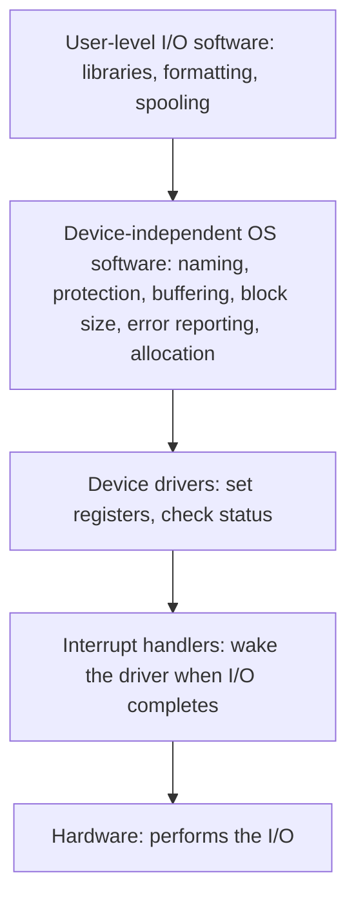

# I/O hardware and the layers of I/O software

> **Before this lesson:** [Hardware review: CPUs, memory, devices and booting](#/lesson/os/hardware-review), for controllers, device drivers, interrupts and direct memory access.

## In plain words

A computer that could only calculate would be useless. It has to take things in (from a keyboard, a touch screen, a network) and send things out (to a display, a printer, a disk). Together these are called **input/output**, written **I/O**, and the equipment involved is called **devices**.

Devices are wildly different from one another. A keyboard delivers a few characters a second; a network card delivers billions of bits. Some store data, some only produce it. Think of a company's post room, which deals with letters, parcels, couriers and faxes. Staff upstairs do not learn the rules of each courier firm. They hand everything to the post room in one standard way, and specialists there deal with each carrier's peculiarities.

The operating system's I/O software is that post room. It is built in layers: at the bottom, code that knows one particular device (a **device driver**); in the middle, code that makes all devices look alike; at the top, the convenient functions that programs call.

Why it matters for a job: device-handling code is the largest part of any operating system and the source of most of its crashes. For an application developer, this lesson explains what really happens when a program reads a file — and why some ways of doing input and output are far faster than others.

## Motivation

Besides providing processes, address spaces and files, an operating system controls every device attached to the machine: it issues commands, fields interrupts and copes with errors. This is not a side job. In a typical kernel, device-related code is by far the largest component and the least glamorous, and it is where most crashes originate.

The challenge is diversity. A keyboard produces a few bytes per second; a fast network card moves gigabytes per second. Some devices store data, some only emit it, some can be read in any order and others only as a stream. The OS must present all of them through an interface simple enough that a program copying data does not care whether the source is a file, a pipe, a terminal or a tape. This lesson explains the hardware principles and then the layered software structure that achieves that.

## I/O hardware

### Block and character devices

Devices are traditionally split into two classes.

A **block device** stores information in fixed-size blocks, each with its own address, and each block can be read or written independently of the others. Hard disks, SSDs and USB sticks are block devices.

A **character device** delivers or accepts a stream of characters with no block structure. It is not addressable and has no seek operation. Printers, network interfaces, mice and most other non-disk-like devices are character devices.

The classification is imperfect — clocks fit neither class; they only cause interrupts at intervals — but it is general enough to serve as the basis for making part of the I/O software device-independent.

### Device controllers

An I/O unit usually has a mechanical part and an electronic part, the **device controller** (or adapter). The controller's job is to convert the raw signal from the device — for a disk, a serial bit stream with preamble, data and error-correcting code — into something clean: a block of bytes, checked for errors and assembled in an internal buffer, ready to be copied to memory. The OS deals with the controller, never with the raw device.

### Talking to a controller: ports and memory mapping

Each controller has a few **registers** used to communicate with the CPU: by writing them the OS commands the device to deliver data, accept data or switch itself on; by reading them it learns the device's state. Many devices also have a **data buffer** (video memory is the classic example).

How does the CPU reach these registers? Two schemes exist.

- **Port-mapped I/O.** Each register is assigned an **I/O port number** in a separate address space, reached with special instructions (`IN` and `OUT`). Memory address 4 and port 4 are unrelated.
- **Memory-mapped I/O.** Each register is assigned a unique *memory address* to which no RAM corresponds. Ordinary load and store instructions reach the device.

Some architectures use a hybrid: memory-mapped data buffers and separate ports for control registers.

Memory-mapped I/O has real advantages. A device driver can be written entirely in a high-level language, since registers are ordinary variables in memory — no assembly is needed for special I/O instructions. No special protection mechanism is required: to keep user processes away from devices, the OS does not map those addresses into their address spaces. And every instruction that can reference memory can reference a device register.

It also has pitfalls. Caching a device register would be a disaster: a loop that waits for a status bit to change would read the cached value forever. So caching must be disabled selectively for those pages. And with separate buses for memory and I/O, every address must be examined to decide which bus it belongs on.

### Direct memory access

Reading a disk block one byte at a time through a register wastes the CPU. With **DMA**, a separate controller does the transfer:

```mermaid
sequenceDiagram
    participant CPU
    participant DMA as DMA controller
    participant DC as Disk controller
    participant MEM as Main memory
    CPU->>DMA: 1. program it: memory address, byte count, direction
    CPU->>DC: issue read command; CPU goes off to other work
    DMA->>DC: 2. request transfer of the next word
    DC->>MEM: 3. write the word at the given address
    DC->>DMA: 4. acknowledge
    Note over DMA: increment address, decrement count, repeat 2 to 4 until count is 0
    DMA->>CPU: interrupt: transfer complete
```

When the interrupt arrives the data is already in memory; the OS has nothing to copy. DMA controllers may transfer a word at a time (**cycle stealing**, sneaking in between the CPU's own bus cycles and delaying it slightly) or seize the bus for a whole block (**burst mode**).

Why does the disk controller buffer the block internally instead of delivering bits straight to memory as they come off the platter? Two reasons: it can verify the checksum before any transfer begins, and once a disk read starts the bits arrive at a constant rate whether or not the bus is available — without a buffer, a busy bus would mean lost data.

### Interrupts revisited

When a device finishes its work it asserts a signal on its assigned interrupt line. The **interrupt controller** chip detects it. If no higher-priority interrupt is pending, the controller puts a number on the bus identifying the device and signals the CPU. That number indexes the **interrupt vector**, a table of addresses of interrupt service routines. The CPU saves at least the program counter (and usually the status word), jumps to the routine, and the routine acknowledges the interrupt so that the controller is free to issue another.

Where to save state is a small design problem of its own. Using the current user stack is risky (the stack pointer may be invalid, or the save may itself cause a page fault); using a kernel stack requires a switch into kernel mode and possibly a change of memory context.

**Precise and imprecise interrupts.** On a pipelined, superscalar processor, at the moment of an interrupt many instructions are partly executed. An interrupt is **precise** if it leaves the machine in a well-defined state:

1. the program counter is saved in a known place;
2. all instructions before the one it points to have completed;
3. no instruction beyond it has finished;
4. the execution state of the instruction it points to is known.

An interrupt that does not meet these conditions is **imprecise**, and makes the OS's life miserable: it must work out what happened and what remains to be done. Machines with precise interrupts spend considerable chip area and complexity to keep the necessary logs so that partly finished work can be cancelled — a price paid for a simpler and faster OS.

## Goals of I/O software

- **Device independence.** A program that reads a file should work unchanged whether the file is on a hard disk, an SSD or a USB stick.
- **Uniform naming.** A device's name should be a string or number that does not depend on the device; in UNIX all devices appear in the file-system name space.
- **Error handling close to the hardware.** If the controller detects a read error it should try to correct it; failing that, the driver should retry. Many errors are transient and vanish on a second attempt. Only if the lower layers cannot cope should the upper layers be told.
- **Synchronous interface over asynchronous hardware.** Most physical I/O is asynchronous — the CPU starts the transfer and goes elsewhere until an interrupt arrives. User programs are far easier to write if calls *block*, so the OS makes interrupt-driven operations look blocking.
- **Buffering.** Data coming off a device often cannot go straight to its destination (a network packet must be examined before the OS knows whom it is for), and some devices have real-time constraints that require data to be staged in advance.
- **Sharable versus dedicated devices.** Disks can be used by many users at once; a printer cannot interleave pages from different jobs. The OS must handle both.

## Three ways of performing I/O

Imagine printing a string of n characters.

**Programmed I/O.** The OS copies the string to kernel space and then loops: wait until the printer is ready, output one character, repeat. The CPU polls the printer's status register continuously — **busy waiting**. Simple, and fine in an embedded system where the CPU has nothing else to do.

**Interrupt-driven I/O.** After writing the first character the OS blocks the process and schedules another. When the printer is ready for the next character it raises an interrupt; the handler outputs one more character and returns. The CPU is free between characters — but an interrupt occurs for *every* character, and interrupts are not free.

**I/O using DMA.** The DMA controller feeds the characters to the printer one at a time without bothering the CPU; there is one interrupt per buffer instead of one per character.

```python-run
def cost(n_chars, device_ms_per_char, method, poll_cost_us=1, interrupt_cost_us=20, dma_setup_us=50):
    """Return (CPU microseconds consumed by the I/O, wall-clock milliseconds)."""
    wall_ms = n_chars * device_ms_per_char
    if method == "programmed":
        cpu_us = wall_ms * 1000                      # the CPU spins for the whole duration
    elif method == "interrupt":
        cpu_us = n_chars * interrupt_cost_us
    else:
        cpu_us = dma_setup_us + interrupt_cost_us    # one setup, one completion interrupt
    return cpu_us, wall_ms

print("device speed      method       CPU time used    share of wall-clock time")
for label, per_char in (("slow printer (10 ms/char)", 10), ("fast device (0.01 ms/char)", 0.01)):
    for method in ("programmed", "interrupt", "dma"):
        cpu, wall = cost(100_000, per_char, method)
        print(f"{label:26s} {method:11s} {cpu / 1e6:10.3f} s   {cpu / (wall * 1000):8.2%}")
    print()
```

**What the code does.** `cost` estimates the processor time used to transfer `n_chars` characters by three methods. The time the whole job takes on the clock (`wall_ms`) is the number of characters times the time the device needs per character, and is the same for all three. With `"programmed"` I/O the processor waits in a loop for the entire time, so the processor time equals the clock time (multiplied by 1000 to convert milliseconds to microseconds). With `"interrupt"` it pays a fixed cost for each character. With `"dma"` it pays once to set the transfer up and once when it finishes. The loop prints, for a slow and a fast device, the processor time and its share of the clock time.

**The output.** For the slow printer, programmed I/O uses 100% of the processor, interrupts 0.2%, and DMA practically nothing. For the fast device, programmed I/O still uses 100%, but interrupts would need 200% — more processor time than exists — because handling each interrupt takes longer than the device takes to deliver a character. Only DMA is workable there.

For a slow device, programmed I/O wastes the whole CPU and interrupts cost almost nothing. For a very fast device the picture flips: twenty microseconds of interrupt handling per character is *more* than the device itself takes, so per-character interrupts would consume more than the entire CPU, and only DMA (or polling) makes sense.

## The I/O software layers

I/O software is typically organised in four layers above the hardware. Each has a well-defined job and a well-defined interface to its neighbours.



### Interrupt handlers

Interrupts should be hidden deep in the OS. The driver that started an operation blocks (on a semaphore, a condition variable or by waiting for a message); when the interrupt comes, the handler does whatever is needed and unblocks the driver. Behind that simple statement lies a fair amount of work: save the registers not saved by hardware, set up a context and a stack for the service routine, acknowledge the interrupt controller, copy the registers to the process table, run the service routine (which extracts information from the controller's registers), choose which process runs next, set up its memory context, load its registers and start it. Interrupt processing takes a considerable number of instructions, particularly on machines where a change of virtual-memory context flushes the TLB and caches.

### Device drivers

Each device needs device-specific code to control it: the **device driver**, generally written by the device's manufacturer and delivered with it. A driver normally handles one device type or a class of closely related ones.

To reach the hardware, drivers ordinarily run in the kernel (although user-space drivers are possible, and are attractive for reliability because a faulty driver then cannot bring the kernel down). Operating systems classify drivers — commonly into **block** and **character** drivers — and define, for each class, a standard interface the driver must implement.

A driver's functions: accept abstract read and write requests from the device-independent layer above and carry them out; initialise the device; manage its power; log events. A typical request passes through these steps: check that the parameters are valid; translate abstract terms into concrete ones (for a disk, a linear block number into whatever the controller needs); check whether the device is in use and queue the request if so; issue the sequence of commands by writing controller registers; then usually block until the interrupt arrives; finally check for errors, pass data upward and return status.

Drivers must be **reentrant** — a second call may arrive while the first is in progress — and in a hot-pluggable system must cope with the device vanishing mid-transfer. They are not allowed to make system calls but may call a defined set of kernel procedures (to allocate memory, manage timers, and so on).

### Device-independent I/O software

The boundary between drivers and the device-independent layer is system-dependent, but the following functions are typically done above the drivers:

**Uniform interfacing.** If each driver had its own interface to the OS, adding a device would mean modifying the kernel. Instead, for each device class the OS defines the set of functions a driver must supply; the driver hands over a table of pointers to them, and the upper layers call through the table. Naming is handled uniformly too: in UNIX, a device name such as `/dev/disk0` leads to an i-node containing a **major device number** (which locates the driver) and a **minor device number** (passed to the driver to identify the specific unit). Because devices appear as files, the ordinary file-protection rules apply to them.

**Buffering.** Consider a process reading from a slow character source. Unbuffered, the process is woken for every character — hopelessly inefficient. Buffering in user space means the process supplies an n-character buffer and is woken when it is full, but what if that buffer's page has been paged out when a character arrives? The usual answer is a **kernel buffer** that the interrupt handler fills and that is copied to user space when full; and to cope with characters arriving *during* that copy, **two kernel buffers** used alternately. A **circular buffer** with separate insert and remove pointers is another common form. Buffering is equally important on output, and too much of it hurts: a network packet may be copied from user space to the kernel, to the controller, and on the far side back up again, and every copy costs time.

**Error reporting.** Programming errors (writing to an input device, an invalid buffer address) are reported to the caller. Genuine I/O errors are first handled by the driver; if it cannot recover, the device-independent layer decides — report failure to the caller, or for critical structures, print a message and terminate.

**Allocating and releasing dedicated devices,** by making `open` fail or block when the device is busy.

**Device-independent block size.** Hide the fact that different disks have different sector sizes by presenting one uniform logical block size.

### User-space I/O software

Some I/O software lives outside the kernel. Library procedures make the system calls and do formatting: `printf` turns a format string and values into characters before calling `write`.

**Spooling** deals with dedicated devices in a multiprogramming system. Rather than letting any process open the printer — and hold it for hours — the system creates a special process, a **daemon**, and a **spooling directory**. To print, a process places the complete file in the directory; only the daemon is allowed to use the printer, and it prints the queued files one after another. The same pattern serves other tasks, such as queuing outgoing mail.

## Following one request through the layers

A user process calls `read` on a file. The device-independent layer checks the buffer cache; if the block is there, it is copied out and the call returns without any device activity. If not, the layer calls the driver, and the process blocks. The driver programs the controller. When the device finishes, the hardware raises an interrupt; the handler collects the status and wakes the driver, which passes the data up; the block is placed in the cache and copied to the user's buffer; the process becomes ready and its system call returns.

```python-run
class DiskDriver:
    """Bottom layers: pretend hardware plus the driver that talks to it."""
    def __init__(self, blocks):
        self.blocks, self.device_reads = blocks, 0
    def read_block(self, n):
        self.device_reads += 1                 # program controller, sleep, interrupt, wake up
        return self.blocks[n]

class BufferCache:
    """Device-independent layer: uniform block interface plus caching."""
    def __init__(self, driver, capacity):
        self.driver, self.capacity, self.cache = driver, capacity, {}
    def get(self, n):
        if n in self.cache:
            self.cache[n] = self.cache.pop(n)          # refresh recency
        else:
            if len(self.cache) == self.capacity:
                self.cache.pop(next(iter(self.cache))) # evict least recently used
            self.cache[n] = self.driver.read_block(n)
        return self.cache[n]

class Library:
    """User-level layer: turns byte-oriented requests into block requests."""
    BLOCK = 8
    def __init__(self, cache):
        self.cache, self.syscalls = cache, 0
    def read(self, offset, length):
        self.syscalls += 1
        out = ""
        while length > 0:
            block, within = divmod(offset, self.BLOCK)
            piece = self.cache.get(block)[within:within + length]
            out, offset, length = out + piece, offset + len(piece), length - len(piece)
        return out

text = "The quick brown fox jumps over the lazy dog and keeps running on"
driver = DiskDriver([text[i:i + 8] for i in range(0, len(text), 8)])
lib = Library(BufferCache(driver, capacity=4))

print(repr(lib.read(4, 15)))
print(repr(lib.read(10, 9)))       # overlaps the previous request: served from the cache
print(repr(lib.read(40, 12)))
print("system calls:", lib.syscalls, "| physical device reads:", driver.device_reads)
```

**What the code does.** Three classes are stacked like the layers of real I/O software. `DiskDriver` is the bottom: it holds the "disk" as a list of 8-character blocks and counts each real read. `BufferCache` is the middle: `get(n)` returns block `n` from its own store if it has it — and moves it to the "recently used" end — or else asks the driver, first discarding its oldest block if it is full. `Library` is the top: a program asks for `length` characters starting at `offset`, and `read` works out which blocks contain them (`divmod` gives the block number and the position within the block), fetches each through the cache, and joins the pieces.

**The output.** Three requests return the right pieces of the sentence. The second overlaps the first, so it is answered from the cache. The last line shows the point of the layers: three requests from the program caused fewer physical reads than the number of blocks touched in total.

> [!INTERVIEW]
> "Describe the I/O stack from `read()` to the hardware." User library → system call → device-independent layer (VFS, permission checks, buffer cache lookup) → block layer / driver (queue the request, program the controller) → process blocks → device works → interrupt → handler acknowledges and wakes the driver → data copied up, cache filled → process made ready → return. Mention where each concern lives: naming and protection at the top, device quirks in the driver, timing-critical work in the interrupt handler.

## Pitfalls

- **Doing real work in an interrupt handler.** Handlers run with interrupts (partly) disabled; long ones make the whole system unresponsive. Do the minimum and defer the rest.
- **Caching memory-mapped device registers.** A stale cached status bit means an infinite wait.
- **Assuming interrupts beat polling.** At very high rates they do not.
- **Treating drivers as trusted.** They are third-party code running with full privilege, and are the leading cause of kernel crashes.
- **Excessive buffering and copying**, which can dominate the cost of fast network I/O.
- **Forgetting transient errors.** Retry before reporting failure.

## Summary

- Devices are **block** (addressable, seekable) or **character** (streams); each is run by a **controller** with registers reached via **I/O ports** or **memory mapping**.
- **DMA** moves whole buffers without the CPU; **interrupts** signal completion and should ideally be **precise**.
- I/O software aims for device independence, uniform naming, low-level error handling, blocking interfaces over asynchronous hardware, buffering, and support for both shared and dedicated devices.
- I/O may be **programmed** (polling), **interrupt-driven** or **DMA-based**; the best choice depends on device speed.
- The software stack has four layers: **interrupt handlers**, **device drivers**, **device-independent** software (uniform interface, buffering, error reporting, allocation, block size) and **user-level** software (libraries, spooling).

## Glossary

- **I/O (input/output)** — communication between a computer and its devices.
- **Block device** — a device that stores data in numbered blocks that can be read in any order, such as a disk.
- **Character device** — a device that produces or accepts a stream of characters, such as a keyboard.
- **Device controller** — the electronics that operate a device.
- **Device register** — a storage location in a controller through which the processor gives commands and reads status.
- **I/O port** — a numbered address, separate from memory, for reaching a device register.
- **Memory-mapped I/O** — giving device registers ordinary memory addresses.
- **DMA (direct memory access)** — a controller moving a whole block of data to or from memory without the processor.
- **Interrupt** — a signal from a device that makes the processor run operating-system code.
- **Interrupt handler** — the code that runs when an interrupt arrives.
- **Precise interrupt** — an interrupt that leaves the processor in a well-defined state.
- **Programmed I/O** — the processor waiting in a loop for a device.
- **Device driver** — the software that controls one kind of device.
- **Device independence** — programs working the same way whatever device is involved.
- **Buffering** — holding data temporarily on its way between a device and a program.
- **Major / minor device number** — which driver / which particular device.
- **Spooling** — queuing work for a device so that a single background program is its only user.

## Check yourself

```quiz
[
  {"q": "Which of the following is a block device?",
   "options": ["A mouse", "A network interface", "A solid-state drive", "A printer"],
   "answer": 2,
   "explain": "An SSD stores fixed-size blocks that can each be read or written independently by address. The others produce or consume streams."},
  {"q": "What is one advantage of memory-mapped I/O over separate I/O ports?",
   "options": ["Device registers can be cached freely", "Drivers can access registers with ordinary memory instructions from a high-level language, and protection is done by not mapping those addresses into user space", "It needs no address decoding", "It makes devices faster"],
   "answer": 1,
   "explain": "Registers look like variables in memory, and the paging mechanism already controls who can reach which addresses. Caching, however, must be disabled for those pages."},
  {"q": "Why does a disk controller buffer a whole block internally before it is transferred to memory?",
   "options": ["To compress it", "So the checksum can be verified first and so that bits arriving at a fixed rate are not lost when the bus is busy", "Because memory is slower than the disk", "To encrypt the data"],
   "answer": 1,
   "explain": "The bits come off the medium at a steady rate regardless of bus availability, and it is better to detect a read error before delivering anything."},
  {"q": "Which condition is required for an interrupt to be precise?",
   "options": ["All instructions after the saved program counter have completed", "All instructions before the saved program counter have fully executed and none after it has", "The interrupt occurs in user mode", "The TLB is flushed"],
   "answer": 1,
   "explain": "A precise interrupt leaves a clean boundary in the instruction stream, so execution can resume at the saved program counter."},
  {"q": "A device delivers one character every 5 microseconds, and handling an interrupt costs 20 microseconds. What is the consequence of using one interrupt per character?",
   "options": ["It works well and leaves the CPU mostly idle", "The CPU cannot keep up: interrupt handling alone would need four times the available time", "DMA would be slower", "Programmed I/O becomes impossible"],
   "answer": 1,
   "explain": "20 microseconds of handling for every 5 microseconds of data is unsustainable. Transfers must be batched with DMA or the device polled."},
  {"q": "In UNIX, what does the major device number identify?",
   "options": ["The specific unit of a device", "The driver responsible for the device", "The owner of the device", "The block size"],
   "answer": 1,
   "explain": "The major number selects the driver; the minor number is passed to that driver to indicate which unit is meant."},
  {"q": "Why are two kernel buffers sometimes used for input from a character device?",
   "options": ["To double the device speed", "So that characters arriving while the first buffer is being copied to user space have somewhere to go", "Because user buffers cannot hold characters", "To avoid interrupts entirely"],
   "answer": 1,
   "explain": "While one full buffer is being emptied into the process, the interrupt handler fills the other; the two then swap roles."},
  {"q": "What problem does spooling solve?",
   "options": ["Slow disk seeks", "Uncontrolled direct access to a dedicated device such as a printer by many processes", "TLB misses", "Imprecise interrupts"],
   "answer": 1,
   "explain": "Only a daemon uses the device. Processes hand complete jobs to a spooling directory, so no process can hold the device hostage or interleave output."}
]
```

> **Source:** Tanenbaum & Bos, Modern Operating Systems 4e, §5.1 (Principles of I/O hardware), §5.2 (Principles of I/O software), §5.3 (I/O software layers)
