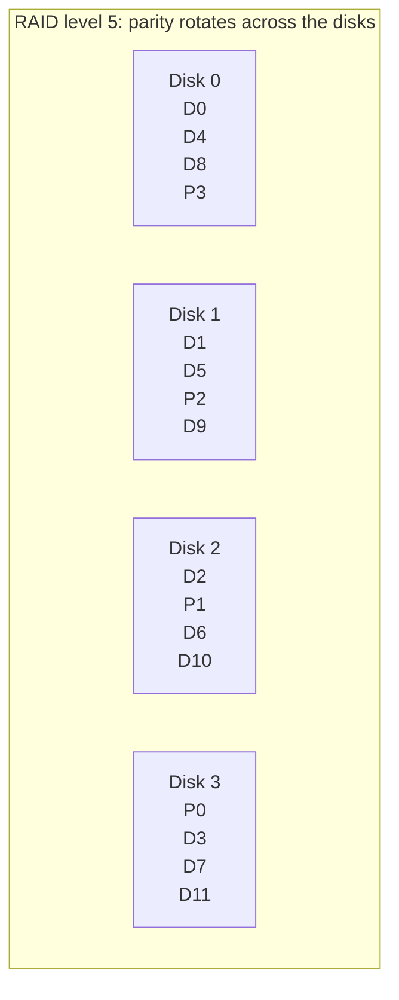

# Disks, RAID and disk-arm scheduling

> **Before this lesson:** [I/O hardware and the layers of I/O software](#/lesson/os/io-hardware-software), for device controllers and drivers, and [Hardware review](#/lesson/os/hardware-review), for the basic picture of a disk.

## In plain words

Disks are where a computer keeps everything it must not forget. They are also its slowest and least reliable major part, and those two facts explain most of this lesson.

A traditional hard disk works like a record player: a platter spins and an arm moves in and out to reach the right ring of data. Moving the arm takes time — a few thousandths of a second, an age for a computer. So the *order* in which requests are served matters, exactly as it does for a lift in a tall building. A lift that went to floors in the order the buttons were pressed — 2, 19, 3, 18 — would waste enormous effort. A sensible lift keeps going in one direction, stopping where needed, and then comes back. Disks use the same idea.

Disks also fail. The remedy is not to rely on one. If the same data is written on two disks, or if a spare disk holds enough extra information to rebuild any one that dies, a failure loses nothing. Arrangements of several disks working together are called **RAID**.

Why it matters for a job: storage is usually the slowest part of a real system and data loss is the most expensive kind of failure. RAID levels and disk scheduling calculations are standard interview and exam material.

## Motivation

Persistent storage is where a computer's valuable state lives, and it is also the slowest and least reliable major component. Those two facts drive this lesson. Slowness explains why operating systems learned to reorder requests and why arrays of disks are striped; unreliability explains mirroring, parity, spare sectors and the elaborate ritual called stable storage. Even where spinning platters have given way to flash, the ideas persist — in data centres, where disks are still the cheapest way to hold exabytes, and in the abstractions (blocks, queues, redundancy) that flash devices inherited.

## Disk hardware

### Magnetic disks

A magnetic disk consists of one or more platters rotating at constant speed, with a read/write head per surface mounted on a common arm. The set of tracks at one arm position is a **cylinder**; each track is divided into **sectors**, traditionally of 512 bytes and nowadays often 4,096.

Three delays determine how long a request takes:

1. **Seek time** — moving the arm to the right cylinder. A few milliseconds on average; about a millisecond between adjacent cylinders.
2. **Rotational delay** — waiting for the sector to arrive under the head. On average half a revolution: about 4 ms at 7,200 rpm.
3. **Transfer time** — the sector passing under the head; small by comparison.

Outer tracks are physically longer than inner ones, so modern drives divide the surface into **zones**, with more sectors per track in the outer zones. The drive hides this. It presents either a fictitious geometry of cylinders, heads and sectors or, universally today, **logical block addressing** (LBA): sectors are numbered from 0 upward and the drive's controller maps each number to a physical location. The OS therefore does not truly know where a block is — a fact that undermines some classic optimisations, as we will see.

```python-run
def access_time_ms(rpm, avg_seek_ms, sectors_per_track, sectors_to_read=1):
    rev_ms = 60_000 / rpm
    rotational = rev_ms / 2
    transfer = rev_ms * sectors_to_read / sectors_per_track
    return avg_seek_ms, rotational, transfer

print("drive                 seek   rotate  transfer   total    random IOPS")
for name, rpm, seek in (("5,400 rpm laptop", 5400, 11.0), ("7,200 rpm desktop", 7200, 8.5), ("15,000 rpm server", 15000, 3.5)):
    s, r, t = access_time_ms(rpm, seek, 500, 8)
    total = s + r + t
    print(f"{name:20s} {s:5.1f}  {r:6.2f}  {t:8.3f}  {total:6.2f} ms  {1000 / total:8.0f}")

print("\nsequential read of 100 MB at 150 MB/s:", round(100 / 150, 2), "s")
ios = 100 * 1024 // 4
print(f"the same 100 MB as {ios} random 4 KB reads at 12.7 ms each: {ios * 12.7 / 1000:.0f} s")
```

**What the code does.** `access_time_ms` computes the three delays in reading from a spinning disk. One rotation takes `60_000 / rpm` milliseconds, since there are 60,000 milliseconds in a minute and `rpm` is rotations per minute. On average the wanted data is half a rotation away. The transfer time is the fraction of a rotation that the wanted sectors occupy. The loop prints these for three disks, with the total and the number of such operations possible per second. The last lines compare reading 100 megabytes in one sweep with reading it as 25,600 separate small pieces in random places.

**The output.** A typical desktop disk needs about 8.5 ms to move the arm and about 4.2 ms of rotation, about 12.8 ms in all, which allows fewer than 80 random operations per second. Reading 100 megabytes in one go takes under a second; as scattered 4-kilobyte reads it takes over five minutes.

The last two lines are the single most important fact about mechanical disks: sequential access is hundreds of times faster than random access. Much of file-system design is an effort to turn the second into the first.

### Solid-state drives

An SSD stores bits in flash cells and has no moving parts, so there is no seek or rotational delay: random reads cost tens of microseconds. The complications are different. Flash cannot be overwritten in place; it must be erased first, in large blocks, and each block endures a limited number of erase cycles. The drive's firmware — the **flash translation layer** — therefore writes new data elsewhere, remaps logical block numbers, garbage-collects stale pages and spreads erasures evenly (**wear levelling**). It is a small log-structured file system inside the device.

### RAID

CPU performance grew exponentially for decades; disk seek times improved by perhaps a factor of ten. One response was to use many disks in parallel. A **RAID** — redundant array of inexpensive (later "independent") disks — is a box of drives behind a controller that makes them look like one large disk to the operating system, offering better performance, better reliability, or both. The data is distributed across the drives in one of several organisations, called levels.

| Level | Organisation | Capacity with n disks | Survives | Notes |
|---|---|---|---|---|
| **0** | Striping: consecutive strips go to successive disks | n | no failure | Fast; reliability is *worse* than a single disk |
| **1** | Mirroring: every disk has a duplicate | n/2 | one disk per pair | Reads can be balanced across copies; writes go to both |
| **2** | Bit-level striping with a Hamming code | varies | one disk | Needs synchronised drives; obsolete |
| **3** | Bit-level striping with one parity disk | n − 1 | one disk | Synchronised drives; one request at a time |
| **4** | Strip-level striping with a dedicated parity disk | n − 1 | one disk | Parity disk is a write bottleneck |
| **5** | Strip-level striping with parity **distributed** over all disks | n − 1 | one disk | The common general-purpose choice |
| **6** | Like level 5 with a second, independent parity block | n − 2 | two disks | For large arrays, where a second failure during rebuild is a real risk |

**Parity** is the heart of levels 3 to 5. For each stripe, the parity strip is the bitwise XOR of the data strips. If any one drive dies, its contents are recomputed as the XOR of everything that survives, because XOR-ing a value in twice cancels it.



```python-run
from functools import reduce

def xor_blocks(blocks):
    return bytes(reduce(lambda a, b: a ^ b, column) for column in zip(*blocks))

data = [b"OPERATIN", b"G SYSTEM", b"S ARE FU"]          # three data strips of one stripe
parity = xor_blocks(data)
print("parity strip:", parity.hex())

# Disk 1 dies. Rebuild its strip from the survivors plus parity.
rebuilt = xor_blocks([data[0], data[2], parity])
print("rebuilt strip:", rebuilt, "| matches the lost one:", rebuilt == data[1])

# Small write: update one strip without reading the others.
new = b"N N!!   "
new_parity = xor_blocks([parity, data[2], new])            # old parity XOR old data XOR new data
data[2] = new
print("incremental parity correct:", new_parity == xor_blocks(data))

# Two failures defeat single parity:
print("can single parity recover two lost strips? No - one equation, two unknowns.")
```

**What the code does.** `xor_blocks` combines several equal-length blocks of bytes into one. `zip(*blocks)` lines the blocks up so that the first bytes are together, the second bytes together, and so on; `reduce(lambda a, b: a ^ b, column)` combines each column with the `^` operation (exclusive or, written XOR), which has the property that combining a value in twice cancels it out. The parity block is the XOR of the three data blocks. To rebuild a lost block, the two surviving data blocks and the parity are combined. The next part updates one data block and adjusts the parity without reading the others, by combining the old parity, the old data and the new data.

**The output.** The rebuilt block equals the lost one, `G SYSTEM`. The parity adjusted the quick way equals the parity recalculated from scratch. The final line is a reminder that one parity block can recover one lost block, not two.

The "small write" trick explains both the strength and the weakness of parity RAID: updating one strip needs two reads and two writes (old data, old parity, new data, new parity). In level 4 every write touches the single parity disk, which becomes the bottleneck; level 5 spreads the parity strips round-robin across all drives to remove it.

> [!WARNING]
> RAID is not a backup. It protects against a drive failing, not against deleting the wrong directory, ransomware, a faulty controller writing garbage to every disk, or a fire.

## Disk formatting

Before a disk can be used it goes through several stages.

**Low-level formatting**, done at the factory, lays down the tracks. Each sector consists of a **preamble** (a bit pattern that lets the hardware recognise the sector's start, plus cylinder and sector numbers), the **data** area, and an **error-correcting code** (ECC) that can detect and often repair read errors. The preambles, ECCs and gaps between sectors mean the formatted capacity is noticeably lower than the raw capacity.

Sector 0 of each track is offset from that of the previous track — **cylinder skew** — so that when the arm steps to the next cylinder during a long sequential read, the next sector is arriving at that moment rather than having already gone by. The required skew is the number of sectors that pass during one track-to-track seek.

**Partitioning** then divides the disk into logical disks. Sector 0 holds the master boot record with the partition table (or, on newer machines, a GUID partition table).

**High-level formatting** creates a file system in each partition: boot block, free-space structures, root directory and an empty file system.

## Disk-arm scheduling

If the driver takes requests one at a time in arrival order — **first-come, first-served** — nothing can be optimised. But on a busy system requests accumulate while the arm is occupied, and the driver can choose the order. Since seek time dominates, the goal is to minimise arm movement.

Suppose the arm is at cylinder 50 and requests are pending for cylinders 82, 17, 43, 140, 24, 16 and 190, in that order of arrival.

**FCFS** visits them as they came: 32 + 65 + 26 + 97 + 116 + 8 + 174 = 518 cylinders of movement.

**Shortest seek first (SSF / SSTF)** always goes to the closest pending request: 43, 24, 17, 16, then all the way up to 82, 140, 190 — 208 cylinders. Much better, but it has a fairness problem. Under heavy load, with new requests constantly arriving near the arm's current position, requests at the edges may wait indefinitely. The goals of minimal response time and fairness conflict.

**The elevator algorithm (SCAN)** borrows from tall buildings: keep moving in one direction, servicing every request on the way, until there are none ahead; then reverse. One bit of state — the current direction — is all it needs. Its total movement has a fixed upper bound of twice the number of cylinders, whatever the request pattern.

A variant, **circular SCAN (C-SCAN)**, services requests in one direction only; on reaching the end it returns to the lowest pending request and starts again. The cylinders are treated as a ring, which makes waiting times more uniform — in plain SCAN the middle cylinders are passed twice per cycle and the ends only once.

Textbooks distinguish **SCAN** (the arm travels all the way to the edge of the disk before reversing) from **LOOK** (it reverses at the last pending request); what was described above is strictly LOOK, and it is what real systems do.

```python-run
def fcfs(head, reqs):
    return list(reqs)

def sstf(head, reqs):
    pending, order = list(reqs), []
    while pending:
        nxt = min(pending, key=lambda c: (abs(c - head), c))
        pending.remove(nxt)
        order.append(nxt)
        head = nxt
    return order

def look(head, reqs, up=True):
    above = sorted(c for c in reqs if c >= head)
    below = sorted((c for c in reqs if c < head), reverse=True)
    return above + below if up else below + above

def c_look(head, reqs):
    above = sorted(c for c in reqs if c >= head)
    below = sorted(c for c in reqs if c < head)
    return above + below

def movement(head, order):
    total = 0
    for c in order:
        total += abs(c - head)
        head = c
    return total

head, reqs = 50, [82, 17, 43, 140, 24, 16, 190]
for name, order in (("FCFS", fcfs(head, reqs)), ("SSTF", sstf(head, reqs)),
                    ("LOOK up", look(head, reqs)), ("LOOK down", look(head, reqs, up=False)),
                    ("C-LOOK", c_look(head, reqs))):
    print(f"{name:9s} {movement(head, order):4d} cylinders   order {order}")

# Starvation under SSTF: a far request while a stream of nearby ones keeps arriving.
import random
rng = random.Random(5)
head, pending, waited = 100, [(0, 195)], None
for step in range(1, 400):
    pending.append((step, rng.randint(90, 110)))
    arrival, cyl = min(pending, key=lambda r: abs(r[1] - head))
    pending.remove((arrival, cyl))
    head = cyl
    if cyl == 195:
        waited = step
        break
print("\nSSTF: the request for cylinder 195 was served after",
      waited if waited else "more than 400", "other requests")
```

**What the code does.** Each function returns the *order* in which a list of requested positions (called cylinders) is visited, starting from `head`. `fcfs` keeps the arrival order. `sstf` repeatedly picks the pending request nearest the current position. `look` visits everything above the starting position in increasing order and then everything below in decreasing order (or the reverse); `c_look` goes up, then jumps back and goes up again. `movement` adds up the distances between consecutive positions. The second part demonstrates a weakness: one request far away at cylinder 195 while new requests keep arriving near cylinder 100, with the nearest always served first.

**The output.** For the sample queue, arrival order costs 518 cylinders of movement and nearest-first 208; the lift-style orders cost between 208 and 341 depending on direction. In the second part, the far request is still waiting after 400 others have been served.

### Does arm scheduling still matter?

All of these algorithms assume the OS knows the disk's real geometry. With LBA and zoned recording it does not; the controller may also have remapped bad sectors elsewhere. Block number is still a reasonable *proxy* for position, so sorting requests by block number helps, but the drive's own firmware — which does know the geometry and can also account for rotational position — often schedules its internal queue better than the OS can. And on SSDs there is no arm at all: the best "scheduler" is one that does almost nothing beyond merging adjacent requests and enforcing fairness between processes.

> [!INTERVIEW]
> Typical question: "Head at cylinder X, queue Q — compute total head movement for FCFS, SSTF, SCAN, C-SCAN, LOOK." Sort the queue first; for the sweep algorithms only the extremes matter. Always state your convention: does SCAN go to the physical edge? Does C-SCAN count the return sweep? Then add judgement: SSTF minimises movement locally but can starve; SCAN/LOOK bound waiting; C-SCAN equalises it; none of it matters on flash.

## Error handling

Manufacturing defects are inevitable at modern recording densities. A sector whose defect affects only a few bits can be used anyway — the ECC corrects them on every read. Larger defects cannot be masked. Each track therefore includes **spare sectors**.

The controller can deal with bad sectors itself. Before shipping, the disk is tested and each bad sector is replaced by a spare, either by remapping the bad sector's number to a spare or by shifting all subsequent sectors up by one. Errors that develop later are handled the same way: when a read fails even after retries (a speck of dust may have been the cause), the controller switches to a spare before the sector dies completely.

If the controller cannot remap transparently, the OS must do the equivalent in software: learn the list of bad sectors and make sure they never appear in any file or on the free list — for example by collecting them into a hidden file that is never read. Backups must then be careful not to read that file.

Seek errors (the arm landing on the wrong cylinder) are corrected by a **recalibrate** command that drives the arm to its limit and resets the controller's idea of where it is.

## Stable storage

RAID guards against a whole drive failing. It does nothing about a **write error** that plants bad data on a good drive, or a crash in the middle of a write that leaves a sector half-updated. Some applications need a stronger promise: a write either stores the new data correctly or leaves the old data intact, no matter what.

**Stable storage** provides this in software using a pair of identical disks, assuming only that a bad write can be detected afterwards (through the ECC) and that the two drives do not fail at the same instant. It defines three operations.

- **Stable write.** Write the block on drive 1, read it back and verify; retry until it is correct (or, after n failures, remap to a spare). Only then write and verify the same block on drive 2.
- **Stable read.** Read the block from drive 1. If the ECC is bad, retry; after n failures, read from drive 2. Because a stable write always leaves at least one good copy, this cannot fail.
- **Crash recovery.** After a crash, scan both drives and compare corresponding blocks. If a pair is identical and good, nothing is done. If one has an ECC error, overwrite it with the good one. If both are good but different, copy the block from drive 1 onto drive 2.

The recovery rule works because of the write order. A crash can occur at five moments: before either write (old value on both); during the write to drive 1 (drive 1 bad — restored from drive 2: old value survives); between the writes (drive 1 new, drive 2 old — drive 1 copied over: new value survives); during the write to drive 2 (drive 2 bad — restored from drive 1: new value); after both (new value). In every case the result is *either the old value or the new value on both drives* — never garbage.

Scanning the whole disk after every crash is slow; a small non-volatile memory recording which block was being written lets recovery check only that one.

## Pitfalls

- **Treating RAID 0 as RAID.** It has no redundancy: one failure loses everything, and with n drives the chance of a failure is roughly n times higher.
- **Forgetting the rebuild window.** After a drive fails in RAID 5 the array is unprotected until the replacement is rebuilt, which on large disks takes many hours of heavy I/O; a single unreadable sector found then is fatal. This is the case for RAID 6.
- **Assuming block numbers reflect geometry.**
- **Applying mechanical-disk heuristics to SSDs** (defragmentation, elevator sorting).
- **Mixing up SCAN and LOOK conventions** in calculations.
- **Trusting a write that returned.** Without verification or checksums, a write can silently fail.

## Summary

- Disk access time = **seek** + **rotational delay** + **transfer**; sequential I/O is orders of magnitude faster than random. Drives expose **logical block addresses**; SSDs remove mechanical delays but need erase management and wear levelling.
- **RAID** combines drives: level 0 stripes, level 1 mirrors, levels 4/5 add XOR **parity** (level 5 distributes it), level 6 adds a second parity.
- Formatting proceeds from low-level (sectors with preamble, data, ECC; cylinder skew) through partitioning to high-level (file system).
- Arm scheduling: **FCFS** (fair, slow), **SSTF** (fast, may starve), **SCAN/LOOK** (elevator, bounded), **C-SCAN/C-LOOK** (uniform waits). Its importance has faded with LBA and flash.
- Bad sectors are remapped to **spares**. **Stable storage** uses two drives and a strict write-verify order so that every write is all-or-nothing.

## Glossary

- **Platter / track / sector / cylinder** — a disk's spinning surface / one ring on it / one arc of a ring / the set of tracks at one arm position.
- **Seek time** — the time to move the arm to the right cylinder.
- **Rotational delay** — the time waiting for the wanted sector to come round.
- **Logical block addressing (LBA)** — numbering a disk's sectors from zero upward, hiding its real layout.
- **Solid-state drive (SSD)** — storage built from flash memory chips, with no moving parts.
- **Wear levelling** — spreading writes evenly over flash memory so that no part wears out early.
- **RAID** — several disks used together for speed, safety or both.
- **Striping** — spreading data across several disks.
- **Mirroring** — keeping an identical copy of the data on a second disk.
- **Parity** — extra information from which one lost block can be rebuilt.
- **XOR (exclusive or)** — an operation on bits that gives 1 when the two bits differ.
- **Low-level / high-level formatting** — laying out sectors on a disk / creating an empty file system.
- **Error-correcting code (ECC)** — extra bits stored with data so that errors can be detected and repaired.
- **FCFS / SSTF** — serving disk requests in arrival order / nearest first.
- **SCAN, LOOK (elevator algorithm)** — sweeping the arm in one direction, serving requests on the way, then reversing.
- **C-SCAN / C-LOOK** — serving requests in one direction only, then returning to the start.
- **Spare sector** — a reserve sector that replaces a damaged one.
- **Stable storage** — a method using two disks so that a write either fully succeeds or leaves the old data intact.

## Check yourself

```quiz
[
  {"q": "A disk rotates at 6,000 rpm. What is the average rotational delay?",
   "options": ["2.5 ms", "5 ms", "10 ms", "20 ms"],
   "answer": 1,
   "explain": "6,000 rpm is 100 revolutions per second, so one revolution takes 10 ms. On average the wanted sector is half a revolution away: 5 ms."},
  {"q": "Which RAID level offers no protection against the failure of a drive?",
   "options": ["Level 0", "Level 1", "Level 5", "Level 6"],
   "answer": 0,
   "explain": "Level 0 only stripes data for speed. Losing any one drive loses part of every large file."},
  {"q": "A RAID level 5 array has five 4 TB drives. What is the usable capacity?",
   "options": ["20 TB", "16 TB", "12 TB", "10 TB"],
   "answer": 1,
   "explain": "One drive's worth of space holds parity, spread across all drives. (5 - 1) * 4 TB = 16 TB."},
  {"q": "A stripe has data strips 1010, 0110 and 1100 (in binary). What is the parity strip?",
   "options": ["0000", "1111", "0101", "1011"],
   "answer": 0,
   "explain": "XOR of 1010 and 0110 is 1100; XOR with 1100 gives 0000. Any lost strip equals the XOR of the remaining ones."},
  {"q": "The arm is at cylinder 40 and requests are pending for 10, 35, 70 and 44. In what order does shortest seek first serve them?",
   "options": ["10, 35, 70, 44", "44, 35, 70, 10", "44, 35, 10, 70", "35, 44, 70, 10"],
   "answer": 2,
   "explain": "From 40 the nearest is 44 (4 away). From 44 the candidates are 35 (9 away) and 70 (26 away), so 35. From 35 the candidates are 10 (25) and 70 (35), so 10, and finally 70. The choice is re-evaluated from the current head position after every move."},
  {"q": "Why can shortest seek first starve some requests?",
   "options": ["It ignores requests that arrive later", "A steady stream of requests near the arm keeps being chosen ahead of a distant one", "It always moves toward cylinder 0", "It cannot handle duplicate cylinders"],
   "answer": 1,
   "explain": "The algorithm is greedy about distance. Under load, the arm can hover in a busy region while edge requests wait indefinitely."},
  {"q": "Why do the classic arm-scheduling algorithms matter less with modern drives?",
   "options": ["Modern drives have no cylinders at all", "The OS sees only logical block numbers, the drive firmware knows the real geometry, and SSDs have no arm", "FCFS has become optimal on all devices", "Seeks are now slower than rotation"],
   "answer": 1,
   "explain": "Logical block addressing hides the geometry, the drive can schedule its own queue with full knowledge, and flash storage has no mechanical positioning."},
  {"q": "In stable storage, a crash occurs after drive 1 has been written correctly but before drive 2 is written. What does recovery do?",
   "options": ["Copies drive 2 over drive 1, restoring the old value", "Copies drive 1 over drive 2, completing the new value", "Marks both blocks bad", "Nothing"],
   "answer": 1,
   "explain": "Both copies are readable but differ. Because drive 1 is always written first, it holds the newer value, which is propagated to drive 2."}
]
```

> **Source:** Tanenbaum & Bos, Modern Operating Systems 4e, §5.4 (Disks)
