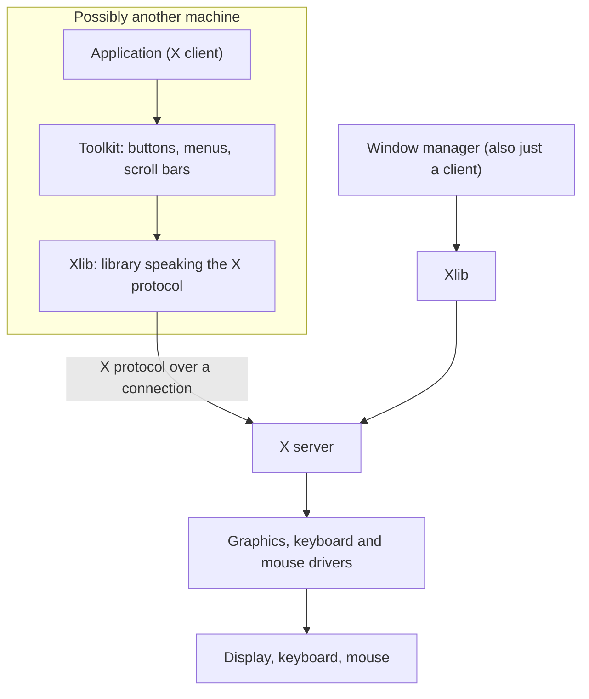

# Clocks, user interfaces and power management

> **Before this lesson:** [I/O hardware and the layers of I/O software](#/lesson/os/io-hardware-software), for interrupts, device drivers and buffering.

## In plain words

This lesson finishes the subject of input and output with three topics that look minor and are not.

**Clocks.** A computer contains a tiny crystal that ticks millions of times a second, like the quartz in a wristwatch. The operating system uses it to know the time of day, to cut off a program that has had its turn, and to do things "in five seconds from now". Think of a kitchen timer: without one, a cook must stand and watch the oven; with one, the cook can do something else until it rings.

**Keyboards, mice and screens.** A key press does not arrive as a letter. It arrives as a number saying which key went down, and software turns that into a character. A mouse reports only how far it moved. Everything you see as a pointer, a window or a character is produced by software.

**Power.** A phone runs on a battery and a data centre pays a vast electricity bill. The simplest way to save energy is to switch off whatever is not being used — like the lights in an empty room — but switching things back on costs time and energy too, so it has to be done with judgement.

Why it matters for a job: timers are behind every timeout and every scheduled task you will write, and battery life is one of the main quality measures of any mobile app.

## Motivation

Three topics round out input/output, and each is easy to underestimate.

**Clocks** look trivial — a chip that ticks — yet without them there is no preemptive scheduling, no timeouts, no time of day, no profiling. **User-interface devices** — keyboards, mice, displays, touch screens — are where every interaction with a human passes through the kernel, and the software that drives them is surprisingly intricate. And **power management** has moved from an afterthought to a first-class design constraint: on a phone, energy is the scarcest resource of all, and in a data centre the electricity bill rivals the hardware bill.

## Clocks

### Clock hardware

The simplest clocks were tied to the mains power line and interrupted on every voltage cycle. Modern clocks are **programmable**, built from three parts: a quartz **crystal oscillator** that produces a very accurate periodic signal, a **counter** that is decremented at each pulse, and a **holding register**. When the counter reaches zero it raises an interrupt.

Two modes are typical. In **one-shot mode** the counter is loaded from the holding register, counts down, interrupts once and stops until software restarts it. In **square-wave mode** the counter is automatically reloaded after reaching zero, producing periodic interrupts called **clock ticks**. With a 500 MHz crystal and a 32-bit register, software can choose any interval from 2 nanoseconds to about 8.6 seconds.

To keep the time of day while powered off, computers have a separate battery-backed clock that is read at boot. Time is then tracked by counting ticks from a reference instant — midnight UTC on 1 January 1970 in UNIX, 1 January 1980 in the Windows lineage.

### Clock software

The hardware only generates interrupts; everything else is the clock driver's job. Its duties:

1. **Maintaining the time of day.** Incrementing a 32-bit count of ticks at 60 Hz would overflow in a little over two years. Solutions: a 64-bit counter (simple, but more expensive arithmetic on older machines); a count of seconds plus a count of ticks within the current second; or counting ticks since boot and adding the stored boot time.
2. **Preventing processes from running too long.** When a process is started the scheduler sets a counter to its quantum in ticks; each tick decrements it; at zero the scheduler is invoked.
3. **CPU accounting.** The accurate method uses a second timer started and stopped at each context switch. The cheap method charges each tick to whichever process happened to be running — statistically reasonable, though a process that is frequently interrupted gets blamed for time it did not use.
4. **Handling the `alarm` system call.** A process may ask to be signalled after an interval — for example a network protocol that retransmits a packet if no acknowledgement arrives in time.
5. **Watchdog timers** for the kernel's own use. A classic example is waiting for a device to reach a usable state after being switched on.
6. **Profiling, monitoring and statistics gathering.** At each tick, record which part of the program was executing; the resulting histogram shows where time goes.

**Simulating many timers with one clock.** One physical timer must serve many pending requests. The driver keeps them in a list sorted by time, where each entry stores only how many ticks to wait *after the preceding entry*. At each tick only the head's count is decremented; when it reaches zero, that event fires, along with any following entries whose increment is zero.

```python-run
class TimerList:
    """Pending alarms as a delta list: each entry holds ticks AFTER the previous entry."""
    def __init__(self):
        self.entries = []                       # [delta, label]

    def add(self, ticks_from_now, label):
        i, remaining = 0, ticks_from_now
        while i < len(self.entries) and remaining >= self.entries[i][0]:
            remaining -= self.entries[i][0]
            i += 1
        if i < len(self.entries):
            self.entries[i][0] -= remaining     # the follower is now relative to the new entry
        self.entries.insert(i, [remaining, label])

    def tick(self):
        fired = []
        if self.entries:
            self.entries[0][0] -= 1             # only the head is touched on a tick
            while self.entries and self.entries[0][0] == 0:
                fired.append(self.entries.pop(0)[1])
        return fired

timers = TimerList()
for when, label in ((5, "retransmit packet"), (3, "blink cursor"), (5, "watchdog"), (9, "alarm for pid 41"), (1, "floppy motor")):
    timers.add(when, label)
print("delta list:", timers.entries)
for t in range(1, 10):
    fired = timers.tick()
    if fired:
        print(f"tick {t}: {fired}")
```

**What the code does.** `TimerList` keeps many pending alarms using one clock. Each entry is `[delta, label]`, where `delta` is the number of ticks to wait *after the entry before it*. `add` walks along the list subtracting each entry's delta from the time requested until it finds the right position; it then inserts the new entry with whatever time remains, and reduces the following entry's delta by the same amount so that the following entry still fires at its original time. `tick` is called once per clock tick: it subtracts one from the *first* entry only, and then removes and returns every entry at the front whose delta has reached zero.

**The output.** Five alarms set for 5, 3, 5, 9 and 1 ticks from now are stored as the deltas 1, 2, 2, 0, 4. Add them up along the list and you get back 1, 3, 5, 5, 9. Running nine ticks fires them at ticks 1, 3, 5 (two together) and 9.

Check the invariant: the deltas along the list sum to each entry's absolute firing time. The work per tick is constant regardless of how many timers are pending — which matters, since the tick handler runs hundreds of times a second.

### Soft timers

Some applications need events at very high rates — a multi-gigabit network link may want a packet processed every few microseconds. Using a hardware timer at that rate means an interrupt each time, with its mode switch and cache and TLB disturbance. Polling avoids interrupts but adds latency.

**Soft timers** avoid both. The kernel is entered very frequently anyway — for system calls, TLB misses, page faults, I/O interrupts, and when the CPU goes idle. Immediately before returning to user mode on any of these occasions, the kernel reads the real-time clock and checks whether a soft timer has expired; if so, it runs the event on the spot, with no extra mode switch. A slower hardware timer acts as a backstop for the rare periods when nothing else enters the kernel. The achievable rate depends on how often those kernel entries occur, which in practice is every few microseconds to tens of microseconds on a busy machine.

> [!NOTE]
> A related modern refinement is the **tickless kernel**: rather than interrupting an idle CPU a hundred or a thousand times a second only to discover that nothing is due, the kernel programs the timer in one-shot mode for the next actual deadline and lets the processor sleep deeply until then. It is one of the most effective power-saving changes of the last two decades.

## User interfaces

### Keyboard input

A keyboard does not deliver characters. Each key press *and each release* generates an interrupt, and the driver reads a **scan code** — a key number, with one bit indicating press or release. It is the driver's job to track the state of the shift, control and alt keys and to translate, through a **keymap** for the user's language and layout, into characters. Doing it in software is what allows the same hardware to be a French, Arabic or Dvorak keyboard.

Two philosophies exist for what the driver passes on. In **raw** (non-canonical) mode it hands over each key event immediately and the program — an editor, a game — interprets everything itself. In **cooked** (canonical) mode the driver handles all intra-line editing: it buffers characters until a full line has been typed, processes erase and line-kill characters, and delivers the corrected line. A program that only wants a line of input then need not deal with the user's typing mistakes.

The driver also handles **echoing** typed characters to the screen (which is why a password prompt can turn echo off), expanding tabs, mapping a carriage return to a line feed, and recognising special characters that generate signals — interrupt the foreground job, quit with a memory dump, suspend output, end of file.

### Mouse and touch input

A mouse reports, a few dozen times a second, a small message containing the change in x, the change in y and the state of the buttons. Note that it reports only *relative* movement; where the pointer is on the screen is a fiction maintained by software. The distinction between a single click and a double click is also made in software, by comparing the time and distance between clicks against thresholds.

Touch screens add **multi-touch**: the device reports several contact points at once, and software recognises patterns in their motion as gestures — a pinch to zoom, a two-finger scroll.

### Output: from text windows to GUIs

**Text output** to a terminal window is a stream of characters, some of which are commands rather than text. To let programs move the cursor, clear part of the screen or insert a line, terminals interpret **escape sequences** — an ESC character followed by a short code. Historically every terminal model had its own set, and a database of terminal capabilities let editors work on all of them; today nearly all emulate one standard set.

**The X Window System** dominates graphical display on UNIX-like systems, and its architecture is unusual. The program that controls the screen, keyboard and mouse is called the **X server**; applications are **X clients**. This sounds backwards until you see that the *display* is the resource being served. Client and server communicate over a network connection using the X protocol, so they may be on different machines: an application running on a remote compute cluster can draw on your screen.



Four kinds of messages cross the connection: drawing commands from client to server; replies to client queries; **events** from server to client (key pressed, mouse moved, window exposed); and error messages. X itself deliberately provides only a mechanism for drawing and input. Window decoration, placement and policy belong to a separate client, the **window manager**, and the look of buttons and menus comes from a toolkit library. An X program is therefore **event-driven**: it creates its windows, tells the server which events it cares about, and then loops, fetching the next event and reacting.

**Graphical user interfaces** in general rest on four elements — windows, icons, menus and a pointing device (the acronym WIMP). On Windows the GUI code is part of the operating system; the program structure is the same event loop, with the system delivering **messages** to a window's procedure: the window was created, a key went down, the mouse moved, part of the window must be repainted. Programs draw through a device-independent graphics interface so that the same code renders on a screen or a printer.

Underneath, a display is a **bitmap**: a rectangular grid of pixels in video memory. Windows, fonts and images are all ultimately copied into it. Text uses **outline fonts**, in which each character is a set of curves that can be scaled to any size and then filled in, rather than a fixed grid of dots per size.

### Thin clients

A recurring idea is to move computing off the desk: the user's device does nothing but display pixels and forward input, while all applications run on a central server. Administration is easier, since there is only one place to update and back up, and the terminal itself has no state to lose or steal. Web applications running in a browser and remote-desktop systems are the current forms of this pendulum swing; the trade-off is dependence on the network and on the provider.

## Power management

The first general-purpose electronic computer drew about 140 kilowatts. Transistors cut consumption so drastically that the industry stopped caring — until portable devices arrived. Batteries improve slowly, perhaps a few percent a year, with no doubling law to rescue them. At the other end of the scale, a data centre with tens of thousands of servers draws tens of megawatts, and every watt consumed must also be removed as heat.

There are two general approaches. The OS can **turn off parts of the computer** that are not in use, since a device that is off uses little or no energy. Or **applications can use less energy**, possibly accepting a poorer user experience to stretch battery life.

### Hardware issues

Most components are designed with several states: **on**, **sleeping** (quick to wake, some power), **hibernating** (slow to wake, almost none) and **off**. Where does the power go? Measurements vary, but on a laptop the display is typically the largest consumer, followed by the CPU and then storage and wireless; on a phone the radio and display dominate.

### What the operating system can do

The OS decides when to change each device's state, and every decision has the same structure: shutting something down saves power while it is off, but restarting costs both energy and delay. There is a **break-even time**: a device should be turned off only if it will stay off longer than that.

**The display.** Turn it off after a period without input. Finer-grained: light only the portion of the screen showing the active window, or dim the backlight.

**The hard disk.** Keeping platters spinning costs power; spinning up again takes seconds and a burst of energy. The OS must predict idle periods. A large in-memory cache helps on both sides — reads are satisfied from memory, and writes can be held until the disk is spinning anyway or the cache fills.

```python-run
def disk_energy(idle_gaps_s, timeout_s, spin_w=2.0, sleep_w=0.2, restart_j=12.0):
    """Energy over a series of idle gaps for a 'spin down after timeout' policy."""
    total, restarts, delay = 0.0, 0, 0.0
    for gap in idle_gaps_s:
        if timeout_s is None or gap <= timeout_s:
            total += gap * spin_w
        else:
            total += timeout_s * spin_w + (gap - timeout_s) * sleep_w + restart_j
            restarts += 1
            delay += 2.5                     # seconds the user waits for spin-up
    return total, restarts, delay

break_even = 12.0 / (2.0 - 0.2)
print(f"break-even idle time: {break_even:.1f} s  (restart energy / power saved while asleep)\n")

import random
rng = random.Random(9)
gaps = [rng.expovariate(1 / 20) for _ in range(300)]      # idle gaps averaging 20 s
print("timeout    energy (J)   spin-ups   total user delay")
for timeout in (None, 60, 20, 7, 2, 0):
    e, r, d = disk_energy(gaps, timeout)
    label = "never" if timeout is None else f"{timeout:3d} s"
    print(f"{label:>7}   {e:10.0f}   {r:8d}   {d:8.0f} s")
```

**What the code does.** `disk_energy` adds up the energy a disk uses over a series of idle gaps under the rule "if nothing happens for `timeout_s` seconds, stop spinning". For a gap shorter than the timeout, the disk spins throughout (`gap * spin_w`: time multiplied by power gives energy). For a longer gap, it spins for the timeout, sleeps for the rest at a much lower power, and then pays a fixed amount of energy (`restart_j`) and a delay to start spinning again. `break_even` is the length of sleep at which the energy saved equals the energy of restarting. The idle gaps are generated at random with an average of 20 seconds, and the loop tries six timeouts, including never sleeping and sleeping at once.

**The output.** The break-even time is 6.7 seconds. Never sleeping uses the most energy and causes no delay. Shorter timeouts use less energy but restart the disk more often — 300 times, with twelve and a half minutes of waiting in total, when it sleeps immediately. The table shows the trade between energy and the user's patience.

Sleeping too eagerly wastes energy on restarts and annoys the user with delays; sleeping too reluctantly wastes energy spinning. The best fixed timeout sits near the break-even time, and adaptive policies try to predict the gap length from recent history.

**The CPU.** A laptop CPU can be put to sleep whenever there is nothing to run, waking on any interrupt. More interestingly, power consumption is roughly proportional to the *square* of the supply voltage, and a lower voltage requires a lower clock frequency. So running at half speed uses about a quarter of the power; since the job takes twice as long, the *energy* for the job is about half. This is **dynamic voltage and frequency scaling**: if a video decoder needs 40 ms of full-speed computation per 100 ms frame, running at half speed for 80 ms meets the deadline for less energy than sprinting and then idling.

On multicore chips the OS can also consolidate work onto fewer cores and power the others down, and many phones pair fast, hungry cores with slow, frugal ones so the scheduler can match each task to an appropriate core.

**Memory.** The cache can be flushed and switched off (reloading it is cheap). Main memory can be written to disk and powered off entirely — **hibernation** — at the price of a slow resume.

**Wireless communication.** The radio draws power even when merely listening. One scheme has the mobile device tell the base station it is going to sleep; the base station buffers incoming messages and delivers them when the device wakes and asks.

**Thermal management.** When the chip gets hot the OS can run the fan (which uses power and makes noise) or slow the CPU (which uses less power and hurts performance). Which to prefer is a policy choice — often exposed to the user as a "quiet" versus "performance" setting.

**Battery management.** Smart batteries report their charge, capacity and health, so the OS can warn the user and shut down cleanly before the charge runs out.

**The driver interface.** A standard firmware interface (ACPI on PCs) lets the OS ask each device what power states it supports and command transitions, and lets devices notify the OS of events such as a lid closing.

### Degraded operation

Applications can cooperate by trading quality for energy when told the battery is low: a video player can drop to a lower resolution or frame rate or switch off colour; a speech recogniser can use a smaller vocabulary; a map viewer can fetch less detailed tiles. The OS supplies the information and the policy hooks; only the application knows what quality it can give up.

> [!INTERVIEW]
> "How does an OS save power?" Idle the CPU in progressively deeper sleep states; scale voltage and frequency to the workload (power falls roughly with the square of voltage); go tickless so idle CPUs are not woken needlessly; batch timers and I/O so devices can stay asleep longer; spin down or suspend devices past their break-even time; migrate work to efficient cores; suspend to RAM or hibernate to disk. The unifying idea is to make idleness *long and contiguous*, because every wake-up has a fixed cost.

## Pitfalls

- **Charging CPU time by ticks and believing the numbers exactly.** Tick-based accounting is statistical.
- **Assuming a timer fires exactly on time.** A timer guarantees "not before"; scheduling delays add latency.
- **Forgetting that a key release is also an event** — necessary for shift keys, games and auto-repeat.
- **Thinking the X "server" is the remote machine.** The server is wherever the display is.
- **Powering devices down too aggressively.** Below the break-even time it costs more than it saves and adds latency.
- **Waking up periodically "only to check".** A polling loop in one background app can keep the whole system out of deep sleep.

## Summary

- A programmable clock is a crystal, a counter and a holding register, in one-shot or square-wave mode. Clock software keeps the **time of day**, enforces **quanta**, does **accounting**, implements **alarms** and **watchdogs**, and supports **profiling**. Many timers are multiplexed with a **delta list**; **soft timers** piggyback on existing kernel entries.
- Keyboards deliver **scan codes** for presses and releases; the driver maps them and offers **raw** or **cooked** input. Mice report relative motion. Terminals interpret **escape sequences**; the **X Window System** separates the display server from client applications and the window manager; GUIs are **event-driven**.
- Power management exploits device states (**on, sleeping, hibernating, off**), **break-even times**, **voltage and frequency scaling**, core consolidation, radio sleep with buffering at the base station, and application-level **degraded operation**.

## Glossary

- **Clock (timer)** — hardware that produces interrupts at regular or chosen intervals.
- **Crystal oscillator** — the component that produces the regular pulses a clock counts.
- **Clock tick** — one periodic interrupt from the clock.
- **One-shot / square-wave mode** — interrupting once after a set delay / repeatedly at a fixed interval.
- **Watchdog timer** — a timer used by the operating system to notice that something has taken too long.
- **Profiling** — measuring where a program spends its time.
- **Soft timer** — a timer checked whenever the kernel is running anyway, avoiding extra interrupts.
- **Tickless kernel** — a kernel that does not interrupt an idle processor at every tick.
- **Scan code** — the number a keyboard sends to say which key was pressed or released.
- **Raw / cooked mode** — passing each key press to the program at once / collecting and editing a whole line first.
- **Echoing** — displaying each character as it is typed.
- **Escape sequence** — a special series of characters that commands a terminal, for example to move the cursor.
- **X Window System** — the usual graphical display system on UNIX-like systems.
- **Window manager** — the program that controls how windows are placed and decorated.
- **Event-driven program** — a program that waits for events such as key presses and reacts to each.
- **Thin client** — a simple device that shows the output of programs running on a central machine.
- **Break-even time** — how long a device must stay switched off for the saving to outweigh the cost of restarting.
- **Dynamic voltage and frequency scaling** — running a processor slower at a lower voltage to save energy.
- **Hibernation** — saving the contents of memory to disk and switching the machine off.

## Check yourself

```quiz
[
  {"q": "A programmable clock has a 1 MHz crystal. What value should be loaded into the holding register to obtain a clock tick every 10 ms in square-wave mode?",
   "options": ["100", "1,000", "10,000", "100,000"],
   "answer": 2,
   "explain": "The counter is decremented once per microsecond. Ten milliseconds is 10,000 microseconds."},
  {"q": "A delta list holds entries with increments 3, 2, 0 and 4. When does the fourth entry fire, measured in ticks from now?",
   "options": ["4", "5", "9", "12"],
   "answer": 2,
   "explain": "Each entry stores the time after the previous one, so absolute times are 3, 5, 5 and 9."},
  {"q": "Why does the clock driver decrement only the first entry of the timer list at each tick?",
   "options": ["Because only one timer can exist", "Because later entries are stored relative to their predecessors, so the per-tick work stays constant", "Because the list is sorted by process id", "Because other entries are decremented by hardware"],
   "answer": 1,
   "explain": "Storing differences means one decrement implicitly advances every pending timer."},
  {"q": "What is the idea behind soft timers?",
   "options": ["Use a slower crystal", "Check for expired timers whenever the kernel is about to return to user mode anyway, avoiding extra interrupts", "Let user programs read the hardware clock directly", "Disable the clock while the CPU is idle"],
   "answer": 1,
   "explain": "System calls, faults and I/O interrupts enter the kernel very often. Piggybacking the check on those entries gives fine-grained timing without dedicated timer interrupts."},
  {"q": "In cooked (canonical) keyboard mode, when does a reading program receive its input?",
   "options": ["After every key press", "After every key release", "When a complete line has been entered, with editing such as backspace already applied", "Only when the buffer is full"],
   "answer": 2,
   "explain": "The driver performs line editing itself and hands over whole lines, so simple programs need not deal with typing corrections."},
  {"q": "In the X Window System, where does the X server run?",
   "options": ["On the machine with the most CPUs", "On the machine that has the display, keyboard and mouse", "Inside the kernel of the remote host", "In the window manager"],
   "answer": 1,
   "explain": "The server manages the display resource on behalf of client applications, which may be local or remote."},
  {"q": "A disk uses 3 W spinning and 0.5 W asleep, and restarting it costs 20 J. What is the break-even idle time?",
   "options": ["4 s", "6.7 s", "8 s", "40 s"],
   "answer": 2,
   "explain": "Sleeping saves 2.5 W. It must be asleep for 20 / 2.5 = 8 seconds to pay back the restart energy."},
  {"q": "Why can running a CPU at half speed reduce the energy needed for a fixed amount of work?",
   "options": ["Slower instructions use fewer transistors", "Lower frequency permits lower voltage, and power falls roughly with the square of the voltage, outweighing the doubled running time", "The cache is larger at low speed", "It cannot; energy always stays the same"],
   "answer": 1,
   "explain": "About a quarter of the power for twice as long is about half the energy, provided the deadline is still met."}
]
```

> **Source:** Tanenbaum & Bos, Modern Operating Systems 4e, §5.5 (Clocks), §5.6 (User interfaces: keyboard, mouse, monitor), §5.7 (Thin clients), §5.8 (Power management)
