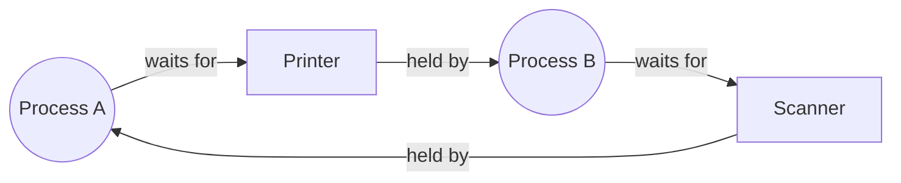
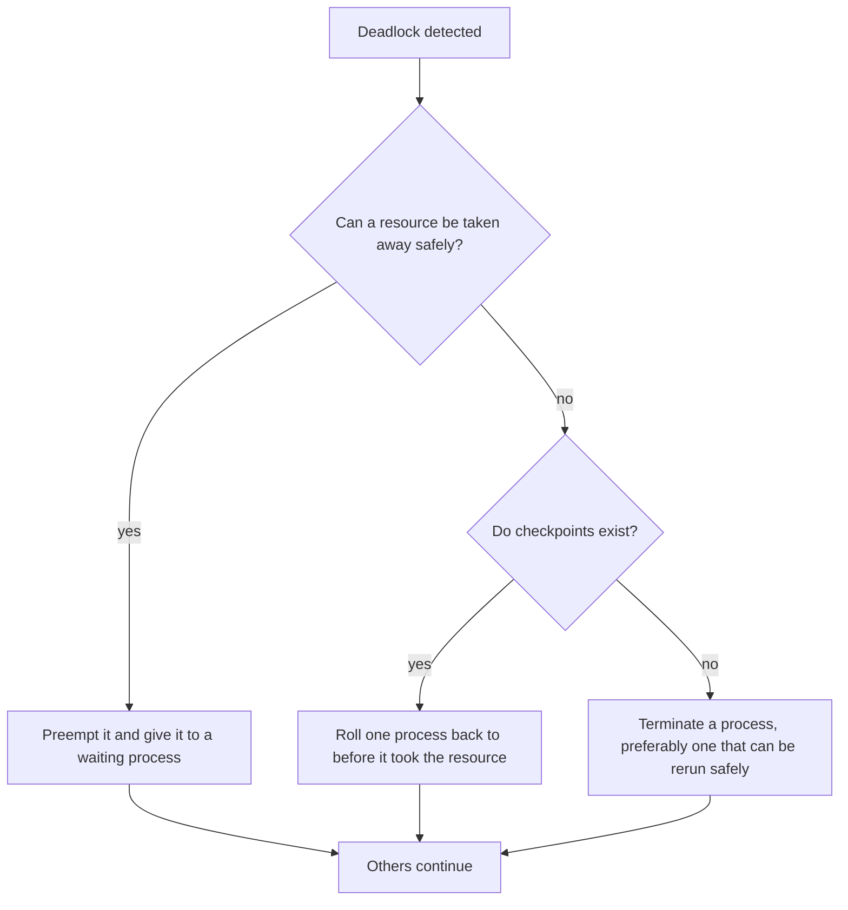

# Deadlock: conditions, modelling, detection and recovery

> **Before this lesson:** you should know what a process is and what it means for a process to be *blocked* ([Processes and threads](#/lesson/os/processes-threads)), and what a lock or semaphore does ([Semaphores, monitors, message passing and the classic problems](#/lesson/os/semaphores-monitors-messages)). No other background is assumed.

## In plain words

Picture a narrow one-lane bridge. A car drives on from the left at the same moment as a car drives on from the right. They meet in the middle. Each driver waits for the other to back off. Neither does. Nothing is broken — both cars work perfectly — yet nobody will ever get across.

That is a **deadlock**: a group of participants, each holding something the next one needs, each waiting for something another one holds, so that none of them can ever continue.

Computers get into exactly this situation. Programs need things to do their work — a file, a printer, a lock on a database row. When two programs each grab one thing and then wait for the other's, they freeze forever. The machine stays on, the fans spin, and those programs never finish.

Why it matters for a job: deadlocks are one of the most common causes of "the system hung" in real software — databases, web servers, mobile apps, operating-system kernels. Interviewers ask about them constantly, because recognising and preventing them is a core skill for anyone writing code where several things happen at once.

This lesson explains what deadlock is, the exact conditions under which it can happen, how to draw it as a picture, how a computer can detect it, and what can be done once it is found. The next lesson covers how to stop it happening in the first place.

## Resources

A **resource** is anything a process must acquire, use for a while, and then release. (A *process*, as a reminder, is a running program.) Some resources are hardware — a printer, a scanner, a disk drive. Others are pieces of information — a record in a database, an entry in a kernel table, or a *lock* (a software marker meaning "someone is using this; wait your turn").

Resources come in two kinds, and the difference matters for deadlock.

- A **preemptable resource** is one that can be taken away from the process that has it without causing harm. The standard example is memory: if a process is using some of the computer's memory and another needs it, the operating system can copy the first process's data to disk, hand the memory over, and bring the data back later. The first process is delayed but not damaged.
- A **nonpreemptable resource** is one that cannot be taken away without causing the work to fail. If a process has started burning a disc and the burner is suddenly given to someone else, the disc is ruined. A half-printed page cannot be "paused" and handed to another job.

Deadlocks involve nonpreemptable resources. If a resource can be taken away safely, the operating system can always break the standoff by taking it away.

The life cycle of using a resource is always the same three steps:

1. **Request** the resource. If it is not available, the process waits (it becomes *blocked*).
2. **Use** it.
3. **Release** it.

### The smallest possible deadlock

Start with the simplest example. There are two processes, A and B, and two resources, a scanner and a printer. Each process wants to scan a document and print it, so each needs both.

Suppose both processes ask for the resources **in the same order**: scanner first, then printer.

- A asks for the scanner and gets it.
- B asks for the scanner. It is taken, so B waits.
- A asks for the printer and gets it. A does its work and releases both.
- B now gets the scanner, then the printer, and finishes.

No problem. Now change one thing: B asks **in the opposite order**, printer first.

- A asks for the scanner and gets it.
- B asks for the printer and gets it.
- A asks for the printer. B has it, so A waits.
- B asks for the scanner. A has it, so B waits.

A is waiting for B. B is waiting for A. Neither can release anything, because releasing only happens after the work is done, and the work cannot be done. This is a deadlock, and it came from nothing more than the *order* of two lines of code.

Notice also that it depends on timing. If A had been quick enough to grab both resources before B started, everything would have worked. That is what makes deadlocks dangerous: the same program can run correctly a thousand times and freeze on the next run.

## What deadlock is, precisely

Here is the formal definition, followed by an explanation of each part.

> A set of processes is **deadlocked** if each process in the set is waiting for an event that only another process in the set can cause.

- "A set of processes": deadlock is a property of a *group*, not of one process. At least two are normally involved (though a single process can deadlock with itself by waiting for a lock it already holds).
- "Waiting for an event": usually the event is "a resource I need is released".
- "That only another process in the set can cause": this is the key. If someone *outside* the group could release the resource, the group would eventually get moving again. In a deadlock, every possible rescuer is also stuck.

Because all of them are waiting, none of them will ever cause the event, so all of them wait forever.

## The four conditions

In 1971 a group of researchers led by Edward Coffman showed that a resource deadlock can occur only if **all four** of the following conditions hold at the same time. They are worth memorising, because every technique for dealing with deadlock works by attacking one of them.

1. **Mutual exclusion.** Each resource is either assigned to exactly one process or is free. (Two processes cannot use it at the same instant.)
2. **Hold and wait.** A process that is already holding resources is allowed to ask for more, and keeps what it has while it waits.
3. **No preemption.** A resource cannot be forcibly taken away from the process holding it. Only that process can release it.
4. **Circular wait.** There is a closed chain of two or more processes, each waiting for a resource held by the next one in the chain.

Go back to the bridge. Mutual exclusion: only one car fits on each stretch of road. Hold and wait: each car sits on its stretch while waiting for the next. No preemption: no crane lifts a car out of the way. Circular wait: car 1 waits for car 2, and car 2 waits for car 1. Remove any one of the four — widen the bridge, make cars reverse, bring a crane, or install a traffic light so only one direction goes at a time — and the standoff becomes impossible.

> [!INTERVIEW]
> "What are the necessary conditions for deadlock?" is one of the most frequently asked operating-system questions. Name all four — mutual exclusion, hold and wait, no preemption, circular wait — and add that they are *necessary together*: if any one is absent, deadlock cannot occur. A strong answer then gives one way to break each (covered in the next lesson): share the resource through a single service, request everything at once, allow resources to be taken back, or always acquire resources in a fixed global order.

## Drawing deadlock: resource-allocation graphs

A picture makes the circular-wait condition visible. In a **resource-allocation graph** there are two kinds of nodes:

- a **circle** for each process;
- a **square** for each resource.

And two kinds of arrows:

- an arrow **from a resource to a process** means "this resource is currently held by that process";
- an arrow **from a process to a resource** means "this process is blocked, waiting for that resource".

Here is the scanner-and-printer deadlock as a graph.



Follow the arrows starting anywhere and you return to where you started: A → Printer → B → Scanner → A. That closed loop is called a **cycle**. When every resource has only one copy, the rule is short:

> **A cycle in the graph means deadlock. No cycle means no deadlock.**

The graph also shows that deadlock is about *order of events*, not about the programs alone. Take three processes A, B, C and three resources R, S, T, where A wants R then S, B wants S then T, and C wants T then R. If the operating system runs A to completion, then B, then C, no arrows ever form a loop. If instead it lets each one take its first resource before any takes its second, a three-way cycle appears. The operating system is not obliged to run processes in any particular order — so, in principle, it could avoid the bad order by delaying one process. Whether that is practical is the subject of the next lesson.

## Four ways to deal with deadlock

There are four broad strategies. This lesson covers the first two; the next covers the others.

1. **Ignore the problem.** Pretend it does not happen.
2. **Detection and recovery.** Let deadlocks occur, notice them, and take action.
3. **Dynamic avoidance.** Allocate resources carefully so that deadlock never arises.
4. **Prevention.** Design the system so that one of the four conditions can never hold.

### Strategy 1: the ostrich algorithm

The first approach is to stick your head in the sand, as ostriches are (wrongly) said to do, and do nothing. It sounds irresponsible. It is in fact what most general-purpose operating systems do for most resources, and the reasoning is an honest engineering trade-off.

Ask three questions. How often does the problem occur? How bad is it when it does? How much would it cost to eliminate? If a deadlock happens once in several years on a desktop machine, and the cure is to reboot, while preventing it would mean restricting every program (for example, "a process may open only one file at a time"), then most people would rather have the occasional freeze. Mathematicians find this unacceptable; engineers find it sensible. A flight-control system or a database, on the other hand, makes a different choice.

### Strategy 2: detection

With detection, the system does not try to stop deadlocks from forming. It lets processes request resources freely, and from time to time runs a check: "is anyone deadlocked right now?" If so, it takes recovery action.

#### Detection with one resource of each type

When every resource has a single copy (one printer, one scanner, one of each lock), detection means **finding a cycle in the resource-allocation graph**.

The method is a walk through the graph that remembers where it has been:

1. Pick a node as the starting point and begin with an empty list.
2. Add the current node to the end of the list. If it is already in the list, we have come round in a circle: a cycle exists, so there is a deadlock.
3. From the current node, look for an outgoing arrow that has not been followed yet. If there is one, follow it to the next node and go back to step 2.
4. If there is none, this is a dead end. Remove the node from the list, step back to the previous node, and continue from step 3.
5. If we step all the way back to the start and nothing is left to try, there is no cycle reachable from this starting node. Try the next starting node.

The program below does exactly this. Read the explanation after it before running it.

```python-run
def find_cycle(graph):
    """graph: dictionary mapping each node to the list of nodes its arrows point to."""
    def walk(node, path):
        if node in path:                              # seen before on this walk: a loop
            return path[path.index(node):] + [node]
        for nxt in graph.get(node, []):               # try every outgoing arrow
            found = walk(nxt, path + [node])
            if found:
                return found
        return None                                   # dead end

    for start in graph:
        cycle = walk(start, [])
        if cycle:
            return cycle
    return None

# Arrows: resource -> process means "held by"; process -> resource means "waits for".
system = {
    "A": ["Printer"], "Printer": ["B"],
    "B": ["Scanner"], "Scanner": ["A"],
    "C": ["Plotter"], "Plotter": [],
}
print("with the cycle:", find_cycle(system))

system["B"] = []            # B stops waiting for the scanner
print("after B gives up waiting:", find_cycle(system))
```

**What each part does.**

- `graph` is a Python *dictionary*: a table that maps a name to a value. Here each name is a node, and the value is the list of nodes its arrows lead to. `"A": ["Printer"]` means "there is an arrow from A to Printer", in other words "A waits for the printer".
- `walk(node, path)` is a function that calls itself (this is called *recursion*). `path` is the list of nodes visited so far on the current walk.
- `if node in path` is step 2 of the method: if we have arrived at a node already on the path, we have gone round a loop. `path[path.index(node):]` cuts out the part of the path from the first visit to that node onwards, which is the loop itself.
- `for nxt in graph.get(node, [])` tries each outgoing arrow in turn (step 3). `graph.get(node, [])` means "the arrows for this node, or an empty list if it has none".
- `return None` at the bottom of `walk` is the dead end (step 4). `None` is Python's word for "nothing found".
- The final loop tries every node as a starting point (step 5).

**The output.** The first line prints `['A', 'Printer', 'B', 'Scanner', 'A']` — the loop, starting and ending at A. After we remove B's arrow, the loop is broken and the function prints `None`: no deadlock. Process C never mattered: it holds nothing anyone else wants.

#### Detection with several copies of each resource

Real systems often have several interchangeable copies of a resource — three identical printers, four tape drives. Then a cycle in the graph is no longer proof of deadlock, because a process waiting for "a printer" might be satisfied by a *different* printer being released by someone outside the loop. A different method is needed, and it uses tables of numbers.

Suppose there are $n$ processes and $m$ kinds of resource. The method keeps four pieces of information:

- **Existing resources, E.** A list of $m$ numbers: how many copies of each kind exist in total.
- **Available resources, A.** A list of $m$ numbers: how many copies of each kind are free right now.
- **Current allocation, C.** A table with one row per process: how many copies of each kind that process holds now.
- **Request, R.** A table with one row per process: how many *more* copies of each kind that process is waiting for.

Every copy is either held by someone or free, so for each kind of resource: (total held by all processes) + (number available) = (number existing).

The idea of the algorithm is to ask: *is there any process whose whole request could be satisfied with what is free now?* If so, imagine giving it what it wants. It will then run to completion and release **everything** it holds, which makes more resources available. Repeat. Any process that can never be satisfied this way is deadlocked.

Step by step:

1. All processes start *unmarked*.
2. Look for an unmarked process whose request row is less than or equal to the available list, comparing number by number.
3. If one is found, add its allocation row to the available list (it finishes and gives everything back), mark it, and go back to step 2.
4. If none is found, stop. **Every process still unmarked is deadlocked.**

Work a small example by hand first. There are three kinds of resource and three processes.

| | Tape drives | Plotters | Scanners |
|---|---|---|---|
| Existing (E) | 4 | 2 | 3 |
| Available (A) | 2 | 1 | 0 |

| Process | Holds (C) | Still requests (R) |
|---|---|---|
| P1 | 0, 0, 1 | 2, 0, 1 |
| P2 | 2, 0, 0 | 1, 0, 1 |
| P3 | 0, 1, 2 | 2, 1, 0 |

- P1 requests (2, 0, 1). Available is (2, 1, 0). It needs 1 scanner and 0 are free. Cannot be satisfied.
- P2 requests (1, 0, 1). Same problem: no scanner free.
- P3 requests (2, 1, 0). Available is (2, 1, 0). Every number fits. P3 can run. When it finishes it returns what it held, (0, 1, 2), plus what it was given, so available becomes (2, 1, 0) + (0, 1, 2) = (2, 2, 2).
- Now P1's request (2, 0, 1) fits in (2, 2, 2). It runs and returns (0, 0, 1): available is (2, 2, 3).
- P2's request (1, 0, 1) fits. It runs.

All three are marked, so there is **no deadlock**. Now change one number: let P3 request (2, 1, 1) instead, so that it also wants a scanner. Then nobody's request fits in (2, 1, 0), nobody can be marked, and all three are deadlocked.

```python-run
def detect(available, allocation, request):
    """Return the list of deadlocked process numbers (empty list = no deadlock)."""
    work = list(available)                  # a copy we are allowed to change
    marked = [False] * len(allocation)
    progress = True
    while progress:
        progress = False
        for i in range(len(allocation)):
            fits = all(need <= free for need, free in zip(request[i], work))
            if not marked[i] and fits:
                work = [free + held for free, held in zip(work, allocation[i])]
                marked[i] = True
                progress = True
                print(f"  P{i + 1} can finish; available becomes {work}")
    return [f"P{i + 1}" for i, done in enumerate(marked) if not done]

allocation = [[0, 0, 1], [2, 0, 0], [0, 1, 2]]
request    = [[2, 0, 1], [1, 0, 1], [2, 1, 0]]
print("first state")
print("deadlocked:", detect([2, 1, 0], allocation, request))

request[2] = [2, 1, 1]                      # P3 now also wants a scanner
print("second state")
print("deadlocked:", detect([2, 1, 0], allocation, request))
```

**What each part does.**

- `work = list(available)` makes a copy of the available list, so the original numbers are not disturbed. `work` plays the role of "what would be free if the marked processes had finished".
- `marked = [False] * len(allocation)` creates one "not yet marked" flag per process.
- `zip(request[i], work)` pairs up the numbers position by position — the first number of the request with the first number of `work`, and so on. `all(need <= free ...)` is true only if *every* pair satisfies the comparison. That is the "fits, number by number" test.
- If the process fits, `work` is replaced by the sum of `work` and what the process holds, again position by position.
- The outer `while progress` loop keeps repeating the scan as long as the previous scan managed to mark someone, because a process that did not fit earlier may fit now.
- The last line collects the names of the processes whose flag is still `False`.

**The output.** For the first state the program prints the same three steps we worked by hand and then an empty list. For the second it prints no steps at all and reports all three processes as deadlocked.

#### When to run the check

Checking costs processor time. Running it on every single resource request finds deadlocks as early as possible but is expensive. Alternatives are to check every few minutes, or only when the processor's workload drops suspiciously low — a sign that many processes are blocked and doing nothing.

## Recovery

Suppose a deadlock has been detected. Something must give. There are three options, and none is pleasant.

**Recovery through preemption.** Temporarily take a resource away from its owner and give it to another process. Whether this is possible depends entirely on the resource. A printer might be recoverable if a human operator collects the pages printed so far, lets the other job print, and then puts the pages back. Most resources cannot be handled this way.

**Recovery through rollback.** If deadlocks are expected, processes can be made to save their state periodically to a file. Such a saved state is called a **checkpoint**: a complete record of the process's memory and of which resources it held at that moment. When a deadlock is found, a process holding a needed resource is **rolled back** — reset to an earlier checkpoint, taken before it acquired that resource. All work done after that checkpoint is lost and must be redone, but the resource becomes free.

**Recovery through killing processes.** The crudest and most common method: terminate one of the deadlocked processes so that its resources are released. With luck the others can continue; if not, kill another. Where possible, choose a victim that can be **rerun from the beginning with no ill effects**. A compilation is a good victim: start it again and the result is the same. A process that has updated half the records in a database is a bad one: running it again would apply the first half of the updates twice.



Databases are the best real-world example of detection and recovery working well. A database groups its changes into *transactions* that are designed to be undone and retried. When the database detects a cycle among transactions waiting for each other's locks, it picks one as the victim, undoes it, and reports an error to the application, which tries again. If you have ever seen an error message saying a transaction "was chosen as the deadlock victim", this is what happened.

## Common mistakes and confusions

- **"A blocked process is a deadlocked process."** No. Being blocked is normal: a process waiting for a key press is blocked, and will continue when the key is pressed. Deadlock means the awaited event can *never* happen.
- **"A cycle always means deadlock."** Only when each resource has a single copy. With several copies, use the table method.
- **"If my program has no bugs, it cannot deadlock."** Two individually correct programs can deadlock each other, as the scanner and printer example shows.
- **Mixing up *request* and *maximum need*.** The detection method uses what processes are waiting for *right now*. The banker's algorithm in the next lesson looks similar but uses the most they could *ever* ask for.
- **Forgetting that a finished process returns everything.** In the table method, add the process's whole *allocation* row to the available list, not its request row.
- **Believing deadlock makes the machine look busy.** The opposite: deadlocked processes use no processor time at all. The system looks idle.

## Summary

- A **deadlock** is a set of processes each waiting for an event only another member of the set can cause. It involves **nonpreemptable** resources.
- Four conditions must all hold: **mutual exclusion**, **hold and wait**, **no preemption** and **circular wait**.
- A **resource-allocation graph** shows processes, resources, "held by" arrows and "waits for" arrows. With one copy of each resource, a **cycle** is exactly a deadlock.
- The **ostrich algorithm** ignores deadlocks when they are rare and prevention is costly.
- **Detection** uses cycle-finding for single-copy resources, and a table method (existing, available, allocation, request) for multiple copies: repeatedly find a process whose request fits, let it finish, and reclaim its resources; whoever remains is deadlocked.
- **Recovery** is by **preemption**, **rollback** to a checkpoint, or **killing** a process that can be rerun safely.

## Glossary

- **Resource** — anything a process must acquire, use and release, such as a device, a record or a lock.
- **Preemptable resource** — a resource that can be taken away from its holder without harm (for example, memory).
- **Nonpreemptable resource** — a resource that cannot be taken away without causing the work to fail (for example, a printer in mid-job).
- **Deadlock** — a group of processes, each waiting for something that only another member of the group can provide.
- **Mutual exclusion** — the rule that a resource is used by at most one process at a time.
- **Hold and wait** — holding some resources while waiting for others.
- **Circular wait** — a closed chain of processes, each waiting for the next.
- **Resource-allocation graph** — a drawing with circles for processes, squares for resources, and arrows for "held by" and "waits for".
- **Cycle** — a path in a graph that returns to its starting node.
- **Ostrich algorithm** — the policy of ignoring deadlocks because handling them would cost more than they do.
- **Checkpoint** — a saved copy of a process's state, from which it can be restarted.
- **Rollback** — resetting a process to an earlier checkpoint.
- **Victim** — the process chosen to be rolled back or terminated to break a deadlock.

## Check yourself

```quiz
[
  {"q": "Which statement best describes a deadlock?",
   "options": ["A process is using too much processor time", "A group of processes each wait for something that only another process in the group can provide", "A process is waiting for the user to type something", "The computer has run out of memory"],
   "answer": 1,
   "explain": "The defining feature is that every possible rescuer is itself waiting, so the awaited event can never happen. Waiting for a key press is ordinary blocking, not deadlock."},
  {"q": "Why do deadlocks involve nonpreemptable resources rather than preemptable ones?",
   "options": ["Preemptable resources are never shared", "A preemptable resource can be taken from its holder safely, which lets the system break the standoff", "Nonpreemptable resources are faster", "Preemptable resources have no owner"],
   "answer": 1,
   "explain": "If a resource can be taken away without harm, the operating system can reassign it and the waiting stops. Only resources that cannot be taken back can stay locked in a standoff."},
  {"q": "Which of these is NOT one of the four conditions required for a resource deadlock?",
   "options": ["Mutual exclusion", "Hold and wait", "Starvation", "Circular wait"],
   "answer": 2,
   "explain": "The four are mutual exclusion, hold and wait, no preemption and circular wait. Starvation is a different problem, in which a process is passed over again and again although the system keeps running."},
  {"q": "In a resource-allocation graph, what does an arrow from a process to a resource mean?",
   "options": ["The process currently holds the resource", "The process is blocked waiting for the resource", "The process created the resource", "The resource is free"],
   "answer": 1,
   "explain": "Process-to-resource arrows are requests. Resource-to-process arrows show who currently holds the resource."},
  {"q": "Every resource has exactly one copy. The graph has arrows A to R1, R1 to B, B to R2, R2 to C. Is there a deadlock?",
   "options": ["Yes, because A is waiting", "Yes, because three processes are involved", "No, because the arrows do not form a cycle", "It cannot be determined"],
   "answer": 2,
   "explain": "A waits for B and B waits for C, but C waits for nobody, so C can finish and release R2, then B can finish, then A. A chain that ends is not a cycle."},
  {"q": "Available resources are (1, 0). Process P1 holds (1, 1) and requests (0, 1). Process P2 holds (0, 1) and requests (1, 0). Using the table method, what is the result?",
   "options": ["Both are deadlocked", "Only P1 is deadlocked", "No deadlock: P2 can finish first, then P1", "No deadlock: P1 can finish first, then P2"],
   "answer": 2,
   "explain": "P1 needs (0, 1) but none of the second kind is free. P2 needs (1, 0), which fits in (1, 0). P2 finishes and returns (0, 1), making (1, 1) available, which satisfies P1."},
  {"q": "Why might an operating system deliberately ignore the possibility of deadlock?",
   "options": ["Deadlocks are impossible on modern hardware", "Deadlocks are rare, and preventing them would impose restrictions that cost more than the occasional freeze", "Ignoring them makes programs run correctly", "The four conditions never hold in practice"],
   "answer": 1,
   "explain": "This is the reasoning behind the ostrich algorithm: weigh how often the problem occurs and how serious it is against the price of eliminating it."},
  {"q": "A deadlock must be broken by terminating one process. Which is the best choice of victim?",
   "options": ["A process that has updated half of a set of database records", "A compilation that can be started again from the beginning with the same result", "The process that has run the longest", "The process that started the deadlock"],
   "answer": 1,
   "explain": "A good victim is one whose work can be repeated without side effects. Rerunning a half-finished database update could apply some changes twice."}
]
```

> **Source:** Tanenbaum & Bos, Modern Operating Systems 4e, §6.1 (Resources), §6.2 (Introduction to deadlocks), §6.3 (The ostrich algorithm), §6.4 (Deadlock detection and recovery)
