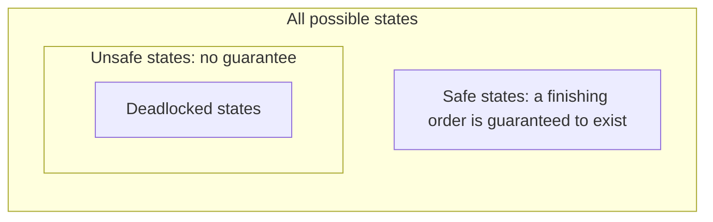

# Deadlock avoidance, the banker's algorithm and prevention

> **Before this lesson:** read [Deadlock: conditions, modelling, detection and recovery](#/lesson/os/deadlock-detection) first. You need the definition of deadlock, the four conditions (mutual exclusion, hold and wait, no preemption, circular wait) and the idea of tables that record what each process holds.

## In plain words

The previous lesson let deadlocks happen and then cleaned up. This lesson is about not letting them happen.

There are two ways to keep out of trouble, and an everyday comparison shows the difference.

- **Avoidance** is like a careful bank manager. The bank has a limited amount of cash. Each customer has an agreed credit limit but borrows a bit at a time. Before handing over any money, the manager asks: "If I lend this, will I still be able to satisfy *somebody* completely, get repaid, and continue until everyone is served?" If yes, the loan is granted. If no, the customer is asked to wait, even though the cash is physically in the vault. The manager is steering round danger one decision at a time.
- **Prevention** is like a road rule. "Everyone drives on the same side" makes head-on collisions impossible by design. No decision is needed at each junction; the rule removes the possibility.

In computer terms: **avoidance** examines each request for a resource as it arrives and grants it only when doing so cannot lead to deadlock. **Prevention** builds the system so that one of the four conditions for deadlock can never be true.

Why it matters for a job: the banker's algorithm is a classic interview and exam exercise, and one prevention technique — always acquiring locks in a fixed order — is the single most useful habit for anyone who writes programs with more than one thread of execution.

## Avoidance: thinking one step ahead

### A picture of two processes

Start with the smallest case: two processes, A and B, and two resources, a printer and a plotter.

- A needs the printer during the middle part of its work and the plotter during a later, overlapping part.
- B needs the plotter first and then, overlapping, the printer.

Imagine a sheet of graph paper. Moving right means "A makes progress". Moving up means "B makes progress". The state of the whole system is a point on the sheet, and as the processes run the point traces a path that can only go right or up (processes do not run backwards).

Some rectangles on this sheet are forbidden: the region where both would be using the printer at once, and the region where both would be using the plotter at once. Mutual exclusion means the path cannot enter them.

Now the important observation. There is a pocket in the sheet, below and to the left of where the two forbidden rectangles meet, from which every way forward — right or up — runs into a forbidden rectangle. If the path enters that pocket, deadlock is *guaranteed*, although nobody is blocked yet. The pocket is called an **unsafe region**.

So the operating system's job, at the moment the path is about to enter that pocket, is to refuse: make one process wait a little, so the path goes round. That is avoidance in one picture. The rest of this section turns the picture into arithmetic.

### Safe and unsafe states

A **state** is a snapshot: what is free, what each process holds, and the most each process might ever need.

A state is **safe** if there exists *some order* in which the processes can run so that every one of them finishes, even if each of them suddenly asks for everything it is entitled to. Such an order is called a **safe sequence**.

A state is **unsafe** if no such order exists.

Work through the simplest example. There is one kind of resource with 10 copies in total.

| Process | Has now | Maximum it may need |
|---|---|---|
| A | 3 | 9 |
| B | 2 | 4 |
| C | 2 | 7 |

Seven copies are held, so **3 are free**.

Is this safe? Look for a process whose remaining need can be covered by the 3 free copies.

- A still needs 9 − 3 = 6. Too many.
- B still needs 4 − 2 = 2. That fits. Give B two copies (1 left free). B finishes and returns all 4 it then holds: **5 free**.
- C still needs 7 − 2 = 5. That fits now. C finishes and returns 7: **7 free**.
- A still needs 6. That fits. A finishes.

The order B, C, A works, so the state is **safe**.

Now suppose, from that same starting state, A asks for one more copy and is given it.

| Process | Has now | Maximum |
|---|---|---|
| A | 4 | 9 |
| B | 2 | 4 |
| C | 2 | 7 |

Now **2 are free**. B can still finish (needs 2), returning 4: 4 free. But C needs 5 and A needs 5. Neither fits in 4. There is no order in which everyone is guaranteed to finish, so this state is **unsafe**. Granting A's request was a mistake, and a careful system would have made A wait.

### Unsafe does not mean deadlocked

This point confuses nearly everyone at first, so it is worth slowing down.

In the unsafe state above, nobody is stuck yet. And deadlock might *never* occur: perhaps A will release a copy before asking for more, or perhaps C will never use its full allowance. An unsafe state is one where the system **can no longer guarantee** that everyone finishes. From a safe state the operating system can always steer to completion. From an unsafe state it depends on how the processes behave — and the operating system cannot control that.



Every deadlocked state is unsafe, but not every unsafe state is deadlocked. Avoidance works by never leaving the safe region.

### The banker's algorithm for one kind of resource

In 1965 Edsger Dijkstra described a scheduling method based on the bank-manager idea, known ever since as the **banker's algorithm**. For a single kind of resource it reads:

> When a request arrives, pretend to grant it. Check whether the resulting state is safe. If it is, grant the request for real. If it is not, make the requester wait.

And the safety check is what we did by hand: repeatedly find a process whose remaining need fits in what is free, let it finish, and take back everything it holds. If all processes can be finished this way, the state is safe.

### The banker's algorithm for several kinds of resource

Real systems have many kinds of resource. The method is the same, with lists of numbers in place of single numbers. Four tables are kept:

- **Available** — how many copies of each kind are free.
- **Allocation** — for each process, how many of each kind it holds now.
- **Maximum** — for each process, the most of each kind it may ever hold. Each process must declare this in advance.
- **Need** — for each process, Maximum minus Allocation: how many more it might still ask for.

The safety check:

1. Look for a process, not yet finished, whose **Need** row is less than or equal to **Available**, comparing kind by kind. If none exists and unfinished processes remain, the state is unsafe.
2. Assume that process gets what it needs, runs to the end and releases everything. Add its **Allocation** row to **Available**. Mark it finished.
3. Repeat until all are finished (safe) or nobody qualifies (unsafe).

Here is a full example. There are three kinds of resource with 10, 5 and 7 copies. Five processes:

| Process | Allocation | Maximum | Need = Max − Alloc |
|---|---|---|---|
| P0 | 0, 1, 0 | 7, 5, 3 | 7, 4, 3 |
| P1 | 2, 0, 0 | 3, 2, 2 | 1, 2, 2 |
| P2 | 3, 0, 2 | 9, 0, 2 | 6, 0, 0 |
| P3 | 2, 1, 1 | 2, 2, 2 | 0, 1, 1 |
| P4 | 0, 0, 2 | 4, 3, 3 | 4, 3, 1 |

Allocated in total: (7, 2, 5). So **Available = (10, 5, 7) − (7, 2, 5) = (3, 3, 2)**.

- P0 needs (7, 4, 3). Not ≤ (3, 3, 2), because 7 > 3.
- P1 needs (1, 2, 2). Each number fits. P1 finishes; Available = (3, 3, 2) + (2, 0, 0) = **(5, 3, 2)**.
- P2 needs (6, 0, 0). 6 > 5. No.
- P3 needs (0, 1, 1). Fits. Available = (5, 3, 2) + (2, 1, 1) = **(7, 4, 3)**.
- P4 needs (4, 3, 1). Fits. Available = (7, 4, 3) + (0, 0, 2) = **(7, 4, 5)**.
- Back to P0: (7, 4, 3) fits in (7, 4, 5). Available = **(7, 5, 5)**.
- P2: (6, 0, 0) fits. Available = **(10, 5, 7)** — everything is back, a useful check on the arithmetic.

A safe sequence is **P1, P3, P4, P0, P2**. Others exist too (for example P3, P1, P4, P2, P0); the check only needs to find one.

```python-run
def is_safe(available, allocation, maximum):
    """Return a safe sequence of process numbers, or None if the state is unsafe."""
    work = list(available)                       # what would be free as processes finish
    need = [[m - a for m, a in zip(max_row, alloc_row)]
            for max_row, alloc_row in zip(maximum, allocation)]
    finished = [False] * len(allocation)
    order = []
    progress = True
    while progress:
        progress = False
        for p in range(len(allocation)):
            if not finished[p] and all(n <= w for n, w in zip(need[p], work)):
                work = [w + a for w, a in zip(work, allocation[p])]
                finished[p] = True
                order.append(p)
                progress = True
    return order if all(finished) else None

def request(p, wanted, available, allocation, maximum):
    """Banker's decision for process p asking for the list `wanted`."""
    need_p = [m - a for m, a in zip(maximum[p], allocation[p])]
    if any(w > n for w, n in zip(wanted, need_p)):
        return "error: process asked for more than its declared maximum"
    if any(w > a for w, a in zip(wanted, available)):
        return "wait: not enough free copies right now"
    # Pretend to grant it.
    new_available = [a - w for a, w in zip(available, wanted)]
    new_allocation = [row[:] for row in allocation]
    new_allocation[p] = [a + w for a, w in zip(allocation[p], wanted)]
    sequence = is_safe(new_available, new_allocation, maximum)
    if sequence is None:
        return "wait: granting would lead to an unsafe state"
    return f"grant: still safe, e.g. order {sequence}"

available  = [3, 3, 2]
allocation = [[0, 1, 0], [2, 0, 0], [3, 0, 2], [2, 1, 1], [0, 0, 2]]
maximum    = [[7, 5, 3], [3, 2, 2], [9, 0, 2], [2, 2, 2], [4, 3, 3]]

print("safe sequence for the starting state:", is_safe(available, allocation, maximum))
print("P1 asks for (1, 0, 2):", request(1, [1, 0, 2], available, allocation, maximum))
print("P4 asks for (3, 3, 0):", request(4, [3, 3, 0], available, allocation, maximum))
print("P0 asks for (0, 2, 0):", request(0, [0, 2, 0], available, allocation, maximum))
print("P0 asks for (8, 0, 0):", request(0, [8, 0, 0], available, allocation, maximum))
```

**What each part does.**

- `need = [[m - a ...] ...]` builds the Need table by subtracting, position by position, each process's allocation from its maximum. `zip` pairs up items from two lists: the first with the first, the second with the second, and so on.
- `finished` holds one true/false flag per process, all starting as `False`.
- Inside the loop, `all(n <= w for n, w in zip(need[p], work))` is the "fits, kind by kind" test: it is true only when every number in the process's need is at most the matching number in `work`.
- When a process fits, `work` grows by that process's allocation, the flag is set, and its number is added to `order`.
- The `while progress` loop repeats the scan as long as the previous pass finished at least one process, because someone who did not fit before may fit now.
- `request` first rejects impossible requests, then builds a *copy* of the tables as they would be after granting (`row[:]` copies a list), and runs `is_safe` on the copy. The real tables are never changed by a mere question.

**The output and why.**

- The starting state prints `[1, 3, 4, 0, 2]`, matching the hand calculation.
- P1 asking for (1, 0, 2) is **granted**: afterwards Available is (2, 3, 0), and an order still exists.
- P4 asking for (3, 3, 0) must **wait**: only (3, 3, 2) is free, so it is physically possible, but afterwards Available would be (0, 0, 2) and no process's need fits — an unsafe state.
- P0 asking for (0, 2, 0) is **granted**, which may be a surprise because P0 is the process with the largest remaining need. Granting leaves (3, 1, 2) free; P3 still fits, and once P3 has finished the others follow in the order shown. The algorithm does not care who asks, only whether a finishing order still exists afterwards.
- P0 asking for (8, 0, 0) is an **error**, because P0 promised never to need more than 7 of the first kind.

> [!INTERVIEW]
> The standard exercise gives you Available, Allocation and Maximum and asks "is the state safe, and what is a safe sequence?" Method: (1) compute Need = Maximum − Allocation; (2) set Work = Available; (3) repeatedly pick any process whose Need ≤ Work, add its **Allocation** to Work, and write its name down; (4) safe if all processes are written down. For "can this request be granted?", first move the requested amounts from Available to that process's Allocation (and reduce its Need), then run the same check. Two mistakes cost most marks: adding Need instead of Allocation when a process finishes, and comparing only totals instead of each resource kind separately.

### Why the banker's algorithm is rarely used in practice

It is elegant, and it is seldom built into real operating systems, for three reasons.

1. **Processes rarely know their maximum needs in advance.** A word processor cannot say how many files the user will open.
2. **The set of processes keeps changing.** Users log in, programs start and stop; the tables would never stand still.
3. **Resources can disappear.** A device that breaks reduces what "exists", which may turn a state that was thought safe into an unsafe one.

Its ideas survive in narrower settings — some databases and embedded controllers, where the tasks and their needs are known ahead of time.

## Prevention: making one condition impossible

Avoidance needs information about the future that is usually unavailable. Prevention takes a different route. Recall that deadlock requires four conditions *all at once*. If the system is designed so that any single one can never be true, deadlock is structurally impossible. Take each in turn.

### Attacking mutual exclusion

If a resource is never assigned exclusively to one process, nobody can hold it while others wait. The classic technique is **spooling**. Instead of letting programs use the printer directly, they hand their output to a single background program (a *daemon* — a program that runs unattended in the background), which is the only one that ever touches the real printer. Since only one process uses the printer, no deadlock over the printer is possible.

The general lesson: avoid assigning a resource unless it is truly necessary, and let as few processes as possible actually claim it. Not every resource can be handled this way — a database record being updated must be exclusive for a while.

### Attacking hold and wait

If a process holding resources is never allowed to wait for more, there can be no chain of waiting. One way: require every process to **request everything it will need before it starts**. If everything is available, it gets it all and runs; otherwise it gets nothing and waits.

Two problems. First, many processes do not know what they will need until they are running. Second, resources are wasted: a process that reads data for an hour and then prints for a minute would hold the printer for the entire hour.

A variation: before asking for a new resource, a process must first **release everything it holds**, then ask for the whole set again in one request.

### Attacking no preemption

If resources could be taken away, standoffs could be broken. For some resources this can be arranged by **virtualising** them: put the printer's output on disk first (spooling again), so that the "printer" a process holds is really a file on disk, which can be handled freely. But many resources cannot be virtualised — a record that is half updated cannot be handed to someone else.

### Attacking circular wait

This is the practical one. Give every resource a **number**, and impose one rule:

> A process may request resources only in increasing numerical order.

A process holding resource 3 may ask for 7, but a process holding 7 may never ask for 3.

Why does this make deadlock impossible? Suppose a cycle of waiting existed. Look at the process in the cycle that holds the **highest-numbered** resource of all those involved. It is waiting for a resource held by another process in the cycle — which must be a lower-numbered one, since its own is the highest. But the rule forbids asking for a lower number than one already held. So no such cycle can exist.

Recall the scanner and printer example from the previous lesson: process A took the scanner and then the printer; process B took the printer and then the scanner. Number the scanner 1 and the printer 2. The rule forces B to ask for the scanner first, like A. Whichever gets the scanner will get the printer too, and the other waits at the start, holding nothing.

```python-run
def run(order_a, order_b, schedule):
    """Two processes each acquire two locks in the given order. schedule says whose turn it is."""
    holder = {}                                   # lock name -> process holding it
    position = {"A": 0, "B": 0}                   # how many locks each has acquired
    plans = {"A": order_a, "B": order_b}
    for who in schedule:
        if position[who] == 2:
            continue                              # this process already has both locks
        wanted = plans[who][position[who]]
        if wanted not in holder:
            holder[wanted] = who
            position[who] += 1
    if position["A"] == 2 or position["B"] == 2:
        return "one process got both locks and can finish"
    if position["A"] + position["B"] < 2:
        return "nobody is stuck yet (the schedule ended early)"
    return f"DEADLOCK: A holds {[k for k, v in holder.items() if v == 'A']}, B holds {[k for k, v in holder.items() if v == 'B']}"

interleaved = ["A", "B", "A", "B"]

print("opposite orders:", run(["scanner", "printer"], ["printer", "scanner"], interleaved))
print("same order     :", run(["scanner", "printer"], ["scanner", "printer"], interleaved))

# Try every possible interleaving of four turns to be sure.
from itertools import product
bad = [s for s in product("AB", repeat=4)
       if run(["scanner", "printer"], ["scanner", "printer"], s).startswith("DEADLOCK")]
print("interleavings that deadlock with a fixed order:", len(bad), "out of 16")
```

**What each part does.**

- `holder` is a dictionary recording which process holds each lock. If a lock's name is not in the dictionary, the lock is free.
- `position` records how far each process has got through its plan (0, 1 or 2 locks acquired).
- For each turn in `schedule`, the process whose turn it is looks at the next lock in its plan. If the lock is free (`wanted not in holder`), it takes it and moves on. If not, nothing happens: it stays waiting.
- At the end, if either process holds both locks, it can do its work and release them, so there is no deadlock. If fewer than two locks are held in total, the schedule ran out before anything interesting happened. The only remaining case is that each process holds one lock and waits for the other: a deadlock.
- The last three lines try all 16 possible sequences of four turns (`product("AB", repeat=4)` generates them) to confirm that with a fixed order no sequence leads to deadlock.

**The output.** With opposite orders the interleaved schedule deadlocks: A holds the scanner, B holds the printer. With the same order, one process gets both locks. And the exhaustive check prints `0 out of 16`.

In real programs, "resources" are usually locks protecting pieces of data, and the numbering rule becomes a **lock ordering** convention written into the project's coding rules: "always take the account lock before the ledger lock". Tools exist that watch a running program and warn if two locks were ever taken in both orders, even when no deadlock happened on that run.

### Summary of prevention

| Condition | How to make it impossible | Practical? |
|---|---|---|
| Mutual exclusion | Route all use through one process (spool everything) | For some devices |
| Hold and wait | Request all resources at the start | Wasteful; needs foresight |
| No preemption | Take resources away | Rarely safe |
| Circular wait | Number the resources and request in increasing order | Yes — widely used |

## Related problems

### Two-phase locking

Databases often need to lock several records to make one consistent change. In **two-phase locking** the work is split into two stages. In the first stage the program tries to lock every record it needs, one at a time. If it succeeds, it moves to the second stage: make the changes, then release all the locks. If during the first stage it finds a record already locked, it **releases everything it has locked so far and starts the first stage again**. Because it never holds locks while waiting indefinitely, the hold-and-wait condition is broken.

This only works if giving up and restarting is harmless — which is true before any changes have been made. It would be unacceptable in a program that had already sent messages or printed half a document.

### Communication deadlock

Deadlock needs no devices or locks at all. Suppose process A sends a request message to process B and waits for the reply, and the request is lost in the network. A waits for the reply. B waits for a request. Each is waiting for an event that only the other can cause: by the definition, a deadlock. This kind is called a **communication deadlock**.

It cannot be prevented by numbering resources, since there are none. The standard cure is a **timeout**: when A sends a message it starts a timer, and if no reply arrives before the timer runs out, A assumes the message was lost and sends it again. This is why network software is full of timers and of rules — collectively called a *protocol* — about what to do when they expire, including how to cope if the original message was merely slow and now arrives twice.

### Livelock

Imagine two polite people meeting in a corridor. Each steps aside to let the other pass — to the same side. They both step back the other way. And again. Nobody is frozen; both are busily moving; yet neither gets past.

In software, this happens when processes react to a conflict by backing off and retrying, and keep colliding. Process A takes resource 1, process B takes resource 2; each tries for the other, fails, politely releases what it has, and tries again in the same order at the same pace. This is **livelock**: the processes are not blocked, but no useful progress is made. The usual remedy is to add randomness — each waits a random length of time before retrying, so they fall out of step.

### Starvation

A different problem again. Suppose the printer is always given to whichever waiting job is smallest. If small jobs keep arriving, a large job can wait indefinitely. The system as a whole is working well and nobody is deadlocked, but one process never gets served. This is **starvation**. The straightforward cure is a first-come, first-served policy, so that the longest-waiting process is next; with it, every process is reached eventually.

| | Are the processes blocked? | Is the system making progress? |
|---|---|---|
| **Deadlock** | Yes, all in the group | Not for the group, ever |
| **Livelock** | No — they keep running | No useful progress |
| **Starvation** | The victim keeps waiting | Yes, for everyone else |

## Common mistakes and confusions

- **Treating "unsafe" as "deadlocked".** Unsafe means the guarantee is gone, not that anyone is stuck.
- **Returning Need instead of Allocation.** When a process finishes in the safety check, it gives back what it *holds*.
- **Stopping the safety check after one pass through the list.** A process skipped early may fit later; keep looping until a whole pass finds nobody.
- **Checking only whether the copies are free.** In the banker's algorithm a request can be refused even though enough copies are available.
- **Believing lock ordering needs the locks to be related.** The order can be arbitrary — by name, by memory address — as long as everyone uses the same one.
- **Confusing detection with avoidance.** Detection asks what processes are requesting *now*. Avoidance asks what they could request *at most*.

## Summary

- **Avoidance** grants a request only if the resulting state is **safe**: some order exists in which every process can obtain its maximum and finish. Unsafe states are not necessarily deadlocked, but offer no guarantee.
- The **banker's algorithm** pretends to grant a request and runs the safety check using **Available**, **Allocation**, **Maximum** and **Need**. It is rarely used in general-purpose systems because maximum needs are unknown and the process set changes.
- **Prevention** removes one of the four conditions: spool to remove **mutual exclusion**; request everything at once to remove **hold and wait**; take resources back to remove **no preemption**; number resources and acquire in increasing order to remove **circular wait** — the technique used most.
- **Two-phase locking** releases all locks and retries on conflict. **Communication deadlocks** are broken with **timeouts**. **Livelock** is activity without progress; **starvation** is one process being passed over indefinitely.

## Glossary

- **Avoidance** — deciding, request by request, to grant only those that cannot lead to deadlock.
- **Prevention** — designing the system so that one of the four deadlock conditions can never hold.
- **State** — a snapshot of what is free, what each process holds and what each may still need.
- **Safe state** — a state from which some order of running the processes lets every one finish.
- **Safe sequence** — such an order.
- **Unsafe state** — a state with no safe sequence; deadlock is possible but not certain.
- **Banker's algorithm** — Dijkstra's method: pretend to grant a request, check that the result is safe, and only then grant it.
- **Need** — a process's declared maximum minus what it currently holds.
- **Spooling** — queuing work for a device on disk so that a single background program is the only user of the device.
- **Daemon** — a program that runs in the background without a user attending to it.
- **Lock ordering** — a fixed, agreed order in which all code must acquire locks.
- **Two-phase locking** — lock everything first (giving up and restarting if any lock is taken), then make changes and release.
- **Communication deadlock** — processes waiting for messages from each other that will never come.
- **Timeout** — a time limit after which a waiting process gives up or retries.
- **Livelock** — processes that keep running and reacting to each other without making progress.
- **Starvation** — a process that waits indefinitely because others are always served first.

## Check yourself

```quiz
[
  {"q": "A system has 12 copies of one resource. Process A holds 5 and may need up to 10; B holds 2 and may need up to 4; C holds 2 and may need up to 9. Is the state safe?",
   "options": ["Yes, in the order A, B, C", "Yes, in the order B, A, C", "No, it is unsafe", "It cannot be determined without knowing the requests"],
   "answer": 1,
   "explain": "9 are held, so 3 are free. B needs 2 more: it finishes and returns 4, giving 5 free. A needs 5 more: it finishes and returns 10, giving 10 free. C needs 7 more, which fits. The order B, A, C works."},
  {"q": "What does it mean for a state to be unsafe?",
   "options": ["A deadlock has already occurred", "At least one process has been terminated", "No order of running the processes is guaranteed to let all of them finish", "A resource has been lost"],
   "answer": 2,
   "explain": "Unsafe means the operating system can no longer guarantee completion. Deadlock may still be avoided if processes happen to release resources early or never ask for their full maximum."},
  {"q": "In the banker's safety check, a process whose need fits is assumed to finish. What is then added to the available list?",
   "options": ["Its Need row", "Its Maximum row", "Its Allocation row", "Nothing"],
   "answer": 2,
   "explain": "A finishing process releases what it holds. The extra copies it borrowed in order to finish came from the available list and go back to it, so the net gain is its allocation."},
  {"q": "Available is (1, 1). Process P1 has Allocation (1, 0) and Maximum (2, 1). Process P2 has Allocation (0, 1) and Maximum (2, 2). Which is true?",
   "options": ["Unsafe: neither can finish", "Safe: P1 can finish, then P2", "Safe: P2 must finish first", "Safe only if P2 never asks for more"],
   "answer": 1,
   "explain": "P1 needs (1, 1), which fits in (1, 1). After P1 finishes, Available is (2, 1). P2 needs (2, 1), which fits. The sequence P1, P2 is safe."},
  {"q": "Why is the banker's algorithm seldom used in general-purpose operating systems?",
   "options": ["It is too slow for any computer", "Processes usually cannot state their maximum needs in advance, and the set of processes keeps changing", "It only works with one kind of resource", "It causes deadlocks"],
   "answer": 1,
   "explain": "The algorithm depends on advance knowledge of every process's maximum claim and on a stable set of processes and resources, which ordinary systems do not have."},
  {"q": "All code in a program follows the rule: locks must be acquired in increasing order of their assigned numbers. Which deadlock condition does this make impossible?",
   "options": ["Mutual exclusion", "Hold and wait", "No preemption", "Circular wait"],
   "answer": 3,
   "explain": "In any cycle of waiting, the process holding the highest-numbered lock would have to be waiting for a lower-numbered one, which the rule forbids. So no cycle can form."},
  {"q": "Process A sends a request to process B and waits for a reply. The request is lost. B waits for a request. What is the standard remedy?",
   "options": ["Number the resources", "The banker's algorithm", "A timeout after which A sends the request again", "Spooling"],
   "answer": 2,
   "explain": "This is a communication deadlock with no resources to order. A timer lets A notice the missing reply and retransmit."},
  {"q": "Two processes repeatedly acquire one lock each, fail to get the second, release, and immediately try again, forever. Neither is ever blocked. What is this called?",
   "options": ["Deadlock", "Livelock", "Starvation", "A safe state"],
   "answer": 1,
   "explain": "Both processes are active but make no progress. In a deadlock they would be blocked; in starvation the rest of the system would be progressing while one process waits."}
]
```

> **Source:** Tanenbaum & Bos, Modern Operating Systems 4e, §6.5 (Deadlock avoidance), §6.6 (Deadlock prevention), §6.7 (Other issues)
