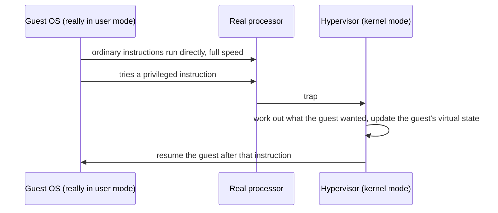
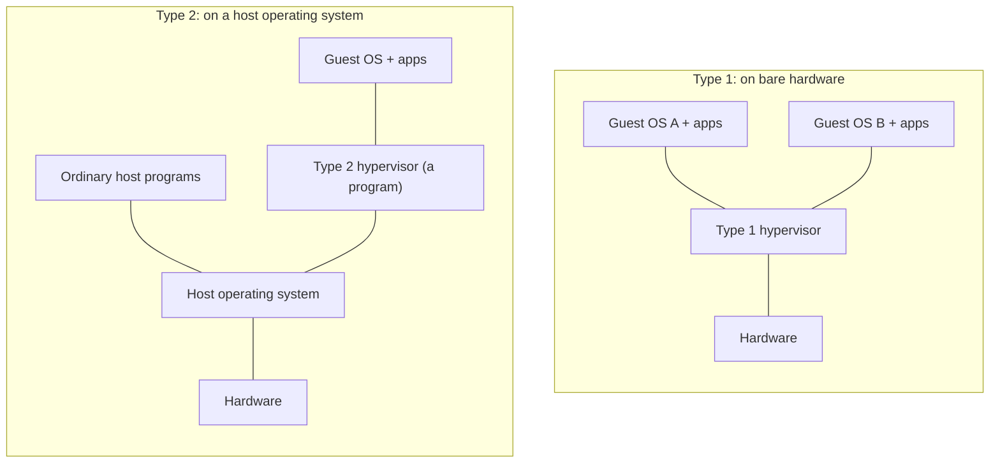

# Hypervisors and CPU virtualization techniques

> **Before this lesson:** you should know the difference between kernel mode and user mode and what a *trap* is ([Hardware review](#/lesson/os/hardware-review)), and what a kernel does ([Core concepts, system calls and kernel structure](#/lesson/os/concepts-syscalls-structure)).

## In plain words

Think of a large house converted into flats. From the street it is one building with one water main and one electricity supply. Inside, each tenant has a front door, a kitchen and a meter, and lives as though the flat were a separate house. The landlord's job is to divide the building's supplies fairly and make sure no tenant can walk into another's flat.

**Virtualization** does this to a computer. One physical machine is made to look like several separate machines. Each of these pretend machines is called a **virtual machine** (VM). Each one runs its own complete operating system — one could run Windows, the next Linux — and each operating system believes it has a whole computer to itself. The program that plays landlord, dividing the real hardware among the virtual machines and keeping them apart, is called a **hypervisor** (also a *virtual machine monitor*).

Why it matters for a job: nearly every server you will ever deploy code to is a virtual machine. Cloud providers rent out virtual machines by the hour. Developers run virtual machines on laptops to test software on other operating systems. Understanding what sits underneath explains a great deal about cost, performance and security in modern computing.

## Why bother?

Start with the problem virtualization solved. A company once ran each service — mail, web site, database, file sharing — on its own physical server. There were good reasons: if the mail software crashed the machine, the web site stayed up; and different services often needed different operating systems or versions.

The result was rooms full of machines, each doing very little. Measurements commonly showed servers busy only a small fraction of the time. Yet each one took up space, drew electricity, produced heat and needed maintenance.

With virtualization, those services each keep their own operating system — so they stay isolated from one another — but share a few powerful physical machines. This is called **server consolidation**.

```python-run
import math

def machines_needed(n_services, average_load, target_load):
    """How many physical machines are needed if each may be loaded up to target_load?"""
    total_work = n_services * average_load
    return math.ceil(total_work / target_load)

services = 40          # one small service per old server
average_load = 0.08    # each old server was busy 8% of the time

print("without virtualization:", services, "machines, each", f"{average_load:.0%}", "busy")
for target in (0.5, 0.7):
    n = machines_needed(services, average_load, target)
    print(f"with virtualization, loading each host to {target:.0%}: {n} machines "
          f"({services // n} virtual machines per host)")
```

**What each line does.** `machines_needed` adds up the work of all the services (`n_services * average_load`, here 40 × 0.08 = 3.2 "machines' worth" of work), divides by how full we are willing to run each host, and rounds up with `math.ceil` because you cannot buy part of a machine. The loop prints the answer for two choices of how heavily to load each host.

**The output.** Forty lightly used servers become seven or five. That is the economic case in one calculation.

Other benefits follow from the fact that a virtual machine is, at bottom, data:

- **Strong isolation.** A fault or break-in inside one VM does not directly affect the others. The amount of code that must be trusted is the hypervisor, which is much smaller than a full operating system — and smaller programs tend to have fewer bugs.
- **Checkpointing and migration.** A VM's entire state — its memory and its disk — can be saved to a file, copied, or moved to another physical machine while it is still running. This lets operators empty a host for repairs without stopping the services on it.
- **Running old software.** A program that needs an operating system no longer supported on new hardware can run inside a VM.
- **Development and testing.** One laptop can test software on many operating systems.

Some vocabulary before going on. The operating system running *inside* a virtual machine is the **guest operating system**. If the hypervisor itself runs on top of an ordinary operating system, that one is the **host operating system**.

## What a hypervisor must achieve

In 1974 two researchers, Gerald Popek and Robert Goldberg, set out what a proper hypervisor must provide. Three goals:

1. **Safety.** The hypervisor has full control of the real hardware. A guest must not be able to do anything that affects other guests or the hypervisor itself.
2. **Fidelity.** A program running in a virtual machine behaves the same as it would on real hardware (apart from timing).
3. **Efficiency.** Most of the guest's instructions run directly on the real processor, with no intervention. Only the few delicate ones need help.

The third goal rules out the easy answer. A program that reads each guest instruction and acts it out in software is called an **interpreter** (or emulator). It is safe and faithful, and it is tens of times slower than real hardware. A hypervisor instead lets the real processor run the guest's instructions at full speed, and steps in only when necessary. The whole subject comes down to one question: *how does the hypervisor get to step in at the right moments?*

### The idea that makes it work: trap-and-emulate

Recall that a processor has two modes. In **kernel mode** every instruction is allowed. In **user mode** some instructions are forbidden; trying to run one causes a **trap** — the processor stops what it was doing and jumps to a handler chosen by whoever is in control.

Normally an operating system runs in kernel mode. Under a hypervisor, the *hypervisor* runs in kernel mode and the guest operating system is run in user mode, like an ordinary program. The guest does not know this. It carries on as though it were in charge.

Most of what the guest does is ordinary arithmetic and memory access, which run directly. But sooner or later the guest tries something that only a real kernel should do — for example, the instruction that turns interrupts off. Because the processor is really in user mode, that instruction traps. Control passes to the hypervisor, which:

1. looks at which instruction the guest was attempting;
2. works out what the guest intended;
3. carries out the effect on the guest's *pretend* machine (for "turn interrupts off", it records "this guest believes its interrupts are off" in a table);
4. returns control to the guest, which continues, none the wiser.

This is called **trap-and-emulate**. The guest thinks it turned off the machine's interrupts. In fact it changed a note in the hypervisor's bookkeeping, and the real machine's interrupts are untouched.



### The catch: sensitive and privileged instructions

Trap-and-emulate depends on an assumption: every instruction that matters *does* trap when run in user mode. Popek and Goldberg made this precise with two definitions.

- A **sensitive instruction** is one that behaves differently depending on whether the processor is in kernel mode or user mode, or that reads or changes the machine's control state. These are the instructions a hypervisor must intercept.
- A **privileged instruction** is one that causes a trap when run in user mode.

Their result:

> A machine can be virtualized by trap-and-emulate only if **every sensitive instruction is also privileged**.

In plain terms: if a guest tries to do something it should not do directly, the hardware must make it trap.

For decades the most common processor family, Intel's x86, failed this test. It had a number of instructions that were sensitive but *not* privileged. One of them, for example, loads the processor's flags, including the flag that controls interrupts. Run in kernel mode, it changes the interrupt flag. Run in user mode, it does **not** trap — it silently leaves that flag alone and carries on. A guest operating system running in user mode would believe it had changed the flag; nothing would have happened; and the hypervisor would never find out. Other instructions let a program read which mode it was really in, so a guest could discover that it was not in kernel mode at all.

So for a long time x86 was thought impossible to virtualize efficiently. Three different ways round the obstacle were found, and you will meet all three in practice.

## Three techniques for an awkward processor

### Technique 1: binary translation

In the late 1990s researchers who went on to found the company VMware found a software solution. The hypervisor does not let the guest's kernel code reach the processor unexamined. Instead it reads that code a small piece at a time, shortly before it runs. Each piece is a **basic block**: a short run of instructions that ends at a jump or branch.

For each block the hypervisor scans for sensitive instructions and **rewrites** them into calls to hypervisor routines that produce the right effect on the virtual machine. Harmless instructions are copied unchanged. The rewritten block is stored in a **translation cache** so that the work is done once; the next time the guest reaches that code, the cached translation runs immediately. Translated blocks are also linked directly to each other, so that in a loop control flows from one to the next without returning to the translator.

Only the guest's *kernel* needs this treatment. Guest application programs run in user mode on a real machine too, so their code can be run directly, untouched.

This is called **binary translation** because it translates the machine's own binary instructions into other binary instructions. Surprisingly, it can be faster than trap-and-emulate even where trapping is possible, because a trap is an expensive event (it disturbs the processor's internal caches and prediction machinery) and a rewritten instruction can often do its job with a few ordinary instructions and no trap.

### Technique 2: paravirtualization

A second approach gives up pretending. Instead of presenting the guest with a perfect imitation of real hardware, the hypervisor presents something *similar* and asks the guest operating system to be modified so that it cooperates. Wherever the guest's source code would have used a sensitive instruction, it is changed to make an explicit request to the hypervisor. Such a request is called a **hypercall** — the same idea as a system call, but from an operating system down to a hypervisor instead of from a program down to an operating system.

This is **paravirtualization**. It is simpler and faster, since there is nothing to detect and nothing to emulate. Its drawback follows from the description: the guest's source code must be changed, which is possible for open-source systems such as Linux and not something an outsider can do to a closed-source one.

To avoid tying a guest kernel to one particular hypervisor, a common interface was defined: the kernel calls a fixed set of routines for sensitive operations, and a small plug-in translates those calls for whichever hypervisor (or bare hardware) it happens to be running on.

### Technique 3: hardware support

Finally, in 2005 and 2006, Intel and AMD changed the processors. The new hardware feature (Intel's is called VT-x, AMD's is called SVM) adds a new way of running code, intended for guests. The hypervisor creates a "container" for each virtual machine and tells the processor which events inside that container should hand control back to the hypervisor. The guest operating system runs inside the container *in what it sees as kernel mode*, and its sensitive instructions either act on a virtual copy of the processor state held by the hardware or cause an exit to the hypervisor.

With this, classic trap-and-emulate works on x86, and guests need no modification and no translation. It is how most virtual machines run today. Exits to the hypervisor remain expensive, so designers still work to make them rare.

| Technique | Guest changed? | How sensitive instructions are handled | Main cost |
|---|---|---|---|
| Binary translation | No | Rewritten by the hypervisor before running | Translation effort; complexity |
| Paravirtualization | Yes — source modified | Replaced by hypercalls | Needs access to guest source |
| Hardware support | No | Trap to the hypervisor (trap-and-emulate) | Each exit is slow |

### A toy trap-and-emulate machine

The following model has a tiny pretend processor. Ordinary instructions (`ADD`) run directly. Privileged ones (`CLI`, "clear interrupts", and `STI`, "set interrupts") trap to a hypervisor when run by a guest.

```python-run
class Hypervisor:
    def __init__(self):
        self.real_interrupts_on = True       # the real machine's state: guests never change it
        self.virtual = {}                    # guest name -> that guest's pretend interrupt flag
        self.traps = 0

    def run(self, guest, program):
        self.virtual.setdefault(guest, True)
        total = 0
        for instruction in program:
            name, *args = instruction.split()
            if name == "ADD":                # harmless: runs directly on the processor
                total += int(args[0])
            elif name in ("CLI", "STI"):     # privileged: the processor traps to us
                self.traps += 1
                self.virtual[guest] = (name == "STI")
            else:
                raise ValueError(f"unknown instruction {name}")
        return total

hv = Hypervisor()
print("guest A result:", hv.run("A", ["ADD 5", "CLI", "ADD 7", "ADD 1", "STI", "ADD 2", "CLI"]))
print("guest B result:", hv.run("B", ["ADD 100", "ADD 1"]))
print("what each guest believes about its interrupts:", hv.virtual)
print("real machine's interrupts still on:", hv.real_interrupts_on)
print("traps taken:", hv.traps, "out of 9 instructions")
```

**What each part does.**

- `self.real_interrupts_on` stands for the true hardware state. Notice that no line in `run` ever changes it.
- `self.virtual` is the hypervisor's bookkeeping: one entry per guest recording what that guest *thinks* its interrupt flag is.
- `name, *args = instruction.split()` breaks a text line such as `"ADD 5"` into the instruction name (`ADD`) and a list of the remaining pieces (`["5"]`).
- For `ADD`, the number is added — standing for an instruction that runs at full speed with no hypervisor involvement.
- For `CLI` and `STI`, the trap counter goes up and only the *guest's own* entry in `self.virtual` changes.

**The output.** Guest A computes 15 and ends up believing its interrupts are off. Guest B computes 101 and never trapped. The real machine's interrupts are still on. And only 3 of the 9 instructions needed the hypervisor — that ratio is the "efficiency" goal: the common case runs untouched.

## Two kinds of hypervisor

Hypervisors come in two arrangements.

A **type 1 hypervisor** runs directly on the hardware — there is no other operating system underneath it. It is, in effect, a small special-purpose operating system whose only "programs" are virtual machines. It is the only software in the most privileged mode. Data centres use this kind.

A **type 2 hypervisor** runs as a program on top of an ordinary host operating system, and relies on the host for things such as reading files and talking to devices. A virtual machine's "disk" is typically a large file in the host's file system. This is the kind you install on a laptop like any other application.



The line between them is blurry in practice. A widely used arrangement on Linux puts the core of the hypervisor inside the Linux kernel itself, so Linux acts as both host operating system and hypervisor.

> [!INTERVIEW]
> "Type 1 versus type 2 hypervisor?" Type 1 ("bare metal") runs directly on hardware and schedules VMs itself: used on servers for performance and a small trusted base. Type 2 ("hosted") runs as an application on a host operating system and borrows its drivers and file system: easy to install, slightly slower. Then be ready for the follow-up, "how does a guest kernel run without being in real kernel mode?": the hypervisor intercepts sensitive operations, either through hardware virtualization support (trap-and-emulate), binary translation, or paravirtual hypercalls.

## Are hypervisors microkernels done right?

Recall the **microkernel** idea from the lesson on kernel structure: keep the privileged core as small as possible and push everything else outside it. A type 1 hypervisor is likewise a small privileged layer with everything else running above it. Are they the same thing?

There is real overlap, and paravirtualization makes it sharper. A paravirtualized guest does not use sensitive instructions at all; it makes hypercalls to a small kernel that provides a handful of services. That is very nearly the description of a microkernel and the servers that run above it.

The difference is mostly in what is offered upward. A microkernel offers small, purpose-built services (send a message, create a thread). A hypervisor offers an imitation of hardware, so that whole existing operating systems run on top with little or no change. The research community argued about whether these are two ideas or one. What matters for a learner is the shared principle: **the less code that runs with full privilege, the smaller the damage a bug or an attacker can do.**

## Common mistakes and confusions

- **"A virtual machine is an emulator."** An emulator acts out every instruction in software, often for a *different* kind of processor. A hypervisor runs nearly all guest instructions directly on the real processor of the same kind. That is why VMs are fast.
- **"The guest runs in kernel mode."** Without hardware support it runs in user mode and only believes otherwise. With hardware support it runs in a special guest mode in which its "kernel mode" is under the hypervisor's control.
- **"Privileged and sensitive mean the same."** Sensitive describes what the instruction *does*; privileged describes whether it *traps* in user mode. Virtualization by trapping needs every sensitive instruction to be privileged.
- **"Type 2 hypervisors are toys."** They use the same underlying techniques; the difference is who provides device access and scheduling.
- **"Virtualization is free."** Ordinary computation costs almost nothing extra, but operations that require the hypervisor — especially input and output — can be noticeably slower.

## Summary

- **Virtualization** makes one physical computer appear as several **virtual machines**, each running its own **guest operating system**, managed by a **hypervisor**.
- Motives: **server consolidation**, isolation, checkpointing and migration, running old software, testing.
- A hypervisor must provide **safety**, **fidelity** and **efficiency**; efficiency means running guest instructions directly and intervening rarely.
- **Trap-and-emulate** runs the guest kernel without real privilege and lets privileged instructions trap. It requires every **sensitive** instruction to be **privileged** — which classic x86 did not satisfy.
- Three solutions: **binary translation** (rewrite guest kernel code on the fly), **paravirtualization** (modify the guest to make **hypercalls**) and **hardware support** (processor extensions that make guests trap properly).
- **Type 1** hypervisors run on bare hardware; **type 2** run on a host operating system.
- Hypervisors and microkernels share the goal of a small privileged core.

## Glossary

- **Virtualization** — making one physical computer behave like several separate ones.
- **Virtual machine (VM)** — one of those pretend computers.
- **Hypervisor (virtual machine monitor)** — the program that creates and controls virtual machines.
- **Guest operating system** — an operating system running inside a virtual machine.
- **Host operating system** — the ordinary operating system underneath a type 2 hypervisor.
- **Server consolidation** — replacing many lightly used physical servers by virtual machines on a few.
- **Interpreter / emulator** — a program that acts out another machine's instructions one at a time in software.
- **Trap-and-emulate** — letting a guest's forbidden instruction trap, then having the hypervisor carry out its effect on the virtual machine.
- **Sensitive instruction** — one whose behaviour depends on, or changes, the machine's control state.
- **Privileged instruction** — one that traps when run in user mode.
- **Binary translation** — rewriting machine code into other machine code shortly before it runs.
- **Basic block** — a short run of instructions ending in a jump.
- **Translation cache** — the store of already-rewritten blocks.
- **Paravirtualization** — modifying the guest operating system to ask the hypervisor for help explicitly.
- **Hypercall** — a request from a guest operating system to the hypervisor.
- **Type 1 / type 2 hypervisor** — running directly on hardware / running on top of a host operating system.

## Check yourself

```quiz
[
  {"q": "What does a hypervisor do?",
   "options": ["Translates programs from one programming language to another", "Makes one physical computer appear as several separate computers, each able to run its own operating system", "Speeds up the processor", "Replaces the need for memory"],
   "answer": 1,
   "explain": "The hypervisor divides the real hardware among virtual machines and keeps them isolated from one another."},
  {"q": "A company runs 30 servers that are each busy 10% of the time. Roughly how many hosts are needed after consolidation if each host may be loaded to 60%?",
   "options": ["3", "5", "10", "30"],
   "answer": 1,
   "explain": "Total work is 30 x 0.10 = 3 machines' worth. Dividing by 0.6 gives 5."},
  {"q": "In trap-and-emulate, what happens when the guest operating system executes a privileged instruction?",
   "options": ["It changes the real hardware directly", "The processor traps to the hypervisor, which applies the effect to the guest's virtual state and resumes the guest", "The guest is terminated", "The instruction is ignored"],
   "answer": 1,
   "explain": "The guest is not really in kernel mode, so the instruction traps. The hypervisor updates its record of the virtual machine and returns control."},
  {"q": "According to Popek and Goldberg, what must be true for a processor to be virtualizable by trap-and-emulate?",
   "options": ["It must have at least four cores", "Every sensitive instruction must be privileged, so that it traps in user mode", "It must have no privileged instructions", "It must support binary translation"],
   "answer": 1,
   "explain": "If a sensitive instruction can run in user mode without trapping, the hypervisor never gets the chance to intercept it."},
  {"q": "Why was the original x86 processor hard to virtualize?",
   "options": ["It was too slow", "It had sensitive instructions that did not trap in user mode but quietly behaved differently", "It had no user mode", "It could not run more than one program"],
   "answer": 1,
   "explain": "Some instructions that touch control state did nothing, or something different, in user mode instead of trapping, so a guest kernel would misbehave without the hypervisor noticing."},
  {"q": "Which technique requires changing the source code of the guest operating system?",
   "options": ["Binary translation", "Hardware-assisted virtualization", "Paravirtualization", "Trap-and-emulate"],
   "answer": 2,
   "explain": "Paravirtualization replaces sensitive operations in the guest kernel with explicit hypercalls, so the guest must be modified."},
  {"q": "What is the role of the translation cache in binary translation?",
   "options": ["It stores guest files", "It keeps already-rewritten blocks of guest code so each is translated only once", "It holds the host's page tables", "It records network packets"],
   "answer": 1,
   "explain": "Translating is costly, so the result for each basic block is saved and reused the next time execution reaches that block."},
  {"q": "You install a virtualization program on your laptop as an ordinary application, and it stores each virtual disk as a file. What kind of hypervisor is it?",
   "options": ["Type 1", "Type 2", "A microkernel", "An interpreter"],
   "answer": 1,
   "explain": "A hypervisor that runs on top of a host operating system and uses its services, such as the file system, is type 2."}
]
```

> **Source:** Tanenbaum & Bos, Modern Operating Systems 4e, §7.1 (History), §7.2 (Requirements for virtualization), §7.3 (Type 1 and type 2 hypervisors), §7.4 (Techniques for efficient virtualization), §7.5 (Are hypervisors microkernels done right?)
