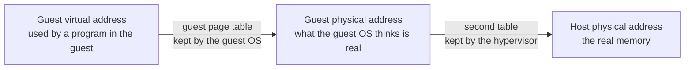
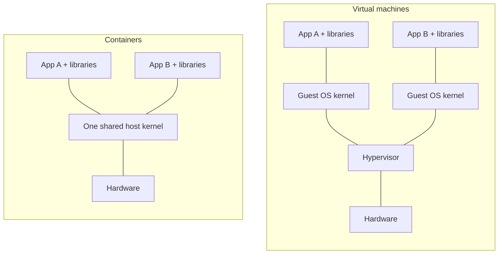

# Memory and I/O virtualization, containers and clouds

> **Before this lesson:** read [Hypervisors and CPU virtualization techniques](#/lesson/os/hypervisors) for what a virtual machine, a guest and a hypervisor are. You also need the idea of a page table from [Virtual memory: paging, page tables and TLBs](#/lesson/os/paging-tlb), and of a device driver from [I/O hardware and the layers of I/O software](#/lesson/os/io-hardware-software).

## In plain words

The previous lesson dealt with one part of a computer: the processor. A hypervisor (the program that runs virtual machines) must also share out the other parts — **memory** and **devices** such as disks and network cards — while letting every guest operating system believe it owns them all.

An analogy for memory. A hotel has rooms numbered by the building's real plan. Each tour group staying there gets its own printed list — "your room 1, your room 2, your room 3" — and the tour leader hands out rooms to group members using that list. Group members only know the leader's numbering; the leader only knows the group's list; and the hotel front desk keeps the table that says which real room each "group room" is. Finding a guest takes two look-ups: member → group room → real room. Memory under virtualization has the same two steps.

An analogy for devices. A block of flats has one postbox out on the street. Each flat is given what looks like its own letterbox, but a caretaker actually carries post between the flats and the single real box.

The lesson ends with two things built on these mechanisms: **containers**, a lighter way of isolating programs, and **clouds**, which rent out virtual machines over the internet.

Why it matters for a job: these mechanisms decide how many virtual machines fit on a server, how fast their disks and networks are, and what you are actually paying for when you rent "a server" from a cloud provider.

## Memory virtualization

### The problem: three kinds of address

Recall how paging works on an ordinary machine. A program uses **virtual addresses**. The operating system keeps a **page table** for each process that maps each virtual page to a **physical frame** of real memory, and the processor uses that table on every memory access.

Now put that operating system in a virtual machine. It still builds page tables, and it still believes the "physical" memory it sees is real. It is not. The hypervisor has handed each guest a pretend block of memory and secretly decides which real frames back it. So there are three kinds of address:

- **Guest virtual address** — what a program inside the guest uses.
- **Guest physical address** — what the guest operating system *believes* is real memory.
- **Host physical address** (also called machine address) — the actual location in the computer's memory chips.

The guest's page tables map the first to the second. The hypervisor must supply the mapping from the second to the third — and two guests may both think they own "physical frame 7".



```python-run
PAGE = 4096      # bytes in one page

# Kept by the guest operating system: guest virtual page -> guest physical page
guest_page_table = {0: 5, 1: 9, 2: 3}

# Kept by the hypervisor, one table per virtual machine: guest physical page -> real frame
host_table_vm1 = {3: 210, 5: 77, 9: 12}
host_table_vm2 = {3: 400, 5: 401, 9: 402}

def translate(address, guest_table, host_table):
    page, offset = divmod(address, PAGE)          # split into page number and position in the page
    if page not in guest_table:
        return "guest page fault (handled by the guest OS)"
    guest_physical_page = guest_table[page]
    if guest_physical_page not in host_table:
        return "fault handled by the hypervisor"
    real_frame = host_table[guest_physical_page]
    return real_frame * PAGE + offset

address = 1 * PAGE + 100                          # byte 100 of virtual page 1
print("in VM 1 the address", address, "is really", translate(address, guest_page_table, host_table_vm1))
print("in VM 2 the address", address, "is really", translate(address, guest_page_table, host_table_vm2))
print("an unmapped page:", translate(7 * PAGE, guest_page_table, host_table_vm1))
```

**What each part does.**

- The two kinds of table are Python dictionaries, which map a key to a value. `guest_page_table = {0: 5, ...}` says "virtual page 0 is in guest physical page 5".
- `divmod(address, PAGE)` divides the address by the page size and gives back two numbers: the whole-number result (which page) and the remainder (how far into that page).
- The function looks the page up in the guest's table, then looks the answer up in the hypervisor's table, and finally rebuilds a full address by multiplying the frame number by the page size and adding the offset back.

**The output.** The same guest address lands at two completely different real locations in the two virtual machines (12 × 4096 + 100 = 49,252 for the first, and 402 × 4096 + 100 for the second) — which is exactly how two guests can use identical-looking memory without ever touching each other's data.

The difficulty is speed. The processor's hardware walks *one* page table on its own. How can two steps be done on every memory access without slowing everything down? Two answers have been used.

### Answer 1: shadow page tables

The older, software-only answer. For each guest process, the hypervisor builds a third table that maps **guest virtual addresses directly to host physical addresses** — the two steps combined into one. This combined table is called a **shadow page table**, and it is the one the real processor actually uses. The guest's own page table is never used by the hardware; it is only a statement of intent that the hypervisor reads.

The hard part is keeping the shadow in step with the original. When the guest changes its page table, it does so by writing to ordinary memory — which does not trap. Hypervisors used tricks to notice: for example, marking the memory that holds the guest's page tables as read-only, so that any attempt to change it causes a fault that the hypervisor catches. This works, but every page-table change by the guest costs an expensive round trip into the hypervisor, and operating systems change page tables a great deal (every time a process is created, for instance).

### Answer 2: nested page tables

Processor makers then added hardware support. With **nested page tables** (Intel calls its version *extended page tables*, EPT), the processor itself knows about both levels: the guest's table and a second table maintained by the hypervisor. On each access it performs both translations in hardware.

The guest can now change its own page tables freely with no trap, which removes most of the overhead. The cost moves elsewhere: when a translation is not already remembered in the processor's translation cache (the TLB), the hardware walk is longer, because every step of walking the guest's table itself needs a translation through the second table. So TLB misses become more expensive, while everything else becomes cheaper. For most workloads that is a clear win, and this is what modern systems use.

### Taking memory back: ballooning

Hypervisors usually promise more memory in total than the machine has — a practice called **overcommitment** — on the reasonable bet that not every guest needs its full allowance at once. When real memory runs short, the hypervisor must take some back from a guest.

Which pages should it take? The hypervisor has no idea which pages the guest values. If it picks blindly, it may remove a page the guest uses constantly while leaving pages the guest would happily give up. The guest operating system, on the other hand, knows exactly which of its pages are least useful — choosing them is what its own page replacement algorithm is for.

The elegant trick is called **ballooning**. A small helper program, the *balloon driver*, is installed inside each guest. When the hypervisor wants memory back from a guest, it tells that guest's balloon to "inflate": the driver asks its own operating system for a large amount of memory and holds on to it. The guest, now short of memory from its own point of view, uses its normal methods to decide what to give up. The pages held by the balloon are not actually being used for anything, so the hypervisor quietly takes the real frames behind them and gives them to another guest. To return memory, the balloon "deflates".

The decision about *what* to give up is thereby made by the one party that has the knowledge to make it well.

### Sharing identical pages

Ten virtual machines running the same operating system hold ten copies of the same program code. **Content-based page sharing** (also called *deduplication*) finds pages with identical contents, keeps one real copy, and points all the guests at it, marked read-only. If any guest later tries to change its copy, the write traps and the hypervisor gives that guest a private copy first — the *copy-on-write* technique from the memory lessons.

```python-run
import hashlib

def shared_memory(virtual_machines):
    """Each VM is a list of page contents. Return (pages before sharing, real pages after sharing)."""
    seen = {}
    before = 0
    for vm in virtual_machines:
        for page in vm:
            before += 1
            fingerprint = hashlib.sha256(page).hexdigest()   # a short "fingerprint" of the contents
            seen.setdefault(fingerprint, page)               # keep only the first page with this fingerprint
    return before, len(seen)

kernel_code = [f"kernel code page {i}".encode() for i in range(300)]     # identical in every VM
zero_page = bytes(4096)                                                  # a page full of zeros
vms = []
for n in range(8):
    private = [f"VM {n} private data {i}".encode() for i in range(150)]
    vms.append(kernel_code + [zero_page] * 50 + private)

before, after = shared_memory(vms)
print(f"pages without sharing: {before}")
print(f"real pages with sharing: {after}  ({1 - after / before:.0%} saved)")
```

**What each part does.** `hashlib.sha256(page).hexdigest()` computes a fixed-length fingerprint of a page's bytes; two pages with the same contents always have the same fingerprint. `seen.setdefault(fingerprint, page)` stores the page under its fingerprint only if nothing is stored there yet, so `seen` ends up holding one entry per *distinct* page. Each of the eight virtual machines is built from 300 pages of shared code, 50 empty pages and 150 private pages.

**The output.** 4,000 pages shrink to 1,501: the 300 code pages and the single zero page are stored once, and only the private pages are multiplied by eight.

## I/O virtualization

"I/O" stands for input/output: everything a computer does with devices — disks, network cards, keyboards, screens. A guest operating system contains device drivers that expect to talk to hardware. What do they talk to in a virtual machine? There are several answers, in increasing order of speed.

**Device emulation.** The hypervisor pretends to be a simple, well-known model of device — an old, standard network card, say. The guest loads its ordinary driver for that model. Every time the driver touches what it believes is the device, the access traps to the hypervisor, which works out what was intended and performs the operation on the real hardware. The guest needs no changes, but each operation involves many traps, so it is slow.

**Paravirtualized drivers.** Give up the pretence. Install in the guest a special driver that knows it is in a virtual machine and passes whole requests ("write these 64 blocks") to the hypervisor in one efficient exchange, usually through a shared region of memory that works as a queue. This is far faster than emulation, and is the usual arrangement in clouds. One widely used standard interface of this kind is called *virtio*.

**Device pass-through.** Hand a real device to one guest for its exclusive use, so that the guest's driver talks to the hardware directly at full speed. This creates a danger. A device that can copy data straight into memory (the *direct memory access* technique from the I/O lesson) uses real memory addresses, and the guest only knows its own pretend ones; worse, a malicious guest could instruct the device to overwrite memory belonging to someone else. The solution is another piece of hardware, the **I/O memory management unit (IOMMU)**, which does for devices what the page table does for programs: it translates and restricts the addresses a device may use, so a device assigned to one guest can reach only that guest's memory.

**Single-root I/O virtualization (SR-IOV).** Pass-through gives a device to only one guest. With SR-IOV, a single physical card presents itself as *many* independent virtual devices, each of which can be passed through to a different guest. The card itself does the sharing in hardware. This gives close to full hardware speed to many guests at once.

**Device domains.** Some hypervisors avoid containing drivers at all: they run an ordinary operating system in one special virtual machine and let it own the real devices, using its existing drivers. Other guests send their requests to that one. The hypervisor stays small, and all the driver work that already exists is reused.

| Method | Guest changed? | Speed | Devices shared? |
|---|---|---|---|
| Emulation | No | Slowest | Yes |
| Paravirtualized driver | Special driver | Fast | Yes |
| Pass-through with an IOMMU | No | Near hardware speed | No — one guest per device |
| SR-IOV | Driver for the virtual device | Near hardware speed | Yes — in hardware |

## Virtual appliances, many cores and licences

Three shorter topics.

**Virtual appliances.** Installing a complicated program can require a particular operating system, particular library versions and careful configuration. Instead, a developer can install everything once in a virtual machine and distribute the whole machine as a file. The user starts it and it works. Such a ready-to-run package is a **virtual appliance**.

**Many cores.** A machine with dozens of processor cores can be divided among virtual machines in any way, and a single virtual machine can be given several virtual processors. Combined with page sharing, a server becomes a flexible pool that can be cut up differently from hour to hour.

**Licences.** Some software is licensed per processor or per machine. Virtualization confuses the count: is a virtual machine "a machine"? Vendors have had to write new rules, and it is a practical question to check before deploying licensed software in a cloud.

## Containers: isolation without a second operating system

A virtual machine includes a whole guest operating system: its own kernel, its own copy of system files, a start-up taking tens of seconds. For many purposes that is more isolation than is needed.

A **container** takes a lighter approach, sometimes called *operating-system-level virtualization*. There is only one kernel — the host's. Inside it, groups of processes are fenced off from each other so thoroughly that each group appears to have a machine to itself:

- **Separate views.** Each container has its own view of the file system, its own list of running processes, its own network addresses and its own user names. A process inside cannot see, or even name, anything outside. (On Linux this mechanism is called *namespaces*.)
- **Resource limits.** Each container can be capped in how much processor time, memory and disk activity it may use, so that one cannot starve the others. (On Linux this is done with *control groups*.)



The comparison:

| | Virtual machine | Container |
|---|---|---|
| What is isolated | A whole pretend computer | A group of processes |
| Kernels running | One per VM, plus the hypervisor | One, shared |
| Start-up time | Tens of seconds | A fraction of a second |
| Memory overhead | A whole operating system each | Very little |
| Can run a different operating system? | Yes | No — must suit the host's kernel |
| Strength of isolation | Stronger: the boundary is a small hypervisor | Weaker: the boundary is the whole shared kernel |

Containers are the usual way to package and deploy server software today, and they are often run *inside* virtual machines to get both the convenience of the one and the stronger isolation of the other.

> [!INTERVIEW]
> "Containers versus virtual machines?" A VM virtualizes hardware and runs its own kernel; a container virtualizes the operating system and shares the host kernel, using isolated views (namespaces) and resource limits (control groups). Containers start in milliseconds and pack densely; VMs isolate more strongly and can run a different operating system. A kernel vulnerability affects every container on the host, whereas escaping a VM requires a flaw in the much smaller hypervisor.

## Clouds

A **cloud** is computing rented over a network: someone else owns the machines, and you pay for what you use. A commonly quoted definition from the United States standards institute NIST lists five characteristics:

1. **On-demand self-service** — you obtain resources yourself, without a human at the provider being involved.
2. **Broad network access** — everything is reachable over the network by standard means.
3. **Resource pooling** — the provider serves many customers from one shared pool of equipment.
4. **Rapid elasticity** — capacity can be added or released quickly as demand changes.
5. **Measured service** — usage is metered, and you are billed accordingly.

What exactly is rented varies:

- **Infrastructure as a Service (IaaS):** bare virtual machines. You install and manage everything from the operating system upward.
- **Platform as a Service (PaaS):** an environment that runs your application code; the provider manages the operating system and supporting software.
- **Software as a Service (SaaS):** a finished application, such as web-based email, used through a browser.

Virtualization is what makes this practical. The provider can put many customers on one physical machine, isolated from one another, and can move them around.

### Live migration

Suppose a physical server needs repair but the virtual machines on it must not stop. **Live migration** moves a running virtual machine to another host with an interruption too short for users to notice.

Copying the memory of a running machine has a problem: while you copy, the machine keeps changing its memory. The standard solution is **pre-copy migration**:

1. Copy all the memory pages to the new host while the virtual machine keeps running.
2. Some pages were changed during that copy. Copy those again.
3. Repeat. Each round is shorter than the last, so fewer pages change during it.
4. When the set of changed pages is small enough, pause the virtual machine very briefly, copy the last few pages and the processor's state, and resume it on the new host.

```python-run
def precopy(total_pages, dirty_rate, copy_rate, stop_threshold=200, max_rounds=30):
    """dirty_rate: pages changed per second while running. copy_rate: pages copied per second."""
    to_send, elapsed = total_pages, 0.0
    for round_number in range(1, max_rounds + 1):
        duration = to_send / copy_rate                     # time to copy this round's pages
        elapsed += duration
        dirtied = min(total_pages, int(dirty_rate * duration))   # pages changed meanwhile
        print(f"  round {round_number}: sent {to_send:7d} pages in {duration:6.2f} s; {dirtied:7d} changed meanwhile")
        to_send = dirtied
        if to_send <= stop_threshold:
            pause = to_send / copy_rate
            return elapsed, pause
    return elapsed, to_send / copy_rate

for label, dirty in (("quiet machine", 2_000), ("busy machine", 30_000), ("too busy", 60_000)):
    print(label, f"(changes {dirty} pages per second, link copies 50,000 per second)")
    total, pause = precopy(total_pages=1_000_000, dirty_rate=dirty, copy_rate=50_000, max_rounds=8)
    print(f"  total time {total:.1f} s, final pause {pause * 1000:.0f} ms\n")
```

**What each part does.** `to_send` starts as every page. In each round the function computes how long copying takes (`to_send / copy_rate`), then how many pages the still-running machine changed during that time (`dirty_rate * duration`), and those become the pages for the next round. When few enough remain, the machine is paused for the final small copy, and `pause` is how long that pause lasts.

**The output.** For the quiet machine the rounds shrink fast and the final pause is a few milliseconds. For the busy one it takes more rounds. For the machine that changes pages faster than the link can copy them, the rounds never shrink, and the function gives up after eight with a very long pause. That is a real limit: live migration works only when the network is faster than the rate at which memory is being changed.

A related ability is **checkpointing**: saving a virtual machine's complete state to a file, so that it can be restored later, copied, or used to return to a known good point after a mistake.

## A brief look at a real system

The first widely successful hypervisor for ordinary personal computers was VMware Workstation, released in 1999, when the processors of the day could not be virtualized by trapping alone. It combined the ideas from these two lessons: running guest application code directly; using **binary translation** for guest kernel code; **shadow page tables** for memory; and, as a hosted (type 2) product, relying on the host operating system's drivers for devices so that it worked on any personal computer without needing drivers of its own. The company later built a type 1 hypervisor for servers, with its own scheduler, memory manager (including ballooning and page sharing, both first described there) and device layer. As processors gained virtualization support and nested page tables, the software techniques were gradually replaced by the hardware ones.

## Common mistakes and confusions

- **"The guest's page table is used by the processor."** With shadow tables it is never used by the hardware; with nested tables it is used only together with the hypervisor's second table.
- **"Nested page tables make everything faster."** They remove traps on page-table changes but make each TLB miss more expensive.
- **"Ballooning takes specific pages."** The balloon only creates pressure; the guest's own operating system picks what to give up.
- **"Containers are small virtual machines."** They share the host's kernel; there is no guest kernel at all.
- **"Pass-through is always best."** It is fastest but ties the virtual machine to particular hardware, which makes live migration difficult.
- **"The cloud is somewhere else, so it is somebody else's problem."** Under IaaS the customer remains responsible for everything inside the virtual machine, including security updates.

## Summary

- Under virtualization there are **guest virtual**, **guest physical** and **host physical** addresses. **Shadow page tables** combine the two translations in software; **nested page tables** let hardware do both.
- **Ballooning** reclaims memory by making the guest choose what to give up; **content-based page sharing** stores identical pages once.
- Device access ranges from **emulation** (slow, unmodified guest) through **paravirtualized drivers** to **pass-through** protected by an **IOMMU** and **SR-IOV**, where one card appears as many.
- **Containers** isolate groups of processes on a single shared kernel using separate views and resource limits: lighter than virtual machines, with weaker isolation.
- **Clouds** offer on-demand, pooled, elastic, metered computing as **IaaS**, **PaaS** or **SaaS**. **Live migration** by repeated pre-copying moves a running virtual machine between hosts.

## Glossary

- **Guest virtual address** — an address used by a program inside a virtual machine.
- **Guest physical address** — what the guest operating system believes is a real memory location.
- **Host physical address (machine address)** — the true location in the computer's memory.
- **Shadow page table** — a hypervisor-built table mapping guest virtual addresses straight to host physical ones.
- **Nested page tables (extended page tables)** — hardware support for performing both translations.
- **Overcommitment** — promising guests more memory in total than physically exists.
- **Ballooning** — reclaiming memory by having a driver inside the guest claim memory, so the guest itself decides what to release.
- **Deduplication (content-based page sharing)** — keeping one real copy of pages with identical contents.
- **I/O** — input/output: communication with devices.
- **Device emulation** — imitating a real device model in software.
- **Paravirtualized driver** — a driver written to cooperate with the hypervisor.
- **Pass-through** — giving a real device to one virtual machine.
- **IOMMU** — hardware that translates and restricts the memory addresses a device may use.
- **SR-IOV** — a feature letting one physical device appear as many virtual ones.
- **Virtual appliance** — a ready-to-run virtual machine with software already installed.
- **Container** — a group of processes isolated on a shared kernel.
- **Namespace / control group** — Linux mechanisms giving containers separate views and resource limits.
- **IaaS / PaaS / SaaS** — renting machines / a platform for your code / a finished application.
- **Live migration** — moving a running virtual machine to another host.
- **Checkpoint** — a saved copy of a virtual machine's complete state.

## Check yourself

```quiz
[
  {"q": "A program in a guest uses an address. Which sequence of translations turns it into a real memory location?",
   "options": ["Host physical, then guest physical, then guest virtual", "Guest virtual to guest physical (by the guest's page table), then guest physical to host physical (by the hypervisor)", "Guest virtual to host virtual", "No translation is needed"],
   "answer": 1,
   "explain": "The guest operating system maps its programs' addresses to what it thinks is physical memory; the hypervisor maps that pretend physical memory to the real thing."},
  {"q": "What is the main cost of shadow page tables?",
   "options": ["They double the memory of every guest", "Every change the guest makes to its page tables must be caught by the hypervisor, which is expensive", "They cannot be used with more than one guest", "They require modified guests"],
   "answer": 1,
   "explain": "The shadow must be kept consistent with the guest's own tables, so guest updates have to be intercepted, typically by causing faults."},
  {"q": "With nested page tables, which operation becomes more expensive than on a machine without virtualization?",
   "options": ["Ordinary arithmetic", "Handling a TLB miss, because the hardware walk involves both sets of tables", "Reading a file", "Starting the hypervisor"],
   "answer": 1,
   "explain": "Each step of walking the guest's table needs its own translation through the hypervisor's table, so a miss takes many more memory accesses."},
  {"q": "Why does ballooning usually choose better pages to reclaim than the hypervisor could on its own?",
   "options": ["The balloon driver is faster", "The guest operating system knows which of its pages are least valuable and makes the choice itself", "The hypervisor cannot read guest memory", "Balloon pages are compressed"],
   "answer": 1,
   "explain": "Inflating the balloon creates memory pressure inside the guest, whose own page replacement policy then decides what to give up."},
  {"q": "A device is passed through to a guest. What prevents the guest from using that device to overwrite another guest's memory?",
   "options": ["The TLB", "The IOMMU, which restricts the memory addresses the device may access", "The balloon driver", "Binary translation"],
   "answer": 1,
   "explain": "The IOMMU translates and checks addresses used by devices, in the same way that page tables do for programs."},
  {"q": "What is the essential difference between a container and a virtual machine?",
   "options": ["Containers cannot use the network", "A container shares the host's kernel, while a virtual machine runs its own guest kernel on virtual hardware", "Virtual machines start faster", "Containers need a hypervisor"],
   "answer": 1,
   "explain": "Containers isolate groups of processes inside one kernel. That makes them light, and also means they cannot run a different operating system and are only as isolated as that kernel is secure."},
  {"q": "A company rents virtual machines and installs its own operating system and software on them. Which cloud service model is this?",
   "options": ["Software as a Service", "Platform as a Service", "Infrastructure as a Service", "None of these"],
   "answer": 2,
   "explain": "IaaS provides the machines; the customer manages everything from the operating system upward."},
  {"q": "During pre-copy live migration, why are memory pages copied in several rounds?",
   "options": ["The network can only send one page per round", "The machine keeps running and changes pages during copying, so the changed ones must be sent again until few remain", "To compress the pages", "To test the destination host"],
   "answer": 1,
   "explain": "Each round is shorter than the previous one, so fewer pages change during it. When the remaining set is small, the machine is paused briefly for the final copy."}
]
```

> **Source:** Tanenbaum & Bos, Modern Operating Systems 4e, §7.6 (Memory virtualization), §7.7 (I/O virtualization), §7.8 (Virtual appliances), §7.9 (Virtual machines on multicore CPUs), §7.10 (Licensing issues), §7.11 (Clouds), §7.12 (Case study: VMware)
