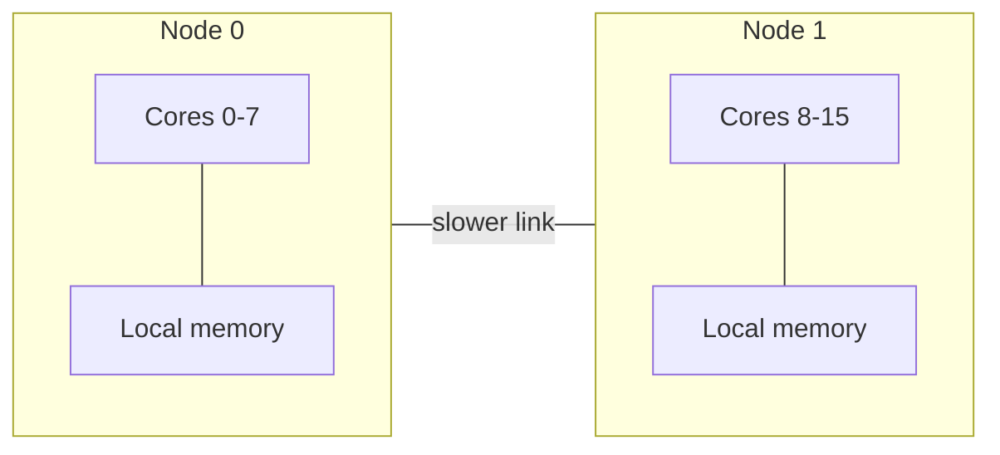
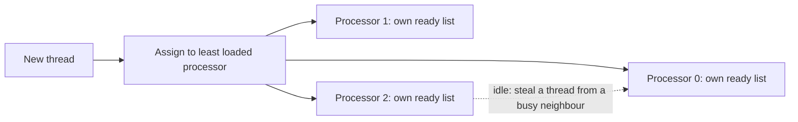

# Multiprocessors: hardware, synchronisation and scheduling

> **Before this lesson:** you should be comfortable with processes, threads and context switches ([Processes and threads](#/lesson/os/processes-threads)), with locks and the test-and-set instruction ([Race conditions and mutual exclusion](#/lesson/os/races-mutual-exclusion)), and with scheduling on one processor ([CPU scheduling](#/lesson/os/scheduling)).

## In plain words

A restaurant kitchen with one cook can only do one thing at a time. To serve more diners you could hire a faster cook — but there is a limit to how fast one person can work. The other way is to hire more cooks. More cooks bring new problems: they share one fridge and one stove, they get in each other's way, two of them may reach for the same pan, and somebody has to decide who makes which dish.

Computers reached the same point. For decades each new processor was faster than the last. Around the mid-2000s that stopped being practical, because faster chips produced too much heat. Manufacturers began putting several processors side by side instead. A computer with more than one processor sharing the same memory is called a **multiprocessor**. Each processing unit on a chip is called a **core**, and a chip with several is a **multicore** chip. Your phone and laptop are multiprocessors.

This lesson is about what the operating system must do differently when there are many cooks in the kitchen: how the hardware is arranged, how the operating system itself is organised, how locks work when things truly happen at the same instant, and how to decide which processor runs what.

Why it matters for a job: every server and every phone is multicore. Whether your program becomes faster or slower when given more cores depends on the ideas here — and "why doesn't my program scale?" is a question you will be asked and will ask.

## The hardware

### A warning about expectations

Start with a calculation that surprises most newcomers. Suppose part of a program can be split among many processors and part cannot (it must be done step by step in order). Let the fraction that can be split be $p$. With $n$ processors, the splittable part takes $1/n$ as long, and the rest takes as long as before. The speed-up is

$$\text{speed-up} = \frac{1}{(1 - p) + p/n}.$$

This is known as **Amdahl's law**, after the computer architect Gene Amdahl.

```python-run
def speedup(parallel_fraction, processors):
    serial = 1 - parallel_fraction                 # the part that cannot be split
    return 1 / (serial + parallel_fraction / processors)

print("processors:      2      4      8     16     64   1024")
for p in (0.50, 0.90, 0.99):
    row = "  ".join(f"{speedup(p, n):5.1f}" for n in (2, 4, 8, 16, 64, 1024))
    print(f"{p:.0%} splittable: {row}")
```

**What each line does.** `speedup` computes the formula: `serial` is the fraction that must run on one processor; the splittable fraction is divided by the number of processors; the total time is their sum, and the speed-up is one divided by that. The loop prints a row for three kinds of program.

**The output.** A program that is half splittable can never run even twice as fast, no matter how many processors it gets. Even a program that is 90% splittable tops out below ten times. The part that cannot be shared out sets the limit. This is why adding cores does not automatically make software faster, and why so much engineering effort goes into shrinking the parts of a system — including parts of the operating system — that only one processor can do at a time.

### Three ways to build a machine with many processors

There are three broad families, and this module covers them in two lessons.

- A **shared-memory multiprocessor**: all processors can read and write the same memory. This lesson.
- A **multicomputer**: each processor has its own private memory, and they communicate by sending messages. Next lesson.
- A **distributed system**: complete, separate computers connected over a wide network such as the internet. Next lesson.

### Sharing memory: the bus and its limits

The simplest multiprocessor connects all processors and the memory to one shared set of wires, called a **bus**. When a processor wants to read memory, it checks whether the bus is free, places the address on it, and waits for the data.

With two or three processors this works. With thirty it does not, because only one processor can use the bus at a time and the rest wait. The bus becomes the bottleneck.

The standard remedy is to give each processor a **cache** — a small, fast, private store that keeps copies of memory it has used recently. Most reads are then answered from the cache without touching the bus.

Caches introduce a new problem. If two processors each hold a copy of the same piece of memory and one of them changes it, the other's copy is now wrong. The hardware follows a set of rules, called a **cache-coherence protocol**, to prevent this: before a processor changes something that others hold copies of, it announces the change on the bus, and the others discard their copies. You do not need the details. You do need the consequence, which returns later in this lesson: **when two processors keep changing the same piece of memory, their caches are constantly being invalidated, and that is slow.**

### Machines too big for one bus: NUMA

To go beyond a few dozen processors, designers gave up the idea that all memory is equally close to every processor. In a **NUMA** machine (*non-uniform memory access*), each processor, or group of processors, has memory attached directly to it. A processor can still use memory attached to a different group, but reaching it takes noticeably longer.



The contrasting term is **UMA** (*uniform memory access*): every processor reaches every part of memory in the same time. Large servers today are NUMA machines, and the operating system has to care about it: a program runs fastest when its data sits in the memory closest to the processor running it.

### Multicore chips and hardware threads

A **multicore** chip places several complete processors on one piece of silicon. They usually share some cache between them and are, from the operating system's point of view, a small shared-memory multiprocessor.

Many chips also have **hardware threads** (Intel's brand name is *hyperthreading*): a single core that can hold the state of two running threads and switch between them extremely quickly, so that when one is waiting for memory, the other uses the core. The operating system sees two processors, but they are not two full processors — they share one set of working parts, and together achieve well under twice the work.

## Organising the operating system

Given a machine with several processors, how should the operating system itself be arranged? Three designs were tried, and seeing why the first two were abandoned explains the third.

**1. Each processor has its own operating system.** Divide the memory into as many parts as there are processors and give each processor its own private copy of the operating system. This is simple, but it is really several separate computers sharing a box. One processor can be overloaded while another sits idle, because they do not share work. Memory cannot be lent from one to another. And if each keeps its own copy of recently used disk data, the copies can disagree and corrupt files. Nobody builds systems this way now.

**2. Master–slave.** One processor, the *master*, runs the operating system. The others, the *slaves*, run only user programs; whenever a program on a slave needs the operating system, the request is passed to the master. There is one copy of every table, so nothing can disagree, and work is shared properly. But every request from every processor queues up for the one master. With many processors the master becomes the bottleneck — Amdahl's law in action.

**3. Symmetric multiprocessing (SMP).** There is one copy of the operating system in memory, and **any processor can run it**. When a program on processor 5 makes a system call, processor 5 itself switches into the kernel and handles it. No processor is special. All modern general-purpose systems work this way.

SMP removes the bottleneck and creates a serious new difficulty: two processors may be running kernel code *at the same instant* and may try to change the same kernel table. Imagine two processors both choosing the next process to run and both picking the same one.

The crudest protection is a single lock around the entire kernel — one processor inside at a time. It is safe, and it is the master–slave bottleneck again in different clothes. The real solution is to split the kernel into many independent parts, each protected by its own lock, so that one processor can be in the scheduler while another is in the file system. Doing this correctly is very difficult: the parts are not truly independent, code often needs two locks at once, and — as the deadlock lessons showed — taking two locks in inconsistent orders leads to deadlock. Converting a kernel to fine-grained locking has, in practice, taken each major operating system many years.

## Locks on a multiprocessor

### Why turning off interrupts no longer works

On a machine with one processor, the kernel can protect a short piece of code by turning off interrupts: with no interrupts, nothing can take the processor away, so nothing else can run. On a multiprocessor this protects nothing. Turning off interrupts on processor 1 has no effect on processor 2, which is running at the very same time.

A real lock is needed, built on an instruction that reads a memory location and changes it in one indivisible step. The classic one is **test-and-set**: it reads the lock, sets it to 1 ("taken"), and reports what the old value was. If the old value was 0, the lock was free and you now hold it. If it was 1, someone else holds it. The hardware guarantees that no other processor can get in between the read and the write.

### Spinning

What should a processor do if it finds the lock taken? The simplest answer: try again, immediately, in a tight loop, until it succeeds. A lock used this way is called a **spin lock**, because the waiting processor "spins" doing nothing useful.

On one processor, spinning is pointless — the holder cannot run and release the lock while you are spinning on the only processor. On a multiprocessor it can make sense, because the holder is running on *another* processor and may release the lock a few millionths of a second later.

Spinning has a hidden cost, which goes back to the caches. Each test-and-set *writes* to the lock, even when it fails. So every waiting processor is repeatedly writing to the same piece of memory, and each write forces all the other processors to discard their cached copy. The lock's memory gets passed back and forth between processors at great expense, slowing down even the processor that holds the lock.

Two improvements are standard:

- **Look before you write.** First *read* the lock (reading does not disturb other caches). Only when it appears free attempt the test-and-set. Many waiting processors can then share a read-only copy quietly.
- **Back off.** After a failed attempt, wait a little before trying again, and double the wait after each failure. Processors then stop hammering the lock in unison.

### Spin or switch?

A waiting processor has another choice: stop waiting and do something else. It can put the waiting thread to sleep and run a different thread — a context switch. So for each lock there is a decision: **spin, or switch?**

The answer comes from comparing two costs. A context switch costs a fixed amount: saving one thread, loading another, and then suffering slow memory access for a while because the cache is full of the old thread's data. Spinning costs however long the lock is held.

- If the lock will be free sooner than a context switch would take, spin.
- If it will be held longer, switch.

The difficulty is that the waiting time is not known in advance. A practical policy is to **spin for a short while and then switch**, and to tune how long by watching what happened in the past.

```python-run
def cost_of_waiting(hold_time, switch_cost, spin_limit):
    """Time wasted by a thread that spins for up to spin_limit and then gives up and switches."""
    if hold_time <= spin_limit:
        return hold_time                      # the lock came free while spinning
    return spin_limit + 2 * switch_cost       # spun in vain, then switched away and later back

import random
rng = random.Random(1)
# Most locks are held very briefly; a few are held for a long time.
hold_times = [rng.choice([1, 1, 2, 2, 3, 5, 8, 400]) for _ in range(10_000)]
SWITCH = 30

print("policy                       average time wasted per wait")
for label, limit in (("always switch at once", 0), ("spin up to 5", 5), ("spin up to 30", 30),
                     ("spin up to 60", 60), ("always spin", 10**9)):
    average = sum(cost_of_waiting(h, SWITCH, limit) for h in hold_times) / len(hold_times)
    print(f"{label:28s} {average:8.1f}")
```

**What each part does.** `cost_of_waiting` returns how much time one waiting thread wastes. If the lock is released within the spin limit, the waste is the hold time. Otherwise the thread wasted the whole spin limit and then also paid for two context switches (one to leave, one to come back). `hold_times` is a list of ten thousand lock hold times in which most are tiny and one in eight is long. The loop tries five policies and prints the average waste for each.

**The output.** Always switching wastes 60 units every time, even for locks that would have been free after 1. Always spinning is ruined by the occasional long hold. Spinning for a little while and then switching beats both. Real kernels and lock libraries use exactly this kind of mixed policy.

> [!INTERVIEW]
> "When would you use a spin lock rather than a blocking lock (mutex)?" Use a spin lock when the protected code is very short, the holder is running on another core, and sleeping is not allowed or would cost more than the wait — typical inside a kernel. Use a blocking lock when the wait might be long or the holder might itself be descheduled. Never hold a spin lock across anything that can sleep. Mention the cache effect: heavily contended spin locks cause the lock's cache line to bounce between cores, so "read first, then test-and-set" and back-off are used.

## Scheduling on a multiprocessor

On one processor, scheduling asks one question: *which thread runs next?* With several processors there are two: *which thread?* and *on which processor?*

### One queue for everyone

The simplest scheme keeps a single list of ready threads for the whole machine. Whenever a processor becomes free, it takes the next thread from the list. Work is balanced automatically — no processor is idle while a thread waits.

Two weaknesses appear as the machine grows. All processors compete for the lock protecting that one list. And a thread tends to hop from processor to processor, which wastes the cache: when a thread has been running on processor 3, that processor's cache is full of the thread's data, and running it next on processor 7 means starting with an empty cache and fetching everything again.

### Affinity

The observation that a thread runs best where it ran last is called **cache affinity**, and a scheduler that tries to respect it does **affinity scheduling**. A common design is **two-level scheduling**:

1. When a thread is created, assign it to a processor — for example, the least busy one.
2. Each processor keeps *its own* list of threads and schedules among them.
3. If a processor runs out of work, it takes a thread from a busier processor rather than sitting idle. This is called *work stealing*.

Per-processor lists reduce competition for locks, keep threads on warm caches, and still balance the load when it becomes uneven.



### Giving a job its own processors

When threads of a program work closely together, a different approach suits them. In **space sharing**, a program that has, say, eight threads is given eight processors for itself until it finishes. No time is spent switching. If too few processors are free, the program waits. Processors are never taken away in the middle. Machines that run large scientific calculations are commonly scheduled this way.

### Gang scheduling

Sharing by time and sharing by space can be combined. The problem that motivates it: suppose threads A and B of one program constantly exchange requests and replies. If the scheduler happens to run A when B is not running, A sends a request and then has nothing to do until B gets a turn; then B answers while A is not running. They are permanently out of step, and each exchange takes a whole time slice.

**Gang scheduling** treats related threads as a unit, a *gang*:

1. All threads of a gang are started and stopped **together**, on different processors.
2. Time is divided into fixed slices, the same for all processors.
3. At the start of each slice, every processor is reassigned at once.

A and B then always run at the same time, and their conversations are fast.

## Common mistakes and confusions

- **"Twice the cores, twice the speed."** Amdahl's law: the unsplittable part sets the ceiling. Contention for locks and caches lowers it further.
- **"Turning off interrupts protects kernel data."** Only on a single processor.
- **"Spin locks are always wasteful."** For very short waits on a multiprocessor they are cheaper than a context switch.
- **"Hardware threads are cores."** Two hardware threads share one core's working parts.
- **"The scheduler should move threads to whichever processor is free."** Moving throws away the warm cache; affinity matters.
- **"All memory is the same distance away."** Not on a NUMA machine.

## Summary

- A **multiprocessor** has several processors sharing memory. **Amdahl's law** limits the speed-up to what the non-splittable part allows.
- Simple machines share a **bus**, relieved by per-processor **caches** kept consistent by a **coherence protocol**; large machines are **NUMA**, with memory that is nearer to some processors than others.
- Operating-system designs evolved from separate copies, through **master–slave**, to **symmetric multiprocessing**, in which any processor runs the single shared kernel — requiring fine-grained locking.
- Multiprocessor locks rest on atomic instructions such as **test-and-set**. **Spin locks** suit short waits; reading before writing and backing off reduce cache traffic; **spin-then-switch** handles unknown wait times.
- Scheduling must choose a thread *and* a processor: a single shared queue balances load; **affinity scheduling** with per-processor queues preserves caches; **space sharing** dedicates processors to a job; **gang scheduling** runs cooperating threads together.

## Glossary

- **Multiprocessor** — a computer with several processors sharing one memory.
- **Core** — one processing unit on a chip; a **multicore** chip has several.
- **Amdahl's law** — the formula giving the maximum speed-up when only part of a job can be split among processors.
- **Bus** — a shared set of wires connecting processors and memory.
- **Cache** — a small, fast store holding copies of recently used memory.
- **Cache-coherence protocol** — hardware rules ensuring processors never use out-of-date cached copies.
- **UMA / NUMA** — uniform / non-uniform memory access: whether all memory is equally quick to reach from every processor.
- **Hardware thread (hyperthreading)** — a core that can hold two threads' state and alternate between them rapidly.
- **Master–slave** — a design in which one processor runs the operating system for all the others.
- **Symmetric multiprocessing (SMP)** — a design in which any processor can run the one shared kernel.
- **Test-and-set** — an instruction that reads a memory location and sets it in one indivisible step.
- **Spin lock** — a lock for which a waiting processor retries in a loop.
- **Back-off** — waiting progressively longer between retries.
- **Cache affinity** — the benefit of running a thread on the processor whose cache already holds its data.
- **Work stealing** — an idle processor taking a thread from a busy one's list.
- **Space sharing** — dedicating a set of processors to one job.
- **Gang scheduling** — running all the threads of a group at the same time on different processors.

## Check yourself

```quiz
[
  {"q": "A program is 80% splittable among processors. According to Amdahl's law, what is the greatest speed-up possible with unlimited processors?",
   "options": ["4 times", "5 times", "8 times", "Unlimited"],
   "answer": 1,
   "explain": "With unlimited processors the splittable part takes no time, leaving the 20% that cannot be split. 1 / 0.2 = 5."},
  {"q": "Why do multiprocessors that share a bus give each processor its own cache?",
   "options": ["To store the operating system", "So that most memory reads are answered locally without using the shared bus", "To make interrupts faster", "To avoid needing locks"],
   "answer": 1,
   "explain": "Only one processor can use the bus at a time. Caches keep most accesses off the bus, which is otherwise the bottleneck."},
  {"q": "What does NUMA mean for the operating system?",
   "options": ["All processors must run the same program", "Some memory is quicker to reach from a given processor than other memory, so placing a program's data near its processor matters", "Memory cannot be shared", "Interrupts are disabled"],
   "answer": 1,
   "explain": "In a non-uniform memory access machine, each group of processors has local memory; using memory attached to another group is slower."},
  {"q": "What is the main weakness of the master-slave design?",
   "options": ["Tables can become inconsistent", "All operating-system work queues for the single master processor, which becomes a bottleneck", "Slaves cannot run programs", "It needs no locks at all"],
   "answer": 1,
   "explain": "Only the master runs kernel code, so with many processors requests pile up waiting for it."},
  {"q": "Why does turning off interrupts not protect kernel data on a multiprocessor?",
   "options": ["Interrupts cannot be turned off", "It affects only the processor that did it; other processors are running at the same time and can touch the same data", "It makes the cache invalid", "It stops the clock"],
   "answer": 1,
   "explain": "Disabling interrupts prevents the current processor from being switched away. It does nothing about code executing simultaneously on other processors."},
  {"q": "Why can a heavily contended spin lock slow down even the thread that holds it?",
   "options": ["The holder must answer each request", "Each failed test-and-set writes to the lock, forcing other processors' cached copies to be discarded and the memory to be passed back and forth", "Spin locks disable the cache", "The holder is put to sleep"],
   "answer": 1,
   "explain": "Test-and-set is a write even when it fails. Constant writes from many processors make the lock's memory bounce between caches."},
  {"q": "A context switch costs 20 microseconds. A lock is typically held for 2 microseconds. What should a waiting thread on another core do?",
   "options": ["Switch immediately", "Spin, because the lock will be free long before a context switch would complete", "Turn off interrupts", "Kill the holder"],
   "answer": 1,
   "explain": "Switching away and back would cost far more than waiting 2 microseconds."},
  {"q": "Two threads of one program exchange messages constantly. Which scheduling approach helps them most?",
   "options": ["A single global queue with random placement", "Gang scheduling, so that both run at the same time on different processors", "Running them only when the system is idle", "Assigning both to the same processor"],
   "answer": 1,
   "explain": "If one runs while the other does not, each message waits a whole time slice for a reply. Running them together lets them converse at full speed."}
]
```

> **Source:** Tanenbaum & Bos, Modern Operating Systems 4e, §8.1 (Multiprocessors)
