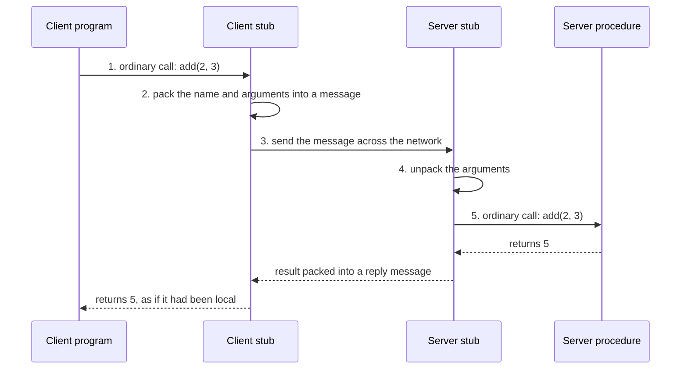
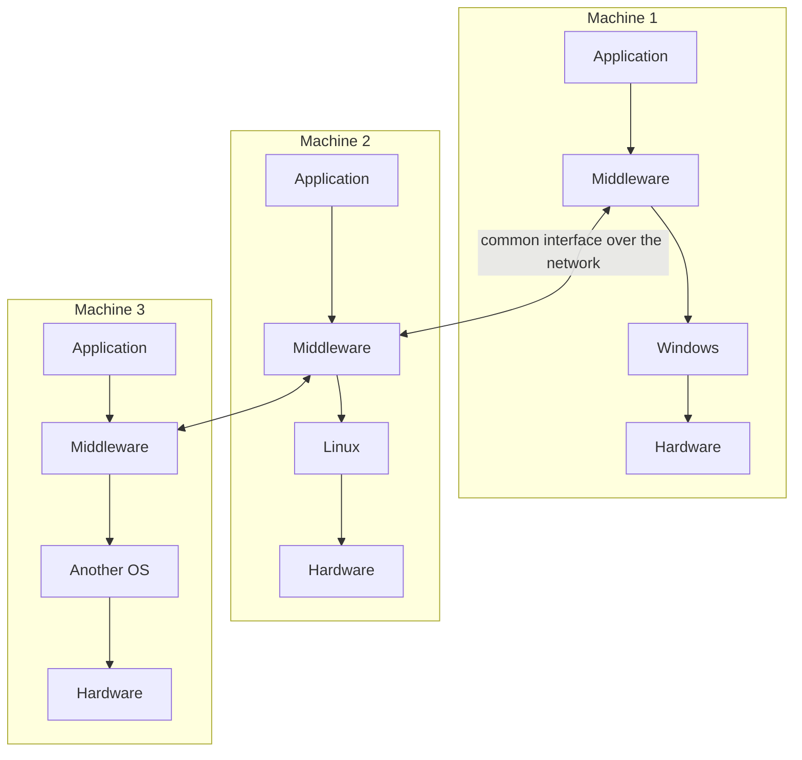

# Multicomputers and distributed systems

> **Before this lesson:** read [Multiprocessors: hardware, synchronisation and scheduling](#/lesson/os/multiprocessors), which covers machines whose processors share memory. You should also know what a process and a system call are ([Core concepts, system calls and kernel structure](#/lesson/os/concepts-syscalls-structure)).

## In plain words

In the previous lesson, several cooks shared one kitchen: one fridge, one stove, everything within reach of everyone. That arrangement stops working beyond a few dozen cooks.

The alternative is to give each cook a complete kitchen of their own, and let them cooperate by passing notes. Nobody can reach into anyone else's fridge. If one cook wants an ingredient another has, a note has to be written, carried across and answered. That is slower for each exchange, but there is no limit on how many kitchens you can add.

In computing terms:

- A **multicomputer** is a set of processors, each with its *own private memory*, connected by a fast network inside one room or one cabinet. They work together on shared tasks by sending **messages**. Large clusters and supercomputers are built this way.
- A **distributed system** is the same idea stretched further: complete, independent computers — possibly of different makes, running different operating systems, owned by different people — spread across a building or the planet and cooperating over a network. The web is the best-known example.

Why it matters for a job: almost every service you use or will build runs on many machines. The vocabulary of this lesson — message passing, remote procedure calls, middleware, protocols, publish/subscribe — is the everyday language of back-end engineering.

| | Multiprocessor | Multicomputer | Distributed system |
|---|---|---|---|
| Memory | Shared by all processors | Private to each node | Private to each node |
| Each node contains | A processor | Processor, memory, network connection | A complete computer |
| Where | One box | One room | Possibly worldwide |
| Communication | Shared memory | Dedicated fast network | Ordinary networks, the internet |
| Operating systems | One, shared | Usually the same on every node | Possibly all different |
| Ownership | One organisation | One organisation | Often many |

## Multicomputers

### How the nodes are wired together

Each machine in a multicomputer is called a **node**: a processor, some memory and a network connection. The pattern of wiring between nodes is the **topology**. A few common ones:

- **Star:** every node is wired to one central switch.
- **Ring:** each node is wired to two neighbours, forming a circle.
- **Grid (mesh):** nodes are laid out in rows and columns, each wired to its neighbours. Joining the edges to each other makes a **torus**.
- **Hypercube:** with $2^d$ nodes, each is wired to $d$ others. A cube is the case $d = 3$: eight corners, each joined to three others.

Two numbers describe how good a topology is. The **diameter** is the largest number of links a message must cross between any two nodes — smaller is faster. And the number of links per node determines the cost of the hardware.

```python-run
import math

def describe(name, nodes, diameter, links_per_node):
    print(f"{name:22s} nodes {nodes:5d}   diameter {diameter:3d}   links per node {links_per_node}")

n = 1024
side = int(math.sqrt(n))                      # a 32 by 32 grid
describe("ring", n, n // 2, 2)
describe("grid 32 x 32", n, 2 * (side - 1), 4)
describe("torus 32 x 32", n, 2 * (side // 2), 4)
describe("hypercube (d = 10)", n, int(math.log2(n)), int(math.log2(n)))
```

**What each line does.** `describe` prints one row. For a ring of 1,024 nodes, the furthest node is halfway round: 512 links. In a grid, the furthest pair are opposite corners: 31 steps across plus 31 down. In a torus the edges wrap round, so the worst case is half the width plus half the height. In a hypercube with $2^{10}$ nodes, any node is reachable in at most 10 links, since `math.log2(1024)` is 10.

**The output.** The hypercube has by far the smallest diameter (10 against 512 for the ring), but needs 10 connections on every node instead of 2 or 4. Topology is a trade between speed and wiring cost.

Messages are usually broken into pieces called **packets**. In **store-and-forward packet switching**, each switch along the route receives a whole packet, stores it briefly, and passes it on to the next. The alternative, **circuit switching**, first sets up a complete path from sender to receiver and then sends the data down it with no stops.

### Sending and receiving

The basic service on a multicomputer is two operations, reached by system calls:

- `send(destination, message)` — send a message to a given process.
- `receive(source, message)` — wait for a message.

One design choice matters a great deal: what happens to the caller during a `send`?

- With a **blocking** (also called *synchronous*) send, the calling process is paused until the message has been sent. It is the easy kind to reason about: when the call returns, the message has gone.
- With a **non-blocking** (*asynchronous*) send, the call returns at once and the process carries on while the message is transmitted in the background. This is faster, but raises an awkward question: the program must not change the message's memory until it has really been sent — and how does it find out when that is? The options are to copy the message into the operating system first (costing time), to interrupt the program when sending completes (making programs hard to write), or to make the memory temporarily read-only.

### Remote procedure call

Writing programs out of raw `send` and `receive` is tedious. Programmers are used to *calling procedures* (also called functions). In 1984 two researchers, Andrew Birrell and Bruce Nelson, proposed a way to make communication between machines look like an ordinary procedure call. The technique is called **remote procedure call**, or **RPC**, and it underlies a large share of modern networked software.

The trick is a small piece of helper code on each side, called a **stub**.



Step by step:

1. The client program calls what looks like an ordinary local procedure. It is actually the **client stub**.
2. The client stub packs the procedure's name and its arguments into a message. Packing values into a message is called **marshalling**.
3. The operating system sends the message to the server machine.
4. There, the **server stub** unpacks the message (*unmarshalling*).
5. The server stub calls the real procedure in the ordinary way, takes the result, packs it into a reply, and sends it back. The client stub unpacks the reply and returns the result to the program.

Neither the client program nor the server procedure contains any networking code. The stubs are usually generated automatically from a description of the procedure.

```python-run
import json

# ---- server side -------------------------------------------------
def add(a, b):
    return a + b

def word_count(text):
    return len(text.split())

SERVER_PROCEDURES = {"add": add, "word_count": word_count}

def server_stub(request_bytes):
    request = json.loads(request_bytes)                     # unmarshal the request
    procedure = SERVER_PROCEDURES.get(request["name"])
    if procedure is None:
        reply = {"error": f"no such procedure: {request['name']}"}
    else:
        reply = {"result": procedure(*request["args"])}     # the real, ordinary call
    return json.dumps(reply).encode()                       # marshal the reply

# ---- the "network" -----------------------------------------------
def network(message_bytes):
    print(f"   [network carries {len(message_bytes)} bytes: {message_bytes.decode()}]")
    return server_stub(message_bytes)

# ---- client side -------------------------------------------------
def remote(name):
    def client_stub(*args):
        request = json.dumps({"name": name, "args": list(args)}).encode()   # marshal
        reply = json.loads(network(request))                                 # send, wait, unmarshal
        if "error" in reply:
            raise RuntimeError(reply["error"])
        return reply["result"]
    return client_stub

add_remote = remote("add")
count_remote = remote("word_count")

print("add_remote(2, 3) ->", add_remote(2, 3))
print("count_remote(...) ->", count_remote("the quick brown fox"))
```

**What each part does.**

- `add` and `word_count` are ordinary procedures on the server. `SERVER_PROCEDURES` is a table from names to procedures.
- `server_stub` receives raw bytes, turns them back into a name and a list of arguments with `json.loads`, looks the procedure up, calls it (`procedure(*request["args"])` passes the list items as separate arguments), and turns the result into bytes again with `json.dumps(...).encode()`.
- `network` stands in for the real network: it shows what travels and hands the bytes to the server.
- `remote(name)` builds a client stub: a procedure that packs its arguments into a message, sends it, waits for the reply and returns the unpacked result.

**The output.** The two calls on the last lines look exactly like local calls and print 5 and 4, but the lines in square brackets show what really crossed the "network": a short text message naming the procedure and listing its arguments.

RPC cannot hide every difference between local and remote, and the leaks are where bugs come from:

- **Pointers.** A local call can pass the memory address of some data. An address on the client's machine means nothing on the server's. The stub must send a copy of the data — which is hard if it is a complicated linked structure.
- **Unknown sizes.** Some languages allow passing an array without saying how long it is, so the stub cannot tell how much to pack.
- **Global variables.** A procedure that relies on variables shared with its caller cannot be moved to another machine.
- **Failure.** A local call either returns or the whole program crashes. A remote call can fail in new ways: the request was lost; the server crashed; the reply was lost. If no reply comes, the client cannot tell whether the procedure ran or not — and trying again might run it twice.

> [!INTERVIEW]
> "What is RPC and what makes it hard?" RPC lets a program call a procedure on another machine using stubs that marshal arguments into a message and unmarshal results. The hard parts are everything a network adds: partial failure (did the call execute or not?), retries and the need for operations that are safe to repeat (*idempotent*), latency thousands of times that of a local call, and the impossibility of passing pointers or shared variables. A good answer names the failure cases: lost request, lost reply, server crash before or after executing.

### Distributed shared memory

Some programmers prefer shared memory to messages. **Distributed shared memory** (DSM) gives it to them on a multicomputer by using the paging machinery from the memory lessons. Every node sees the same large address space, but each page lives on one node at a time. When a program touches a page that is not on its node, a page fault occurs, and the operating system fetches the page from whichever node has it — over the network.

A characteristic trap is **false sharing**. Suppose one page holds two unrelated variables, A and B. A process on node 1 uses A constantly; a process on node 2 uses B constantly. They are not sharing data at all, yet because the two variables lie in the same page, the page is hauled back and forth across the network all the time.

### Balancing the load

On a multicomputer a process normally stays on the node where it started, so the important decision is *where to start it*. If nothing is done, some nodes become overloaded while others are idle. Two simple schemes share out the work:

- **Sender-initiated:** when a node finds itself overloaded, it asks a few randomly chosen nodes whether they are less busy, and hands new work to one that is. Under heavy load this backfires: every node is overloaded and all of them waste time asking each other.
- **Receiver-initiated:** when a node runs out of work, it asks other nodes for some. Under heavy load no one is asking, so there is no extra traffic at the worst moment. Under light load, idle nodes ask repeatedly — but they have nothing better to do.

## Distributed systems

### Loosely coupled, and built on middleware

A distributed system differs from a multicomputer mainly in how *loose* it is. The computers are complete and independent; they may be thousands of kilometres apart; they may differ in hardware and operating system; they belong to different owners; and any of them, or the links between them, may fail at any time while the rest carry on.

To make such a collection usable, a layer of software is placed on each machine, above the operating system and below the applications. Its job is to hide the differences and present every application with one uniform way of doing things. Because it sits in the middle, it is called **middleware**.



### The network underneath

Two kinds of network carry the traffic.

A **local area network** (LAN) covers a building. The dominant technology is **Ethernet**. In its modern form, every computer is connected by cable to a **switch**, a box that reads the destination address at the front of each incoming packet and forwards the packet out of the correct cable.

A **wide area network** (WAN) covers a city, a country or the world. The **internet** is a network of networks: a huge number of local networks joined by specialised computers called **routers**. Each router holds a table that tells it, for any destination, which neighbouring router to pass a packet to next. A packet makes its way across the world one hop at a time.

### Protocols and layers

For two computers to communicate, they must agree on the rules: what a message looks like, who speaks when, what to do when something is lost. A set of such rules is a **protocol**.

Network software is organised as a stack of **layers**, each solving one problem and relying on the layer below. The three you will meet most often:

- **IP** (Internet Protocol) carries individual packets from one computer to another across the internet. It makes its best effort but promises nothing: packets may be lost, duplicated or arrive out of order. Each computer has a numeric **IP address**.
- **TCP** (Transmission Control Protocol) sits on top of IP and turns that unreliable service into a reliable one. It numbers the data, has the receiver acknowledge what arrived, resends what was lost and puts everything in order, giving programs a dependable two-way stream of bytes called a **connection**.
- **DNS** (Domain Name System) translates names that people can remember, such as `example.org`, into the numeric addresses the network uses.

### Four styles of middleware

How should a distributed system look to the programs that use it? Four broad answers have been tried, each presenting the whole system as one familiar thing.

**1. Everything is a document.** The World Wide Web presents the system as a giant collection of documents that point to each other. Each document has an address called a **URL** with three parts: the protocol to use, the name of the machine holding the document, and the document's name on that machine. A program called a **browser** fetches a document by asking DNS for the machine's address, opening a TCP connection to it, requesting the document and displaying the reply.

**2. Everything is a file.** Make the whole system look like one large file system. Two designs exist for how a remote file is used. In the **upload/download model**, the whole file is copied to the user's machine, worked on there, and copied back — simple, but wasteful for big files, and awkward if two people change the same file. In the **remote-access model**, the file stays on the server and each read or write is sent to it. Naming is a second design question: either each machine attaches remote directories wherever it likes (so the same file may have different paths on different machines), or all machines see one identical directory tree.

**3. Everything is an object.** An **object** is a bundle of data together with the procedures that operate on it. Under this style, programs call the procedures of objects without knowing or caring which machine the object lives on; the middleware finds the object and performs what is in effect an RPC.

**4. Coordination through shared data.** The last style separates the communicating programs completely, so that they need not know each other's names or even be running at the same time.

- In a **tuple space**, programs place small records (called *tuples*) into a shared pool, and other programs remove records that match a pattern they are interested in. The producer and consumer never address each other.
- In **publish/subscribe**, some programs *publish* messages on named topics, and others *subscribe* to the topics they care about. The middleware delivers each published message to every subscriber. The publisher has no idea who, if anyone, is listening.

```python-run
from collections import defaultdict

class Broker:
    """A tiny publish/subscribe system."""
    def __init__(self):
        self.subscribers = defaultdict(list)       # topic -> list of handler procedures

    def subscribe(self, topic, handler):
        self.subscribers[topic].append(handler)

    def publish(self, topic, message):
        delivered = 0
        for handler in self.subscribers[topic]:
            handler(message)
            delivered += 1
        return delivered

broker = Broker()
broker.subscribe("orders", lambda m: print("   billing service received:", m))
broker.subscribe("orders", lambda m: print("   warehouse service received:", m))
broker.subscribe("alerts", lambda m: print("   on-call engineer paged:", m))

print("publish to 'orders':")
print("   delivered to", broker.publish("orders", "order 1042: 3 kettles"), "subscribers")
print("publish to 'alerts':")
print("   delivered to", broker.publish("alerts", "disk nearly full"), "subscribers")
print("publish to 'weather':")
print("   delivered to", broker.publish("weather", "rain"), "subscribers")
```

**What each part does.** `self.subscribers` is a table from topic names to lists of procedures; `defaultdict(list)` means a topic that has never been mentioned starts with an empty list. `subscribe` adds a procedure to a topic's list. `publish` calls every procedure on that topic's list with the message and reports how many there were. Each `lambda m: print(...)` is a small unnamed procedure standing for a separate service.

**The output.** One message about an order reaches two services that the publisher never named. The alert reaches one. The weather message reaches nobody, and the publisher neither knows nor cares. That independence — new subscribers can be added without changing the publisher — is why this style is so widely used to connect services.

## Common mistakes and confusions

- **"A remote call is the same as a local call."** It is thousands of times slower and can fail halfway.
- **"If I got no reply, the request was not carried out."** The request may have run and the reply been lost. Design operations so that repeating them is harmless.
- **"TCP makes the network reliable."** TCP makes a *connection* reliable while it lasts. Machines can still crash and connections can still break.
- **"More nodes always means more speed."** Communication costs and unbalanced load eat into the gain, as Amdahl's law warned.
- **"Middleware is part of the operating system."** It runs above it, as ordinary software.
- **"Sharing a page means sharing data."** False sharing moves pages between nodes for variables that have nothing to do with each other.

## Summary

- A **multicomputer** connects nodes with private memory by a fast network; a **distributed system** connects whole independent computers over ordinary networks.
- Network **topologies** trade **diameter** against wiring cost. Communication is by **send** and **receive**, blocking or non-blocking.
- **RPC** makes a remote operation look like a procedure call using **stubs** that **marshal** arguments; it cannot hide pointers, shared variables or partial failure.
- **Distributed shared memory** simulates shared memory with paging and suffers from **false sharing**. Load is balanced by **sender-initiated** or **receiver-initiated** schemes.
- Distributed systems rest on **middleware** over networks (Ethernet, the internet) and layered **protocols** (IP, TCP, DNS).
- Middleware styles: **document-based** (the web), **file-system-based**, **object-based** and **coordination-based** (tuple spaces, publish/subscribe).

## Glossary

- **Multicomputer** — processors with private memories linked by a fast local network.
- **Distributed system** — independent computers cooperating over a network.
- **Node** — one machine in such a system.
- **Topology** — the pattern of connections between nodes.
- **Diameter** — the largest number of links between any two nodes.
- **Packet** — a piece of a message sent as a unit.
- **Store-and-forward** — each switch receives a whole packet before passing it on.
- **Blocking / non-blocking send** — the caller waits until the message is sent / continues at once.
- **Remote procedure call (RPC)** — calling a procedure that runs on another machine.
- **Stub** — helper code that converts between a procedure call and a network message.
- **Marshalling** — packing values into a message.
- **Idempotent** — safe to perform more than once with the same effect as once.
- **Distributed shared memory** — an illusion of shared memory built from pages moved between nodes.
- **False sharing** — unrelated data in one page causing that page to move repeatedly.
- **Middleware** — software above the operating system that gives distributed programs a uniform interface.
- **LAN / WAN** — a network covering a building / a large area.
- **Switch / router** — a device that forwards packets within a local network / between networks.
- **Protocol** — an agreed set of rules for communication.
- **IP / TCP / DNS** — the protocols for delivering packets / providing reliable connections / translating names to addresses.
- **URL** — the address of a document on the web.
- **Publish/subscribe** — a style in which senders publish to topics and receivers subscribe to them.

## Check yourself

```quiz
[
  {"q": "What is the defining difference between a multiprocessor and a multicomputer?",
   "options": ["A multicomputer has more processors", "In a multiprocessor the processors share memory; in a multicomputer each has private memory and they exchange messages", "A multiprocessor has no operating system", "Multicomputers cannot run programs in parallel"],
   "answer": 1,
   "explain": "Shared memory versus private memory with message passing is the dividing line."},
  {"q": "A hypercube has 64 nodes. What is its diameter?",
   "options": ["6", "8", "32", "63"],
   "answer": 0,
   "explain": "64 is 2 to the power 6. In a hypercube any node can be reached in at most as many links as that exponent."},
  {"q": "In RPC, what does the client stub do?",
   "options": ["Runs the procedure locally", "Packs the procedure name and arguments into a message, sends it, and returns the unpacked reply", "Chooses which server is least loaded", "Encrypts the hard disk"],
   "answer": 1,
   "explain": "The stub makes the remote operation look like a local call by marshalling arguments and unmarshalling the result."},
  {"q": "A client makes a remote call and receives no reply. What can it conclude?",
   "options": ["The procedure definitely did not run", "The procedure definitely ran", "Nothing certain: the request, the server or the reply may have failed", "The network is permanently broken"],
   "answer": 2,
   "explain": "A lost request, a crashed server and a lost reply all look identical to the client. This is why repeatable (idempotent) operations matter."},
  {"q": "Two unrelated variables used by processes on different nodes happen to lie in the same page of a distributed shared memory. What results?",
   "options": ["A deadlock", "False sharing: the page is moved back and forth although the processes share no data", "Faster access", "A protection fault"],
   "answer": 1,
   "explain": "Each access by one node pulls the page away from the other, which then pulls it back."},
  {"q": "Why does receiver-initiated load balancing behave better than sender-initiated under heavy load?",
   "options": ["It uses faster networks", "When all nodes are busy, no node is idle to send requests, so no extra messages are added at the worst moment", "It moves running processes", "It ignores the load"],
   "answer": 1,
   "explain": "Sender-initiated schemes add probing messages when every node is already overloaded. Receiver-initiated schemes probe only when a node is idle."},
  {"q": "Which protocol turns unreliable packet delivery into a reliable, ordered stream of bytes?",
   "options": ["IP", "TCP", "DNS", "Ethernet"],
   "answer": 1,
   "explain": "TCP adds numbering, acknowledgements, retransmission and ordering on top of IP."},
  {"q": "In a publish/subscribe system, what does a publisher need to know about the receivers of its messages?",
   "options": ["Their network addresses", "Their names and number", "Nothing; it publishes to a topic and the middleware delivers to whoever subscribed", "Their operating systems"],
   "answer": 2,
   "explain": "Publishers and subscribers are decoupled: they share only the topic name."}
]
```

> **Source:** Tanenbaum & Bos, Modern Operating Systems 4e, §8.2 (Multicomputers), §8.3 (Distributed systems)
