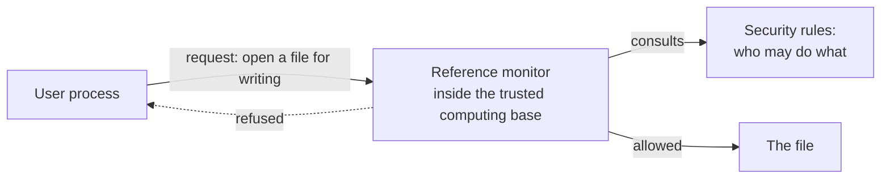
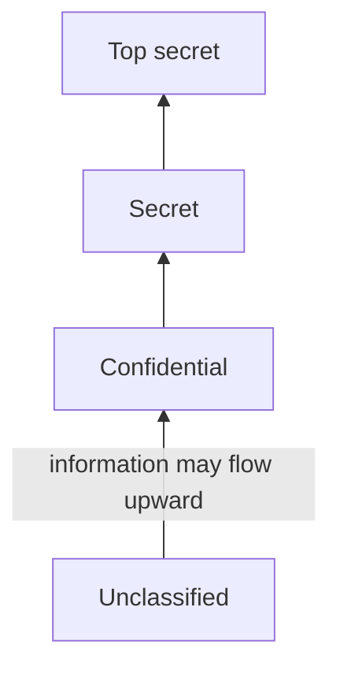

# Threat models, access control and formal models

> **Before this lesson:** you should know what a process, a file and a system call are ([Core concepts, system calls and kernel structure](#/lesson/os/concepts-syscalls-structure)) and the idea of kernel mode versus user mode ([Hardware review](#/lesson/os/hardware-review)). The nine-bit file permissions of UNIX were introduced in [Files and directories](#/lesson/os/files-directories).

## In plain words

An office building has many rooms and many people. Some rooms anyone may enter; some only staff; one holds the safe. The building's security consists of three things: a clear decision about *who is allowed to do what*, a mechanism that *enforces* that decision (doors, locks, a guard who checks badges), and a healthy suspicion about what could go wrong (a stolen badge, a propped-open door, a dishonest employee).

A computer is the same. It holds information belonging to many people and runs programs written by strangers. **Security** in an operating system means: deciding who may do what to which data, enforcing it reliably, and thinking ahead about how someone might try to get round it.

This lesson covers the first half of that: what we are trying to protect and from whom, how the operating system records and checks permissions, and some precise mathematical rules that were invented for organisations where a leak would be very serious. The next two lessons cover secret codes and passwords, and then how attacks work in principle and how systems defend against them.

Why it matters for a job: every program you write runs with somebody's permissions and handles somebody's data. Mistakes here become the security incidents that reach the news. Interviewers expect you to reason about permissions clearly.

## What are we protecting?

Security people summarise the goals with three words, often abbreviated **CIA**.

- **Confidentiality** — secret data stays secret. If the owner of some data has decided that only certain people may see it, the system must make sure nobody else can.
- **Integrity** — data is not changed without the owner's permission. Changing includes altering, deleting and adding false data.
- **Availability** — the system stays usable. Nobody should be able to disturb it so badly that legitimate users cannot get their work done.

For each goal there is a matching threat:

| Goal | Threat |
|---|---|
| Confidentiality | Exposure of data |
| Integrity | Tampering with data |
| Availability | Denial of service |

A **denial-of-service attack** deliberately overloads or crashes a system so that its real users are shut out — for example, by flooding a web site with so many requests that it cannot answer genuine ones.

Other properties are sometimes added to the three: **authenticity** (is this message really from who it claims?), **accountability** (can we tell afterwards who did what?), and **privacy** (protection of individuals from misuse of information about them).

### A few essential words

- A **vulnerability** is a weakness in a system — usually a programming mistake — that could be misused.
- An **exploit** is a way of taking advantage of a vulnerability.
- An **attacker** (also *adversary* or *intruder*) is someone trying to do so. Attackers range from curious amateurs, through insiders with a grievance and criminals after money, to well-funded government agencies. How much defence is sensible depends on which of these you expect: a home computer and a military system face very different opponents.
- A **threat model** is a written-down answer to: *What are we protecting? From whom? What can they do, and what can they not?* Without one, there is no way to say whether a system is "secure", because secure against a bored teenager and secure against a national intelligence service are different things.

## Can an operating system be made secure?

In principle, yes. In practice it is difficult for two reasons. Today's systems are enormous — tens of millions of lines of code — and every line is a possible mistake. And users will not give up their existing systems and programs for a new, smaller, safer one that lacks the features they are used to.

The realistic strategy is to make the part that *must* be correct as small as possible.

### The trusted computing base

The **trusted computing base** (TCB) is the set of hardware and software that the system's security depends on. If everything in the TCB works correctly, security holds, no matter what any other program does. If anything in it is wrong, there are no guarantees.

The smaller the TCB, the better the chance of getting it right. This is one of the main arguments for the microkernel design described earlier in the track: with only a tiny kernel in the TCB, a faulty device driver cannot undermine the system's security.

### The reference monitor

At the heart of the TCB is the **reference monitor**: the component through which *every* security-relevant request must pass. When a process asks to open a file, the reference monitor is consulted and answers yes or no. Nothing may go round it. Putting all decisions in one place means there is one place to check and one place to get right.



## Controlling access to resources

### Domains: the set of things you may touch

Start with some vocabulary. An **object** is anything that needs protecting: a file, a printer, a region of memory. Each object has operations that can be performed on it, such as *read* and *write* for a file. A **right** is permission to perform one operation on one object.

A **protection domain** is a set of (object, rights) pairs — in plain terms, "everything you are allowed to touch, and how". Every process runs in some domain. Often a domain corresponds to a user: the domain says what that user may do.

A basic design rule applies here, called the **principle of least authority** (or *least privilege*): every domain should contain the minimum rights needed to do its job and no more. A program that only needs to read one file should not have the right to delete all of them. Then, if the program is faulty or is taken over, the damage is limited.

In UNIX, a process's domain is determined by its **user ID** (UID) and **group ID** (GID) — numbers identifying which user and which group of users the process acts for. Two processes with the same pair have the same access to everything.

### The protection matrix

How does the system record which domain has which rights? Picture a large table: one **row per domain**, one **column per object**, and in each box the rights that domain has over that object. This is the **protection matrix**.

| | File1 | File2 | File3 | Printer |
|---|---|---|---|---|
| **Domain 1 (Asha)** | read, write | read | | |
| **Domain 2 (Ben)** | | read, write | read, write, execute | write |
| **Domain 3 (Chidi)** | | | read | write |

The table makes the idea clear, but it is never stored this way. With thousands of users and millions of files, almost every box would be empty. Two practical ways of storing it exist, and they correspond to cutting the table up in two directions.

### Cutting by columns: access control lists

Store, with each **object**, the list of domains that may use it and how. This is an **access control list** (ACL). For File2 above, the list is: Asha — read; Ben — read and write.

When a process tries to open a file, the system looks through that file's list for the process's user and checks whether the requested operation is there.

The nine permission bits of UNIX (read, write and execute for the owner, the group and everyone else) are a compressed access control list with exactly three entries. Fuller ACLs, as in Windows and modern UNIX systems, allow any number of entries naming individual users and groups.

### Cutting by rows: capabilities

Store, with each **process**, the list of objects it may use and how. Each entry in such a list is called a **capability**: a token that both names an object and grants specific rights over it. Holding the capability *is* the permission; whoever presents it gets access, and no list is searched.

Since a capability is the permission itself, a process must not be able to make one up or alter one. Three ways of protecting them are used:

- keep them inside the operating system, where processes can refer to them only by a number;
- have the hardware mark each memory word as "capability" or "ordinary data", so that programs cannot modify capabilities;
- keep them in user memory but protect them with cryptography, so that a forged one is detected.

The **file descriptor** you get back when you open a file in UNIX is a small capability: the permission check is done once, at open time, and afterwards the descriptor is all you need.

### Comparing the two

| | Access control lists | Capabilities |
|---|---|---|
| Stored with | The object | The process |
| "Who can use this file?" | Easy: read the list | Hard: must search every process |
| "What can this process use?" | Hard: must search every object | Easy: read its list |
| Taking away one user's access | Easy: edit the list | Hard: copies may have been passed on |
| Passing a right to another process | Awkward | Easy: hand over the capability |
| Check on every use | Search the list (often done once at open) | Present the token |

Most real systems use both: access control lists to decide whether a file may be opened, and capability-like handles for all use after that.

```python-run
# The protection matrix as a table of (domain, object) -> set of rights.
matrix = {
    ("asha", "file1"): {"read", "write"},
    ("asha", "file2"): {"read"},
    ("ben", "file2"): {"read", "write"},
    ("ben", "file3"): {"read", "write", "execute"},
    ("ben", "printer"): {"write"},
    ("chidi", "file3"): {"read"},
    ("chidi", "printer"): {"write"},
}

def access_control_lists(matrix):
    """Cut the matrix by columns: one list per object."""
    acls = {}
    for (domain, obj), rights in matrix.items():
        acls.setdefault(obj, {})[domain] = rights
    return acls

def capability_lists(matrix):
    """Cut the matrix by rows: one list per domain."""
    caps = {}
    for (domain, obj), rights in matrix.items():
        caps.setdefault(domain, {})[obj] = rights
    return caps

def allowed(domain, obj, right):
    return right in matrix.get((domain, obj), set())

acls, caps = access_control_lists(matrix), capability_lists(matrix)
print("ACL stored with file2      :", acls["file2"])
print("capabilities held by chidi :", caps["chidi"])
print("may asha write file2?      :", allowed("asha", "file2", "write"))
print("may ben write file2?       :", allowed("ben", "file2", "write"))
print("may chidi read file1?      :", allowed("chidi", "file1", "read"))
```

**What each part does.**

- `matrix` is a Python dictionary. Each key is a pair (domain, object); each value is a *set* — an unordered collection — of the rights in that box of the table. Empty boxes are left out.
- `access_control_lists` goes through every box and files it under its **object**. `acls.setdefault(obj, {})` means "use the entry for this object, creating an empty one first if there is none".
- `capability_lists` does the same but files each box under its **domain**.
- `allowed` looks up one box. `matrix.get((domain, obj), set())` returns the rights in that box, or an empty set if the box is absent; `right in ...` then asks whether the wanted right is among them.

**The output.** The same information appears two ways: file2's list shows who can use that file, and Chidi's list shows what Chidi can use. The three questions are answered False, True, False — Asha may read file2 but not write it; Ben may; and Chidi has no box for file1 at all, which means no access. That last point is the safe default: *anything not explicitly granted is refused*.

> [!INTERVIEW]
> "ACL versus capability?" An ACL is attached to the object and lists who may do what; the system checks the caller's identity against it. A capability is held by the subject and is itself proof of the right. ACLs make it easy to review and revoke access to one object; capabilities make it easy to pass on exactly one right and to follow least privilege. Give the standard example: opening a UNIX file checks an ACL (the permission bits); the returned file descriptor behaves as a capability.

## Formal models: when a leak is unacceptable

The mechanisms above are **discretionary**: the owner of a file decides who may use it. That is fine for ordinary purposes. But suppose an organisation holds information so sensitive that it cannot rely on every individual making good decisions — and, more subtly, cannot rely on the programs those individuals run. A program might secretly copy what it reads to somewhere it should not go.

For such places the rules are set by the organisation and enforced by the system on everybody, owners included. This is **mandatory access control**. Two classic models describe what the rules should be.

### Keeping secrets in: the Bell–LaPadula model

This model was designed for military use and is about **confidentiality**. Every document has a **security level**, for example, from lowest to highest: unclassified, confidential, secret, top secret. Every person is cleared up to some level, and a process running for that person carries the person's level.

Two rules govern how information may flow:

1. **The simple security property — "no read up".** A process may read only objects at its own level or *below*. A person cleared for "secret" can read secret and confidential documents but not top-secret ones.
2. **The star property — "no write down".** A process may write only to objects at its own level or *above*. A process at "secret" may not write into an unclassified file.

The first rule is what anyone would expect. The second surprises people. Why should a colonel be forbidden from writing to a document that a private may read? Because otherwise secrets would leak downward: a process at a high level (perhaps one that has been tampered with) could read a secret and then copy it into a file that anyone can read. With both rules in force, information can only flow upward or sideways — never down.



```python-run
LEVELS = {"unclassified": 0, "confidential": 1, "secret": 2, "top secret": 3}

def may_read(process_level, object_level):
    """No read up: the object must not be above the process."""
    return LEVELS[object_level] <= LEVELS[process_level]

def may_write(process_level, object_level):
    """No write down: the object must not be below the process."""
    return LEVELS[object_level] >= LEVELS[process_level]

process = "secret"
print(f"a process cleared to '{process}':")
for obj in LEVELS:
    r = "yes" if may_read(process, obj) else "NO "
    w = "yes" if may_write(process, obj) else "NO "
    print(f"   {obj:13s} read: {r}   write: {w}")
```

**What each part does.** `LEVELS` gives each security level a number so that levels can be compared. `may_read` allows reading when the object's number is less than or equal to the process's. `may_write` allows writing when the object's number is greater than or equal to the process's. The loop prints both answers for every level of object.

**The output.** The "secret" process may read unclassified, confidential and secret objects, and may write to secret and top-secret ones. Only at its own level may it both read and write.

### Keeping errors out: the Biba model

Bell–LaPadula protects secrets and does nothing for **integrity**: under its rules, the lowest-ranked person may write into the highest-ranked document and so could fill it with nonsense. A company usually cares more about its figures being *right* than about their being secret.

The **Biba model** turns the two rules upside down to protect integrity. Levels now mean trustworthiness.

1. **"No write up".** A process may write only to objects at its own integrity level or *below*. A junior clerk's program cannot alter the director's records.
2. **"No read down".** A process may read only objects at its own level or *above*. A high-integrity process must not take in information from an unreliable source, because it might then act on it.

The two models pull in opposite directions, and some organisations want both properties, which is hard to achieve at once.

### Covert channels: leaking without sending

Suppose all the rules above are enforced perfectly. Can a process holding a secret still pass it to an accomplice? Unfortunately, often yes, by a side route called a **covert channel** — a way of signalling that was never meant to carry information.

The idea is that the secret-holding process does something whose *effect* the accomplice can observe, even though no data passes between them. For example, it could work the processor hard for one second to signal a 1 and stay idle for one second to signal a 0, while the accomplice watches how quickly its own work gets done. Other signals include creating or locking a file that the accomplice can test for, or using and releasing a shared device.

Such channels are slow and noisy, but they exist, and finding all of them in a real system is extremely hard. Random delays can make them less reliable; they cannot be eliminated completely.

A related trick is **steganography**: hiding a message inside something innocent-looking, such as the least significant bits of the colour values in a photograph. The picture looks unchanged to the eye. Nothing seems to have been sent at all, which is what distinguishes hiding a message from encrypting one.

## Common mistakes and confusions

- **"Secure" with no threat model.** The word means nothing until you say against whom and what they can do.
- **Confusing confidentiality with integrity.** One is about who may *see* data; the other about who may *change* it.
- **Getting "no write down" backwards.** Bell–LaPadula stops a high-level process writing to a low-level object, so secrets cannot leak downward.
- **Thinking the protection matrix is stored as a table.** It is an idea; ACLs and capabilities are the two ways of storing it.
- **Assuming that "not listed" means "allowed".** The safe default is to refuse anything that was not granted.
- **Believing access control stops all leaks.** Covert channels pass information without any permitted flow of data.

## Summary

- Security goals are **confidentiality**, **integrity** and **availability**; the matching threats are exposure, tampering and denial of service. A **threat model** states what is protected and from whom.
- The **trusted computing base** is everything security depends on and should be small; the **reference monitor** checks every request.
- A **protection domain** is a set of rights over objects; follow the **principle of least authority**. The **protection matrix** is stored either by column as **access control lists** or by row as **capabilities**.
- **Mandatory access control** imposes organisation-wide rules. **Bell–LaPadula** protects secrecy with "no read up, no write down"; **Biba** protects integrity with "no write up, no read down".
- **Covert channels** leak information through observable side effects; **steganography** hides messages in innocent data.

## Glossary

- **Confidentiality / integrity / availability** — keeping data secret / unaltered / usable.
- **Denial of service** — an attack that makes a system unusable for its real users.
- **Vulnerability** — a weakness that could be misused.
- **Exploit** — a way of misusing a vulnerability.
- **Threat model** — a statement of what is protected, from whom, and what the attacker can do.
- **Trusted computing base (TCB)** — the hardware and software on which security depends.
- **Reference monitor** — the component that checks every security-relevant request.
- **Object** — anything that needs protecting.
- **Right** — permission to perform one operation on one object.
- **Protection domain** — a set of objects together with the rights held over them.
- **Principle of least authority** — give each program only the rights it needs.
- **UID / GID** — numbers identifying a user and a group.
- **Protection matrix** — a table of rights with a row per domain and a column per object.
- **Access control list (ACL)** — a list kept with an object saying who may use it and how.
- **Capability** — a token held by a process that names an object and grants rights over it.
- **Discretionary / mandatory access control** — the owner decides / the organisation's rules are imposed on everyone.
- **Bell–LaPadula model** — rules that keep information from flowing to lower security levels.
- **Biba model** — rules that keep unreliable information from reaching higher integrity levels.
- **Covert channel** — an unintended way of signalling information through side effects.
- **Steganography** — hiding a message inside innocent-looking data.

## Check yourself

```quiz
[
  {"q": "An attacker floods a web site with requests so that real customers cannot reach it. Which security goal is being attacked?",
   "options": ["Confidentiality", "Integrity", "Availability", "Authenticity"],
   "answer": 2,
   "explain": "No data was read or altered; the system was made unusable. That is a denial-of-service attack on availability."},
  {"q": "Why is a small trusted computing base desirable?",
   "options": ["It runs faster", "The less code security depends on, the more likely that code can be made correct", "It uses less disk space", "It needs no reference monitor"],
   "answer": 1,
   "explain": "Every line in the TCB is a place where a mistake could break security. Fewer lines means fewer opportunities for error and a real chance of thorough checking."},
  {"q": "What does the principle of least authority say?",
   "options": ["Administrators should have no rights", "Each program should have only the rights it needs for its task", "All files should be readable by everyone", "Passwords should be short"],
   "answer": 1,
   "explain": "Limiting rights limits the harm a faulty or compromised program can do."},
  {"q": "The UNIX permission bits (owner, group, others) are best described as...",
   "options": ["A capability list", "A compact access control list with three entries stored with the file", "A covert channel", "A Biba integrity label"],
   "answer": 1,
   "explain": "The permissions are stored with the object and say who may do what, which is exactly an access control list, limited to three classes of user."},
  {"q": "Which task is easier with access control lists than with capabilities?",
   "options": ["Handing one right to another process", "Finding out everyone who can access a particular file", "Listing everything one process can access", "Avoiding any check at open time"],
   "answer": 1,
   "explain": "The list is stored with the file, so reading it answers the question directly. With capabilities, every process would have to be examined."},
  {"q": "Under the Bell-LaPadula model, a process at level 'secret' wants to write to an 'unclassified' file. What happens and why?",
   "options": ["Allowed, because the process outranks the file", "Refused, because writing down could leak secret information to a lower level", "Allowed only for the file's owner", "Refused, because nobody may write unclassified files"],
   "answer": 1,
   "explain": "The star property forbids writing down. Otherwise a process could read a secret and copy it where lower-level users could see it."},
  {"q": "Which model is designed to stop low-trust data from corrupting high-trust data?",
   "options": ["Bell-LaPadula", "Biba", "The protection matrix", "Steganography"],
   "answer": 1,
   "explain": "Biba protects integrity with 'no write up' and 'no read down', the mirror image of the Bell-LaPadula rules."},
  {"q": "A process signals bits to another by making the processor busy or idle for fixed periods, while the other measures how fast it runs. What is this?",
   "options": ["An access control list", "A covert channel", "A capability", "A reference monitor"],
   "answer": 1,
   "explain": "No data is passed through any permitted route. Information travels through an observable side effect, which is the definition of a covert channel."}
]
```

> **Source:** Tanenbaum & Bos, Modern Operating Systems 4e, §9.1 (The security environment), §9.2 (Operating systems security), §9.3 (Controlling access to resources), §9.4 (Formal models of secure systems)
