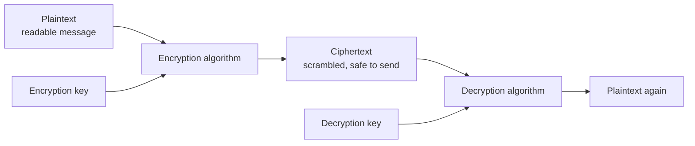

# Cryptography basics and authentication

> **Before this lesson:** read [Threat models, access control and formal models](#/lesson/os/security-access-control) for the goals of security (confidentiality, integrity, availability) and the idea of an attacker. No mathematics beyond multiplication and remainders is needed; everything else is explained here.

## In plain words

Two everyday problems, and two families of tools.

**Problem one: keeping a message private.** You want to send a letter that only your friend can read, even though the postman, the sorting office and anyone who steals the envelope can see it. The answer is to scramble the letter in a way that only your friend can undo. The science of scrambling and unscrambling messages is called **cryptography**.

**Problem two: proving who you are.** A bank will not hand money to anyone who walks in and says "I am Dana". It asks for proof: a card, a signature, a secret number. A computer has the same need each time someone logs in. Checking that someone is who they claim to be is called **authentication**.

The two are linked. Authentication on a computer nearly always relies on cryptographic tools — which is why they are taught together.

Why it matters for a job: every web site with a login, every app that stores a password, and every secure connection you make uses the ideas in this lesson. Getting them wrong (for instance, storing passwords in readable form) is one of the most common serious mistakes in real software, and a favourite interview topic.

A word of caution before starting: the small examples below are for *understanding*. Real systems must use well-tested, published algorithms from standard libraries. Inventing your own scrambling method is a well-known way to produce something that looks secure and is not.

## Cryptography

### The basic idea and its vocabulary

The original, readable message is called the **plaintext**. Scrambling it is **encryption**, and the scrambled result is the **ciphertext**. Turning ciphertext back into plaintext is **decryption**.

Encryption is controlled by a secret value called a **key**. The method (the *algorithm*) is assumed to be public. This is deliberate, and is known as **Kerckhoffs's principle**, after the nineteenth-century cryptographer who stated it: *the security of a system should depend only on keeping the key secret, not on keeping the method secret.* Methods leak; they are built into millions of devices and studied by experts. A method that has been public for years and survived every attempt to break it deserves far more trust than a secret one nobody has examined. Relying on a secret method is mockingly called *security by obscurity*.



### Secret-key cryptography

In the simplest kind, the **same key** is used to encrypt and to decrypt. Sender and receiver must both know it, and nobody else may. This is **secret-key** (or *symmetric*) cryptography.

A childhood example makes the idea concrete: replace each letter by another according to a fixed table — every A becomes Q, every B becomes W, and so on. The table is the key. This particular scheme is easy to break, because some letters are much more common than others in any language, and counting the letters in the ciphertext reveals which is which. Real secret-key algorithms, such as the widely used AES (Advanced Encryption Standard), mix the bits of the message so thoroughly that no such patterns survive.

Secret-key encryption is very fast. Its weakness is practical: **how do the two parties agree on the key in the first place?** If they could send the key safely, they could have sent the message that way.

### Public-key cryptography

In 1976 Whitfield Diffie and Martin Hellman proposed something that sounds impossible: use **two different keys** — one for encrypting, one for decrypting — chosen so that knowing the first does not let you work out the second.

Each person generates such a pair. One key, the **public key**, is published for the world to see. The other, the **private key**, is never shown to anyone. To send Dana a secret message, you encrypt it with Dana's *public* key. Only Dana's *private* key can decrypt it. The problem of agreeing on a shared secret has vanished.

How can a pair of keys have this property? Such systems are built on calculations that are easy to do in one direction and extremely hard to reverse. The best-known public-key system, **RSA**, relies on this fact: multiplying two very large prime numbers is quick, but given only the result, finding the two primes would take longer than the age of the universe with any known method.

Public-key operations are thousands of times slower than secret-key ones. So in practice the two are combined: public-key cryptography is used once, to send a freshly chosen secret key safely, and the fast secret-key method encrypts the actual data.

The toy below uses tiny numbers so that you can follow every step. Real keys are numbers hundreds of digits long.

```python-run
# A toy version of RSA with tiny primes. Never use numbers this small for real.
p, q = 61, 53
n = p * q                         # 3233: part of both keys, made public
phi = (p - 1) * (q - 1)           # 3120: used only while making the keys
e = 17                            # public exponent
d = pow(e, -1, phi)               # private exponent: the number with (e * d) % phi == 1

print("public key  (e, n):", (e, n))
print("private key (d, n):", (d, n))

message = 65                      # a message must be a number smaller than n
ciphertext = pow(message, e, n)   # encrypt with the PUBLIC key
recovered = pow(ciphertext, d, n) # decrypt with the PRIVATE key
print("message", message, "-> ciphertext", ciphertext, "-> decrypted", recovered)

# Why is it hard to break? An attacker who knows n must find p and q.
def factor(number):
    tries = 0
    for candidate in range(2, number):
        tries += 1
        if number % candidate == 0:
            return candidate, number // candidate, tries
print("factoring the toy n took", factor(n)[2], "trial divisions;",
      "a real n has over 600 digits and cannot be factored this way")
```

**What each line does.**

- `p` and `q` are two prime numbers (numbers divisible only by 1 and themselves). `n` is their product.
- `phi` is a helper number, needed only when creating the keys.
- `e` is chosen as part of the public key. `pow(e, -1, phi)` finds the number `d` such that `e × d` leaves remainder 1 when divided by `phi`. That `d` is the private key.
- `pow(message, e, n)` means "raise the message to the power `e`, and keep only the remainder after dividing by `n`". That is encryption.
- `pow(ciphertext, d, n)` does the same with `d`, and the mathematics guarantees that the original message comes back.
- `factor` tries dividing `n` by 2, 3, 4, … until something divides it exactly — what an attacker would have to do to find `p` and `q`.

**The output.** The message 65 becomes 2790 and decrypts back to 65. Factoring 3233 took only 52 attempts, which is why toy numbers are useless; the same search on a number with hundreds of digits would never finish.

### One-way functions

A **one-way function** is a calculation that is easy to perform but practically impossible to reverse: given the input you can find the output quickly, but given only the output you cannot find an input that produces it.

The most used kind is a **cryptographic hash function**. It takes data of any length and produces a short, fixed-length result called a **hash** (or *digest*). A good hash function has three properties:

1. The same input always gives the same hash.
2. Changing even one character of the input changes the hash completely and unpredictably.
3. It is not feasible to find an input that gives a chosen hash, or two different inputs with the same hash.

A widely used one is SHA-256, which always produces 256 bits.

### Digital signatures

How do you sign an electronic document so that the recipient knows it came from you and has not been altered? A **digital signature** combines the two previous ideas.

1. The signer computes the hash of the document.
2. The signer transforms that hash using their **private** key. The result is the signature, sent along with the document.
3. The receiver computes the hash of the document they received, and uses the signer's **public** key to undo the transformation on the signature.
4. If the two hashes match, the document is genuine and unaltered. Only the holder of the private key could have produced a signature that the public key unlocks to the right hash.

Note the reversal compared with encryption: for secrecy you use the *receiver's public* key; for signing you use *your own private* key.

One question remains: how do you know that a public key really belongs to the person it claims to? The usual answer is a **certificate**: a statement saying "this public key belongs to this name", itself digitally signed by an organisation that both parties trust, called a **certification authority**. Your web browser comes with the public keys of such authorities built in, which is how it can check that a web site is the one it claims to be.

### Keeping keys safe: the trusted platform module

Cryptography is only as safe as its keys. A key stored in an ordinary file can be copied by anyone who breaks into the computer. A **trusted platform module** (TPM) is a small chip on the computer's main board that stores keys in a way that software cannot read out. Programs ask the chip to *perform* operations with a key; the key itself never leaves. The chip can also record measurements of the software that was started when the machine booted, so that another party can be given evidence that the machine is running unmodified software.

## Authentication

Every time you log in, the computer must decide whether you are who you say. Methods of authentication rest on one or more of three things:

1. **Something you know** — a password, a PIN.
2. **Something you have** — a bank card, a phone, a small key-shaped device.
3. **Something you are** — a fingerprint, your face, your voice.

Using two of these together is called **two-factor authentication**. It is much stronger than either alone, because an attacker must defeat two unrelated things: a stolen password is useless without your phone, and a stolen phone is useless without your password.

### Passwords, and how they go wrong

The most common method is the simplest: the user types a name and a password. Its weaknesses are mostly human.

- **People choose badly.** Left to themselves, people pick short, memorable words: names, dates, "123456", "password". Studies of real password collections find, every time, that a large share can be guessed from a list of common choices.
- **People reuse.** The same password is used on many sites, so a leak from one opens the others.
- **People are tricked.** A fake login page that imitates the real one (an attack called *phishing*) collects whatever the victim types.

A well-designed login also gives nothing away. It should say "login incorrect" whether the name or the password was wrong, so that an attacker cannot use the message to discover which names exist.

### How passwords should be stored

Here is the question that separates careful systems from careless ones: *what does the computer keep, so that it can check your password next time?*

**The wrong answer: the passwords themselves.** If the file of passwords is ever copied — and such files are stolen all the time — every account is immediately open.

**Better: store a hash of each password.** When you log in, the system hashes what you typed and compares the result with the stored hash. The system never needs to keep the password itself, and because a hash cannot be reversed, a stolen file does not directly reveal passwords.

But a thief can still *guess*. They take a list of millions of common passwords, hash each one, and look for matches in the stolen file. Worse, they can do the hashing once, in advance, and reuse the resulting table against every stolen file. And since identical passwords produce identical hashes, cracking one cracks everyone who chose the same.

**Better still: add salt.** For each user the system generates a random string, called a **salt**, stores it next to the user's name, and hashes the salt together with the password. Now:

- two users with the same password have different stored hashes;
- a table of hashes prepared in advance is useless, because it was not computed with these salts;
- the attacker must attack each account separately.

**And make it slow.** Ordinary hash functions are designed to be fast, which helps the attacker try billions of guesses per second. Password systems therefore use deliberately slow methods that repeat the hashing many thousands of times. A legitimate login is delayed by a fraction of a second; an attacker trying billions of guesses is slowed by the same factor on every guess.

```python-run
import hashlib, os

def fast_hash(password):
    return hashlib.sha256(password.encode()).hexdigest()[:16]

def salted_slow_hash(password, salt, rounds=20_000):
    # pbkdf2_hmac repeats the hashing `rounds` times, mixing in the salt.
    return hashlib.pbkdf2_hmac("sha256", password.encode(), salt, rounds).hex()[:16]

users = {"asha": "sunshine", "ben": "sunshine", "chidi": "T7#mVq2-lake"}

print("1. Plain hashes: identical passwords are visible at a glance")
for name, pw in users.items():
    print(f"   {name:6s} {fast_hash(pw)}")

print("2. Salted, slow hashes: every stored value is different")
stored = {}
for name, pw in users.items():
    salt = os.urandom(8)                           # 8 random bytes, different for every user
    stored[name] = (salt, salted_slow_hash(pw, salt))
    print(f"   {name:6s} salt {salt.hex()}  hash {stored[name][1]}")

def login(name, attempt):
    salt, expected = stored[name]
    return salted_slow_hash(attempt, salt) == expected

print("3. Checking a login")
print("   asha with 'sunshine' :", login("asha", "sunshine"))
print("   asha with 'sunshin3' :", login("asha", "sunshin3"))

common = ["123456", "password", "qwerty", "sunshine", "letmein"]
cracked = [name for name in stored if any(login(name, guess) for guess in common)]
print("4. Accounts guessable from a list of five common passwords:", cracked)
```

**What each part does.**

- `fast_hash` computes a SHA-256 hash and keeps the first 16 characters so the output fits on a line. `password.encode()` turns text into bytes, which is what hash functions work on.
- `salted_slow_hash` uses `hashlib.pbkdf2_hmac`, a standard function that mixes the salt with the password and repeats the hashing 20,000 times.
- `os.urandom(8)` asks the operating system for 8 unpredictable random bytes.
- `stored` is what the system would keep in its password file: for each user, the salt and the slow hash — never the password.
- `login` repeats the same calculation on the attempt, using the stored salt, and compares.
- The final lines play the attacker, trying five common passwords against each account.

**The output.** In part 1, Asha and Ben have the same hash, so anyone looking at the file knows they share a password. In part 2 their stored values differ. In part 3 the right password is accepted and a near miss is rejected. Part 4 shows the limit of all this machinery: Asha and Ben are still cracked, because "sunshine" is on the list. Salting and slowness raise the cost of guessing; they cannot rescue a password that is easy to guess. Chidi's long, unusual password is not found.

> [!INTERVIEW]
> "How should passwords be stored?" Never in readable form, and never with a plain fast hash. Store, per user, a random **salt** and the output of a deliberately **slow** password-hashing function (such as bcrypt, scrypt, Argon2 or PBKDF2) applied to salt and password. Explain what each part defeats: hashing means a stolen file does not directly reveal passwords; salt defeats precomputed tables and hides identical passwords; slowness limits the rate of guessing. Then mention the layers around it: rate-limiting login attempts and offering two-factor authentication.

### One-time passwords

A password that works only once is useless to someone who overhears it. One classic scheme, due to Leslie Lamport, builds a chain using a one-way function. The user picks a secret and applies the function to it, say, 100 times; the system stores only that final result. To log in for the first time, the user supplies the value after 99 applications; the system applies the function once more and checks that it matches what is stored, then stores the value it was sent. Next time the user supplies the value after 98 applications, and so on. Someone who overhears a value cannot work backwards to the one needed next, because the function cannot be reversed.

The six-digit codes shown by authenticator apps apply the same thinking in a different way: the app and the server share a secret, and each computes a code from that secret and the current time. The code changes every half-minute.

### Challenge–response

Sending a password across a network is risky even if it is stored well. **Challenge–response** authentication proves that you know the secret *without ever sending it*.

1. The server sends a random number it has never used before — the **challenge**.
2. The user's device combines the challenge with the secret, using a one-way function, and sends back the result — the **response**.
3. The server performs the same calculation and compares.

An eavesdropper sees only a random number and a result. Because the challenge is different every time, recording today's exchange and replaying it tomorrow fails.

```python-run
import hmac, hashlib, os

shared_secret = b"correct horse battery staple"       # known to the user's device and the server

def respond(secret, challenge):
    # HMAC combines a secret with a message using a hash function.
    return hmac.new(secret, challenge, hashlib.sha256).hexdigest()[:20]

# --- an honest login ---
challenge = os.urandom(8)                              # the server invents a fresh random challenge
response = respond(shared_secret, challenge)           # computed on the user's device
print("challenge:", challenge.hex(), " response:", response)
print("server accepts:", response == respond(shared_secret, challenge))

# --- an eavesdropper replays the recorded response later ---
new_challenge = os.urandom(8)
print("replayed old response against a new challenge:", response == respond(shared_secret, new_challenge))

# --- someone who does not know the secret ---
print("guess with the wrong secret:", respond(b"wrong secret", new_challenge) == respond(shared_secret, new_challenge))
```

**What each part does.** `hmac.new(secret, challenge, hashlib.sha256)` is a standard way of hashing a message together with a secret key; without the key the result cannot be produced. `os.urandom(8)` creates a new random challenge. The three sections show an honest login (accepted), an old response replayed against a fresh challenge (rejected), and an attempt with the wrong secret (rejected).

**The output.** `True`, then `False`, then `False`. The secret itself never appeared on the "network".

### Something you have

The second way to authenticate uses a physical object. A bank card with a chip, called a **smart card**, contains a tiny computer holding a secret key that cannot be read out. The card proves its identity by challenge–response: the terminal sends a random number, and the chip computes the reply inside itself. Copying the card would require extracting the key from the chip, which it is built to resist. The small security keys that plug into a laptop, and phones used to approve logins, work on the same principle.

### Something you are

The third way measures a physical characteristic that is hard to copy — a fingerprint, the pattern of the iris of the eye, the shape of the face, the voice. This is **biometrics**. It has two stages: **enrolment**, when the characteristic is measured and a compact description stored; and **identification**, when a new measurement is compared with what was stored.

No two measurements are ever exactly the same, so the system must accept anything "close enough", and that produces two kinds of error. A **false acceptance** lets the wrong person in. A **false rejection** keeps the right person out. Making the system stricter reduces the first and increases the second; making it more relaxed does the opposite. Where to set the balance depends on what is being protected.

Biometrics have a particular drawback: they cannot be changed. If your password leaks, you choose a new one. If a copy of your fingerprint leaks, you cannot get new fingers. For that reason they are best used as one factor among two, and best checked on your own device, not sent to a remote server.

## Common mistakes and confusions

- **Mixing up which key does what.** To keep a message secret, encrypt with the *receiver's public* key. To sign, use *your own private* key.
- **Confusing hashing with encryption.** Encryption can be undone with the key. A hash cannot be undone at all.
- **Thinking a salt must be secret.** It is stored openly beside the hash. Its job is to be different for each user.
- **Believing a strong storage scheme rescues a weak password.** Guessable passwords remain guessable.
- **Inventing a private scrambling method.** Use published, tested algorithms from standard libraries.
- **Treating a fingerprint as a password.** It is not secret and cannot be changed.

## Summary

- **Cryptography** turns **plaintext** into **ciphertext** under the control of a **key**. Security should rest on the secrecy of the key alone (**Kerckhoffs's principle**).
- **Secret-key** cryptography uses one shared key and is fast. **Public-key** cryptography uses a public/private pair, solving key distribution at the cost of speed; real systems combine the two.
- **Hash functions** are one-way summaries. **Digital signatures** apply a private key to a document's hash; **certificates** tie public keys to names. A **TPM** keeps keys inside tamper-resistant hardware.
- **Authentication** rests on something you **know**, **have** or **are**; two together give **two-factor authentication**.
- Store passwords as **salted, slow hashes**. **One-time passwords** and **challenge–response** defeat eavesdropping and replay. **Smart cards** hold keys in hardware. **Biometrics** trade false acceptances against false rejections and cannot be replaced once leaked.

## Glossary

- **Cryptography** — the science of scrambling messages so that only intended readers can read them.
- **Authentication** — checking that someone is who they claim to be.
- **Plaintext / ciphertext** — the readable message / its scrambled form.
- **Encryption / decryption** — scrambling / unscrambling.
- **Key** — the secret value that controls encryption or decryption.
- **Kerckhoffs's principle** — security should depend only on the secrecy of the key, not of the method.
- **Secret-key (symmetric) cryptography** — one shared key both encrypts and decrypts.
- **Public-key cryptography** — a published key encrypts and a matching private key decrypts.
- **Prime number** — a whole number divisible only by 1 and itself.
- **RSA** — a widely used public-key system based on the difficulty of factoring large numbers.
- **One-way function** — easy to compute, practically impossible to reverse.
- **Hash (digest)** — the short fixed-length output of a hash function.
- **Digital signature** — a value, made with a private key, proving who produced a document and that it is unchanged.
- **Certificate** — a signed statement that a public key belongs to a particular name.
- **Certification authority** — an organisation trusted to sign certificates.
- **Trusted platform module (TPM)** — a chip that stores keys and performs operations with them without revealing them.
- **Two-factor authentication** — requiring two different kinds of proof.
- **Phishing** — tricking someone into entering secrets on a fake page.
- **Salt** — a random value stored with each password hash so that equal passwords give different hashes.
- **One-time password** — a password valid for a single use.
- **Challenge–response** — proving knowledge of a secret by answering a fresh random question computed from it.
- **Smart card** — a card containing a chip that holds a key and computes with it.
- **Biometrics** — authentication by measuring a physical characteristic.
- **False acceptance / false rejection** — wrongly admitting an impostor / wrongly refusing the real user.

## Check yourself

```quiz
[
  {"q": "What does Kerckhoffs's principle state?",
   "options": ["The encryption method must be kept secret", "A system should remain secure even if everything about it except the key is public", "Keys should be as short as possible", "Only governments may design encryption"],
   "answer": 1,
   "explain": "Methods become known and benefit from public scrutiny. Security should rest only on the secrecy of the key."},
  {"q": "You want to send a confidential message to Dana using public-key cryptography. Which key do you encrypt with?",
   "options": ["Your own private key", "Your own public key", "Dana's public key", "Dana's private key"],
   "answer": 2,
   "explain": "Anything encrypted with Dana's public key can be decrypted only with Dana's private key, which only Dana holds."},
  {"q": "Why do real systems combine public-key and secret-key cryptography?",
   "options": ["Secret-key cryptography is illegal", "Public-key operations are slow, so they are used only to exchange a secret key, which then encrypts the data quickly", "Public keys cannot encrypt text", "To make the keys shorter"],
   "answer": 1,
   "explain": "The public-key step solves the problem of agreeing on a key; the fast secret-key method does the bulk of the work."},
  {"q": "Which property is NOT expected of a cryptographic hash function?",
   "options": ["The same input always gives the same output", "A tiny change to the input changes the output completely", "The input can be recovered from the output using a key", "Finding two inputs with the same output is infeasible"],
   "answer": 2,
   "explain": "A hash is one-way; there is no key and no way back. Recovering the input is what encryption with decryption provides, not hashing."},
  {"q": "A digital signature is made by applying which key to the hash of a document?",
   "options": ["The signer's private key", "The signer's public key", "The receiver's public key", "A shared secret key"],
   "answer": 0,
   "explain": "Only the signer holds the private key, so only the signer could have made a signature that the public key verifies."},
  {"q": "What does adding a per-user salt to password hashing achieve?",
   "options": ["It makes the password longer for the user to type", "It makes identical passwords store differently and defeats tables of hashes prepared in advance", "It encrypts the password so it can be recovered", "It removes the need for a password"],
   "answer": 1,
   "explain": "With a different random salt per user, an attacker must attack each account separately, and precomputed tables are useless."},
  {"q": "In challenge-response authentication, why does recording a successful login and replaying it later fail?",
   "options": ["The password changes every day", "The server issues a new random challenge each time, so the old response no longer matches", "The network deletes old messages", "Responses are encrypted with the attacker's key"],
   "answer": 1,
   "explain": "The response depends on the challenge. A fresh challenge requires a fresh response that only someone knowing the secret can compute."},
  {"q": "What is a particular weakness of biometric authentication compared with passwords?",
   "options": ["It is always slower", "A leaked biometric cannot be replaced, unlike a leaked password", "It never produces errors", "It cannot be combined with other factors"],
   "answer": 1,
   "explain": "You can choose a new password after a leak but cannot change your fingerprints. Biometrics are therefore best used alongside another factor."}
]
```

> **Source:** Tanenbaum & Bos, Modern Operating Systems 4e, §9.5 (Basics of cryptography), §9.6 (Authentication)
