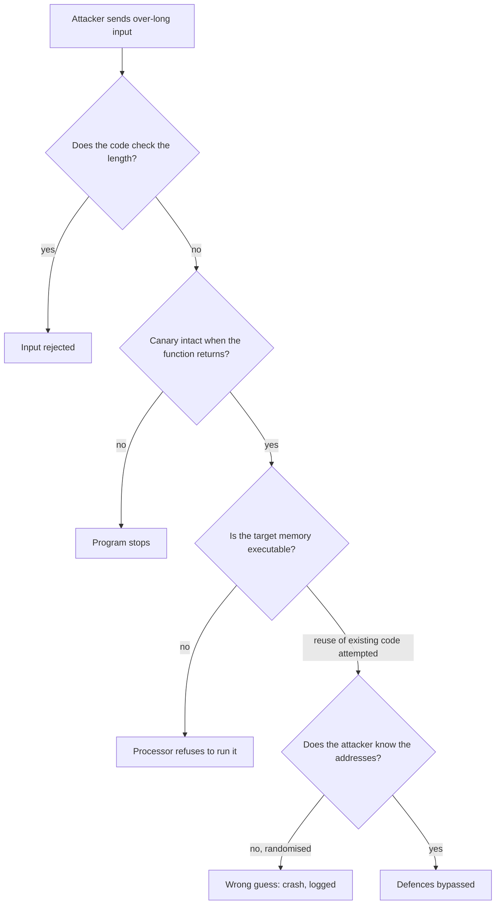

# Classes of attack and the defences against them

> **Before this lesson:** read [Threat models, access control and formal models](#/lesson/os/security-access-control) and [Cryptography basics and authentication](#/lesson/os/crypto-authentication). It also helps to remember how a process's memory is laid out — code, data and a stack — from [Core concepts, system calls and kernel structure](#/lesson/os/concepts-syscalls-structure).

## In plain words

A burglar rarely breaks down the front door. They look for the window left open, the spare key under the mat, the delivery driver who will hold the door for anyone carrying a box. Good locks matter, but most break-ins exploit a *mistake* or a *habit*.

Computer break-ins are the same. Attackers seldom defeat the mathematics of encryption. They look for a programming mistake that makes a program do something its author never intended, or they trick a person into running something harmful.

This lesson explains the main *kinds* of mistake that attackers use and, for each, what defenders do about it. It is deliberately about ideas and defences: you will understand why the weaknesses exist and how to avoid creating them, which is what a software engineer needs. It contains no instructions for attacking anything.

One idea runs through the whole lesson, so here it is at the start: **no single defence is perfect, so systems use several layers.** A castle has a moat *and* walls *and* guards. If one layer fails, the next may hold. This is called **defence in depth**.

Why it matters for a job: most security incidents trace back to a small number of well-known mistake types. Recognising them in a code review — your own code or someone else's — is one of the most valuable skills a developer can have.

## Mistakes in programs

A **bug** is a mistake in a program. A bug that can be used to break security is a **vulnerability**. The first group of attacks all work the same way in outline: the attacker supplies carefully chosen *input* to a program that has a bug, and the bug causes the program to misbehave in a way that benefits the attacker.

### Writing past the end: buffer overflows

A **buffer** is a block of memory set aside to hold some data — for example, 64 bytes for a name the user types. A **buffer overflow** happens when a program copies more data into a buffer than it can hold. The extra data does not vanish. It lands in whatever happens to be stored next to the buffer and overwrites it.

Why would a program allow that? Because some programming languages — notably C and C++, in which most operating systems are written — do not check. In those languages, copying a 200-byte input into a 64-byte buffer is carried out without complaint. The programmer is expected to check the length, and sometimes forgets.

Why is overwriting neighbouring memory dangerous? The neighbouring memory may hold values that control what the program does next. In particular, while a function is running, the program keeps a note of where to continue when the function finishes. This note is called the **return address**, and it is stored close to the function's local buffers. If an overflow replaces that note with a value chosen by an attacker, then when the function finishes, the program continues at a place the attacker selected, not where it was supposed to.

The model below shows the essence with a pretend memory made of numbered boxes. It involves no real memory and no real machine instructions; it only shows why a missing length check lets one variable trample another.

```python-run
def make_memory():
    # 12 boxes. Boxes 0-5: a buffer for a name. Box 6: a guard value. Boxes 7-11: an important setting.
    memory = ["."] * 6 + ["GUARD"] + list("user ")
    return memory

def show(memory, label):
    print(f"{label:28s} buffer={''.join(memory[:6])!r:10} guard={memory[6]!r:8} setting={''.join(memory[7:12])!r}")

def careless_copy(memory, text):
    for i, ch in enumerate(text):        # copies every character, however many there are
        memory[i] = ch

def careful_copy(memory, text, size=6):
    if len(text) > size:
        return "rejected: input longer than the buffer"
    for i, ch in enumerate(text):
        memory[i] = ch
    return "ok"

m = make_memory()
show(m, "at the start")

careless_copy(m, "Mira")
show(m, "careless copy, short input")

m = make_memory()
careless_copy(m, "AAAAAAXadmin")             # 12 characters into a 6-character buffer
show(m, "careless copy, long input")
print("guard still intact?", m[6] == "GUARD", "-> the overflow can be DETECTED by checking the guard")

m = make_memory()
print("careful copy, long input :", careful_copy(m, "AAAAAAXadmin"))
show(m, "after the careful copy")
```

**What each part does.**

- `make_memory` builds a list of 12 boxes: six for a name, one holding a guard value, and five holding an important setting (`"user "`).
- `careless_copy` writes every character of the input into the boxes starting at box 0, never asking whether the input fits. This is the bug.
- `careful_copy` checks the length first and refuses input that is too long. This is the fix.
- `show` prints the three regions.

**The output.** With a short input, nothing goes wrong. With a 12-character input, the careless copy runs past box 5: the guard is destroyed and the setting changes from `user ` to `admin`. The input changed something it was never meant to reach. The careful version refuses the input and memory stays as it was. Notice the line about the guard: because the overflow had to pass through box 6 to reach the setting, checking the guard afterwards reveals that something went wrong. That observation is the basis of a real defence described below.

### Defences against overflows — and why there are several

Defenders responded with a series of protections. Each one made attacks harder, attackers found a way round, and another layer was added. The history is a good illustration of defence in depth.

**Stack canaries.** The compiler (the program that turns source code into a runnable program) places a random value, called a **canary**, between a function's buffers and its return address, exactly like the guard in the model above. Before the function returns, it checks the canary. If the value has changed, an overflow has happened, and the program stops immediately instead of continuing at a corrupted address. The name comes from the canaries once carried into coal mines to give early warning of bad air.

**Non-executable data.** Early attacks placed their own machine instructions in the overflowing input and redirected the program to run them. Modern processors let the operating system mark each region of memory as *either* writable *or* executable, not both. The stack and other data areas are marked non-executable, so even if an attacker's bytes are placed there, the processor refuses to run them. This is called **data execution prevention** (DEP), and the processor feature is often called the *NX* ("no-execute") bit.

**Code reuse and why DEP was not the end.** Attackers adapted. If they cannot bring their own instructions, they can misuse instructions that are *already in memory* — the program's own code and the libraries it uses. By redirecting the program to existing pieces of code in a chosen order, an attacker can piece together harmful behaviour without supplying any new instructions. This family is known as **code-reuse attacks**. For a defender the lesson is that DEP alone is not enough.

**Address space layout randomisation (ASLR).** Code-reuse attacks need to know *where* the useful pieces of existing code are in memory. ASLR makes the operating system place the program's code, libraries, stack and other regions at different, randomly chosen addresses every time the program runs. An attacker who must guess an address will almost always guess wrong, and a wrong guess usually crashes the program — which is noticeable.

```python-run
def chance_of_guessing(random_bits, attempts=1):
    """Probability of guessing a randomised location in a given number of attempts."""
    positions = 2 ** random_bits
    return min(1.0, attempts / positions)

print("bits of randomness   possible positions   chance per attempt")
for bits in (0, 8, 16, 28):
    print(f"{bits:18d}   {2 ** bits:18,d}   {chance_of_guessing(bits):.10f}")

print("\nIf each wrong guess crashes the program and is logged,")
print("the expected number of crashes before one success with 28 bits is about", f"{2 ** 28 // 2:,}")
```

**What each line does.** `2 ** random_bits` is the number of different places the region could be. One guess succeeds with probability one divided by that number. The table shows the chance for different amounts of randomness, and the last line gives the average number of failed attempts before a lucky one.

**The output.** With no randomisation the attacker is right every time. With 28 bits there are over 268 million possibilities. ASLR does not make an attack impossible; it makes it unreliable and noisy. Its main weakness is anything that *reveals* an address to the attacker — which is why bugs that leak memory contents are treated as serious even when they seem harmless.

**Memory-safe languages.** The most thorough defence is to remove the cause. Languages such as Rust, Java, Go, Python and C# check every access to an array and refuse to read or write outside it. A whole class of vulnerabilities cannot occur in them. This is the main reason new system software is increasingly written in memory-safe languages.



### Other common mistakes

The same pattern — unexpected input meeting a missing check — appears in several other forms. Know them by name and by remedy.

**Format-string bugs.** Some functions that print text take a *format* — a template describing what to print — as their first argument. If a program passes text supplied by the user as that template, special sequences in the text are interpreted as formatting commands, which can reveal or even alter memory. *Remedy:* never use outside input as a format; always supply a fixed format and pass the user's text as data.

**Use after free (dangling pointers).** A program asks for a block of memory, uses it, and gives it back. A *pointer* is a stored memory address; a **dangling pointer** is one that still refers to memory that has been given back. If the program later uses that pointer, the memory may by then belong to something else entirely. *Remedy:* careful ownership rules, automatic memory management, or languages that make the mistake impossible to write.

**Null pointer dereference.** A pointer holding the special "refers to nothing" value is used as though it were valid. Usually the program crashes — an availability problem. *Remedy:* check before use; operating systems also refuse to let anything be placed at address zero.

**Integer overflow.** Computer integers have a fixed size. Adding to the largest value wraps round to a small one, as a car's mileage counter rolls over to zero. If a program computes how much memory to request by multiplying two numbers supplied from outside, and the result wraps round, it requests far too little memory and then writes far too much into it — an overflow by another route. *Remedy:* check arithmetic on sizes before using the result.

**Command injection.** A program builds a text command from pieces, including some text from the user, and passes the whole thing to a command interpreter. If the user's text contains characters that have special meaning to the interpreter, part of the "data" is treated as extra commands. The same pattern against a database is called *SQL injection*. *Remedy:* never build commands by joining text; pass the user's input as a separate, clearly marked value, and accept only input that matches what is expected.

```python-run
import re

def validate_filename(name):
    """Accept only what we expect: letters, digits, dot, dash, underscore; no path separators; sensible length."""
    if not re.fullmatch(r"[A-Za-z0-9._-]{1,64}", name):
        return False
    return name not in (".", "..")

for candidate in ["report.txt", "notes_2026-11.md", "../../etc/passwd", "a.txt; rm -rf ~", "", "x" * 100, ".."]:
    shown = candidate if len(candidate) < 30 else candidate[:27] + "..."
    print(f"{shown!r:34} -> {'accepted' if validate_filename(candidate) else 'REJECTED'}")
```

**What each part does.** `re.fullmatch` tests whether the *whole* text matches a pattern. The pattern `[A-Za-z0-9._-]{1,64}` means "between 1 and 64 characters, each of which is a letter, a digit, a dot, an underscore or a dash". Anything else — a slash, a space, a semicolon — causes rejection. The last check refuses the two special names that mean "this directory" and "the parent directory".

**The output.** The two ordinary names are accepted. Names containing path separators, spaces or command punctuation, the empty name, an over-long name and `..` are all rejected. This approach is called an **allow-list**: describe exactly what is acceptable and refuse everything else. It is far more reliable than trying to list everything that is dangerous, because attackers are better than defenders at thinking of dangerous inputs.

**Time of check to time of use (TOCTOU).** A program checks that something is permitted and then, a moment later, does it — and in between, the situation changes. For example: a program running with high privilege checks that a user is allowed to write to a certain file name, and then opens that name. If, in the gap, the name is switched to refer to a different, protected file, the check was passed for one file and the write happens to another. This is a race condition, exactly like those in the lesson on mutual exclusion, with security consequences. *Remedy:* make the check and the action a single indivisible operation — for example, open the file first and then check the already-opened file, so that the name cannot be switched underneath.

> [!INTERVIEW]
> "What is a buffer overflow and how is it prevented?" Writing more data into a fixed-size buffer than it holds, so that adjacent memory — possibly control data such as a return address — is overwritten. Prevention in layers: bounds checking in the code or a memory-safe language (removes the cause); stack canaries (detect it); non-executable data (stop injected code running); ASLR (make useful addresses unpredictable); least privilege and sandboxing (limit the damage). Then name the principle behind all of it: **never trust input** — validate length, type and content at every boundary.

## Attacks from the inside

Not all threats come from outside. People who legitimately work on a system can abuse their position.

- A **logic bomb** is code secretly placed in a program by one of its authors, set to do damage when some condition is met — for example, when the author's name disappears from the payroll.
- A **back door** is a hidden way round the normal checks, such as a secret account name that is always accepted.
- **Login spoofing** is a fake login screen left running on a shared computer; it collects what the next person types and then passes them on to the real screen. This is why some systems require a special key combination before login that no ordinary program can intercept.

The main defence against the first two is **code review**: no change enters the product unless a second person has read and approved it.

## Malicious software

Software written to do harm is called **malware**. The names describe how it arrives and spreads.

- A **Trojan horse** is a program that appears useful and also contains hidden harmful behaviour. The victim installs it voluntarily. It is named after the wooden horse of Greek legend.
- A **virus** is code that attaches itself to other programs or documents. When an infected program is run, the virus runs too and copies itself to more files. It spreads when people share infected files.
- A **worm** is a complete program that spreads from computer to computer by itself, over the network, with no action by any person, by using a vulnerability in software that is listening for connections. Because no human is needed at each step, worms can spread across the world in minutes.
- **Spyware** secretly collects information — what you type, which sites you visit — and sends it to someone else.
- A **rootkit** is software designed to hide the presence of other malware, often by changing the operating system so that the malware's files and processes are left out of the lists the system reports. Once the operating system itself is lying, it cannot be trusted to find the problem.
- **Ransomware** encrypts the victim's files and demands payment for the key.

A collection of infected computers remotely controlled by one attacker is called a **botnet**, and can be used to send spam or to overwhelm a target with traffic.

## Defences

### Firewalls

A **firewall** stands between a computer or network and the rest of the internet and decides which network traffic may pass. It examines each packet of data and applies a list of rules — for example, "allow incoming connections to the web server program; refuse all other incoming connections". A *stateful* firewall also remembers which conversations are in progress and allows replies only to requests that were genuinely made from inside. Firewalls shrink the number of doors an outside attacker can even knock on.

### Antivirus techniques

Programs that look for malware use several methods, each with a weakness:

- **Signature scanning.** Keep a list of byte patterns ("signatures") found in known malware, and scan files for them. Fast and reliable against known threats, and blind to anything new. Malware authors respond by making each copy look different.
- **Integrity checking.** Record a hash (a short fingerprint, as explained in the previous lesson) of every important file while the system is known to be clean. Later, recompute and compare. Any file whose hash has changed has been modified. This finds changes without needing to know what caused them.
- **Behavioural checking.** Watch what programs *do* and raise an alarm at suspicious actions, such as a program that starts overwriting many documents in a row.

```python-run
import hashlib

def fingerprint(content):
    return hashlib.sha256(content).hexdigest()[:12]

system_files = {
    "/bin/login": b"program that checks passwords, version 4.2",
    "/bin/list-files": b"program that lists a directory, version 9.1",
    "/etc/startup": b"start the network; start the login service",
}
baseline = {path: fingerprint(data) for path, data in system_files.items()}   # recorded while clean
print("baseline recorded:", baseline)

# Later: something has changed two of the files.
system_files["/bin/list-files"] = b"program that lists a directory but hides certain names"
system_files["/etc/startup"] += b"; start an extra unknown service"

print("\nintegrity check:")
for path, data in system_files.items():
    status = "unchanged" if fingerprint(data) == baseline[path] else "MODIFIED - investigate"
    print(f"   {path:16s} {status}")
```

**What each part does.** `fingerprint` computes a SHA-256 hash and keeps the first 12 characters. `baseline` is a table of the fingerprints of all the files, built while the system is clean. Afterwards two files are changed, and the final loop recomputes each fingerprint and compares it with the baseline.

**The output.** The two altered files are flagged; the untouched one is not. The checker did not need to know anything about the changes. For this to work in practice the baseline must be stored where an attacker cannot rewrite it too — otherwise they update the fingerprints to match.

### Code signing

How do you know that a program you downloaded really comes from its claimed author and has not been altered on the way? With **code signing**, the author attaches a digital signature (from the previous lesson) to the program. Before installing or running it, the operating system verifies the signature. An altered program fails the check. Phone app stores and operating system updates depend on this.

### Confinement: jails and sandboxes

Suppose a program must be run although it is not fully trusted. The answer is to limit what it can do, so that even if it misbehaves, the harm is contained.

- **Jailing** places a second program, the *jailer*, in control of the untrusted one. Every time the untrusted program makes a system call, the jailer is consulted first and may refuse.
- A **sandbox** restricts a program to a limited area: only certain files, only certain network destinations, only certain system calls. Web browsers run each web page in a sandbox; phones run each app in one. Containers and virtual machines, from the virtualization lessons, are strong forms of the same idea.

Both are the **principle of least authority** applied to whole programs.

### Intrusion detection

An **intrusion detection system** watches for signs of an attack in progress. One interesting approach is *model-based*: analyse a program in advance to learn which sequences of system calls it could legitimately make, and then monitor it while it runs. If it ever makes a system call that its own code could not have produced, something has taken control of it.

### Programs from elsewhere

Web pages contain programs that your browser downloads and runs automatically. Three techniques make that tolerable: **sandboxing**, as above; **interpretation**, in which the downloaded code is not run directly by the processor but acted out step by step by another program that checks each step; and language-level safety, as in the Java virtual machine, which verifies downloaded code before running it and consults a security policy before each sensitive action.

## Common mistakes and confusions

- **"We use encryption, so we are secure."** Most attacks go round the cryptography, through bugs and people.
- **Mixing up virus and worm.** A virus needs a person to run or share an infected file; a worm spreads through the network by itself.
- **Relying on one defence.** Canaries, non-executable data and randomisation each have known ways round; together they are strong.
- **Listing bad inputs instead of good ones.** Use an allow-list.
- **Checking and then acting in two steps.** That gap is a race condition.
- **Trusting a possibly compromised system to inspect itself.** A rootkit makes the system lie; check from outside.

## Summary

- Most attacks exploit **vulnerabilities**: bugs triggered by unexpected input. **Buffer overflows** overwrite neighbouring memory, including control data such as return addresses.
- Layered defences: bounds checking and **memory-safe languages**, **stack canaries**, **non-executable data (DEP)**, and **ASLR** — together an instance of **defence in depth**.
- Other bug classes: format strings, **use after free**, null pointers, **integer overflow**, **command injection** (cure: allow-lists and separating data from commands) and **TOCTOU** races (cure: make check and use indivisible).
- Insider threats include **logic bombs**, **back doors** and **login spoofing**; **code review** is the main defence.
- **Malware** types: Trojan horse, virus, worm, spyware, rootkit, ransomware.
- Defences: **firewalls**, antivirus (**signatures**, **integrity checking**, **behaviour**), **code signing**, **jails** and **sandboxes**, and **intrusion detection**.

## Glossary

- **Bug** — a mistake in a program.
- **Vulnerability** — a bug that can be used to break security.
- **Defence in depth** — using several independent layers of protection.
- **Buffer** — a block of memory reserved for some data.
- **Buffer overflow** — writing more into a buffer than it can hold.
- **Return address** — the stored note of where to continue after a function finishes.
- **Stack canary** — a random value placed before the return address and checked to detect overflows.
- **Data execution prevention (DEP), NX bit** — marking data memory so the processor will not run it as code.
- **Code-reuse attack** — misusing instructions already present in memory.
- **Address space layout randomisation (ASLR)** — placing a program's memory regions at random addresses on each run.
- **Memory-safe language** — a language that checks every memory access.
- **Dangling pointer / use after free** — using a reference to memory that has been given back.
- **Integer overflow** — a calculation exceeding the largest value a number can hold and wrapping round.
- **Command injection** — outside input being interpreted as part of a command.
- **Allow-list** — a description of exactly what input is acceptable; everything else is refused.
- **TOCTOU** — time of check to time of use: a gap between checking a condition and acting on it.
- **Logic bomb / back door** — hidden harmful code set to trigger later / a hidden way round security checks.
- **Malware** — software written to do harm.
- **Trojan horse / virus / worm** — harmful code hidden in a useful-looking program / attached to other files / spreading over the network unaided.
- **Spyware / rootkit / ransomware** — collects information secretly / hides malware / encrypts files for payment.
- **Firewall** — a filter deciding which network traffic may pass.
- **Signature** (in antivirus) — a byte pattern identifying known malware.
- **Integrity checking** — detecting changes by comparing file hashes with a trusted record.
- **Code signing** — attaching a digital signature to a program so its origin and integrity can be verified.
- **Sandbox / jail** — a restricted environment limiting what a program can do.
- **Intrusion detection system** — software that watches for signs of an attack.

## Check yourself

```quiz
[
  {"q": "What is a buffer overflow?",
   "options": ["Running out of disk space", "Writing more data into a fixed-size block of memory than it can hold, so that neighbouring memory is overwritten", "Sending too many network packets", "A password that is too long"],
   "answer": 1,
   "explain": "The excess data lands in adjacent memory. If that memory holds control information such as a return address, the program's behaviour can be redirected."},
  {"q": "How does a stack canary protect a program?",
   "options": ["It encrypts the stack", "A random value placed before the return address is checked before the function returns; if it has changed, the program stops", "It prevents all input", "It randomises the location of libraries"],
   "answer": 1,
   "explain": "An overflow that reaches the return address must first overwrite the canary, which is then detected."},
  {"q": "Data execution prevention stops an attacker from...",
   "options": ["Reading files", "Running instructions that were placed in a data area such as the stack", "Guessing passwords", "Connecting to the network"],
   "answer": 1,
   "explain": "Memory is marked as either writable or executable. Bytes written into data areas will not be run by the processor."},
  {"q": "Why was ASLR introduced even though DEP already existed?",
   "options": ["DEP slowed programs down too much", "Attackers began reusing code already in memory, which requires knowing its address; randomising addresses makes that unreliable", "DEP did not work on any processor", "ASLR replaces passwords"],
   "answer": 1,
   "explain": "Code-reuse attacks avoid injecting new instructions, so DEP does not stop them. They depend on knowing where existing code is, which ASLR makes unpredictable."},
  {"q": "A program validates a file name by rejecting names containing a short list of known dangerous characters. What is a better approach?",
   "options": ["Reject nothing", "Use an allow-list: accept only names made of a defined set of safe characters and reject everything else", "Make the list of bad characters longer each month", "Convert the name to upper case"],
   "answer": 1,
   "explain": "Defining what is acceptable is more reliable than trying to anticipate every harmful input."},
  {"q": "A privileged program checks that a user may write to a file name and then opens that name; between the two steps the name is redirected to a protected file. What kind of flaw is this?",
   "options": ["Integer overflow", "A time-of-check-to-time-of-use race condition", "A format-string bug", "A logic bomb"],
   "answer": 1,
   "explain": "The condition that was checked no longer holds when the action is taken. The fix is to make checking and using a single indivisible operation."},
  {"q": "What distinguishes a worm from a virus?",
   "options": ["A worm is harmless", "A worm spreads between computers over the network by itself, while a virus attaches to files and depends on people running or sharing them", "A virus only affects phones", "A worm cannot copy itself"],
   "answer": 1,
   "explain": "Worms exploit vulnerabilities in network-facing software and need no human action, which is why they can spread so fast."},
  {"q": "An integrity checker reports that a system program's hash differs from the recorded baseline. What does this show?",
   "options": ["The program is definitely a virus", "The file has been modified since the baseline was recorded and should be investigated", "The disk is full", "The hash function is broken"],
   "answer": 1,
   "explain": "A changed hash proves the contents changed. It does not say why; the cause could be a legitimate update or tampering."}
]
```

> **Source:** Tanenbaum & Bos, Modern Operating Systems 4e, §9.7 (Exploiting software), §9.8 (Insider attacks), §9.9 (Malware), §9.10 (Defenses)
