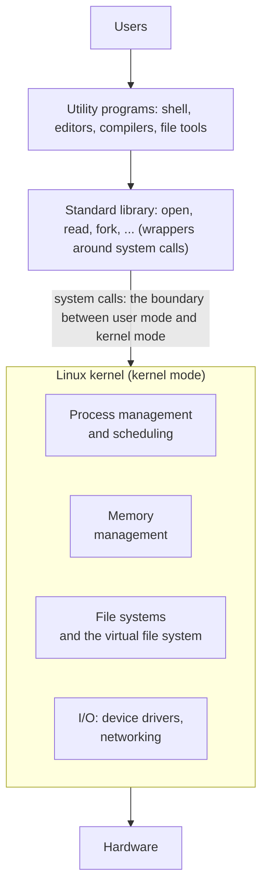
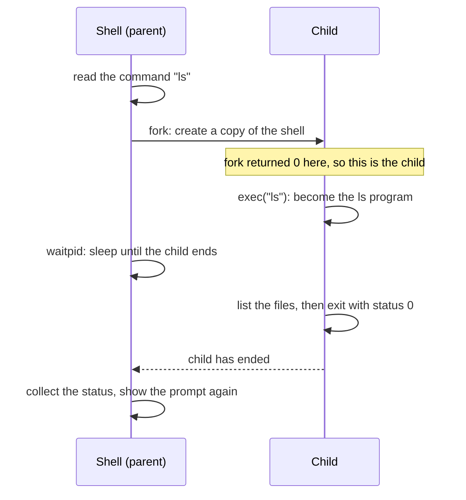

# Linux: history, structure, processes and scheduling

> **Before this lesson:** this is a case study that shows the earlier ideas inside one real system. You should have read [Core concepts, system calls and kernel structure](#/lesson/os/concepts-syscalls-structure), [Processes and threads](#/lesson/os/processes-threads) and [CPU scheduling](#/lesson/os/scheduling).

## In plain words

So far this track has described operating systems in general, the way a biology book describes "the cell". A case study is like looking at one particular animal: you see the general parts again, arranged the way one real creature arranged them.

The creature here is **Linux**. Linux is an operating system *kernel* — the core program that manages processes, memory, files and devices. It runs most of the world's web servers, almost every supercomputer, every Android phone, and a great many routers, televisions and cars.

Linux belongs to a family. In the early 1970s an operating system called **UNIX** was written at a telephone company's research laboratory. Its ideas were so clean that they were copied and reimplemented for fifty years. Linux is one of those reimplementations: it behaves like UNIX but shares none of the original code. Think of a recipe that many cooks have followed in their own kitchens — the dishes are recognisably the same, although each was made separately.

Why it matters for a job: if you write software that runs on a server, it almost certainly runs on Linux. Knowing how Linux creates processes and shares out the processor explains much of what you will see when you deploy, monitor and debug real programs.

## A short history

**UNIX.** In the 1960s a large project called MULTICS tried to build an operating system to serve a whole city. It was too ambitious for the machines of the time. One of its programmers, Ken Thompson, afterwards wrote a much smaller system by himself on a spare minicomputer. A colleague jokingly named it UNICS, later spelt UNIX. Dennis Ritchie joined him and designed a programming language, **C**, for writing it. That was a turning point: before then, operating systems were written in the low-level language of one specific machine and could not be moved to another. A system written in C could be **ported** — adapted to a different kind of computer — by rewriting only a small part.

**Spread and splitting.** The company that owned UNIX licensed its source code to universities cheaply. Students studied it, improved it and took it into industry. The University of California at Berkeley produced an influential variant known as **BSD** (Berkeley Software Distribution), which added, among other things, the networking that the internet was later built on. Companies sold their own incompatible versions.

**Standards.** With many slightly different UNIX systems, a program written for one often would not build on another. A standard called **POSIX** (Portable Operating System Interface) was written to define a common set of system calls. A program that sticks to POSIX runs on any conforming system.

**MINIX and Linux.** When the owner of UNIX stopped allowing its source code to be used for teaching, a professor (the author of the textbook this track follows) wrote a small UNIX-like system called **MINIX** for students. In 1991 a Finnish student, Linus Torvalds, who had been using MINIX, began writing his own kernel and published it on the internet for anyone to use and improve. It was named **Linux**. Thousands of volunteers, and later most large technology companies, contributed. Together with a large collection of free utility programs from the GNU project, it became a complete system.

Linux is released under a licence called the **GPL** (General Public License), which allows anyone to use, study, change and redistribute the code, provided that changed versions that are distributed are offered under the same terms.

## The design philosophy

UNIX was designed by programmers for programmers, and three attitudes run through it.

1. **Simplicity and consistency.** A small number of ideas should cover many cases. The best-known example: nearly everything is treated as a **file** — an ordinary document, a keyboard, a disk, a connection to another program — so that the same few operations (open, read, write, close) work on all of them.
2. **Small tools that combine.** Each program should do one job well. Bigger jobs are done by connecting small programs together, the output of one feeding the input of the next.
3. **No fuss.** Commands are short and say little when they succeed. This is efficient for an expert and can be forbidding for a newcomer.

## The layers



Three interfaces are visible in the picture:

- the **system call interface**, between programs and the kernel;
- the **library interface**, a set of ordinary functions that programs call, most of which make one or more system calls for them;
- the **user interface**, formed by the standard utility programs.

### The shell

The classic user interface is a program called the **shell**: it shows a prompt, reads a line the user types, runs the program named on that line, and repeats. It is an ordinary program with no special privileges.

Two features of the shell show the "combine small tools" philosophy at work.

- **Redirection.** Every program starts with three open connections: **standard input** (where it reads from, normally the keyboard), **standard output** (where it writes results, normally the screen) and **standard error** (where it writes error messages). The shell can attach these to files instead. Writing `sort < names.txt > sorted.txt` makes the `sort` program read from one file and write to another, and the `sort` program itself neither knows nor cares.
- **Pipes.** The symbol `|` connects the standard output of one program directly to the standard input of the next. The line `grep error log.txt | sort | head -5` runs three programs: the first picks out lines containing "error", the second sorts them, the third keeps the first five. A program designed to be used this way, reading input and writing transformed output, is called a **filter**.

The kernel itself is **monolithic**: one large program running entirely in kernel mode. To keep it adaptable, Linux supports **loadable kernel modules** — pieces of kernel code, typically device drivers, that can be added or removed while the system runs.

## Processes in Linux

### Creating processes: fork

Every running program is a **process**, and each has a number identifying it, its **PID** (process identifier).

Linux creates processes in the UNIX way, with a system call named `fork`. It takes no arguments and makes an almost exact copy of the calling process. The original is called the **parent** and the copy the **child**. Both then continue running from the line immediately after the `fork`.

If they are identical, how does each know which one it is? By the value `fork` returns: in the child it returns 0; in the parent it returns the child's PID. Programs test that value and take different paths.

The child usually goes on to run a different program. It does this with a second system call, `exec`, which throws away the process's current program and loads a new one in its place, keeping the same PID. The parent often waits for the child to finish with a third call, `waitpid`, which also delivers the child's **exit status** — a small number the child handed back to report success or failure.

So when you type `ls` in a shell, this happens:



Copying a whole process sounds expensive. It is not, because of **copy-on-write**: parent and child at first share the same memory, marked read-only, and a page is copied only when one of them tries to change it. Since the child usually calls `exec` straight away, almost nothing is ever copied.

### Zombies and orphans

Two odd-sounding words that appear in real system output.

- When a process finishes, the kernel must keep its exit status until the parent asks for it. A process that has finished but has not yet been collected by its parent is called a **zombie**. It uses no memory or processor, only an entry in the kernel's table of processes. A parent that never collects its children accumulates zombies.
- If a parent finishes *before* its child, the child becomes an **orphan**. Linux hands orphans to a special process, the very first one started at boot, whose PID is 1 (traditionally named `init`; on most current systems it is a program called `systemd`). That process collects them when they finish.

The model below imitates the kernel's bookkeeping for these events.

```python-run
class Kernel:
    def __init__(self):
        self.table = {1: {"name": "init", "parent": 0, "state": "running", "status": None}}
        self.next_pid = 2

    def fork(self, parent, name):
        pid, self.next_pid = self.next_pid, self.next_pid + 1
        self.table[pid] = {"name": name, "parent": parent, "state": "running", "status": None}
        return pid

    def exit(self, pid, status):
        self.table[pid].update(state="zombie", status=status)       # finished, waiting to be collected
        for child in self.table.values():                           # its own children become orphans
            if child["parent"] == pid:
                child["parent"] = 1                                 # adopted by process 1

    def wait(self, parent):
        for pid, p in list(self.table.items()):
            if p["parent"] == parent and p["state"] == "zombie":
                del self.table[pid]                                 # entry finally removed
                return pid, p["status"]
        return None

    def show(self, title):
        print(title)
        for pid, p in self.table.items():
            print(f"   pid {pid}  {p['name']:8s} parent {p['parent']}  {p['state']}")

k = Kernel()
shell = k.fork(1, "shell")
editor = k.fork(shell, "editor")
backup = k.fork(shell, "backup")
k.show("three processes started")

k.exit(editor, status=0)
k.show("editor has finished but the shell has not collected it yet")

print("shell calls wait ->", k.wait(shell))
k.exit(shell, status=0)
k.show("shell has exited while backup is still running")
```

**What each part does.**

- `self.table` is the kernel's process table: a dictionary from PID to a small record holding the process's name, its parent's PID, its state and its exit status.
- `fork` gives out the next unused PID and adds a record whose parent is the caller.
- `exit` does not delete the record. It marks it `zombie` and stores the status. It then looks for any children of the process that is exiting and changes their parent to 1.
- `wait` searches for a zombie child of the caller, removes its record and returns its PID and status.

**The output.** After the editor exits, its line shows `zombie` until the shell calls `wait`, which prints `(3, 0)` — PID 3, status 0 — and removes it. When the shell itself exits, `backup`'s parent changes from 2 to 1: it has been adopted. The shell itself is now a zombie waiting for *its* parent, process 1, to collect it.

### Signals

Processes sometimes need to be told that something has happened. Linux does this with **signals**: short notifications, each identified by a number and a name. A few common ones:

| Signal | Meaning |
|---|---|
| SIGINT | The user pressed the interrupt key (Ctrl+C) |
| SIGTERM | A polite request to shut down |
| SIGKILL | Stop immediately; cannot be caught or ignored |
| SIGSEGV | The process used memory it has no right to |
| SIGCHLD | One of the process's children has finished |
| SIGALRM | A timer the process set has expired |

A process can choose what happens when a signal arrives: let the default action occur (usually ending the process), ignore it, or **catch** it by naming a function — a *signal handler* — to be run. Two signals, SIGKILL and SIGSTOP, cannot be caught or ignored, so that there is always a way to stop a misbehaving program.

### Inside the kernel: tasks, and threads as a special case

Inside the kernel each process is described by a record called the **task structure** (in the source code, `task_struct`). It holds everything the kernel knows about the process: its PID, its state, its scheduling details, pointers to its memory map and open files, the signals waiting for it, and so on.

Linux has an unusual and elegant way of handling **threads** (several flows of execution inside one process, sharing memory). The kernel does not treat processes and threads as two different kinds of thing. It has one kind of object, the **task**, and one system call, `clone`, that creates a new task. `clone` takes a set of on/off options saying which resources the new task should **share** with its creator and which it should get its own copy of:

| Option | If set, the new task shares… | If not set, it gets… |
|---|---|---|
| `CLONE_VM` | the same memory | a copy of the memory |
| `CLONE_FILES` | the same open files | a copy of the table of open files |
| `CLONE_FS` | the same working directory | its own |
| `CLONE_SIGHAND` | the same signal handlers | a copy |

Share nothing and the result is what `fork` produces: a separate process. Share everything and the result is a thread. Anything in between is also possible. "Process" and "thread" are two points on a scale.

## Scheduling in Linux

The **scheduler** decides which task gets the processor next. Linux's scheduler works on tasks (so on individual threads), and sorts them into classes.

### Real-time classes

Tasks with urgent timing needs are placed in one of two real-time classes, both of which are always preferred over ordinary tasks.

- **Real-time FIFO** (first in, first out): the highest-priority such task runs until it finishes, blocks, or a higher-priority one becomes ready. It is never interrupted by an equal.
- **Real-time round robin:** the same, except that tasks of equal priority take turns, each for a fixed time slice.

Despite the name, these are not guaranteed to meet deadlines; they are given priority, and that is all.

### Ordinary tasks and "niceness"

Everything else is an ordinary timesharing task. Each has a **nice value** from −20 to +19, default 0. The name is literal: a task with a high nice value is being *nice* to others by accepting less processor time. A lower nice value means a larger share. Ordinary users may only raise the niceness of their tasks; only the administrator may lower it.

### An earlier design: the O(1) scheduler

Linux versions from the early 2000s used a scheduler with an **array of queues, one for each priority level**, plus a small table of bits recording which queues were not empty. Finding the highest-priority ready task meant finding the first set bit and taking the first task from that queue — an amount of work that does not grow with the number of tasks. That property is written **O(1)**, pronounced "order one" or "constant time", and it gave the scheduler its name.

Its weakness was deciding which tasks were *interactive* (waiting on a human, and deserving quick service) and which were not. It guessed from how much each task slept, using rules that grew complicated and sometimes guessed wrongly, producing sluggish desktops.

### The Completely Fair Scheduler

In 2007 it was replaced by the **Completely Fair Scheduler** (CFS), built on one clear idea: *imagine a perfect processor that could run every task at once, each at an equal fraction of full speed. Make the real system resemble that as closely as possible.*

The mechanism:

1. For every task, keep a running total called its **virtual runtime** (`vruntime`): how much processor time it has had so far.
2. Whenever a decision is needed, **run the task with the smallest virtual runtime** — the one that has had least.
3. While a task runs, its virtual runtime grows. Soon it is no longer the smallest, and another task is chosen.

That is all. The effect is that every task's total stays close to every other's, which is what fairness means.

Two refinements complete it.

**Weights.** Niceness is implemented by making virtual runtime grow at different speeds. For a task with default niceness, one millisecond of real running adds one millisecond of virtual runtime. For a task with a low nice value (high priority), each real millisecond adds *less* — its clock runs slowly, so it stays "behind" and keeps being chosen. For a task with a high nice value, each real millisecond adds *more*.

**A fast data structure.** The scheduler must repeatedly find the smallest virtual runtime among all ready tasks. Tasks are kept in a **red-black tree**: a kind of sorted tree that keeps itself balanced, so that inserting or removing a task takes a number of steps proportional to the logarithm of the number of tasks (about 20 steps for a million tasks). The task with the smallest value is always the leftmost one, and the kernel keeps a direct pointer to it.

Interactive tasks are favoured with no guesswork. A task that spends most of its time waiting for the keyboard accumulates very little virtual runtime. When it wakes, its total is far smaller than that of a task that has been computing all along, so it is chosen at once.

```python-run
import heapq

def cfs(tasks, total_time, slice_ms=4):
    """tasks: {name: weight}. Larger weight = larger share. Returns real milliseconds each task ran."""
    ran = {name: 0 for name in tasks}
    tree = [(0.0, name) for name in tasks]        # (virtual runtime, name); the smallest is always first
    heapq.heapify(tree)
    clock = 0
    while clock < total_time:
        vruntime, name = heapq.heappop(tree)      # the task that has had least
        ran[name] += slice_ms
        clock += slice_ms
        vruntime += slice_ms * 1024 / tasks[name] # heavier tasks' virtual clocks run more slowly
        heapq.heappush(tree, (vruntime, name))
    return ran

print("three equal tasks:")
for name, ms in cfs({"A": 1024, "B": 1024, "C": 1024}, 3000).items():
    print(f"   {name}: {ms} ms")

print("one task with double weight, one with half:")
result = cfs({"important": 2048, "normal": 1024, "background": 512}, 7000)
for name, ms in result.items():
    print(f"   {name:11s} {ms:5d} ms  ({ms / 7000:.0%})")
```

**What each part does.**

- `tasks` maps each task's name to a **weight**. In real Linux the weight is derived from the nice value; 1024 is the weight of nice 0.
- `tree` is a list of pairs (virtual runtime, name). `heapq` is a Python module that keeps such a list arranged so that the smallest item can be removed quickly — it stands in for the kernel's red-black tree.
- In each pass of the loop, `heappop` removes the task with the smallest virtual runtime; it "runs" for one slice; its virtual runtime is increased by the slice multiplied by `1024 / weight`; and it is put back.
- Dividing by the weight is the whole trick: a task of weight 2048 has its virtual runtime grow at half speed, so it needs twice as much real time to "catch up" with the others.

**The output.** Three equal tasks each receive 1,000 ms. With weights 2048, 1024 and 512, the shares come out at about 4,000, 2,000 and 1,000 ms — in the same 4 : 2 : 1 proportion as the weights. Nobody is starved: even the background task runs regularly, because its virtual runtime eventually becomes the smallest.

On machines with several processors, each processor has its own tree of ready tasks. The kernel prefers to keep a task on the processor it last used, because that processor's cache still holds the task's data, and periodically moves tasks from busy processors to idle ones to balance the load.

> [!INTERVIEW]
> "How does the Linux scheduler work?" For ordinary tasks, the Completely Fair Scheduler keeps each task's weighted *virtual runtime* and always runs the task with the smallest, using a red-black tree for O(log n) insertion and O(1) access to the leftmost node. Nice values set weights that scale how fast virtual runtime accumulates. Interactive tasks sleep a lot, accumulate little, and are therefore picked promptly on waking. Real-time FIFO and round-robin classes take precedence over all of this. Also be able to explain `fork`/`exec`/`wait`, zombies and orphans, and that Linux threads are tasks created by `clone` that share memory.

## Starting the system

For completeness, the sequence when a Linux machine is switched on:

1. **Firmware** built into the machine tests the hardware and loads a small program called a **boot loader** from disk.
2. The boot loader loads the **kernel** into memory and starts it.
3. The kernel sets up its own tables, works out what hardware is present, and starts the device drivers.
4. It creates the first process by hand — **process 1**.
5. Process 1 reads its configuration and starts the system's background services, called **daemons**, and finally the programs that let users log in.

## Common mistakes and confusions

- **"Linux is UNIX."** It behaves like UNIX and follows the same standards, but was written independently.
- **"Linux is a whole operating system."** Strictly it is the kernel; a usable system adds libraries, a shell and utilities.
- **"fork starts a new program."** `fork` duplicates the caller; `exec` is what loads a different program.
- **"A zombie is using resources."** Only a table entry. The problem is the parent that never collects it.
- **"A higher nice value means higher priority."** The reverse: a nicer task takes less.
- **"Real-time class means guaranteed deadlines."** It means priority over ordinary tasks, nothing more.

## Summary

- **Linux** is an independently written, open-source kernel in the **UNIX** tradition, following the **POSIX** standard.
- Its philosophy: few general ideas (everything is a file), small tools combined with **redirection** and **pipes**, and a **monolithic** kernel extended by **loadable modules**.
- Processes are created with **fork** (copy, made cheap by copy-on-write), changed with **exec**, and collected with **waitpid**. Unfinished business produces **zombies** and **orphans**. **Signals** notify processes of events.
- The kernel has one kind of object, the **task**; **clone** creates tasks that share as much or as little as requested, so threads are tasks that share memory.
- Scheduling: **real-time FIFO** and **round-robin** classes first; ordinary tasks under the **Completely Fair Scheduler**, which always runs the task with the smallest weighted **virtual runtime**, kept in a **red-black tree**.

## Glossary

- **Kernel** — the core of an operating system, running with full privilege.
- **UNIX** — the influential operating system from the 1970s whose design Linux follows.
- **C** — the programming language created for writing UNIX.
- **Port** — to adapt software to run on a different kind of computer.
- **BSD** — the University of California at Berkeley's variant of UNIX.
- **POSIX** — a standard defining a common set of system calls for UNIX-like systems.
- **GPL** — the licence under which Linux is distributed.
- **Shell** — the program that reads commands and runs them.
- **Standard input / output / error** — the three connections every program starts with.
- **Redirection** — attaching a program's input or output to a file.
- **Pipe** — a connection carrying one program's output to another's input.
- **Filter** — a program that reads input, transforms it and writes output.
- **Loadable kernel module** — kernel code that can be added while the system runs.
- **PID** — the number identifying a process.
- **fork / exec / waitpid** — system calls to copy the current process / replace its program / wait for a child.
- **Exit status** — a small number a finishing process reports to its parent.
- **Copy-on-write** — sharing memory until one side changes it, and only then copying.
- **Zombie** — a finished process whose parent has not yet collected its status.
- **Orphan** — a process whose parent has finished.
- **Signal** — a short notification delivered to a process.
- **Task** — the kernel's single kind of schedulable object, covering both processes and threads.
- **clone** — the system call that creates a task with chosen sharing.
- **Nice value** — a number from −20 to +19 adjusting a task's share of the processor.
- **Virtual runtime** — a task's weighted total of processor time received.
- **Completely Fair Scheduler (CFS)** — the Linux scheduler that always runs the task with the smallest virtual runtime.
- **Red-black tree** — a self-balancing sorted tree.
- **Daemon** — a background service.

## Check yourself

```quiz
[
  {"q": "What made UNIX unusually easy to move to different kinds of computers?",
   "options": ["It was very small", "It was written mostly in the C language instead of the low-level language of one specific machine", "It needed no memory", "It had no device drivers"],
   "answer": 1,
   "explain": "A system written in a high-level language can be ported by recompiling and rewriting only the small machine-dependent part."},
  {"q": "What does the shell command line 'grep error log.txt | sort' do?",
   "options": ["Runs grep, then deletes log.txt", "Connects the output of grep directly to the input of sort", "Runs sort first and then grep", "Saves the output of sort in a file called grep"],
   "answer": 1,
   "explain": "The vertical bar creates a pipe: the first program's standard output becomes the second program's standard input."},
  {"q": "After a successful fork, what value does fork return in the child process?",
   "options": ["The parent's PID", "The child's own PID", "0", "-1"],
   "answer": 2,
   "explain": "The child sees 0 and the parent sees the child's PID. That difference is how each discovers which one it is."},
  {"q": "Why is fork cheap even for a process with a great deal of memory?",
   "options": ["The memory is compressed", "Copy-on-write: parent and child share pages until one of them writes, and only that page is then copied", "The child has no memory", "The kernel skips the copy on weekends"],
   "answer": 1,
   "explain": "Since the child usually calls exec almost immediately, very few pages are ever actually copied."},
  {"q": "A process has finished, but its parent has not yet called wait. What is the process called?",
   "options": ["An orphan", "A daemon", "A zombie", "A thread"],
   "answer": 2,
   "explain": "The kernel keeps a table entry holding the exit status until the parent collects it. In that state the process is a zombie."},
  {"q": "In Linux, how is a thread created at the kernel level?",
   "options": ["With a completely separate kind of kernel object", "With clone, asking for the new task to share memory and other resources with its creator", "By calling exec twice", "Threads cannot be created in Linux"],
   "answer": 1,
   "explain": "Linux has one kind of schedulable object, the task. Options to clone decide what is shared; sharing the address space produces a thread."},
  {"q": "Which task does the Completely Fair Scheduler choose to run next?",
   "options": ["The one that has waited longest in real time", "The one with the smallest virtual runtime", "The one with the highest nice value", "A random one"],
   "answer": 1,
   "explain": "Virtual runtime measures (weighted) processor time already received. Running whoever has least keeps everyone's totals close together."},
  {"q": "Two tasks compete for one processor. Task X has weight 3072 and task Y has weight 1024. About what share does X receive?",
   "options": ["25%", "50%", "75%", "100%"],
   "answer": 2,
   "explain": "Shares are proportional to weights: 3072 / (3072 + 1024) = 3/4."}
]
```

> **Source:** Tanenbaum & Bos, Modern Operating Systems 4e, §10.1 (History of UNIX and Linux), §10.2 (Overview of Linux), §10.3 (Processes in Linux)
