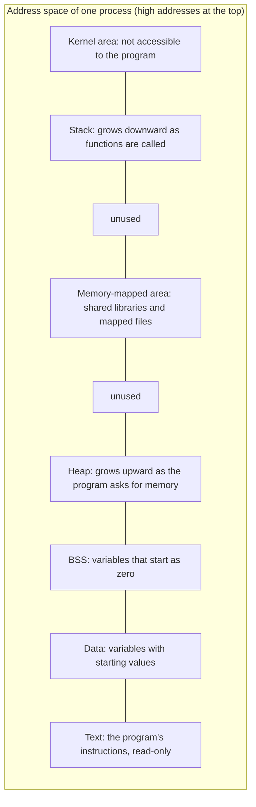

# Linux: memory, I/O, file systems and security

> **Before this lesson:** read the first half of this case study, [Linux: history, structure, processes and scheduling](#/lesson/os/linux-processes). You will also need the general ideas from [Virtual memory: paging, page tables and TLBs](#/lesson/os/paging-tlb), [Page replacement algorithms](#/lesson/os/page-replacement), [File-system implementation](#/lesson/os/fs-implementation) and [I/O hardware and the layers of I/O software](#/lesson/os/io-hardware-software).

## In plain words

The previous lesson looked at how Linux runs programs and shares out the processor. A program also needs somewhere to keep its data while running (**memory**), a way to talk to the outside world (**input and output**, written I/O), somewhere to keep data permanently (a **file system**), and rules about who may touch what (**security**).

A useful picture is a large workshop. Memory is the workbench space, which must be shared among the workers and tidied when it fills up. I/O is the loading dock, where goods of every shape arrive and leave. The file system is the storeroom with its shelves and its catalogue. Security is the key cabinet, which records who may open which door.

This lesson walks through how Linux handles each of those four, using the general ideas from earlier modules. The next lesson then shows how **Android**, the phone system, builds a very different world on top of the same kernel.

Why it matters for a job: when a server "runs out of memory", when a disk is slow, when a file cannot be opened because of permissions — these are everyday problems, and diagnosing them requires knowing roughly what Linux is doing underneath.

## Memory management

### What a process's memory looks like

Each Linux process has its own private **address space**: a long range of numbered memory locations that only it can see. The space is divided into regions, each with a purpose.



- **Text** holds the program's machine instructions. It is read-only, so several processes running the same program can share one copy.
- **Data** holds variables that have a starting value written in the program.
- **BSS** holds variables that start as zero. The program file need only record how large this region is; the zeros themselves are not stored on disk. (The odd name is a historical abbreviation.)
- The **heap** is where a program gets memory it asks for while running. It grows upward. The system call that moves its upper boundary is named `brk`.
- The **stack** holds the working data of the functions currently being executed. It grows downward and is extended automatically.
- Between heap and stack is room for **memory-mapped** regions, explained next.

### Mapping files into memory

The system call `mmap` ("memory map") asks the kernel to make a file appear as a region of the process's address space. After that, reading the memory reads the file, and writing the memory changes the file. Nothing is copied at the time of the call: each page of the file is brought in from disk only when first touched.

This single mechanism does a great deal of work in Linux:

- **Shared libraries** — collections of code used by many programs — are mapped into every process that needs them, and all those processes share one copy in physical memory.
- **Program loading** itself is done this way: starting a program maps its file, and pages are read from disk only as they are used.
- Two processes that map the same file can exchange data through it.
- A program can also ask for an **anonymous** mapping, backed by no file, to obtain a large block of fresh memory.

### Page tables

Linux uses **paging**: memory is divided into fixed-size **pages** (normally 4 kilobytes), and a **page table** per process records which page of real memory, if any, holds each page of the address space. On 64-bit machines the table has four (on the newest, five) levels, so that only the parts describing memory actually in use need to exist. Linux can also use much larger pages — 2 megabytes or 1 gigabyte — for programs that handle huge amounts of data, which reduces the load on the processor's cache of translations (the TLB).

### Handing out physical memory: the buddy system

The kernel must keep track of which pages of real memory are free. It often needs several pages *next to each other*, so it must be able to find runs of consecutive free pages quickly and to join neighbouring free pages back together. Linux uses the **buddy algorithm**.

The idea: free memory is kept in blocks whose sizes are powers of two — 1 page, 2, 4, 8, 16 and so on. To satisfy a request:

1. Round the request up to the next power of two.
2. If a free block of that size exists, use it.
3. If not, take a larger block and split it in half. The two halves are called **buddies**. Use one half (splitting again if it is still too big) and keep the other as a free block.

When a block is released, the kernel checks whether its buddy is also free. If so, the two are merged back into one block of double the size, and the check is repeated at the next size up.

```python-run
class Buddy:
    def __init__(self, total_pages):
        self.total = total_pages
        self.free = {total_pages: [0]}          # block size -> list of starting page numbers
        self.used = {}                          # starting page -> block size

    def alloc(self, pages):
        size = 1
        while size < pages:                     # round up to a power of two
            size *= 2
        candidate = size
        while candidate <= self.total and not self.free.get(candidate):
            candidate *= 2                      # look for the smallest free block that is big enough
        if candidate > self.total:
            return None
        start = self.free[candidate].pop(0)
        while candidate > size:                 # split until the block is the right size
            candidate //= 2
            self.free.setdefault(candidate, []).append(start + candidate)   # the upper half stays free
        self.used[start] = size
        return start

    def release(self, start):
        size = self.used.pop(start)
        while size < self.total:
            buddy = start ^ size                # the buddy's address differs in exactly one bit
            if buddy not in self.free.get(size, []):
                break
            self.free[size].remove(buddy)       # merge with the buddy
            start = min(start, buddy)
            size *= 2
        self.free.setdefault(size, []).append(start)

    def show(self, label):
        blocks = {size: sorted(starts) for size, starts in sorted(self.free.items()) if starts}
        print(f"{label:28s} free blocks {blocks}")

b = Buddy(16)
b.show("start: 16 pages")
a = b.alloc(3);  b.show(f"alloc 3 pages -> page {a}")
c = b.alloc(2);  b.show(f"alloc 2 pages -> page {c}")
b.release(a);    b.show("release the first block")
b.release(c);    b.show("release the second block")
```

**What each part does.**

- `self.free` records the free blocks, grouped by size. At the start there is one block of 16 pages beginning at page 0.
- `alloc` rounds the request up (3 becomes 4), finds the smallest free block that is large enough, and splits it repeatedly. At each split the lower half is kept for further use and the upper half (`start + candidate`) is added to the free list for its size.
- `release` looks for the block's buddy. The expression `start ^ size` flips one bit of the address, which gives the address of the other half of the pair. If the buddy is free, the two are merged and the loop tries again with the doubled block.
- `show` prints the free blocks by size.

**The output.** Asking for 3 pages splits 16 into 8 + 8, then one 8 into 4 + 4, and hands out pages 0–3; free blocks of 4 and 8 remain. Asking for 2 pages splits the free 4 into 2 + 2. Releasing the first block cannot merge yet, because its buddy (pages 4–7) is partly in use. Releasing the second lets everything merge back: 2 + 2 → 4, 4 + 4 → 8, 8 + 8 → 16.

The weakness of the buddy system is waste *inside* blocks: a request for 3 pages uses 4, and one for 65 uses 128. This is called **internal fragmentation**.

### Small objects: the slab allocator

The kernel constantly creates and destroys small records of fixed sizes — a record for each process, for each open file, and so on. Using whole pages for these would waste most of each page. On top of the buddy system, Linux therefore runs a **slab allocator**: it takes pages from the buddy system, cuts each into equal slots for one particular kind of record, and hands the slots out one at a time. Freed slots are kept ready for reuse, already set up, which is faster than starting from scratch each time.

### The page cache and reclaiming memory

Reading from a disk is thousands of times slower than reading from memory. So Linux keeps copies of recently used file data in memory, in what is called the **page cache**. If the same data is needed again, it is already there. As a result a healthy Linux system shows very little "free" memory: unused memory would be wasted memory, so it is put to work as cache. This surprises newcomers, who think the machine is running out; the cache is given up instantly when programs need the space.

When memory does run short, the kernel must choose pages to take back. A background kernel task named **kswapd** does this before the situation becomes urgent. Linux keeps the pages in two lists:

- the **active list**: pages that have been used recently and more than once;
- the **inactive list**: pages that have not been used lately — the candidates for removal.

A page newly brought in starts on the inactive list. If it is used again, it is promoted to the active list. Pages on the active list that go unused drift back to the inactive list. Pages are taken from the far end of the inactive list. The point of having two lists is that a page must be used *twice* to earn protection, so that a single pass through a huge file does not push out pages that are in steady use.

A page that has been changed must be written to disk before its memory is reused. Pages that belong to a file go back to that file. Pages that belong to no file — a program's heap or stack — are written to a reserved area of disk called **swap space**.

If everything fails and memory is exhausted, the kernel's last resort is the **out-of-memory killer**, which picks a process — preferring one that is using a great deal of memory — and terminates it to save the rest of the system.

```python-run
from collections import OrderedDict

class TwoLists:
    def __init__(self, capacity):
        self.capacity = capacity
        self.active, self.inactive = OrderedDict(), OrderedDict()
        self.evicted = []

    def touch(self, page):
        if page in self.active:
            self.active.move_to_end(page)            # still in use: refresh its position
        elif page in self.inactive:
            del self.inactive[page]                  # used a second time: promote
            self.active[page] = True
        else:
            self.inactive[page] = True               # first use: start on the inactive list
        while len(self.active) > self.capacity // 2: # keep the active list from taking everything
            old, _ = self.active.popitem(last=False)
            self.inactive[old] = True
        while len(self.active) + len(self.inactive) > self.capacity:
            victim, _ = self.inactive.popitem(last=False)
            self.evicted.append(victim)

memory = TwoLists(capacity=8)
for page in ["db1", "db2", "db1", "db2"]:            # two pages used repeatedly
    memory.touch(page)
for i in range(12):                                  # then a big file is read once, start to end
    memory.touch(f"file{i}")

print("active  :", list(memory.active))
print("inactive:", list(memory.inactive))
print("evicted :", memory.evicted)
```

**What each part does.** Each list is an `OrderedDict`, a table that remembers the order in which items were added. `touch` handles a use of a page: a page on the active list is moved to the fresh end; a page on the inactive list is promoted; an unknown page starts on the inactive list. The two `while` loops keep the active list to at most half the memory and evict from the old end of the inactive list when memory is full.

**The output.** The two database pages, each used twice, sit on the active list and survive. The twelve file pages, each used once, pass through the inactive list, and the oldest ones are evicted. A single list ordered by last use would have thrown the database pages out.

## Input and output

### Devices as files

Linux carries the "everything is a file" idea through to hardware. Each device appears as an entry in the directory `/dev`, called a **special file**. A program opens it, reads and writes it like any file, and the kernel passes the requests to the right device driver.

There are two kinds:

- **Block special files** stand for devices that store data in numbered blocks that can be read in any order, such as disks.
- **Character special files** stand for devices that produce or accept a stream of bytes, such as keyboards and printers.

Each special file carries two numbers. The **major number** identifies the driver. The **minor number** tells that driver which particular device is meant — the second disk, say.

Operations that do not fit the read/write pattern, such as changing a terminal's settings, go through a catch-all system call named `ioctl` (I/O control).

### Networking

Network communication uses an object called a **socket**, originally from BSD UNIX. A socket is one end of a conversation between two programs, possibly on different computers. A program creates a socket and receives a file descriptor for it, so the usual read and write calls work on it. A server program *listens* on a socket for incoming connections; a client program *connects* to it.

### Scheduling disk requests

Between the file system and the disk drivers sits the **block layer**, which collects requests to read and write disk blocks. It merges requests for neighbouring blocks and decides the order in which to send them to the device. Linux provides several interchangeable **I/O schedulers**. For spinning disks, some reorder requests to reduce movement of the read/write arm while guaranteeing that no request waits beyond a deadline. For solid-state drives, which have no moving parts, the usual choice does almost no reordering.

## File systems

### The ext family

Linux's long-standing native file system is **ext2** (the second extended file system), followed by ext3 and ext4, each built on the last.

**Layout.** An ext2 disk is divided into **block groups**. Each group contains its own copy of key information, a map of which of its blocks are free, a map of which of its i-nodes are free, a table of i-nodes, and the data blocks. Dividing the disk this way keeps a file's data near the record that describes it, which reduces arm movement on spinning disks. An important table called the **superblock**, describing the whole file system, is duplicated in several groups, so that damage to one copy is survivable.

**I-nodes.** As in the general file-system lessons, each file is described by an **i-node**: a fixed-size record holding the file's owner, permissions, size, times, and the locations of its data blocks. It does *not* hold the file's name.

**Directories.** A directory is itself a file. Its contents are a list of entries, each pairing a **name** with an **i-node number**. Names live only in directories. This is why one file can have several names: several entries may give the same i-node number. Each such entry is a **hard link**, and the i-node counts how many there are; the file's storage is released when the count reaches zero and no program has the file open.

**ext3** added a **journal**. Before changing its structures, the file system first writes a note describing the intended changes. After a crash, the notes are replayed, bringing the structures to a consistent state in seconds instead of requiring a check of the whole disk.

**ext4** added, among other things, **extents**. Instead of listing every block of a file individually, an extent says "this file occupies 5,000 consecutive blocks starting at block 80,000". Large files are described far more compactly and are read faster.

### The virtual file system

Linux supports dozens of different file systems — its own, those of other operating systems, ones on other machines reached over a network. Programs use the same system calls for all of them. The layer that makes this possible is the **virtual file system** (VFS). It defines four kinds of object, and every real file system must supply the functions that operate on them:

| Object | Represents |
|---|---|
| **Superblock** | One mounted file system |
| **I-node** | One file |
| **Dentry** (directory entry) | One component of a path name, linking a name to an i-node |
| **File** | One *opening* of a file by a process, including the current position |

Looking up path names is so frequent that the kernel keeps recently used dentries in memory, in the **dentry cache**, so that the directories along a common path need not be read from disk again.

### Files that are not on disk

Some Linux "file systems" store nothing. The directory `/proc` contains files generated at the moment they are read, showing information about the kernel and about each running process. Reading one of them is a way of asking the kernel a question. This is the same "everything is a file" principle, applied to the system's own internals.

### Network file systems

**NFS** (Network File System) lets a directory stored on one machine, the *server*, be attached to the directory tree of another, the *client*, so that programs use remote files exactly as if they were local.

## Security

### Users, groups and the permission bits

Every user has a number, the **user ID** (UID). Users can belong to groups, each with a **group ID** (GID). One user ID, **0**, is special: it belongs to the administrator, traditionally named **root**, to whom the ordinary permission checks do not apply.

Each file records its owner's UID, a GID, and nine permission bits: permission to **r**ead, **w**rite and e**x**ecute, given separately to the owner, to members of the file's group, and to everyone else. They are written as three groups of three letters, for example `rwxr-x---` (the owner may do everything; the group may read and execute; others may do nothing), or as three digits in base eight, where read counts 4, write 2 and execute 1: `750` for the same example.

For a directory the bits mean something slightly different: read permits listing the names in it, write permits adding and removing entries, and execute permits passing through it on the way to something inside.

When a process tries to use a file, the kernel decides which **one** of the three groups of bits applies — owner, group, or other, in that order — and looks only at that group.

### Borrowing privilege: setuid

Sometimes an ordinary user must do something that requires more permission than they have. The classic example is changing your own password, which means altering a file that ordinary users must not be able to write. The UNIX answer is the **setuid bit**. A program file marked with it runs with the permissions of the file's *owner*, not of the person who started it. The password program is owned by root and marked setuid, so that while it runs — and only then — it may update the password file.

The price is risk. A setuid-root program has complete power, and any bug in it may hand that power to whoever runs it. Such programs are kept few, small and carefully checked. Newer Linux versions can split root's power into separate **capabilities** (permission to bind to certain network ports, permission to change file ownership, and so on) so that a program can be given only the single power it needs.

```python-run
def can(mode, file_uid, file_gid, uid, gids, wanted):
    """Does a process with user id `uid` and group ids `gids` have every right in `wanted`?"""
    if uid == 0:
        return True                                   # root bypasses the checks (simplified)
    if uid == file_uid:
        bits = (mode >> 6) & 7                        # owner's three bits
    elif file_gid in gids:
        bits = (mode >> 3) & 7                        # group's three bits
    else:
        bits = mode & 7                               # everyone else's three bits
    value = {"r": 4, "w": 2, "x": 1}
    return all(bits & value[letter] for letter in wanted)

def as_text(mode):
    return "".join(letter if mode & (1 << (8 - i)) else "-" for i, letter in enumerate("rwxrwxrwx"))

mode = 0o640                                          # a report owned by user 1000, group 50
print("permissions:", as_text(mode))
print("owner reads and writes :", can(mode, 1000, 50, 1000, [50], "rw"))
print("group member reads     :", can(mode, 1000, 50, 1001, [50], "r"))
print("group member writes    :", can(mode, 1000, 50, 1001, [50], "w"))
print("a stranger reads       :", can(mode, 1000, 50, 1002, [60], "r"))

print("\nA file with mode", as_text(0o077), "- the owner is shut out although everyone else is allowed:")
print("owner reads   :", can(0o077, 1000, 50, 1000, [50], "r"))
print("stranger reads:", can(0o077, 1000, 50, 1002, [60], "r"))
```

**What each part does.**

- `mode` is the nine permission bits as a number. `0o640` is Python's way of writing 640 in base eight.
- `(mode >> 6) & 7` shifts the number right by six bit positions and keeps the lowest three bits — which extracts the owner's group of three. Shifting by three gives the group's bits; no shift gives the "everyone else" bits.
- The `if / elif / else` chain picks exactly one of the three groups.
- `bits & value[letter]` tests one permission bit; `all(...)` requires every requested letter to be allowed.
- `as_text` turns the number into the familiar `rw-r-----` form.

**The output.** The owner may read and write; a group member may read but not write; a stranger may do nothing. The last two lines show a consequence that surprises people: with mode `---rwxrwx` the owner is refused, although a complete stranger is allowed, because the owner's own three bits are the only ones consulted for the owner.

> [!INTERVIEW]
> Favourite Linux questions from this lesson: *"Why does Linux show almost no free memory?"* — unused memory holds the page cache and is released on demand. *"What happens when memory runs out?"* — the kernel reclaims cache and inactive pages, swaps, and finally the out-of-memory killer ends a process. *"What is an i-node?"* — the record of a file's metadata and block locations; names live in directories, which is why hard links work. *"What does setuid do?"* — the program runs with its owner's identity. *"What does mode 754 mean?"* — owner rwx, group r-x, others r--.

## Looking ahead: Android

Android, the most widely used phone operating system, runs on this same Linux kernel but builds a very different world on top of it. It reuses the features from this lesson in new ways: every app gets its *own* user ID, so the ordinary permission bits above keep apps out of each other's files; and the out-of-memory killer, a last resort on a server, becomes a routine tool that quietly removes background apps. Android also adds a few things to the kernel, such as the Binder mechanism for calls between processes and wake locks for saving battery. All of this is covered in the next lesson, [Android: runtime, Zygote, Binder, apps and their lifecycle](#/lesson/os/android).

## Common mistakes and confusions

- **"Free memory is low, so the system is in trouble."** Low free memory is normal; the page cache is using it and will give it back.
- **"The file name is stored in the i-node."** Names are stored in directories; the i-node holds everything else.
- **"Permissions add up."** Exactly one group of three bits applies to any given process.
- **"Execute permission on a directory means running it."** It means permission to pass through it.
- **"setuid gives the user root powers."** It gives one *program* its owner's powers while it runs.

## Summary

- A process's address space has **text**, **data**, **BSS**, **heap**, **stack** and **memory-mapped** regions; `mmap` maps files (including shared libraries) into it on demand.
- Physical pages are managed by the **buddy algorithm**, with a **slab allocator** on top for small kernel objects. The **page cache** uses spare memory for file data; **kswapd** reclaims pages using **active** and **inactive** lists; the **out-of-memory killer** is the last resort.
- Devices are **special files** (block or character) with **major** and **minor** numbers; networking uses **sockets**; the block layer applies an **I/O scheduler**.
- **ext2** uses block groups, i-nodes and name-to-i-node directories; **ext3** adds a **journal**; **ext4** adds **extents**. The **VFS** unifies all file systems through superblock, i-node, dentry and file objects; `/proc` exposes kernel information as files.
- Security rests on **UIDs**, **GIDs** and nine **permission bits**, with **setuid** and finer-grained **capabilities** for controlled privilege.
- **Android** builds on the same kernel, reusing UIDs to isolate apps; it is the subject of the next lesson.

## Glossary

- **Address space** — the range of memory locations visible to one process.
- **Text / data / BSS** — regions holding instructions / variables with starting values / variables that start as zero.
- **Heap** — the region from which a running program obtains extra memory.
- **Stack** — the region holding the working data of functions in progress.
- **mmap** — the system call that maps a file (or fresh memory) into the address space.
- **Shared library** — code used by many programs and kept in memory once.
- **Buddy algorithm** — managing free memory in power-of-two blocks that are split and merged in pairs.
- **Internal fragmentation** — memory wasted inside an allocated block.
- **Slab allocator** — a layer that divides pages into equal slots for small kernel objects.
- **Page cache** — file data kept in memory to avoid disk reads.
- **kswapd** — the kernel task that reclaims memory in the background.
- **Active / inactive list** — pages in regular use / pages that are candidates for removal.
- **Swap space** — disk space used to hold pages that belong to no file.
- **Out-of-memory killer** — the kernel mechanism that ends a process when memory is exhausted.
- **Special file** — an entry in `/dev` that stands for a device.
- **Major / minor number** — which driver / which device of that driver.
- **Socket** — one end of a network conversation.
- **I/O scheduler** — the component that orders requests to a storage device.
- **Block group** — a section of an ext2 disk with its own maps, i-nodes and data blocks.
- **Superblock** — the record describing a whole file system.
- **I-node** — the record describing one file, apart from its name.
- **Hard link** — a directory entry referring to an i-node.
- **Journal** — a log of intended changes, used to recover after a crash.
- **Extent** — a description of a run of consecutive blocks.
- **Virtual file system (VFS)** — the layer giving all file systems one interface.
- **Dentry** — the kernel's record linking one name in a path to an i-node.
- **Root** — the administrator account, user ID 0.
- **setuid bit** — a mark on a program file making it run with its owner's identity.

## Check yourself

```quiz
[
  {"q": "A Linux server shows that nearly all its memory is 'used' while the programs running on it are small. What is the most likely explanation?",
   "options": ["A memory leak in the kernel", "The page cache is holding recently used file data, which will be released when programs need memory", "The swap space is full", "The buddy allocator has failed"],
   "answer": 1,
   "explain": "Linux deliberately uses spare memory to cache file data. That memory is reclaimed on demand, so it is not a sign of shortage."},
  {"q": "The buddy allocator receives a request for 5 pages. How many pages does it hand out, and what is the waste called?",
   "options": ["5 pages, no waste", "6 pages, external fragmentation", "8 pages, internal fragmentation", "16 pages, swap"],
   "answer": 2,
   "explain": "Requests are rounded up to the next power of two, here 8. The 3 unused pages inside the block are internal fragmentation."},
  {"q": "Why does Linux keep both an active and an inactive list of pages?",
   "options": ["To double the amount of memory", "So that a page must be used more than once to be protected, preventing a single pass through a large file from pushing out pages in steady use", "Because disks have two sides", "To separate kernel pages from user pages"],
   "answer": 1,
   "explain": "New pages start on the inactive list and are promoted only on a second use. Pages read once flow through and are evicted first."},
  {"q": "What do the major and minor numbers of a special file identify?",
   "options": ["The file's owner and group", "The driver, and the particular device handled by that driver", "The block size and the block count", "The file's size and age"],
   "answer": 1,
   "explain": "The major number selects the driver; the minor number is passed to that driver to select the unit."},
  {"q": "Where is a file's name stored in an ext file system?",
   "options": ["In the i-node", "In the superblock", "In a directory entry that pairs the name with an i-node number", "In the journal"],
   "answer": 2,
   "explain": "The i-node holds everything about the file except its name. Because names are in directories, several names can refer to one i-node."},
  {"q": "What did ext3 add to ext2?",
   "options": ["Extents", "A journal, so that the file system can be brought to a consistent state quickly after a crash", "Encryption of all files", "Support for long file names"],
   "answer": 1,
   "explain": "Journaling records intended changes first and replays them after a crash. Extents came later, with ext4."},
  {"q": "A file has mode 640, owner UID 1000 and group GID 50. A process with UID 1001 belonging to group 50 tries to write it. What happens?",
   "options": ["Allowed, because 6 includes write", "Refused, because the group's bits are 4 (read only)", "Allowed, because the process is in the group", "Refused, because only root may write files"],
   "answer": 1,
   "explain": "The process is not the owner but is in the group, so the middle digit applies. 4 means read only."}
]
```

> **Source:** Tanenbaum & Bos, Modern Operating Systems 4e, §10.4 (Memory management in Linux), §10.5 (Input/output in Linux), §10.6 (The Linux file system), §10.7 (Security in Linux)
