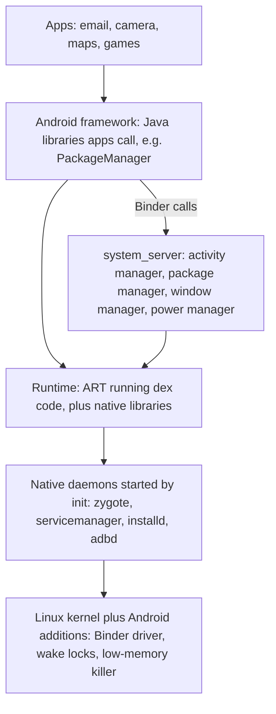
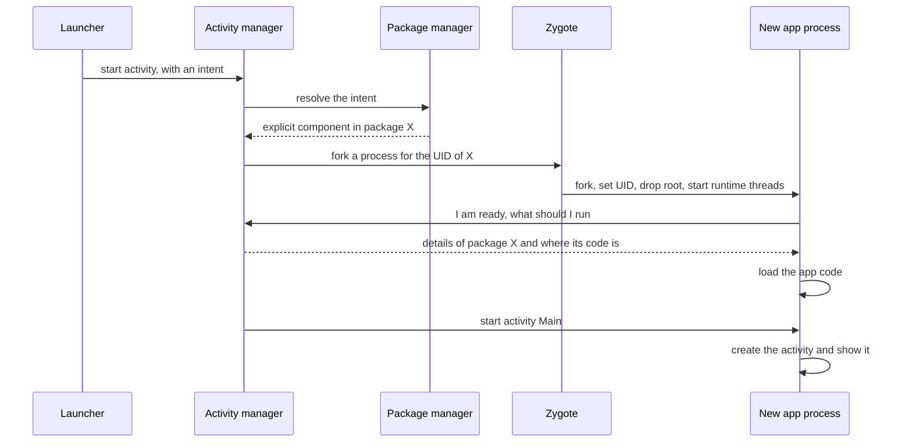

# Android: runtime, Zygote, Binder, apps and their lifecycle

> **Before this lesson:** read both halves of the Linux case study, [Linux: history, structure, processes and scheduling](#/lesson/os/linux-processes) and [Linux: memory, I/O, file systems and security](#/lesson/os/linux-memory-io-fs). Android reuses the ideas taught there: `fork`, copy-on-write, user IDs, file permissions and the out-of-memory killer. The general background is in [Processes and threads](#/lesson/os/processes-threads), [Semaphores, monitors, message passing and the classic problems](#/lesson/os/semaphores-monitors-messages) and [Threat models, access control and formal models](#/lesson/os/security-access-control).

## In plain words

**Android** is the operating system on most of the world's phones and tablets. Underneath it sits an ordinary Linux kernel. Everything above the kernel, however, looks very little like a Linux desktop or server: there is no login prompt, no shell window, no "quit" button, and the programs (called **apps**) come from thousands of strangers.

A good everyday picture is a large shared office building run by a strict building manager. Each company (each app) gets its own locked suite and cannot walk into another company's rooms. Companies that want to work together do not shout through the walls; they send sealed envelopes through the building's internal mail room, which stamps every envelope with the sender's name so it cannot be forged. When the building gets crowded, the manager quietly moves out the companies nobody has visited for a while, after making sure each one left a note saying exactly where it was in its work, so it can be moved back in later as if nothing had happened.

In that picture, the locked suites are Android's **per-app sandboxes**, the mail room is **Binder**, and the manager is a system service called the **activity manager**, helped by the kernel's **low-memory killer**.

Why it matters for a job: mobile developers meet these ideas every day — an app's screen being destroyed and recreated, a background task being stopped to save battery, a permission dialog, an "app not responding" report. Systems interviews also like Android because it shows how one kernel can serve a completely different purpose by using its familiar features in new ways.

## Why a phone needs a different design

The Linux you met in the previous two lessons was shaped by servers and desktops. A phone breaks several of their assumptions.

- **One person, many untrusted programs.** A desktop protects users from *each other*. A phone usually has a single owner, but the apps on it are written by strangers. The real danger is a program misusing the owner's own data. Android's starting principle is that an app is a *guest* on the device: it is trusted with nothing sensitive unless the owner has agreed.
- **A battery.** The device should be in deep sleep whenever nothing useful is happening, yet still ring for an incoming call.
- **Little memory and no swap.** Phones normally have no **swap space** (disk space used to hold pages pushed out of memory), because flash storage wears out when written heavily and is slower than memory. So the operating system cannot ease a memory shortage by paging out data that a program has changed.
- **Short visits.** People glance at a message, reply in one sentence, and switch to the camera. Starting an app has to feel instant; the designers aimed at about a fifth of a second for a basic app to show a usable screen.
- **No "quit".** Users should not have to manage running programs. The system decides what stays in memory and what is removed.
- **Apps that cooperate.** A camera app should be able to hand a photo to an email app without either one knowing the other in advance.

Every design choice in the rest of this lesson answers one of these six points.

## The architecture: Linux underneath, Java above



**The kernel.** A largely standard Linux kernel, with a handful of additions described later in this lesson.

**`init` and the native daemons.** As on any Linux system, the first user-space process is `init`, the ancestor of every other process. Android's `init` starts a different set of **daemons** (background programs with no user interface), focused on low-level jobs:

- `servicemanager` — a directory where system services register under well-known names, so that apps can find them;
- `installd` — a small privileged helper that creates and deletes the private storage folders of apps;
- `adbd` — the debugging daemon, which hands out a shell to a developer connected over USB (phones have no console, so this is the only way to get a command line);
- `zygote` — the parent of every Java-language process, explained in its own section below.

**`system_server`.** The first process Zygote starts. It contains most of the operating system's services, written in Java: the **activity manager** (decides which app components run, and when), the **package manager** (knows every installed app), the **window manager** (arranges what is on screen) and the **power manager**, among many others. Because these services hold the system's memory of what is going on, `system_server` must never die; if it crashes, the phone restarts its whole user-space world.

**Persistent processes and app processes.** A few other system processes, such as the telephony stack in a process called `phone`, run all the time. App processes are created and destroyed constantly as the user moves around.

**How an app reaches a system service.** An app calls an ordinary-looking Java class, for example `PackageManager`. Inside, that class needs to talk to the real package manager living in `system_server`. At boot, `system_server` registers each service with `servicemanager` under a name such as `"package"`. The app's library looks the name up, receives a connection, and from then on its method calls travel across the process boundary through **Binder**, Android's mechanism for one process to call into another. The service in `system_server` then makes decisions that involve every app at once, which no single app could be trusted to do.

## Running app code: Dalvik, ART and the dex format

Android apps are mostly written in **Java** or **Kotlin**, two languages that are normally compiled to *bytecode* — instructions for an imaginary machine, which a program called a **virtual machine** then carries out on the real processor. On a PC, Java bytecode is run by the Java virtual machine. Android takes a different route.

**The dex format.** After the ordinary Java compiler produces its bytecode, an Android build tool (today called D8) converts it into a single **dex** file (*Dalvik executable*). Two differences matter.

1. **Registers instead of a stack.** Standard Java bytecode is designed for a *stack machine*: operands are pushed onto a stack and instructions pop them. Dex bytecode is designed for a *register machine*: instructions name the slots they read and write. The same addition looks like this:

   ```text
   Stack style (Java bytecode)        Register style (dex)
     iload_1      push a              add-int v0, v1, v2    v0 = v1 + v2
     iload_2      push b
     iadd         pop two, push sum
     istore_3     pop into c
   ```

   Fewer, larger instructions means less work deciding what to do next, which made interpretation faster on slow early phones.

2. **One shared pool of constants.** A Java program is many separate class files, each repeating the same strings and names. A dex file keeps one shared pool for the whole app, so it is smaller on storage and in memory. (One historical side effect: a single dex file can refer to at most 65,536 methods, so very large apps are split into several dex files, known as *multidex*.)

**Dalvik, then ART.** The original virtual machine was called **Dalvik**, and it interpreted dex code, later adding a **just-in-time (JIT) compiler** that translates frequently used pieces into machine code while the program runs. Since Android 5.0, Dalvik has been replaced by **ART** (*Android Runtime*), which runs the same dex files, so apps did not need to change. ART first translated the whole app into machine code at install time — **ahead-of-time (AOT) compilation** — which made apps fast but installs slow and storage-hungry. Since Android 7.0 it uses a mix: a new app starts out interpreted and JIT-compiled, ART records a *profile* of which methods are actually used, and those hot methods are compiled ahead of time later, while the phone is idle and charging.

**What the runtime does *not* do.** Java has its own security sandbox, but Android deliberately does not rely on it. Isolation comes from the kernel: every app is a separate Linux process with its own copy of the runtime, and protection comes from Linux user IDs. This keeps the runtime simpler, lets the kernel clean up everything when a process dies, and lets apps include native code written in C or C++ (most game engines are), which a language-level sandbox could not contain anyway.

## Zygote: starting every app from a warm copy

Separate processes create a problem. Bringing up a fresh Java runtime and loading the core framework classes can take around a second — far over the fifth-of-a-second target.

Android's answer is a process called **Zygote** (a biology word for the first cell from which an organism grows). At boot, Zygote starts the runtime and **preloads** the thousands of framework classes and resources (images, layouts, strings) that nearly every app needs. Then it waits.

When a new app process is needed, Zygote calls `fork` — and, unusually, **does not call `exec`** afterwards. Recall from the Linux lessons that `fork` creates a child that is a copy of the parent and that `exec` would replace the copy with a different program. Skipping `exec` is the whole point: the child *is* a ready-to-run Java environment with everything already loaded. All that is left is to specialise it:

1. switch it to the app's own user ID and security settings, dropping the root powers Zygote holds (Zygote must run as root precisely so that it can hand each child a different identity);
2. start the threads the runtime needs, such as the garbage collector (threads are not copied by `fork`, so they must be started afterwards);
3. load the app's own code and begin running it.

**Copy-on-write sharing.** The second benefit is memory. After `fork`, parent and child share the same physical pages, marked read-only; a page is copied only when one side writes to it. This is **copy-on-write**. The preloaded classes and resources are essentially never modified, so every app on the phone shares one physical copy of them with Zygote. Without swap, this matters even more than speed: pages a program has modified ("dirty" pages) cannot be written out to disk, so every megabyte saved by sharing is a megabyte that stays free.

A rough feel for the numbers: if the preloaded material occupies tens of megabytes and twenty app processes are alive, sharing saves the difference between one copy and twenty — hundreds of megabytes on a device that may have only a few gigabytes.

## Binder: how isolated processes talk

Android cuts the system into many processes — apps, `system_server`, media servers — so almost every useful action crosses a process boundary. **Interprocess communication** (IPC: any way for separate processes to exchange data) therefore has to be fast, safe and easy. Android's IPC mechanism is **Binder**.

### Why not pipes or sockets?

Linux already had pipes, sockets and the older System V primitives (shared memory segments, semaphores and message queues). Android's designers chose to add something new for several reasons.

- **The model is calls, not streams.** A pipe or stream socket carries an endless flow of bytes; the receiver has to work out where one message ends and the next begins. What apps actually want is a **remote procedure call** (RPC): call a function that happens to live in another process, wait, get the result back. Binder delivers complete messages that map directly onto calls.
- **Trustworthy caller identity on every call.** A service deciding whether to allow an action must know which app is asking. Binder has the kernel stamp each message with the sender's user ID and process ID. The sender cannot forge this, because the kernel writes it, not the sender.
- **Passing references to objects.** Binder lets a process send another process a reference to one of its objects, and the kernel translates it so that the receiver can call it. Pipes can carry only bytes.
- **Clean-up when things die.** The System V primitives outlive the processes that create them, so a buggy or malicious app can leak them forever. Binder's resources belong to processes and vanish with them, and a process can ask to be told when the owner of an object it uses dies.
- **Efficiency.** Message data is copied only once, as described below.

The book's summary is that this model differs enough from the traditional ones that it could not be built efficiently on top of them in user space, so it needed its own kernel driver.

### Transactions

A Binder message is called a **transaction**. Each one is complete in itself: it names its target, carries its data, and (added by the kernel) the sender's identity. The flow is:

1. Any thread in the sending process builds a transaction and hands it to the kernel through `ioctl`, a general-purpose system call for sending commands to a driver.
2. The kernel works out which process owns the target, copies the data, adds the sender's identity, and wakes a waiting thread in the receiving process.
3. That thread runs the requested operation and, usually, sends a reply transaction back. The sender normally waits for the reply, exactly as for a function call; a call marked **one-way** does not wait.

**One copy, not two.** The simple picture is "copy into the kernel, then copy out to the receiver". In reality each receiving process has a buffer that is mapped both into its own address space and into the kernel's, so the kernel copies the data once, directly from the sender into that shared buffer. The buffer is modest (around one megabyte per process), which is why Binder is for calls and small data, not for moving large files.

**The thread pool.** Each process that receives calls keeps a few threads parked inside the driver, waiting for work; together they form its **Binder thread pool**. The kernel hands each incoming transaction to one of the waiting threads, so a busy service can serve several callers at once. Sending does not need a pool thread: any thread may start a call.

### Handles: references the kernel controls

How does the sender name its target? Objects in another process are referred to by an integer **handle**, much like a Linux **file descriptor** (the small number a process uses to refer to an open file). The kernel keeps, for each process, a table mapping its handles to real objects in other processes. The properties are the same as file descriptors and worth stating carefully:

- A handle means something only inside the process that holds it. Handle 2 in one process and handle 2 in another can refer to different objects.
- A process cannot invent a handle. Handles are created only by the kernel, when a reference to an object arrives in a transaction. If nobody has ever sent you a reference to an object, you have no path to it.
- The kernel inspects the data of each transaction. When it finds a reference to an object, it translates it into the receiver's terms: a new handle if the receiver has never seen that object, the *same* handle as before if it has, or the plain local address if the object actually lives in the receiver.

That last point gives Binder objects a stable identity as they travel: send the same object to a process twice and it arrives with the same handle both times, and if it comes back home, its owner recognises it as its own.

The demo below models the kernel's bookkeeping. Run it and watch the handles.

```python-run
class BinderKernel:
    def __init__(self, uids):
        self.uid = uids                              # process -> user ID
        self.table = {p: {} for p in uids}           # process -> {handle: (owner, object)}
        self.index = {p: {} for p in uids}           # process -> {(owner, object): handle}

    def ref_for(self, proc, owner, obj):
        """How 'obj living in owner' looks from inside proc."""
        if owner == proc:
            return ("local", obj)                    # it is one of proc's own objects
        key = (owner, obj)
        if key not in self.index[proc]:              # first time proc sees it: new handle
            h = len(self.table[proc]) + 1
            self.table[proc][h] = key
            self.index[proc][key] = h
        return ("handle", self.index[proc][key])

    def transact(self, sender, handle, payload):
        if handle not in self.table[sender]:
            return f"{sender}: REFUSED, handle {handle} was never given to you"
        owner, target = self.table[sender][handle]
        data = []
        for item in payload:                         # translate object references
            if isinstance(item, tuple):
                kind, val = item
                src = (sender, val) if kind == "local" else self.table[sender][val]
                data.append(self.ref_for(owner, *src))
            else:
                data.append(item)
        return f"deliver to {owner}.{target} from uid {self.uid[sender]}: {data}"

k = BinderKernel({"email": 10057, "camera": 10061, "system": 1000})
k.ref_for("email", "system", "PackageService")       # pretend email got this from servicemanager
k.ref_for("email", "camera", "Pictures")
print(k.transact("email", 2, ["give me photo 1", ("local", "Callback")]))
print(k.transact("email", 2, ["again", ("local", "Callback")]))
print(k.transact("camera", 1, ["done", "photo bytes"]))
print(k.transact("camera", 7, ["sneaky"]))
```

**What each part does.**

- `table` and `index` are the per-process handle tables, kept in both directions so the kernel can look up either way.
- `ref_for` answers "what does this object look like from inside that process?". Its own object stays a local address; anyone else's becomes a handle, created the first time and reused afterwards.
- `transact` refuses a handle the sender was never given, finds the owner of the target, translates every object reference in the payload into the receiver's view, and stamps the delivery with the sender's user ID.

**The output.** Email holds handle 1 for the package service and handle 2 for the camera's `Pictures` object. When it sends its own `Callback` object, the camera receives it as a new handle 1 (handle numbers belong to each process separately). Sending `Callback` again produces the same handle 1, not a new one. When the camera calls handle 1, the call reaches `email.Callback`, stamped with the camera's user ID 10061. Its attempt to use handle 7, which nobody gave it, is refused.

### The layers above the driver

Few programmers touch the driver directly. Binder has three layers:

1. **The kernel driver**, reached through `ioctl`, which does everything described so far.
2. **A small object library.** `IBinder` is the interface for anything that can receive a transaction (its key method is `transact`); `Binder` is the class you extend to *be* such an object (you override `onTransact` to handle incoming calls); and `Parcel` is the container that holds a transaction's data — numbers, strings and, importantly, object references the kernel knows how to translate.
3. **AIDL**, the *Android Interface Definition Language*. You describe an interface in a few lines, and a tool generates the tedious code that packs arguments into a `Parcel` (**marshalling**) and unpacks them on the other side (**unmarshalling**).

```java
// ISyncControl.aidl: an interface another app may call
package com.example.email;

interface ISyncControl {
    int getSyncInterval();
    void setSyncInterval(int seconds);
}
```

From this the tool generates a **proxy** class, used by the caller, whose methods marshal their arguments and call `transact`, and a **stub** class, extended by the implementer, whose `onTransact` unmarshals the call and invokes the right method. The caller writes `control.setSyncInterval(900)` as though the object were local. Most of Android's own system services are defined this way, including `servicemanager` itself, whose interface boils down to "register a service under a name" and "look a service up by name".

**Binder as a capability system.** A **capability** is an unforgeable token whose possession grants the right to use something. Binder objects behave exactly like that: you can call an object only if someone handed you a reference to it, and handing it on grants the same power. This brings a capability-style security model to Linux, alongside the user-ID checks. A useful habit: when you see a Binder reference, ask "who could have given this to me?".

## The app model

A desktop program is an executable file with one starting point, `main`. An Android app is different: it is a package of **components** that the system can start individually, whenever and wherever they are needed.

### The package and its manifest

An app is shipped as an **APK** (*Android package*), which is a zip archive containing the dex code (and any native libraries), the resources, the author's signature, and a **manifest** — a file named `AndroidManifest.xml` that declares what the app is and what it can do. The manifest gives the app a unique **package name**, such as `com.example.email`, and lists its components and the permissions it needs.

Because components are *declared* rather than registered by running code, the package manager can learn everything about an app without executing any of it, there is no separate database that could drift out of step with the app, and uninstalling removes every trace. (The designers contrasted this with the Windows registry, where installers write settings that can outlive the program.)

There are four kinds of component. The activity manager runs all four, despite its name.

### Activities

An **activity** is one screen of user interface — the inbox, the compose screen. When you tap an app's icon, the launcher starts the activity that the manifest marks as the main entry point.

The activity manager keeps a record for each activity and groups activities into **tasks**: the stack of screens the user experiences as "one app", which the Back button walks down. The activity on top of the current task is **resumed** (in the foreground, receiving input). When the user moves away, the system asks the activity to **save its state** — a small bundle describing what the user sees, such as which message is open and how far it is scrolled, not the message itself, which belongs in the app's own storage. The saved state is handed to the activity manager and kept in `system_server`, and the activity is now **stopped**. (The code sees these changes as calls to methods such as `onResume`, `onPause`, `onStop` and `onSaveInstanceState`.)

That small step is what lets Android live without swap. Once the state is safely stored outside the app, the app's process can be killed at any moment to free memory. When the user comes back, the system starts a fresh process if necessary, creates a new instance of the activity, hands it the saved bundle, and the screen reappears as the user left it. To the user the app never went away.

Activities are also how apps cooperate. If the camera wants to share a photo, it can start the email app's *compose* activity directly on top of its own task. Only that one screen of the email app is created; its inbox is not started, saving memory.

### Services

A **service** is a component without a screen. It has two uses:

- **Long-running background work** — playing music, syncing a mailbox every fifteen minutes, finishing an upload. The activity manager records that the service has been *started* and will restart it if its process dies. (Modern Android versions restrict background work heavily to save battery; work the user should know about runs as a *foreground service* that must show a notification.)
- **An interface for other apps.** Another app can **bind** to a service. The activity manager starts the service if needed, collects the `IBinder` the service returns, and passes it to the client, which can then call it directly. The `ISyncControl` interface above is exactly such a case.

### Broadcast receivers

A **broadcast receiver** reacts to system-wide events, such as "storage is low", "the network changed" or "an alarm went off". The system sends a **broadcast**; the activity manager asks the package manager which receivers want it and runs each one in turn. A receiver is short-lived: a fresh instance is created for one broadcast, does its small job, and is finished. Crucially, the app need not be running when the event occurs — the system starts it. (To save power, recent versions limit which broadcasts can wake an app that is not running.)

### Content providers

A **content provider** is how one app offers *data* to others. Data is named by a URI beginning `content://`, whose first part, the *authority*, identifies the provider:

```text
content://com.example.email.provider.email/messages      all messages
content://com.example.email.provider.email/messages/1    message number 1
```

A client calls the system's `ContentResolver` with such a URI. Behind the scenes this works much like binding to a service: the activity manager finds the provider by its authority, starts its app if necessary, obtains the provider's Binder interface, and returns it to the client, which then performs queries, inserts or reads.

### Intents and intent filters

How does the camera find "something that can send a photo" without knowing that an email app exists? Through **intents**. An intent is a message describing an action to be performed.

- An **explicit intent** names one component exactly: a package name plus a class name. It is like typing the full path of a command in a shell.
- An **implicit intent** describes only what is wanted — an *action* such as `SEND`, perhaps a *category* and a type of data such as `image/jpeg` — and lets the system find a match. It is like typing a bare command name and letting the shell search its path.

Components announce what they can handle with **intent filters** in the manifest. The email app's compose activity, for example, declares that it handles the `SEND` action for any kind of data. Finding the matching components is called **intent resolution**, and it has three outcomes: no match (the caller gets an error or an empty answer), exactly one match (it is started at once), or several matches. In the last case the package manager resolves the intent to a special system activity that shows the user a chooser; when the user picks one, it is launched with an explicit intent. Even the home screen works this way: the launcher is an ordinary app that asks the package manager for activities filtered as "main entry, show in launcher".

```python-run
APPS = {
    "email.Compose":   [{"action": "SEND", "types": {"*/*"}}],
    "chat.Share":      [{"action": "SEND", "types": {"image/*", "text/plain"}}],
    "notes.Editor":    [{"action": "SEND", "types": {"text/plain"}}],
    "gallery.Viewer":  [{"action": "VIEW", "types": {"image/*"}}],
}

def type_matches(pattern, mime):
    major, minor = mime.split("/")
    p_major, p_minor = pattern.split("/")
    return p_major in ("*", major) and p_minor in ("*", minor)

def resolve(action, mime):
    hits = [comp for comp, filters in APPS.items()
            for f in filters
            if f["action"] == action and any(type_matches(t, mime) for t in f["types"])]
    if not hits:
        return "no match: the caller gets an error"
    if len(hits) == 1:
        return f"one match: start {hits[0]} at once"
    return f"several matches: show a chooser with {hits}"

print("SEND image/jpeg ->", resolve("SEND", "image/jpeg"))
print("SEND audio/mp3  ->", resolve("SEND", "audio/mp3"))
print("VIEW image/png  ->", resolve("VIEW", "image/png"))
print("EDIT text/plain ->", resolve("EDIT", "text/plain"))
```

**What each part does.** `APPS` stands in for the package manager's index of intent filters. `type_matches` lets `*` stand for "anything" in either half of a type such as `image/jpeg`. `resolve` collects every component with a filter for the requested action and a matching type, then applies the three-outcome rule. **The output:** sending a photo offers a chooser (email and chat both accept images), sending audio goes straight to the email app (the only one accepting any type), viewing an image opens the gallery, and nothing handles `EDIT`.

## Android's additions to Linux

Most of what makes Android distinctive is a new *use* of standard Linux features. A few things, however, were added to the kernel.

### Wake locks

A PC is either running or deeply asleep, and it sleeps rarely — when the user asks or after a long idle period. A phone with its screen off must still receive calls and messages, and must be usable the instant it leaves a pocket. Leaving the processor merely *idle* is not good enough: on many chips idle draws far more power than true sleep, any trivial piece of work can wake an idle processor, and idling tells the system nothing about which other hardware could be switched off.

Android flips the default. The device's natural state is **asleep**, and it stays awake only while something holds a **wake lock** (also called a *suspend blocker*). While the screen is on, the system holds one. When the screen goes off, the system lets go of its own, and the device falls asleep as soon as nobody else holds one either.

Waking up starts with a hardware interrupt — an alarm firing, the cellular radio announcing a call, a network packet, the power button. The chain from interrupt to app must never have a gap, or the device could fall asleep halfway through handling the event. So each stage takes its own wake lock *before* releasing the previous stage's: the interrupt handler holds a short lock until the driver has taken one; the driver holds its lock until the event has been delivered to a user-space process and that process has had the chance to take its own. When the last lock is released, the whole system goes back to sleep.

The flip side is the classic Android battery bug: an app that takes a wake lock and forgets to release it keeps the whole phone awake. Mainline Linux later gained an equivalent built-in mechanism (*wakeup sources* and *autosleep*).

### The low-memory killer and out-of-memory scores

Standard Linux has an **out-of-memory killer**: a last resort, run when the kernel cannot find a free page at all, which gives each process a "badness" score (mostly from its size) and kills the worst. On Android this does not work well. Without swap, memory runs short constantly, and the stock killer runs too late and has to *guess* which process is unimportant. Late is bad too: long before the kernel is completely out of memory, a starved phone spends its time repeatedly dropping and re-reading code pages, and the foreground app stutters.

Android therefore added its own **low-memory killer**, with two different design choices:

1. **It acts early.** It starts killing as soon as free and cached memory falls below adjustable thresholds, keeping the system out of the slow, thrashing zone.
2. **It does not guess.** Each process carries an **out-of-memory adjustment** value, written by the activity manager, which knows exactly what the user is doing. The killer treats it as a *strict order*: every process with a higher value dies before any process with a lower one. Within one level, larger processes go first.

In older releases this killer was a kernel driver and the value was called `oom_adj`, with small numbers like those in the table later in this lesson. Current releases use the kernel's `oom_score_adj` setting, on a scale from −1000 to 1000 (the foreground app at 0, cached apps from 900 upwards), and the killing decision has moved to a user-space daemon called `lmkd`, which watches the kernel's memory-pressure signals. The principle — strict ordering supplied by the system that knows what matters — is unchanged.

### Alarms

Apps often need to run something at a set time even if the phone is asleep: a calendar reminder, a sync every hour. An ordinary timer is no use if the processor is suspended. Android added an **alarm** facility to the kernel that programs the real-time clock hardware to *wake the device* at the right moment, after which the wake-lock chain above keeps it up long enough to deliver the alarm. Apps use it through the framework's `AlarmManager`. To save power, the system prefers *inexact* alarms, which it can batch together so the device wakes once for several apps instead of many times. Mainline Linux now provides equivalent alarm timers, which Android uses.

### Anonymous shared memory

Processes sometimes need to share a block of memory — for example, a graphics buffer or a large chunk of data too big for a Binder message. Android added **ashmem** (*anonymous shared memory*): a memory region represented by a file descriptor, so it can be handed to another process over Binder and mapped by both. A distinctive feature fits the no-swap world: the owner can mark parts of the region as *unpinned*, meaning "you may throw these pages away if memory is short — I can recreate them". Newer releases are moving to the standard Linux `memfd` facility for the same purpose.

## Process lifecycle and importance

On a Linux server, a shell forks and execs commands, and a process ends when its program exits. On Android the activity manager runs the show: it decides when an app needs a process, what runs in it, and how important it is.

### Starting a process



The activity manager talks to Zygote over a dedicated socket, describing the sandbox for the new process (its user ID and other security limits). If the app's process is already running, all the early steps are skipped and the activity manager simply tells the existing process to start the component.

### Importance levels

The activity manager knows which activities, services, receivers and providers live in each process, so it can rank every process and write the ranking into its out-of-memory value. The book lists these categories, most important first, with the older-style values:

| Category | Meaning | Typical old `oom_adj` |
|---|---|---|
| System | Core system processes and daemons | −16 |
| Persistent | Always-running processes such as telephony | −12 |
| Foreground | The app the user is using now | 0 |
| Visible | On screen but not in front, e.g. behind a dialog | 1 |
| Perceptible | Not visible but noticeable, e.g. playing music | 2 |
| Service | Running background services | 3 |
| Home | The launcher | 4 |
| Cached | Nothing running; kept only in case it is needed again | 5 and up |

A process's importance is that of the **most important component** in it. Cached processes are further ordered by how recently they were used, so the one untouched longest goes first.

**Apps never exit cleanly.** This surprises newcomers: Android does not end app processes when the user leaves them. They simply slide down to *cached* and stay in memory, and the low-memory killer removes them when the memory is wanted. Cached processes act as Android's replacement for swap: if the user returns while the process is still there, switching back is instant; if it was killed, a new process is forked from Zygote and the saved state restores the screen. The user cannot tell the difference except by speed.

### Dependencies between processes

One more rule closes a gap. Suppose the foreground email app is reading a photo through the camera app's content provider. The camera has no screen, so by itself it would be *cached* — and could be killed in the middle of the read. To prevent this, **a process is at least as important as the most important process using it**, whether through a content provider or a bound service. The activity manager tracks these links itself, so an app cannot lie about them, and walks the resulting dependency graph to compute final importance.

The demo below computes importance with dependencies and then plays the low-memory killer.

```python-run
LEVEL = {"system": -16, "persistent": -12, "foreground": 0, "visible": 1,
         "perceptible": 2, "service": 3, "home": 4, "cached": 5}

def importance(procs, uses):
    """procs: name -> (own category, MB, cached rank). uses: client -> [servers]."""
    adj = {p: LEVEL[c] + (rank if c == "cached" else 0) for p, (c, mb, rank) in procs.items()}
    changed = True
    while changed:                                     # repeat so chains of use propagate
        changed = False
        for client, servers in uses.items():
            for s in servers:
                if adj[client] < adj[s]:               # a server is raised to its client's level
                    adj[s] = adj[client]
                    changed = True
    return adj

def kill_until_free(procs, adj, need_mb):
    order = sorted(procs, key=lambda p: (-adj[p], -procs[p][1]))
    freed, victims = 0, []
    for p in order:
        if freed >= need_mb or adj[p] < 0:             # never touch system or persistent
            break
        victims.append(f"{p}({adj[p]}, {procs[p][1]}MB)")
        freed += procs[p][1]
    return victims, freed

procs = {
    "system_server": ("system", 300, 0), "phone": ("persistent", 80, 0),
    "email": ("foreground", 150, 0), "camera": ("cached", 120, 0),
    "music": ("perceptible", 90, 0), "media": ("cached", 60, 1),
    "download": ("service", 70, 0), "launcher": ("home", 100, 0),
    "maps": ("cached", 200, 2),
}
uses = {"email": ["camera"], "music": ["media"]}

adj = importance(procs, uses)
print("importance:", {p: adj[p] for p in procs})
print("need 300 MB, kill:", kill_until_free(procs, adj, 300))

uses = {"music": ["media"]}                            # email has finished with the camera
adj = importance(procs, uses)
print("\nafter email stops using camera, camera =", adj["camera"])
print("need 300 MB, kill:", kill_until_free(procs, adj, 300))
```

**What each part does.**

- `LEVEL` holds the old-style values from the table. Cached processes add their recency rank, so a longer-unused one has a larger number.
- `importance` starts from each process's own category, then repeatedly raises any server to the level of a more important client until nothing changes — that handles chains such as A uses B uses C.
- `kill_until_free` sorts by value (largest first) and, within a value, by size (largest first), then kills until enough memory is freed. System and persistent processes are never touched.

**The output.** While email uses it, the camera is raised to foreground (0), and the media process, used by the music player, to perceptible (2). The killer frees memory by removing `maps` and then the launcher. Once email lets go, the camera drops to cached and, being the most recently used cached process, ranks just behind `maps`, so it is the next victim. The real system would also keep the camera's process around as long as possible, since email may need it again soon and reconnecting to a provider that is already running is cheap.

## Security

### A sandbox per app

Traditional systems run every program with the full powers of the user who started it. A game you download can read all your documents, because *you* can. Android rejects this: at installation each app gets its **own Linux user ID** (UID), and all its code runs as that "user". The kernel's ordinary user-based protection — the same file-permission bits from the previous lesson — then keeps apps out of each other's files and processes. Each app also gets a private storage folder owned by its UID.

| UID | Used for |
|---|---|
| 0 | root |
| 1000 | the core system (`system_server`) |
| 1001 | telephony |
| 2000 | the developer shell |
| 10000–19999 | apps, assigned at install time |
| 100000 and up | the same apps for a second user of the device (100000 is added per extra user) |

Even `system_server` (UID 1000) cannot touch apps' files. That is why `installd` exists: a small, tightly restricted privileged daemon that creates and removes app folders on the package manager's behalf. Because every crossing between apps passes through Binder, and Binder stamps each call with the caller's UID, every service can check exactly who is asking.

### Permissions

A sandbox that blocks everything would be useless, so Android adds **permissions**: named abilities such as using the camera, reading contacts or accessing the internet. An app lists the permissions it wants in its manifest. A service enforcing a permission takes the UID of the incoming Binder call and asks the package manager whether that UID holds it; if not, the call fails with a security error. Location access, for example, is checked by the location service whenever an app calls it.

Originally all permissions were granted at installation, all or nothing. Since Android 6.0, *dangerous* permissions (those touching private data, such as location, contacts or the camera) are requested **at run time**, when the app first needs them, and the user can revoke them later in Settings.

Broad permissions fit badly with sharing, though. An email app should not need permission to read *all* your photos just to attach one. Android's answer uses the fact that the system is involved in the user's action. When the camera starts the email app's compose screen with a `SEND` intent carrying `content://pics/1`, the activity manager records a **URI grant**: this activity may read this one URI. When the email app opens the URI, the camera's content provider asks the activity manager, finds the grant, and returns the photo. The user expressed the intention by tapping "share"; the system turns that into a hole in the sandbox exactly one photo wide. Picking an attachment from the email app works the same way in reverse.

Particularly sensitive roles, such as replacing the keyboard (which sees every password typed), cannot be taken by a permission at all. The app may only *offer* to act as a keyboard; the user must enable it in a trusted system settings screen, and even then only the keyboard currently in use, and only for the window that has input focus, gets those powers.

### SELinux: rules even root must obey

User IDs and permissions are **discretionary** controls: they protect resources according to who owns them, and root may override them. If an attacker gains root through a kernel or daemon bug, discretionary controls offer no further barrier. Android therefore also uses **SELinux** (*Security-Enhanced Linux*), a **mandatory access control** system built into the Linux kernel. Every process runs in a labelled *domain* (apps run in a domain for untrusted apps; each system daemon has its own), every file and device has a label, and a central policy written by the platform lists exactly which domain may do what to which label. Anything not explicitly allowed is refused — and the policy applies even to processes running as root. Since Android 5.0 SELinux has been enforced for the whole system. It connects directly to the formal models from the security module: a central policy that individual owners cannot change.

Layered on top are further measures, such as a filter on which system calls app processes may make at all, and signature checks on the system software at boot — another case of **defence in depth**.

> [!INTERVIEW]
> Popular Android-internals questions: *"Why does every app run in its own process?"* — the kernel then provides isolation and clean-up, and native code is contained. *"What is Zygote and why fork without exec?"* — a preloaded runtime; forking it starts apps fast and shares the preloaded pages copy-on-write. *"Why Binder instead of sockets?"* — call semantics, kernel-stamped caller identity, object references as capabilities, one-copy transfer and automatic clean-up. *"Why can my activity be destroyed while I am away?"* — the low-memory killer removes cached processes; saved state lets the activity be recreated. *"How are apps isolated?"* — one Linux UID per app, permissions checked on Binder calls, URI grants for one-off sharing, and SELinux beneath it all.

## Common mistakes and confusions

- **"Android is not really Linux."** The kernel *is* Linux, with a few additions; what differs is the user-space world on top.
- **"Each app runs inside one big Java virtual machine."** Each app is its own Linux process with its own copy of the runtime; isolation comes from the kernel, not from Java.
- **"Zygote execs each app."** It forks *without* exec; skipping exec is what keeps the preloaded state and the copy-on-write sharing.
- **"Leaving an app ends its process."** The process normally stays as a cached process until memory is needed.
- **"Task-killer apps save memory."** Killing cached processes gains little, since the system would reclaim them anyway, and makes the next launch slower.
- **"Binder is a kind of socket."** It is a separate kernel driver for message-based calls between processes, with kernel-managed object references.
- **"A Binder handle number identifies an object everywhere."** Like a file descriptor, it is meaningful only inside the process that holds it.
- **"Permissions are the whole security story."** Below them sit per-app UIDs and SELinux; beside them sit URI grants and trusted settings screens.

## Summary

- Android runs a mostly standard **Linux kernel** with a different user space: `init` starts native daemons (`servicemanager`, `installd`, `adbd`, `zygote`); **`system_server`** hosts the core services (activity, package, window and power managers).
- Apps are compiled to compact, register-based **dex** bytecode, run by **ART** (formerly **Dalvik**) using a mix of interpretation, JIT and profile-guided ahead-of-time compilation. Isolation comes from Linux processes, not the language.
- **Zygote** preloads the runtime and framework, then **forks without exec** for each new app, giving fast starts and **copy-on-write** sharing of preloaded pages.
- **Binder** is a kernel driver for **transactions** (remote procedure calls) with kernel-stamped caller identity, per-process **handles** translated by the kernel, **thread pools**, one-copy transfer, and **AIDL**-generated proxies and stubs. Binder references behave as **capabilities**.
- Apps are packages of four components — **activities**, **services**, **broadcast receivers** and **content providers** — declared in a **manifest** and connected by explicit and implicit **intents** matched against **intent filters**.
- Kernel additions: **wake locks** (asleep by default), an early, strictly ordered **low-memory killer** driven by **out-of-memory scores**, wake-up **alarms**, and **ashmem**.
- The activity manager ranks processes (system, persistent, foreground, visible, perceptible, service, home, cached), raises servers to their clients' level, and lets cached processes stand in for swap. Apps never exit cleanly; **saved state** makes their death invisible.
- Security: one **UID per app**, **permissions** (run-time for dangerous ones since 6.0), **URI grants** for one-off sharing, and **SELinux** mandatory access control that binds even root.

## Glossary

- **App** — an Android application, shipped as a package of components.
- **APK** — Android package: the zip archive holding an app's code, resources, signature and manifest.
- **Manifest** — the file declaring an app's package name, components, intent filters and permissions.
- **dex** — Dalvik executable: Android's compact, register-based bytecode format.
- **Dalvik / ART** — Android's original virtual machine / the runtime that replaced it in Android 5.0.
- **Just-in-time (JIT) compilation** — translating bytecode to machine code while the program runs.
- **Ahead-of-time (AOT) compilation** — translating bytecode to machine code before the program runs.
- **Zygote** — the preloaded process from which every Java-language process is forked.
- **Copy-on-write** — sharing pages after `fork` until one side writes, at which point that page is copied.
- **system_server** — the process holding Android's core system services.
- **Activity manager** — the service that starts components, manages tasks and ranks processes.
- **Package manager** — the service that installs apps and indexes their manifests.
- **servicemanager** — the daemon where system services register under names.
- **installd** — the privileged daemon that creates and deletes apps' storage folders.
- **Binder** — Android's kernel-supported mechanism for calls between processes.
- **Transaction** — one Binder message: target, data and kernel-added sender identity.
- **Handle** — a per-process number referring to a Binder object in another process.
- **Binder thread pool** — the threads a process keeps waiting in the driver to serve incoming calls.
- **Parcel** — the container holding a transaction's data, including object references.
- **AIDL** — Android Interface Definition Language: generates proxy and stub code for Binder interfaces.
- **Marshalling / unmarshalling** — packing call arguments into a message / unpacking them.
- **Capability** — an unforgeable reference whose possession grants the right to use something.
- **Activity** — one screen of an app's user interface.
- **Task** — the stack of activities the user experiences as one app.
- **Saved state** — the small bundle an activity provides so it can be recreated exactly.
- **Service** — a component for background work or for an interface other apps bind to.
- **Broadcast receiver** — a component run briefly in response to a system-wide event.
- **Content provider** — a component that offers data to other apps through `content://` URIs.
- **Intent** — a message describing an action; explicit if it names a component, implicit if it describes one.
- **Intent filter** — a manifest declaration of which implicit intents a component accepts.
- **Intent resolution** — finding the component or components that match an implicit intent.
- **Wake lock** — a hold that keeps the device out of sleep; the device sleeps when none are held.
- **Low-memory killer** — Android's early, strictly ordered process killer.
- **Out-of-memory score (`oom_adj`, `oom_score_adj`)** — the per-process value that orders killing.
- **Alarm (kernel)** — a timer able to wake a sleeping device.
- **ashmem** — anonymous shared memory: a shareable, partly discardable memory region passed as a file descriptor.
- **Cached process** — a process with nothing active, kept only in case it is needed again.
- **Permission** — a named ability an app must hold to use a protected service or data.
- **URI grant** — a one-off right for a specific component to access one specific URI.
- **SELinux** — Security-Enhanced Linux: mandatory access control enforced by the kernel, binding even root.
- **Mandatory access control** — access rules set by a central policy that owners cannot override.

## Check yourself

```quiz
[
  {"q": "Why does Zygote create app processes with fork but without exec?",
   "options": ["exec is not available on Android", "The child keeps the preloaded runtime and framework, so it starts quickly and shares those pages copy-on-write with Zygote", "exec would give the app root powers", "fork alone is the only way to set a UID"],
   "answer": 1,
   "explain": "exec would throw away the preloaded state. Without it, the child is a ready-to-run runtime whose unchanged pages are shared physically with Zygote and every other app."},
  {"q": "Which is NOT one of the reasons Android uses Binder rather than pipes or System V IPC?",
   "options": ["Binder delivers complete call-style messages rather than a byte stream", "The kernel stamps each transaction with the caller's identity", "Binder resources are cleaned up when their process dies", "Binder lets apps share memory without any kernel involvement"],
   "answer": 3,
   "explain": "Binder is a kernel driver; every transaction passes through the kernel, which is what lets it translate handles and add an unforgeable caller identity."},
  {"q": "Process A holds handle 3 for an object. It sends the number 3 to process B as a plain integer inside a message. Can B now call the object?",
   "options": ["Yes, handle numbers are global", "No: handles are meaningful only in the process holding them, and B gets a handle only when the kernel translates a real object reference", "Yes, if B has the same UID", "Only if B is system_server"],
   "answer": 1,
   "explain": "Like file descriptors, handles are per-process. A reference must travel as an object in the Parcel so the kernel can create a handle for B."},
  {"q": "The user switches from the email app to the camera. Later the email process is killed to free memory. What makes returning to email look seamless?",
   "options": ["The email process was swapped to flash", "The email activity saved a small state bundle that the activity manager kept in system_server, and a new instance is created from it", "The camera keeps a copy of the email app", "Android never kills processes"],
   "answer": 1,
   "explain": "Saved state lives outside the app's process, so the process can be killed and the screen recreated exactly as the user left it."},
  {"q": "A photo app's share button sends an implicit SEND intent for image/jpeg. Three installed apps have intent filters accepting SEND for images. What happens?",
   "options": ["All three are started", "The first installed one is started", "The intent resolves to a system chooser activity that lets the user pick one, which is then started with an explicit intent", "The intent fails"],
   "answer": 2,
   "explain": "With several matches the package manager resolves to the chooser; the user's choice becomes an explicit intent."},
  {"q": "What is the default power state of an Android device under the wake-lock design?",
   "options": ["Always awake until the user presses power", "Asleep; it stays awake only while some component holds a wake lock", "Idle but never asleep", "Awake whenever the screen is off"],
   "answer": 1,
   "explain": "Android reverses the PC default: sleep is normal, and anything that needs the device awake must hold a wake lock."},
  {"q": "Memory is low. Process X is cached with oom value 5 and uses 50 MB; process Y is a background service with value 3 and uses 400 MB. Which does Android's low-memory killer end first?",
   "options": ["Y, because it is larger", "X, because a higher value is always killed before a lower one, regardless of size", "Both at once", "Neither; the stock Linux killer decides"],
   "answer": 1,
   "explain": "The values form a strict order. Size only breaks ties within the same level."},
  {"q": "The foreground email app is reading data from the camera app's content provider. The camera has no visible screen. How important is the camera's process?",
   "options": ["Cached, since it has no screen", "At least foreground, because a process is as important as the most important process using it", "Home", "System"],
   "answer": 1,
   "explain": "Dependencies raise the server to its client's level, so the provider is not killed in the middle of a read."},
  {"q": "How does Android stop one app from reading another app's private files?",
   "options": ["Apps are encrypted with different passwords", "Each app runs under its own Linux user ID, so ordinary file permissions separate them, with SELinux policy as a further layer", "Apps run on different processors", "The Java language forbids it"],
   "answer": 1,
   "explain": "Android reuses the kernel's separation between users by treating every app as a distinct user, and adds mandatory SELinux rules underneath."},
  {"q": "Why does Android use SELinux in addition to per-app UIDs and permissions?",
   "options": ["To make apps start faster", "UIDs and permissions are discretionary and root can override them; SELinux applies a central policy that even root processes must obey", "Because Linux has no file permissions", "To replace Binder"],
   "answer": 1,
   "explain": "If an attacker gains root, discretionary checks no longer help. Mandatory access control still confines each domain to what the policy allows."}
]
```

> **Source:** Tanenbaum & Bos, Modern Operating Systems 4e, §10.8 (Android: design goals, architecture, Linux extensions, Dalvik, Binder IPC, applications, intents, sandboxes, security, process model); Android Open Source Project documentation (ART, SELinux, run-time permissions, lmkd).
