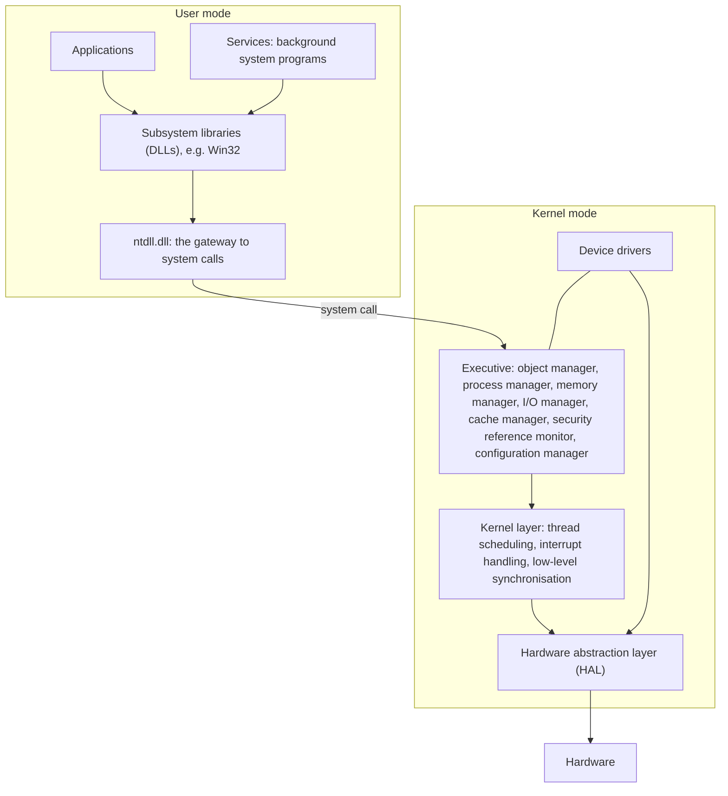
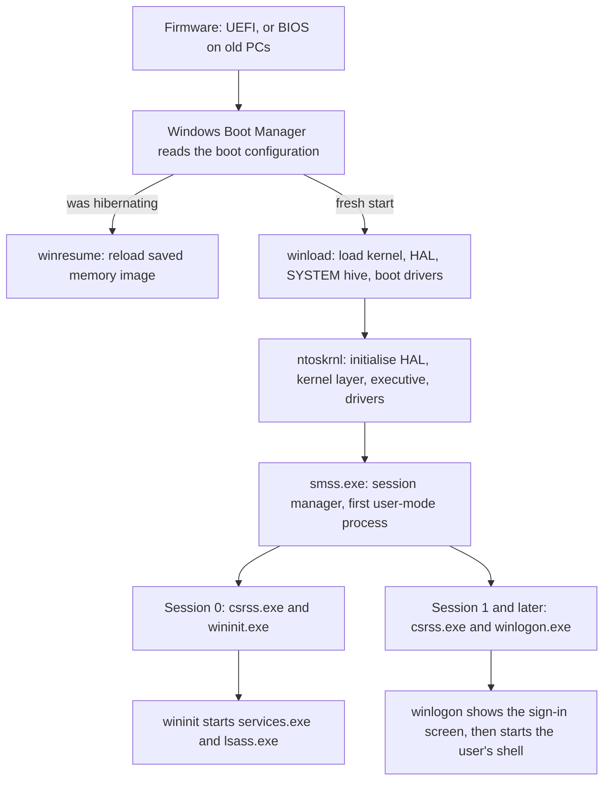

# Windows: structure, objects, processes and threads

> **Before this lesson:** this is the second case study. Read [Core concepts, system calls and kernel structure](#/lesson/os/concepts-syscalls-structure), [Processes and threads](#/lesson/os/processes-threads) and [CPU scheduling](#/lesson/os/scheduling) first. Having read the Linux case study, [Linux: history, structure, processes and scheduling](#/lesson/os/linux-processes), will help, because this lesson often compares the two.

## In plain words

Two families of operating system run most of the world's computers. One descends from UNIX and includes Linux, Android and Apple's systems. The other is **Microsoft Windows**, which runs most desktop and laptop computers and a large share of business servers.

The two solve the same problems — running programs, sharing memory, storing files — but they made different choices, the way two countries can both have working road systems and yet drive on different sides. Seeing a second solution is the best way to learn which parts of an operating system are fundamental and which are one designer's taste.

One idea will keep coming back in this lesson, so here it is in everyday terms. In a large library you do not walk into the stacks and take a book. You go to the desk, ask for it, and are given a numbered ticket. Later you show the ticket to borrow, renew or return. The staff keep the real records; you hold only a ticket. Windows works this way for nearly everything: a program asks the system for a thing (a file, a process, a lock), receives a ticket called a **handle**, and uses the handle from then on. The thing itself — called an **object** — stays inside the operating system.

Why it matters for a job: business software, games and a great deal of corporate infrastructure run on Windows. Terms from this lesson — handle, registry, service, DLL, thread priority — appear in documentation and error messages every day.

## A short history

The Windows you use today is the result of two separate lines that were eventually merged.

**MS-DOS.** In 1981 the first IBM personal computer shipped with a very simple operating system from Microsoft called MS-DOS. It ran one program at a time, had no protection between that program and the system, and was controlled by typing commands.

**Windows on top of MS-DOS.** Microsoft then built a graphical layer, named Windows, that ran on top of MS-DOS. Versions through Windows 95, 98 and Me were of this kind. They were easy to use and fragile: one misbehaving program could bring down the whole machine, because the weak foundation offered no real barriers.

**Windows NT.** In parallel, starting in 1988, Microsoft built a completely new operating system. It hired David Cutler, who had led the design of a respected system for minicomputers, to head the work. The result, released in 1993, was **Windows NT** ("New Technology"). It was a serious modern design: programs were protected from each other and from the system; it supported several processors; and it was built to be moved to different kinds of hardware.

**The merger.** For some years Microsoft sold both lines: the old one for homes, NT for businesses. With Windows XP in 2001, the old line was ended and everyone moved to the NT foundation. Every version since — Vista, 7, 8, 10, 11, and the server editions — is a development of NT. When this lesson says "Windows" it means that NT line.

## How programs talk to Windows

### Two layers of interface

In UNIX-like systems the documented interface for programs is the set of system calls itself. Windows does it differently.

- The kernel has its own set of system calls, the **native NT API**. (API stands for *application programming interface*: the set of functions one piece of software offers to others.) Microsoft does not fully document this layer and changes it between versions.
- Programs are expected to use a much larger, documented library on top, the **Win32 API**. Many Win32 functions do their work without entering the kernel at all; others call one or more native functions for you.

The advantage for Microsoft is freedom to reorganise the kernel without breaking existing programs, as long as Win32 keeps behaving the same.

NT was also designed so that several different "personalities" could sit on the same kernel, each offering programs the interface of a different operating system. Such a personality is called a **subsystem**. Win32 became by far the most important one.

### Objects and handles

Almost everything the Windows kernel manages is an **object**: a block of kernel memory with a standard header followed by data specific to its kind. Processes, threads, files, locks, shared memory regions and many more are all objects, each of a particular **object type**.

One kernel component, the **object manager**, looks after all of them in a uniform way. Because every object has the same kind of header, the object manager can provide the same services for all types:

- **Naming.** Objects can be given names in a single tree-shaped namespace, much like a file system. This is how one process finds an object created by another.
- **Access checking.** Every object can carry a description of who may use it, and the check is made in one place.
- **Reference counting.** The header counts how many handles and pointers refer to the object. When the count reaches zero, the object is destroyed. No object disappears while someone is still using it, and none lingers once nobody is.

A program never receives the object itself. It receives a **handle**: a small number that is an index into a table belonging to the process — the **handle table**. Each entry in the table points to an object and records what the process is allowed to do with it. To use the object, the program passes the handle to a system call; the kernel looks it up in *that process's* table. A handle is therefore meaningless in any other process, and a program cannot invent access to an object that is not in its table.

If you have read the security lessons you will recognise this: a handle is a **capability** — a token that both names an object and grants rights over it.

```python-run
class ObjectManager:
    def __init__(self):
        self.objects = {}                           # object id -> {"type", "name", "refs"}
        self.next_id = 1

    def create(self, kind, name):
        oid, self.next_id = self.next_id, self.next_id + 1
        self.objects[oid] = {"type": kind, "name": name, "refs": 0}
        return oid

    def reference(self, oid):
        self.objects[oid]["refs"] += 1

    def dereference(self, oid):
        self.objects[oid]["refs"] -= 1
        if self.objects[oid]["refs"] == 0:
            print(f"      (no references left: {self.objects[oid]['type']} '{self.objects[oid]['name']}' destroyed)")
            del self.objects[oid]

class Process:
    def __init__(self, name, om):
        self.name, self.om, self.handles, self.next_handle = name, om, {}, 4

    def open(self, oid, rights):
        handle, self.next_handle = self.next_handle, self.next_handle + 4
        self.handles[handle] = (oid, rights)        # the handle table entry
        self.om.reference(oid)
        return handle

    def use(self, handle, right):
        if handle not in self.handles:
            return "error: invalid handle"
        oid, rights = self.handles[handle]
        return "ok" if right in rights else "error: access denied"

    def close(self, handle):
        oid, _ = self.handles.pop(handle)
        self.om.dereference(oid)

om = ObjectManager()
log = om.create("File", "report.log")
a, b = Process("A", om), Process("B", om)

ha = a.open(log, {"read", "write"})
hb = b.open(log, {"read"})
print("A's handle:", ha, "| B's handle:", hb, "| references to the file:", om.objects[log]["refs"])
print("A writes  :", a.use(ha, "write"))
print("B writes  :", b.use(hb, "write"))
print("B uses a handle number it was never given:", b.use(12, "read"))
print("A closes its handle:")
a.close(ha)
print("   references now:", om.objects[log]["refs"])
print("B closes its handle:")
b.close(hb)
```

**What each part does.**

- `ObjectManager` keeps every object in one table, each with a type, a name and a count of references.
- Each `Process` has its own `handles` table. `open` picks the next handle number (Windows handle values go up in steps of 4), stores the pair (object, permitted rights) under it, and tells the object manager there is one more reference.
- `use` looks the handle up in *this* process's table and checks that the requested right was granted when the handle was opened.
- `close` removes the entry and reduces the object's reference count; `dereference` destroys the object when the count reaches zero.

**The output.** Both processes get handle number 4 — the same number, in two different tables — and the file has two references. A may write; B, which opened the file for reading only, is refused. A handle number B was never given is invalid. After A closes, one reference remains and the file survives; after B closes, the count is zero and the object is destroyed.

### The registry

Windows keeps its configuration — settings for the system, for hardware, for each user and for each installed program — in a single central database called the **registry**. It is organised like a file system: **keys** play the role of directories, and **values** play the role of files. UNIX-like systems, by comparison, traditionally keep configuration in many separate text files. The registry gives one uniform place and one way of reading it; its drawback is that a damaged registry can stop the whole system from starting.

## The structure of the system



Read the picture from the bottom.

**The hardware abstraction layer (HAL).** A thin layer that hides the differences between one manufacturer's main board and another's — how interrupts are wired, how timers are read. Everything above it can be written once.

**The kernel layer.** The lowest part of the operating system proper. It decides which thread runs on which processor, handles interrupts, and provides basic locks. In Windows terminology "the kernel" means this layer specifically.

One mechanism here deserves a mention because the name appears often. When an interrupt arrives, its handler should do as little as possible, because while it runs, other interrupts are held back. Windows lets the handler queue up the rest of the work as a **deferred procedure call** (DPC), which runs a moment later, when nothing more urgent is pending.

**The executive.** The upper part of kernel mode, containing the major services, each called a *manager*:

- the **object manager**, described above;
- the **process manager**, which creates and ends processes and threads;
- the **memory manager**, which implements virtual memory;
- the **I/O manager**, which provides the framework for device drivers;
- the **cache manager**, which keeps recently used file data in memory;
- the **security reference monitor**, which makes the access decisions;
- the **configuration manager**, which implements the registry.

**Device drivers.** Code for particular devices, loaded into kernel mode. As in every system, they are the largest source of crashes, because a fault in kernel mode has nothing to contain it.

**User mode.** Above the kernel are ordinary programs, background programs called **services** (the Windows word for what UNIX calls *daemons*), and libraries. A Windows shared library is called a **DLL** (dynamic-link library): a file of code that programs load when they run, so that many programs share one copy. One special DLL, `ntdll.dll`, contains the small routines that actually perform the jump into kernel mode.

Is Windows a microkernel, in the sense used earlier in this track? No. Although it is cleanly divided into layers and managers, all of them run together in kernel mode. It is best described as a well-structured **monolithic** kernel, sometimes called a *hybrid*.

## How Windows boots

When you press the power button, none of the structure above exists yet. Memory is empty, there are no objects, no handles and no registry in memory. **Booting** is the process of building all of it, one stage at a time, where each stage is a small program whose only job is to load and start the next, slightly larger one. A relay race is a good picture: each runner carries the baton a short distance and hands it on, and the race fails if any hand-over is dropped.



**1. Firmware.** The processor starts by running code stored in a memory chip on the main board, written by the board's manufacturer. Because it lives in the hardware and is rarely changed (updating it is called *flashing*), it is called **firmware**. Old PCs used firmware called the **BIOS** (*Basic Input/Output System*); modern ones use **UEFI** (*Unified Extensible Firmware Interface*), which understands modern disks and file systems, is less tied to one processor family, and can be extended — for example to boot over a network or run diagnostics. The firmware checks the hardware and then finds and starts the operating system's boot program on the disk.

UEFI adds an important security step called **Secure Boot**: the firmware runs a boot program only if it carries a valid digital signature from a trusted publisher. This blocks a class of malware, sometimes called *bootkits*, that tries to load itself before the operating system so that it can hide from everything that starts later.

**2. The Windows Boot Manager.** The first Windows program to run is the **boot manager**. It reads the *boot configuration data*, a small database listing the installed systems and their options, and makes one decision: was the machine **hibernating** (memory saved to disk before power-off)? If so, it starts **winresume**, which reloads the saved memory image and continues where the system left off. Otherwise it starts **winload** for a fresh boot.

**3. winload.** This loader brings the essential pieces into memory before any of them runs:

- the kernel and executive, a file normally called `ntoskrnl.exe`;
- the hardware abstraction layer, `hal.dll`;
- the **SYSTEM hive** — the part of the registry that says how the machine is configured, including which drivers to load;
- the drivers marked in that hive as **boot drivers**, the ones needed before the system can read anything else, such as the driver for the disk it is booting from;
- if the Hyper-V virtualisation feature is enabled, the **hypervisor** (the layer that runs operating systems as virtual machines), which starts beneath Windows.

**4. The kernel initialises itself.** winload hands control to `ntoskrnl`, which sets up the HAL, the kernel layer and each manager of the executive in turn, connects the boot drivers, and reads the SYSTEM hive to learn what else to start. Only at this point do objects begin to exist: even the object *types* are created during this phase. Plug-and-play then finds the remaining devices and loads their drivers.

**5. smss.exe, the session manager.** When kernel mode is ready, the kernel creates the first user-mode process, which runs `smss.exe`. It plays the role that `init` plays on Linux. It finishes setting up the machine — creating the paging files, loading the rest of the registry, defining system-wide environment settings — and then creates **sessions**. A session is the set of processes belonging to one logged-in desktop, plus a special *session 0* for system services, kept separate so that services never share a desktop with a user's programs. For each session, `smss` starts a copy of **csrss.exe**, the user-mode part of the Win32 subsystem.

**6. wininit, services and lsass (session 0).** In session 0, `smss` starts **wininit.exe**, which launches two essential processes:

- **services.exe**, the *service control manager*, which starts all the background services configured to start automatically (recall that services are Windows' daemons);
- **lsass.exe**, the *local security authority*, which checks passwords and other credentials and creates the access tokens that record who a process is acting for.

**7. winlogon and the user's shell.** In each interactive session, `smss` starts **winlogon.exe**, which shows the sign-in screen. When someone signs in, winlogon passes the credentials to `lsass` for checking; if they are accepted, it creates the user's first process with the new token, which in turn starts the familiar desktop shell, `explorer.exe`. From here on, every program the user starts inherits that token. (The *Ctrl+Alt+Del* key combination exists because Windows reserves it and always delivers it to winlogon: no ordinary program can intercept it, so it is a safe way to reach the genuine sign-in screen rather than a fake one.)

**When booting goes wrong.** Because every stage depends on the previous one, Windows offers ways around the usual causes of failure. A newly installed driver or a damaged registry can stop the boot, so the boot manager can offer the *last known good configuration* (on older versions), **safe mode** (only the essential drivers are loaded), and a **recovery environment** with a command prompt, comparable to single-user mode on UNIX. Because faulty memory chips turned out to cause many mysterious crashes, Windows can also run a thorough memory test at boot.

**Measured boot and the TPM.** Many PCs contain a **TPM** (*Trusted Platform Module*), a small security chip that stores secret keys and keeps a tamper-evident record of each boot stage as it loads. It can be set to release a key — such as the key that unlocks a disk encrypted with BitLocker — only if every stage was the expected one, so a thief who boots the disk with modified software gets nothing. The same record can be used to prove to a remote server that the machine started cleanly.

| Stage | Windows | Rough Linux equivalent |
|---|---|---|
| Firmware | UEFI or BIOS | the same firmware |
| Boot loader | Boot Manager, then winload | a boot loader such as GRUB |
| Kernel | `ntoskrnl.exe` with `hal.dll` | `vmlinuz` |
| First user process | `smss.exe` | `init` (often systemd) |
| Background programs | `services.exe` starts services | init starts daemons |
| Sign-in | winlogon with lsass | a login manager with PAM |

## Processes and threads

Windows has four related notions, from largest to smallest.

- A **job** is a group of processes managed as a unit. Limits can be set on a job as a whole — a maximum amount of memory or processor time for all its processes together. (Jobs are also one of the building blocks Windows uses for containers.)
- A **process** is a container for resources: an address space, a handle table, and one or more threads. A process itself does not execute anything.
- A **thread** is what actually runs. The scheduler deals only in threads. Every process has at least one.
- A **fiber** is a lightweight thread managed entirely by the program, without the kernel's knowledge. The program switches between its fibers by itself, which is very cheap, but if one fiber blocks in a system call, the kernel thread underneath it — and so all the fibers sharing that thread — is blocked.

### Creating a process

Recall that UNIX creates a process in two steps: `fork` copies the caller, then `exec` loads a new program. Windows uses **one call**, `CreateProcess`, which builds a fresh process and loads a named program into it. It takes about ten parameters, covering what the two-step method leaves to the code between `fork` and `exec`: which program to run, its command line, security settings, which handles the new process should inherit, and so on.

| | UNIX / Linux | Windows |
|---|---|---|
| Create a process | `fork`, then `exec` | `CreateProcess` (one call) |
| What you get back | A process ID | Handles to the new process and its first thread |
| Parent–child relationship | A lasting tree | None enforced; whoever holds a handle can control the process |
| Wait for it to finish | `waitpid` | `WaitForSingleObject` on its handle |

Because creating threads is relatively expensive, Windows provides **thread pools**: a set of threads kept ready, to which a program hands small pieces of work instead of creating a new thread for each.

### Waiting for things: one mechanism for everything

Windows has a neat general design for synchronisation. Many kinds of kernel object can be in one of two states, **signalled** or **not signalled**, and a thread can wait on any of them with the same calls: `WaitForSingleObject` waits for one, `WaitForMultipleObjects` for any or all of several. Such objects are called **dispatcher objects**.

What "signalled" means depends on the type:

| Object | Becomes signalled when… |
|---|---|
| Process or thread | it finishes |
| **Mutex** (a lock that one thread at a time may hold) | it is free |
| **Semaphore** (a counter of available permits) | its count is above zero |
| **Event** (a flag one thread sets to tell others something happened) | some thread sets it |
| Timer | its time arrives |

So "wait for this thread to finish", "wait for this lock" and "wait up to five seconds for either of these two things" are all the same operation applied to different objects.

For protecting data *within one process*, Windows offers a lighter lock called a **critical section**. It tries to take the lock entirely in user mode and enters the kernel only if it has to wait, which makes the uncontended case very fast — the same idea as the *futex* described in the synchronisation lessons.

### Scheduling

Windows has no central scheduler thread. Scheduling code runs whenever a thread blocks, a thread becomes ready, a thread's time slice ends, or a thread's priority changes.

**Priorities.** Every thread has a priority from **0 to 31**, where a higher number means more important.

- **16 to 31** are the **real-time** levels. They are reserved for system work and specially privileged programs, and the system never adjusts them.
- **1 to 15** are the **dynamic** levels, used by ordinary programs. The system adjusts these up and down, as described below.
- **0** is used by a system thread that fills free memory pages with zeros when nothing else needs the processor.

The rule is strict: **the highest-priority ready thread runs.** There are 32 queues of ready threads, one per level, and the scheduler takes the first thread from the highest non-empty queue. Threads at the same level take turns, each running for a time slice called a **quantum**. If a higher-priority thread becomes ready, the running thread is interrupted at once.

A thread's starting priority comes from two settings: the **priority class** of its process (for example Normal, High or Idle) and the thread's own **relative priority** within that class.

**Priority boosts.** A strict priority rule would let threads that compute constantly shut out threads that mostly wait. To keep the system responsive, Windows temporarily *raises* the priority of an ordinary thread in certain situations:

- **When an input/output operation completes**, the waiting thread is boosted. The size depends on the device — a small boost for a disk, a larger one for a keyboard or sound card — so that threads which respond to the user run promptly.
- **When a thread that was waiting on a lock or event is released**, it gets a small boost.
- **When a window becomes the foreground window**, the threads of its process are favoured.

A boost is not permanent. Each time a boosted thread uses up a quantum, its priority drops by one level, until it is back at its base. And boosts never raise a thread into the real-time range.

**Avoiding starvation and priority inversion.** A low-priority thread might hold a lock that a high-priority thread needs, while medium-priority threads keep the processor busy so the low one never runs to release it — the *priority inversion* problem from the synchronisation lessons. Windows has a blunt remedy: a system thread periodically looks for threads that have been ready but have not run for several seconds, raises each one to a high priority for a short time, and then lets it fall back. The starved thread gets a chance to run and release what it holds.

```python-run
def simulate(threads, rounds):
    """threads: {name: {"base": n, "current": n}}. Each round the highest current priority runs one quantum."""
    history = []
    for _ in range(rounds):
        name = max(threads, key=lambda n: (threads[n]["current"], -list(threads).index(n)))
        t = threads[name]
        history.append(f"{name}({t['current']})")
        if t["current"] > t["base"]:
            t["current"] -= 1                    # a boost decays by one level per quantum used
    return history

threads = {
    "editor":   {"base": 8, "current": 8},
    "compiler": {"base": 8, "current": 8},
    "backup":   {"base": 6, "current": 6},
}
print("no boosts          :", " ".join(simulate(threads, 6)))

threads["editor"]["current"] = 8 + 6             # the user pressed a key: keyboard boost
print("after a key press  :", " ".join(simulate(threads, 9)))

threads["backup"]["current"] = 15                # starved for seconds: temporary rescue boost
print("after anti-starvation boost:", " ".join(simulate(threads, 4)))
```

**What each part does.**

- Each thread has a `base` priority and a `current` priority, which may be higher because of a boost.
- In every round, `max(...)` picks the thread with the highest current priority. (The second part of the key breaks ties in favour of whichever was listed first, to keep the example simple; a real system rotates among equals.)
- The chosen thread "runs" for one quantum and its name and priority are recorded.
- If it is above its base priority, it loses one level — the decay of a boost.

**The output.** With no boosts the editor (first in the list at the top priority) is chosen each time and `backup` never runs. After a key press the editor jumps to 14 and runs with its priority stepping down — 14, 13, 12, 11, 10, 9 — until it is back at 8. After the rescue boost, `backup` at last runs, starting at 15 and decaying. The number in brackets on each run shows the decay happening.

On machines with several processors, each thread has an *ideal processor* that the scheduler prefers, so that the thread keeps finding its data in that processor's cache.

> [!INTERVIEW]
> "Compare process creation and scheduling in Linux and Windows." Linux: `fork` + `exec`, a process tree, and the Completely Fair Scheduler choosing the smallest weighted virtual runtime, with separate real-time classes. Windows: a single `CreateProcess`, no enforced hierarchy, access through handles, and a 32-level strict priority scheduler with round robin within a level, temporary boosts for I/O completion and foreground work, and a periodic anti-starvation boost. Mention the shared ideas underneath: kernel threads as the scheduled unit, preemption, and favouring interactive work.

## Common mistakes and confusions

- **"Windows is built on MS-DOS."** Not since Windows XP. Modern Windows is the NT design.
- **"Win32 functions are the system calls."** Win32 is a library; the real system calls are the native NT API beneath it.
- **"A handle is a pointer to the object."** It is an index into the calling process's own handle table.
- **"A process runs."** In Windows a process is a container; its threads run.
- **"A higher number means lower priority, as with nice values."** In Windows a higher number is *more* important.
- **"A boost is permanent."** It decays by one level for each quantum used.
- **"winlogon checks my password."** winlogon collects it and runs the sign-in screen; **lsass** checks it and builds the access token.

## Summary

- Modern Windows descends from **Windows NT** (1993), a ground-up design that replaced the MS-DOS-based line.
- Programs use the documented **Win32 API**, layered over the undocumented **native NT API**. Kernel resources are **objects** managed uniformly by the **object manager** and reached through per-process **handles**. Configuration lives in the **registry**.
- Kernel mode consists of the **HAL**, the **kernel layer** (scheduling, interrupts, **DPCs**), the **executive** (object, process, memory, I/O, cache, security and configuration managers) and **device drivers**; user mode holds applications, **services** and **DLLs**.
- Booting is a relay: **firmware** (UEFI, with **Secure Boot**) starts the **boot manager**, which starts **winload** (or **winresume** after hibernation); winload loads the kernel, HAL, SYSTEM hive and boot drivers; the kernel initialises and starts **smss.exe**, which starts **csrss**, **wininit** (then **services.exe** and **lsass**) and **winlogon**.
- Windows has **jobs**, **processes**, **threads** and **fibers**; `CreateProcess` creates and loads in one call. Waiting is unified through **dispatcher objects** that are signalled or not.
- Scheduling uses **32 priority levels**: 16–31 real-time, 1–15 dynamic. The highest-priority ready thread always runs; temporary **boosts** keep the system responsive and rescue starved threads.

## Glossary

- **Windows NT** — the operating system design, first released in 1993, on which all current Windows versions are based.
- **API** — application programming interface: the functions one piece of software offers to others.
- **Win32 API** — the documented library of functions Windows programs call.
- **Native NT API** — the kernel's actual system calls.
- **Subsystem** — a layer offering programs a particular operating-system interface.
- **Object** — a kernel data structure with a standard header, representing a resource.
- **Object manager** — the kernel component that names, protects and counts references to objects.
- **Handle** — a number, valid within one process, that refers to an object and carries access rights.
- **Handle table** — a process's table mapping handles to objects.
- **Reference count** — the number of current users of an object.
- **Registry** — the central configuration database.
- **HAL** — hardware abstraction layer: hides differences between main boards.
- **Deferred procedure call (DPC)** — work postponed from an interrupt handler to run shortly afterwards.
- **Executive** — the upper part of the Windows kernel, containing the managers.
- **Service** — a background system program (a daemon, in UNIX terms).
- **Firmware** — start-up code stored on the main board; **BIOS** is the old kind, **UEFI** the modern kind.
- **Secure Boot** — a UEFI feature that runs only boot programs carrying a trusted digital signature.
- **Boot manager / winload / winresume** — the Windows program that chooses how to start / the loader for a fresh boot / the loader that resumes from hibernation.
- **SYSTEM hive** — the part of the registry describing the machine's configuration and boot drivers.
- **Boot driver** — a driver loaded before the kernel starts because it is needed to continue booting.
- **smss.exe** — the session manager, the first user-mode process (like `init`).
- **Session** — the processes of one desktop; session 0 holds system services.
- **csrss.exe / wininit.exe / winlogon.exe** — the user-mode Win32 subsystem process / the starter of system services and lsass / the sign-in manager of an interactive session.
- **services.exe** — the service control manager, which starts and stops services.
- **lsass.exe** — the local security authority, which checks credentials and creates access tokens.
- **TPM** — Trusted Platform Module: a security chip that stores keys and records each boot stage.
- **DLL** — dynamic-link library: a shared library loaded when a program runs.
- **Job** — a group of processes managed and limited as a unit.
- **Fiber** — a lightweight thread scheduled by the program, not the kernel.
- **Thread pool** — a set of ready threads to which pieces of work are handed.
- **Dispatcher object** — a kernel object that can be waited on, being either signalled or not.
- **Mutex / semaphore / event** — a lock held by one thread at a time / a counter of permits / a flag set to announce that something happened.
- **Critical section** — a fast lock for use within one process.
- **Quantum** — the time slice a thread runs before another of equal priority gets a turn.
- **Priority boost** — a temporary increase in a thread's priority.

## Check yourself

```quiz
[
  {"q": "Which statement about the origins of modern Windows is correct?",
   "options": ["It is MS-DOS with a graphical shell", "It descends from Windows NT, a separate design begun in 1988 that replaced the MS-DOS-based line", "It is based on Linux", "It was derived from UNIX source code"],
   "answer": 1,
   "explain": "The MS-DOS-based line ended with Windows Me. Since Windows XP every version has been built on the NT design."},
  {"q": "What is a handle?",
   "options": ["The memory address of a kernel object", "A number that indexes the calling process's own table of references to kernel objects", "A file name", "A hardware interrupt number"],
   "answer": 1,
   "explain": "Programs never get the object itself. The handle is meaningful only in the process whose table contains it, and the table records the rights granted."},
  {"q": "Why does the object manager keep a reference count in every object?",
   "options": ["To bill the user", "So that an object is destroyed exactly when nobody is using it any more", "To choose the object's priority", "To encrypt the object"],
   "answer": 1,
   "explain": "Each handle or pointer adds a reference. When the count falls to zero the object can safely be removed."},
  {"q": "What is the role of the hardware abstraction layer?",
   "options": ["It runs user programs", "It hides differences between hardware platforms so the rest of the kernel can be written once", "It stores the registry", "It schedules threads"],
   "answer": 1,
   "explain": "Details such as interrupt wiring and timers differ between main boards. The HAL presents them uniformly to the layers above."},
  {"q": "How does creating a process in Windows differ from UNIX?",
   "options": ["Windows cannot create processes", "Windows uses a single CreateProcess call that creates the process and loads the program, instead of fork followed by exec", "Windows copies the parent twice", "UNIX uses handles and Windows uses process IDs"],
   "answer": 1,
   "explain": "CreateProcess takes many parameters to cover what UNIX programs arrange between fork and exec."},
  {"q": "A thread waits for another thread to finish by calling WaitForSingleObject on its handle. Why does this work?",
   "options": ["Threads are files", "A thread is a dispatcher object that becomes signalled when it ends, and waiting works the same way for all such objects", "The scheduler polls every second", "It does not work; a special call is needed"],
   "answer": 1,
   "explain": "Processes, threads, mutexes, semaphores, events and timers can all be waited on with the same calls."},
  {"q": "Two threads are ready: one at priority 9 and one at priority 12. Which runs?",
   "options": ["The one at priority 9, because lower numbers are more important", "The one at priority 12, because the highest-priority ready thread always runs", "They alternate equally", "Whichever has waited longer"],
   "answer": 1,
   "explain": "Windows priorities run from 0 to 31 with higher numbers more important. Round robin applies only among threads at the same level."},
  {"q": "A thread with base priority 8 is boosted to 14 when keyboard input arrives. What happens to its priority afterwards?",
   "options": ["It stays at 14 permanently", "It drops by one level each time it uses a full quantum, until it returns to 8", "It drops immediately to 0", "It rises to 31"],
   "answer": 1,
   "explain": "Boosts are temporary and decay step by step, so a thread that keeps computing gradually loses the advantage."},
  {"q": "Put these Windows boot stages in order: smss.exe, winload, firmware, ntoskrnl initialisation, Boot Manager.",
   "options": ["Boot Manager, firmware, winload, smss.exe, ntoskrnl", "firmware, Boot Manager, winload, ntoskrnl initialisation, smss.exe", "firmware, winload, smss.exe, Boot Manager, ntoskrnl", "ntoskrnl, firmware, Boot Manager, winload, smss.exe"],
   "answer": 1,
   "explain": "Each stage loads the next: firmware finds the boot manager, which starts winload, which loads the kernel; the kernel initialises and then creates smss.exe as the first user-mode process."},
  {"q": "Which process checks a user's password and creates the access token at sign-in?",
   "options": ["smss.exe", "winlogon.exe on its own", "lsass.exe, the local security authority, called by winlogon", "services.exe"],
   "answer": 2,
   "explain": "winlogon runs the sign-in screen and passes the credentials to lsass, which verifies them and builds the token that the user's processes then inherit."},
  {"q": "What does UEFI Secure Boot protect against?",
   "options": ["Disk crashes", "Malware that loads before the operating system by replacing the boot program, because unsigned boot programs are refused", "Slow boots", "Users forgetting their passwords"],
   "answer": 1,
   "explain": "The firmware checks the digital signature of each boot program before running it, so a tampered loader is not started."}
]
```

> **Source:** Tanenbaum & Bos, Modern Operating Systems 4e, §11.1 (History of Windows), §11.2 (Programming Windows), §11.3 (System structure, including §11.3.2 Booting Windows), §11.4 (Processes and threads in Windows)
