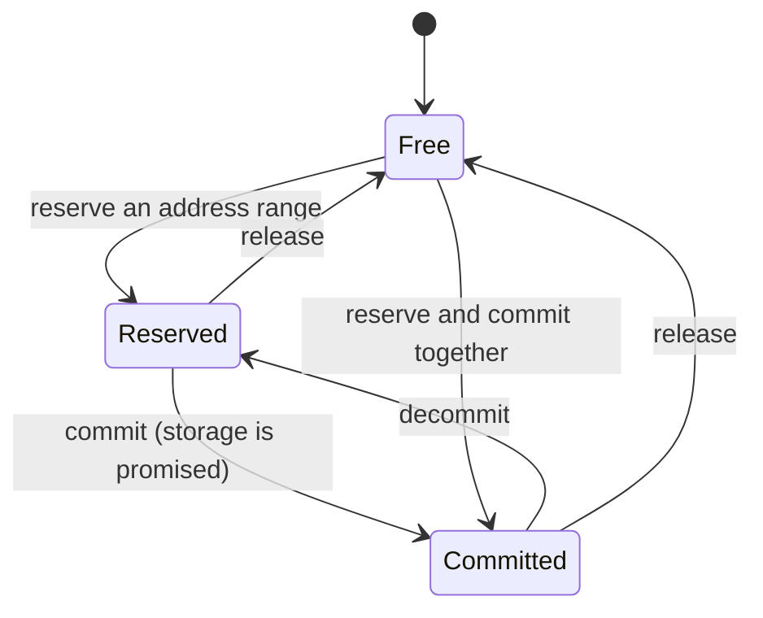
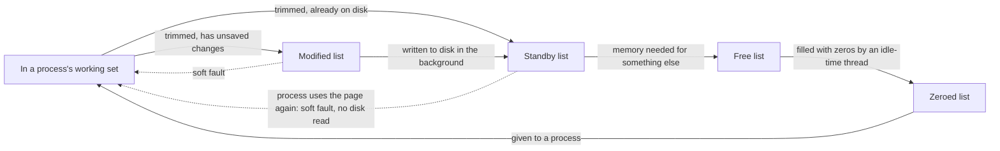
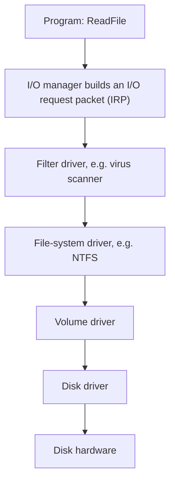

# Windows: memory, caching, I/O, NTFS and security

> **Before this lesson:** read the first half of this case study, [Windows: structure, objects, processes and threads](#/lesson/os/windows-structure-processes), for objects, handles and the executive. The general ideas come from [Virtual memory: paging, page tables and TLBs](#/lesson/os/paging-tlb), [Page replacement algorithms](#/lesson/os/page-replacement), [File-system implementation](#/lesson/os/fs-implementation) and [Threat models, access control and formal models](#/lesson/os/security-access-control).

## In plain words

The previous lesson covered how Windows is organised and how it runs programs. This one covers the rest: how it shares out **memory**, how it deals with **devices**, how it stores **files**, and how it decides **who may do what**.

A picture to hold on to: a large hotel. Guests reserve rooms long before they arrive, and a reserved room costs the hotel nothing until someone actually moves in (memory). Requests — room service, laundry, repairs — are written on a slip that is passed from desk to desk until the job is done (devices). There is a master ledger with one line for every room and everything known about it (files). And each guest carries a key card that the door locks check (security).

Each of those corresponds to a Windows mechanism you will meet below: reserved and committed memory, the I/O request packet, the master file table, and the access token.

Why it matters for a job: terms such as "committed memory", "working set", "NTFS permissions", "access denied" and "run as administrator" appear constantly when developing for or administering Windows systems. This lesson explains what is behind them.

## Memory management

### Three states of a page

Like every modern system, Windows gives each process its own private **virtual address space**, divided into fixed-size **pages** (normally 4 kilobytes each). On a 64-bit system the space is enormous — far larger than any real memory.

Windows is unusual in making a distinction that other systems blur. Every page of a process's address space is in one of three states:

- **Free** — not in use. Touching it is an error.
- **Reserved** — the *range of addresses* has been set aside so that nothing else will be placed there, but no storage stands behind it yet. Touching it is still an error. Reserving costs almost nothing.
- **Committed** — the system has promised storage for the page. It can now be used.

Why separate reserving from committing? Suppose a program needs a region that might grow up to a gigabyte but usually stays small — a thread's stack is the standard case. It *reserves* the whole gigabyte of addresses, guaranteeing the region can grow without bumping into anything, and *commits* pages only as they are needed.

Committing is a real promise. For each committed page that does not come from a file, Windows makes sure there is room for it either in memory or in the **paging file** — the file on disk where pages are kept when they are pushed out of memory. The total of all such promises is the **commit charge**, and it may not exceed the **commit limit** (roughly, the size of memory plus the paging files). If a program asks to commit more than can be honoured, the request fails at once, with an error the program can handle.

This is a deliberate difference from Linux, which by default promises more memory than it has, betting that not all of it will be used, and resolves a lost bet by killing a process. Windows refuses up front.



```python-run
class AddressSpace:
    def __init__(self, commit_limit_pages):
        self.state = {}                                  # page number -> "reserved" or "committed"
        self.commit_limit = commit_limit_pages
        self.committed = 0

    def reserve(self, start, count):
        for page in range(start, start + count):
            self.state.setdefault(page, "reserved")
        return f"reserved {count} pages (costs nothing yet)"

    def commit(self, start, count):
        new = [p for p in range(start, start + count) if self.state.get(p) == "reserved"]
        if len(new) != count:
            return "error: pages must be reserved first"
        if self.committed + count > self.commit_limit:
            return f"error: commit limit reached ({self.committed} + {count} > {self.commit_limit})"
        for page in new:
            self.state[page] = "committed"
        self.committed += count
        return f"committed {count} pages; commit charge is now {self.committed}"

    def touch(self, page):
        s = self.state.get(page, "free")
        return "ok" if s == "committed" else f"access violation (page is {s})"

space = AddressSpace(commit_limit_pages=1000)
print(space.reserve(0, 250_000))            # a huge range of addresses: about a gigabyte
print(space.commit(0, 16))                  # only the first 16 pages are actually needed
print("touch page 5     :", space.touch(5))
print("touch page 5000  :", space.touch(5000))
print("touch page 900000:", space.touch(900_000))
print(space.commit(16, 2000))               # asking for more than the system can promise
```

**What each part does.**

- `self.state` records the state of each page; a page that is not in the table is free.
- `reserve` marks a range as reserved. Nothing is counted against the limit.
- `commit` checks that the pages were reserved, then checks that the promise can be kept (`self.committed + count > self.commit_limit`), and only then changes their state and increases the commit charge.
- `touch` stands for a program using a page: only committed pages may be used.

**The output.** Reserving a quarter of a million pages succeeds and costs nothing. Committing 16 raises the commit charge to 16. Page 5 is usable; page 5000 is reserved but not committed, so using it is an error; page 900,000 was never reserved at all. The final request is refused cleanly because it would exceed the limit.

### Sections and mapped files

Windows has an object for memory that can be shared: the **section**. A section represents a block of memory, backed either by a file or by the paging file. A process **maps a view** of a section into its address space — the same idea as memory-mapped files in the Linux lesson. Two processes that map the same section share memory. Loading a program or a DLL (a shared library) is done by creating a section for the file and mapping it, so that all processes using the same DLL share one copy of its code.

### Page faults and working sets

A **page fault** happens when a program uses a page that is committed but not currently in physical memory. Windows uses **demand paging**: pages are brought in only when first used. To reduce the number of separate disk reads, it also brings in a few neighbouring pages at the same time.

For each process, Windows keeps track of its **working set**: the set of that process's pages currently in physical memory. The working set has a minimum and a maximum size, and these are adjusted as conditions change. When memory is plentiful, a process's working set is allowed to grow. When memory becomes scarce, a kernel component called the **working set manager** trims pages from working sets, preferring processes that have been idle and pages that have not been used recently.

### What happens to a trimmed page

Here Windows is more elaborate than the textbook algorithms, and the reason is worth understanding. A page removed from a working set is *not* immediately thrown away. Every page of physical memory is on one of several lists:

| List | What is on it |
|---|---|
| **Modified** | Pages removed from a working set that have been changed and still need writing to disk |
| **Standby** | Pages removed from a working set whose contents are already safely on disk |
| **Free** | Pages whose contents are no longer needed by anyone |
| **Zeroed** | Free pages that have been filled with zeros, ready to hand out |



The dotted arrows are the point of the whole arrangement. A page on the standby or modified list still holds its old contents. If the process that owned it uses it again, the page is handed straight back with no disk access — a **soft page fault**, thousands of times cheaper than a **hard page fault** that must read from disk. The standby list therefore acts as a large cache of pages that *might* be wanted again, while still counting as available memory, since any standby page can be reused instantly for something else.

Why zero pages before handing them out? Security. A page given to a process must never contain another process's leftover data.

Recent versions of Windows add **memory compression**: instead of writing rarely used pages to disk, the system compresses them and keeps them in memory, which is much faster than a disk and often frees enough space.

## Caching

The **cache manager** keeps recently used file data in memory so that repeated reads do not go to the disk. It works closely with the memory manager: cached file data is held in memory mapped from the files themselves, so the same pages serve a program reading the file through ordinary read calls and a program that has mapped the file into its memory. One consequence is that the cache has no fixed size; it grows and shrinks with the rest of memory. The cache manager also notices sequential reading and fetches ahead, and writes changed data back to disk in the background.

## Input and output

### The I/O manager and request packets

The **I/O manager** provides the framework within which all device drivers work. Its central idea is that every I/O operation is described by a data structure called an **I/O request packet** (IRP). When a program asks to read from a file, the I/O manager fills in an IRP — what operation, on which file, how many bytes, where to put them — and passes it to the appropriate driver.

Drivers are arranged in **stacks**. A request for a file on a disk might pass through a file-system driver (which turns "bytes 0 to 4095 of this file" into "these blocks of the volume"), then a volume driver, then the driver for the disk itself. The IRP is handed down the stack, each driver doing its part, and the result travels back up. Extra drivers called **filter drivers** can be inserted into a stack to add a feature — encryption, virus scanning, compression — without changing the drivers above or below.



### Asynchronous I/O

Windows I/O is **asynchronous** at heart. *Synchronous* means the program waits until the operation is finished before doing anything else. *Asynchronous* means the program starts the operation, carries on with other work, and is told later when it completes. Internally every operation is asynchronous; the simple waiting form that most programs use is built on top.

For servers that handle thousands of network connections, Windows offers a mechanism called an **I/O completion port**. The program starts many operations and has a small pool of threads waiting on one port; as each operation finishes, a notice is queued to the port and one waiting thread wakes to handle it. A few threads can thereby serve a very large number of connections.

### Plug and play, and power

The **plug and play manager** discovers devices as they are attached, works out which driver each needs, loads it, and assigns the device the resources it requires — all without the user doing anything. The **power manager** coordinates sleep states. Each device and the system as a whole can be in states ranging from fully on to off; when the system is about to sleep, the power manager asks every driver, in the right order, to put its device into a low-power state, and does the reverse on waking. **Hibernation** saves the whole of memory to disk and switches the machine off entirely, to be restored later.

## The NTFS file system

**NTFS** (NT File System) is the native Windows file system. It was designed from the start for large disks and for surviving crashes.

### The master file table

The heart of an NTFS volume is one special file, the **master file table** (MFT). It is a long sequence of fixed-size **records**, typically 1 kilobyte each. Every file and every directory on the volume has at least one record. The first few records describe the file system itself — including one for the MFT, since the MFT is a file too.

A record is not a fixed layout of fields. It is a list of **attributes**, each consisting of a header saying what kind it is and a value. Standard attributes include:

- **standard information** — times and basic flags;
- **file name** — the name, and a reference to the directory it is in;
- **security descriptor** — who may access the file (in practice a reference to a shared copy);
- **data** — the contents of the file.

Yes: the file's contents are one more attribute. This leads to a neat optimisation.

### Resident and non-resident attributes

If a file is small enough — a few hundred bytes — its data fits *inside the MFT record itself*. Such an attribute is called **resident**. Reading the file then needs no further disk access once the record has been read, and no separate blocks are used at all.

If the data is too big, it is stored elsewhere on the disk and the attribute becomes **non-resident**: the record holds, instead of the data, a list of where the data is. That list consists of **runs**. A run is a pair of numbers: a starting block and a count of consecutive blocks. (This is the same idea as the *extents* of the Linux lesson.) A file stored in one piece needs a single run however large it is; a badly scattered file needs many.

```python-run
RECORD_SPACE = 700          # bytes available for the data attribute inside a 1 KB record (illustrative)
BLOCK = 4096                # bytes per disk block

def store(size_bytes, free_runs):
    """Decide how a file of this size is recorded. free_runs: list of (start_block, length) available."""
    if size_bytes <= RECORD_SPACE:
        return {"kind": "resident", "detail": f"{size_bytes} bytes kept inside the MFT record"}
    needed = -(-size_bytes // BLOCK)                 # round up to whole blocks
    runs = []
    for start, length in free_runs:
        take = min(length, needed)
        runs.append((start, take))
        needed -= take
        if needed == 0:
            break
    return {"kind": "non-resident", "detail": runs}

def find_block(runs, block_in_file):
    """Translate a block number within the file into a block number on the disk."""
    for start, length in runs:
        if block_in_file < length:
            return start + block_in_file
        block_in_file -= length
    return None

print("a 120-byte note      ->", store(120, []))
tidy = store(40_000_000, [(100_000, 50_000)])
print("a 40 MB video, tidy  ->", tidy["detail"])
scattered = store(60_000, [(20, 4), (300, 2), (41, 3), (900, 100)])
print("a 60 KB file, scattered ->", scattered["detail"])
for n in (0, 3, 4, 6, 9, 14):
    print(f"   block {n:2d} of the file is disk block {find_block(scattered['detail'], n)}")
```

**What each part does.**

- `store` first tests whether the data fits in the record; if so it is resident and no blocks are used.
- Otherwise `-(-size_bytes // BLOCK)` computes the number of blocks needed, rounding up (a small trick: negating before and after the division makes Python round upward).
- The loop takes free stretches of disk one at a time, recording each as a run `(start, how many)`, until enough blocks have been found.
- `find_block` walks through the runs: if the wanted block falls within the current run it is `start + offset`; otherwise the run's length is subtracted and the search moves to the next run.

**The output.** The 120-byte note is stored inside its record. The 40-megabyte video needs 9,766 blocks, described by a single run. The scattered file needs 15 blocks spread over four runs, and the last lines show the translation: block 3 is the last of the first run (disk block 23), block 4 is the first of the second run (disk block 300), and so on.

A **directory** in NTFS is also an MFT record, and its entries are kept sorted in a tree structure (a B+ tree) so that finding one name among many thousands is quick. Small directories fit inside the record.

### Other features

- **Journaling.** Changes to the file system's own structures are first written to a log file. After a crash, the log is used to finish or undo incomplete changes, so the structure is always consistent. Note that this protects the *structure*, not necessarily the latest contents of your files.
- **Compression.** Files can be compressed transparently: programs read and write normally, and NTFS compresses and expands the data in chunks.
- **Encryption.** Files can be encrypted so that they are unreadable to anyone who removes the disk and reads it elsewhere. Each file is encrypted with its own key, and that key is in turn protected with the owner's key.
- **Hard links and symbolic links,** as in UNIX.
- **Alternate data streams.** Because data is an attribute, a file can have more than one data attribute, each with its own name. This is a rarely used but genuine feature — and one that tools must remember when copying files.
- **Shadow copies** — snapshots of a volume at a moment in time, used for backups of files that are in use.

## Security

### Identities: SIDs and access tokens

Every user, every group and every computer has a **security identifier** (SID): a long number designed to be unique in the world. Names can change; the SID is what the system uses.

When a user logs in, Windows builds an **access token**: a kernel object recording who the user is. It contains the user's SID, the SIDs of all the groups the user belongs to, and a list of **privileges** — special powers that are not tied to any particular object, such as the right to shut the machine down or to change the system clock. Every process the user starts receives a copy of this token. The token is the key card from the hotel picture: it is what the system examines whenever the process tries to do something.

### Protection: security descriptors and ACLs

Every object that can be protected — a file, a registry key, a process — has a **security descriptor**. It contains:

- the SID of the **owner**;
- a **discretionary access control list** (DACL), which says who may do what;
- a **system access control list** (SACL), which says which uses of the object should be recorded in the security log.

An access control list is a sequence of **access control entries** (ACEs). The two main kinds are:

- an **allow** entry: this SID is granted these rights;
- a **deny** entry: this SID is refused these rights.

When a process opens an object, asking for certain rights, the security reference monitor compares the token with the DACL. It goes through the entries **in order**:

1. If an entry applies to a SID in the token and *denies* any requested right, access is refused at once.
2. If it *allows* some of the requested rights, those are noted as granted.
3. If all requested rights have been granted, access is allowed and the search stops.
4. If the end of the list is reached with some right still not granted, access is refused.

Two consequences. First, **order matters**, which is why deny entries are placed before allow entries: a user who belongs to an allowed group but is individually denied must meet the deny first. Second, an object with an *empty* DACL lets nobody in, because nothing was granted.

```python-run
def check_access(token_sids, dacl, wanted):
    """dacl: list of (kind, sid, rights) in order. Returns (decision, reason)."""
    remaining = set(wanted)
    for kind, sid, rights in dacl:
        if sid not in token_sids:
            continue                                   # this entry is about somebody else
        if kind == "deny" and remaining & rights:
            return False, f"denied by entry for {sid}"
        if kind == "allow":
            remaining -= rights
            if not remaining:
                return True, f"all rights granted (last needed entry: {sid})"
    return False, f"no entry granted {sorted(remaining)}"

dacl = [
    ("deny",  "user:ravi",       {"write"}),
    ("allow", "group:engineers", {"read", "write"}),
    ("allow", "group:everyone",  {"read"}),
]
ravi  = {"user:ravi", "group:engineers", "group:everyone"}
lena  = {"user:lena", "group:engineers", "group:everyone"}
guest = {"user:guest", "group:everyone"}

for name, token in (("ravi", ravi), ("lena", lena), ("guest", guest)):
    for wanted in ({"read"}, {"read", "write"}):
        ok, why = check_access(token, dacl, wanted)
        print(f"{name:5s} wants {sorted(wanted)!s:18} -> {'ALLOWED' if ok else 'refused'}: {why}")

print("\nempty list:", check_access(lena, [], {"read"}))
```

**What each part does.**

- `token_sids` is the set of identifiers in the caller's token: the user and all their groups.
- `remaining` starts as the set of rights asked for and shrinks as allow entries grant them.
- The loop takes entries in order. Entries naming someone not in the token are skipped. A deny entry that touches any still-wanted right ends the check with a refusal. An allow entry removes its rights from `remaining`; if nothing remains, access is granted.
- Reaching the end with rights still outstanding means refusal.

**The output.** Ravi may read (the deny entry concerns only writing, and the engineers entry grants reading) but is refused read-and-write, because the deny entry is met first, even though his group would have allowed it. Lena, also an engineer, gets both. The guest may read but not write. And with an empty list nobody is allowed anything.

### Integrity levels and User Account Control

Access control lists decide by *who the user is*. That is not enough when a user's own programs cannot all be trusted equally: a web browser handling pages from strangers should not have the same power over your files as a program you installed deliberately.

Windows therefore adds **integrity levels** — low, medium, high and system — to processes and objects. A process at a lower level cannot modify objects at a higher level, whatever the access control lists say. Browsers run the parts that handle web content at low integrity, so that even if those parts are taken over, they cannot alter the user's files. This is an application of the *Biba* integrity model from the security lessons ("no write up").

Related to this is **User Account Control** (UAC). Even an administrator's programs normally run with an ordinary user's powers. When an action needs full administrative power, Windows shows a confirmation prompt on a separate, protected screen, and only that one program is given the higher power.

Windows also applies the general defences described in the lesson on attacks: randomising where programs are placed in memory, forbidding execution of data areas, checking guard values on the stack, and requiring kernel drivers to be digitally signed.

> [!INTERVIEW]
> "How does Windows decide whether to grant access to a file?" The process presents its **access token** (user SID, group SIDs, privileges). The file's **security descriptor** contains a DACL of allow and deny **ACEs**. The security reference monitor walks the DACL in order: a matching deny for a requested right refuses immediately; allows accumulate until every requested right is granted; reaching the end with something missing means refusal. Add: deny entries come first, an empty DACL denies everyone, the check happens when the handle is opened (the handle then records the granted rights), and integrity levels can further restrict writing.

## Common mistakes and confusions

- **"Reserved memory uses memory."** Reserving sets aside addresses only. Committing is what makes a promise of storage.
- **"A large standby list means memory is short."** Standby pages are a cache that can be reused instantly; they count as available.
- **"Every page fault reads the disk."** A soft fault recovers a page still in memory.
- **"Small files waste a whole block."** In NTFS a very small file lives entirely inside its master file table record.
- **"A user in an allowed group always gets access."** A deny entry met earlier in the list wins.
- **"An empty access control list means everyone is allowed."** It means nobody is. (An object with *no* list at all is the case that allows everyone.)

## Summary

- A page of a Windows address space is **free**, **reserved** or **committed**; committing counts against the **commit limit**, so over-promising fails immediately.
- **Sections** provide shared and file-mapped memory. Each process has a **working set** trimmed under pressure; trimmed pages move through **modified**, **standby**, **free** and **zeroed** lists, allowing cheap **soft faults**.
- The **cache manager** keeps file data in memory using the same mapping mechanism.
- The **I/O manager** represents each operation as an **IRP** passed down a **stack** of drivers, possibly with **filter drivers**; I/O is fundamentally **asynchronous**, with **completion ports** for busy servers. Plug and play and power management coordinate devices.
- **NTFS** is built on the **master file table**, whose records hold **attributes**; small data is **resident**, large data is described by **runs**. It offers journaling, compression, encryption, links and multiple data streams.
- Security uses **SIDs**, **access tokens**, and **security descriptors** whose ordered **DACL** of allow and deny entries is checked by the security reference monitor, supplemented by **integrity levels** and **User Account Control**.

## Glossary

- **Virtual address space** — the private range of memory addresses belonging to one process.
- **Reserved / committed page** — addresses set aside with no storage / a page for which storage is promised.
- **Paging file** — the disk file holding pages pushed out of memory.
- **Commit charge / commit limit** — the total storage promised / the most that may be promised.
- **Section** — the Windows object for shareable or file-backed memory.
- **Working set** — the pages of a process currently in physical memory.
- **Modified / standby / free / zeroed list** — lists of physical pages that are awaiting writing / reusable but still holding old contents / unused / unused and filled with zeros.
- **Soft / hard page fault** — a fault resolved from memory / one requiring a disk read.
- **Cache manager** — the component keeping file data in memory.
- **I/O request packet (IRP)** — the data structure describing one I/O operation.
- **Driver stack** — the chain of drivers a request passes through.
- **Filter driver** — a driver inserted into a stack to add a feature.
- **Synchronous / asynchronous I/O** — waiting for an operation to finish / continuing and being told later.
- **I/O completion port** — a queue of finished operations served by a small pool of threads.
- **Plug and play** — automatic discovery and configuration of devices.
- **Hibernation** — saving memory to disk and powering off.
- **NTFS** — the native Windows file system.
- **Master file table (MFT)** — the table with a record for every file and directory.
- **Attribute** — a typed item in an MFT record, such as the name or the data.
- **Resident / non-resident** — stored inside the record / stored elsewhere and located by runs.
- **Run** — a starting block and a count of consecutive blocks.
- **Alternate data stream** — an additional named data attribute of a file.
- **Security identifier (SID)** — the unique number identifying a user, group or computer.
- **Access token** — the kernel object stating who a process is acting for.
- **Privilege** — a special power not tied to any one object.
- **Security descriptor** — an object's record of owner and access control lists.
- **DACL / SACL** — the list deciding access / the list deciding what is logged.
- **Access control entry (ACE)** — one allow or deny line in a list.
- **Integrity level** — a trust level limiting what a process may modify.
- **User Account Control (UAC)** — the mechanism that asks for confirmation before granting administrative power.

## Check yourself

```quiz
[
  {"q": "A program reserves a large range of virtual addresses without committing it. What does this cost?",
   "options": ["Physical memory equal to the range", "Space in the paging file equal to the range", "Almost nothing: only the addresses are set aside", "It is not allowed"],
   "answer": 2,
   "explain": "Reserving only prevents the addresses from being used for something else. Storage is promised when pages are committed."},
  {"q": "What happens in Windows when a program asks to commit more memory than the commit limit allows?",
   "options": ["The request succeeds and a process is killed later", "The request fails immediately with an error the program can handle", "The system restarts", "The pages are taken from another process"],
   "answer": 1,
   "explain": "Windows does not promise storage it cannot provide. This differs from the default Linux behaviour of overcommitting."},
  {"q": "A page was trimmed from a process's working set and is on the standby list. The process uses it again. What kind of fault occurs?",
   "options": ["A hard page fault needing a disk read", "A soft page fault: the page is returned from memory with no disk access", "An access violation", "No fault at all"],
   "answer": 1,
   "explain": "Standby pages still hold their contents. Returning one to its owner is cheap, which is why the list acts as a cache."},
  {"q": "Why are pages filled with zeros before being given to a process?",
   "options": ["To make them compress better", "So that a process can never see data left behind by another process", "Because zeros use less electricity", "To test the memory"],
   "answer": 1,
   "explain": "Handing out a page with another process's old contents would leak information."},
  {"q": "In the Windows I/O system, what is an IRP?",
   "options": ["A kind of interrupt", "A data structure describing one I/O request, passed down through the stack of drivers", "A file on disk", "A security identifier"],
   "answer": 1,
   "explain": "The I/O manager creates an I/O request packet for each operation and each driver in the stack handles its part."},
  {"q": "Where is the data of a 200-byte file stored on an NTFS volume?",
   "options": ["In one full disk block", "Inside the file's master file table record, as a resident attribute", "In the registry", "In the paging file"],
   "answer": 1,
   "explain": "Data is an attribute like any other. If it is small enough it fits in the record itself, and no separate blocks are used."},
  {"q": "A file's data is recorded as the runs (500, 4) and (80, 3). Which disk block holds block 5 of the file?",
   "options": ["505", "81", "85", "83"],
   "answer": 1,
   "explain": "Blocks 0 to 3 of the file are in the first run (disk blocks 500 to 503). Block 4 is the first of the second run (80), so block 5 is 81."},
  {"q": "A DACL contains, in order: deny Mona write; allow Staff read and write. Mona is a member of Staff and requests write access. What is the result?",
   "options": ["Allowed, because Staff has write", "Refused, because the deny entry for Mona is reached first", "Allowed, because later entries override earlier ones", "Refused, because Staff may only read"],
   "answer": 1,
   "explain": "Entries are examined in order and a matching deny refuses immediately. That is why deny entries are placed before allow entries."}
]
```

> **Source:** Tanenbaum & Bos, Modern Operating Systems 4e, §11.5 (Memory management), §11.6 (Caching in Windows), §11.7 (Input/output in Windows), §11.8 (The Windows NT file system), §11.9 (Windows power management), §11.10 (Security in Windows)
