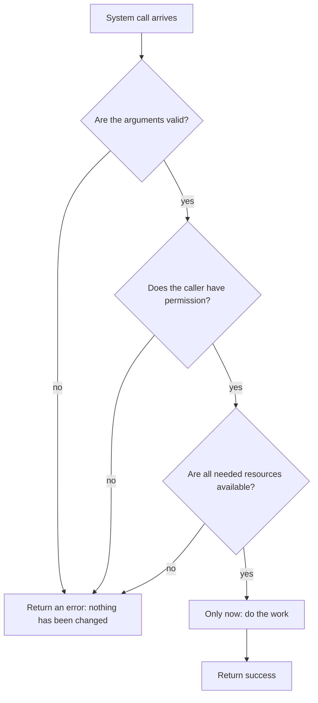

# Design goals, interfaces and implementation

> **Before this lesson:** this lesson looks back over the whole track from a designer's point of view, so it helps to have met the main pieces first: system calls and kernel structures ([Core concepts, system calls and kernel structure](#/lesson/os/concepts-syscalls-structure)), processes ([Processes and threads](#/lesson/os/processes-threads)) and files ([Files and directories](#/lesson/os/files-directories)).

## In plain words

Up to now this track has taken operating systems apart to see how each piece works. This lesson asks a different question: if *you* had to design one, how would you decide what to build?

Think about designing a kitchen that thousands of different cooks will use for the next thirty years. You must decide what goes on the worktop (the things cooks touch every day) and what stays behind the walls (pipes, wiring). Put too little on the worktop and cooks cannot do their job. Put too much and nobody can find anything. And once people have learned where things are, you can never move them without causing chaos.

An operating system has the same two faces. The part programmers see and use is the **interface**: the set of operations offered to programs. The part behind the walls is the **implementation**: how those operations are actually carried out. A good designer spends most of the effort on the interface, because the implementation can be replaced later and the interface, in practice, cannot.

Why it matters for a job: very few people design a whole operating system, but every engineer designs interfaces — a library, a web service, a module used by teammates. The principles in this lesson were learned painfully on operating systems and apply to all of those. Design questions are also a standard part of senior-level interviews.

## What is the designer trying to achieve?

A general-purpose operating system has four main jobs. Each has appeared earlier in the track.

1. **Define abstractions.** An *abstraction* is a simplified thing that hides messy details. Processes, address spaces and files are abstractions: none of them exists physically; they are useful inventions.
2. **Provide primitive operations** on those abstractions — create, read, write, delete — reachable through system calls.
3. **Ensure isolation.** Many users and programs share one machine. A fault or misbehaviour in one must not damage the others. Yet they must also be able to share data when they *choose* to.
4. **Manage the hardware.** Someone has to deal with the processor, memory chips, disks and other devices, and allow programs to share them.

### Why it is hard

Designing an operating system is much harder than designing an ordinary application, and it is worth knowing why, because the same pressures apply to any large, long-lived piece of software.

- **Size.** Modern systems contain tens of millions of lines of code. No single person understands all of it.
- **Concurrency.** Many things happen at the same time — several users, several devices — which produces problems such as race conditions and deadlocks.
- **Hostile users.** Some people using the system want to break it or to read others' data.
- **Sharing.** Despite distrust, users want to share some things with selected others.
- **Long life.** An operating system lives for decades. The designers must guess how hardware and usage will change, and they will sometimes guess wrong.
- **Unknown uses.** Designers do not know what people will do with the system. Nobody designing UNIX foresaw smartphones.
- **Portability.** The system must run on different kinds of hardware and with thousands of devices made by other companies.
- **Backward compatibility.** New versions must keep running old programs, including programs that rely on old mistakes. This is the heaviest chain of all.

## Designing the interface

### Three principles

Generations of designers have arrived at roughly the same three principles for a good interface.

**Principle 1: Simplicity.** A simple interface is easier to understand and to implement without bugs. The French writer and aviator Antoine de Saint-Exupéry observed that a design is finished not at the point where nothing more can be added to it, but at the point where nothing more can be removed. In short: less is better than more.

**Principle 2: Completeness.** The interface must make it possible to do everything users need. Simplicity and completeness pull against each other; the two are reconciled by a saying usually credited to Albert Einstein: *everything should be as simple as possible, but no simpler.*

One influential designer, Fernando Corbató, who led two famous early systems, described the goal as providing a **minimum of mechanism and a maximum of clarity**. If a feature cannot be implemented efficiently and explained in a sentence, it probably should not be included. A useful test is to ask of every proposed feature: *what would go wrong if we left it out?* If the answer is "nothing much", leave it out.

**Principle 3: Efficiency.** If an operation cannot be implemented efficiently, it is probably not worth having. Programmers should also be able to tell roughly what an operation costs. An operation that looks cheap but is secretly expensive leads people to write slow programs without knowing why.

### Paradigms: a consistent way of seeing things

Once the goals are set, the designer needs a unifying idea, so that users can guess how an unfamiliar part of the system works from the parts they already know. Such a unifying idea is called a **paradigm**. A system built on a coherent paradigm has **architectural coherence**: its parts feel like they belong together.

There are two audiences to think of: people using the screen, and programmers writing code.

**For users of the screen.** Graphical systems use what is sometimes called the **WIMP** paradigm — windows, icons, menus and a pointing device. What matters most is consistency: the same action should always be done the same way. If double-clicking opens one kind of thing, it should open every kind of thing.

**For programmers: how programs run.** Two paradigms are common.

- The **algorithmic** paradigm: a program starts, does a job step by step, perhaps asking the operating system for services along the way, and finishes. The program is in charge.
- The **event-driven** paradigm: the program sets itself up and then waits. Things that happen — a key press, a mouse movement, a message arriving — are called **events**. For each event, the system calls a piece of the program written to handle it. The outside world is in charge. Graphical programs and network servers are written this way.

```python-run
# The same task - totalling numbers typed by a user - written in the two paradigms.

# 1. Algorithmic: the program drives; it asks for each input when it wants it.
def algorithmic(inputs):
    total = 0
    for value in inputs:          # "read the next input" at a moment the program chooses
        total += value
    return total

# 2. Event-driven: the program registers handlers and then reacts to whatever arrives.
class EventDriven:
    def __init__(self):
        self.total = 0
        self.handlers = {"number": self.on_number, "reset": self.on_reset}

    def on_number(self, value):
        self.total += value

    def on_reset(self, _):
        self.total = 0

    def dispatch(self, event_name, data=None):
        handler = self.handlers.get(event_name)
        if handler:
            handler(data)

print("algorithmic :", algorithmic([4, 10, 6]))

app = EventDriven()
for event in [("number", 4), ("number", 10), ("mouse-moved", None), ("reset", None), ("number", 6)]:
    app.dispatch(*event)
print("event-driven:", app.total)
```

**What each part does.**

- `algorithmic` is an ordinary function: it loops over the inputs in an order it controls and returns the sum.
- `EventDriven` holds a table, `self.handlers`, that maps the *name* of an event to the function that should deal with it.
- `dispatch` is the part that the system would call whenever something happens: it looks up the event's name and, if a handler was registered, calls it with the event's data. `app.dispatch(*event)` unpacks a pair such as `("number", 4)` into the two arguments.
- Events with no registered handler — here `"mouse-moved"` — are ignored.

**The output.** The first prints 20. The second prints 6: the events arrived in an order the program did not choose, including a reset in the middle, and the program reacted to each one as it came. That loss of control over ordering is what makes event-driven programs harder to reason about and also what lets them stay responsive.

**For programmers: how data is seen.** The second decision is what "data" looks like to a program. UNIX chose *everything is a file*: documents, devices and connections between programs are all read and written the same way. Windows chose *everything is an object*, reached through a handle. Other systems have tried *everything is a document* (the web) or *everything is a persistent object in one huge address space*. The particular choice matters less than applying it uniformly.

### The system call interface

Following the first principle, the system should offer **as few system calls as it can get away with**, each as simple as possible, while still covering what is needed. Three guidelines help.

**Handle the general case, and let libraries provide the special cases.** UNIX has several ways to start a new program, differing only in how the arguments are supplied. Only one is a system call. The others are library functions that rearrange their arguments and then make that one call. The kernel stays small, and programmers still get convenience.

**Do not hide power.** If the hardware can do something efficiently, give programs an efficient way to use it. Do not bury it under layers that make it slow. The purpose of abstraction is to hide *undesirable* properties, not to hide useful ones.

**Decide between connections and no connections.** Some services are **connection-oriented**: first you set up an association (open a file), then you use it (read, write), then you tear it down (close). Others are **connectionless**: each request is complete in itself. The connection-oriented style lets expensive checks be done once, at the start.

A related question is **visibility**: which system calls should programs see? One approach publishes the real kernel calls (POSIX). The other publishes a library and keeps the kernel calls private (Windows), which leaves the designers free to change the kernel later.

## Implementing the system

### Choosing an overall structure

Earlier lessons described the main ways to organise a kernel. As a reminder, from a designer's viewpoint:

| Structure | Idea | Trade-off |
|---|---|---|
| **Layered** | Stack of layers, each using only the one below | Clean to reason about; hard to decide what goes in which layer |
| **Exokernel** | Kernel only divides up resources; programs bring their own abstractions as libraries | Very flexible; little is shared |
| **Microkernel with servers** | Tiny kernel; file systems and drivers run as ordinary processes | Faults are contained; messages cost time |
| **Extensible system** | Small core to which trusted or checked code can be added | Flexible; safety of added code is the difficulty |
| **Monolithic** | Everything in one privileged program | Fast and straightforward; a bug anywhere can crash everything |

The argument behind the exokernel and microkernel families is called the **end-to-end argument**: if something must be done by the application anyway in order to do it properly, it is wasteful to also do it in a lower layer.

### Mechanism versus policy

This is one of the most valuable ideas in all of system design, and it deserves care.

- A **mechanism** is *how* something is done.
- A **policy** is *what* is to be done, or *which* choice is to be made.

The principle: **keep them separate.** Put the mechanism in the kernel, and leave the policy, as far as possible, to something outside it.

An example from scheduling. The mechanism is: "the kernel keeps a table of ready threads with a priority number for each, and always runs the one with the highest number." The policy is: "which threads should have high numbers?" If the kernel provides the mechanism plus a way to *set* the numbers, then different users of the system can apply entirely different policies — favour interactive programs, favour paying customers, favour a database's most urgent work — without changing a line of the kernel.

```python-run
# Mechanism: a tiny scheduler that knows nothing about WHY a job is important.
def run_all(jobs, choose):
    """jobs: list of dicts. choose: a function (the policy) that picks the next job from a list."""
    waiting, order = list(jobs), []
    while waiting:
        job = choose(waiting)          # the policy decides
        waiting.remove(job)            # the mechanism carries it out
        order.append(job["name"])
    return order

jobs = [
    {"name": "report",  "length": 9, "arrived": 0, "paying": False},
    {"name": "invoice", "length": 2, "arrived": 1, "paying": True},
    {"name": "backup",  "length": 6, "arrived": 2, "paying": False},
    {"name": "search",  "length": 1, "arrived": 3, "paying": False},
]

# Three policies, each one short function. The mechanism above is untouched.
first_come   = lambda waiting: min(waiting, key=lambda j: j["arrived"])
shortest     = lambda waiting: min(waiting, key=lambda j: j["length"])
paying_first = lambda waiting: min(waiting, key=lambda j: (not j["paying"], j["arrived"]))

print("first come, first served:", run_all(jobs, first_come))
print("shortest job first      :", run_all(jobs, shortest))
print("paying customers first  :", run_all(jobs, paying_first))
```

**What each part does.**

- `run_all` is the mechanism. It keeps a list of waiting jobs, repeatedly asks `choose` which one to take, removes that one and records it. It contains no opinion about which job is better.
- `choose` is passed in as an argument. In Python a function can be handed to another function like any other value.
- Each of the three policies is written with `lambda`, which creates a small unnamed function. `min(waiting, key=...)` returns the job for which the key is smallest. In the third policy the key is a pair: `not j["paying"]` is `False` for paying customers, and `False` counts as smaller than `True`, so they come first; ties are broken by arrival time.

**The output.** Three different orders from the same mechanism: by arrival; shortest first (`search`, `invoice`, `backup`, `report`); and with the paying customer's job moved to the front. Changing the behaviour of the system required writing one line, not rewriting the scheduler.

### Orthogonality

**Orthogonality** means that separate ideas can be combined freely and independently. A system built from a few orthogonal pieces can do a great many things, because the pieces multiply.

The Linux `clone` call from the case study is the standard example. The designers did not build one fixed thing called "process" and another called "thread". They provided a single operation with independent switches: share the memory or not; share the open files or not; share the signal handlers or not. Every combination works. Two of those combinations happen to be what people call a process and a thread.

A second example: in UNIX, *processes* (things that run) and *the working directory* or *the ownership of a file* are independent ideas, so each can be changed without affecting the others.

### Naming

Nearly every lasting data structure in an operating system has a **name** by which it can be found. Names usually exist at two levels:

- an **external name** used by people — a path such as `/home/mira/notes.txt`;
- an **internal name** used by the system — a number such as an i-node number.

A **directory** is a table that translates one into the other. Splitting the two is what allows a file to be renamed without moving it, and to have several names at once.

A naming scheme should let names be organised in a tree, so that different people can use the same short name without collision, and should not impose pointless limits on the length or form of names.

### Binding time

**Binding** means connecting a name to the thing it stands for. **Binding time** is *when* that connection is made.

- **Early binding** fixes the connection well in advance. It is efficient, because no work is needed at the moment of use, and inflexible.
- **Late binding** makes the connection at the last moment. It is flexible and costs something every time.

An everyday comparison: ordering a product from a catalogue. A manufacturer who keeps finished goods in a warehouse has bound early — delivery is quick but the choice is fixed. One who builds each item after it is ordered has bound late — you wait, but you get exactly what you asked for.

In computing: a compiler that fixes the memory address of a variable when the program is built is binding early. Virtual memory binds late: the real location of a page is decided only when the page is first used, and can change afterwards. Operating systems tend to prefer late binding for flexibility and then work hard, with caches, to win back the speed.

### Static versus dynamic structures

Designers repeatedly face one choice: should a table inside the system have a **fixed** size decided in advance (*static*), or should it **grow as needed** (*dynamic*)?

Take the table of processes. A static design reserves room for, say, 256 processes. It is simple and fast: finding entry number 37 is a single calculation. But the 257th process cannot be created, however much memory is free, and if only ten processes exist, the space for the other 246 is wasted.

A dynamic design allocates entries when needed and links them together. No limit is built in, and no space is wasted. But it needs a memory manager inside the kernel, the code is more complicated, and finding an entry may mean following a chain of links.

```python-run
class StaticTable:
    """Fixed number of slots, decided in advance."""
    def __init__(self, slots):
        self.slots = [None] * slots
    def add(self, item):
        for i, current in enumerate(self.slots):
            if current is None:
                self.slots[i] = item
                return i
        return "error: table full"
    def in_use(self):
        return sum(1 for s in self.slots if s is not None)

class DynamicTable:
    """Grows whenever an entry is added."""
    def __init__(self):
        self.entries = []
    def add(self, item):
        self.entries.append(item)
        return len(self.entries) - 1
    def in_use(self):
        return len(self.entries)

static, dynamic = StaticTable(slots=4), DynamicTable()
for name in ["shell", "editor", "browser", "music", "backup", "compiler"]:
    print(f"start {name:9s} static -> {static.add(name)!s:18} dynamic -> {dynamic.add(name)}")

quiet = StaticTable(slots=1000)
quiet.add("only one process")
print("a static table of 1000 slots with 1 process wastes", 1000 - quiet.in_use(), "slots")
```

**What each part does.** `StaticTable` creates a list of a fixed number of empty slots (`None` means empty). Its `add` searches for an empty slot and reports an error if none is left. `DynamicTable` starts with an empty list, and `add` appends to it, so it never fills up. The loop starts six programs in each, and the last lines show the opposite problem: a large static table that is nearly empty.

**The output.** The first four programs fit in both. The fifth and sixth are refused by the static table and accepted by the dynamic one. And the 1000-slot table with one entry wastes 999 slots. A static limit is either too small or too large — rarely right.

The same choice appears in the kernel's **stack**. Giving each thread a fixed stack is simple; if it is too small, the system crashes. There is no universally right answer: small systems with known workloads favour static; general-purpose systems favour dynamic, usually with some upper limit as a safety net.

### Top-down or bottom-up?

There are two orders in which to build a system.

- **Top-down:** start with the system call handlers and work downward, writing lower layers as they are needed.
- **Bottom-up:** start with the code that hides the hardware — interrupt handling, the clock, device drivers — and build upward.

Top-down sounds orderly, but nothing can be tested until the bottom exists. Bottom-up means each layer can be tested as soon as it is written, on a foundation that already works. In practice most teams build the low-level parts first.

### Useful techniques

A collection of ideas that experienced implementers use again and again.

**Hide the hardware.** Much of an operating system has nothing to do with any particular machine. Confine the machine-specific parts to a small layer at the bottom — as the Windows hardware abstraction layer does — so that moving to a new machine means rewriting only that layer.

**Add a level of indirection.** A saying in computing holds that any problem can be solved by adding another level of **indirection** — that is, by going through an intermediate table or name instead of referring to a thing directly. Examples from this track: a keyboard sends a key *number*, which a table translates into a character, so the same keyboard works for any language. A program holds a file *descriptor*, not the file. A directory holds an *i-node number*, not the file's contents. Each extra step buys flexibility.

**Design for reuse.** The same code can often serve several purposes. Code that manages a map of free and used bits can track free disk blocks, free memory pages and free table entries.

**Write reentrant code.** Code is **reentrant** if it can safely be executed by two activities at the same time — or interrupted and entered a second time before the first execution finishes. On a machine with several processors this is not optional. It means either keeping no shared state, or protecting shared state with locks.

**Try brute force first.** Clever optimisation is often wasted. If a table has a dozen entries, searching it from start to end is quite fast enough; a sophisticated structure would add bugs and save nothing measurable. Optimise only what measurement shows to be slow.

**Check for errors first.** Many system calls can fail for many reasons: a file does not exist, the caller lacks permission, a table is full. Do *all* the checks at the start of the call, before changing anything. If instead the call does half its work and then discovers a problem, it must carefully undo that half — and undoing is where bugs hide.



> [!INTERVIEW]
> "Explain the difference between mechanism and policy, with an example." Mechanism is how something is done; policy is what should be done. Example: a kernel that always runs the highest-priority thread provides a mechanism; deciding which threads get high priority is policy, and can be set from outside through a system call. Separating them lets the policy change without touching (and re-testing) the kernel. Other examples you can offer: page replacement (the kernel provides "evict a page"; which page is policy), and access control (the kernel checks a list; what the list says is policy).

## Common mistakes and confusions

- **"A richer interface is a better interface."** Every feature must be learned, documented, tested and supported for decades. Features can be added later; they can almost never be removed.
- **"The implementation is the hard part."** A poor implementation behind a good interface can be replaced. A poor interface is permanent.
- **Confusing mechanism with policy.** If changing a *decision* requires changing *kernel code*, the two were not separated.
- **Setting a fixed limit because "nobody will ever need more".** Such limits are among the most frequently regretted design decisions.
- **Optimising before measuring.** Effort goes into parts that were never slow.
- **Doing work before checking for errors**, and then having to undo it.

## Summary

- An operating system must **define abstractions**, **provide operations** on them, **isolate** users while allowing **sharing**, and **manage hardware**. It is hard because of size, concurrency, hostile users, long life, unknown uses, portability and backward compatibility.
- A good interface is **simple**, **complete** and **efficient**, and follows a consistent **paradigm** (algorithmic or event-driven execution; files or objects for data).
- Offer few system calls; put special cases in libraries; do not hide power; choose deliberately between connection-oriented and connectionless services.
- Implementation choices include the overall **structure**, separating **mechanism from policy**, **orthogonality**, two-level **naming**, **binding time**, and **static versus dynamic** structures.
- Useful techniques: hide the hardware, add **indirection**, design for reuse, write **reentrant** code, prefer brute force until measurement says otherwise, and **check for errors first**.

## Glossary

- **Interface** — the set of operations a system offers to those who use it.
- **Implementation** — how those operations are carried out internally.
- **Abstraction** — a simplified thing that hides messy details.
- **Isolation** — keeping one user's or program's faults from affecting others.
- **Backward compatibility** — new versions continuing to run old programs.
- **Paradigm** — a unifying way of looking at a system.
- **Architectural coherence** — the quality of parts fitting together under one paradigm.
- **Algorithmic paradigm** — a program runs step by step under its own control.
- **Event-driven paradigm** — a program waits and reacts to events as they occur.
- **Event** — something that happens and to which a program may respond.
- **Connection-oriented / connectionless** — a service that is set up, used and torn down / one where each request stands alone.
- **End-to-end argument** — if the application must do something anyway to do it properly, lower layers should not duplicate it.
- **Mechanism** — how something is done.
- **Policy** — what is to be done, or which choice is made.
- **Orthogonality** — the ability to combine separate features independently.
- **External / internal name** — a name for people / a name used inside the system.
- **Binding** — connecting a name to what it stands for.
- **Early / late binding** — making that connection in advance / at the moment of use.
- **Static / dynamic structure** — a table of fixed size / one that grows as needed.
- **Top-down / bottom-up** — building from the user-facing parts downward / from the hardware upward.
- **Indirection** — referring to something through an intermediate step.
- **Reentrant** — safe to execute by more than one activity at the same time.
- **Brute force** — the most direct method, with no cleverness.

## Check yourself

```quiz
[
  {"q": "Which of these is NOT one of the three classic principles of interface design?",
   "options": ["Simplicity", "Completeness", "Efficiency", "Maximising the number of features"],
   "answer": 3,
   "explain": "The principles are simplicity, completeness and efficiency. Features should be kept to the minimum that makes the interface complete."},
  {"q": "A designer wonders whether to add a feature. Which question is the most useful test?",
   "options": ["Does a competitor have it?", "What would go wrong if we left it out?", "Can it be added quickly?", "Will it make the manual longer?"],
   "answer": 1,
   "explain": "If nothing much is lost by omitting a feature, it should be omitted: everything added must be supported indefinitely."},
  {"q": "A program sets up some handlers and then waits; the system calls a handler each time a key is pressed or a message arrives. Which paradigm is this?",
   "options": ["Algorithmic", "Event-driven", "Batch", "Layered"],
   "answer": 1,
   "explain": "In the event-driven paradigm the outside world determines what happens next; the program reacts."},
  {"q": "UNIX offers several library functions for starting a program but only one system call that does so. Which guideline does this illustrate?",
   "options": ["Hide power from the programmer", "Handle the general case in the kernel and let libraries provide the special cases", "Use static tables", "Bind as early as possible"],
   "answer": 1,
   "explain": "Keeping one general call in the kernel keeps it small, while libraries add convenience outside it."},
  {"q": "A kernel always runs the highest-priority thread and lets a privileged program set the priorities. What is the mechanism and what is the policy?",
   "options": ["Mechanism: who gets high priority. Policy: running the highest-priority thread", "Mechanism: running the highest-priority thread. Policy: deciding which threads get high priority", "Both are mechanism", "Both are policy"],
   "answer": 1,
   "explain": "How the choice is carried out is mechanism. What the priorities should be is policy, and it can be changed without altering the kernel."},
  {"q": "What is the main disadvantage of a static (fixed-size) table in the kernel?",
   "options": ["It is slow to search", "Its limit is either too small, causing failures, or too large, wasting space", "It needs a memory manager", "It cannot be used on multiprocessors"],
   "answer": 1,
   "explain": "A fixed size is simple and fast but cannot adapt: requests beyond the limit fail even when memory is free."},
  {"q": "Virtual memory decides where a page really lives only when the page is first used. What is this an example of?",
   "options": ["Early binding", "Late binding", "Brute force", "Top-down implementation"],
   "answer": 1,
   "explain": "The connection between a virtual page and a physical location is made at the last moment, which is flexible at some cost in speed."},
  {"q": "Why should a system call perform all its error checks before changing anything?",
   "options": ["Checks are faster at the start", "So that a failure never leaves half-finished work that must be undone", "Because errors can only happen at the start", "To use less memory"],
   "answer": 1,
   "explain": "If a problem is found after partial changes, the system must restore the previous state exactly, which is error-prone."}
]
```

> **Source:** Tanenbaum & Bos, Modern Operating Systems 4e, §12.1 (The nature of the design problem), §12.2 (Interface design), §12.3 (Implementation)
