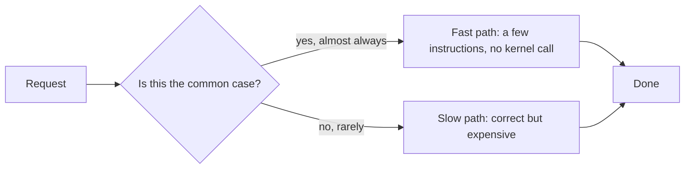

# Performance, project management and trends

> **Before this lesson:** read [Design goals, interfaces and implementation](#/lesson/os/design-interfaces-implementation), which this lesson continues. The idea of a cache comes from [Hardware review](#/lesson/os/hardware-review), and virtual machines from [Hypervisors and CPU virtualization techniques](#/lesson/os/hypervisors).

## In plain words

Three practical questions remain once a system has been designed.

**How do you make it fast?** Imagine a delivery company whose parcels arrive late. A new manager could buy faster vans. A wiser one first finds out where the time actually goes — and discovers that the vans are fine, but every parcel waits two hours at one sorting desk. Fixing that desk helps; faster vans would not have. Making software fast works the same way: *measure first*, then fix the one place that matters.

**How do you organise the people who build it?** A large operating system is built by hundreds or thousands of people over many years. It turns out that adding more people does not make such work go proportionally faster — and can make it slower — for reasons that have nothing to do with computers and everything to do with how people communicate.

**Where is it all heading?** The hardware under an operating system keeps changing: more processor cores, more memory, batteries, data centres. Each change shifts what the operating system must be good at.

Why it matters for a job: "it is too slow" and "the project is late" are the two complaints every engineer hears throughout a career. The ideas here — measure before optimising, cache, optimise the common case, and be realistic about team size — are among the most widely applicable in the whole track.

## Performance

### The first rule: correct first, then fast

An operating system that is fast and unreliable is of no use to anyone. An influential rule of thumb says: get the system working, with the most straightforward design you can; only then, if it is too slow, make it faster. Features and cleverness added early, "for performance", are a leading cause of systems that are both late and slow.

It also helps to know *why* systems are slow. Old computers running small operating systems could start in seconds. Today's machines are thousands of times more powerful and can take longer. The reason is not the hardware. Systems have grown to do far more — much of it rarely used — and every feature adds code that must be loaded and checked. This steady growth is known as **software bloat**. The cure is restraint in adding features, the first principle of the previous lesson.

### Measure before you optimise

Programmers are notoriously bad at guessing which part of a program takes the time. The discipline is:

1. **Measure.** Use a tool called a **profiler**, which records how much time is spent in each part of the program.
2. Find the place where most of the time goes. This is the **bottleneck** — named after the narrow neck of a bottle, which limits how fast it can be poured however wide the rest is.
3. Improve *that* place.
4. Measure again, both to confirm the improvement and because the bottleneck has now moved somewhere else.

An observation that guides this work: in most programs, a small fraction of the code accounts for most of the running time. Speeding up the rest gains almost nothing.

```python-run
def total_time(parts):
    return sum(parts.values())

def speed_up(parts, name, factor):
    improved = dict(parts)                      # a copy, so the original is untouched
    improved[name] = parts[name] / factor
    return improved

# Where a request spends its time, in milliseconds (found by measuring, not guessing).
parts = {"parse request": 2, "check permissions": 3, "read from disk": 80, "format reply": 15}
before = total_time(parts)
print(f"before: {before} ms")
for name, share in parts.items():
    print(f"   {name:18s} {share:3d} ms  {share / before:5.0%}")

print("\nmake one part 10 times faster:")
for name in parts:
    after = total_time(speed_up(parts, name, 10))
    print(f"   {name:18s} -> total {after:6.1f} ms  (overall speed-up {before / after:4.2f}x)")
```

**What each part does.**

- `parts` is a table of how long each stage takes — the kind of result a profiler gives.
- `total_time` adds the stages up.
- `speed_up` copies the table (`dict(parts)`) and divides one stage's time by a factor, standing for an optimisation of that stage alone.
- The first loop prints each stage's share of the total. The second tries, in turn, making each single stage ten times faster and prints the new total.

**The output.** Reading from disk is 80% of the time. Making *parsing* ten times faster — which might be weeks of clever work — improves the total by under 2%. Making the disk stage ten times faster makes the whole request about 3.6 times faster. Effort spent anywhere but the bottleneck is wasted.

### Trading space for time

Many optimisations exchange one resource for another. The commonest exchange is between **space** (memory) and **time**.

- To save *time*, spend *memory*: compute answers once, store them in a table, and look them up afterwards.
- To save *memory*, spend *time*: store data in a compact form and work it out again each time it is needed.

A small example: counting how many bits of a byte are 1. (A *byte* is eight bits; each bit is 0 or 1.) The direct way examines the eight bits one at a time. The alternative is to work out the answer for all 256 possible byte values in advance and store them in a table; counting then becomes a single look-up.

```python-run
def count_by_loop(byte):
    """Examine each of the 8 bits. Returns (number of 1 bits, steps taken)."""
    count, steps = 0, 0
    for position in range(8):
        steps += 1
        if byte & (1 << position):      # is the bit at this position a 1?
            count += 1
    return count, steps

TABLE = [bin(value).count("1") for value in range(256)]     # built once: 256 stored answers

def count_by_table(byte):
    return TABLE[byte], 1                                   # one look-up

data = [0, 1, 255, 170, 37, 128]
print("byte   loop: answer, steps    table: answer, steps")
for byte in data:
    print(f"{byte:4d}   {count_by_loop(byte)!s:20} {count_by_table(byte)}")

n = 1_000_000
print(f"\nfor {n:,} bytes: loop needs {8 * n:,} steps and no table;")
print(f"the table method needs {n:,} steps and {len(TABLE)} stored numbers")
```

**What each part does.**

- `count_by_loop` checks each of the eight bit positions. `1 << position` is a number with a single 1 bit at that position; `byte & ...` is non-zero exactly when the byte has a 1 there.
- `TABLE` is built once. `bin(value)` gives a number's binary form as text, such as `'0b10101010'`, and `.count("1")` counts the 1 characters.
- `count_by_table` returns the stored answer.

**The output.** Both methods agree on every byte (255 has eight 1 bits; 170, which is 10101010 in binary, has four). The loop always takes 8 steps; the table takes 1. For a million bytes that is eight million steps against one million, bought with 256 stored numbers. That is the trade in miniature.

The trade goes the other way too. Compressing data saves space and costs time to compress and expand. Which direction is right depends on what is scarce — and that changes over the years as memory and processors get cheaper at different rates.

### Caching

The most widely used performance technique of all is **caching**: keeping a copy of the result of expensive work so that the work need not be repeated. You have met caches throughout this track — the processor's cache of memory, the translation cache for addresses (the TLB), the cache of disk blocks, the cache of directory look-ups.

Caching works whenever the same result is likely to be needed again soon. Consider finding the file `/usr/lib/python/os.py`. The system must read the root directory to find `usr`, read that directory to find `lib`, and so on — several disk reads for one name. If the result is remembered, the next request for the same name, or for another file in the same directory, needs no disk reads at all.

Every cache needs answers to two questions.

- **What to throw out when it is full?** This is the page replacement problem again; the usual answer is to discard what has gone unused longest.
- **How to keep it correct?** A cached copy that no longer matches the original is called **stale**. If the original changes, the cached copy must be updated or discarded — a step known as **invalidation**. Forgetting it is a classic and hard-to-find bug.

```python-run
class SlowDirectoryService:
    """Pretends to be a disk: every lookup of one path component costs one disk read."""
    def __init__(self):
        self.disk_reads = 0
    def resolve(self, path):
        parts = [p for p in path.split("/") if p]
        self.disk_reads += len(parts)
        return hash(path) % 100000              # stands for the file's internal number

class CachedLookup:
    def __init__(self, service):
        self.service, self.cache = service, {}
    def resolve(self, path):
        if path not in self.cache:
            self.cache[path] = self.service.resolve(path)     # miss: do the slow work once
        return self.cache[path]                               # hit: no disk read
    def invalidate(self, path):
        self.cache.pop(path, None)

requests = ["/usr/lib/python/os.py", "/usr/lib/python/re.py", "/usr/lib/python/os.py",
            "/etc/hosts", "/usr/lib/python/os.py", "/etc/hosts", "/usr/lib/python/re.py"] * 50

plain = SlowDirectoryService()
for path in requests:
    plain.resolve(path)

backing = SlowDirectoryService()
cached = CachedLookup(backing)
for path in requests:
    cached.resolve(path)

print("disk reads without a cache:", plain.disk_reads)
print("disk reads with a cache   :", backing.disk_reads)

cached.invalidate("/etc/hosts")                 # the file was renamed: the old answer must go
cached.resolve("/etc/hosts")
print("after one invalidation     :", backing.disk_reads)
```

**What each part does.**

- `SlowDirectoryService.resolve` splits the path into its components and charges one disk read for each.
- `CachedLookup` keeps a dictionary of answers already found. On a request it first looks in the dictionary; only if the path is absent does it ask the slow service and store the result.
- `invalidate` removes an entry, which must be done whenever the underlying thing changes.
- The same 350 requests are then made with and without the cache.

**The output.** Without a cache, 1,200 disk reads. With one, 10 — one set of reads for each of the three distinct paths. After invalidating one entry and asking again, 12: the work for that one path had to be redone.

### Hints

A cache entry is expected to be right. A **hint** is weaker: a suggestion that is *probably* right and that the user must **check** before relying on. If the hint proves wrong, the proper answer is found the slow way.

Hints are useful because they need no invalidation. A web page that says "the next page is over there" is a hint: usually it is, and if the link is broken you search another way. A stale hint costs a little time; it never causes a wrong result, because it is always verified.

### Locality

Programs and people do not behave randomly. A program that used one part of memory a moment ago will probably use nearby parts next. A person who opened one file in a folder a moment ago will probably open another from the same folder. This tendency is called **locality of reference**, and nearly all performance techniques depend on it. Caches work because of it. File systems put the blocks of one file, and the files of one directory, close together on disk because of it. On a multiprocessor, the scheduler tries to run a thread on the processor it last used because of it.

### Optimise the common case

Most operations have a usual, uncomplicated case and several rare, awkward ones. The guideline is: **make the common case fast, and make the rare cases correct.**

The lock is the textbook example. Usually, when a thread tries to take a lock, the lock is free. So a well-designed lock handles that case with one or two machine instructions and no call into the kernel. Only in the rare case that the lock is already held does it take the slow path — entering the kernel and putting the thread to sleep. The slow path may be quite slow; it hardly matters, because it is rare.



## Project management

Programmers are optimists, and operating-system projects are famous for being late. The most influential account of why was written by Fred Brooks, who managed the development of a large operating system for IBM in the 1960s and described the experience in a book whose central points still hold.

### The person-month is a myth

Managers like to measure work in **person-months**: one person working for one month. The unit suggests that people and months can be swapped — that a job needing 12 person-months could be done by one person in 12 months, by 12 people in one month, or by 365 people in a day.

For some work that is true. Picking a field of fruit is like that: the pickers do not need to talk to each other. Software is not, for three reasons.

1. **The work cannot be split up freely.** Many tasks must be done in order. Brooks's famous comparison: bearing a child takes nine months, no matter how many people are assigned.
2. **Each new person must be trained** in the project — its design, its tools, its conventions — and the training is done by the experienced people, who stop doing their own work meanwhile.
3. **People must communicate,** and the amount of communication grows much faster than the number of people.

The third point can be made exact. If every member of a team must coordinate with every other, the number of pairs among $n$ people is

$$\frac{n(n-1)}{2}.$$

```python-run
def pairs(n):
    return n * (n - 1) // 2

print("team size   pairs who must coordinate")
for n in (2, 3, 5, 10, 20, 50, 100, 1000):
    print(f"{n:9d}   {pairs(n):9,d}")

# A simple model: each person does 1 unit of work per month,
# minus a little time lost for every colleague they must stay in step with.
def months_to_finish(work_units, people, loss_per_colleague=0.02):
    productive = people * max(0.0, 1 - loss_per_colleague * (people - 1))
    return float("inf") if productive == 0 else work_units / productive

print("\na job of 120 units of work:")
for people in (1, 5, 10, 20, 26, 35, 45):
    print(f"   {people:3d} people -> {months_to_finish(120, people):6.1f} months")
```

**What each part does.**

- `pairs` computes the formula. `//` is whole-number division.
- `months_to_finish` is a deliberately crude model. Each person could do one unit of work a month, but loses 2% of their time for every colleague they must coordinate with. Multiplying by the number of people gives the team's real output, and dividing the job by that gives the months needed.

**The output.** Ten people form 45 pairs; a hundred form 4,950; a thousand form nearly half a million. In the model, going from 1 person to 10 cuts the time from 120 months to under 15. But the gain shrinks: 26 people finish in about 9 months, and beyond that the schedule gets *longer* — 35 people take longer than 26, and 45 take longer still, because so much time goes on coordination. The exact numbers are invented; the shape of the curve is real.

Brooks summed up the consequence in what is now called **Brooks's law**: *adding people to a late software project makes it later.* The newcomers consume the time of the experienced people and add to the communication load before they contribute anything.

### How large projects divide the time

Brooks also reported how the time in a large project is actually spent. Writing the code is the *small* part — roughly a sixth. About a third goes on planning, and about half on testing, first of the individual parts and then of the whole. People who estimate only the coding will be wrong by a large factor.

### Team structure

Not all programmers are equally productive; measured differences between the best and the rest are large. And a design made by too many equal voices tends to lose its coherence.

One structure that tries to deal with both facts is the **chief programmer team**, modelled on a surgical team. One highly able person does the design and writes the crucial code. Others support that person: an assistant who can take over, someone handling administration, someone writing documentation, someone building tools, someone testing. The aim is to let the most capable person's time go on what only they can do, and to keep the design in one mind.

Large projects cannot be one such team, so they are organised as a tree: small teams with leaders, groups of teams with managers, and so on. Communication then flows mainly within teams and through leaders, not between every pair of people — which is how organisations escape the $n(n-1)/2$ trap.

### The role of experience

Experienced designers matter enormously. Brooks observed a recurring pattern he called the **second-system effect**. A designer's first system is usually lean, because the designer is cautious. Having succeeded, the designer loads the second one with every idea that was left out of the first — and produces something bloated and late. By the third, the lesson has been learned.

Experience also teaches a preference for building something small that works and growing it, over planning something vast in full detail before any of it runs.

### No silver bullet

In old stories, a werewolf can be killed only by a silver bullet. Brooks used the image for the hope of a single technique that would make software development dramatically easier. He argued that there is none: better languages, tools and methods each help somewhat, but the real difficulty is the complexity of the problem being solved, and no tool removes that. Decades later, the judgement still stands. Progress in software comes from steady accumulation of modest improvements.

> [!INTERVIEW]
> Performance and project questions with compact answers. *"The system is slow — what do you do?"* Measure with a profiler; find the bottleneck; fix that; measure again. Never optimise by guesswork. *"What is the fastest way to speed up repeated work?"* Cache it — and say how the cache is kept correct (invalidation) and bounded (eviction). *"The project is late; should we add engineers?"* Usually not: Brooks's law. New people need training and add communication paths. Better options are cutting scope or moving the date. *"Why is a common-case fast path worth extra code?"* Because total cost is dominated by what happens most often.

## Trends

An operating system is shaped by its hardware, and the hardware keeps moving. Several directions were already clear when the source text for this track was written and have continued since.

**Virtualization and the cloud.** Running an operating system on a virtual machine, not directly on hardware, has become the normal arrangement in data centres. That changes what the system underneath must do: divide resources among tenants, move running machines between hosts, and account for what each uses. It also makes specialised, stripped-down operating systems practical — a virtual machine that runs one program needs only the parts of an operating system that one program uses.

**Many cores.** Since individual processor cores stopped getting much faster, chips have gained more of them. Operating systems must spread work over dozens or hundreds of cores without their own internal locks becoming the bottleneck. The harder problem is outside the operating system: most programs are not written to use many cores at all.

**Very large address spaces.** With 64-bit addresses, the range of memory addresses is so vast that it need never be reused. That invites different designs: for example, giving every object that will ever exist its own permanent address, and blurring the line between memory and files.

**Access to data from anywhere.** People expect their documents, photographs and messages to be available on every device they own, wherever they are. That pushes storage out of the individual machine and into services on the network, and makes the local file system one cache among several.

**Battery-powered computers.** Most computers are now phones, watches and other portable devices. For these, energy is the scarcest resource, and almost every decision in the operating system — when to wake, how fast to run, when to use the radio — is also a decision about the battery.

**Embedded systems.** Computers are built into cars, appliances, medical devices and factory equipment in numbers far greater than desktop machines. These need small, reliable, often real-time operating systems, and, increasingly, strong security, because they are now connected to networks.

A lesson from the history at the start of this track applies here. Ideas return. Each new kind of computer has begun with a primitive system and gradually rediscovered protection, multiprogramming and virtual memory as its hardware grew. Techniques written off as obsolete come back when the economics change. A good foundation in the principles is what lets you recognise an old idea in new clothes.

## Common mistakes and confusions

- **Optimising by intuition.** Without measurement, the effort almost always goes to the wrong place.
- **Thinking a cache is free.** It uses memory, and a stale entry is a bug.
- **Confusing a cache with a hint.** A cache entry is trusted; a hint must be checked before use.
- **Believing people and months are interchangeable.** They are only for work that needs no communication.
- **Adding staff to rescue a late project.** It usually delays it further.
- **Expecting a tool to remove the difficulty of software.** The difficulty lies in the problem, not the tools.

## Summary

- Make it **correct first**, then fast. **Measure** to find the **bottleneck**; optimise that; measure again.
- Standard techniques: **space–time trade-offs**, **caching** (with eviction and **invalidation**), **hints** (checked before use), exploiting **locality of reference**, and **optimising the common case**.
- People and months are not interchangeable: work cannot always be divided, newcomers need training, and coordination grows as $n(n-1)/2$. **Brooks's law**: adding people to a late project makes it later.
- Coding is a minority of the effort; planning and testing dominate. **Chief programmer teams** and tree-shaped organisations limit communication. Beware the **second-system effect**. There is **no silver bullet**.
- Trends: **virtualization and clouds**, **many cores**, **huge address spaces**, **data everywhere**, **battery power** and **embedded systems**.

## Glossary

- **Software bloat** — the growth of software in size and slowness as features accumulate.
- **Profiler** — a tool that measures where a program spends its time.
- **Bottleneck** — the part of a system that limits its overall speed.
- **Space–time trade-off** — using more memory to save time, or more time to save memory.
- **Byte / bit** — eight bits / a single 0 or 1.
- **Caching** — keeping the results of expensive work to avoid repeating it.
- **Stale** — said of a cached copy that no longer matches the original.
- **Invalidation** — removing or updating a cache entry when the original changes.
- **Hint** — a probably correct suggestion that must be verified before being relied on.
- **Locality of reference** — the tendency to use again what was used recently, and things near it.
- **Common case** — the situation that occurs most often.
- **Fast path / slow path** — the short route for the common case / the full route for rare cases.
- **Person-month** — one person working for one month, as a unit of effort.
- **Brooks's law** — adding people to a late software project makes it later.
- **Chief programmer team** — a team in which one able designer is supported by specialists.
- **Second-system effect** — the tendency to overload a designer's second system with features.
- **Silver bullet** — a hoped-for single technique that would make software development easy.
- **Embedded system** — a computer built into another device.

## Check yourself

```quiz
[
  {"q": "A program spends 70% of its time in function A, 20% in B and 10% in C. Which change gives the largest improvement?",
   "options": ["Making C 100 times faster", "Making B 10 times faster", "Making A twice as fast", "Rewriting C in a faster language"],
   "answer": 2,
   "explain": "Halving A saves 35% of the total time. Even eliminating C entirely saves only 10%, and making B ten times faster saves 18%."},
  {"q": "What should be done before attempting to optimise a slow system?",
   "options": ["Rewrite it in a lower-level language", "Measure where the time is actually spent", "Add more threads", "Buy faster hardware"],
   "answer": 1,
   "explain": "Guesses about where time goes are usually wrong. A profiler identifies the bottleneck, which is the only place where optimisation pays off."},
  {"q": "Replacing a calculation by a look-up in a precomputed table is an example of...",
   "options": ["Trading space for time", "Trading time for space", "Late binding", "Brooks's law"],
   "answer": 0,
   "explain": "Extra memory holds the stored answers, and in return each result is obtained in one step."},
  {"q": "A cache holds the location of a file. The file is then moved. What must happen to the cache entry?",
   "options": ["Nothing", "It must be invalidated or updated, otherwise it is stale", "It must be copied to disk", "It becomes a silver bullet"],
   "answer": 1,
   "explain": "A cached copy that no longer matches reality gives wrong answers. Keeping caches consistent is the hard part of caching."},
  {"q": "How does a hint differ from a cache entry?",
   "options": ["A hint is always correct", "A hint is only probably correct and must be checked before it is relied upon", "A hint is stored on disk", "There is no difference"],
   "answer": 1,
   "explain": "Because a hint is verified on use, a wrong one costs only time, never a wrong result, and hints need no invalidation."},
  {"q": "A team grows from 5 to 20 people, and everyone must coordinate with everyone else. How does the number of coordinating pairs change?",
   "options": ["From 5 to 20", "From 10 to 190", "From 25 to 400", "It stays the same"],
   "answer": 1,
   "explain": "The number of pairs is n(n-1)/2: 5 x 4 / 2 = 10 and 20 x 19 / 2 = 190. Four times the people, nineteen times the coordination."},
  {"q": "What does Brooks's law state?",
   "options": ["Software doubles in size every two years", "Adding people to a late software project makes it later", "Every program has at least one bug", "Testing takes no time"],
   "answer": 1,
   "explain": "New team members need training from the existing ones and add communication overhead before they become productive."},
  {"q": "Why do well-designed locks have a fast path that avoids entering the kernel?",
   "options": ["Because the kernel cannot handle locks", "Because the common case is that the lock is free, and the common case should be made fast", "To use more memory", "Because locks are rarely used"],
   "answer": 1,
   "explain": "Most lock attempts find the lock free. Handling that case in a few instructions makes the average cost low; the rare contended case can take the slower route."}
]
```

> **Source:** Tanenbaum & Bos, Modern Operating Systems 4e, §12.4 (Performance), §12.5 (Project management), §12.6 (Trends in operating system design)
