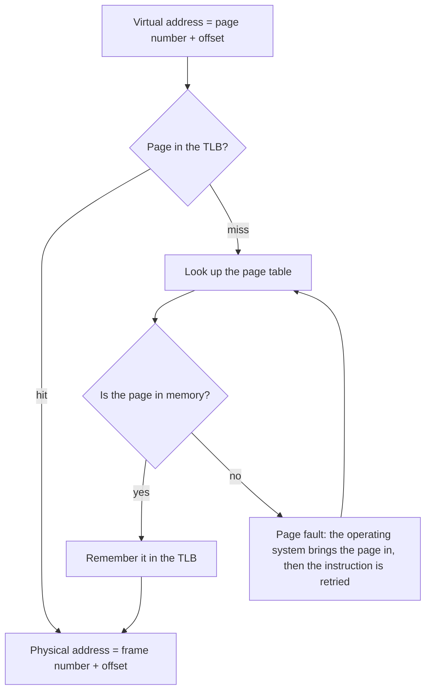

# OS interview essentials

> **Before this lesson:** this is a review of the whole track. Each section points to the lesson that teaches the topic in full; if a section feels unfamiliar, read that lesson first and come back.

## In plain words

Before a driving test you do not reread the whole handbook. You go over the handful of things the examiner always asks: mirrors, signals, stopping distances, right of way. This lesson is that final review for operating systems.

Interviewers return to the same small set of questions again and again, because they reveal whether someone understands what happens *underneath* their programs. Seven topics cover most of what is asked:

1. What is the difference between a process and a thread?
2. What is a context switch, and why does it cost time?
3. How does virtual memory work?
4. What happens on a page fault?
5. What happens on a system call?
6. What is deadlock and how is it handled?
7. How do scheduling algorithms compare?

For each one this lesson gives the foundations in plain language, then a model answer of the kind that works well in an interview, then the follow-up questions to expect.

A word on how to answer. A good answer has three parts: a one-sentence definition, the mechanism in a few steps, and one consequence or trade-off. Interviewers are less interested in whether you remember a term than in whether you can explain *why* things are the way they are.

## 1. Process versus thread

*Taught in full in [Processes and threads](#/lesson/os/processes-threads).*

**The foundations.** A **program** is a file of instructions stored on disk. A **process** is a program that is running: the instructions plus everything needed to carry them out — its own private memory, its open files, its current position. Start the same program twice and there are two processes, each with its own memory.

Inside a process, a **thread** is one sequence of instructions being carried out. Every process has at least one. A process may have several, and then several things are in progress at once *inside the same memory*.

An everyday picture: a process is a house; threads are the people living in it. Everyone in the house shares the kitchen and the furniture (the memory and files). Each person has their own to-do list and their own train of thought (their own stack and their own place in the program). People in different houses cannot touch each other's things; people in the same house can — which is convenient, and is also how two of them end up reaching for the last egg at the same moment.

| | Process | Thread |
|---|---|---|
| What it is | A running program with its own resources | One line of execution inside a process |
| Memory | Private: its own address space | Shared with the other threads of the process |
| Has its own | Address space, open files, threads | Stack, registers, program counter |
| Cost to create | Higher | Lower |
| Cost to switch between | Higher (the memory map changes) | Lower (same memory map) |
| If one crashes | Other processes are unaffected | The whole process, with all its threads, goes down |
| How they communicate | Through the operating system (pipes, sockets, shared memory set up on purpose) | By reading and writing the same variables |

Three terms in that table need defining. The **address space** is the range of memory locations a process can use. The **stack** is the region of memory where a thread keeps track of the functions it is in the middle of. The **program counter** is the processor's note of which instruction comes next, and **registers** are the processor's handful of built-in working storage slots.

**A model answer.** "A process is a running program with its own address space and resources. A thread is a unit of execution within a process. Threads of one process share memory and open files, but each has its own stack and registers. Threads are cheaper to create and to switch between, and they communicate by sharing data directly; the price is that they are not protected from each other, so shared data needs synchronisation and one faulty thread can bring down the whole process. Processes are isolated, which is safer, and communicate through mechanisms the operating system provides."

**Expect to be asked next:**

- *When would you choose processes over threads?* When isolation matters more than speed: a web browser puts each tab in its own process so that one misbehaving page cannot crash or spy on the others.
- *What do threads share and not share?* They share code, global variables, the heap (memory requested while running) and open files. They do not share stacks or registers.
- *What is a race condition?* A bug where the result depends on the exact timing of two threads using the same data. It is prevented with a lock: a marker that lets only one thread at a time into the sensitive part of the code. (See [Race conditions and mutual exclusion](#/lesson/os/races-mutual-exclusion).)

## 2. The context switch

*Taught in [Processes and threads](#/lesson/os/processes-threads) and [CPU scheduling](#/lesson/os/scheduling).*

**The foundations.** A processor core can carry out only one sequence of instructions at a time. To give the impression that many programs run at once, the operating system lets each run for a brief moment — typically a few thousandths of a second — and then switches to another. The act of stopping one and starting another is a **context switch**. The "context" is everything that must be remembered about the stopped one so that it can later continue exactly where it left off.

Picture a chef cooking two dishes on one stove. To switch dishes, the chef notes where the first one stands, puts its tools aside, picks up the second dish's tools and recalls where that one stood. None of that noting and fetching cooks any food. It is pure overhead.

**The steps.**

1. Something hands control to the operating system: a timer signals that the running thread's turn is over, or the thread asks for something it must wait for.
2. The operating system saves the running thread's registers, program counter and stack pointer in a record kept for that thread.
3. The **scheduler** — the part of the operating system that decides who runs — picks the next thread.
4. If that thread belongs to a *different process*, the processor is told to use that process's memory map.
5. The saved registers of the chosen thread are loaded, and it continues from where it stopped.

**Why it costs time.** The saving and loading are quick. The hidden cost is larger. The processor keeps small, fast stores of recently used data, called **caches**, and a store of recent address translations called the **TLB** (translation lookaside buffer). After a switch, these are full of the *previous* thread's information. The new thread runs slowly at first, until the caches fill up with its own. Switching between threads of the same process is cheaper, because the memory map does not change and the translation store stays valid.

```python-run
def useful_fraction(time_slice_ms, switch_cost_ms):
    """Share of processor time spent on real work when every slice ends in a switch."""
    return time_slice_ms / (time_slice_ms + switch_cost_ms)

print("time slice   switch cost   time doing useful work")
for time_slice, switch_cost in ((100, 0.5), (10, 0.5), (1, 0.5), (0.5, 0.5), (0.1, 0.5)):
    print(f"{time_slice:7.1f} ms   {switch_cost:6.1f} ms   {useful_fraction(time_slice, switch_cost):8.1%}")
```

**What each line does.** `useful_fraction` divides the time spent working (one time slice) by the total time (the slice plus the switch that follows it). The loop tries shorter and shorter slices with a fixed switching cost of half a millisecond, which includes the slow-down from cold caches.

**The output.** With a 100 ms slice, 99.5% of the time is useful. With a 1 ms slice, only two-thirds. With a 0.1 ms slice, more than four-fifths of the processor's time goes on switching. This is why operating systems do not switch as often as possible, and why a server with far more busy threads than processor cores can slow to a crawl.

**A model answer.** "A context switch is the operating system saving the state of the running thread — registers, program counter, stack pointer — and restoring the state of another so it can continue. It is triggered by a timer interrupt, a blocking call, or a higher-priority thread becoming ready. The direct cost is small; the larger cost is indirect, because the processor's caches and translation buffer hold the old thread's data. A switch between processes costs more than one between threads of the same process, since the address space changes as well."

**Expect to be asked next:**

- *What is the difference between a context switch and a mode switch?* A **mode switch** is the processor changing between running an ordinary program and running the operating system (see section 5). It happens on every system call and does not by itself change which thread is running.
- *How could you reduce context switching?* Use fewer threads than there are busy tasks (a pool of threads), avoid needless blocking, and group small pieces of work together.

## 3. Virtual memory, step by step

*Taught in [Virtual memory: paging, page tables and TLBs](#/lesson/os/paging-tlb).*

**The foundations.** A computer's real memory is one long row of numbered storage cells. If programs used those numbers directly, every program would have to know where the others were, and a mistake in one could overwrite another.

**Virtual memory** solves this with a level of pretence. Each process is given its own private set of addresses, called **virtual addresses**, starting from zero. They are not real locations. Every time a program uses an address, the hardware translates it into a real one, called a **physical address**, using a table that the operating system maintains for that process.

A picture: a block of flats where every flat has rooms numbered 1, 2, 3. "Room 2" means something different in each flat. The building's plan records which actual space each flat's room 2 is. Residents never see the plan; they refer to their own room numbers.

Memory is handled in fixed-size chunks to keep the table manageable. A chunk of virtual memory is a **page**; a chunk of real memory is a **frame**; both are usually 4,096 bytes. The table that says which frame holds each page is the **page table**.

**Translating one address.** An address has two parts: *which page*, and *how far into that page* (the **offset**).

1. Split the virtual address into page number and offset.
2. Look in the TLB, a small fast store of recent translations. If the page is there (a **hit**), the frame number is known immediately.
3. If not (a **miss**), look the page up in the page table, which takes a few memory accesses, and remember the result in the TLB.
4. If the page table says the page is not in memory at all, a **page fault** occurs (section 4).
5. Otherwise, the physical address is the frame number followed by the same offset.



```python-run
PAGE_SIZE = 4096

page_table = {0: 7, 1: 3, 2: None, 5: 12}       # page -> frame; None = not in memory at the moment
tlb = {}                                        # the small, fast store of recent translations
next_free_frame = [20]

def translate(virtual_address):
    page, offset = divmod(virtual_address, PAGE_SIZE)
    steps = [f"page {page}, offset {offset}"]
    if page in tlb:
        steps.append("TLB hit")
    else:
        steps.append("TLB miss -> page table")
        if page not in page_table:
            return " | ".join(steps + ["INVALID ADDRESS: the process is stopped"])
        if page_table[page] is None:
            page_table[page] = next_free_frame[0]          # the operating system loads the page
            next_free_frame[0] += 1
            steps.append(f"page fault -> loaded into frame {page_table[page]}")
        tlb[page] = page_table[page]
    physical = tlb[page] * PAGE_SIZE + offset
    return " | ".join(steps + [f"physical address {physical}"])

for address in (100, 4196, 4200, 8192, 8200, 40000):
    print(f"{address:6d}: {translate(address)}")
```

**What each part does.**

- `page_table` maps page numbers to frame numbers. A page listed with `None` belongs to the process but is not in memory right now. A page not listed at all does not belong to the process.
- `divmod(virtual_address, PAGE_SIZE)` divides the address by 4,096 and returns both the whole-number result (the page) and the remainder (the offset).
- If the page is in `tlb`, the answer is immediate. Otherwise the page table is consulted: a missing page is an invalid address; a `None` entry is a page fault, handled by giving the page a frame; and in either successful case the translation is remembered in `tlb`.
- The final line rebuilds the real address: frame number times page size, plus the unchanged offset.

**The output.** Address 100 is page 0: a TLB miss, then frame 7, giving 28,772. Address 4,196 is page 1, offset 100: a miss, then frame 3. Address 4,200 is the same page again: a TLB hit this time. Address 8,192 is page 2, which was not in memory: a page fault, after which it is loaded. Address 8,200 then hits. Address 40,000 is page 9, which the process does not own: an invalid address.

**What virtual memory gives you.** Know these three by heart.

1. **Isolation.** A process cannot even name another process's memory.
2. **More memory than physically exists.** Pages that are not in use can be kept on disk and brought back when needed.
3. **Flexibility and sharing.** Real memory can be handed out in any scattered pattern; the same frames can appear in several processes, so that one copy of a shared library serves them all.

**A model answer.** "Virtual memory gives each process a private address space. Addresses are split into a page number and an offset. On each access the processor translates the page number to a physical frame, first checking the TLB, a cache of recent translations, and otherwise walking the page table. If the page is not present, a page fault lets the operating system bring it in. The benefits are isolation between processes, the ability to use more memory than is physically installed, and easy sharing of memory. The costs are the translation itself and the memory used by the tables."

**Expect to be asked next:**

- *Why are page tables arranged in several levels?* A single flat table covering a 64-bit address space would be impossibly large. A tree of small tables only needs branches for the regions actually in use.
- *What is thrashing?* When the programs running need more memory than there is, pages are constantly pushed out and immediately needed again, so the system spends its time on disk transfers and little real work is done. The cure is more memory or fewer running programs. (See [Page replacement algorithms](#/lesson/os/page-replacement).)
- *Which page is removed when memory is full?* Ideally the one unused for longest (least recently used); real systems approximate this cheaply.

## 4. What happens on a page fault

*Taught in [Paging design, implementation issues and segmentation](#/lesson/os/paging-design-segmentation).*

**The foundations.** A **page fault** occurs when a program uses a page that is not currently available in memory. Despite the name it is usually not an error. It is the normal way pages are brought into memory at the moment they are first needed — a method called **demand paging**.

**The steps.**

1. The processor tries to translate the address and finds the page marked "not present".
2. It stops the instruction and hands control to the operating system, switching into its privileged mode.
3. The operating system saves the program's state and finds out which address caused the fault.
4. It checks whether the address is legitimate. If the process has no right to that address, the process is stopped with an error — the familiar "segmentation fault". Otherwise it continues.
5. It finds a free frame. If none is free, it chooses a page to remove; if that page was changed since it was loaded, it is first written to disk.
6. It obtains the contents of the wanted page: read from the program's file, read back from the disk area used for pushed-out pages, or filled with zeros if the page is new.
7. While the disk is working, the process is marked as waiting and *other processes run*.
8. When the data has arrived, the page table is updated to show the page as present.
9. The process is made ready, and the instruction that failed is **run again from the start**. This time the translation succeeds.

**Three kinds of fault.**

| Kind | What happened | Cost |
|---|---|---|
| **Minor (soft)** | The page was already in memory somewhere; only the table needed updating | Microseconds |
| **Major (hard)** | The page had to be read from disk | Milliseconds — thousands of times slower |
| **Invalid** | The address does not belong to the process, or the kind of access is forbidden | The process is stopped |

**A model answer.** "The processor finds the page not present and traps to the operating system. The handler checks that the address is valid — if not, the process gets a segmentation fault. If it is valid, the handler obtains a frame, evicting another page if necessary and writing it out first if it was modified. It then loads the required page from disk or zero-fills it, updates the page table, and restarts the faulting instruction. While the disk read is in progress the process is blocked and others run. Faults that need no disk access are minor; those that do are major and far more expensive."

**Expect to be asked next:**

- *What is copy-on-write?* After a process is duplicated, parent and child share the same pages, marked read-only. The first write by either causes a fault, and only then is that one page copied.
- *How would you tell that a program is suffering from too many page faults?* The operating system's monitoring tools report major faults per second and disk activity; a high rate together with low processor use points to memory shortage.

## 5. What happens on a system call

*Taught in [Core concepts, system calls and kernel structure](#/lesson/os/concepts-syscalls-structure).*

**The foundations.** The processor has two modes. In **user mode**, where ordinary programs run, certain instructions are forbidden: a program cannot talk to devices directly or alter the memory map. In **kernel mode**, where the core of the operating system (the **kernel**) runs, everything is allowed.

So how does a program read a file? It asks the kernel. A request from a program to the kernel is a **system call**.

A picture: a bank customer cannot walk into the vault. They go to the counter, state what they want, and a teller — who is allowed in — does it for them and reports back. The counter is the only way in, and the teller checks every request.

**The steps,** for a program reading from a file.

1. The program calls an ordinary function in a library, such as `read`.
2. That library function places a number identifying the requested service, and the arguments, where the kernel expects to find them.
3. It executes a special instruction — a **trap** — that switches the processor to kernel mode and jumps to a fixed entry point in the kernel. The program cannot choose where in the kernel it lands.
4. The kernel saves the program's registers.
5. It uses the service number to look up the right handler in a table, and **checks the arguments**: is this file descriptor valid? Does the memory address supplied really belong to this process? Nothing from user mode is trusted.
6. The handler does the work. If the data is not ready, the thread is put to sleep and another runs meanwhile.
7. The result — or an error code — is placed where the program will find it.
8. The processor is switched back to user mode and the program continues after the trap.

```mermaid
sequenceDiagram
    participant A as Program (user mode)
    participant L as Library function
    participant K as Kernel (kernel mode)
    A->>L: read(file, buffer, count)
    L->>K: trap instruction with the service number
    K->>K: save registers, validate the arguments
    K->>K: carry out the request (may wait for the device)
    K-->>L: result or error code; back to user mode
    L-->>A: returns the number of bytes read
```

**A model answer.** "A system call is a controlled entry into the kernel. The library wrapper loads the system call number and arguments and executes a trap instruction, which switches the processor into kernel mode at a fixed entry point. The kernel saves the user state, validates the arguments, dispatches through the system call table to the handler, performs the operation — possibly blocking the thread — and returns a result, switching back to user mode. It costs far more than an ordinary function call because of the mode switch and its effect on the caches, which is why programs buffer their input and output to make fewer calls."

**Expect to be asked next:**

- *System call versus function call?* A function call stays within the program and its privileges. A system call crosses into the kernel.
- *System call versus interrupt?* A system call is requested by the running program, at a known point. An **interrupt** comes from a device at an unpredictable moment. Both enter the kernel through a table of handlers.
- *Why must the kernel check arguments?* A program could otherwise pass the address of kernel memory and trick the kernel into reading or overwriting it.

## 6. Deadlock

*Taught in [Deadlock: conditions, modelling, detection and recovery](#/lesson/os/deadlock-detection) and [Deadlock avoidance, the banker's algorithm and prevention](#/lesson/os/deadlock-avoidance-prevention).*

**The foundations.** A **deadlock** is a standstill in which a group of threads or processes each wait for something that only another member of the group can provide. Since all are waiting, none will ever provide it.

The smallest example: thread A holds lock 1 and waits for lock 2. Thread B holds lock 2 and waits for lock 1. Neither can continue. It is two people in a narrow corridor, each waiting for the other to step back.

**The four conditions.** Deadlock can occur only if all four hold at once. Memorise them.

1. **Mutual exclusion** — a resource can be used by only one thread at a time.
2. **Hold and wait** — a thread keeps what it has while waiting for more.
3. **No preemption** — a resource cannot be taken away from the thread holding it.
4. **Circular wait** — there is a closed chain of threads, each waiting for the next.

**The four responses.**

| Approach | Idea | Used where |
|---|---|---|
| **Ignore** | Accept the rare freeze; restart if it happens | Most desktop systems, for most resources |
| **Detect and recover** | Look for cycles of waiting; break one by aborting a participant | Databases |
| **Avoid** | Grant a request only if the result is provably safe (the banker's algorithm) | Rare: needs advance knowledge of maximum needs |
| **Prevent** | Design so that one of the four conditions cannot hold | Everyday programming |

The prevention technique to remember is **lock ordering**: agree on a fixed order for all locks, and always acquire them in that order. A circular wait then cannot form, because closing the circle would require someone to take a lock out of order.

**A model answer.** "Deadlock is a set of threads each waiting for a resource held by another in the set. It requires four conditions together: mutual exclusion, hold and wait, no preemption and circular wait. In application code the practical defence is prevention by breaking circular wait — acquiring locks in a consistent global order — along with holding locks briefly, avoiding calls to unknown code while holding one, and using timeouts when taking a lock. Databases instead detect cycles and abort one transaction, which is then retried."

**Expect to be asked next:**

- *Deadlock versus starvation versus livelock?* In **deadlock** the threads are blocked forever. In **starvation** the system keeps working but one thread is always passed over. In **livelock** the threads keep running and reacting to each other, but make no progress.
- *How would you find a deadlock in a running program?* Capture what every thread is doing (a "thread dump"); a deadlock shows as threads each waiting for a lock held by another.
- *Mutex versus semaphore?* A **mutex** is a lock with an owner: one thread holds it and that same thread releases it. A **semaphore** is a counter of available permits with no owner; it can admit several threads, or be used by one thread to signal another.

## 7. Scheduling trade-offs

*Taught in [CPU scheduling](#/lesson/os/scheduling).*

**The foundations.** When more threads are ready to run than there are processor cores, the **scheduler** chooses who goes next. Different choices suit different goals, and the goals conflict:

- **Throughput** — the amount of work finished per hour.
- **Turnaround time** — how long a job takes from being submitted to being finished.
- **Response time** — how quickly the system reacts to a request. This is what a person at a keyboard notices.
- **Fairness** — everyone gets a reasonable share.

Two further terms. A **preemptive** scheduler can interrupt a running thread to give the processor to another; a **non-preemptive** one waits until the thread stops by itself. And a thread is **starved** if it waits indefinitely because others are always chosen ahead of it.

| Algorithm | Rule | Good at | Weakness |
|---|---|---|---|
| **First come, first served** | Run jobs in arrival order, each to completion | Simplicity; no starvation | A long job at the front delays every short job behind it (the *convoy effect*) |
| **Shortest job first** | Run the job with the least work | Lowest average waiting time | Needs job lengths in advance; long jobs may starve |
| **Shortest remaining time first** | As above, and a shorter newcomer interrupts | Even better average | More switching; starvation of long jobs |
| **Round robin** | Each gets a fixed time slice in turn | Response time, fairness | Too short a slice wastes time switching; too long feels sluggish |
| **Priority** | Run the most important first | Urgent work is served first | Low-priority threads may starve |
| **Multilevel feedback queue** | Several queues; a thread that uses its whole slice is moved down | Favours interactive work without advance knowledge | Complicated; needs tuning |
| **Fair-share (for example Linux's)** | Run whoever has had the least processor time so far, weighted | Fairness with adjustable shares | — |

```python-run
def first_come(bursts):
    clock, waits = 0, []
    for burst in bursts:
        waits.append(clock)                 # this job waited until now
        clock += burst
    return waits

def round_robin(bursts, time_slice):
    remaining, clock = list(bursts), 0
    first_run, finish = [None] * len(bursts), [0] * len(bursts)
    queue = list(range(len(bursts)))
    while queue:
        job = queue.pop(0)
        if first_run[job] is None:
            first_run[job] = clock
        run = min(time_slice, remaining[job])
        clock += run
        remaining[job] -= run
        if remaining[job] > 0:
            queue.append(job)               # not finished: back of the queue
        else:
            finish[job] = clock
    waits = [finish[j] - bursts[j] for j in range(len(bursts))]
    return waits, first_run

def average(values):
    return sum(values) / len(values)

jobs = [24, 3, 3]                           # one long job arrives ahead of two short ones
print("first come, first served       : average wait", average(first_come(jobs)))
print("shortest first                 : average wait", average(first_come(sorted(jobs))))
waits, first_response = round_robin(jobs, time_slice=4)
print("round robin, slice of 4        : average wait", round(average(waits), 2),
      "| average time to first response", round(average(first_response), 2))
```

**What each part does.**

- `first_come` runs the jobs in the given order. Each job's waiting time is the clock when it starts; the clock then advances by the job's length.
- Shortest-job-first is obtained by sorting the jobs by length and running the same function.
- `round_robin` keeps a queue of job numbers. It takes the first, runs it for at most one time slice, and puts it back at the end if work remains. It records when each job first got the processor and when it finished; waiting time is finish time minus the job's own length.

**The output.** First come, first served gives an average wait of 17: the two short jobs sit behind the long one. Running the shortest first gives 3 — the best possible average for these jobs. Round robin gives about 5.67, and, more to the point for interactive use, every job gets its first turn within a few time units instead of waiting 24.

**A model answer.** "There is no single best algorithm; it depends on the goal. Shortest-job-first minimises average waiting time but needs to know job lengths and can starve long jobs. Round robin gives good response time and fairness, with the time slice as the key parameter. Priority scheduling serves important work first but needs aging — gradually raising the priority of waiting threads — to prevent starvation. Real systems combine these: multilevel feedback queues or fair-share schedulers that favour interactive threads, which use the processor in short bursts, without being told which threads those are."

**Expect to be asked next:**

- *What does "I/O-bound" versus "CPU-bound" mean?* An **I/O-bound** thread spends most of its time waiting for input and output (I/O), such as disk or network, and uses the processor in short bursts. A **CPU-bound** thread computes for long stretches. Schedulers favour the first kind, because serving them quickly keeps devices and users busy.
- *How do you prevent starvation?* **Aging**: raise a thread's priority the longer it waits.
- *What is priority inversion?* A high-priority thread waits for a lock held by a low-priority thread, which cannot run because medium-priority threads keep the processor. The remedy is **priority inheritance**: the lock holder temporarily borrows the waiting thread's priority.

## Rapid-fire round

Short answers worth having ready. Each links to the lesson that explains it.

| Question | Answer in one breath |
|---|---|
| Kernel mode versus user mode? | Kernel mode permits every instruction; user mode forbids privileged ones, which trap to the kernel. ([Hardware review](#/lesson/os/hardware-review)) |
| What is a race condition? | A result that depends on the timing of threads sharing data; fixed by mutual exclusion. ([Race conditions and mutual exclusion](#/lesson/os/races-mutual-exclusion)) |
| Internal versus external fragmentation? | Wasted space inside an allocated block, versus free space split into pieces too small to use. ([Address spaces, swapping and free-space management](#/lesson/os/address-spaces-swapping)) |
| What is an i-node? | The record holding everything about a file except its name: owner, permissions, size and where its data is. ([File-system implementation](#/lesson/os/fs-implementation)) |
| Hard link versus symbolic link? | Another name for the same i-node, versus a small file containing a path. ([Files and directories](#/lesson/os/files-directories)) |
| Why journaling? | Record intended changes first, so that after a crash the file system can be made consistent quickly. ([File-system implementation](#/lesson/os/fs-implementation)) |
| RAID 0, 1, 5? | Striping with no redundancy; mirroring; striping with distributed parity that survives one disk failure. ([Disks, RAID and disk-arm scheduling](#/lesson/os/disks-raid)) |
| Polling versus interrupts? | Repeatedly asking a device whether it is ready, versus being told when it is. ([I/O hardware and the layers of I/O software](#/lesson/os/io-hardware-software)) |
| Virtual machine versus container? | A VM imitates hardware and runs its own kernel; a container isolates processes on a shared kernel. ([Memory and I/O virtualization, containers and clouds](#/lesson/os/virt-memory-io-cloud)) |
| Spin lock versus mutex? | Waiting in a loop versus going to sleep; spin only for very short waits on a multiprocessor. ([Multiprocessors](#/lesson/os/multiprocessors)) |
| How should passwords be stored? | As a slow, salted hash — never in readable form. ([Cryptography basics and authentication](#/lesson/os/crypto-authentication)) |
| What is a buffer overflow? | Writing past the end of a block of memory and overwriting what lies next to it; prevented by bounds checking and layered defences. ([Classes of attack and the defences against them](#/lesson/os/attacks-defences)) |
| Monolithic kernel versus microkernel? | Everything in one privileged program (fast) versus a tiny privileged core with services outside it (contained failures). ([Core concepts, system calls and kernel structure](#/lesson/os/concepts-syscalls-structure)) |
| Mechanism versus policy? | How something is done versus what is to be done; keep them separate. ([Design goals, interfaces and implementation](#/lesson/os/design-interfaces-implementation)) |

> [!INTERVIEW]
> The classic combined question is: **"What happens, from the operating system's point of view, when you run a program from the command line?"** A complete answer strings the seven topics together. The shell reads the line and makes a **system call** to create a new **process**. The kernel sets up an **address space** and maps the program file into it without reading it all in. The **scheduler** picks the new process's thread and a **context switch** starts it. Its first instructions cause **page faults**, which bring the needed pages in from disk on demand. The program makes system calls to read and write; when it must wait, it blocks and another thread runs. When it finishes, the kernel releases its memory and files, and the shell — which was waiting — is woken and collects its exit status. If you can tell that story and expand any step when asked, you understand operating systems.

## Common mistakes in interviews

- **Reciting a definition and stopping.** Always add the mechanism and one trade-off.
- **Saying threads have separate memory.** They share memory; only stacks and registers are separate.
- **Calling a page fault an error.** Most are routine; only invalid ones stop the process.
- **Listing three of the four deadlock conditions.** Use a memory aid: *exclusive, holding, no taking back, in a circle.*
- **Declaring one scheduling algorithm "the best".** State the goal first, then the algorithm that suits it.
- **Confusing a mode switch with a context switch.** Entering the kernel does not necessarily change which thread runs.
- **Guessing.** "I am not certain, but here is how I would reason about it" is a much stronger answer than a confident error.

## Summary

- A **process** is a running program with private memory; a **thread** is a line of execution inside it, sharing that memory but owning a stack and registers.
- A **context switch** saves one thread's state and restores another's; its main cost is cold caches, and it is dearer between processes than between threads.
- **Virtual memory** translates each private virtual address to a physical one through a **page table**, cached by the **TLB**, giving isolation, more memory than is installed, and sharing.
- A **page fault** brings a missing page into memory and restarts the instruction; it may be minor, major or invalid.
- A **system call** is a trap into the kernel at a fixed entry point, with arguments validated, work done and control returned.
- **Deadlock** needs mutual exclusion, hold and wait, no preemption and circular wait; in practice it is prevented by ordering locks.
- **Scheduling** balances throughput, turnaround, response time and fairness; no algorithm wins on all of them.

## Glossary

- **Program / process / thread** — a file of instructions / a running program with its own memory / one line of execution within a process.
- **Address space** — the range of memory locations a process can use.
- **Stack** — the memory where a thread keeps track of functions in progress.
- **Program counter** — the processor's record of the next instruction.
- **Registers** — the processor's built-in working storage.
- **Context switch** — saving one thread's state and restoring another's.
- **Scheduler** — the part of the operating system that chooses which thread runs next.
- **Cache** — a small, fast store of recently used data.
- **TLB** — translation lookaside buffer: a cache of recent address translations.
- **Mode switch** — the processor changing between user mode and kernel mode.
- **Virtual / physical address** — an address as a process sees it / the real location in memory.
- **Page / frame** — a fixed-size chunk of virtual / real memory.
- **Page table** — the table mapping a process's pages to frames.
- **Offset** — the position within a page.
- **Page fault** — the event when a program uses a page that is not available in memory.
- **Demand paging** — loading pages only when they are first used.
- **Thrashing** — spending most of the time moving pages to and from disk.
- **Copy-on-write** — sharing pages until one side writes, and only then copying.
- **Kernel** — the core of the operating system, running with full privilege.
- **User mode / kernel mode** — the restricted mode for programs / the unrestricted mode for the kernel.
- **System call** — a request from a program to the kernel.
- **Trap** — the instruction or event that transfers control into the kernel.
- **Interrupt** — a signal from a device that makes the processor run kernel code.
- **Deadlock / starvation / livelock** — permanent mutual waiting / one thread never being chosen / activity without progress.
- **Lock ordering** — always acquiring locks in one agreed order.
- **Mutex / semaphore** — a lock with an owner / a counter of permits.
- **Throughput / turnaround time / response time** — work completed per unit time / time from submission to completion / time to first reaction.
- **Preemptive** — able to interrupt a running thread.
- **Time slice (quantum)** — the length of one turn on the processor.
- **Aging** — raising the priority of a thread the longer it waits.
- **Priority inversion** — a high-priority thread held up by a low-priority one.
- **I/O-bound / CPU-bound** — mostly waiting for input and output / mostly computing.

## Check yourself

```quiz
[
  {"q": "Which of the following is shared by all the threads of one process?",
   "options": ["The stack", "The program counter", "The heap and global variables", "The registers"],
   "answer": 2,
   "explain": "Threads share the process's memory, including the heap and globals, and its open files. Each thread has its own stack, registers and program counter."},
  {"q": "Why does switching between two processes usually cost more than switching between two threads of the same process?",
   "options": ["Processes have more registers", "The address space changes, so the memory map is switched and cached translations become useless", "Threads are not scheduled by the kernel", "Processes must be reloaded from disk"],
   "answer": 1,
   "explain": "Threads of one process use the same page tables, so the translation cache stays valid. A process switch changes the mappings."},
  {"q": "With 4,096-byte pages, virtual address 9,000 is in which page and at what offset?",
   "options": ["Page 2, offset 808", "Page 2, offset 904", "Page 1, offset 4,904", "Page 3, offset 0"],
   "answer": 0,
   "explain": "9,000 divided by 4,096 is 2 with remainder 808 (2 x 4,096 = 8,192; 9,000 - 8,192 = 808)."},
  {"q": "A program reads from an address that does not belong to it at all. What does the operating system do?",
   "options": ["Loads the page from disk", "Stops the process with an error, commonly reported as a segmentation fault", "Gives it a page of zeros", "Ignores the access"],
   "answer": 1,
   "explain": "The fault handler first checks validity. An address outside the process's memory is an invalid access, not a page to be loaded."},
  {"q": "Which step in a system call switches the processor into kernel mode?",
   "options": ["Calling the library function", "Executing the trap instruction", "Returning the result", "Validating the arguments"],
   "answer": 1,
   "explain": "The trap changes mode and jumps to a fixed kernel entry point in one step, so that the program cannot choose where it enters."},
  {"q": "All code in a system acquires locks in the same agreed order. Which deadlock condition can no longer occur?",
   "options": ["Mutual exclusion", "Hold and wait", "No preemption", "Circular wait"],
   "answer": 3,
   "explain": "A cycle would need some thread to request a lock that comes earlier in the order than one it already holds, which the rule forbids."},
  {"q": "Three jobs needing 10, 2 and 1 time units arrive together. What is the average waiting time under shortest job first?",
   "options": ["1.33", "4.33", "7.67", "13"],
   "answer": 0,
   "explain": "Order 1, 2, 10: the waits are 0, 1 and 3, which sum to 4. The average is 4 / 3 = 1.33."},
  {"q": "A round-robin scheduler's time slice is made extremely short. What is the main consequence?",
   "options": ["Response time becomes very poor", "A large share of processor time is spent on context switches instead of useful work", "Long jobs starve", "It becomes first come, first served"],
   "answer": 1,
   "explain": "Each switch has a fixed cost. With very short slices that cost dominates. Very long slices are the case that behaves like first come, first served."}
]
```

> **Source:** Tanenbaum & Bos, Modern Operating Systems 4e, §1.6 (System calls), §2.1–2.4 (Processes, threads, interprocess communication, scheduling), §3.3–3.6 (Virtual memory, page replacement, design and implementation issues), §6.2–6.6 (Deadlocks)
