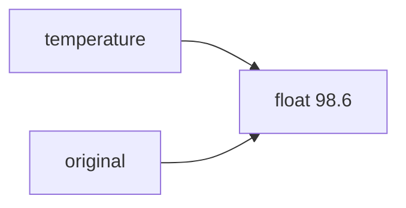

# Objects, names, types and mutability

> **Before this lesson:** you should be able to read a short Python program that uses variables, lists, `if`, `for` and a small function. All of that is taught in the "Start here" module, beginning with [First steps: running Python, values, names and text](#/lesson/python/py-start-first-steps) and ending with [User input, while loops and functions](#/lesson/python/py-start-input-functions). Nothing else is assumed: every new word is explained where it first appears and collected in the glossary at the end.

## In plain words

When you write `score = 10`, it is tempting to picture a box called `score` with the number 10 inside it. Python does not work that way, and the box picture is the cause of a whole family of confusing bugs. In Python the number 10 is a thing that exists in the computer's memory, called an **object**, and `score` is a **name**: a label tied to that thing.

An everyday picture: think of a left-luggage room at a railway station. The suitcases on the shelves are the objects. The paper tags tied to their handles are the names. One suitcase can carry two tags. A tag can be untied from one suitcase and tied to another. And if somebody opens a suitcase and puts a jumper in it, everybody holding a tag for that suitcase will find the jumper inside, whether or not they were told.

That last sentence is the whole lesson in miniature. Some Python objects can be opened and changed after they are made (lists, dictionaries, sets); those are called **mutable**. Others are sealed for life (numbers, text, tuples); those are **immutable**. Knowing which is which, and knowing when two names are tied to the same object, explains why a list "changes by itself", why a function altered the data you gave it, and why copying is sometimes necessary.

Why this matters for a job: these questions come up in almost every Python interview ("what is the difference between `is` and `==`?", "is Python pass-by-value or pass-by-reference?", "what is wrong with this default argument?"), and in daily work they separate the person who fixes a strange bug in five minutes from the person who loses an afternoon to it.

## Everything is an object

An **object** is a piece of data living in the computer's memory, together with the knowledge of what kind of data it is. In Python, everything you can give a name to is an object: the whole number `7`, the text `"hi"`, the built-in function `len`, a module you import, and even `None`, the special object Python uses to mean "nothing here".

Every object has three properties:

| Property | What it means | How to inspect it |
|---|---|---|
| **Identity** | Which particular object it is. It never changes while the object exists. In CPython (the standard Python program that most people run) the identity is the object's address in memory. | `id(x)`, compared with `is` |
| **Type** | What kind of object it is: a whole number, a piece of text, a list. The type decides what you are allowed to do with the object, and it is also fixed for life. | `type(x)`, `isinstance(x, T)` |
| **Value** | The contents. For some types the contents can change later; for others they cannot. | `==`, `repr(x)` |

```python-run
x = 42
print(type(x), id(x) > 0, repr(x))
print(type(len), type(type), type(None))
print(isinstance(True, int))   # bool is a subclass of int!
```

**Reading this code line by line**

- `x = 42` creates the whole-number object 42 and ties the name `x` to it.
- `type(x)` asks an object what kind it is; the answer prints as `<class 'int'>`. The word **class** is Python's word for "type", and `int` is short for integer, a whole number.
- `id(x)` returns the identity as a (large) number. The number itself differs from run to run, so the demo prints only whether it is positive: `True`.
- `repr(x)` returns the text you would type in a program to produce this value, here `'42'`. It is the "show me exactly what this is" function, useful when printing for debugging.
- The second line shows that a function, the thing called `type` and `None` are objects with types of their own: `builtin_function_or_method`, `type` and `NoneType`.
- `isinstance(True, int)` asks "is `True` a kind of `int`?" and the answer is `True`.

That last answer surprises people. `True` and `False` belong to the type `bool` (short for Boolean, a yes/no value), and `bool` is defined as a special kind of `int`: `True` behaves as 1 and `False` as 0, so `True + True == 2`. This is occasionally handy (`sum(flags)` counts how many flags are `True`) and occasionally a trap (a function that checks `isinstance(v, int)` will also accept `True`).

## Names, binding and the assignment statement

The statement you will write more than any other is **assignment**, the one with a single `=`:

```python
temperature = 98.6
```

Python handles it in two steps, always in this order:

1. The right-hand side is worked out first. That produces an object, here a `float` (a number with a decimal point) whose value is 98.6.
2. The name on the left is then tied to that object. Programmers call this **binding** the name, and they say the name **refers to** (or is a **reference** to) the object.

The name itself has no type. The object does. That is what people mean when they call Python **dynamically typed**: types belong to objects and are checked while the program runs, so the same name may refer to a number now and to text a moment later. If you have used Java, a name behaves like a reference variable; if you have used C, it behaves like a pointer you cannot do arithmetic on. If you have used neither, the luggage tag is all you need.



The diagram shows the situation after a second statement, `original = temperature`. No new number was made. There is one float object and two names tied to it. Two names for one object are called **aliases**.

Now run one more assignment:

```python
temperature = temperature + 5.0
```

Step 1 works out `temperature + 5.0`, which builds a *new* float, 103.6. Step 2 moves the name `temperature` over to that new object. The name `original` was never mentioned, so it is still tied to 98.6. This is a rule with no exceptions: assigning to a name **never** changes the object the name used to refer to. It only moves the tag.

```python-run
temperature = 98.6
original = temperature
print(original is temperature)    # same object
temperature = temperature + 5.0
print(temperature, original)      # 103.6 98.6
print(original is temperature)    # alias broken
```

The operator `is` asks "are these two names tied to the very same object?". The program prints `True` first (two tags, one suitcase), then `103.6 98.6`, then `False`, because after the second assignment the two names refer to different objects.

### Aliasing with objects that can change

So far aliasing was harmless, because a float can never be altered. A list can. A **list** is an ordered collection written in square brackets, and it is **mutable**: you can add, remove or replace its items after it has been created. When two names are tied to one list, a change made through either name is visible through the other.

```python-run
a = [1, 2, 3]
b = a            # no copy! b is another name for the same list
b.append(4)
print(a)         # [1, 2, 3, 4]
print(a is b)    # True

b = b + [5]      # + builds a NEW list; b now points elsewhere
print(a, b)      # [1, 2, 3, 4] [1, 2, 3, 4, 5]
```

**Reading this code line by line**

- `a = [1, 2, 3]` makes one list object and ties `a` to it.
- `b = a` ties a second name to the same list. Nothing is copied. This is the line beginners misread.
- `b.append(4)` opens the list and adds an item at the end. `append` is a **method**: a function that belongs to an object and is called with a dot.
- `print(a)` shows `[1, 2, 3, 4]` although the program never wrote `a.append`. There is only one list, so of course `a` shows the new item too.
- `b = b + [5]` is an assignment, so the two-step rule applies: `b + [5]` builds a brand-new five-item list, and then `b` is moved to it. `a` stays tied to the old four-item list, which is why the last line prints two different lists.

Two different things happened to `b` here, and telling them apart is the skill this lesson teaches:

- **Mutating an object** changes the object's contents: `b.append(4)`, `b[0] = 9`. Every alias sees the change, because there is only one object.
- **Rebinding a name** ties the name to a different object: `b = ...`. Only that one name is affected.

> [!WARNING]
> For lists, `b += [5]` and `b = b + [5]` are **not** the same. `+=` on a list calls a special method named `__iadd__` ("in-place add") that extends the existing list, so every alias sees the new item. `b = b + [5]` creates a new list and rebinds `b`. Immutable types such as `int`, `str` and `tuple` have no in-place version, so for them `+=` quietly builds a new object and rebinds the name.

```python-run
a = [1, 2]
b = a
b += [3]          # in-place extend
print(a)          # [1, 2, 3]

s = "ab"
t = s
t += "c"          # strings are immutable: new object
print(s, t)       # ab abc
```

The first half prints `[1, 2, 3]`: the list that `a` and `b` share was extended. The second half prints `ab abc`: a **string** (a piece of text, type `str`) cannot be changed, so `t += "c"` had to build the new string `"abc"` and move `t` to it, leaving `s` alone.

## `is` versus `==`

Python has two different ways to compare, and they answer two different questions.

- `==` asks "do these two objects have an equal **value**?" Behind the scenes it calls a method named `__eq__` on the object, and the author of a type decides what "equal" means for it.
- `is` asks "are these the **same object**?" It compares identities, and no type can change how it behaves.

Two suitcases can have identical contents and still be two suitcases:

```python-run
x = [1, 2, 3]
y = [1, 2, 3]
print(x == y, x is y)   # True False: equal values, different objects

n = None
print(n is None)        # the idiomatic None check
```

The output is `True False`, then `True`. The lists `x` and `y` hold the same items, so `==` says yes; they were built by two separate pairs of square brackets, so `is` says no.

Use `is` for **singletons**, objects of which only one copy ever exists: `None`, `True`, `False`, and special marker objects you create yourself (often called *sentinels*). Use `==` for everything else. Never write `if x is 1000:` or `if s is "hello":`. CPython happens to keep one shared copy of each small integer from −5 to 256 and of *some* strings (the string trick is called **interning**), so `is` may appear to work in a quick experiment and then fail in production on a value computed while the program runs. Recent Python versions print a `SyntaxWarning` when they see `is` next to a literal number or string.

> [!INTERVIEW]
> "What's the difference between `is` and `==`?" Answer: identity versus equality. `is` compares object identity (in CPython, the memory address) and is used for `None` and sentinels; `==` calls `__eq__` to compare values. Bonus points: mention that small-integer caching and string interning make `is` on literals unreliable, and that `float('nan') == float('nan')` is `False` even though a NaN (the "not a number" float) `is` itself.

## Mutable and immutable types

A type is **immutable** if the value of one of its objects can never change after the object is created, and **mutable** if it can. Here are the built-in types you will meet most:

| Type | Description | Immutable? | Examples of how it is written |
|---|---|---|---|
| `bool` | yes/no value | yes | `True`, `False` |
| `int` | whole number of any size | yes | `0`, `-17`, `0x1F`, `0b101`, `1_000_000` |
| `float` | number with a fractional part (64-bit IEEE-754, the standard format almost all hardware uses) | yes | `3.14`, `6.02e23`, `float('inf')` |
| `complex` | complex number | yes | `3+4j` |
| `str` | text (a sequence of Unicode characters) | yes | `'a'`, `"b"`, `"""multi"""` |
| `bytes` | sequence of raw bytes | yes | `b"\x00ab"` |
| `tuple` | fixed sequence of items | yes* | `(1, 2)`, `1,` |
| `frozenset` | set that cannot change | yes | `frozenset({1, 2})` |
| `list` | sequence you can change | **no** | `[1, 2]` |
| `dict` | dictionary: keys mapped to values | **no** | `{"k": 1}` |
| `set` | collection of distinct items | **no** | `{1, 2}` (but `{}` is an empty *dict*) |
| `bytearray` | bytes you can change | **no** | `bytearray(b"ab")` |

A few notes on the "written as" column: `0x1F` is the number 31 in hexadecimal (base 16), `0b101` is 5 in binary (base 2), and the underscores in `1_000_000` are ignored by Python and exist only to help human eyes.

\*A **tuple** is a sequence written in round brackets whose slots are fixed: you cannot replace, add or remove a slot. But a slot holds a reference, and if it refers to a mutable object, that object can still change:

```python-run
t = (1, [2, 3])
t[1].append(4)      # fine: we mutate the list, not the tuple
print(t)
try:
    t[0] = 99
except TypeError as e:
    print("TypeError:", e)
```

The first print shows `(1, [2, 3, 4])`. The tuple still has the same two slots, tied to the same two objects; the list in the second slot was opened and extended. The `try` / `except` pair then attempts something that is forbidden, replacing a slot, and prints the error message instead of stopping the program: `'tuple' object does not support item assignment`.

### Why immutability matters

1. **Dictionary keys and set members.** A dictionary finds a key quickly by computing a number from it, called a **hash**. That only works if the number can never change, so Python allows only **hashable** objects as keys. The practical rule: immutable built-ins are hashable, mutable ones are not. A tuple is hashable only if everything inside it is hashable, so `(1, [2])` cannot be a key.
2. **Safe sharing.** You can hand an immutable object to any function knowing that it cannot be modified behind your back.
3. **Default arguments.** A mutable default value of a function is shared between calls, a classic bug that the functions lesson dissects.

```python-run
d = {}
d[(1, 2)] = "tuple key ok"
try:
    d[[1, 2]] = "list key"
except TypeError as e:
    print("TypeError:", e)
print(d)
```

The tuple key is accepted. The list key is refused with `unhashable type: 'list'`, and the final print shows a dictionary holding only the tuple key.

## A closer look at the numeric types

**`int` never overflows.** In many languages a whole number lives in a fixed number of bits and wraps around or fails when it gets too large (that failure is called *overflow*). A Python `int` grows as large as memory allows, which is why factorials and huge powers need no special care in an interview.

```python-run
import math
print(2 ** 100)
print(len(str(math.factorial(100))), "digits")
print(7 // 2, -7 // 2)    # floor division rounds toward negative infinity
print(7 % 3, -7 % 3)      # result takes the sign of the divisor
print(divmod(-7, 2))
```

**Reading this code line by line**

- `2 ** 100` is 2 to the power 100; Python prints all 31 digits.
- `math.factorial(100)` is 1 × 2 × ... × 100. Converting it to text with `str` and measuring with `len` shows it has 158 digits.
- `//` is **floor division**: divide, then round *down* to the next whole number. `7 // 2` is 3. `-7 // 2` is −4, because −3.5 rounded down is −4. C and Java would say −3 here, because they round toward zero.
- `%` is the **remainder** (or modulo) operator. `7 % 3` is 1. `-7 % 3` is 2: in Python the result takes the sign of the right-hand number.
- `divmod(-7, 2)` returns both answers at once, as the tuple `(-4, 1)`.

Python keeps the promise `(a // b) * b + a % b == a` for every pair of integers; check it with −7 and 2: `-4 * 2 + 1 == -7`. If you need C-style rounding toward zero, use `math.trunc(a / b)` or `int(a / b)` (careful: the `/` goes through a float, which loses precision for very large numbers).

**`float` is binary floating point.** A float stores a number in base 2 using 64 bits, and most decimal fractions, including 0.1, have no exact base-2 form, in the same way that 1/3 has no exact decimal form. The stored value is the nearest one that fits, and the tiny errors show up when you compare.

```python-run
import math
from decimal import Decimal
from fractions import Fraction
print(0.1 + 0.2, 0.1 + 0.2 == 0.3, math.isclose(0.1 + 0.2, 0.3))
print(Decimal("0.1") + Decimal("0.2"))
print(Fraction(1, 3) + Fraction(1, 6))
print(float("inf") > 10**308, float("nan") == float("nan"))
```

The first line prints `0.30000000000000004 False True`. The sum is not exactly 0.3, so `==` fails; `math.isclose` asks "are these equal apart from a tiny rounding error?" and is the right way to compare floats. `Decimal` does exact base-10 arithmetic and prints `0.3`; use it for money. `Fraction` keeps exact fractions and prints `1/2`. The last line shows two special floats: `inf` (infinity) is larger than any number, and `nan` ("not a number", the result of an undefined calculation) is not equal to anything, itself included.

**Conversions** use the type's name as a function: `int("42")` turns text into a number, `int(3.99)` cuts off the fractional part and gives `3`, `int("ff", 16)` reads base-16 text and gives 255, `float("2.5")`, `str(10)`, `bool(x)`. Called with nothing in the brackets, each type gives its "empty" value: `int()` is `0`, `str()` is `""`, `list()` is `[]`.

## Truthiness

An `if` or a `while` needs a yes-or-no answer, but Python lets you put any object there and decides for you. The values treated as false, called **falsy**, are: `None`, `False`, every zero (`0`, `0.0`, `0j`) and every empty container (`""`, `[]`, `()`, `{}`, `set()`, `range(0)`). Everything else is **truthy**. (A class can state its own rule by defining a method named `__bool__` or `__len__`; the data model lesson shows how.)

```python-run
for v in [0, 1, "", "0", [], [0], None, {}, {"a": 1}]:
    print(repr(v).ljust(10), bool(v))
```

The loop prints each value next to the result of `bool(v)`, the function that performs the same conversion an `if` performs. Two rows deserve a look: `"0"` is `True`, because it is a string with one character in it and therefore not empty, and `[0]` is `True`, because it is a list with one item, even though that item is zero.

Experienced Python programmers write `if items:` in place of `if len(items) > 0:`. Be careful when `0` or `""` are *valid* values, though: `if count:` treats a perfectly good count of zero as "missing". In that case say what you mean: `if count is not None:`.

## Dynamic typing and duck typing

Because names carry no type, a function does not declare what kind of object it accepts. It uses the object and trusts that the object can do what is asked. This style is called **duck typing**, after the saying "if it walks like a duck and quacks like a duck, treat it as a duck". A function that calls `.readline()` works with a real file, with an in-memory text buffer, or with anything else that has a `readline` method.

```python-run
import io

def first_line(f):
    return f.readline().strip()

print(first_line(io.StringIO("hello\nworld")))   # anything with readline() works
```

`io.StringIO` builds an object that behaves like an open file but keeps its text in memory. `first_line` never checks the type of `f`; it calls `readline()` to fetch the first line and `strip()` to remove the line break, and prints `hello`. Type hints (see the typing module of this track) let you write down and check such expectations with a tool, but Python does not enforce them while the program runs.

## Objects are freed when no names refer to them

You never release memory by hand in Python. CPython keeps a counter on every object, the **reference count**, recording how many names and containers currently refer to it. When the count falls to zero, the object is destroyed at once and its memory is reused. A second mechanism, the **garbage collector**, finds groups of objects that refer only to each other and removes those. The statement `del name` removes a *name*, not an object; the object disappears only if that was its last reference.

```python-run
import sys
a = []
b = a
print(sys.getrefcount(a))   # includes the temporary reference made by the call itself
del b
print(sys.getrefcount(a))
```

The first number is 3: the names `a` and `b`, plus one temporary reference that exists while `getrefcount` is looking at the list. After `del b` the count is 2. The list is still alive, because `a` is still tied to it. The CPython internals lesson returns to reference counting in detail.

## Passing arguments: "call by object reference"

A **parameter** is a name in a function's definition; an **argument** is the object you supply when you call it. When you call `f(x)`, the parameter inside `f` becomes **another name for the same object**. Nothing is copied. Everything you learned above about aliases therefore applies:

- If `f` *mutates* the object (for example `lst.append(...)`), the caller sees the change.
- If `f` *rebinds* its parameter (for example `lst = []`), the caller is unaffected.

```python-run
def mutate(lst):
    lst.append("mutated")

def rebind(lst):
    lst = ["new list"]        # only the local name moves

data = ["original"]
mutate(data)
rebind(data)
print(data)    # ['original', 'mutated']
```

Inside `mutate`, `lst` and the caller's `data` are two tags on one list, so the appended item is visible afterwards. Inside `rebind`, the assignment moves the tag `lst` to a new list; `data` keeps pointing at the old one, and the new list is thrown away when the function ends. The output is `['original', 'mutated']`.

This model is neither "pass by value" (the function gets a copy) nor "pass by reference" (the function can make the caller's variable refer to something else) as languages such as C++ use those words. A good name for it is *pass by assignment*: the parameter is assigned the argument, exactly as `param = arg` would do.

> [!INTERVIEW]
> "Is Python pass-by-value or pass-by-reference?" Neither, precisely. Arguments are passed by **object reference** (also called pass by assignment): the function's parameter is bound to the same object the caller passed. Mutations through it are visible to the caller; rebinding the parameter is not. Demonstrate with `append` versus `=`.

## Worked example: the grid aliasing bug

A favourite interview trap is building a table of rows and columns (a grid) with list multiplication. `[0] * 3` means "a list holding three zeros", and it is tempting to multiply again to get three rows:

```python-run
grid = [[0] * 3] * 3     # three references to ONE inner list
grid[0][0] = 1
print(grid)              # every row changed!

grid = [[0] * 3 for _ in range(3)]   # a fresh inner list per row
grid[0][0] = 1
print(grid)
```

The first print shows `[[1, 0, 0], [1, 0, 0], [1, 0, 0]]`: one assignment appears to have changed three rows. The reason is aliasing. `[[0] * 3] * 3` builds the inner list `[0, 0, 0]` once and then makes an outer list holding three references to that single list. There is one row, seen three times.

The second version uses a **list comprehension**, a compact loop written inside square brackets. It runs `[0] * 3` afresh for each of the three turns (the name `_` is a conventional "I do not need this variable"), so three separate rows exist and the output is `[[1, 0, 0], [0, 0, 0], [0, 0, 0]]`.

Why is the *inner* multiplication safe? `[0] * 3` holds three references to the same integer 0, but integers are immutable. Writing `row[0] = 1` replaces what one slot refers to; it does not alter the shared 0. The rule to remember: build nested mutable structures with a comprehension, never with `*`.

## Common pitfalls recap

- Assuming `b = a` copies a list or dictionary. It does not. To get a copy, write `a.copy()`, `list(a)` or `a[:]`, or `copy.deepcopy(a)` when there are lists inside lists (the copying lesson explains the difference).
- Using `is` to compare numbers or strings.
- `[[...]] * n` sharing one inner list.
- Treating `0`, `""` or `[]` as "missing" with a truthiness test when they are valid values.
- Forgetting that `bool` is an `int` (`isinstance(True, int)` is `True`).
- Expecting `-7 // 2 == -3`.

## Summary

- Names are references tied to objects; assignment works out the right side, then binds the name.
- Every object has an identity, a type and a value. `is` tests identity, `==` tests value.
- Immutable types (`int`, `float`, `str`, `tuple`, `frozenset`, `bytes`) cannot change; mutable ones (`list`, `dict`, `set`) can, and the change is visible through every alias.
- Functions receive references to the caller's objects, not copies.
- Objects live as long as something refers to them.

## Glossary

- **Object** - a piece of data in memory that knows its own type.
- **Name (variable)** - a label tied to an object; it has no type of its own.
- **Binding / rebinding** - tying a name to an object / tying it to a different one.
- **Reference** - the link from a name (or a slot in a container) to an object.
- **Alias** - a second name for the same object.
- **Identity** - which object something is; shown by `id()` and compared with `is`.
- **Type (class)** - the kind of an object, which decides what operations it supports.
- **Mutable / immutable** - able / not able to change its value after creation.
- **Mutation** - changing an object's contents in place, as `append` does.
- **Hashable** - having a fixed hash number, and so usable as a dictionary key or set member.
- **Singleton** - an object of which only one exists, such as `None`.
- **Interning** - CPython's reuse of one shared object for some equal strings and small integers.
- **Floor division (`//`)** - division rounded down toward negative infinity.
- **Falsy / truthy** - treated as false / true when used in a condition.
- **Dynamic typing** - types belong to objects and are checked while the program runs.
- **Duck typing** - using an object for what it can do, without checking its type.
- **Reference count** - CPython's tally of how many references point at an object.
- **Garbage collector** - the part of Python that reclaims objects nothing can reach.
- **CPython** - the standard implementation of Python, written in C.

```quiz
[
  {"q": "After `a = [1, 2]; b = a; b = b + [3]`, what is `a`?", "options": ["[1, 2]", "[1, 2, 3]", "An error", "[3]"], "answer": 0,
   "explain": "`b + [3]` builds a new list and rebinds `b`; the original list that `a` refers to is unchanged."},
  {"q": "After `a = [1, 2]; b = a; b += [3]`, what is `a`?", "options": ["[1, 2]", "[1, 2, 3]", "An error", "[3]"], "answer": 1,
   "explain": "For lists, `+=` calls `__iadd__`, which extends the existing list in place, so the alias `a` sees the change."},
  {"q": "Which of these can be used as a dictionary key?", "options": ["[1, 2]", "{1, 2}", "(1, [2])", "(1, \"two\", 3.0)"], "answer": 3,
   "explain": "Keys must be hashable. A tuple is hashable only if all its elements are; lists and sets are unhashable."},
  {"q": "What does `-7 // 2` evaluate to in Python?", "options": ["-3", "-4", "-3.5", "3"], "answer": 1,
   "explain": "`//` is floor division: it rounds toward negative infinity, so -3.5 floors to -4."},
  {"q": "What is the idiomatic way to test whether `x` is None?", "options": ["x == None", "x is None", "not x", "type(x) == None"], "answer": 1,
   "explain": "None is a singleton, so test identity with `is`. `not x` also catches 0, empty strings etc., and `== None` can be fooled by a custom `__eq__`."},
  {"q": "`grid = [[0] * 3] * 3; grid[1][1] = 5` — how many 5s are now in the grid?", "options": ["1", "3", "9", "0"], "answer": 1,
   "explain": "The outer `* 3` creates three references to the same inner list, so the single list (seen as every row) gets one 5 in column 1: three 5s visible in total."},
  {"q": "A function does `def f(lst): lst = []`. Calling `f(data)` on a non-empty list...", "options": ["empties data", "leaves data unchanged", "raises TypeError", "makes data None"], "answer": 1,
   "explain": "Assigning to the parameter only rebinds the local name; the caller's object is untouched. `lst.clear()` would empty it."},
  {"q": "Which statement about `t = (1, [2, 3])` is true?", "options": ["`t[1].append(4)` raises TypeError because tuples are immutable", "`t[1].append(4)` works, and `t` can still not be used as a dictionary key", "`t[0] = 9` works because integers are immutable", "`t` is hashable because it is a tuple"], "answer": 1,
   "explain": "The tuple's slots are fixed, but the list in slot 1 is still mutable. Because it contains an unhashable list, the tuple itself is unhashable."}
]
```

> **Source:** Goodrich, Tamassia & Goldwasser, *Data Structures and Algorithms in Python*, §1.2 (Objects in Python) and §1.5.1 (information passing), restated in original wording with new examples; Python docs, *Language Reference* §3.1 "Objects, values and types" and *Library Reference* "Built-in Types".
