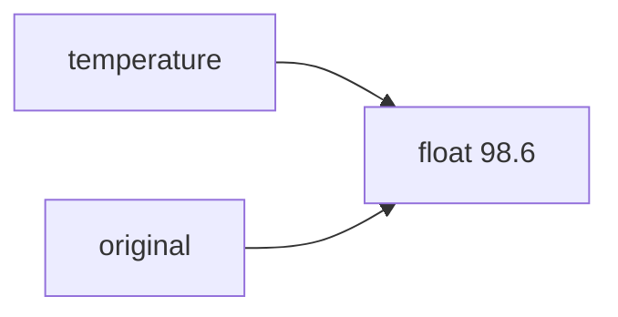

# Objects, names, types and mutability

Every Python bug that makes you say "but I never touched that list!" comes from one idea that beginners skip: **in Python, variables are not boxes that hold values. They are names attached to objects.** Once that mental model clicks, aliasing, the mutable-default trap, shallow copies, and "pass by object reference" stop being mysterious. This lesson builds that model from scratch and then tours the built-in types you will use every day.

## Everything is an object

Python is object-oriented all the way down. The integer `7`, the string `"hi"`, the function `len`, a module, a class, even `None` — each is an **object**. Every object has three things:

| Property | What it means | How to inspect it |
|---|---|---|
| **Identity** | Which object it is; never changes during its lifetime. In CPython this is its memory address. | `id(x)`, compared with `is` |
| **Type** | What kind of object it is; determines what operations it supports. Also fixed for life. | `type(x)`, `isinstance(x, T)` |
| **Value** | Its contents. May or may not be changeable, depending on the type. | `==`, `repr(x)` |

```python-run
x = 42
print(type(x), id(x) > 0, repr(x))
print(type(len), type(type), type(None))
print(isinstance(True, int))   # bool is a subclass of int!
```

The last line surprises people: `True` and `False` are instances of `bool`, which subclasses `int`, so `True + True == 2`. This is occasionally handy (`sum(flags)` counts the `True`s) and occasionally a pitfall (a function checking `isinstance(v, int)` accepts booleans).

## Names, binding and the assignment statement

The most important statement in Python is assignment:

```python
temperature = 98.6
```

Goodrich et al. describe this precisely: the right-hand side is evaluated **first**, producing (or finding) an object; then the name on the left is **bound** to that object. The name has no type of its own — Python is *dynamically typed* — but the object it refers to absolutely does. Think of a name as a sticky note you put on an object; Java programmers can think "reference variable", C programmers "a pointer you can't do arithmetic on".



After `original = temperature`, both names are **aliases** for the same float. Now:

```python
temperature = temperature + 5.0
```

The expression `temperature + 5.0` builds a *new* float `103.6`, and only then is `temperature` re-pointed at it. `original` still refers to `98.6`. Reassigning a name **never** changes the object it used to refer to; it only moves the sticky note.

```python-run
temperature = 98.6
original = temperature
print(original is temperature)    # same object
temperature = temperature + 5.0
print(temperature, original)      # 103.6 98.6
print(original is temperature)    # alias broken
```

### Aliasing with mutable objects

With a mutable object, aliasing becomes visible, because you can change the object *through* either name:

```python-run
a = [1, 2, 3]
b = a            # no copy! b is another name for the same list
b.append(4)
print(a)         # [1, 2, 3, 4]
print(a is b)    # True

b = b + [5]      # + builds a NEW list; b now points elsewhere
print(a, b)      # [1, 2, 3, 4] [1, 2, 3, 4, 5]
```

The key distinction is between **mutating an object** (`b.append(4)`, `b[0] = 9`, `b += [5]` on a list) and **rebinding a name** (`b = ...`). Mutation is seen by every alias; rebinding affects only that one name.

> [!WARNING]
> `b += [5]` and `b = b + [5]` are **not** the same for lists. `+=` calls `list.__iadd__`, which extends the list *in place* (every alias sees it). `b = b + [5]` creates a new list. For immutable types like `int`, `str` and `tuple`, `+=` has no in-place version and quietly falls back to building a new object.

```python-run
a = [1, 2]
b = a
b += [3]          # in-place extend
print(a)          # [1, 2, 3]

s = "ab"
t = s
t += "c"          # strings are immutable: new object
print(s, t)       # ab abc
```

## `is` versus `==`

- `==` asks "do these have equal **value**?" It calls `__eq__`, which a class can define however it likes.
- `is` asks "are these the **same object**?" It compares identities and cannot be overridden.

```python-run
x = [1, 2, 3]
y = [1, 2, 3]
print(x == y, x is y)   # True False: equal values, different objects

n = None
print(n is None)        # the idiomatic None check
```

Use `is` for singletons — `None`, `True`, `False`, sentinel objects — and `==` for everything else. Never write `if x is 1000:` or `if s is "hello":`. CPython caches small integers (−5 to 256) and *some* strings, so `is` may appear to work in a quick test and then fail in production with a value computed at runtime. Modern Python even emits a `SyntaxWarning` for `is` with a literal.

> [!INTERVIEW]
> "What's the difference between `is` and `==`?" Answer: identity versus equality. `is` compares object identity (in CPython, memory address) and is used for `None` and sentinels; `==` invokes `__eq__` for value comparison. Bonus points: mention that small-int caching and string interning make `is` on literals unreliable, and that `float('nan') == float('nan')` is `False` even though a NaN `is` itself.

## Mutable and immutable types

A type is **immutable** if its instances' values can never change after creation. Here are the core built-ins (Goodrich, Table 1.2, plus a few more):

| Type | Description | Immutable? | Literal examples |
|---|---|---|---|
| `bool` | Boolean | yes | `True`, `False` |
| `int` | Arbitrary-precision integer | yes | `0`, `-17`, `0x1F`, `0b101`, `1_000_000` |
| `float` | IEEE-754 double | yes | `3.14`, `6.02e23`, `float('inf')` |
| `complex` | Complex number | yes | `3+4j` |
| `str` | Unicode text | yes | `'a'`, `"b"`, `"""multi"""` |
| `bytes` | Immutable byte string | yes | `b"\x00ab"` |
| `tuple` | Immutable sequence | yes* | `(1, 2)`, `1,` |
| `frozenset` | Immutable set | yes | `frozenset({1, 2})` |
| `list` | Mutable sequence | **no** | `[1, 2]` |
| `dict` | Mapping | **no** | `{"k": 1}` |
| `set` | Mutable set | **no** | `{1, 2}` (but `{}` is an empty *dict*) |
| `bytearray` | Mutable bytes | **no** | `bytearray(b"ab")` |

\*A tuple is immutable in the sense that you can't replace or remove its slots, but if a slot refers to a mutable object, that object can still change:

```python-run
t = (1, [2, 3])
t[1].append(4)      # fine: we mutate the list, not the tuple
print(t)
try:
    t[0] = 99
except TypeError as e:
    print("TypeError:", e)
```

### Why immutability matters

1. **Hashing.** Only hashable objects can be dict keys or set members, and the rule of thumb is that immutable built-ins are hashable while mutable ones are not. A tuple is hashable only if everything inside it is hashable, so `(1, [2])` cannot be a key.
2. **Safe sharing.** You can hand an immutable object to any function without fear it will be modified.
3. **Default arguments** (next lessons): a mutable default is shared across calls — a classic bug.

```python-run
d = {}
d[(1, 2)] = "tuple key ok"
try:
    d[[1, 2]] = "list key"
except TypeError as e:
    print("TypeError:", e)
print(d)
```

## A closer look at the numeric types

**`int` has no overflow.** Python integers grow as large as memory allows, which is why you never need special handling for factorials in interviews:

```python-run
import math
print(2 ** 100)
print(len(str(math.factorial(100))), "digits")
print(7 // 2, -7 // 2)    # floor division rounds toward negative infinity
print(7 % 3, -7 % 3)      # result takes the sign of the divisor
print(divmod(-7, 2))
```

Note `-7 // 2 == -4`, not `-3` as in C or Java, and `-7 % 3 == 2`. Python keeps the identity `(a // b) * b + a % b == a` with floor semantics. If you need C-style truncation, use `int(a / b)` (careful with huge numbers) or `math.trunc`.

**`float` is binary floating point**, so `0.1 + 0.2 != 0.3`. Compare floats with `math.isclose`, and use `decimal.Decimal` for money or `fractions.Fraction` for exact rationals.

```python-run
import math
from decimal import Decimal
from fractions import Fraction
print(0.1 + 0.2, 0.1 + 0.2 == 0.3, math.isclose(0.1 + 0.2, 0.3))
print(Decimal("0.1") + Decimal("0.2"))
print(Fraction(1, 3) + Fraction(1, 6))
print(float("inf") > 10**308, float("nan") == float("nan"))
```

**Conversions** use the type as a constructor: `int("42")`, `int(3.99)` (truncates to `3`), `int("ff", 16)`, `float("2.5")`, `str(10)`, `bool(x)`. Constructors with no argument return a "zero" value: `int() == 0`, `str() == ""`, `list() == []`.

## Truthiness

Any object can be used in a Boolean context (`if`, `while`, `and`, `or`, `not`). The **falsy** values are: `None`, `False`, numeric zeros (`0`, `0.0`, `0j`), and empty containers (`""`, `[]`, `()`, `{}`, `set()`, `range(0)`). Everything else is truthy, unless a class defines `__bool__` or `__len__` to say otherwise.

```python-run
for v in [0, 1, "", "0", [], [0], None, {}, {"a": 1}]:
    print(repr(v).ljust(10), bool(v))
```

Idiomatic Python writes `if items:` rather than `if len(items) > 0:`. But be careful when `0` or `""` are *valid* values: `if count:` treats a legitimate count of zero as "missing". In that case write `if count is not None:`.

## Dynamic typing and duck typing

Because names carry no type, the same name can refer to an `int` now and a `str` later. Functions don't declare parameter types either, so Python relies on **duck typing**: "if it walks like a duck and quacks like a duck, treat it as a duck". A function that calls `.read()` works with a file, a `StringIO`, or a socket wrapper — anything with a `read` method.

```python-run
import io

def first_line(f):
    return f.readline().strip()

print(first_line(io.StringIO("hello\nworld")))   # anything with readline() works
```

Type hints (module 8) let you document and statically check these expectations, but they are not enforced at runtime.

## Objects are freed when no names refer to them

You never `free` memory in Python. CPython keeps a **reference count** on every object; when the count drops to zero, the object is destroyed immediately. A cycle detector cleans up groups of objects that only refer to each other. `del name` removes a *name*, not an object; the object dies only if that was the last reference.

```python-run
import sys
a = []
b = a
print(sys.getrefcount(a))   # includes the temporary reference made by the call itself
del b
print(sys.getrefcount(a))
```

We'll revisit reference counting and the garbage collector in the CPython internals lesson.

## Passing arguments: "call by object reference"

When you call `f(x)`, the parameter inside `f` becomes **another name for the same object**. Nothing is copied. Consequences:

- If `f` *mutates* the object (e.g., `lst.append`), the caller sees it.
- If `f` *rebinds* its parameter (e.g., `lst = []`), the caller is unaffected.

```python-run
def mutate(lst):
    lst.append("mutated")

def rebind(lst):
    lst = ["new list"]        # only the local name moves

data = ["original"]
mutate(data)
rebind(data)
print(data)    # ['original', 'mutated']
```

This model is neither "pass by value" nor "pass by reference" as C++ means them. It's sometimes called *pass by assignment*: the parameter is assigned the argument, exactly as `param = arg` would.

> [!INTERVIEW]
> "Is Python pass-by-value or pass-by-reference?" Neither, precisely. Arguments are passed by **object reference** (a.k.a. pass by assignment): the function's parameter is bound to the same object the caller passed. Mutations through it are visible to the caller; rebinding the parameter is not. Demonstrate with `append` vs `=`.

## Worked example: the grid aliasing bug

A favourite interview trap is building a 2-D grid with list multiplication:

```python-run
grid = [[0] * 3] * 3     # three references to ONE inner list
grid[0][0] = 1
print(grid)              # every row changed!

grid = [[0] * 3 for _ in range(3)]   # a fresh inner list per row
grid[0][0] = 1
print(grid)
```

`[[0] * 3] * 3` evaluates `[0] * 3` once, then makes a list holding three references to it. Multiplying the *inner* list is fine because ints are immutable — writing `row[0] = 1` rebinds a slot instead of mutating a shared int. Always build nested mutable structures with a comprehension.

## Common pitfalls recap

- Assuming `b = a` copies a list or dict. It doesn't; use `a.copy()`, `list(a)`, `a[:]` or `copy.deepcopy(a)`.
- Using `is` to compare numbers or strings.
- `[[...]] * n` sharing inner lists.
- Treating `0`, `""` or `[]` as "missing" with a truthiness test when they are valid values.
- Forgetting that `bool` is an `int` (`isinstance(True, int)` is `True`).
- Expecting `-7 // 2 == -3`.

## Summary

- Names are references bound to objects; assignment evaluates the right side, then binds.
- Every object has an identity, a type and a value. `is` tests identity, `==` tests value.
- Immutable types (`int`, `float`, `str`, `tuple`, `frozenset`, `bytes`) can't change; mutable ones (`list`, `dict`, `set`) can, and the change is visible through all aliases.
- Functions receive references to the caller's objects.
- Objects live as long as something refers to them.

```quiz
[
  {"q": "After `a = [1, 2]; b = a; b = b + [3]`, what is `a`?", "options": ["[1, 2]", "[1, 2, 3]", "An error", "[3]"], "answer": 0,
   "explain": "`b + [3]` builds a new list and rebinds `b`; the original list that `a` refers to is unchanged."},
  {"q": "After `a = [1, 2]; b = a; b += [3]`, what is `a`?", "options": ["[1, 2]", "[1, 2, 3]", "An error", "[3]"], "answer": 1,
   "explain": "For lists, `+=` calls `__iadd__`, which extends the existing list in place, so the alias `a` sees the change."},
  {"q": "Which of these can be used as a dictionary key?", "options": ["[1, 2]", "{1, 2}", "(1, [2])", "(1, \"two\", 3.0)"], "answer": 3,
   "explain": "Keys must be hashable. A tuple is hashable only if all its elements are; lists and sets are unhashable."},
  {"q": "What does `-7 // 2` evaluate to in Python?", "options": ["-3", "-4", "-3.5", "3"], "answer": 1,
   "explain": "`//` is floor division: it rounds toward negative infinity, so -3.5 floors to -4."},
  {"q": "What is the idiomatic way to test whether `x` is None?", "options": ["x == None", "x is None", "not x", "type(x) == None"], "answer": 1,
   "explain": "None is a singleton, so test identity with `is`. `not x` also catches 0, empty strings etc., and `== None` can be fooled by a custom `__eq__`."},
  {"q": "`grid = [[0] * 3] * 3; grid[1][1] = 5` — how many 5s are now in the grid?", "options": ["1", "3", "9", "0"], "answer": 1,
   "explain": "The outer `* 3` creates three references to the same inner list, so the single list (seen as every row) gets one 5 in column 1: three 5s visible in total."},
  {"q": "A function does `def f(lst): lst = []`. Calling `f(data)` on a non-empty list...", "options": ["empties data", "leaves data unchanged", "raises TypeError", "makes data None"], "answer": 1,
   "explain": "Assigning to the parameter only rebinds the local name; the caller's object is untouched. `lst.clear()` would empty it."}
]
```

> **Source:** Goodrich, Tamassia & Goldwasser, *Data Structures and Algorithms in Python*, §1.2 (Objects in Python) and §1.5.1 (information passing); Python docs, *Language Reference* §3.1 "Objects, values and types" and *Library Reference* "Built-in Types".
