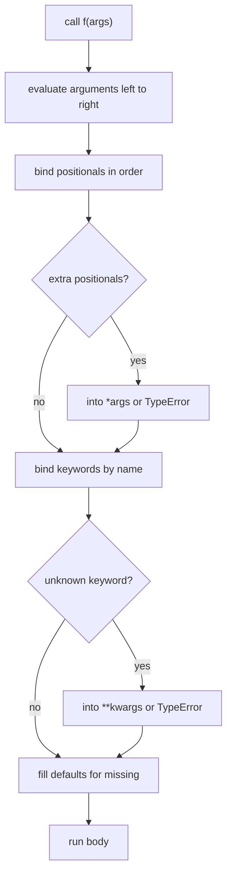

# Functions and arguments

> **Before this lesson:** you should have written and called a small function with `def` and `return`, as taught in [User input, while loops and functions](#/lesson/python/py-start-input-functions), and you need the picture of names tied to objects, mutable versus immutable, from [Objects, names, types and mutability](#/lesson/python/py-objects-names). Tuple unpacking and `for` loops come from [Expressions, operators and control flow](#/lesson/python/py-operators-control).

## In plain words

A **function** is a named piece of code that you can run whenever you want by writing its name followed by parentheses. You hand it some information, it does its work, and it hands a result back.

A good everyday picture is an order form at a print shop. The form has labelled blanks: paper size, number of copies, colour or black-and-white. Some blanks must be filled in. Some come pre-filled with a sensible choice ("copies: 1") that you may overwrite. You can fill the blanks in the printed order, or point at a blank by its label. The shop then does the job and gives you the prints. A Python function is the form plus the work: the blanks are its **parameters**, what you write in them are the **arguments**, and what you get back is the **return value**.

Python's order forms are unusually flexible, and this lesson is a tour of every kind of blank: ones filled by position, ones filled by name, pre-filled ones, and ones that accept "any number of extra items". It also covers the most famous Python trap of all, the pre-filled blank that remembers what the previous customer wrote in it (the *mutable default argument*). Almost every Python interview touches at least one topic from this lesson, and reading other people's code is impossible without recognising `*args`, `**kwargs` and the bare `*` in a function header.

## Defining and calling

```python
def count(data, target):
    """Return how many times target occurs in data."""
    n = 0
    for item in data:
        if item == target:
            n += 1
    return n
```

**Reading this code line by line**

- `def count(data, target):` starts a function definition. `count` is its name; `data` and `target` are its parameters, the names the function will use for whatever it is given.
- The text in triple quotes directly under the header is the **docstring**, a description for human readers. Python stores it, and `help(count)` displays it.
- The indented lines are the **body**: the work. Here it walks through `data` and adds one to `n` for each item equal to `target`.
- `return n` ends the function and hands `n` back to whoever called it.

Calling it looks like `count([1, 2, 1], 1)`, which gives `2`. A few facts that beginners often get wrong:

- `def` is an ordinary statement that runs like any other. When Python reaches it, it builds a **function object** and ties the name `count` to it. Nothing in the body runs until the function is called. Because `def` is a statement, you may put it inside an `if` or inside another function.
- A function that reaches the end of its body without meeting `return` (or that executes a bare `return`) returns `None`.
- To return several values, separate them with commas: `return lo, hi`. That builds one tuple, which the caller can unpack with `lo, hi = minmax(xs)`.

Vocabulary used from here on: **parameters** are the names in the definition (`data`, `target`); **arguments** are the objects supplied in a call. Some textbooks say *formal parameters* and *actual parameters* for the same two ideas.

## Positional and keyword arguments

There are two ways to say which argument goes to which parameter. A **positional argument** is matched by its place in the list: first argument to first parameter. A **keyword argument** is matched by writing the parameter's name and an equals sign.

```python-run
def power(base, exp):
    return base ** exp

print(power(2, 10))             # positional
print(power(exp=10, base=2))    # keyword, any order
print(power(2, exp=10))         # mixed: positional must come first
try:
    power(2, base=3)
except TypeError as e:
    print("TypeError:", e)
```

The first three calls all print `1024`. In the second, the order of the keywords does not matter because each one names its target. In the third, `2` goes to `base` by position and `exp` is named. The fourth call fails, and the `try`/`except` prints the reason: `power() got multiple values for argument 'base'`. The positional `2` already filled `base`, and then `base=3` tried to fill it again.

Keyword arguments make a call explain itself. `sorted(words, key=len, reverse=True)` can be read without looking anything up; three bare values could not.

## Default values

A parameter can be given a **default value**, used when the caller supplies nothing for it:

```python-run
def greet(name, greeting="Hello", punct="!"):
    return f"{greeting}, {name}{punct}"

print(greet("Luffy"))
print(greet("Zoro", "Oi"))
print(greet("Nami", punct="?"))
```

The output is `Hello, Luffy!`, `Oi, Zoro!` and `Hello, Nami?`. The first call uses both defaults, the second replaces `greeting` by position, and the third skips over `greeting` by naming `punct`. In the header, parameters with defaults must come after those without, otherwise Python could not tell which positional argument belongs where.

### The mutable default argument pitfall

Here is the rule that causes the trap: **a default value is worked out once, at the moment the `def` statement runs, and that one object is reused on every call.** For an immutable default such as `"Hello"` or `0` nobody can tell. For a mutable default such as a list, changes made during one call are still there in the next.

```python-run
def add_item(item, bucket=[]):     # BUG
    bucket.append(item)
    return bucket

print(add_item("a"))
print(add_item("b"))        # ['a', 'b'] — the same list as before!
print(add_item.__defaults__)
```

The author expected each call without a `bucket` to start with a fresh empty list. The output says otherwise: `['a']`, then `['a', 'b']`. The `[]` in the header was evaluated a single time, producing one list object that is stored on the function itself, in an attribute called `__defaults__` (the third line prints it, and you can see the accumulated items inside). In terms of the print-shop form: the pre-filled blank is not reprinted for each customer; everybody writes on the same sheet.

The standard fix is to use `None` as the default and create the list inside the body, which does run on every call:

```python-run
def add_item(item, bucket=None):
    if bucket is None:
        bucket = []          # fresh list on every call
    bucket.append(item)
    return bucket

print(add_item("a"), add_item("b"))
```

Now the output is `['a'] ['b']`. A value used this way, to mean "nothing was supplied", is called a **sentinel**. If `None` is itself a meaningful argument for your function, make a private sentinel object: `_MISSING = object()`, then `def f(x=_MISSING):` and test `if x is _MISSING:`.

The same "worked out once" rule bites with time. `def log(msg, when=datetime.now())` stamps every message with the moment the file was loaded, not the moment of the call.

> [!INTERVIEW]
> "What's wrong with `def f(x, acc=[])`?" The default list is created once, when the function is defined, and shared by all calls, so changes persist. Fix with `acc=None` and create the list inside. A common follow-up is "when is this behaviour *useful*?" Answer: as a deliberate cache, for example `def fib(n, _memo={})`, although `functools.lru_cache` is the clean way to do that.

## Variadic arguments: `*args` and `**kwargs`

Some functions should accept any number of arguments; `print` is one. Such a function is called **variadic**. In a function header:

- a parameter with one star in front, conventionally `*args`, collects all **extra positional arguments into a tuple**;
- a parameter with two stars, conventionally `**kwargs` ("keyword arguments"), collects all **extra keyword arguments into a dictionary**.

The names `args` and `kwargs` are a habit, not a rule; the stars do the work.

```python-run
def report(title, *args, **kwargs):
    print("title :", title)
    print("args  :", args)
    print("kwargs:", kwargs)

report("run 1", 3, 4, 5, user="brook", verbose=True)
report("run 2")
```

In the first call, `"run 1"` fills `title`; the leftover positional values become the tuple `(3, 4, 5)`; the two named values become the dictionary `{'user': 'brook', 'verbose': True}`. In the second call nothing is left over, so `args` is the empty tuple `()` and `kwargs` is the empty dictionary `{}`.

Common uses:

- functions like `max(*values)` or `print(*objects)` that take any number of items;
- **wrappers**, functions whose job is to call another function and pass along whatever they received: `def wrapper(*args, **kwargs): return func(*args, **kwargs)`. The decorators lesson is built on this line;
- the setup method of a class passing options it does not recognise up to the class it is based on.

## Unpacking at the call site

The same stars have the opposite meaning in a *call*. There, `*iterable` spreads the items of a list (or any iterable) out as separate positional arguments, and `**mapping` spreads the key/value pairs of a dictionary out as keyword arguments. This is called **unpacking**.

```python-run
def volume(l, w, h):
    return l * w * h

dims = [2, 3, 4]
opts = {"w": 3, "h": 4}
print(volume(*dims))
print(volume(2, **opts))
print(*range(5), sep=",")
merged = {**{"a": 1, "b": 2}, **{"b": 20, "c": 3}}   # later keys win
print(merged, [*"abc", *range(2)])
```

`volume(*dims)` is the same as `volume(2, 3, 4)` and prints `24`. `volume(2, **opts)` is the same as `volume(2, w=3, h=4)`, also `24`. `print(*range(5), sep=",")` hands `print` five separate numbers: `0,1,2,3,4`. The last two lines show that stars also work inside dictionary and list brackets: the merged dictionary is `{'a': 1, 'b': 20, 'c': 3}` (when a key appears twice, the later one wins) and the list is `['a', 'b', 'c', 0, 1]`.

## Keyword-only and positional-only parameters

A function's author can restrict *how* a parameter may be filled, using two markers in the header:

- Everything after `*args`, or after a bare `*`, is **keyword-only**: the caller must name it.
- Everything before a `/` is **positional-only**: the caller may not name it (Python 3.8 and later).

```python-run
def connect(host, port=5432, /, *, timeout=10, retries=3):
    return f"{host}:{port} timeout={timeout} retries={retries}"

print(connect("db", 6543, timeout=2))
for bad in ("connect('db', 6543, 2)", "connect(host='db')"):
    try:
        eval(bad)
    except TypeError as e:
        print(bad, "->", e)
```

The valid call prints `db:6543 timeout=2 retries=3`. The loop then tries two invalid calls (`eval` runs a piece of Python given as text) and prints why each fails. A third positional value has nowhere to go, because `timeout` is keyword-only: "takes from 1 to 2 positional arguments but 3 were given". And `host` may not be named, because it sits before the `/`.

The full order of a parameter list is:

```
def f(pos_only, /, normal, *args, kw_only, **kwargs)
```

Why would an author restrict callers?

- **Keyword-only** options prevent unreadable calls like `send(msg, True, False)` and allow new options to be added later without breaking existing calls.
- **Positional-only** makes the parameter's name private to the function (the author can rename it freely) and avoids clashes with names collected by `**kwargs`. Many built-in functions are positional-only: `len(obj=...)` is an error.

## Functions are first-class objects

In Python a function is an object like a number or a list. "**First-class**" means it can do everything other objects can: be tied to another name, be stored in a list or dictionary, be passed to a function as an argument, and be returned from one. The key to reading such code is the difference between `shout` (the function object itself) and `shout("hi")` (calling it and getting its result).

```python-run
def shout(s): return s.upper() + "!"
def whisper(s): return s.lower() + "..."

handlers = {"loud": shout, "quiet": whisper}
for mode in ("loud", "quiet"):
    print(handlers[mode]("Yohoho"))

def apply_twice(f, x):
    return f(f(x))

print(apply_twice(lambda n: n * 3, 2))
print(shout.__name__, callable(shout), type(shout))
```

**Reading this code line by line**

- `handlers = {"loud": shout, "quiet": whisper}` stores the two functions in a dictionary. No parentheses, so nothing is called yet.
- `handlers[mode]("Yohoho")` looks up a function and then calls it, printing `YOHOHO!` and `yohoho...`.
- `apply_twice(f, x)` receives a function as its first argument and calls it twice.
- `lambda n: n * 3` creates a small function without a name; it takes `n` and returns `n * 3`. Applied twice to 2, it gives 18.
- The last line shows that a function has a name stored inside it, that `callable` reports it can be called, and that its type is `function`.

A function that takes or returns other functions is called a **higher-order function**. The built-ins `map`, `filter`, `sorted(key=...)`, `min`/`max(key=...)` and `functools.reduce` are the classic ones. The `key` parameter in particular appears everywhere in interview code: you pass a function, and the sort or search compares the results of that function, not the items themselves.

```python-run
words = ["kiwi", "Banana", "apple", "fig"]
print(sorted(words))                       # by code point: uppercase first
print(sorted(words, key=str.lower))        # case-insensitive
print(sorted(words, key=len))              # stable: ties keep original order
print(max(words, key=len), min(words, key=lambda w: w[-1]))
```

Plain `sorted` puts `Banana` first because capital letters have smaller character numbers. With `key=str.lower` each word is compared by its lowercase form: `['apple', 'Banana', 'fig', 'kiwi']`. With `key=len` words are ordered by length, and words of equal length keep their original relative order (a property called **stability**). The last line prints the longest word, `Banana`, and the word whose last letter comes first in the alphabet, `Banana` again (it ends in `a`).

## Return values and `None`

Every call gives something back. Functions that exist for their **side effect** (a change they make to the world, such as printing or modifying a list) return `None`. Methods that change a list in place, such as `list.sort()`, `list.append()` and `random.shuffle()`, return `None` on purpose, to remind you that they changed the original. Forgetting that produces a classic bug:

```python-run
nums = [3, 1, 2]
result = nums.sort()      # sorts in place, returns None
print(result, nums)
print(sorted([3, 1, 2]))  # sorted() returns a NEW list
```

The first print shows `None [1, 2, 3]`: the list was sorted, and `result` holds `None`. The function `sorted()` is the one that leaves its input alone and returns a new sorted list.

## Recursion

A function may call itself; that is **recursion**. Every call that has started but not finished occupies a record called a **stack frame**, and CPython refuses to pile up more than about 1000 of them (the *recursion limit*) so that a runaway recursion fails with a clear error instead of crashing the whole process. Some languages reuse the frame when a function's last action is to call itself (*tail-call optimisation*); Python does not.

```python-run
import sys

def depth(n):
    return 0 if n == 0 else 1 + depth(n - 1)

print(depth(500), sys.getrecursionlimit())
try:
    depth(100_000)
except RecursionError as e:
    print("RecursionError:", str(e)[:40])
```

`depth(500)` works: 500 nested calls fit under the limit. `depth(100_000)` does not, and Python raises `RecursionError: maximum recursion depth exceeded`. In interview problems this matters for deep structures, for example a depth-first search along a chain of 100,000 nodes: there you replace recursion with a loop and your own list used as a stack, or raise the limit with `sys.setrecursionlimit` and accept the risk.

## Argument evaluation and binding order

When you call `f(a(), b())`, Python first works out what `f` is, then evaluates the arguments **from left to right**, then matches them to parameters by these rules:

1. Positional arguments fill parameters from left to right; leftovers go into `*args`, or raise `TypeError` if there is no `*args`.
2. Keyword arguments fill parameters by name; unknown names go into `**kwargs`, or raise `TypeError`.
3. A parameter filled twice raises `TypeError: got multiple values`.
4. Parameters still empty take their default, or raise `TypeError: missing required argument`.



## Worked example: a flexible `stats` function

This example combines the pieces: any number of values, keyword-only options, a safe default, and several return values.

```python-run
def stats(*values, precision=2, exclude=None):
    """Return (count, mean, minimum, maximum) of the values, skipping any in exclude."""
    exclude = set() if exclude is None else set(exclude)
    data = [v for v in values if v not in exclude]
    if not data:
        return 0, None, None, None
    mean = round(sum(data) / len(data), precision)
    return len(data), mean, min(data), max(data)

n, mean, lo, hi = stats(4, 8, 15, 16, 23, 42)
print(n, mean, lo, hi)
print(stats(*range(10), precision=0, exclude=[0, 9]))
print(stats())
```

`*values` collects the numbers. `precision` and `exclude` come after it, so they are keyword-only. `exclude=None` followed by the first body line is the safe-default pattern from earlier. The second line of the body keeps only values that are not excluded. An empty input is handled before the division, which would otherwise fail. The three calls print `6 18.0 4 42`, then `(8, 4.0, 1, 8)` (the numbers 1 to 8), then `(0, None, None, None)`.

## Docstrings and annotations

The convention for docstrings (from the style document PEP 257) is a one-line summary phrased as a command ("Return ..."), then a blank line, then details. **Annotations** are optional notes about expected types, written `def f(x: int) -> str:`. Python stores them in `f.__annotations__` and otherwise ignores them while running; the typing lessons show the tools that check them.

```python-run
def area(r: float) -> float:
    """Return the area of a circle of radius r."""
    import math
    return math.pi * r * r

print(area.__doc__)
print(area.__annotations__)
```

The output is the docstring text and the dictionary `{'r': <class 'float'>, 'return': <class 'float'>}`.

## Under the hood: what a function object carries

When `def` runs, Python has already translated the body into a compact internal form called a **code object**; `def` wraps that in a function object and attaches the defaults and the name. Nearly everything in this lesson is visible as an attribute of the function, which helps when you are debugging a puzzling call:

```python-run
import inspect

def order(item, qty=1, *extras, gift=False, note=None, **meta):
    """Place an order."""
    return item, qty, extras, gift, note, meta

print(order.__name__, "|", order.__doc__)
print("positional defaults:", order.__defaults__)        # for qty
print("keyword-only defaults:", order.__kwdefaults__)    # for gift, note
print("local variable names:", order.__code__.co_varnames)
sig = inspect.signature(order)
for name, p in sig.parameters.items():
    print(f"  {name:<7} {p.kind.name:<22} default={p.default if p.default is not p.empty else '-'}")

bound = sig.bind("cola", 3, "straw", "ice", gift=True, colour="red")
bound.apply_defaults()
print(dict(bound.arguments))
```

The first lines print the name, the docstring, the defaults `(1,)` for `qty`, and the dictionary of keyword-only defaults. `inspect.signature(order)` returns a description of the parameter list (the function's **signature**), and the loop prints each parameter's kind: `POSITIONAL_OR_KEYWORD`, `VAR_POSITIONAL` for `*extras`, `KEYWORD_ONLY`, `VAR_KEYWORD` for `**meta`. Finally, `sig.bind(...)` performs the same matching of arguments to parameters that a real call performs, without running the function, and shows where each value landed: `"straw"` and `"ice"` in `extras`, `colour="red"` in `meta`.

Frameworks such as FastAPI, pytest and click use `inspect.signature` to decide what to pass to the functions you write. One more internal fact ties this section to the default-argument trap: each *call* gets a new frame holding that call's local variables, which is why two calls running at once, or a function calling itself, never overwrite each other's locals. The *defaults* are stored on the single function object, so they are shared.

## Debugging argument errors

`TypeError` messages from calls are precise once you know the vocabulary. Run this and match each message to its cause:

```python-run
def move(x, y, *, speed=1):
    return x, y, speed

calls = {
    "too few":            lambda: move(1),
    "too many positional": lambda: move(1, 2, 3),
    "unknown keyword":    lambda: move(1, 2, velocity=3),
    "given twice":        lambda: move(1, x=5, y=2),
    "unpacked wrong size": lambda: move(*[1, 2, 3]),
    "dict with bad key":  lambda: move(**{"x": 1, "y": 2, "z": 3}),
}
for label, call in calls.items():
    try:
        call()
    except TypeError as e:
        print(f"{label:<20} -> {e}")
```

Each `lambda:` wraps one bad call so that it runs later, inside the `try`. Three situations account for most real confusion:

1. **"takes 2 positional arguments but 3 were given"** on a *method* call that visibly passes two. The object itself was passed as the hidden first argument, `self`: either `self` is missing from the method's header, or an instance method was called on the class.
2. **"got multiple values for argument"**: a positional argument already filled the parameter that was also passed by keyword. This is common after someone reorders parameters, one more reason to make options keyword-only.
3. **A function "returns None"**: one branch reaches the end without `return`, or the function printed its answer when it should have returned it. Printing shows text on the screen; it does not hand a value to the caller.

## Design guidelines for signatures

- Put the required, self-evident parameters first; make everything optional or yes/no **keyword-only** (after `*,`), so that calls read as `resize(img, width=200, keep_ratio=True)`.
- Prefer returning new values to changing the arguments; if you do change an argument, say so in the name or docstring and return `None`, as `list.sort` does.
- Accept the most general input that works (any iterable, not specifically a list) and return one predictable type.
- More than four or five parameters usually means a missing object: group related values into a dataclass (covered in the object-oriented module).
- Avoid a Boolean "mode switch" that makes one function do two jobs; two well-named functions are clearer.

## Pitfalls recap

- **Mutable defaults** are shared across calls; use `None` and create the object inside.
- Defaults are evaluated once, including `datetime.now()`.
- Forgetting `return` gives `None`; using the result of `list.sort()` gives `None`.
- Writing a positional argument after a keyword argument is a `SyntaxError`.
- `*args` is a **tuple** and `**kwargs` a **dictionary**; a tuple has no `append`.
- Deep recursion ends in `RecursionError`; Python has no tail-call optimisation.

## Summary

A Python function is an object created when its `def` statement runs. Parameters can be positional, keyword, defaulted, variadic, keyword-only or positional-only, and a call can unpack lists and dictionaries into arguments. Arguments are bound by assignment, so the function sees the caller's own objects. Defaults are worked out once, which makes mutable defaults dangerous.

## Glossary

- **Function** - a named, reusable block of code that is run by calling it.
- **Parameter / argument** - a name in the function's header / an object supplied in a call.
- **Return value** - what a call hands back; `None` if nothing is returned.
- **Docstring** - the descriptive string placed first in a function body.
- **Positional / keyword argument** - matched by its place in the call / by `name=value`.
- **Default value** - the value a parameter takes when the caller supplies none; evaluated once at definition.
- **Sentinel** - a special value, often `None`, meaning "nothing was supplied".
- **Variadic** - accepting any number of arguments, via `*args` and `**kwargs`.
- **Unpacking** - spreading a sequence (`*`) or dictionary (`**`) into separate arguments.
- **Keyword-only / positional-only** - parameters that must / must not be passed by name.
- **First-class object** - a value that can be stored, passed and returned like any other.
- **Higher-order function** - a function that takes or returns functions.
- **Lambda** - a small function written as an expression, without a name.
- **Side effect** - a change a function makes beyond returning a value.
- **Recursion** - a function calling itself.
- **Stack frame** - the record holding one call's local variables while it runs.
- **Signature** - a function's name together with its parameter list.
- **Annotation** - an optional note about a parameter's or result's type.

```quiz
[
  {"q": "When is a default argument value evaluated?", "options": ["Every time the function is called", "Once, when the def statement executes", "Only if the argument is omitted", "At import time of the caller"], "answer": 1,
   "explain": "Defaults are computed when `def` runs and stored in `__defaults__`, so the same object is reused on every call."},
  {"q": "Inside `def f(*args, **kwargs)`, what types are `args` and `kwargs`?", "options": ["list and dict", "tuple and dict", "tuple and list", "list and set"], "answer": 1,
   "explain": "Extra positional arguments are packed into a tuple; extra keyword arguments into a dict."},
  {"q": "Given `def f(a, /, b, *, c)`, which call is valid?", "options": ["f(a=1, b=2, c=3)", "f(1, 2, 3)", "f(1, b=2, c=3)", "f(1, 2, c=3, d=4)"], "answer": 2,
   "explain": "`a` is positional-only, `b` is normal (so keyword is fine), `c` is keyword-only, and there is no **kwargs to absorb `d`."},
  {"q": "What does `print([3, 1, 2].sort())` print?", "options": ["[1, 2, 3]", "None", "[3, 1, 2]", "An error"], "answer": 1,
   "explain": "list.sort() sorts in place and returns None; use sorted() to get a new list."},
  {"q": "What is printed? `def f(x, acc=[]): acc.append(x); return len(acc)` then `f(1); print(f(2))`", "options": ["1", "2", "0", "TypeError"], "answer": 1,
   "explain": "The default list is shared, so after two calls it holds two items."},
  {"q": "`volume(*[2, 3], **{\"h\": 4})` for `def volume(l, w, h)` returns:", "options": ["24", "TypeError", "9", "[2, 3, 4]"], "answer": 0,
   "explain": "`*` spreads 2 and 3 into l and w; `**` passes h=4 by keyword. 2*3*4 = 24."},
  {"q": "Why does Python raise RecursionError for depth(100000)?", "options": ["Integers overflow", "Python has a default recursion limit of about 1000 and no tail-call optimisation", "Functions can only call themselves 255 times", "The stack is full of garbage"], "answer": 1,
   "explain": "CPython caps the interpreter stack depth (sys.getrecursionlimit) and never eliminates tail calls."},
  {"q": "Given `handlers = {\"loud\": shout}`, what is the difference between `handlers[\"loud\"]` and `handlers[\"loud\"](\"hi\")`?", "options": ["None; both call the function", "The first is the function object itself; the second calls it with \"hi\" and gives its result", "The first calls it with no arguments", "The second is a SyntaxError"], "answer": 1,
   "explain": "A function name without parentheses refers to the function object. Adding parentheses with arguments calls it."}
]
```

> **Source:** Goodrich, Tamassia & Goldwasser, *Data Structures and Algorithms in Python*, §1.5 (Functions: information passing, default parameters, built-in functions), restated in original wording with new examples; Python docs, *Tutorial* §4.8–4.9 "Defining Functions / More on Defining Functions" and *Language Reference* §8.7 "Function definitions".
