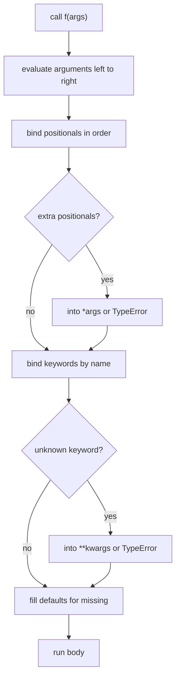

# Functions and arguments

Functions are where Python's flexibility really shows: positional and keyword arguments, defaults, variadic `*args` and `**kwargs`, keyword-only and positional-only parameters, unpacking at the call site, and the fact that functions are ordinary objects you can store, pass and return. This lesson covers all of it — plus the single most famous Python gotcha, the mutable default argument.

## Defining and calling

```python
def count(data, target):
    """Return how many times target occurs in data."""
    n = 0
    for item in data:
        if item == target:
            n += 1
    return n
```

- `def` creates a **function object** and binds it to the name `count`. That happens when the `def` statement *executes*, not when the file is parsed — so you can define functions inside `if` blocks or other functions.
- The string right after the signature is the **docstring**, stored in `count.__doc__` and shown by `help(count)`.
- `return` ends the call and hands back a value. A function that falls off its end (or uses bare `return`) returns `None`.
- To return several values, return a tuple: `return lo, hi`, unpacked by the caller as `lo, hi = minmax(xs)`.

Terminology: **parameters** are the names in the definition (`data`, `target`); **arguments** are the values you pass in a call. Goodrich calls them *formal* and *actual* parameters.

## Positional and keyword arguments

Any parameter can be filled **positionally** (by order) or by **keyword** (by name):

```python-run
def power(base, exp):
    return base ** exp

print(power(2, 10))             # positional
print(power(exp=10, base=2))    # keyword, any order
print(power(2, exp=10))         # mixed: positional must come first
try:
    power(2, base=3)
except TypeError as e:
    print("TypeError:", e)
```

Keyword arguments make call sites self-documenting: `sorted(words, key=len, reverse=True)` is far clearer than three positional values.

## Default values

```python-run
def greet(name, greeting="Hello", punct="!"):
    return f"{greeting}, {name}{punct}"

print(greet("Luffy"))
print(greet("Zoro", "Oi"))
print(greet("Nami", punct="?"))
```

Parameters with defaults must come after those without. And now the trap.

### The mutable default argument pitfall

**Default values are evaluated once, when the `def` statement runs, and the same object is reused on every call.** If the default is mutable and the function mutates it, the changes accumulate:

```python-run
def add_item(item, bucket=[]):     # BUG
    bucket.append(item)
    return bucket

print(add_item("a"))
print(add_item("b"))        # ['a', 'b'] — the same list as before!
print(add_item.__defaults__)
```

The default list lives on the function object (`__defaults__`). The standard fix is a `None` sentinel:

```python-run
def add_item(item, bucket=None):
    if bucket is None:
        bucket = []          # fresh list on every call
    bucket.append(item)
    return bucket

print(add_item("a"), add_item("b"))
```

If `None` is itself a meaningful argument, use a private sentinel object: `_MISSING = object()` and `def f(x=_MISSING): if x is _MISSING: ...`.

The same "evaluated once" rule bites with time: `def log(msg, when=datetime.now())` stamps every message with the time the module was imported.

> [!INTERVIEW]
> "What's wrong with `def f(x, acc=[])`?" — the default list is created once at definition time and shared across calls, so mutations persist. Fix with `acc=None` and create the list inside. Interviewers love following up with "when is this behaviour *useful*?" — a deliberate cache: `def fib(n, _memo={})` — though `functools.lru_cache` is the clean way.

## Variadic arguments: `*args` and `**kwargs`

A parameter prefixed with `*` collects **extra positional arguments into a tuple**; one prefixed with `**` collects **extra keyword arguments into a dict**. The names `args` and `kwargs` are only convention.

```python-run
def report(title, *args, **kwargs):
    print("title :", title)
    print("args  :", args)
    print("kwargs:", kwargs)

report("run 1", 3, 4, 5, user="brook", verbose=True)
report("run 2")
```

Common uses:

- functions like `max(*values)` or `print(*objects)` that take any number of items;
- **wrappers and decorators** that forward whatever they receive: `def wrapper(*args, **kwargs): return func(*args, **kwargs)`;
- subclass `__init__` methods that pass unknown options up to the parent.

## Unpacking at the call site

The same symbols work in reverse at a call: `*iterable` spreads items as positional arguments and `**mapping` spreads key/value pairs as keyword arguments.

```python-run
def volume(l, w, h):
    return l * w * h

dims = [2, 3, 4]
opts = {"w": 3, "h": 4}
print(volume(*dims))
print(volume(2, **opts))
print(*range(5), sep=",")
merged = {**{"a": 1, "b": 2}, **{"b": 20, "c": 3}}   # later keys win
print(merged, [*"abc", *range(2)])
```

## Keyword-only and positional-only parameters

Anything after `*args` — or after a bare `*` — can only be passed **by keyword**. Anything before a `/` can only be passed **positionally** (3.8+).

```python-run
def connect(host, port=5432, /, *, timeout=10, retries=3):
    return f"{host}:{port} timeout={timeout} retries={retries}"

print(connect("db", 6543, timeout=2))
for bad in ("connect('db', 6543, 2)", "connect(host='db')"):
    try:
        eval(bad)
    except TypeError as e:
        print(bad, "->", e)
```

The full order of a parameter list is:

```
def f(pos_only, /, normal, *args, kw_only, **kwargs)
```

Why bother?

- **Keyword-only** flags prevent mysterious call sites like `send(msg, True, False)` and let you add options later without breaking callers.
- **Positional-only** lets the parameter name be an implementation detail (you can rename it freely) and avoids clashes with `**kwargs`. Many built-ins are positional-only: `len(obj=...)` is an error.

## Functions are first-class objects

A function is an object like any other: you can bind it to another name, store it in a list or dict, pass it as an argument, return it from another function, and give it attributes.

```python-run
def shout(s): return s.upper() + "!"
def whisper(s): return s.lower() + "..."

handlers = {"loud": shout, "quiet": whisper}
for mode in ("loud", "quiet"):
    print(handlers[mode]("Yohoho"))

def apply_twice(f, x):
    return f(f(x))

print(apply_twice(lambda n: n * 3, 2))
print(shout.__name__, callable(shout), type(shout))
```

Functions that take or return functions are called **higher-order functions**. The built-ins `map`, `filter`, `sorted(key=...)`, `min/max(key=...)` and `functools.reduce` are the classics. `key` functions in particular are everywhere in interview code:

```python-run
words = ["kiwi", "Banana", "apple", "fig"]
print(sorted(words))                       # by code point: uppercase first
print(sorted(words, key=str.lower))        # case-insensitive
print(sorted(words, key=len))              # stable: ties keep original order
print(max(words, key=len), min(words, key=lambda w: w[-1]))
```

## Return values and `None`

Every call returns something. Functions used for their side effects return `None`, and in-place methods such as `list.sort()`, `list.append()` and `random.shuffle()` deliberately return `None` to remind you they mutate. A classic bug:

```python-run
nums = [3, 1, 2]
result = nums.sort()      # sorts in place, returns None
print(result, nums)
print(sorted([3, 1, 2]))  # sorted() returns a NEW list
```

## Recursion

A function may call itself. Python does **not** optimise tail calls, and the default recursion limit is about 1000 frames (`sys.getrecursionlimit()`). Deep recursion (e.g., DFS on a 10⁵-node path graph) needs an explicit stack, or `sys.setrecursionlimit` plus care.

```python-run
import sys

def depth(n):
    return 0 if n == 0 else 1 + depth(n - 1)

print(depth(500), sys.getrecursionlimit())
try:
    depth(100_000)
except RecursionError as e:
    print("RecursionError:", str(e)[:40])
```

## Argument evaluation and binding order

When you call `f(a(), b())`, Python evaluates the function expression, then arguments **left to right**, then binds them to parameters following these rules:

1. Positional arguments fill positional parameters left to right; leftovers go to `*args` (or raise `TypeError`).
2. Keyword arguments fill parameters by name; unknown names go to `**kwargs` (or raise).
3. A parameter filled twice raises `TypeError: got multiple values`.
4. Missing parameters take their default, or raise `TypeError: missing required argument`.



## Worked example: a flexible `stats` function

Let's combine everything: variadic input, keyword-only options, a mutable-safe default, and multiple return values.

```python-run
def stats(*values, precision=2, exclude=None):
    """Return (count, mean, minimum, maximum) of the values, skipping any in exclude."""
    exclude = set() if exclude is None else set(exclude)
    data = [v for v in values if v not in exclude]
    if not data:
        return 0, None, None, None
    mean = round(sum(data) / len(data), precision)
    return len(data), mean, min(data), max(data)

n, mean, lo, hi = stats(4, 8, 15, 16, 23, 42)
print(n, mean, lo, hi)
print(stats(*range(10), precision=0, exclude=[0, 9]))
print(stats())
```

## Docstrings and annotations

PEP 257 conventions: a one-line summary in the imperative ("Return ..."), a blank line, then details. Annotations (`def f(x: int) -> str:`) are stored in `f.__annotations__` and ignored at runtime — we'll treat them fully in the typing module.

```python-run
def area(r: float) -> float:
    """Return the area of a circle of radius r."""
    import math
    return math.pi * r * r

print(area.__doc__)
print(area.__annotations__)
```

## Under the hood: what a function object carries

`def` builds a **function object** from a compiled **code object**. Nearly everything discussed in this lesson is visible as an attribute, which is handy when debugging a signature problem:

```python-run
import inspect

def order(item, qty=1, *extras, gift=False, note=None, **meta):
    """Place an order."""
    return item, qty, extras, gift, note, meta

print(order.__name__, "|", order.__doc__)
print("positional defaults:", order.__defaults__)        # for qty
print("keyword-only defaults:", order.__kwdefaults__)    # for gift, note
print("local variable names:", order.__code__.co_varnames)
sig = inspect.signature(order)
for name, p in sig.parameters.items():
    print(f"  {name:<7} {p.kind.name:<22} default={p.default if p.default is not p.empty else '-'}")

bound = sig.bind("cola", 3, "straw", "ice", gift=True, colour="red")
bound.apply_defaults()
print(dict(bound.arguments))
```

`inspect.signature(f).bind(...)` performs exactly the binding algorithm the interpreter uses, without calling the function — frameworks (FastAPI, pytest, click) rely on it to decide what to pass to your functions. Each *call* then creates a fresh **frame** holding that call's local variables; that is why two simultaneous calls (or recursive calls) never trample each other's locals, while the *defaults* — stored on the single function object — are shared.

## Debugging argument errors

`TypeError` messages from calls are precise once you know the vocabulary. Run this and match each message to its cause:

```python-run
def move(x, y, *, speed=1):
    return x, y, speed

calls = {
    "too few":            lambda: move(1),
    "too many positional": lambda: move(1, 2, 3),
    "unknown keyword":    lambda: move(1, 2, velocity=3),
    "given twice":        lambda: move(1, x=5, y=2),
    "unpacked wrong size": lambda: move(*[1, 2, 3]),
    "dict with bad key":  lambda: move(**{"x": 1, "y": 2, "z": 3}),
}
for label, call in calls.items():
    try:
        call()
    except TypeError as e:
        print(f"{label:<20} -> {e}")
```

Three situations account for most real-world confusion:

1. **"takes 2 positional arguments but 3 were given"** on a *method* call that visibly passes two: the instance was passed as `self` — you forgot `self` in the method definition, or called an instance method on the class.
2. **"got multiple values for argument"**: a positional argument already filled the parameter you also passed by keyword — common after reordering parameters, which is one more reason to make options keyword-only.
3. **A function "returns None"**: a branch falls off the end without `return`, or you printed instead of returning. `print(result)` inside the function is not a return value.

## Design guidelines for signatures

- Put required, obvious parameters first; make everything optional or boolean **keyword-only** (`*,`), so call sites read as `resize(img, width=200, keep_ratio=True)`.
- Prefer returning new values to mutating arguments; if you do mutate, say so in the name or docstring and return `None`, as `list.sort` does.
- Accept the most general input that works (any iterable rather than specifically a list) and return a concrete, predictable type.
- More than four or five parameters usually signals a missing object: group related values in a dataclass.
- Avoid boolean "mode switches" that make one function do two jobs; two well-named functions are clearer.

## Pitfalls recap

- **Mutable defaults** are shared across calls; use `None`.
- Defaults are evaluated once — including `datetime.now()`.
- Forgetting `return` gives `None`; using the result of `list.sort()` gives `None`.
- Passing a positional argument after a keyword one is a `SyntaxError`.
- `*args` is a **tuple**, `**kwargs` a **dict** — you can't `append` to `args`.
- Deep recursion hits `RecursionError`; Python has no tail-call optimisation.

## Summary

Python functions are objects created at runtime by `def`. Parameters can be positional, keyword, defaulted, variadic, keyword-only or positional-only; call sites can unpack sequences and mappings into arguments. Arguments are bound by assignment, so the function sees the caller's objects. Defaults are evaluated once, which makes mutable defaults dangerous.

```quiz
[
  {"q": "When is a default argument value evaluated?", "options": ["Every time the function is called", "Once, when the def statement executes", "Only if the argument is omitted", "At import time of the caller"], "answer": 1,
   "explain": "Defaults are computed when `def` runs and stored in `__defaults__`, so the same object is reused on every call."},
  {"q": "Inside `def f(*args, **kwargs)`, what types are `args` and `kwargs`?", "options": ["list and dict", "tuple and dict", "tuple and list", "list and set"], "answer": 1,
   "explain": "Extra positional arguments are packed into a tuple; extra keyword arguments into a dict."},
  {"q": "Given `def f(a, /, b, *, c)`, which call is valid?", "options": ["f(a=1, b=2, c=3)", "f(1, 2, 3)", "f(1, b=2, c=3)", "f(1, 2, c=3, d=4)"], "answer": 2,
   "explain": "`a` is positional-only, `b` is normal (so keyword is fine), `c` is keyword-only, and there is no **kwargs to absorb `d`."},
  {"q": "What does `print([3, 1, 2].sort())` print?", "options": ["[1, 2, 3]", "None", "[3, 1, 2]", "An error"], "answer": 1,
   "explain": "list.sort() sorts in place and returns None; use sorted() to get a new list."},
  {"q": "What is printed? `def f(x, acc=[]): acc.append(x); return len(acc)` then `f(1); print(f(2))`", "options": ["1", "2", "0", "TypeError"], "answer": 1,
   "explain": "The default list is shared, so after two calls it holds two items."},
  {"q": "`volume(*[2, 3], **{\"h\": 4})` for `def volume(l, w, h)` returns:", "options": ["24", "TypeError", "9", "[2, 3, 4]"], "answer": 0,
   "explain": "`*` spreads 2 and 3 into l and w; `**` passes h=4 by keyword. 2*3*4 = 24."},
  {"q": "Why does Python raise RecursionError for depth(100000)?", "options": ["Integers overflow", "Python has a default recursion limit of about 1000 and no tail-call optimisation", "Functions can only call themselves 255 times", "The stack is full of garbage"], "answer": 1,
   "explain": "CPython caps the interpreter stack depth (sys.getrecursionlimit) and never eliminates tail calls."}
]
```

> **Source:** Goodrich, Tamassia & Goldwasser, *Data Structures and Algorithms in Python*, §1.5 (Functions: information passing, default parameters, built-in functions); Python docs, *Tutorial* §4.8–4.9 "Defining Functions / More on Defining Functions" and *Language Reference* §8.7 "Function definitions".
