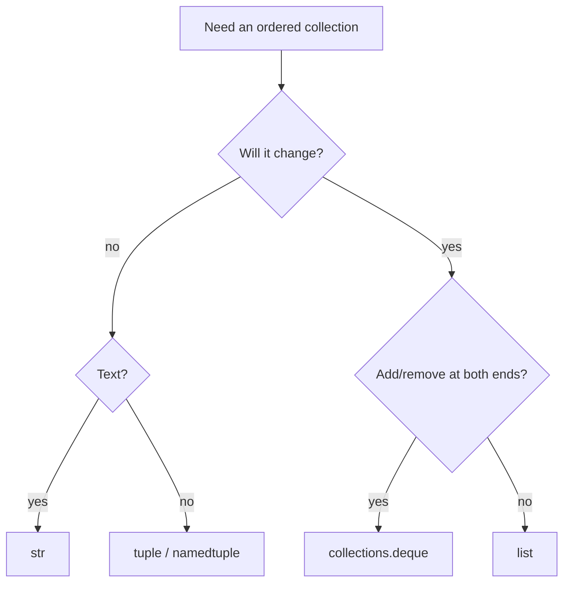

# Lists, tuples and strings

Python's three workhorse sequences share one interface — indexing, slicing, iteration, `len`, `in`, concatenation — but differ in mutability and in what they're good for. In interviews you must know not only *how* to use them but *what each operation costs*, because "this line is O(n) inside a loop" is the most common reason a correct solution times out.

## The common sequence interface

All sequences (`list`, `tuple`, `str`, `range`, `bytes`) support:

| Operation | Meaning |
|---|---|
| `s[i]` | item at index `i` (negative counts from the end: `s[-1]` is last) |
| `s[i:j:k]` | slice from `i` up to (not including) `j` with step `k` |
| `len(s)` | number of items |
| `x in s` | membership (linear scan, except `range` and substring search) |
| `s + t`, `s * n` | concatenation, repetition (new object) |
| `s.index(x)`, `s.count(x)` | first position / number of occurrences |
| `min(s)`, `max(s)`, `sorted(s)` | built-ins that work on any iterable |
| `for x in s` | iteration |

## Slicing in depth

A slice `s[start:stop:step]` produces a **new** sequence. Omitted parts default to "the whole way": `start` = beginning, `stop` = end, `step` = 1. With a negative step, the defaults flip (start at the end, run to the beginning).

```python-run
s = "abcdefgh"
print(s[2:5], s[:3], s[5:], s[-3:], s[:-3])
print(s[::2], s[1::2], s[::-1], s[6:2:-1])
print(s[100:], s[-100:2])      # out-of-range slices clip silently
try:
    s[100]
except IndexError as e:
    print("IndexError:", e)
```

Mental model: indices point **between** items.

```
 +---+---+---+---+---+
 | a | b | c | d | e |
 +---+---+---+---+---+
 0   1   2   3   4   5
-5  -4  -3  -2  -1
```

`s[1:3]` is everything between boundary 1 and boundary 3: `"bc"`. Consequences: `len(s[i:j]) == j - i` (when in range), `s[:k] + s[k:] == s` for any `k`, and slicing never raises for out-of-range bounds.

**Slice assignment** on lists can replace, insert or delete a whole region, and the replacement can have a different length:

```python-run
a = list(range(8))
a[2:5] = ["x"]          # replace 3 items with 1
print(a)
a[1:1] = [10, 11]       # insert without removing
print(a)
del a[::2]              # delete every other item
print(a)
a[:] = []               # clear in place (aliases see it)
print(a)
```

A slice costs **O(k)** where `k` is the slice length, because the items are copied. That means `s[1:]` inside a recursive function makes your algorithm quadratic — pass indices instead.

> [!WARNING]
> `def is_pal(s): return len(s) < 2 or (s[0] == s[-1] and is_pal(s[1:-1]))` is O(n²) time and space because every call copies the string. Use two indices `lo, hi` instead.

## Lists: dynamic arrays

A `list` is a **dynamic array of references**. The list object holds a contiguous block of pointers to the element objects, with spare capacity at the end. When the block fills up, CPython allocates a bigger one (growth of roughly 1.125× plus a constant) and copies the pointers. Because growth is geometric, a sequence of `n` appends costs O(n) total: **amortised O(1)** per append. (Goodrich ch. 5 analyses this in depth.)

```python-run
import sys
a = []
last = sys.getsizeof(a)
for i in range(40):
    a.append(i)
    size = sys.getsizeof(a)
    if size != last:
        print(f"len={len(a):3d} -> {size} bytes")
        last = size
```

### List operation costs (CPython)

| Operation | Average cost | Why |
|---|---|---|
| `a[i]`, `a[i] = x`, `len(a)` | O(1) | direct indexing |
| `a.append(x)` | O(1) amortised | spare capacity at the end |
| `a.pop()` | O(1) | remove from end |
| `a.pop(0)`, `a.insert(0, x)` | **O(n)** | every pointer shifts |
| `a.insert(i, x)`, `a.pop(i)`, `del a[i]` | O(n − i) | shift the tail |
| `x in a`, `a.index(x)`, `a.count(x)`, `a.remove(x)` | **O(n)** | linear scan |
| `a.extend(b)`, `a += b` | O(len(b)) | |
| `a + b` | O(len(a) + len(b)) | new list |
| `a[i:j]` | O(j − i) | copy |
| `a.sort()`, `sorted(a)` | O(n log n) | Timsort; O(n) on already-sorted data |
| `a.reverse()` | O(n) | |
| `min(a)`, `max(a)`, `sum(a)` | O(n) | |
| `a * k` | O(n·k) | |

The two rows in bold are where interview solutions die. `pop(0)` in a BFS loop turns O(V+E) into O(V²); use `collections.deque.popleft()`. `x in big_list` inside a loop turns O(n) into O(n²); build a `set` first.

```python-run
import time
from collections import deque

n = 50_000
a = list(range(n))
t = time.perf_counter()
while a:
    a.pop(0)
print(f"list.pop(0):    {time.perf_counter() - t:.3f}s")

d = deque(range(n))
t = time.perf_counter()
while d:
    d.popleft()
print(f"deque.popleft: {time.perf_counter() - t:.3f}s")
```

### Useful list methods

```python-run
a = [5, 3, 8, 3]
a.append(1); a.extend([9, 2]); a.insert(1, 7)
print(a)
a.remove(3)               # first occurrence only; ValueError if absent
print(a, a.pop(), a.pop(0), a)
print(a.index(8), a.count(3))
a.sort(reverse=True); print(a)
a.sort(key=lambda x: (x % 2, x)); print(a)    # evens first, then by value
b = a.copy(); b.clear(); print(a, b)
```

### Stacks with lists

A list is a perfect stack: `append` to push, `pop()` to pop, `a[-1]` to peek, `if a:` to test empty. All O(1).

## Tuples: immutable records

Tuples are fixed-size, immutable sequences. Use them for:

- **records** of heterogeneous fields: `point = (3, 4)`, `row = ("ana", 31, "Lisbon")`;
- **multiple return values** and **unpacking**;
- **dictionary keys and set members** (when the contents are hashable), e.g. `visited.add((r, c))` in grid search;
- data that must not be changed by accident.

```python-run
p = 3, 4                  # the comma makes the tuple, not the parentheses
single = (5,)             # one-element tuple needs a trailing comma
print(type(p), type((5)), type(single))
x, y = p
first, *rest = (1, 2, 3, 4)
print(x, y, first, rest)
from collections import namedtuple
Point = namedtuple("Point", "x y")
q = Point(1, 2)
print(q.x, q[1], q._replace(x=10), q)
```

Tuples are slightly smaller and faster to create than lists, and the compiler can fold constant tuples. `namedtuple` (or `typing.NamedTuple`) adds field names at no extra per-instance cost.

## Strings: immutable Unicode text

A `str` is an immutable sequence of Unicode code points. There is no separate `char` type: `s[0]` is a string of length 1. `ord("A") == 65` and `chr(97) == "a"` convert between characters and code points.

### Immutability and the concatenation trap

Because strings are immutable, `s += t` creates a new string. Doing that inside a loop is potentially O(n²) total (CPython sometimes optimises it in place when there's exactly one reference, but you should not rely on that). The idiom is to collect pieces in a list and `"".join(pieces)` once — O(total length).

```python-run
import time
parts = [str(i) for i in range(200_000)]

t = time.perf_counter()
s = ""
for p in parts:
    s = s + p          # may copy every time
t1 = time.perf_counter() - t

t = time.perf_counter()
s2 = "".join(parts)
t2 = time.perf_counter() - t
print(s == s2, f"concat {t1:.3f}s vs join {t2:.4f}s")
```

### Essential string methods

```python-run
s = "  Hello, Grand Line!  "
print(repr(s.strip()), repr(s.lstrip()), s.strip().lower(), s.upper())
print(s.strip().split(", "), "a,b,,c".split(","), "  many   spaces ".split())
print("-".join(["2026", "11", "19"]))
print("banana".find("na"), "banana".rfind("na"), "banana".find("x"), "banana".count("a"))
print("banana".replace("a", "o", 2), "Title case".title(), "abc".startswith(("x", "a")))
print("42".isdigit(), "abc".isalpha(), "a1".isalnum(), " ".isspace(), "AbC".swapcase())
print("7".zfill(3), "hi".center(8, "*"), "x".ljust(4, "."), "x".rjust(4, "."))
print("key=value=more".partition("="), "a/b/c".rsplit("/", 1))
```

Notes:

- `split()` with **no** argument splits on runs of any whitespace and drops empty strings; `split(" ")` does not.
- `find` returns −1 when absent; `index` raises `ValueError`.
- `str.translate` with `str.maketrans` maps or deletes many characters in one pass.
- Substring search `t in s` is fast in practice (CPython uses a two-way/Boyer-Moore-Horspool-like hybrid), worst case O(n·m) in older versions.

### String costs

| Operation | Cost |
|---|---|
| `s[i]`, `len(s)` | O(1) (CPython stores fixed-width code units per string) |
| `s + t` | O(len(s) + len(t)) |
| `s[i:j]` | O(j − i) |
| `"".join(parts)` | O(total length) |
| `s.split()`, `s.replace()`, `s.lower()`, `s.strip()` | O(n) |
| `t in s`, `s.find(t)` | O(n) typical |
| `s == t` | O(n) worst case (fast if lengths differ) |

### Building and comparing characters

Interview problems often map letters to indices with `ord(c) - ord("a")`, and use the `string` module constants:

```python-run
import string
word = "python"
counts = [0] * 26
for c in word:
    counts[ord(c) - ord("a")] += 1
print(counts)
print(string.ascii_lowercase, string.digits, string.punctuation[:10])
print("".join(chr((ord(c) - 97 + 3) % 26 + 97) for c in "xyz"))  # Caesar shift
```

### bytes versus str

Text (`str`) is Unicode; binary data (`bytes`) is a sequence of integers 0–255. Convert with `s.encode("utf-8")` and `b.decode("utf-8")`. Files opened in text mode give `str`; in binary mode (`"rb"`), `bytes`. Network sockets and hashing functions want `bytes`.

```python-run
s = "héllo"
b = s.encode("utf-8")
print(b, len(s), len(b), b.decode("utf-8") == s, b[0])
```

## Choosing the right sequence



## Worked example: reverse words in a sentence

"Reverse the order of words, collapsing multiple spaces." The Pythonic answer uses `split()` and `join`, both linear:

```python-run
def reverse_words(s):
    return " ".join(reversed(s.split()))

print(repr(reverse_words("  the sky   is blue ")))
```

And an in-place style version on a list of characters, the way a C programmer would do it — reverse everything, then reverse each word — useful when the interviewer forbids `split`:

```python-run
def reverse_words_inplace(chars):
    def rev(lo, hi):
        while lo < hi:
            chars[lo], chars[hi] = chars[hi], chars[lo]
            lo, hi = lo + 1, hi - 1
    rev(0, len(chars) - 1)
    start = 0
    for i in range(len(chars) + 1):
        if i == len(chars) or chars[i] == " ":
            rev(start, i - 1)
            start = i + 1
    return chars

print("".join(reverse_words_inplace(list("the sky is blue"))))
```

> [!INTERVIEW]
> Know these costs cold: list append O(1) amortised, `pop(0)` / `insert(0)` O(n), `in` on a list O(n), slicing O(k), string concatenation in a loop potentially O(n²) — use `join`. When asked "why is `append` amortised O(1)?", explain geometric over-allocation: resizes happen at sizes growing by a constant factor, so total copying is a geometric series bounded by O(n).

## Everyday list and string chores

A few operations come up constantly in scripts and deserve to be at your fingertips.

```python-run
guests = ["ana", "ben", "cy", "ben"]
del guests[0]                          # remove by position, value not needed
last = guests.pop()                    # remove by position and keep the value
guests.remove("ben")                   # remove by value: first match only (ValueError if absent)
print(guests, last)

votes = ["tea", "coffee", "tea", "water", "tea"]
no_tea = [v for v in votes if v != "tea"]          # remove EVERY occurrence: build a new list
print(no_tea, votes.count("tea"))

names = ["mossback", "Eagle Tooth", "cinder hill"]
print(sorted(names), sorted(names, key=str.lower), sorted(names, key=len, reverse=True))
print(names)                                        # sorted() never changes its argument

url = "https://example.org/reports/2026-summary.pdf"
print(url.removeprefix("https://"), url.removesuffix(".pdf"), url.rpartition("/")[2])
print(repr("  padded \t\n".strip()), "xx-data-xx".strip("x"), "a,b;c".replace(";", ",").split(","))
```

`str.removeprefix` and `str.removesuffix` (3.9+) remove an exact leading or trailing piece and leave the string unchanged when it is not there. Do not confuse them with `strip("...")`, whose argument is a *set of characters* to trim from both ends — `"banana.na".strip(".na")` removes far more than a suffix.

The beginner-level tour of these operations — indexing from zero, `append`/`insert`/`del`/`pop`/`remove`, `sort` versus `sorted`, slices and copying — is the lesson *Lists and loops* in the "Start here" module.

## Pitfalls recap

- `(5)` is an int; `(5,)` is a tuple.
- `split(" ")` keeps empty strings for repeated spaces; `split()` doesn't.
- Slicing copies — avoid it in recursion and tight loops.
- Repeated string `+=` in loops; use `join`.
- `list.remove(x)` removes only the first match and raises if missing.
- `sorted` returns a list even for a string: `"".join(sorted(s))`.

## Summary

Lists are dynamic arrays of references with O(1) indexing and amortised O(1) append but O(n) front operations and membership. Tuples are immutable, hashable (when their contents are) records. Strings are immutable Unicode sequences with a rich method set; build them with `join`. Slicing is universal, forgiving of bounds, and always copies.

```quiz
[
  {"q": "What is the average time complexity of `lst.pop(0)` on a Python list of n items?", "options": ["O(1)", "O(log n)", "O(n)", "O(n log n)"], "answer": 2,
   "explain": "Removing the first slot shifts every remaining pointer left. Use collections.deque.popleft() for O(1)."},
  {"q": "What does `\"abcdef\"[::-2]` return?", "options": ["\"fdb\"", "\"eca\"", "\"fedcba\"", "\"ace\""], "answer": 0,
   "explain": "With a negative step, the slice starts at the last index (f) and takes every second character going left: f, d, b."},
  {"q": "Why is `\"\".join(parts)` preferred over repeated `s += p` in a loop?", "options": ["join is more readable only", "Strings are immutable, so += may copy the growing string each time, giving O(n^2); join computes the total size once", "+= is not allowed on strings", "join sorts the parts"], "answer": 1,
   "explain": "Each concatenation can allocate and copy a new string; join does one pass with one allocation."},
  {"q": "Which expression creates a one-element tuple?", "options": ["(5)", "tuple(5)", "(5,)", "[5]"], "answer": 2,
   "explain": "The comma makes a tuple. (5) is just a parenthesised int, and tuple(5) fails because 5 is not iterable."},
  {"q": "`a = [0,1,2,3,4,5]; a[1:4] = ['x']` leaves a as:", "options": ["[0,'x',4,5]", "[0,'x',2,3,4,5]", "['x',4,5]", "ValueError"], "answer": 0,
   "explain": "Slice assignment replaces the three items at indices 1..3 with the single item 'x'."},
  {"q": "Why is append amortised O(1)?", "options": ["Lists are linked lists", "CPython over-allocates geometrically, so resizes are rare and total copy work is O(n)", "Python pre-allocates a million slots", "It is actually O(log n)"], "answer": 1,
   "explain": "Because capacity grows by a constant factor, the copies during n appends sum to a geometric series bounded by a constant times n."},
  {"q": "`\"a  b\".split(\" \")` returns:", "options": ["['a', 'b']", "['a', '', 'b']", "['a  b']", "['a', ' ', 'b']"], "answer": 1,
   "explain": "Splitting on an explicit single space keeps the empty string between the two spaces; split() with no argument would give ['a', 'b']."}
]
```

> **Source:** Goodrich, Tamassia & Goldwasser, *Data Structures and Algorithms in Python*, §1.2.3 (built-in classes), §1.3 (sequence operators) and ch. 5 (array-based sequences, amortised dynamic arrays); Python docs, *Library Reference* "Sequence Types — list, tuple, range" and "Text Sequence Type — str"; Python wiki "TimeComplexity".
