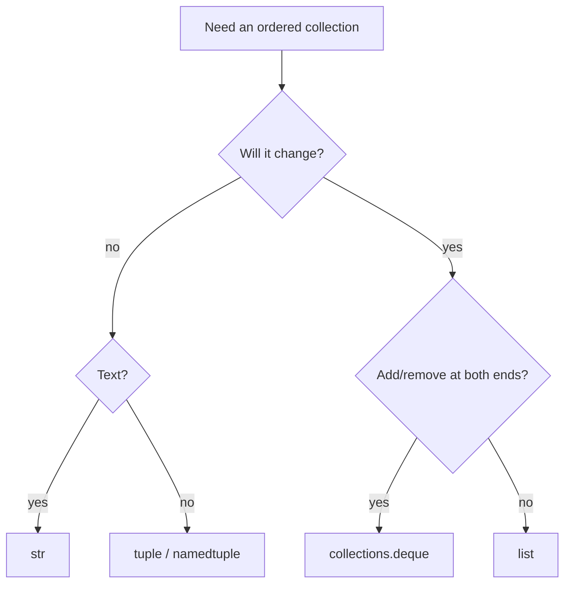

# Lists, tuples and strings

> **Before this lesson:** you should have used lists and loops as in [Lists and loops: working with many values](#/lesson/python/py-start-lists-loops) and handled text as in [First steps](#/lesson/python/py-start-first-steps). The ideas of mutable and immutable objects and of aliases come from [Objects, names, types and mutability](#/lesson/python/py-objects-names).

## In plain words

A **sequence** is a row of items kept in a fixed order, where each item has a numbered position. Python has three sequences you will use every day. A **list** is a row you may change: add items, remove them, replace them. A **tuple** is a row that is sealed once made. A **string** is a sealed row of characters, which is how Python stores text.

Picture a row of numbered coat hooks. A list is a coat rack on which you may hang, swap and remove coats, and to which more hooks are added when it fills up. A tuple is a framed display: the same row, behind glass. A string is a line of printed letters on a page: you can read any letter, copy out any part, but to "change" it you write a new line.

All three answer the same basic requests in the same way (give me item number 3, give me items 2 to 5, how many are there, is this one in there?), so what you learn for one transfers to the others. They differ in whether they can change, and, importantly, in **what each request costs**. On ten items every operation is instant. On a million items, an operation that touches every item, repeated inside a loop, turns a program that takes a second into one that takes an hour. "This line is slow inside that loop" is the most common reason a correct interview solution is rejected, so this lesson attaches a cost to everything it teaches.

## How costs are written: a two-minute guide to O-notation

Programmers describe cost by how the amount of work grows as the data grows, writing `n` for the number of items. The notation is called **big-O**:

- **O(1)**, "constant time": the work does not depend on `n`. Reading item number 500 of a list is as quick as reading item number 5.
- **O(n)**, "linear time": the work grows in step with `n`. Looking for a value by checking every item takes ten times longer on ten times more data.
- **O(n²)**, "quadratic time": doing an O(n) thing once for each of the `n` items. Ten times more data means a hundred times more work. This is the one to fear.
- **O(log n)** and **O(n log n)**: log n is roughly the number of times you can halve `n` before reaching 1 (about 20 for a million). Sorting costs O(n log n).

That is all the theory this lesson needs; the algorithms tracks treat it in depth.

## The common sequence interface

Every sequence type (`list`, `tuple`, `str`, and also `range` and `bytes`) supports these operations:

| Operation | Meaning |
|---|---|
| `s[i]` | the item at position `i`; positions (**indexes**) start at 0, and negative ones count from the end, so `s[-1]` is the last item |
| `s[i:j:k]` | a **slice**: the items from position `i` up to, but not including, `j`, taking every `k`-th |
| `len(s)` | the number of items |
| `x in s` | is `x` among the items? (checks one by one, except for `range` and for text-in-text search) |
| `s + t`, `s * n` | joining two sequences end to end, repeating one `n` times (each builds a new object) |
| `s.index(x)`, `s.count(x)` | position of the first `x` / how many times `x` occurs |
| `min(s)`, `max(s)`, `sorted(s)` | built-in functions that work on any iterable |
| `for x in s` | visiting the items in order |

## Slicing in depth

A slice `s[start:stop:step]` produces a **new** sequence of the same type. Any of the three parts may be left out: a missing `start` means "from the beginning", a missing `stop` means "to the end", and a missing `step` means 1. With a negative step the slice runs backwards, and the defaults swap round (start at the end, run to the beginning).

```python-run
s = "abcdefgh"
print(s[2:5], s[:3], s[5:], s[-3:], s[:-3])
print(s[::2], s[1::2], s[::-1], s[6:2:-1])
print(s[100:], s[-100:2])      # out-of-range slices clip silently
try:
    s[100]
except IndexError as e:
    print("IndexError:", e)
```

**Reading this code line by line**

- `s[2:5]` is positions 2, 3 and 4: `cde`. `s[:3]` is the first three letters, `s[5:]` everything from position 5, `s[-3:]` the last three, and `s[:-3]` everything except the last three.
- `s[::2]` takes every second letter from the start (`aceg`); `s[1::2]` does the same starting at position 1 (`bdfh`); `s[::-1]` is the whole string reversed; `s[6:2:-1]` walks backwards from position 6 and stops before position 2 (`gfed`).
- A slice that reaches past the ends is quietly trimmed: `s[100:]` is the empty string and `s[-100:2]` is `ab`.
- Asking for a *single* item that does not exist is an error: `s[100]` raises `IndexError: string index out of range`.

The picture that makes slices easy: the numbers point **between** the items, not at them.

```
 +---+---+---+---+---+
 | a | b | c | d | e |
 +---+---+---+---+---+
 0   1   2   3   4   5
-5  -4  -3  -2  -1
```

`s[1:3]` is everything between boundary 1 and boundary 3, which is `"bc"`. Three useful facts follow: a slice `s[i:j]` has `j - i` items (when both are in range); `s[:k] + s[k:]` gives back `s` for any `k`; and slicing never raises an error for out-of-range bounds.

**Slice assignment** works on lists only (they are the mutable ones). It replaces a whole stretch of the list with the items of another sequence, and the replacement may be longer or shorter than what it replaces:

```python-run
a = list(range(8))
a[2:5] = ["x"]          # replace 3 items with 1
print(a)
a[1:1] = [10, 11]       # insert without removing
print(a)
del a[::2]              # delete every other item
print(a)
a[:] = []               # clear in place (aliases see it)
print(a)
```

Starting from `[0, 1, 2, 3, 4, 5, 6, 7]`, the first assignment swaps three items for one: `[0, 1, 'x', 5, 6, 7]`. `a[1:1]` is an empty stretch at position 1, so assigning to it inserts: `[0, 10, 11, 1, 'x', 5, 6, 7]`. `del a[::2]` removes positions 0, 2, 4 and 6, leaving `[10, 1, 5, 7]`. `a[:] = []` empties the *same* list object, so any other name tied to it also sees an empty list, unlike `a = []`, which would only move the name.

A slice costs **O(k)**, where `k` is its length, because the items are copied into the new sequence. Slicing inside a loop or a recursive function is therefore a hidden cost.

> [!WARNING]
> `def is_pal(s): return len(s) < 2 or (s[0] == s[-1] and is_pal(s[1:-1]))` checks whether a string reads the same backwards, and it is O(n²) in time and memory because every call copies almost the whole string. Pass two positions `lo, hi` and move them inwards.

## Lists: dynamic arrays

An **array** is a block of equal-sized slots laid side by side in memory, so that the computer can jump straight to slot number `i`. A Python `list` is a **dynamic array of references**: a block of slots, each holding a reference to an item, that can grow. The block is kept somewhat larger than needed. `append` drops the new reference into a spare slot. When the spare slots run out, CPython asks for a bigger block (about one-eighth larger, plus a little), copies the references across, and carries on.

Copying is expensive, but it happens rarely, and because each new block is bigger by a *proportion* of the old one, the total copying done during `n` appends adds up to only O(n). Averaged over all the appends, that is O(1) each. An average of this kind, taken over a long run of operations, is called an **amortised** cost.

```python-run
import sys
a = []
last = sys.getsizeof(a)
for i in range(40):
    a.append(i)
    size = sys.getsizeof(a)
    if size != last:
        print(f"len={len(a):3d} -> {size} bytes")
        last = size
```

`sys.getsizeof(a)` reports how many bytes the list object occupies (the block of slots, not the items). The loop appends forty numbers and prints a line only when that size changes. You will see a handful of lines, not forty: the size jumps at lengths such as 1, 5, 9, 17, 25 and 33, and in between the appends use the spare room.

### List operation costs (CPython)

| Operation | Average cost | Why |
|---|---|---|
| `a[i]`, `a[i] = x`, `len(a)` | O(1) | jump straight to the slot |
| `a.append(x)` | O(1) amortised | spare room at the end |
| `a.pop()` | O(1) | remove from the end |
| `a.pop(0)`, `a.insert(0, x)` | **O(n)** | every other reference must shift one slot |
| `a.insert(i, x)`, `a.pop(i)`, `del a[i]` | O(n − i) | everything after position `i` shifts |
| `x in a`, `a.index(x)`, `a.count(x)`, `a.remove(x)` | **O(n)** | checks items one by one |
| `a.extend(b)`, `a += b` | O(len(b)) | |
| `a + b` | O(len(a) + len(b)) | builds a new list |
| `a[i:j]` | O(j − i) | copies |
| `a.sort()`, `sorted(a)` | O(n log n) | the algorithm is called Timsort; O(n) on data that is already sorted |
| `a.reverse()` | O(n) | |
| `min(a)`, `max(a)`, `sum(a)` | O(n) | |
| `a * k` | O(n·k) | |

The two rows in bold are where interview solutions fail. Taking items from the *front* with `pop(0)` inside a loop turns a linear algorithm into a quadratic one; `collections.deque` (a double-ended queue, covered in the collections lesson) has a `popleft()` that is O(1). Writing `x in big_list` inside a loop does the same damage; build a `set` first, because a set answers `in` in O(1).

```python-run
import time
from collections import deque

n = 50_000
a = list(range(n))
t = time.perf_counter()
while a:
    a.pop(0)
print(f"list.pop(0):    {time.perf_counter() - t:.3f}s")

d = deque(range(n))
t = time.perf_counter()
while d:
    d.popleft()
print(f"deque.popleft: {time.perf_counter() - t:.3f}s")
```

`time.perf_counter()` reads a precise clock; subtracting two readings gives the seconds that passed. Both loops empty a collection of 50,000 numbers from the front. The exact times depend on your machine, but the list version is many times slower, and the gap widens as `n` grows.

### Useful list methods

```python-run
a = [5, 3, 8, 3]
a.append(1); a.extend([9, 2]); a.insert(1, 7)
print(a)
a.remove(3)               # first occurrence only; ValueError if absent
print(a, a.pop(), a.pop(0), a)
print(a.index(8), a.count(3))
a.sort(reverse=True); print(a)
a.sort(key=lambda x: (x % 2, x)); print(a)    # evens first, then by value
b = a.copy(); b.clear(); print(a, b)
```

**Reading this code line by line**

- `append` adds one item at the end, `extend` adds every item of another sequence, and `insert(1, 7)` puts 7 at position 1: `[5, 7, 3, 8, 3, 1, 9, 2]`. (A semicolon lets several statements share a line; it is used here only to keep the demo short.)
- `remove(3)` deletes the first 3 it finds.
- The second `print` evaluates its arguments left to right: it notes the list, then `pop()` removes and returns the last item (2), then `pop(0)` removes and returns the first (5). Because the first and last arguments are the same list object, both show its final state, `[7, 8, 3, 1, 9]`.
- `index(8)` is 1 and `count(3)` is 1.
- `sort(reverse=True)` orders from largest to smallest. The second sort uses a key function that returns a pair: the remainder after dividing by 2 (0 for even, 1 for odd), then the number. Pairs compare item by item, so even numbers come first: `[8, 1, 3, 7, 9]`.
- `copy()` makes a new list with the same items; clearing the copy leaves the original untouched.

### Stacks with lists

A **stack** is a pile where you add and remove only at the top, like plates. A list makes a perfect stack: `append` to push, `pop()` to take the top item, `a[-1]` to look at it, `if a:` to test whether anything is left. All four are O(1).

## Tuples: immutable records

A tuple is a fixed-size sequence that cannot be changed. Use tuples for:

- **records** made of fields of different kinds: `point = (3, 4)`, `row = ("ana", 31, "Lisbon")`;
- **returning several values** from a function, and **unpacking** them;
- **dictionary keys and set members** (when every item inside is hashable), for example `visited.add((r, c))` when exploring a grid;
- data that must not be changed by accident.

```python-run
p = 3, 4                  # the comma makes the tuple, not the parentheses
single = (5,)             # one-element tuple needs a trailing comma
print(type(p), type((5)), type(single))
x, y = p
first, *rest = (1, 2, 3, 4)
print(x, y, first, rest)
from collections import namedtuple
Point = namedtuple("Point", "x y")
q = Point(1, 2)
print(q.x, q[1], q._replace(x=10), q)
```

The first three lines make a point that surprises beginners: it is the *comma* that creates a tuple. `3, 4` is a tuple without any brackets; `(5)` is the plain integer 5 in brackets; `(5,)` is a tuple with one item. `x, y = p` unpacks the two items into two names. `first, *rest = ...` gives the first item to `first` and gathers all the others into a list: `1 [2, 3, 4]`.

`namedtuple` creates a tuple type whose positions also have names. `Point(1, 2)` can be read as `q.x` or `q[1]`. Like any tuple it cannot be modified; `q._replace(x=10)` returns a *new* point `Point(x=10, y=2)` and leaves `q` as it was.

Tuples take slightly less memory than lists and are quicker to create. `namedtuple` (or its typed cousin `typing.NamedTuple`) adds field names without making each object any bigger.

## Strings: immutable Unicode text

A `str` is an immutable sequence of characters. **Unicode** is the worldwide standard that gives every character of every writing system a number, called its **code point**; a Python string is a sequence of those. There is no separate "single character" type: `s[0]` is a string of length 1. `ord("A")` gives the code point 65, and `chr(97)` gives the character `"a"`.

### Immutability and the concatenation trap

Because a string cannot change, `s += t` has to build a new string containing both parts. Inside a loop, each round may copy everything built so far: lengths 1, 2, 3, ... up to `n` add up to about n²/2 characters copied, which is O(n²). (CPython can sometimes extend the string in place when nothing else refers to it, but you should not rely on that.) The dependable method is to collect the pieces in a list and join them once with `"".join(pieces)`, which measures the total length, makes one string and copies each piece once: O(total length).

```python-run
import time
parts = [str(i) for i in range(200_000)]

t = time.perf_counter()
s = ""
for p in parts:
    s = s + p          # may copy every time
t1 = time.perf_counter() - t

t = time.perf_counter()
s2 = "".join(parts)
t2 = time.perf_counter() - t
print(s == s2, f"concat {t1:.3f}s vs join {t2:.4f}s")
```

Both halves build the same long string out of 200,000 pieces; the program prints `True` for "the results are equal" and the two timings. `join` wins clearly. The string in front of `.join` is the separator placed between pieces: `""` for nothing, `", "` for a comma and a space.

### Essential string methods

No string method changes the string it is called on; each returns a new string (or a list, or a number).

```python-run
s = "  Hello, Grand Line!  "
print(repr(s.strip()), repr(s.lstrip()), s.strip().lower(), s.upper())
print(s.strip().split(", "), "a,b,,c".split(","), "  many   spaces ".split())
print("-".join(["2026", "11", "19"]))
print("banana".find("na"), "banana".rfind("na"), "banana".find("x"), "banana".count("a"))
print("banana".replace("a", "o", 2), "Title case".title(), "abc".startswith(("x", "a")))
print("42".isdigit(), "abc".isalpha(), "a1".isalnum(), " ".isspace(), "AbC".swapcase())
print("7".zfill(3), "hi".center(8, "*"), "x".ljust(4, "."), "x".rjust(4, "."))
print("key=value=more".partition("="), "a/b/c".rsplit("/", 1))
```

What each line demonstrates:

1. `strip()` removes spaces, tabs and line breaks from both ends; `lstrip()` from the left only. `repr` is used so that the quotes show where the string ends. `lower()` and `upper()` change the case.
2. `split(sep)` cuts a string into a list at every `sep`. Note `"a,b,,c".split(",")` gives `['a', 'b', '', 'c']`, with an empty string between the two commas.
3. `join` is the reverse of `split`: `2026-11-19`.
4. `find` gives the position of the first match (2), `rfind` the last (4), and −1 when there is none; `count` gives 3.
5. `replace("a", "o", 2)` replaces only the first two matches: `bonona`. `startswith` accepts a tuple of alternatives.
6. The `is...` methods test what kind of characters a string contains.
7. `zfill`, `center`, `ljust` and `rjust` pad a string to a given width.
8. `partition` cuts at the first separator into exactly three parts, `('key', '=', 'value=more')`; `rsplit("/", 1)` splits once, starting from the right: `['a/b', 'c']`.

Notes:

- `split()` with **no** argument splits on any run of spaces, tabs or line breaks and never produces empty strings; `split(" ")` splits at every single space and does produce them.
- `find` returns −1 when the text is absent; `index` raises `ValueError` in the same situation.
- `str.translate`, with a table made by `str.maketrans`, replaces or deletes many different characters in one pass.
- Searching for text inside text (`t in s`) is fast in practice, because CPython uses a clever search method that skips ahead; in older versions the worst case was O(n·m) for lengths `n` and `m`.

### String costs

| Operation | Cost |
|---|---|
| `s[i]`, `len(s)` | O(1) (CPython stores every character of one string in the same number of bytes, so it can jump to position `i`) |
| `s + t` | O(len(s) + len(t)) |
| `s[i:j]` | O(j − i) |
| `"".join(parts)` | O(total length) |
| `s.split()`, `s.replace()`, `s.lower()`, `s.strip()` | O(n) |
| `t in s`, `s.find(t)` | O(n) typically |
| `s == t` | O(n) at worst (immediate if the lengths differ) |

### Building and comparing characters

Interview problems about letters often turn a letter into a position from 0 to 25 with `ord(c) - ord("a")`, and use the ready-made constants of the `string` module:

```python-run
import string
word = "python"
counts = [0] * 26
for c in word:
    counts[ord(c) - ord("a")] += 1
print(counts)
print(string.ascii_lowercase, string.digits, string.punctuation[:10])
print("".join(chr((ord(c) - 97 + 3) % 26 + 97) for c in "xyz"))  # Caesar shift
```

`counts` starts as 26 zeros, one per letter. For each letter of `python`, `ord(c) - ord("a")` gives its place in the alphabet (`a` is 0, `p` is 15) and the matching counter goes up by one. The second line prints the lowercase alphabet, the ten digits and some punctuation marks. The last line is a Caesar cipher, which moves each letter three places along: subtract 97 (the code point of `a`) to get 0-25, add 3, wrap round with `% 26`, add 97 again and convert back with `chr`. `xyz` becomes `abc`.

### bytes versus str

A **byte** is a number from 0 to 255, the unit in which files and networks carry data. Text (`str`) is made of characters; `bytes` is a sequence of bytes. Turning characters into bytes is called **encoding**, and the reverse is **decoding**; the usual scheme is named UTF-8. Convert with `s.encode("utf-8")` and `b.decode("utf-8")`. A file opened in text mode gives you `str`; opened in binary mode (`"rb"`) it gives `bytes`. Network connections and hashing functions want `bytes`.

```python-run
s = "héllo"
b = s.encode("utf-8")
print(b, len(s), len(b), b.decode("utf-8") == s, b[0])
```

The string has 5 characters but its encoded form has 6 bytes, because `é` needs two bytes in UTF-8 (shown as `\xc3\xa9`). Decoding gives the original text back, and `b[0]` is the number 104, the byte for `h`.

## Choosing the right sequence



## Worked example: reverse words in a sentence

The task: "reverse the order of the words in a sentence, reducing repeated spaces to one." The idiomatic answer uses `split()` and `join`, both O(n):

```python-run
def reverse_words(s):
    return " ".join(reversed(s.split()))

print(repr(reverse_words("  the sky   is blue ")))
```

`s.split()` gives `['the', 'sky', 'is', 'blue']` (the extra spaces vanish), `reversed` walks that list backwards, and `" ".join` glues the words with single spaces: `'blue is sky the'`.

Interviewers sometimes forbid `split` and ask for the method a C programmer would use on a list of characters, changing it in place: reverse the whole thing, then reverse each word back.

```python-run
def reverse_words_inplace(chars):
    def rev(lo, hi):
        while lo < hi:
            chars[lo], chars[hi] = chars[hi], chars[lo]
            lo, hi = lo + 1, hi - 1
    rev(0, len(chars) - 1)
    start = 0
    for i in range(len(chars) + 1):
        if i == len(chars) or chars[i] == " ":
            rev(start, i - 1)
            start = i + 1
    return chars

print("".join(reverse_words_inplace(list("the sky is blue"))))
```

The helper `rev(lo, hi)` swaps the characters at the two ends of a stretch and moves both positions inwards until they meet. Reversing everything gives `eulb si yks eht`: the words are in the right order but each is spelled backwards. The loop then finds each word (it ends at a space or at the end of the list) and reverses it back. No slices are made, so the extra memory used is O(1).

> [!INTERVIEW]
> Know these costs by heart: list `append` is O(1) amortised; `pop(0)` and `insert(0, x)` are O(n); `in` on a list is O(n); slicing is O(k); string concatenation in a loop can be O(n²), so use `join`. If asked "why is `append` amortised O(1)?", explain geometric over-allocation: the block grows by a constant factor each time it fills, so the copying done over `n` appends forms a geometric series whose sum is bounded by a constant times `n`.

## Everyday list and string chores

A few operations come up constantly in scripts and deserve to be at your fingertips.

```python-run
guests = ["ana", "ben", "cy", "ben"]
del guests[0]                          # remove by position, value not needed
last = guests.pop()                    # remove by position and keep the value
guests.remove("ben")                   # remove by value: first match only (ValueError if absent)
print(guests, last)

votes = ["tea", "coffee", "tea", "water", "tea"]
no_tea = [v for v in votes if v != "tea"]          # remove EVERY occurrence: build a new list
print(no_tea, votes.count("tea"))

names = ["mossback", "Eagle Tooth", "cinder hill"]
print(sorted(names), sorted(names, key=str.lower), sorted(names, key=len, reverse=True))
print(names)                                        # sorted() never changes its argument

url = "https://example.org/reports/2026-summary.pdf"
print(url.removeprefix("https://"), url.removesuffix(".pdf"), url.rpartition("/")[2])
print(repr("  padded \t\n".strip()), "xx-data-xx".strip("x"), "a,b;c".replace(";", ",").split(","))
```

The first group shows the three ways to remove from a list: `del` by position, `pop` by position while keeping the value, `remove` by value. After all three, `guests` is `['cy']` and `last` is `'ben'`. To remove *every* matching item, build a new list that keeps the rest. `sorted` returns a new list each time and leaves `names` alone.

`str.removeprefix` and `str.removesuffix` (Python 3.9+) cut off one exact piece from the front or back, and return the string unchanged when the piece is not there. Do not confuse them with `strip("...")`, whose argument is a *set of characters* to trim from both ends: `"banana.na".strip(".na")` eats far more than a suffix, because it keeps removing any of `.`, `n` and `a` from each end.

## Pitfalls recap

- `(5)` is an integer; `(5,)` is a tuple.
- `split(" ")` keeps empty strings for repeated spaces; `split()` does not.
- Slicing copies; avoid it inside recursion and tight loops.
- Repeated string `+=` in a loop; use `join`.
- `list.remove(x)` removes only the first match and raises `ValueError` if there is none.
- `sorted` returns a list even when given a string; write `"".join(sorted(s))` to get a string back.

## Summary

Lists are dynamic arrays of references: O(1) access by position and amortised O(1) `append`, but O(n) for anything at the front and for membership tests. Tuples are immutable records, hashable when their contents are. Strings are immutable sequences of Unicode characters with a rich set of methods; build long ones with `join`. Slicing works on all of them, forgives out-of-range bounds, and always copies.

## Glossary

- **Sequence** - an ordered collection whose items have numbered positions.
- **Index** - the position number of an item, starting at 0; negative indexes count from the end.
- **Slice** - a new sequence made from a stretch of another, written `s[start:stop:step]`.
- **Big-O notation** - a way to state how the work of an operation grows with the number of items `n`.
- **Constant / linear / quadratic time** - O(1) / O(n) / O(n²).
- **Array** - a block of equal-sized slots that can be reached directly by number.
- **Dynamic array** - an array that moves to a larger block when it fills up; a Python list is one.
- **Amortised cost** - the average cost per operation over a long run of operations.
- **Stack** - a collection where items are added and removed at the same end.
- **Tuple** - an immutable sequence, often used as a small record.
- **namedtuple** - a tuple type whose positions also have names.
- **Unicode / code point** - the standard that numbers every character / one such number.
- **Concatenation** - joining sequences end to end with `+`.
- **bytes** - an immutable sequence of numbers from 0 to 255: raw data.
- **Encoding / decoding** - turning text into bytes / bytes into text, usually with UTF-8.
- **Stable sort** - a sort that keeps items with equal keys in their original order.

```quiz
[
  {"q": "What is the average time complexity of `lst.pop(0)` on a Python list of n items?", "options": ["O(1)", "O(log n)", "O(n)", "O(n log n)"], "answer": 2,
   "explain": "Removing the first slot shifts every remaining pointer left. Use collections.deque.popleft() for O(1)."},
  {"q": "What does `\"abcdef\"[::-2]` return?", "options": ["\"fdb\"", "\"eca\"", "\"fedcba\"", "\"ace\""], "answer": 0,
   "explain": "With a negative step, the slice starts at the last index (f) and takes every second character going left: f, d, b."},
  {"q": "Why is `\"\".join(parts)` preferred over repeated `s += p` in a loop?", "options": ["join is more readable only", "Strings are immutable, so += may copy the growing string each time, giving O(n^2); join computes the total size once", "+= is not allowed on strings", "join sorts the parts"], "answer": 1,
   "explain": "Each concatenation can allocate and copy a new string; join does one pass with one allocation."},
  {"q": "Which expression creates a one-element tuple?", "options": ["(5)", "tuple(5)", "(5,)", "[5]"], "answer": 2,
   "explain": "The comma makes a tuple. (5) is an int in parentheses, and tuple(5) fails because 5 is not iterable."},
  {"q": "`a = [0,1,2,3,4,5]; a[1:4] = ['x']` leaves a as:", "options": ["[0,'x',4,5]", "[0,'x',2,3,4,5]", "['x',4,5]", "ValueError"], "answer": 0,
   "explain": "Slice assignment replaces the three items at indices 1..3 with the single item 'x'."},
  {"q": "Why is append amortised O(1)?", "options": ["Lists are linked lists", "CPython over-allocates geometrically, so resizes are rare and total copy work is O(n)", "Python pre-allocates a million slots", "It is actually O(log n)"], "answer": 1,
   "explain": "Because capacity grows by a constant factor, the copies during n appends sum to a geometric series bounded by a constant times n."},
  {"q": "`\"a  b\".split(\" \")` returns:", "options": ["['a', 'b']", "['a', '', 'b']", "['a  b']", "['a', ' ', 'b']"], "answer": 1,
   "explain": "Splitting on an explicit single space keeps the empty string between the two spaces; split() with no argument would give ['a', 'b']."}
]
```

> **Source:** Goodrich, Tamassia & Goldwasser, *Data Structures and Algorithms in Python*, §1.2.3 (built-in classes), §1.3 (sequence operators) and ch. 5 (array-based sequences, amortised dynamic arrays), restated in original wording with new examples; Python docs, *Library Reference* "Sequence Types — list, tuple, range" and "Text Sequence Type — str"; Python wiki "TimeComplexity".
