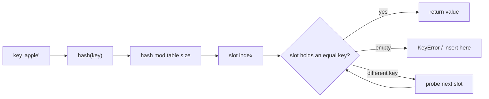

# Dictionaries and sets

If lists are Python's most common data structure, dictionaries are its most *important* one. Module namespaces, object attributes, keyword arguments and class bodies are all dicts under the hood. In interviews, the hash map is the single tool that turns more O(n²) brute-force solutions into O(n) ones than any other. Sets are dicts without values, and just as useful.

## What a hash table does

A dict maps **keys** to **values**. To find a key quickly, Python computes `hash(key)` — an integer — and uses it to pick a slot in an internal table. If two keys land in the same slot (a **collision**), CPython probes other slots using a pseudo-random sequence derived from the hash (*open addressing*). The table is kept at most about two-thirds full; when it gets fuller, it's resized (roughly doubled) and every entry is reinserted. Like list growth, resizing is geometric, so insertion is **amortised O(1)**.



Since Python 3.6 (guaranteed from 3.7), CPython's dict uses a compact layout: a sparse index table pointing into a dense array of entries in **insertion order**. That's why dicts iterate in insertion order and use less memory than older versions.

### The hashing contract

For a key to work correctly:

1. `hash(k)` must not change while `k` is in the dict — in practice, the key must be immutable.
2. If `a == b` then `hash(a) == hash(b)`. (The reverse need not hold; that's a collision.)

That's why `list`, `dict` and `set` are unhashable, while `int`, `str`, `tuple` (of hashables), `frozenset` and most user-defined objects (hashed by identity by default) are hashable. Note `hash(1) == hash(1.0) == hash(True)` and `1 == 1.0 == True`, so these are the **same key**:

```python-run
d = {1: "int"}
d[1.0] = "float"
d[True] = "bool"
print(d)              # {1: 'bool'} — one key, last value wins, first key object kept
print(hash("abc") == hash("abc"), hash((1, 2)))
```

String hashes are randomised per process (`PYTHONHASHSEED`) to resist denial-of-service attacks, so never persist `hash()` values.

## Dict operations and their costs

| Operation | Average | Worst case |
|---|---|---|
| `d[k]`, `d[k] = v`, `del d[k]` | O(1) | O(n) |
| `k in d`, `d.get(k)` | O(1) | O(n) |
| `d.pop(k)`, `d.setdefault(k, v)` | O(1) | O(n) |
| `len(d)` | O(1) | |
| iterate over `d`, `d.keys()`, `d.values()`, `d.items()` | O(n) | |
| `d.copy()`, `dict(d)` | O(n) | |
| `d.update(other)`, `d | other` | O(len(other)) | |

The worst case requires pathological collisions and essentially never happens with built-in types. In interviews, quote O(1) average.

## Working with dicts

```python-run
ages = {"luffy": 19, "zoro": 21}
ages["nami"] = 20                     # insert
ages["luffy"] += 1                    # update
print(ages["zoro"], ages.get("usopp"), ages.get("usopp", "unknown"))
try:
    ages["usopp"]
except KeyError as e:
    print("KeyError:", e)
print("nami" in ages, 20 in ages)     # 'in' checks KEYS, not values
print(ages.pop("nami"), ages.pop("missing", None))
print(list(ages), list(ages.values()), list(ages.items()))
for name, age in ages.items():
    print(f"{name}: {age}")
```

Other ways to build dicts:

```python-run
print(dict(a=1, b=2))
print(dict([("x", 1), ("y", 2)]))
print(dict(zip("abc", range(3))))
print(dict.fromkeys(["a", "b"], 0))
print({w: len(w) for w in ["sun", "moon"]})          # dict comprehension
inverted = {v: k for k, v in {"a": 1, "b": 2}.items()}
print(inverted)
```

> [!WARNING]
> `dict.fromkeys(keys, [])` shares **one** list among all keys — the same aliasing bug as `[[]] * n`. Use `{k: [] for k in keys}` or `defaultdict(list)`.

### Counting and grouping: `get`, `setdefault`, `defaultdict`, `Counter`

Counting occurrences and grouping items by a key are the two most common dict patterns. Here they are four ways, from most manual to most idiomatic:

```python-run
from collections import defaultdict, Counter
words = "the cat and the hat and the bat".split()

c1 = {}
for w in words:
    if w not in c1:
        c1[w] = 0
    c1[w] += 1

c2 = {}
for w in words:
    c2[w] = c2.get(w, 0) + 1

c3 = defaultdict(int)          # int() == 0 is the default factory
for w in words:
    c3[w] += 1

c4 = Counter(words)
print(c1 == c2 == c3 == c4, c4.most_common(2))

groups = defaultdict(list)
for w in words:
    groups[w[-2:]].append(w)   # group by last two letters
print(dict(groups))

g2 = {}
for w in words:
    g2.setdefault(len(w), []).append(w)
print(g2)
```

### Dict views

`keys()`, `values()` and `items()` return **views**: live windows onto the dict, not copies. They're cheap (O(1) to create), reflect later changes, and `keys()`/`items()` support set operations.

```python-run
a = {"x": 1, "y": 2, "z": 3}
b = {"y": 20, "w": 0}
ks = a.keys()
a["new"] = 9
print(ks)                        # the view sees the insertion
print(a.keys() & b.keys(), a.keys() - b.keys())
```

### Merging and ordering

```python-run
defaults = {"host": "localhost", "port": 8000}
overrides = {"port": 9000, "debug": True}
print({**defaults, **overrides})
print(defaults | overrides)             # 3.9+
cfg = dict(defaults); cfg |= overrides  # in-place merge
print(cfg)
# insertion order is preserved; re-assigning an existing key keeps its position
cfg["host"] = "0.0.0.0"
print(list(cfg))
# sorted by value
scores = {"a": 3, "b": 1, "c": 2}
print(sorted(scores, key=scores.get), dict(sorted(scores.items(), key=lambda kv: -kv[1])))
```

## Sets

A `set` is an unordered collection of unique hashable items, implemented as a hash table with keys only. Use it for membership tests, de-duplication and set algebra.

```python-run
seen = set()                      # NOT {} — that's an empty dict
for x in [3, 1, 3, 2, 1]:
    seen.add(x)
print(seen, len(seen), 2 in seen)
a, b = {1, 2, 3, 4}, {3, 4, 5}
print(a | b, a & b, a - b, a ^ b)
print(a.issubset({1, 2, 3, 4, 5}), {1, 2} <= a, a.isdisjoint({9}))
a.discard(99)                     # no error if absent
try:
    a.remove(99)
except KeyError:
    print("remove raises KeyError when absent")
print(list(dict.fromkeys([3, 1, 3, 2, 1])))   # dedupe preserving order
```

| Operation | Average cost |
|---|---|
| `x in s`, `s.add(x)`, `s.remove(x)`, `s.discard(x)` | O(1) |
| `s | t` | O(len(s) + len(t)) |
| `s & t` | O(min(len(s), len(t))) |
| `s - t` | O(len(s)) |
| `set(iterable)` | O(n) |

`frozenset` is the immutable, hashable version — use it when you need a set as a dict key or inside another set (e.g., memoising on a set of visited nodes).

Sets are unordered: never rely on their iteration order (for small ints it often *looks* sorted, which fools people).

## Worked example: Two Sum, from O(n²) to O(n)

Given a list of numbers and a target, return indices of two numbers that add up to the target.

```python-run
def two_sum_brute(nums, target):           # O(n^2)
    for i in range(len(nums)):
        for j in range(i + 1, len(nums)):
            if nums[i] + nums[j] == target:
                return [i, j]

def two_sum(nums, target):                 # O(n) time, O(n) space
    index_of = {}
    for i, x in enumerate(nums):
        need = target - x
        if need in index_of:               # O(1) average lookup
            return [index_of[need], i]
        index_of[x] = i

print(two_sum_brute([2, 7, 11, 15], 9), two_sum([2, 7, 11, 15], 9), two_sum([3, 3], 6))
```

The dict remembers "which value have I seen, and where?", so each element is processed once. Checking before inserting handles the `[3, 3]` case and prevents using one element twice.

## Worked example: first non-repeating character

```python-run
from collections import Counter
def first_unique(s):
    counts = Counter(s)                    # O(n)
    for i, c in enumerate(s):              # second O(n) pass, in string order
        if counts[c] == 1:
            return i
    return -1

print(first_unique("leetcode"), first_unique("loveleetcode"), first_unique("aabb"))
```

## Using objects as keys

User-defined class instances are hashable by identity unless you define `__eq__`. If you define `__eq__`, Python sets `__hash__` to `None` (making instances unhashable) unless you also define `__hash__`. For value-based keys, use a tuple of the identifying fields, a `NamedTuple`, or a frozen dataclass (module 5).

```python-run
class P:
    def __init__(self, x, y): self.x, self.y = x, y
    def __eq__(self, o): return (self.x, self.y) == (o.x, o.y)
    def __hash__(self): return hash((self.x, self.y))

s = {P(1, 2)}
print(P(1, 2) in s)
```

> [!INTERVIEW]
> Be ready to explain how a dict works: hash the key, index into a table, resolve collisions by probing, compare with `==` to confirm; keep the load factor low and resize geometrically for amortised O(1). Then the follow-ups: why must keys be immutable (their hash must not change), why are dicts ordered (compact insertion-ordered entry array since 3.6/3.7), and what's the worst case (O(n) with adversarial collisions; mitigated by hash randomisation).

## Pitfalls recap

- `{}` is an empty dict; use `set()` for an empty set.
- `d[k]` raises `KeyError`; use `get`, `in`, `setdefault` or `defaultdict` as appropriate.
- `x in d` checks keys. To search values use `x in d.values()` (O(n)).
- Modifying a dict's size while iterating raises `RuntimeError`; iterate over `list(d)`.
- `dict.fromkeys(ks, [])` shares one list.
- Keys `1`, `1.0` and `True` collide into one entry.
- Defining `__eq__` without `__hash__` makes your objects unhashable.

## Summary

Dicts and sets are hash tables: O(1) average lookup, insertion and deletion, at the price of requiring hashable keys and extra memory. Dicts preserve insertion order; sets are unordered. `get`, `setdefault`, `defaultdict` and `Counter` cover the counting and grouping patterns that appear in a huge fraction of interview problems.

```quiz
[
  {"q": "Average time complexity of `key in my_dict`?", "options": ["O(1)", "O(log n)", "O(n)", "O(n log n)"], "answer": 0,
   "explain": "The key's hash picks a slot directly; with a low load factor only a few probes are needed."},
  {"q": "What does `type({})` return?", "options": ["set", "dict", "frozenset", "list"], "answer": 1,
   "explain": "Empty braces are an empty dict. An empty set is written set()."},
  {"q": "Why can't a list be a dict key?", "options": ["Lists are too large", "Lists are mutable, so they are unhashable (their hash could change)", "Only strings can be keys", "Lists are ordered"], "answer": 1,
   "explain": "A key's hash must stay constant while it's stored. Mutable built-ins set __hash__ to None."},
  {"q": "What is `len({1: 'a', 1.0: 'b', True: 'c'})`?", "options": ["3", "2", "1", "TypeError"], "answer": 2,
   "explain": "1, 1.0 and True are equal and hash equally, so they are the same key; the last value wins."},
  {"q": "Since which version is dict insertion order guaranteed by the language?", "options": ["2.7", "3.5", "3.7", "3.10"], "answer": 2,
   "explain": "CPython 3.6 implemented it; Python 3.7 made it part of the language specification."},
  {"q": "You define `__eq__` on a class but not `__hash__`. Instances are now:", "options": ["Hashed by identity", "Hashed by their fields", "Unhashable", "Hashed as 0"], "answer": 2,
   "explain": "Defining __eq__ alone sets __hash__ = None, because identity hashing would violate 'equal objects have equal hashes'."},
  {"q": "Best structure to count occurrences of words in a list?", "options": ["list.count in a loop", "collections.Counter", "a set", "sorted() then scan"], "answer": 1,
   "explain": "Counter builds counts in one O(n) pass and has most_common(k). list.count in a loop is O(n^2)."}
]
```

> **Source:** Goodrich, Tamassia & Goldwasser, *Data Structures and Algorithms in Python*, §1.2.3 (set, frozenset, dict classes) and ch. 10 (maps, hash tables); Python docs, *Library Reference* "Mapping Types — dict" and "Set Types", *Tutorial* §5.4–5.5; Python wiki "TimeComplexity".
