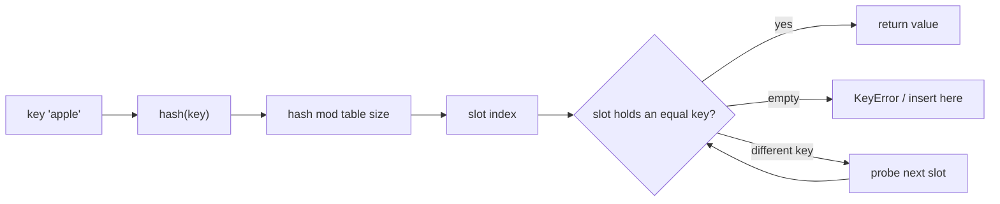

# Dictionaries and sets

> **Before this lesson:** you should have built and read a small dictionary, as in [Decisions and dictionaries](#/lesson/python/py-start-decisions-dicts), and know lists, tuples, slicing and the O-notation for costs from [Lists, tuples and strings](#/lesson/python/py-sequences). "Hashable" and "mutable" were introduced in [Objects, names, types and mutability](#/lesson/python/py-objects-names). A few demos define a small class; [Classes: modelling things with objects](#/lesson/python/py-start-classes) covers what you need.

## In plain words

A **dictionary** (type `dict`) stores pairs: a **key** you look things up by, and the **value** filed under it. A **set** stores keys only, with no values, and never holds the same item twice.

Think of a cloakroom. You hand over your coat and get a numbered ticket. Later you show the ticket and the attendant walks straight to the right hook; nobody searches the whole room. A dictionary works the same way: from the key, Python *calculates* where the value is kept and goes directly there. That is why finding one entry among ten million is as quick as finding one among ten, where a list would have to be checked item by item. A set is the guest list at the door: the only question it answers is "is this name on it?", and it answers at once.

Dictionaries are everywhere inside Python itself: the names in a module, the attributes of an object and the keyword arguments of a call are all stored in dictionaries. In interviews, the dictionary (often called a *hash map* there) is the tool that turns more slow solutions into fast ones than any other. The typical move is "remember what I have already seen, so I never search for it again", and this lesson shows it in two classic problems.

## What a hash table does

The structure behind both `dict` and `set` is called a **hash table**. Here is the idea, one step at a time.

1. Python keeps an internal array of slots (a "table").
2. To store a key, it calls `hash(key)`, which turns the key into an integer, its **hash**. The same key always gives the same integer.
3. That integer, reduced to the size of the table, picks a slot. The key and its value are stored there.
4. To look the key up later, Python computes the same hash, goes to the same slot and finds the entry.

Sometimes two different keys are sent to the same slot. That is a **collision**. CPython then tries other slots in a fixed, hash-dependent order until it finds a free one (this approach is called *open addressing*, and each try is a *probe*). When looking up, it follows the same trail and compares keys with `==` until it finds the right one or reaches an empty slot.



Collisions slow things down, so the table is never allowed to get crowded: it is kept at most about two-thirds full. When it passes that mark, Python makes a table roughly twice as large and re-inserts every entry. As with list growth in the previous lesson, the growth is by a proportion, so the average cost of an insertion stays constant: **amortised O(1)**.

One more fact you can rely on: since Python 3.7, a dictionary remembers the **order in which keys were inserted** and gives them back in that order when you loop over it. (CPython keeps the entries in a compact array in arrival order, with a separate small table of slot numbers pointing into it, which also saves memory.)

### The hashing contract

For lookups to work, every key must obey two rules:

1. Its hash must never change while it is in the dictionary. In practice the key must be immutable.
2. If `a == b`, then `hash(a) == hash(b)`. (The reverse is not required: two unequal keys with the same hash are an ordinary collision.)

That is why `list`, `dict` and `set` cannot be keys (they are *unhashable*), while `int`, `str`, `frozenset`, a `tuple` of hashable items, and most objects of your own classes can. A consequence of rule 2 surprises people: `1`, `1.0` and `True` are equal, so they have equal hashes, so they are **the same key**.

```python-run
d = {1: "int"}
d[1.0] = "float"
d[True] = "bool"
print(d)              # {1: 'bool'} — one key, last value wins, first key object kept
print(hash("abc") == hash("abc"), hash((1, 2)))
```

The dictionary ends up with a single entry. Each assignment found the existing key and replaced its value, so the output is `{1: 'bool'}`: the first key object stayed, the last value won. The second line shows that hashing the same string twice gives the same number (`True`) and prints the hash of a tuple.

String hashes are deliberately different in each run of Python (the setting that controls this is `PYTHONHASHSEED`), which protects web servers from attackers who craft keys that all collide. So never save a `hash()` value to a file and expect it to match next time.

## Dict operations and their costs

| Operation | Average | Worst case |
|---|---|---|
| `d[k]`, `d[k] = v`, `del d[k]` | O(1) | O(n) |
| `k in d`, `d.get(k)` | O(1) | O(n) |
| `d.pop(k)`, `d.setdefault(k, v)` | O(1) | O(n) |
| `len(d)` | O(1) | |
| looping over `d`, `d.keys()`, `d.values()`, `d.items()` | O(n) | |
| `d.copy()`, `dict(d)` | O(n) | |
| `d.update(other)`, `d | other` | O(len(other)) | |

The worst case needs nearly every key to collide, which does not happen with built-in key types in normal use. In an interview, say "O(1) on average".

## Working with dicts

```python-run
ages = {"luffy": 19, "zoro": 21}
ages["nami"] = 20                     # insert
ages["luffy"] += 1                    # update
print(ages["zoro"], ages.get("usopp"), ages.get("usopp", "unknown"))
try:
    ages["usopp"]
except KeyError as e:
    print("KeyError:", e)
print("nami" in ages, 20 in ages)     # 'in' checks KEYS, not values
print(ages.pop("nami"), ages.pop("missing", None))
print(list(ages), list(ages.values()), list(ages.items()))
for name, age in ages.items():
    print(f"{name}: {age}")
```

**Reading this code line by line**

- Curly braces with `key: value` pairs create a dictionary. `ages["nami"] = 20` adds a new pair; `ages["luffy"] += 1` reads the old value, adds one and stores it back.
- `ages["zoro"]` reads a value. `ages.get("usopp")` also reads, but returns `None` when the key is missing; with a second argument it returns that fallback, here `unknown`.
- Square brackets on a missing key raise `KeyError`, which the `try`/`except` catches and prints.
- `in` tests **keys**: `"nami" in ages` is `True`, while `20 in ages` is `False` even though 20 is a value.
- `pop(key)` removes a pair and returns its value (20); with a second argument it returns that when the key is absent, so no error occurs.
- `list(ages)` gives the keys; `.values()` the values; `.items()` the pairs as tuples. The `for` loop unpacks each pair into `name` and `age`.

Other ways to build a dictionary:

```python-run
print(dict(a=1, b=2))
print(dict([("x", 1), ("y", 2)]))
print(dict(zip("abc", range(3))))
print(dict.fromkeys(["a", "b"], 0))
print({w: len(w) for w in ["sun", "moon"]})          # dict comprehension
inverted = {v: k for k, v in {"a": 1, "b": 2}.items()}
print(inverted)
```

In order: from keyword arguments; from a list of pairs; from two sequences matched up by `zip`; from a list of keys that all get the same value; with a **dict comprehension**, a compact loop in braces that produces `key: value` pairs (here `{'sun': 3, 'moon': 4}`); and, with another comprehension, swapping keys and values to get `{1: 'a', 2: 'b'}`.

> [!WARNING]
> `dict.fromkeys(keys, [])` gives every key **the same** list object, the aliasing bug you met with `[[0] * 3] * 3`. Use `{k: [] for k in keys}` or `defaultdict(list)`.

### Counting and grouping: `get`, `setdefault`, `defaultdict`, `Counter`

Counting how often each thing occurs, and grouping things that share a property, are the two most common dictionary jobs. The awkward part of both is the first time a key appears: there is nothing to add to yet. Here is counting done four ways, from the most manual to the most idiomatic, followed by grouping done two ways.

```python-run
from collections import defaultdict, Counter
words = "the cat and the hat and the bat".split()

c1 = {}
for w in words:
    if w not in c1:
        c1[w] = 0
    c1[w] += 1

c2 = {}
for w in words:
    c2[w] = c2.get(w, 0) + 1

c3 = defaultdict(int)          # int() == 0 is the default factory
for w in words:
    c3[w] += 1

c4 = Counter(words)
print(c1 == c2 == c3 == c4, c4.most_common(2))

groups = defaultdict(list)
for w in words:
    groups[w[-2:]].append(w)   # group by last two letters
print(dict(groups))

g2 = {}
for w in words:
    g2.setdefault(len(w), []).append(w)
print(g2)
```

- `c1` checks by hand whether the word is new and, if so, starts it at 0.
- `c2` uses `get(w, 0)`: "the current count, or 0 if there is none yet".
- `c3` uses `defaultdict(int)`, a dictionary that creates a missing value automatically by calling the function it was given. `int()` returns 0, so every new word starts at 0.
- `c4` uses `Counter`, a dictionary made for counting: hand it the items and it does the loop itself. `most_common(2)` returns the two most frequent: `[('the', 3), ('and', 2)]`.
- All four are equal, so the first `print` starts with `True`.
- `defaultdict(list)` starts every new key with an empty list, so `append` always has a list to work on. Grouping by the last two letters gives `{'he': ['the', 'the', 'the'], 'at': ['cat', 'hat', 'bat'], 'nd': ['and', 'and']}`.
- `g2.setdefault(k, [])` does the same with a plain dictionary: it returns the value for `k`, first storing the given default if `k` was missing.

### Dict views

`keys()`, `values()` and `items()` do not copy anything. Each returns a **view**: a live window onto the dictionary. A view is created in O(1), shows changes made to the dictionary afterwards, and (for keys and items) supports set operations.

```python-run
a = {"x": 1, "y": 2, "z": 3}
b = {"y": 20, "w": 0}
ks = a.keys()
a["new"] = 9
print(ks)                        # the view sees the insertion
print(a.keys() & b.keys(), a.keys() - b.keys())
```

`ks` was taken before `"new"` was added, yet printing it shows four keys. The last line finds the keys the two dictionaries have in common, `{'y'}`, and the keys only `a` has.

### Merging and ordering

```python-run
defaults = {"host": "localhost", "port": 8000}
overrides = {"port": 9000, "debug": True}
print({**defaults, **overrides})
print(defaults | overrides)             # 3.9+
cfg = dict(defaults); cfg |= overrides  # in-place merge
print(cfg)
# insertion order is preserved; re-assigning an existing key keeps its position
cfg["host"] = "0.0.0.0"
print(list(cfg))
# sorted by value
scores = {"a": 3, "b": 1, "c": 2}
print(sorted(scores, key=scores.get), dict(sorted(scores.items(), key=lambda kv: -kv[1])))
```

The first three prints show three ways to combine two dictionaries, all giving `{'host': 'localhost', 'port': 9000, 'debug': True}`: when a key is in both, the right-hand one wins. Assigning to the existing key `"host"` changes its value but not its place in the order. The last line sorts keys by their values (`['b', 'c', 'a']`) using `scores.get` as the key function, and then builds a new dictionary ordered from highest score to lowest.

## Sets

A `set` is a collection of distinct hashable items in no particular order. Internally it is a hash table that stores keys without values. Use it to test membership, to remove duplicates, and for the operations of school set theory.

```python-run
seen = set()                      # NOT {} — that's an empty dict
for x in [3, 1, 3, 2, 1]:
    seen.add(x)
print(seen, len(seen), 2 in seen)
a, b = {1, 2, 3, 4}, {3, 4, 5}
print(a | b, a & b, a - b, a ^ b)
print(a.issubset({1, 2, 3, 4, 5}), {1, 2} <= a, a.isdisjoint({9}))
a.discard(99)                     # no error if absent
try:
    a.remove(99)
except KeyError:
    print("remove raises KeyError when absent")
print(list(dict.fromkeys([3, 1, 3, 2, 1])))   # dedupe preserving order
```

**Reading this code line by line**

- An empty set must be written `set()`, because `{}` already means an empty dictionary.
- Adding 3 and 1 a second time changes nothing, so `seen` holds three items.
- `a | b` is the **union** (items in either), `a & b` the **intersection** (items in both), `a - b` the **difference** (in `a` but not `b`) and `a ^ b` the **symmetric difference** (in exactly one of them): `{1, 2, 3, 4, 5} {3, 4} {1, 2} {1, 2, 5}`.
- `issubset` and `<=` ask "is every item of the left set also in the right one?"; `isdisjoint` asks "do they share nothing?".
- `discard` removes an item if present and stays quiet otherwise; `remove` raises `KeyError` when the item is missing.
- The last line is a handy trick: dictionary keys are unique *and* ordered, so `dict.fromkeys` removes duplicates while keeping first-seen order: `[3, 1, 2]`.

| Operation | Average cost |
|---|---|
| `x in s`, `s.add(x)`, `s.remove(x)`, `s.discard(x)` | O(1) |
| `s | t` | O(len(s) + len(t)) |
| `s & t` | O(min(len(s), len(t))) |
| `s - t` | O(len(s)) |
| `set(iterable)` | O(n) |

`frozenset` is the immutable, hashable version of a set. Use it when a set must itself be a dictionary key or a member of another set.

Sets have no order you may depend on. For small integers the printed order often *looks* sorted, which fools people into relying on it.

## Worked example: Two Sum, from O(n²) to O(n)

The problem: given a list of numbers and a target, return the positions of two numbers that add up to the target.

```python-run
def two_sum_brute(nums, target):           # O(n^2)
    for i in range(len(nums)):
        for j in range(i + 1, len(nums)):
            if nums[i] + nums[j] == target:
                return [i, j]

def two_sum(nums, target):                 # O(n) time, O(n) space
    index_of = {}
    for i, x in enumerate(nums):
        need = target - x
        if need in index_of:               # O(1) average lookup
            return [index_of[need], i]
        index_of[x] = i

print(two_sum_brute([2, 7, 11, 15], 9), two_sum([2, 7, 11, 15], 9), two_sum([3, 3], 6))
```

The first version tries every pair: a loop inside a loop, O(n²). This straightforward try-everything approach is called **brute force**.

The second version walks the list once. For each number `x` it asks: "which partner would I need to reach the target?" (`need = target - x`), and then "have I already met that partner?". The dictionary `index_of` maps each number seen so far to its position, so that question is answered in O(1). If yes, the answer is found; if not, `x` is recorded and the walk continues. Trace it on `[2, 7, 11, 15]` with target 9: at 2, need 7, not seen, record `{2: 0}`; at 7, need 2, seen at position 0, return `[0, 1]`.

Checking *before* recording matters. With `[3, 3]` and target 6, the first 3 finds nothing and is recorded; the second 3 finds it and returns `[0, 1]`. Recording first would let a single 3 pair with itself.

## Worked example: first non-repeating character

```python-run
from collections import Counter
def first_unique(s):
    counts = Counter(s)                    # O(n)
    for i, c in enumerate(s):              # second O(n) pass, in string order
        if counts[c] == 1:
            return i
    return -1

print(first_unique("leetcode"), first_unique("loveleetcode"), first_unique("aabb"))
```

Two passes: the first counts every character; the second walks the string in order and returns the position of the first character whose count is 1. Two O(n) passes are still O(n). The output is `0 2 -1`: `l` in the first word, `v` in the second, and nothing in `aabb`.

## Using objects as keys

Objects of a class you write are hashable by default, and two different objects are never equal: both hash and equality go by identity. If you teach your class what equality means by defining `__eq__`, Python switches hashing off for it (it sets `__hash__` to `None`), because identity-based hashes would now break rule 2 of the contract. To use such objects as keys you must define `__hash__` too, computed from the same fields as `__eq__`:

```python-run
class P:
    def __init__(self, x, y): self.x, self.y = x, y
    def __eq__(self, o): return (self.x, self.y) == (o.x, o.y)
    def __hash__(self): return hash((self.x, self.y))

s = {P(1, 2)}
print(P(1, 2) in s)
```

`__init__` stores the two coordinates, `__eq__` says two points are equal when their coordinates are, and `__hash__` hashes the same pair. A second, separately created `P(1, 2)` is therefore found in the set: `True`. Often it is easier to use a plain tuple of the identifying fields, a `NamedTuple` or a frozen dataclass (see the object-oriented module) as the key.

> [!INTERVIEW]
> Be ready to explain how a dict works: hash the key, use the hash to pick a slot in a table, resolve collisions by probing, confirm with `==`; keep the table at most about two-thirds full and grow it geometrically for amortised O(1). Then the follow-ups: why must keys be immutable (their hash must not change), why are dicts ordered (a compact entry array in insertion order, since 3.6/3.7), and what is the worst case (O(n) with adversarial collisions, mitigated by hash randomisation).

## Under the hood: watching a dict grow and collide

You can watch the resizing from Python. Memory use jumps in steps as entries are added, and it does **not** shrink when entries are deleted (a deleted slot is only marked as free until the next resize):

```python-run
import sys
d, last = {}, None
for i in range(40):
    d[i] = None
    size = sys.getsizeof(d)
    if size != last:
        print(f"{len(d):>3} entries -> {size} bytes")
        last = size
for i in range(40):
    del d[i]
print("after deleting everything:", sys.getsizeof(d), "bytes;", "a fresh dict:", sys.getsizeof({}), "bytes")
d = dict(d)          # rebuild (or use .copy()) to reclaim the space
print("rebuilt:", sys.getsizeof(d), "bytes")
```

The loop prints a line each time the dictionary's size in bytes changes: a few jumps, not forty. After every entry is deleted, the emptied dictionary still occupies its large table; building a new dictionary from it gives the space back.

Collisions cost time, never correctness. The class `BadKey` below has a deliberately terrible hash that sends every key to the same slot, so each insertion must compare against all the keys already there. Lookups fall from O(1) to O(n), and building the dictionary becomes O(n²):

```python-run
import time

class BadKey:
    def __init__(self, v): self.v = v
    def __hash__(self): return 1                    # everything collides
    def __eq__(self, other): return self.v == other.v

class GoodKey(BadKey):
    def __hash__(self): return hash(self.v)

for cls in (GoodKey, BadKey):
    t = time.perf_counter()
    table = {cls(i): i for i in range(1500)}
    print(f"{cls.__name__}: {(time.perf_counter() - t) * 1000:.1f} ms, lookup ok: {table[cls(700)] == 700}")
```

Both classes give correct lookups (`lookup ok: True`), but `BadKey` takes far longer to build the same 1,500-entry dictionary. This is what an attacker exploits with crafted keys, and why string hashing is randomised per run.

### The mutated-key bug

If an object's hash depends on data that can change, and you change it while the object sits in a dictionary or set, the entry is stranded in the slot chosen by its *old* hash:

```python-run
class Point:
    def __init__(self, x, y): self.x, self.y = x, y
    def __eq__(self, o): return (self.x, self.y) == (o.x, o.y)
    def __hash__(self): return hash((self.x, self.y))

p = Point(1, 2)
seen = {p}
p.x = 99                                   # mutation changes the hash
print(p in seen, Point(1, 2) in seen, len(seen), any(q is p for q in seen))
```

The output is `False False 1 True`. The object is still physically in the set (length 1, and looping finds it), yet it cannot be found by its new value (Python looks in the slot for the new hash, which is empty) or by its old value (the slot is right, but `==` now fails). The rule: compute a hash only from fields that never change, or make the class immutable with `@dataclass(frozen=True)`.

## Choosing between list, set and dict

| Question you keep asking | Structure | Cost |
|---|---|---|
| "What is at position i?" | `list` | O(1) |
| "Have I seen x?" | `set` | O(1) average |
| "What value goes with key k?" | `dict` | O(1) average |
| "How many times did x occur?" | `Counter` | O(1) average per update |
| "Which items share property p?" | `defaultdict(list)` keyed by p | O(1) average per insert |
| "What is the smallest, or the next in order?" | sorted list with `bisect`, or `heapq` | O(log n) |

A hash table gives up ordering by key. If you need "the largest key below x" or to visit keys in sorted order, a dictionary alone will not do: sort the keys when needed (O(n log n)) or keep a sorted list alongside.

A practical debugging tip: when a lookup fails although you can "see" the key, print `repr(key)` and `type(key)` for both the stored key and the one you are searching with. The usual culprits are `"42"` versus `42`, a trailing space or different capitalisation in a string, a float that is not exactly the value you think (`0.1 + 0.2`), or a list where a tuple was intended.

## Pitfalls recap

- `{}` is an empty dictionary; write `set()` for an empty set.
- `d[k]` raises `KeyError` for a missing key; use `get`, `in`, `setdefault` or `defaultdict` as fits.
- `x in d` checks keys. To search the values, use `x in d.values()`, which is O(n).
- Adding or removing keys while looping over a dictionary raises `RuntimeError`; loop over `list(d)`.
- `dict.fromkeys(ks, [])` shares one list among all keys.
- The keys `1`, `1.0` and `True` are one and the same entry.
- Defining `__eq__` without `__hash__` makes your objects unhashable.

## Summary

Dictionaries and sets are hash tables: lookup, insertion and deletion take O(1) on average, at the price of needing hashable keys and some extra memory. Dictionaries keep insertion order; sets have no order. `get`, `setdefault`, `defaultdict` and `Counter` cover the counting and grouping patterns that appear in a large share of interview problems.

## Glossary

- **Dictionary (dict)** - a collection of key-value pairs with fast lookup by key.
- **Key / value** - what you look up by / what is stored under it.
- **Set** - a collection of distinct hashable items with fast membership tests.
- **Hash** - an integer computed from an object by `hash()`, used to choose a slot.
- **Hash table** - an array of slots in which an item's position is computed from its hash.
- **Collision** - two different keys being sent to the same slot.
- **Probe** - one step of trying another slot after a collision.
- **Open addressing** - resolving collisions by probing other slots of the same table.
- **Hashable** - having a hash that never changes and a matching `==`; required of keys.
- **Insertion order** - the order in which keys were first added; dicts preserve it.
- **View** - a live window onto a dict's keys, values or items, not a copy.
- **defaultdict** - a dict that creates a default value for a missing key automatically.
- **Counter** - a dict subclass that counts hashable items.
- **Union / intersection / difference** - items in either set / in both / in the first only.
- **frozenset** - an immutable, hashable set.
- **Brute force** - solving a problem by trying every possibility.

```quiz
[
  {"q": "Average time complexity of `key in my_dict`?", "options": ["O(1)", "O(log n)", "O(n)", "O(n log n)"], "answer": 0,
   "explain": "The key's hash picks a slot directly; with a low load factor only a few probes are needed."},
  {"q": "What does `type({})` return?", "options": ["set", "dict", "frozenset", "list"], "answer": 1,
   "explain": "Empty braces are an empty dict. An empty set is written set()."},
  {"q": "Why can't a list be a dict key?", "options": ["Lists are too large", "Lists are mutable, so they are unhashable (their hash could change)", "Only strings can be keys", "Lists are ordered"], "answer": 1,
   "explain": "A key's hash must stay constant while it's stored. Mutable built-ins set __hash__ to None."},
  {"q": "What is `len({1: 'a', 1.0: 'b', True: 'c'})`?", "options": ["3", "2", "1", "TypeError"], "answer": 2,
   "explain": "1, 1.0 and True are equal and hash equally, so they are the same key; the last value wins."},
  {"q": "Since which version is dict insertion order guaranteed by the language?", "options": ["2.7", "3.5", "3.7", "3.10"], "answer": 2,
   "explain": "CPython 3.6 implemented it; Python 3.7 made it part of the language specification."},
  {"q": "You define `__eq__` on a class but not `__hash__`. Instances are now:", "options": ["Hashed by identity", "Hashed by their fields", "Unhashable", "Hashed as 0"], "answer": 2,
   "explain": "Defining __eq__ alone sets __hash__ = None, because identity hashing would violate 'equal objects have equal hashes'."},
  {"q": "Best structure to count occurrences of words in a list?", "options": ["list.count in a loop", "collections.Counter", "a set", "sorted() then scan"], "answer": 1,
   "explain": "Counter builds counts in one O(n) pass and has most_common(k). list.count in a loop is O(n^2)."},
  {"q": "In the one-pass Two Sum, why is the lookup done before the current number is stored?", "options": ["It is faster", "So that one element cannot be paired with itself, while duplicates such as [3, 3] still work", "Dictionaries cannot be read after writing", "To keep the dictionary sorted"], "answer": 1,
   "explain": "Looking up first means only earlier elements can be partners. Storing first would let a single 3 match itself for target 6."}
]
```

> **Source:** Goodrich, Tamassia & Goldwasser, *Data Structures and Algorithms in Python*, §1.2.3 (set, frozenset, dict classes) and ch. 10 (maps, hash tables), restated in original wording with new examples; Python docs, *Library Reference* "Mapping Types — dict" and "Set Types", *Tutorial* §5.4–5.5; Python wiki "TimeComplexity".
