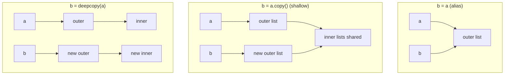

# Comprehensions, unpacking and copying

> **Before this lesson:** you need lists, tuples and slices from [Lists, tuples and strings](#/lesson/python/py-sequences), dictionaries and sets from [Dictionaries and sets](#/lesson/python/py-dicts-sets), and above all the idea that names and container slots are references to objects, from [Objects, names, types and mutability](#/lesson/python/py-objects-names).

## In plain words

This lesson covers three everyday skills that work on every kind of container.

A **comprehension** is a short way to build a new list, dictionary or set from an existing collection, in one line that reads almost like a sentence: "the square of each number in this list, for the even ones only". It replaces the four-line pattern "make an empty list, loop, test, append".

**Unpacking** is taking a collection apart into separate names in a single assignment: "the first item is `x`, the second is `y`".

**Copying** is making a second, independent version of a collection. Here there is a trap. Imagine photocopying a page that lists the addresses of three houses. You now have two separate pages: crossing an address off one does not affect the other. But both pages point at the same three houses, and if somebody repaints a house, both pages now lead to a repainted house. That is a **shallow copy**: the outer container is duplicated, the things inside are shared. A **deep copy** builds three new houses as well.

Comprehensions and unpacking make your code shorter and are expected in any Python interview. Copying matters because getting it wrong produces bugs that are hard to see: data that "changes by itself", or a search algorithm that returns a list full of empty results. The last one is among the most common mistakes in coding interviews, and this lesson shows it and its fix.

## List comprehensions

Suppose you want the squares of the numbers 0 to 9. With a loop:

```python
squares = []
for n in range(10):
    squares.append(n * n)
```

A **list comprehension** says the same thing inside one pair of square brackets:

```python
squares = [n * n for n in range(10)]
```

Read it from the middle: "for each `n` in `range(10)`, compute `n * n`, and collect the results in a list". The general shape is

```python
[expression for item in iterable if condition]
```

where the `if` part is optional and keeps only the items for which the condition is true. It does the same job as this loop:

```python
result = []
for item in iterable:
    if condition:
        result.append(expression)
```

The comprehension is shorter, usually a little faster (Python runs it with specialised internal instructions), and it is an expression, so it can be used directly inside a call or a `return`.

```python-run
nums = range(10)
squares = [n * n for n in nums]
even_squares = [n * n for n in nums if n % 2 == 0]
labels = ["even" if n % 2 == 0 else "odd" for n in nums]   # if/else goes BEFORE for
print(squares, even_squares, labels[:4], sep="\n")
```

**Reading this code line by line**

- `squares` has ten items: `[0, 1, 4, 9, 16, 25, 36, 49, 64, 81]`.
- `even_squares` adds a filter. `n % 2 == 0` is true for even numbers, so only five squares are kept: `[0, 4, 16, 36, 64]`.
- `labels` uses a conditional expression (`a if cond else b`) as the *output* part. Every number produces an item, either `"even"` or `"odd"`.
- `sep="\n"` makes `print` put each result on its own line.

Keep the two kinds of `if` apart. An `if` **after** the `for` is a **filter**: it drops items. An `if ... else` **before** the `for` is part of the expression: it chooses a value for every item and drops nothing.

### Nested loops

A comprehension may have several `for` parts. They nest from left to right, in the same order you would write the loops:

```python-run
pairs = [(r, c) for r in range(3) for c in range(3) if r != c]
print(pairs)

matrix = [[1, 2, 3], [4, 5, 6]]
flat = [x for row in matrix for x in row]            # outer loop first!
transposed = [[row[i] for row in matrix] for i in range(3)]
print(flat, transposed, list(zip(*matrix)))
```

`pairs` is the loop "for each `r`, for each `c`, if they differ, keep the pair", giving six pairs from `(0, 1)` to `(2, 1)`. A `matrix` here is a list of rows, each row a list. `flat` takes every `x` of every `row` and produces one flat list, `[1, 2, 3, 4, 5, 6]`; the outer loop (`for row in matrix`) is written first, exactly as in the loop version.

`transposed` is different: it is a comprehension *inside the expression* of another, so it builds a list of lists. For each column number `i` it collects item `i` of every row, turning rows into columns: `[[1, 4], [2, 5], [3, 6]]`. `zip(*matrix)` does the same thing in the idiomatic way: the star passes the rows as separate arguments, and `zip` pairs up their first items, second items, and so on (as tuples).

### Dict and set comprehensions

Curly braces give a set comprehension; curly braces with `key: value` give a dict comprehension.

```python-run
words = ["apple", "Avocado", "banana", "blueberry", "cherry"]
by_len = {w: len(w) for w in words}
initials = {w[0].lower() for w in words}
index = {w: i for i, w in enumerate(words)}
swapped = {v: k for k, v in {"a": 1, "b": 2}.items()}
print(by_len, initials, index, swapped, sep="\n")
```

`by_len` maps each word to its length. `initials` is a set of lowercase first letters, so it holds only three items (`a`, `b`, `c`) although there are five words. `index` maps each word to its position, a common preparation step when you will need "where is this word?" many times. `swapped` exchanges keys and values.

### Generator expressions

Round brackets in place of square ones give a **generator expression**. It does not build a list. It produces its items one at a time, only when something asks for the next one; such behaviour is called **lazy**. When a generator expression is the only argument of a call, the extra pair of brackets may be left out.

```python-run
import sys
total = sum(n * n for n in range(1_000_000))       # no million-element list in memory
print(total)
print(sys.getsizeof([n for n in range(10_000)]), "bytes for the list")
print(sys.getsizeof((n for n in range(10_000))), "bytes for the generator")
print(any(w.startswith("b") for w in ["apple", "banana"]), max(len(w) for w in ["a", "abc"]))
```

`sum` pulls the squares one by one and adds them up; at no moment do a million numbers exist together in memory. The two `getsizeof` lines make the difference visible: tens of thousands of bytes for the list, a couple of hundred for the generator, however long the range. `any(...)` returns `True` as soon as one item is true and `all(...)` returns `False` as soon as one is false; fed by a generator, they stop early and never compute the remaining items. The generators lesson returns to this topic in depth.

### Scope inside comprehensions

The loop variable of a comprehension exists only inside the comprehension. It does not overwrite a variable of the same name outside:

```python-run
x = "outer"
squares = [x * 2 for x in range(3)]
print(x)          # still 'outer'
```

One detail for later: the *first* iterable (here `range(3)`) is evaluated in the surrounding code, and everything else inside the comprehension's own private area. This becomes visible in class bodies, where a comprehension cannot see the class's own names except in that first iterable.

### When not to use a comprehension

- When you only want an action to happen (printing, appending somewhere else), write a `for` loop. `[print(x) for x in xs]` builds a useless list of `None`s.
- When it needs more than two `for` parts or a complicated condition, a loop or a helper function is easier to read.
- When the result will be walked through once and thrown away, a generator expression saves memory.

## Unpacking

**Unpacking** assigns the items of any iterable to several names in one statement. The number of names must equal the number of items, unless one of the names carries a star.

```python-run
point = (3, 4)
x, y = point
first, *middle, last = [1, 2, 3, 4, 5]
head, *tail = "abc"
*_, final = range(10)
(a, b), c = (1, 2), 3                 # nested unpacking
print(x, y, first, middle, last, head, tail, final, a, b, c)
try:
    p, q = [1, 2, 3]
except ValueError as e:
    print("ValueError:", e)
```

**Reading this code line by line**

- `x, y = point` ties `x` to 3 and `y` to 4.
- `first, *middle, last = ...` gives the first item to `first`, the last to `last`, and everything in between to `middle` as a list: `1 [2, 3, 4] 5`.
- `head, *tail = "abc"` works on a string too: `a` and `['b', 'c']`.
- `*_, final = range(10)` keeps only the last item, 9. The name `_` is the conventional "I do not care about this" name.
- `(a, b), c = (1, 2), 3` unpacks a pair inside a pair.
- Two names cannot receive three items: Python raises `ValueError: too many values to unpack (expected 2)`.

The starred name always becomes a **list**, possibly an empty one. Unpacking also works in a `for` loop (`for name, score in pairs:`) and in function calls with `*` and `**`, as the functions lesson showed.

**Swapping** two variables is unpacking as well: `a, b = b, a`. The right-hand side is fully worked out (into a tuple) before any name on the left is touched, so nothing is overwritten too early. There is one subtle trap. The targets on the *left* are assigned one after another, left to right, and if the second target contains an expression, that expression is evaluated after the first assignment has already happened:

```python-run
nums = [1, 0]
i = 0
nums[i], nums[nums[i]] = nums[nums[i]], nums[i]   # tricky!
print(nums)        # not the swap you might expect
```

The right side evaluates to the pair `(0, 1)`. Then `nums[0] = 0` runs, making the list `[0, 0]`. Only now is the second target worked out: `nums[nums[0]]` is `nums[0]`, which receives 1. The result is `[1, 0]`, unchanged, not a swap of two positions. When targets depend on one another, compute the positions into separate variables first.

## Copying: assignment, shallow copy, deep copy

Assignment never copies; it ties another name to the same object. When you do want an independent copy, you have to decide how far down the copying should go.



The three panels show a list of lists. With plain assignment there is one outer list with two names. With a shallow copy there are two outer lists, both pointing at the same inner lists. With a deep copy everything is duplicated.

### Shallow copies

A **shallow copy** is a new container whose slots refer to the *same* item objects as the original. Ways to make one:

- `lst.copy()`, `lst[:]`, `list(lst)`, `[*lst]`
- `d.copy()`, `dict(d)`, `{**d}`
- `s.copy()`, `set(s)`
- `copy.copy(obj)` for any object

If the items are immutable (numbers, strings, tuples of those), a shallow copy is all you will ever need, because nobody can alter the shared items. If the items are themselves mutable, such as inner lists, they are shared, and a change to one of them shows through both containers:

```python-run
import copy
palette = [["red", "green"], ["blue"]]
shallow = palette.copy()
shallow.append(["new"])            # changes only the copy's outer list
shallow[0].append("PINK")          # mutates an inner list shared by both!
print(palette)
print(shallow)
print(shallow[0] is palette[0])
```

`shallow.append(["new"])` adds a third slot to the copy's outer list only; `palette` still has two. `shallow[0].append("PINK")` reaches *through* slot 0 into the inner list, and that inner list is the same object in both. So `palette` prints as `[['red', 'green', 'PINK'], ['blue']]`: it gained a colour that the program never added to it by name. The last line confirms the sharing with `is`: `True`.

In short, a shallow copy protects you from adding, removing or replacing *slots*, but not from changes made *inside* the items.

### Deep copies

`copy.deepcopy(obj)` copies the object, then everything it refers to, then everything those refer to, all the way down. While it works it keeps a private dictionary of the objects it has already copied (a *memo*), which has two benefits: an object that appears twice in the original appears as one shared object in the copy, and a structure that contains itself does not send the copying into an endless loop.

```python-run
import copy
palette = [["red", "green"], ["blue"]]
deep = copy.deepcopy(palette)
deep[0].append("PINK")
print(palette, deep)

shared = [1, 2]
pair = [shared, shared]
dp = copy.deepcopy(pair)
print(dp[0] is dp[1])        # True: the sharing structure is reproduced

cyc = [1]
cyc.append(cyc)              # a list that contains itself
print(copy.deepcopy(cyc)[1][1][0])
```

After the deep copy, adding `PINK` affects only `deep`; `palette` is untouched. In the second part, `pair` holds the same list twice, and so does its deep copy (`True`): one new inner list, referenced twice. In the third part, `cyc` is a list whose second item is the list itself; `deepcopy` handles it, and following the self-reference twice in the copy still leads to 1.

A deep copy costs time and memory in proportion to the size of everything reachable from the object, which can be far more than you expect. It also copies things you may not want duplicated (a large cache) and fails on things that cannot be copied (an open file, a lock). A class can define the special methods `__copy__` and `__deepcopy__` to control how its objects are copied.

### Copying in practice

| Situation | Use |
|---|---|
| You want two names for the same data | plain assignment |
| You will change the container, not the original; the items are immutable | shallow copy |
| A nested mutable structure you will change at depth (for example a grid you will edit) | `[row[:] for row in grid]` or `deepcopy` |
| Backtracking: recording the current path | `result.append(path[:])` or `path.copy()` |

The last row deserves an example, because it is a classic interview bug. **Backtracking** is a search method that builds a candidate answer step by step in one working list, records it when complete, then undoes the last step and tries another. The code below lists all subsets of `[1, 2]`. For each number it explores two branches: leave it out, or put it in.

```python-run
def subsets_buggy(nums):
    res, path = [], []
    def dfs(i):
        if i == len(nums):
            res.append(path)          # BUG: appends a reference
            return
        dfs(i + 1)
        path.append(nums[i]); dfs(i + 1); path.pop()
    dfs(0)
    return res

def subsets(nums):
    res, path = [], []
    def dfs(i):
        if i == len(nums):
            res.append(path[:])       # snapshot
            return
        dfs(i + 1)
        path.append(nums[i]); dfs(i + 1); path.pop()
    dfs(0)
    return res

print(subsets_buggy([1, 2]))
print(subsets([1, 2]))
```

`path` is the working list. In the inner function `dfs` (short for depth-first search), `i` is the position of the number being decided; when `i` reaches the end, the current `path` is one complete subset. The line `path.append(nums[i]); dfs(i + 1); path.pop()` means: put the number in, explore, take it out again.

The buggy version prints `[[], [], [], []]`. It appended `path` itself four times, so `res` holds four references to one list, and by the end every `pop` has emptied that list. The correct version appends `path[:]`, a shallow copy taken at that moment (a *snapshot*), and prints `[[], [2], [1], [1, 2]]`.

## Equality versus identity, revisited

A copy is equal to its original but is not the same object:

```python-run
a = [[1], [2]]
b = a[:]
c = __import__("copy").deepcopy(a)
print(a == b == c, a is b, a[0] is b[0], a[0] is c[0])
```

The output `True False True False` sums up the lesson: all three are equal in value; `b` is a different outer list from `a`; the shallow copy shares its inner lists with the original; the deep copy does not. (`__import__("copy")` is an unusual way to import a module inside an expression, used here only to keep the demo to one line.)

## Worked example: a matrix utility belt

```python-run
def zeros(r, c):
    return [[0] * c for _ in range(r)]

def transpose(m):
    return [list(col) for col in zip(*m)]

def rotate90(m):                      # clockwise
    return [list(row) for row in zip(*m[::-1])]

def spiral(m):
    out = []
    m = [row[:] for row in m]         # don't destroy the caller's matrix
    while m:
        out += m.pop(0)
        m = [list(r) for r in zip(*m)][::-1]   # rotate counter-clockwise
    return out

grid = [[1, 2, 3], [4, 5, 6], [7, 8, 9]]
print(zeros(2, 3), transpose(grid), rotate90(grid), spiral(grid), grid, sep="\n")
```

- `zeros` builds a grid of `r` rows and `c` columns with a comprehension, so that every row is a separate list (recall the `[[0] * 3] * 3` trap).
- `transpose` turns rows into columns with `zip(*m)`; `list(col)` converts each tuple that `zip` yields into a list.
- `rotate90` reverses the order of the rows (`m[::-1]`) and then transposes, which turns the grid a quarter-turn clockwise.
- `spiral` reads the grid in a spiral: take the top row, rotate what is left a quarter-turn counter-clockwise so that the next side is on top, and repeat until nothing is left. Its second line copies each row first, because `pop` would otherwise destroy the caller's grid.

Each function returns a new structure and leaves `grid` as it was, which the last printed line confirms.

> [!INTERVIEW]
> "What's the difference between a shallow and a deep copy?" A shallow copy duplicates the container but shares the objects inside it; a deep copy duplicates those objects too, recursively, using a memo to preserve shared references and cope with cycles. Show the nested-list example, then mention the backtracking `path[:]` idiom: it tells the interviewer you have met this bug in real code.

## Pitfalls recap

- `[expr for x in xs if c else d]` is a syntax error; the `if`/`else` form goes before `for`.
- Several `for` parts run outer-first, like nested loops.
- A list comprehension used only for its actions wastes memory.
- `copy()` is shallow; changes inside nested items are shared.
- `deepcopy` is slow on large structures and may fail on objects such as locks or open files.
- Appending a mutable "current state" (such as `path`) to a result list without copying it.

## Summary

Comprehensions build lists, dictionaries and sets by describing their contents; generator expressions do the same lazily. Unpacking, with an optional starred name, takes any iterable apart. Assignment makes an alias, a shallow copy duplicates one level, and a deep copy duplicates everything reachable. Choose among the three on purpose.

## Glossary

- **Comprehension** - a one-expression way to build a list, dict or set from an iterable.
- **Filter** - the `if` after the `for` in a comprehension; it drops items.
- **Conditional expression** - `a if cond else b`; it chooses a value and drops nothing.
- **Generator expression** - a comprehension in round brackets that produces items lazily.
- **Lazy** - computing each item only when it is requested.
- **Unpacking** - assigning the items of an iterable to several names at once.
- **Starred target** - a name with `*` that collects the leftover items into a list.
- **Alias** - another name for the same object; what plain assignment creates.
- **Shallow copy** - a new container that shares its items with the original.
- **Deep copy** - a new container whose contents are also copied, recursively.
- **Memo** - the record `deepcopy` keeps of objects it has already copied.
- **Cycle** - a structure that, directly or indirectly, contains itself.
- **Backtracking** - a search that builds candidates step by step and undoes steps to try alternatives.
- **Snapshot** - a copy of a changing object taken at one moment, for example `path[:]`.
- **Transpose** - to swap the rows and columns of a grid.

```quiz
[
  {"q": "What does `[x for row in [[1, 2], [3]] for x in row]` produce?", "options": ["[[1, 2], [3]]", "[1, 2, 3]", "[1, 3]", "SyntaxError"], "answer": 1,
   "explain": "Multiple for clauses nest like loops, outer first, producing a flat list."},
  {"q": "Which comprehension is valid?", "options": ["[x for x in xs if x > 0 else 0]", "[x if x > 0 else 0 for x in xs]", "[for x in xs: x]", "[x for x in xs else 0]"], "answer": 1,
   "explain": "A conditional expression (a if c else b) is part of the output expression and goes before for. A trailing if is only a filter."},
  {"q": "`first, *rest = 'a'` — what is rest?", "options": ["''", "[]", "None", "ValueError"], "answer": 1,
   "explain": "The starred target always becomes a list, possibly empty."},
  {"q": "`a = [[1], [2]]; b = a.copy(); b[0].append(9)` — what is a?", "options": ["[[1], [2]]", "[[1, 9], [2]]", "[[1], [2], 9]", "[[9], [2]]"], "answer": 1,
   "explain": "A shallow copy shares the inner lists, so mutating b[0] mutates a[0]."},
  {"q": "How does copy.deepcopy handle an object that refers to itself?", "options": ["Infinite recursion", "It raises ValueError", "It uses a memo dict so the copy refers to itself too", "It replaces the cycle with None"], "answer": 2,
   "explain": "deepcopy remembers already-copied objects by id, reproducing shared references and cycles."},
  {"q": "In a backtracking solution, why write `res.append(path[:])` instead of `res.append(path)`?", "options": ["It is faster", "path is later mutated, so without a snapshot every result refers to the same list", "Lists cannot be appended to lists", "To sort the path"], "answer": 1,
   "explain": "Appending path stores a reference; the subsequent pops would empty every stored result."},
  {"q": "What is the advantage of `sum(x*x for x in range(n))` over `sum([x*x for x in range(n)])`?", "options": ["Different result", "The generator version doesn't build an n-element list in memory", "The list version is lazy", "None"], "answer": 1,
   "explain": "A generator expression yields values one at a time, using O(1) extra memory."}
]
```

> **Source:** Goodrich, Tamassia & Goldwasser, *Data Structures and Algorithms in Python*, §1.9 (comprehension syntax, packing and unpacking) and §2.6 (Shallow and Deep Copying), restated in original wording with new examples; Python docs, *Tutorial* §5.1.3 "List Comprehensions" and *Library Reference* `copy` module.
