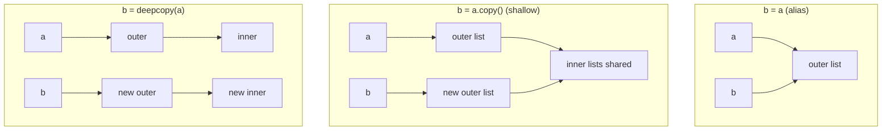

# Comprehensions, unpacking and copying

This lesson collects three topics that cut across every container type. **Comprehensions** are Python's concise syntax for building lists, dicts and sets from iterables. **Unpacking** lets you pull structures apart in a single assignment. **Copying** — shallow versus deep — is where the names-and-references model from lesson 1 has the most practical consequences.

## List comprehensions

A list comprehension builds a new list by transforming and filtering an iterable:

```python
[expression for item in iterable if condition]
```

It is equivalent to this loop, but shorter, usually faster (the loop runs in specialised bytecode) and an expression rather than a statement:

```python
result = []
for item in iterable:
    if condition:
        result.append(expression)
```

```python-run
nums = range(10)
squares = [n * n for n in nums]
even_squares = [n * n for n in nums if n % 2 == 0]
labels = ["even" if n % 2 == 0 else "odd" for n in nums]   # if/else goes BEFORE for
print(squares, even_squares, labels[:4], sep="\n")
```

Note the two different `if`s: a **filter** (`... for n in nums if cond`) drops items; a **conditional expression** (`a if cond else b for n in nums`) chooses a value for every item.

### Nested loops

Multiple `for` clauses nest left to right, in the same order you'd write the loops:

```python-run
pairs = [(r, c) for r in range(3) for c in range(3) if r != c]
print(pairs)

matrix = [[1, 2, 3], [4, 5, 6]]
flat = [x for row in matrix for x in row]            # outer loop first!
transposed = [[row[i] for row in matrix] for i in range(3)]
print(flat, transposed, list(zip(*matrix)))
```

A nested comprehension (a comprehension inside the expression) builds nested lists; multiple `for` clauses build a flat list. `zip(*matrix)` is the idiomatic transpose.

### Dict and set comprehensions

```python-run
words = ["apple", "Avocado", "banana", "blueberry", "cherry"]
by_len = {w: len(w) for w in words}
initials = {w[0].lower() for w in words}
index = {w: i for i, w in enumerate(words)}
swapped = {v: k for k, v in {"a": 1, "b": 2}.items()}
print(by_len, initials, index, swapped, sep="\n")
```

### Generator expressions

Use parentheses instead of brackets and you get a **generator expression**: a lazy iterator that produces items on demand rather than building a list. When a generator expression is the only argument of a call, the extra parentheses can be dropped:

```python-run
import sys
total = sum(n * n for n in range(1_000_000))       # no million-element list in memory
print(total)
print(sys.getsizeof([n for n in range(10_000)]), "bytes for the list")
print(sys.getsizeof((n for n in range(10_000))), "bytes for the generator")
print(any(w.startswith("b") for w in ["apple", "banana"]), max(len(w) for w in ["a", "abc"]))
```

`any`/`all` with a generator **short-circuit**: they stop as soon as the answer is known. We return to generators in module 4.

### Scope inside comprehensions

In Python 3, the loop variable of a comprehension is local to it — it doesn't leak into the surrounding scope (as it did in Python 2). The *first* iterable is evaluated in the enclosing scope; the rest are evaluated inside the comprehension. This matters in class bodies, where a comprehension can't see class-level names except in its first iterable.

```python-run
x = "outer"
squares = [x * 2 for x in range(3)]
print(x)          # still 'outer'
```

### When not to use a comprehension

- If you need side effects only (printing, appending elsewhere), write a `for` loop; `[print(x) for x in xs]` builds a useless list of `None`s.
- If it needs more than two `for` clauses or complex conditions, a loop or helper function is clearer.
- If you only need to iterate once, a generator expression saves memory.

## Unpacking

**Sequence unpacking** assigns the items of any iterable to several names at once. The number of names must match the number of items, unless one name is starred:

```python-run
point = (3, 4)
x, y = point
first, *middle, last = [1, 2, 3, 4, 5]
head, *tail = "abc"
*_, final = range(10)
(a, b), c = (1, 2), 3                 # nested unpacking
print(x, y, first, middle, last, head, tail, final, a, b, c)
try:
    p, q = [1, 2, 3]
except ValueError as e:
    print("ValueError:", e)
```

The starred name always becomes a **list** (possibly empty). Unpacking works in `for` loops too — `for name, score in pairs:` — and in function calls with `*` and `**`, as we saw in lesson 3.

**Swapping** is just unpacking: `a, b = b, a`. The right side is evaluated into a tuple first, so there's no clobbering. A subtle trap: in `a[i], a[a[i]] = ...` the targets are assigned left to right, and the second target's index is evaluated *after* the first assignment. Use temporaries when targets depend on each other.

```python-run
nums = [1, 0]
i = 0
nums[i], nums[nums[i]] = nums[nums[i]], nums[i]   # tricky!
print(nums)        # not the swap you might expect
```

## Copying: assignment, shallow copy, deep copy

Recall that assignment never copies — it creates another reference. When you *do* want an independent copy, you must choose how deep.



### Shallow copies

A **shallow copy** creates a new container whose slots refer to the *same* element objects. Ways to make one:

- `lst.copy()`, `lst[:]`, `list(lst)`, `[*lst]`
- `d.copy()`, `dict(d)`, `{**d}`
- `s.copy()`, `set(s)`
- `copy.copy(obj)` for anything

For containers of immutable items (numbers, strings, tuples of immutables), a shallow copy is all you ever need. For containers of mutable items, the inner objects are shared:

```python-run
import copy
palette = [["red", "green"], ["blue"]]
shallow = palette.copy()
shallow.append(["new"])            # changes only the copy's outer list
shallow[0].append("PINK")          # mutates an inner list shared by both!
print(palette)
print(shallow)
print(shallow[0] is palette[0])
```

Goodrich's colour-palette example (§2.6) makes exactly this point: a shallow copy protects you from adding or removing *elements* but not from mutating the elements themselves.

### Deep copies

`copy.deepcopy(obj)` recursively copies the whole object graph. It keeps a memo dictionary of objects already copied, so shared references and cycles are preserved in the copy rather than causing infinite recursion.

```python-run
import copy
palette = [["red", "green"], ["blue"]]
deep = copy.deepcopy(palette)
deep[0].append("PINK")
print(palette, deep)

shared = [1, 2]
pair = [shared, shared]
dp = copy.deepcopy(pair)
print(dp[0] is dp[1])        # True: the sharing structure is reproduced

cyc = [1]
cyc.append(cyc)              # a list that contains itself
print(copy.deepcopy(cyc)[1][1][0])
```

Deep copies are O(size of the whole graph) and can be surprisingly expensive; they also copy things you may not want copied (large caches, locks will fail). Classes can control copying with `__copy__` and `__deepcopy__`.

### Copying in practice

| Situation | Use |
|---|---|
| Want two names for the same data | plain assignment |
| Need to modify the container without affecting the original, items are immutable | shallow copy |
| Nested mutable structure you'll mutate at depth (e.g., a grid you'll edit) | `[row[:] for row in grid]` or `deepcopy` |
| Backtracking: record the current path | `result.append(path[:])` or `path.copy()` |

The backtracking case is a classic interview bug: appending `path` itself, then mutating `path` later, leaves every recorded result pointing to the same (finally empty) list.

```python-run
def subsets_buggy(nums):
    res, path = [], []
    def dfs(i):
        if i == len(nums):
            res.append(path)          # BUG: appends a reference
            return
        dfs(i + 1)
        path.append(nums[i]); dfs(i + 1); path.pop()
    dfs(0)
    return res

def subsets(nums):
    res, path = [], []
    def dfs(i):
        if i == len(nums):
            res.append(path[:])       # snapshot
            return
        dfs(i + 1)
        path.append(nums[i]); dfs(i + 1); path.pop()
    dfs(0)
    return res

print(subsets_buggy([1, 2]))
print(subsets([1, 2]))
```

## Equality versus identity, revisited

Copies compare equal but are not identical:

```python-run
a = [[1], [2]]
b = a[:]
c = __import__("copy").deepcopy(a)
print(a == b == c, a is b, a[0] is b[0], a[0] is c[0])
```

## Worked example: a matrix utility belt

```python-run
def zeros(r, c):
    return [[0] * c for _ in range(r)]

def transpose(m):
    return [list(col) for col in zip(*m)]

def rotate90(m):                      # clockwise
    return [list(row) for row in zip(*m[::-1])]

def spiral(m):
    out = []
    m = [row[:] for row in m]         # don't destroy the caller's matrix
    while m:
        out += m.pop(0)
        m = [list(r) for r in zip(*m)][::-1]   # rotate counter-clockwise
    return out

grid = [[1, 2, 3], [4, 5, 6], [7, 8, 9]]
print(zeros(2, 3), transpose(grid), rotate90(grid), spiral(grid), grid, sep="\n")
```

Each function returns a new structure and leaves `grid` untouched, which you can verify from the last line.

> [!INTERVIEW]
> "What's the difference between a shallow and a deep copy?" A shallow copy duplicates the container but shares the contained objects; a deep copy recursively duplicates contained objects too (using a memo to preserve sharing and handle cycles). Show the nested-list example, then mention the backtracking `path[:]` idiom — it signals you've been bitten by this in real code.

## Pitfalls recap

- `[expr for x in xs if c else d]` is a syntax error — the `if/else` form goes before `for`.
- Multiple `for` clauses run outer-first, like nested loops.
- List comprehensions for side effects waste memory.
- `copy()` is shallow; mutations of nested items are shared.
- `deepcopy` is slow on large graphs and may fail on objects like locks or open files.
- Appending a mutable "current state" (like `path`) to a result list without copying it.

## Summary

Comprehensions build lists, dicts and sets declaratively; generator expressions do the same lazily. Unpacking (with an optional starred target) pulls apart any iterable. Assignment aliases, shallow copies duplicate one level, deep copies duplicate the whole graph — choose deliberately.

```quiz
[
  {"q": "What does `[x for row in [[1, 2], [3]] for x in row]` produce?", "options": ["[[1, 2], [3]]", "[1, 2, 3]", "[1, 3]", "SyntaxError"], "answer": 1,
   "explain": "Multiple for clauses nest like loops, outer first, producing a flat list."},
  {"q": "Which comprehension is valid?", "options": ["[x for x in xs if x > 0 else 0]", "[x if x > 0 else 0 for x in xs]", "[for x in xs: x]", "[x for x in xs else 0]"], "answer": 1,
   "explain": "A conditional expression (a if c else b) is part of the output expression and goes before for. A trailing if is only a filter."},
  {"q": "`first, *rest = 'a'` — what is rest?", "options": ["''", "[]", "None", "ValueError"], "answer": 1,
   "explain": "The starred target always becomes a list, possibly empty."},
  {"q": "`a = [[1], [2]]; b = a.copy(); b[0].append(9)` — what is a?", "options": ["[[1], [2]]", "[[1, 9], [2]]", "[[1], [2], 9]", "[[9], [2]]"], "answer": 1,
   "explain": "A shallow copy shares the inner lists, so mutating b[0] mutates a[0]."},
  {"q": "How does copy.deepcopy handle an object that refers to itself?", "options": ["Infinite recursion", "It raises ValueError", "It uses a memo dict so the copy refers to itself too", "It replaces the cycle with None"], "answer": 2,
   "explain": "deepcopy remembers already-copied objects by id, reproducing shared references and cycles."},
  {"q": "In a backtracking solution, why write `res.append(path[:])` instead of `res.append(path)`?", "options": ["It is faster", "path is later mutated, so without a snapshot every result refers to the same list", "Lists cannot be appended to lists", "To sort the path"], "answer": 1,
   "explain": "Appending path stores a reference; the subsequent pops would empty every stored result."},
  {"q": "What is the advantage of `sum(x*x for x in range(n))` over `sum([x*x for x in range(n)])`?", "options": ["Different result", "The generator version doesn't build an n-element list in memory", "The list version is lazy", "None"], "answer": 1,
   "explain": "A generator expression yields values one at a time, using O(1) extra memory."}
]
```

> **Source:** Goodrich, Tamassia & Goldwasser, *Data Structures and Algorithms in Python*, §1.9 (comprehension syntax, packing and unpacking) and §2.6 (Shallow and Deep Copying); Python docs, *Tutorial* §5.1.3 "List Comprehensions" and *Library Reference* `copy` module.
