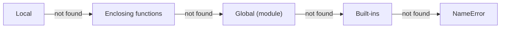

# Scope, closures and lambdas

> **Before this lesson:** you need functions, default values and "functions are objects that can be passed around and returned", all from [Functions and arguments](#/lesson/python/py-functions-args), and the model of names tied to objects, with the difference between mutating and rebinding, from [Objects, names, types and mutability](#/lesson/python/py-objects-names).

## In plain words

Every name in a program has an area in which it is known. A variable created inside a function is known only inside that function; a variable created at the top of a file is known throughout the file. The area where a name is visible is its **scope**.

Think of an office building. A note pinned up inside one meeting room can be read only in that room. A notice on the floor's corridor board can be read by everyone on the floor. A sign in the lobby is for the whole building. When you look for information you check your own room first, then the corridor, then the lobby. Python looks for a name in the same inside-out way, and this lesson gives you the exact order.

The second idea is the **closure**. When a function is created *inside* another function, it can keep using the outer function's variables even after the outer function has finished. Picture someone leaving a meeting and taking a photocopy of the room's whiteboard... except that it is better than a photocopy: they keep a live link to that whiteboard, and it stays up for as long as they need it. A function that carries such a link is a closure. It is the mechanism behind decorators, callbacks, caches and much of Python's asynchronous code.

The third idea, **lambda**, is a way to write a tiny function in the middle of an expression without giving it a name.

Interviewers ask about all three: "explain the LEGB rule", "why does this raise `UnboundLocalError`?" and "what does this list of lambdas print?" are standard questions, and each one is answered in this lesson.

## Namespaces

A **namespace** is a table that maps names to objects; in most cases it is literally a dictionary. Python keeps several of them, created at different moments and lasting for different lengths of time:

| Namespace | Created | Lasts | Inspect with |
|---|---|---|---|
| Built-in (`len`, `print`, `ValueError`) | when Python starts | for the whole run | `import builtins; dir(builtins)` |
| Global (one per module, that is, per `.py` file) | when the file is loaded | usually for the whole run | `globals()` |
| Enclosing function | when the outer function is called | as long as a closure still refers to it | `fn.__closure__` |
| Local | at each function call | until that call returns (unless captured) | `locals()` |
| Class body | when the `class` statement runs | it becomes the class's attribute table | `vars(cls)` |

Working out which namespace a name belongs to is called **name resolution**. The word "global" is a little grand: in Python it means "at the top level of this file", not "everywhere in the program".

## The LEGB rule

When Python needs the value of a name, it searches four scopes in a fixed order and uses the first match:

1. **L**ocal: names assigned inside the current function, including its parameters.
2. **E**nclosing: the locals of any function this one is defined inside, nearest first.
3. **G**lobal: the top level of the module.
4. **B**uilt-in: the names Python provides, such as `len`.

If the name is in none of them, Python raises `NameError`.



```python-run
x = "global"

def outer():
    x = "enclosing"
    def inner():
        print("inner sees:", x)      # E: found in outer
    inner()

def shadow_builtin():
    len = lambda s: 42               # L shadows B
    return len("abc")

outer()
print(shadow_builtin(), len("abc"))
```

**Reading this code line by line**

- There are two variables named `x`: one at the top level and one inside `outer`. They are different variables that happen to share a name.
- `inner` has no `x` of its own. Looking outward, Python finds the `x` of `outer` before it reaches the global one, so it prints `inner sees: enclosing`.
- Inside `shadow_builtin`, the name `len` is assigned, so within that function `len` means the local function that always returns 42. An inner name that hides an outer one is said to **shadow** it.
- The last line prints `42 3`: the shadow existed only inside the function; the real `len` is untouched outside.

### Scope is decided before the function runs

Here is the rule that trips everybody at least once: **if a function assigns to a name anywhere in its body, that name is local for the whole function**, including the lines above the assignment. Python decides this when it translates the function into its internal form (when it *compiles* it), not line by line while running.

```python-run
count = 0

def increment():
    try:
        count += 1        # count is local here because of this assignment...
    except UnboundLocalError as e:
        print("UnboundLocalError:", e)

increment()
```

`count += 1` means `count = count + 1`, which is an assignment. So inside `increment`, `count` is a local variable, a different one from the global `count`. The statement first has to read the local `count`, which has no value yet, and Python raises `UnboundLocalError`. It does not fall back to the global, because the decision "this name is local" was already made.

Changing the *contents* of a global object is not an assignment to the name. `items.append(1)` works on a global list from inside a function, because the name `items` is only read; it is never re-tied.

### `global` and `nonlocal`

To re-tie a name that lives in an outer scope, declare your intention first:

- `global name` says: in this function, `name` means the module-level variable.
- `nonlocal name` says: `name` means the variable of the nearest enclosing function. It must already exist there.

```python-run
count = 0
def increment_global():
    global count
    count += 1

def make_counter():
    n = 0
    def tick():
        nonlocal n
        n += 1
        return n
    return tick

increment_global(); increment_global()
t = make_counter()
print(count, t(), t(), t())
```

`increment_global` now updates the module's `count`; after two calls it is 2. `make_counter` creates a local `n` and an inner function `tick` that adds one to that `n` (thanks to `nonlocal`) and returns it. Calling `make_counter()` hands back `tick`, which the program names `t`; three calls give 1, 2, 3. The output is `2 1 2 3`.

Use `global` sparingly: data at module level that many functions change makes a program hard to test and to reason about. `nonlocal` inside a small inner function is common and healthy.

### Blocks do not create scopes

In C or Java, a variable declared inside the braces of an `if` or a loop disappears at the closing brace. Python is different: `if`, `for`, `while`, `with` and `try` blocks do **not** create a scope. A variable assigned inside them is still there afterwards, loop variable included:

```python-run
for i in range(3):
    last_square = i * i
print(i, last_square)        # both still exist
```

This prints `2 4`. Only modules, functions (lambdas included), classes and comprehensions create scopes. One oddity: the name in `except SomeError as err:` is deleted when the `except` block ends.

### Class bodies are not enclosing scopes

You might expect a method (a function defined inside a class) to see the class's variables the way an inner function sees its outer function's variables. It does not. The class body is skipped in the LEGB search, and a method must reach class-level names through `self` or through the class name:

```python-run
class Config:
    retries = 3
    def show(self):
        try:
            return retries
        except NameError:
            return f"must write self.retries -> {self.retries}"

print(Config().show())
```

Reading the bare name `retries` inside the method raises `NameError`; `self.retries` works and gives 3.

## Closures

A **closure** is a function that uses variables from the function it was defined inside, and keeps those variables alive after that outer function has returned.

```python-run
def make_multiplier(factor):
    def multiply(x):
        return x * factor          # 'factor' is a free variable
    return multiply

double = make_multiplier(2)
triple = make_multiplier(3)
print(double(10), triple(10))
print(double.__code__.co_freevars, double.__closure__[0].cell_contents)
```

**Reading this code line by line**

- `make_multiplier(factor)` defines an inner function `multiply` and returns it without calling it (no parentheses after `multiply`).
- Inside `multiply`, `factor` is neither a parameter nor assigned there. A variable that a function uses but does not define is called a **free variable**; by LEGB it is found in the enclosing function.
- `double = make_multiplier(2)` runs the outer function with `factor` 2 and keeps the returned inner function. `triple` is a second, separate inner function with its own `factor` of 3.
- `double(10)` gives 20 and `triple(10)` gives 30, although both calls to `make_multiplier` finished long ago.
- The last line peeks inside: the function records `('factor',)` as its free variables and the stored value is `2`.

How can `double` still know `factor` after `make_multiplier` has returned and its local variables are gone? Python sees, when compiling, that an inner function uses `factor`, and stores that variable in a small separate container called a **cell**. The outer call and the inner function both point at the cell. When the outer call ends, the cell survives, because the inner function still refers to it.

An important consequence: a closure captures the **variable, not its value at that moment**. If the variable is changed later, the closure sees the new value:

```python-run
def outer():
    msg = "first"
    def show():
        return msg
    msg = "second"         # rebinding the captured variable
    return show

print(outer()())           # 'second'
```

`show` was created while `msg` was `"first"`, yet it returns `second`, because it looks into the cell when it is *called*. (`outer()()` calls `outer`, then calls the function it returned.)

### Closures as lightweight objects

A closure packages some remembered data together with code that uses it, which is also the job of a class. For a small case the closure is lighter:

```python-run
def running_average():
    total = 0
    n = 0
    def add(x):
        nonlocal total, n
        total += x
        n += 1
        return total / n
    return add

avg = running_average()
print([avg(x) for x in (10, 20, 30, 40)])
```

`total` and `n` live in the enclosing scope and are updated by each call of `add`. Feeding in 10, 20, 30 and 40 prints the average so far after each: `[10.0, 15.0, 20.0, 25.0]`. When the remembered data grows, or you need several operations on it, a class becomes the clearer choice.

## Lambda expressions

`lambda params: expression` creates a function with no name whose body is one expression; the value of that expression is returned automatically. It is equivalent to a small `def`, written in place:

```python-run
square = lambda x: x * x                     # PEP 8 discourages binding lambdas to names
pairs = [(1, "one"), (3, "three"), (2, "two")]
print(sorted(pairs, key=lambda p: p[1]))     # the canonical use: a key function
print(list(map(lambda x: x + 1, [1, 2])), list(filter(lambda x: x % 2, range(6))))
print((lambda a, b=2, *rest, **kw: (a, b, rest, kw))(1, 5, 6, z=0))
```

- `lambda x: x * x` is the same function as `def square(x): return x * x`.
- The typical use is as a `key`: `key=lambda p: p[1]` tells `sorted` to order the pairs by their second item, giving `one`, `three`, `two` in alphabetical order.
- `map(f, items)` applies `f` to every item, giving `[2, 3]`; `filter(f, items)` keeps the items for which `f` returns something truthy, here the odd numbers `[1, 3, 5]`.
- The last line shows that a lambda accepts every kind of parameter and can be called on the spot; it prints `(1, 5, (6,), {'z': 0})`.

A lambda may not contain statements: no assignment with `=`, no `return`, no loops. Use lambdas for short key functions and callbacks (a **callback** is a function you hand to other code so that it can call it later). If you are going to give the function a name, use `def`: error reports will then show a real name, and there is room for a docstring.

### `operator` module: lambdas you do not have to write

The standard `operator` module provides ready-made small functions. `itemgetter(1)` is a function that returns item 1 of its argument, `attrgetter("name")` returns an attribute, and `methodcaller("upper")` calls a method.

```python-run
from operator import itemgetter, attrgetter, methodcaller, add
from functools import reduce
rows = [("ana", 31), ("ben", 25), ("cy", 31)]
print(sorted(rows, key=itemgetter(1, 0)))
print(list(map(methodcaller("upper"), ["a", "b"])), reduce(add, [1, 2, 3]))
```

`itemgetter(1, 0)` returns the pair (item 1, item 0), so the rows are sorted by age and then by name. `reduce(add, [1, 2, 3])` combines the items two at a time with `add`: (1 + 2) + 3 = 6. These helpers are fast, and unlike lambdas they can be saved and sent to another process (they are *picklable*).

## The late-binding trap

Because a closure captures a variable and not a value, creating functions in a loop gives a famous surprise:

```python-run
callbacks = [lambda: i for i in range(3)]
print([f() for f in callbacks])         # [2, 2, 2] — not [0, 1, 2]!
```

The comprehension creates three lambdas. Each one says "return `i`", and all three refer to the **same** variable `i`. None of them looks at `i` until it is called, and by then the loop is over and `i` is 2. Looking a variable up at call time is known as **late binding**. There are three standard fixes:

```python-run
from functools import partial

fix1 = [lambda i=i: i for i in range(3)]          # default arg evaluated at creation
fix2 = [(lambda j: (lambda: j))(i) for i in range(3)]   # extra enclosing scope per item
fix3 = [partial(lambda j: j, i) for i in range(3)]      # partial binds the value now
print([f() for f in fix1], [f() for f in fix2], [f() for f in fix3])
```

All three print `[0, 1, 2]`. In `fix1`, `i=i` gives each lambda its own parameter whose default is the current value of the loop variable; defaults are worked out once, at creation, the same rule that causes the mutable-default bug, here put to good use. In `fix2`, an extra outer lambda is called immediately for each item, so each inner lambda gets its own cell. In `fix3`, `functools.partial` builds a new function with the argument already filled in.

> [!INTERVIEW]
> "What does `[lambda: i for i in range(3)]` return when each is called?" `[2, 2, 2]`, because closures are late-binding: they capture the variable `i`, not its value at creation. Fix with `lambda i=i: i` or `functools.partial`. Follow-up: "Explain LEGB and when you would get `UnboundLocalError`." Assigning to a name anywhere in a function makes it local everywhere in that function.

## Worked example: a memoising closure

**Memoising** means remembering the results of earlier calls so that the same input is never computed twice. A closure can do it without a class; the dictionary of remembered results lives in the enclosing scope.

```python-run
def memoize(fn):
    cache = {}
    def wrapper(n):
        if n not in cache:
            cache[n] = fn(n)
        return cache[n]
    wrapper.cache = cache          # expose for inspection
    return wrapper

@memoize                           # decorator syntax: fib = memoize(fib)
def fib(n):
    return n if n < 2 else fib(n - 1) + fib(n - 2)

print(fib(80), len(fib.cache))
```

`memoize` takes a function `fn` and returns `wrapper`, a closure over `fn` and `cache`. When `wrapper(n)` is called, it computes `fn(n)` only if `n` is not yet in the dictionary. The line `@memoize` above `def fib` is shorthand for `fib = memoize(fib)`: the name `fib` now refers to the wrapper.

`fib` computes Fibonacci numbers, where each number is the sum of the two before it. Written this way without a cache, `fib(80)` would need an astronomical number of calls. With the cache it finishes at once and stores 81 results. The reason the recursion benefits is worth a second look: inside `fib`, the name `fib` is a global, looked up at call time, and it now refers to `wrapper`. So the recursive calls go through the cache as well. That is exactly how decorators work, and they are the subject of the next lesson.

## Under the hood: how the compiler classifies names

Python translates each function into **bytecode**, a list of small instructions for its internal machine. While doing so it sorts every name in the function into a category and chooses a different instruction for each. The `dis` module and the function's code object let you look:

```python-run
import dis

g = "global"

def outer():
    captured = "enclosing"
    def inner(param):
        local = param + 1
        return local, captured, g, len
    return inner

inner = outer()
code = inner.__code__
print("locals   (co_varnames):", code.co_varnames)     # LOAD_FAST: slots in the frame
print("free     (co_freevars):", code.co_freevars)     # LOAD_DEREF: via closure cells
print("globals/builtins (co_names):", code.co_names)   # LOAD_GLOBAL: dict lookups at run time
print("outer's cell vars:", outer.__code__.co_cellvars)
print(sorted({i.opname for i in dis.get_instructions(inner) if i.opname.startswith("LOAD")}))
```

The output lists `param` and `local` as locals, `captured` as a free variable, and `g` and `len` as global-or-built-in names. Three facts follow:

- **Locals** are kept in numbered slots of the call's frame and reached by slot number. That is fast, and it is fixed at compile time, which is why you get `UnboundLocalError` and not a fallback to the global.
- **Free variables** are reached through cells. The outer function stores `captured` in a cell, not in a plain slot, *because* an inner function uses it; both share the cell.
- **Globals and built-ins** are looked up by name while the program runs, first in the module's dictionary and then among the built-ins. That is why a function may use a global that is defined further down the file, provided it exists by the time the function is called.

Because a cell is shared and live, two closures made by the same call see each other's changes:

```python-run
def make_account(balance):
    def deposit(n):
        nonlocal balance
        balance += n
        return balance
    def get():
        return balance
    return deposit, get

deposit, get = make_account(100)
deposit(50)
print(get(), deposit.__closure__[0] is get.__closure__[0])   # the very same cell object
```

`deposit` raises the balance to 150, and `get`, a different function, reports 150. The second value printed is `True`: both functions hold the very same cell.

## Debugging scope problems

A short checklist for when a name misbehaves:

1. **`NameError`**: the name is in none of the four scopes *at the moment the line runs*. Is it misspelled? Defined further down the file? Defined inside another function, or inside an `if` branch that did not run?
2. **`UnboundLocalError`**: search the function for an assignment to that name. `+=`, `for name in`, `with ... as name`, `import name` and `except ... as name` all count, and any one of them makes the name local.
3. **A value is "stale" or "wrong"**: you may be reading a variable that shadows the one you meant. `print(locals())` and `print(globals().get("x"))` show which one you are getting.
4. **A built-in stopped working** (`'list' object is not callable`): earlier code tied the name `list`, `str`, `max`, `sum`, `type`, `id` or `input` to something else. `del name` removes the shadow and the built-in is visible again.

```python-run
total = 0
def add_all(nums):
    for total in nums:        # the loop variable makes 'total' LOCAL here
        pass
    return total              # last item, not a sum!
print(add_all([1, 2, 3]), total)

sum_ = sum                    # keep the builtin safe under another name if you must reuse 'sum'
values = [1, 2, 3]
print(sum_(values), "sum" in dir(__builtins__) or True)
```

The first part prints `3 0`. The loop variable `total` is a local of `add_all`, so the function returns the last item it saw, and the global `total` is still 0.

## When to use what

| Need | Tool |
|---|---|
| a tiny key function or callback used once | `lambda` |
| the same, but reused or sent to another process | `def`, or `operator.itemgetter` / `functools.partial` |
| a function with one or two pieces of remembered state | closure with `nonlocal` |
| several operations on shared state, or state you want to inspect | a class |
| settings fixed at creation | a function that returns a closure, or `partial` |
| mutable state shared across a module | avoid; pass it in as an argument |

Closures and classes can do each other's job. Choose the one whose state is easier for a reader, and a debugger, to see: a closure's state hides in `__closure__`, while an object's state is in plain view in `vars(obj)`.

## Pitfalls recap

- Assigning to a name in a function makes it local everywhere in that function, which leads to `UnboundLocalError`.
- `nonlocal` needs the variable to exist in an enclosing *function*, not at module level.
- Closures capture variables, not values: lambdas created in a loop share the loop variable.
- Loops and `if` blocks do not create scopes; the loop variable survives the loop.
- Methods cannot see class attributes without `self.` or `ClassName.`.
- Shadowing a built-in (`list = [...]`, `id = 5`, `input = ...`) breaks later code in that scope.

## Summary

Names are resolved in the order Local, Enclosing, Global, Built-in, and whether a name is local is decided at compile time by the presence of an assignment. `global` and `nonlocal` allow outer names to be re-tied. Inner functions capture enclosing variables in cells, forming closures that outlive the call that created them. Lambdas are one-expression functions, ideal as keys and callbacks, and they share the late-binding behaviour of all closures.

## Glossary

- **Scope** - the region of code in which a name is visible.
- **Namespace** - a table mapping names to objects.
- **Name resolution** - finding which namespace a name belongs to.
- **LEGB** - the search order Local, Enclosing, Global, Built-in.
- **Global** - belonging to the top level of a module (a `.py` file).
- **Shadowing** - an inner name hiding an outer name that is spelled the same.
- **`global` / `nonlocal`** - declarations that let a function re-tie a module-level / enclosing-function variable.
- **Closure** - a function together with the enclosing variables it has captured.
- **Free variable** - a variable a function uses but neither defines nor receives as a parameter.
- **Cell** - the small container in which a captured variable is stored and shared.
- **Lambda** - a nameless function whose body is a single expression.
- **Callback** - a function passed to other code to be called later.
- **Late binding** - looking a variable's value up when the function is called, not when it is created.
- **Memoising** - caching the results of calls so repeated inputs are not recomputed.
- **Bytecode** - the low-level instructions Python compiles source code into.
- **`functools.partial`** - a tool that makes a new function with some arguments already filled in.

```quiz
[
  {"q": "In what order does Python resolve a name being read?", "options": ["Global, Local, Built-in", "Local, Enclosing, Global, Built-in", "Built-in, Global, Local", "Local, Global, Enclosing, Built-in"], "answer": 1,
   "explain": "LEGB: local, then enclosing functions, then module globals, then built-ins."},
  {"q": "Why does `x = 1` / `def f(): print(x); x = 2` / `f()` raise UnboundLocalError?", "options": ["print can't print ints", "The assignment makes x local throughout f, so the print reads an unassigned local", "Globals are read-only", "x was deleted"], "answer": 1,
   "explain": "Locality is decided at compile time; any assignment in the body makes the name local for the whole function."},
  {"q": "What does `[f() for f in [lambda: i for i in range(3)]]` give?", "options": ["[0, 1, 2]", "[2, 2, 2]", "[3, 3, 3]", "NameError"], "answer": 1,
   "explain": "Each lambda looks up i when called; by then the comprehension's i is 2."},
  {"q": "Which keyword lets an inner function rebind a variable of its enclosing function?", "options": ["global", "nonlocal", "outer", "static"], "answer": 1,
   "explain": "nonlocal targets the nearest enclosing function scope; global targets the module."},
  {"q": "Where does a closure keep captured variables?", "options": ["In the global namespace", "In cell objects referenced from __closure__", "On the stack frame, which is copied", "In __defaults__"], "answer": 1,
   "explain": "Captured variables live in cells shared by the outer frame and the inner function, so they survive the outer call."},
  {"q": "Which statement creates a new scope?", "options": ["for loop", "if block", "with block", "def"], "answer": 3,
   "explain": "Only modules, functions/lambdas, classes and comprehensions create scopes; blocks do not."},
  {"q": "What can't a lambda contain?", "options": ["Default arguments", "*args", "Statements such as assignment or return", "A conditional expression"], "answer": 2,
   "explain": "A lambda body is a single expression; statements are not allowed (the walrus := is an expression, though)."}
]
```

> **Source:** Goodrich, Tamassia & Goldwasser, *Data Structures and Algorithms in Python*, §1.10 (Scopes and Namespaces) and §1.5, restated in original wording with new examples; Python docs, *Tutorial* §9.2 "Python Scopes and Namespaces", *Language Reference* §4.2 "Naming and binding", and *Programming FAQ* "Why do lambdas defined in a loop with different values all return the same result?".
