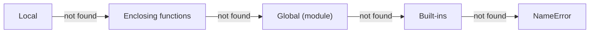

# Scope, closures and lambdas

Decorators, callbacks, factories, `functools.partial` and half of the tricks in asyncio rely on one capability: a function can *remember* variables from the place where it was defined. To understand that, you need Python's scoping rules (LEGB), the `global` and `nonlocal` keywords, and closures. We finish with `lambda`, Python's anonymous-function expression, and its famous late-binding trap.

## Namespaces

A **namespace** is a mapping from names to objects — literally a dict in most cases. Python has several, created at different moments and living for different lengths of time:

| Namespace | Created | Lifetime | Inspect with |
|---|---|---|---|
| Built-in (`len`, `print`, `ValueError`) | interpreter start | forever | `import builtins; dir(builtins)` |
| Global (module) | module import | until interpreter exit (usually) | `globals()` |
| Enclosing function | outer function call | while referenced by a closure | `fn.__closure__` |
| Local | each function call | the call (unless captured) | `locals()` |
| Class body | class statement | becomes the class `__dict__` | `vars(cls)` |

Goodrich (§1.10) calls the process of finding which namespace a name belongs to **name resolution**, and the region of code where a name is visible its **scope**.

## The LEGB rule

When Python sees a name being *read*, it searches four scopes in order and uses the first match:

1. **L**ocal — names assigned in the current function (including parameters).
2. **E**nclosing — locals of any enclosing `def`s (innermost first).
3. **G**lobal — the module's top level.
4. **B**uilt-in — Python's predefined names.

If none matches: `NameError`.



```python-run
x = "global"

def outer():
    x = "enclosing"
    def inner():
        print("inner sees:", x)      # E: found in outer
    inner()

def shadow_builtin():
    len = lambda s: 42               # L shadows B
    return len("abc")

outer()
print(shadow_builtin(), len("abc"))
```

### Scope is decided at compile time

Here's the rule that trips everyone: **if a function assigns to a name anywhere in its body, that name is local for the entire function** — even on lines before the assignment. The compiler decides, not the runtime.

```python-run
count = 0

def increment():
    try:
        count += 1        # count is local here because of this assignment...
    except UnboundLocalError as e:
        print("UnboundLocalError:", e)

increment()
```

`count += 1` is an assignment, so `count` is local to `increment`; reading it before it has a local value raises `UnboundLocalError`. Note that *mutating* a global object doesn't count as assignment: `items.append(1)` works fine on a global list, because `items` itself is never rebound.

### `global` and `nonlocal`

To rebind a name in an outer scope, declare it:

- `global name` — the name refers to the module-level variable.
- `nonlocal name` — the name refers to the nearest enclosing function's variable (it must already exist there).

```python-run
count = 0
def increment_global():
    global count
    count += 1

def make_counter():
    n = 0
    def tick():
        nonlocal n
        n += 1
        return n
    return tick

increment_global(); increment_global()
t = make_counter()
print(count, t(), t(), t())
```

Use `global` sparingly — module-level mutable state makes code hard to test. `nonlocal` is common and healthy inside closures.

### Blocks don't create scopes

Unlike C or Java, `if`, `for`, `while`, `with` and `try` blocks do **not** introduce a new scope. Variables assigned inside them are visible after the block, including the loop variable:

```python-run
for i in range(3):
    last_square = i * i
print(i, last_square)        # both still exist
```

Only modules, functions (including lambdas), classes and comprehensions create scopes. And one oddity: the name bound by `except E as err:` is deleted at the end of the `except` block.

### Class bodies are not enclosing scopes

Methods can't see class-level names unqualified; they must go through `self` or the class:

```python-run
class Config:
    retries = 3
    def show(self):
        try:
            return retries
        except NameError:
            return f"must write self.retries -> {self.retries}"

print(Config().show())
```

## Closures

A **closure** is a function that captures variables from an enclosing scope, keeping them alive after the enclosing function has returned.

```python-run
def make_multiplier(factor):
    def multiply(x):
        return x * factor          # 'factor' is a free variable
    return multiply

double = make_multiplier(2)
triple = make_multiplier(3)
print(double(10), triple(10))
print(double.__code__.co_freevars, double.__closure__[0].cell_contents)
```

How does `double` still know `factor` after `make_multiplier` returned? Python stores captured variables in **cell objects**. The outer function's frame and the inner function both point to the same cell; when the outer frame dies, the cell lives on because the closure references it.

Key consequence: closures capture **variables, not values**. If the variable changes later, the closure sees the new value:

```python-run
def outer():
    msg = "first"
    def show():
        return msg
    msg = "second"         # rebinding the captured variable
    return show

print(outer()())           # 'second'
```

### Closures as lightweight objects

A closure bundles state with behaviour — the same job a class does. For small cases, a closure is lighter:

```python-run
def running_average():
    total = 0
    n = 0
    def add(x):
        nonlocal total, n
        total += x
        n += 1
        return total / n
    return add

avg = running_average()
print([avg(x) for x in (10, 20, 30, 40)])
```

When the state grows or you need multiple operations on it, switch to a class.

## Lambda expressions

`lambda params: expression` creates an anonymous function whose body is a single expression (no statements, no annotations, implicit return). It's equivalent to a `def`, just inline:

```python-run
square = lambda x: x * x                     # PEP 8 discourages binding lambdas to names
pairs = [(1, "one"), (3, "three"), (2, "two")]
print(sorted(pairs, key=lambda p: p[1]))     # the canonical use: a key function
print(list(map(lambda x: x + 1, [1, 2])), list(filter(lambda x: x % 2, range(6))))
print((lambda a, b=2, *rest, **kw: (a, b, rest, kw))(1, 5, 6, z=0))
```

Lambdas support all argument kinds. Use them for short key functions and callbacks. If you're naming it, use `def` — you get a real `__name__` in tracebacks and room for a docstring.

### `operator` module: lambdas you don't have to write

`operator.itemgetter`, `attrgetter` and `methodcaller` produce fast, picklable key functions:

```python-run
from operator import itemgetter, attrgetter, methodcaller, add
from functools import reduce
rows = [("ana", 31), ("ben", 25), ("cy", 31)]
print(sorted(rows, key=itemgetter(1, 0)))
print(list(map(methodcaller("upper"), ["a", "b"])), reduce(add, [1, 2, 3]))
```

## The late-binding trap

Because closures capture variables rather than values, creating functions in a loop gives a surprise:

```python-run
callbacks = [lambda: i for i in range(3)]
print([f() for f in callbacks])         # [2, 2, 2] — not [0, 1, 2]!
```

All three lambdas close over the **same** variable `i`, which ends the loop as `2`. They look the value up when *called*, not when created. Three fixes:

```python-run
from functools import partial

fix1 = [lambda i=i: i for i in range(3)]          # default arg evaluated at creation
fix2 = [(lambda j: (lambda: j))(i) for i in range(3)]   # extra enclosing scope per item
fix3 = [partial(lambda j: j, i) for i in range(3)]      # partial binds the value now
print([f() for f in fix1], [f() for f in fix2], [f() for f in fix3])
```

The default-argument trick works precisely *because* defaults are evaluated once, at definition time — the same rule that causes the mutable-default bug.

> [!INTERVIEW]
> "What does `[lambda: i for i in range(3)]` return when each is called?" — `[2, 2, 2]`, because closures are late-binding: they capture the variable `i`, not its value at creation. Fix with `lambda i=i: i` or `functools.partial`. Follow-up: "Explain LEGB and when you'd get `UnboundLocalError`." — assigning to a name anywhere in a function makes it local everywhere in that function.

## Worked example: a memoising closure

Closures are how you build caches without classes. Here the cache dict lives in the enclosing scope:

```python-run
def memoize(fn):
    cache = {}
    def wrapper(n):
        if n not in cache:
            cache[n] = fn(n)
        return cache[n]
    wrapper.cache = cache          # expose for inspection
    return wrapper

@memoize                           # decorator syntax: fib = memoize(fib)
def fib(n):
    return n if n < 2 else fib(n - 1) + fib(n - 2)

print(fib(80), len(fib.cache))
```

Recursive calls inside `fib` look up the *global* name `fib`, which now refers to `wrapper` — so they hit the cache too. That's exactly how decorators work, which is the next lesson.

## Under the hood: how the compiler classifies names

Scope decisions are baked into the bytecode. The compiler sorts every name in a function into one of four categories and emits a different instruction for each — which you can see with `dis` and the code object's attributes:

```python-run
import dis

g = "global"

def outer():
    captured = "enclosing"
    def inner(param):
        local = param + 1
        return local, captured, g, len
    return inner

inner = outer()
code = inner.__code__
print("locals   (co_varnames):", code.co_varnames)     # LOAD_FAST: slots in the frame
print("free     (co_freevars):", code.co_freevars)     # LOAD_DEREF: via closure cells
print("globals/builtins (co_names):", code.co_names)   # LOAD_GLOBAL: dict lookups at run time
print("outer's cell vars:", outer.__code__.co_cellvars)
print(sorted({i.opname for i in dis.get_instructions(inner) if i.opname.startswith("LOAD")}))
```

- **Locals** live in an array in the frame, addressed by index — fast, and fixed at compile time (hence `UnboundLocalError` rather than a fallback to the global).
- **Free variables** are reached through **cells**. The outer function stores `captured` in a cell instead of a plain slot *because* an inner function uses it; both functions share the cell.
- **Globals and built-ins** are looked up by name at run time, first in the module's dict, then in `builtins`. That is why a global can be defined *after* the function that uses it, as long as it exists by the time the function is called.

Because cells are shared and live, two closures created by the same call see each other's writes:

```python-run
def make_account(balance):
    def deposit(n):
        nonlocal balance
        balance += n
        return balance
    def get():
        return balance
    return deposit, get

deposit, get = make_account(100)
deposit(50)
print(get(), deposit.__closure__[0] is get.__closure__[0])   # the very same cell object
```

## Debugging scope problems

A short checklist when a name misbehaves:

1. **`NameError`**: the name doesn't exist in any LEGB scope *at the time the line runs*. Typo? Defined later in the file? Defined inside another function or an `if` branch that didn't execute?
2. **`UnboundLocalError`**: search the function for an assignment to that name — including `+=`, `for name in`, `with ... as name`, `import name`, and `except ... as name`. Any of them makes it local.
3. **A value is "stale" or "wrong"**: you may be reading a *shadowing* variable. `print(locals())` and `print(globals().get("x"))` show which one you are getting.
4. **A built-in stopped working** (`'list' object is not callable`): you rebound `list`, `str`, `max`, `sum`, `type`, `id` or `input` earlier. `del name` (or restarting the notebook kernel) restores access to the built-in.

```python-run
total = 0
def add_all(nums):
    for total in nums:        # the loop variable makes 'total' LOCAL here
        pass
    return total              # last item, not a sum!
print(add_all([1, 2, 3]), total)

sum_ = sum                    # keep the builtin safe under another name if you must reuse 'sum'
values = [1, 2, 3]
print(sum_(values), "sum" in dir(__builtins__) or True)
```

## When to use what

| Need | Tool |
|---|---|
| a tiny key/callback used once | `lambda` |
| the same, but picklable or reused | `def`, or `operator.itemgetter` / `functools.partial` |
| a function with one or two pieces of remembered state | closure with `nonlocal` |
| several operations on shared state, or state you want to inspect | a class |
| configuration fixed at creation | closure factory or `partial` |
| shared mutable module state | avoid; pass it in explicitly |

Closures and classes are interchangeable in principle ("a closure is a poor man's object, and vice versa"). Pick the one whose state is easiest for a reader — and a debugger — to see: closure state hides in `__closure__`, instance state sits in plain sight in `vars(obj)`.

## Pitfalls recap

- Assigning to a name in a function makes it local everywhere in that function → `UnboundLocalError`.
- `nonlocal` requires the variable to exist in an enclosing *function* (not module) scope.
- Closures capture variables, not values: loop-created lambdas share the loop variable.
- Loop and `if` blocks don't create scopes; the loop variable survives the loop.
- Methods don't see class attributes without `self.` or `ClassName.`.
- Shadowing built-ins (`list = [...]`, `id = 5`, `input = ...`) breaks later code in that scope.

## Summary

Names are resolved Local → Enclosing → Global → Built-in, with locality decided at compile time by the presence of an assignment. `global` and `nonlocal` let you rebind outer names. Inner functions capture enclosing variables in cells, forming closures that outlive their creator. Lambdas are expression-only functions ideal for keys and callbacks, but they share the late-binding behaviour of all closures.

```quiz
[
  {"q": "In what order does Python resolve a name being read?", "options": ["Global, Local, Built-in", "Local, Enclosing, Global, Built-in", "Built-in, Global, Local", "Local, Global, Enclosing, Built-in"], "answer": 1,
   "explain": "LEGB: local, then enclosing functions, then module globals, then built-ins."},
  {"q": "Why does `x = 1` / `def f(): print(x); x = 2` / `f()` raise UnboundLocalError?", "options": ["print can't print ints", "The assignment makes x local throughout f, so the print reads an unassigned local", "Globals are read-only", "x was deleted"], "answer": 1,
   "explain": "Locality is decided at compile time; any assignment in the body makes the name local for the whole function."},
  {"q": "What does `[f() for f in [lambda: i for i in range(3)]]` give?", "options": ["[0, 1, 2]", "[2, 2, 2]", "[3, 3, 3]", "NameError"], "answer": 1,
   "explain": "Each lambda looks up i when called; by then the comprehension's i is 2."},
  {"q": "Which keyword lets an inner function rebind a variable of its enclosing function?", "options": ["global", "nonlocal", "outer", "static"], "answer": 1,
   "explain": "nonlocal targets the nearest enclosing function scope; global targets the module."},
  {"q": "Where does a closure keep captured variables?", "options": ["In the global namespace", "In cell objects referenced from __closure__", "On the stack frame, which is copied", "In __defaults__"], "answer": 1,
   "explain": "Captured variables live in cells shared by the outer frame and the inner function, so they survive the outer call."},
  {"q": "Which statement creates a new scope?", "options": ["for loop", "if block", "with block", "def"], "answer": 3,
   "explain": "Only modules, functions/lambdas, classes and comprehensions create scopes; blocks do not."},
  {"q": "What can't a lambda contain?", "options": ["Default arguments", "*args", "Statements such as assignment or return", "A conditional expression"], "answer": 2,
   "explain": "A lambda body is a single expression; statements are not allowed (the walrus := is an expression, though)."}
]
```

> **Source:** Goodrich, Tamassia & Goldwasser, *Data Structures and Algorithms in Python*, §1.10 (Scopes and Namespaces) and §1.5; Python docs, *Tutorial* §9.2 "Python Scopes and Namespaces", *Language Reference* §4.2 "Naming and binding", and *Programming FAQ* "Why do lambdas defined in a loop with different values all return the same result?".
