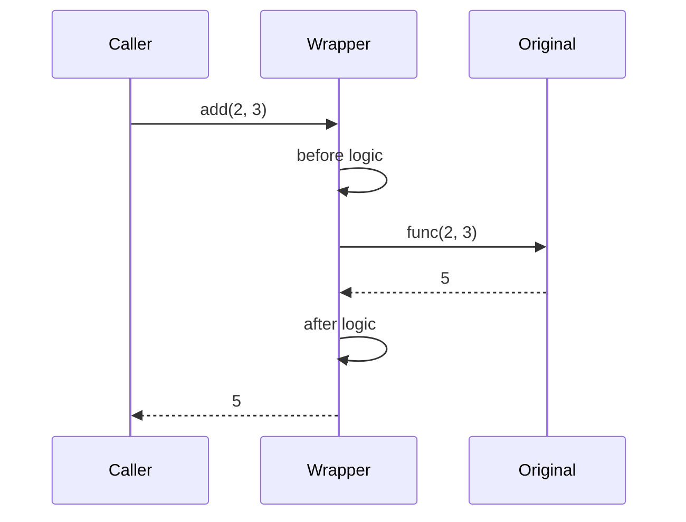

# Decorators and functools

A **decorator** is a callable that takes a function and returns a replacement for it. That one sentence, combined with closures from the previous lesson, explains `@lru_cache`, `@property`, `@staticmethod`, `@dataclass`, Flask and FastAPI's `@app.get("/")`, pytest's `@pytest.fixture` and every logging/timing/retry helper you will ever write. This lesson builds decorators from first principles, then tours the `functools` module.

## The `@` syntax is just sugar

```python
@decorator
def f(...):
    ...
```

means exactly

```python
def f(...):
    ...
f = decorator(f)
```

The decorator runs **once, at definition time**, and whatever it returns is bound to the name `f`. Usually it returns a new function (a *wrapper*) that calls the original.

```python-run
def announce(func):
    print(f"decorating {func.__name__}")        # runs at definition time
    def wrapper(*args, **kwargs):
        print(f"-> calling {func.__name__}{args}")
        result = func(*args, **kwargs)
        print(f"<- {func.__name__} returned {result!r}")
        return result
    return wrapper

@announce
def add(a, b):
    return a + b

print("defined")
add(2, 3)
```

Notice the `*args, **kwargs` signature: the wrapper accepts anything and forwards it, so the decorator works for any function.



## Preserving metadata with `functools.wraps`

The wrapper replaces the original, so by default the function's name, docstring and signature are lost — bad for debugging, `help()`, and frameworks that inspect signatures (FastAPI does!). `functools.wraps` copies `__name__`, `__qualname__`, `__doc__`, `__module__`, `__dict__` and sets `__wrapped__` to the original:

```python-run
import functools, inspect

def plain(func):
    def wrapper(*args, **kwargs):
        return func(*args, **kwargs)
    return wrapper

def proper(func):
    @functools.wraps(func)
    def wrapper(*args, **kwargs):
        return func(*args, **kwargs)
    return wrapper

@plain
def a(x: int) -> int:
    "Docstring of a."
    return x

@proper
def b(x: int) -> int:
    "Docstring of b."
    return x

print(a.__name__, a.__doc__)
print(b.__name__, b.__doc__, inspect.signature(b), b.__wrapped__)
```

**Always use `@functools.wraps(func)` on your wrapper.** It's the first thing reviewers look for.

## Common decorator recipes

### Timing

```python-run
import functools, time

def timed(func):
    @functools.wraps(func)
    def wrapper(*args, **kwargs):
        start = time.perf_counter()
        try:
            return func(*args, **kwargs)
        finally:                          # report even if func raises
            ms = (time.perf_counter() - start) * 1000
            print(f"{func.__name__} took {ms:.2f} ms")
    return wrapper

@timed
def busy(n):
    return sum(i * i for i in range(n))

busy(200_000)
```

### Counting calls (state on the wrapper)

```python-run
import functools

def count_calls(func):
    @functools.wraps(func)
    def wrapper(*args, **kwargs):
        wrapper.calls += 1
        return func(*args, **kwargs)
    wrapper.calls = 0
    return wrapper

@count_calls
def hello():
    return "hi"

for _ in range(3):
    hello()
print(hello.calls)
```

Function attributes are a tidy place for decorator state. A closure variable with `nonlocal` also works but isn't visible from outside.

## Decorators with arguments

`@retry(times=3)` has an extra layer: `retry(times=3)` is called first and must *return a decorator*. So you write three nested functions — a **decorator factory**:

```python-run
import functools

def retry(times=3, exceptions=(Exception,)):
    def decorator(func):
        @functools.wraps(func)
        def wrapper(*args, **kwargs):
            last = None
            for attempt in range(1, times + 1):
                try:
                    return func(*args, **kwargs)
                except exceptions as e:
                    last = e
                    print(f"attempt {attempt} failed: {e}")
            raise last
        return wrapper
    return decorator

attempts = iter([ValueError("flaky"), ValueError("still flaky"), "ok"])

@retry(times=3, exceptions=(ValueError,))
def fetch():
    r = next(attempts)
    if isinstance(r, Exception):
        raise r
    return r

print(fetch())
```

Reading `@retry(times=3)` as `fetch = retry(times=3)(fetch)` makes the three layers obvious. A common mistake is writing `@retry` (no parentheses) on a factory: then `retry` receives the function as `times`. Libraries sometimes support both forms by checking whether the first argument is callable.

## Stacking decorators

Decorators apply **bottom-up** (closest to the `def` first), and the resulting wrappers run **top-down** at call time:

```python-run
def tag(name):
    def deco(func):
        def wrapper(*a, **k):
            return f"<{name}>{func(*a, **k)}</{name}>"
        return wrapper
    return deco

@tag("b")
@tag("i")
def greet(who):
    return f"hi {who}"

print(greet("Brook"))    # greet = tag("b")(tag("i")(greet))
```

## Class decorators and decorators as classes

A decorator can also *be* a class (its `__init__` receives the function, its `__call__` runs on every call), and a decorator can be *applied to* a class (receiving the class, e.g. `@dataclass`).

```python-run
import functools

class CountCalls:
    def __init__(self, func):
        functools.update_wrapper(self, func)
        self.func = func
        self.calls = 0
    def __call__(self, *args, **kwargs):
        self.calls += 1
        return self.func(*args, **kwargs)

@CountCalls
def ping():
    return "pong"

ping(); ping()
print(ping.calls, ping.__name__)

def register(cls):            # class decorator: registry pattern
    REGISTRY[cls.__name__] = cls
    return cls

REGISTRY = {}
@register
class Plugin: pass
print(REGISTRY)
```

One caveat: a class-based decorator applied to a *method* doesn't automatically bind `self`, because instances of your class aren't descriptors. Function-based decorators don't have this problem.

## functools tour

### `lru_cache` and `cache`

`@functools.lru_cache(maxsize=128)` memoises a function: results are stored in a dict keyed by the arguments, and the least recently used entries are evicted once `maxsize` is exceeded. `maxsize=None` (or `@functools.cache`, 3.9+) means unbounded. Arguments must be **hashable**.

```python-run
from functools import lru_cache, cache

@cache
def grid_paths(r, c):
    if r == 0 or c == 0:
        return 1
    return grid_paths(r - 1, c) + grid_paths(r, c - 1)

print(grid_paths(16, 16), grid_paths.cache_info())

@lru_cache(maxsize=2)
def sq(n):
    return n * n
for n in [1, 2, 1, 3, 2]:
    sq(n)
print(sq.cache_info())
sq.cache_clear()
```

In interviews, `@cache` turns a recursive brute force into top-down dynamic programming in one line. Caveats: recursion depth is still limited; caching a method caches on `self` too (keeping instances alive); and passing lists raises `TypeError: unhashable type` — convert to tuples.

### `partial`

`functools.partial(func, *args, **kwargs)` freezes some arguments, producing a new callable:

```python-run
from functools import partial
int_from_binary = partial(int, base=2)
print(int_from_binary("1011"))
pow2 = partial(pow, 2)
print([pow2(e) for e in range(5)])
p = partial(print, sep=" | ")
p("a", "b", "c")
```

`partial` objects are picklable (unlike lambdas), which matters for `multiprocessing`.

### `reduce`

`reduce(f, iterable, initial)` folds a sequence: `reduce(f, [a, b, c], x) == f(f(f(x, a), b), c)`. Prefer `sum`, `math.prod`, `max`, `any`, `"".join` when they exist; reach for `reduce` for custom folds.

```python-run
from functools import reduce
import operator
print(reduce(operator.mul, range(1, 6), 1), reduce(lambda acc, d: acc * 10 + d, [4, 2, 7], 0))
```

### `total_ordering`, `singledispatch`, `cached_property`

```python-run
from functools import total_ordering, singledispatch, cached_property

@total_ordering
class Version:
    def __init__(self, s): self.parts = tuple(map(int, s.split(".")))
    def __eq__(self, o): return self.parts == o.parts
    def __lt__(self, o): return self.parts < o.parts     # the rest are derived

print(Version("1.10.0") > Version("1.9.3"), Version("2.0") >= Version("2.0"))

@singledispatch
def describe(x):
    return f"something: {x!r}"
@describe.register
def _(x: int):
    return f"an int: {x}"
@describe.register
def _(x: list):
    return f"a list of {len(x)}"
print(describe(3), describe([1, 2]), describe("s"))

class Report:
    @cached_property
    def heavy(self):
        print("computing...")
        return 42
r = Report()
print(r.heavy, r.heavy)       # computed once per instance
```

## Worked example: a validating decorator

Let's build something realistic: check argument types against annotations at call time, using `inspect.signature` and `functools.wraps`.

```python-run
import functools, inspect

def enforce_types(func):
    sig = inspect.signature(func)
    @functools.wraps(func)
    def wrapper(*args, **kwargs):
        bound = sig.bind(*args, **kwargs)
        bound.apply_defaults()
        for name, value in bound.arguments.items():
            ann = sig.parameters[name].annotation
            if isinstance(ann, type) and not isinstance(value, ann):
                raise TypeError(f"{name} must be {ann.__name__}, got {type(value).__name__}")
        return func(*args, **kwargs)
    return wrapper

@enforce_types
def repeat(text: str, times: int = 2) -> str:
    return text * times

print(repeat("ab", 3))
try:
    repeat("ab", "3")
except TypeError as e:
    print("TypeError:", e)
```

This is a toy version of what Pydantic's `validate_call` and FastAPI's request parsing do.

> [!INTERVIEW]
> "Write a decorator that caches results / times a function / retries on failure" is a standard live-coding question. Hit these points: (1) the wrapper takes `*args, **kwargs`; (2) use `@functools.wraps`; (3) for parameters, add the outer factory layer; (4) return the result of the wrapped call; (5) mention `lru_cache` for memoisation and that its arguments must be hashable.

## Pitfalls recap

- Forgetting to `return func(*args, **kwargs)` in the wrapper — every call returns `None`.
- Forgetting `@functools.wraps` — broken names, docs, signatures.
- Using a decorator factory without parentheses (`@retry` instead of `@retry()`).
- Calling the function instead of returning it: `return wrapper()` instead of `return wrapper`.
- `lru_cache` on functions with unhashable arguments or on methods (cache keeps `self` alive).
- Decorator side effects at import time (e.g., registration) surprise people who expect lazy behaviour.

## Summary

A decorator is a callable that receives a function (or class) and returns a replacement; `@d` is sugar for `f = d(f)`. Wrappers use closures and `*args, **kwargs`, and should be wrapped with `functools.wraps`. Decorators with arguments add a factory layer; stacked decorators apply bottom-up. `functools` adds `lru_cache`/`cache`, `partial`, `reduce`, `total_ordering`, `singledispatch` and `cached_property`.

```quiz
[
  {"q": "`@d` above `def f(): ...` is equivalent to:", "options": ["f = d", "f = d(f)", "d = f(d)", "f = d()"], "answer": 1,
   "explain": "The decorator is called with the function object and its return value is bound to the name f."},
  {"q": "When does the decorator function itself run?", "options": ["On every call of f", "Once, when the def statement executes", "Only on the first call", "At program exit"], "answer": 1,
   "explain": "Decoration happens at definition time; only the wrapper runs on each call."},
  {"q": "What does functools.wraps do?", "options": ["Caches results", "Copies __name__, __doc__ etc. onto the wrapper and sets __wrapped__", "Makes the function async", "Adds type checking"], "answer": 1,
   "explain": "It preserves the wrapped function's metadata so introspection and tracebacks still make sense."},
  {"q": "With `@a` above `@b` above `def f`, what is f?", "options": ["b(a(f))", "a(b(f))", "a(f) and b(f)", "Only a(f)"], "answer": 1,
   "explain": "Decorators apply bottom-up: b first, then a wraps the result."},
  {"q": "Why does `@lru_cache` fail with `f([1, 2])`?", "options": ["Lists are too long", "Cache keys are built from the arguments, which must be hashable", "lru_cache only accepts ints", "It does not fail"], "answer": 1,
   "explain": "Arguments form a dict key; lists are unhashable. Pass a tuple instead."},
  {"q": "How many nested function layers does a decorator that takes arguments, like @retry(times=3), normally have?", "options": ["1", "2", "3", "4"], "answer": 2,
   "explain": "Factory (takes options) -> decorator (takes func) -> wrapper (takes call arguments)."},
  {"q": "functools.partial(int, base=16)('ff') returns:", "options": ["'ff'", "255", "15", "TypeError"], "answer": 1,
   "explain": "partial freezes base=16, so the call becomes int('ff', base=16) = 255."}
]
```

> **Source:** Python docs, *Glossary* "decorator", *Language Reference* §8.7 (function definitions and decorators), *Library Reference* `functools` module; Goodrich, Tamassia & Goldwasser, *Data Structures and Algorithms in Python*, §1.5 (functions as first-class objects).
