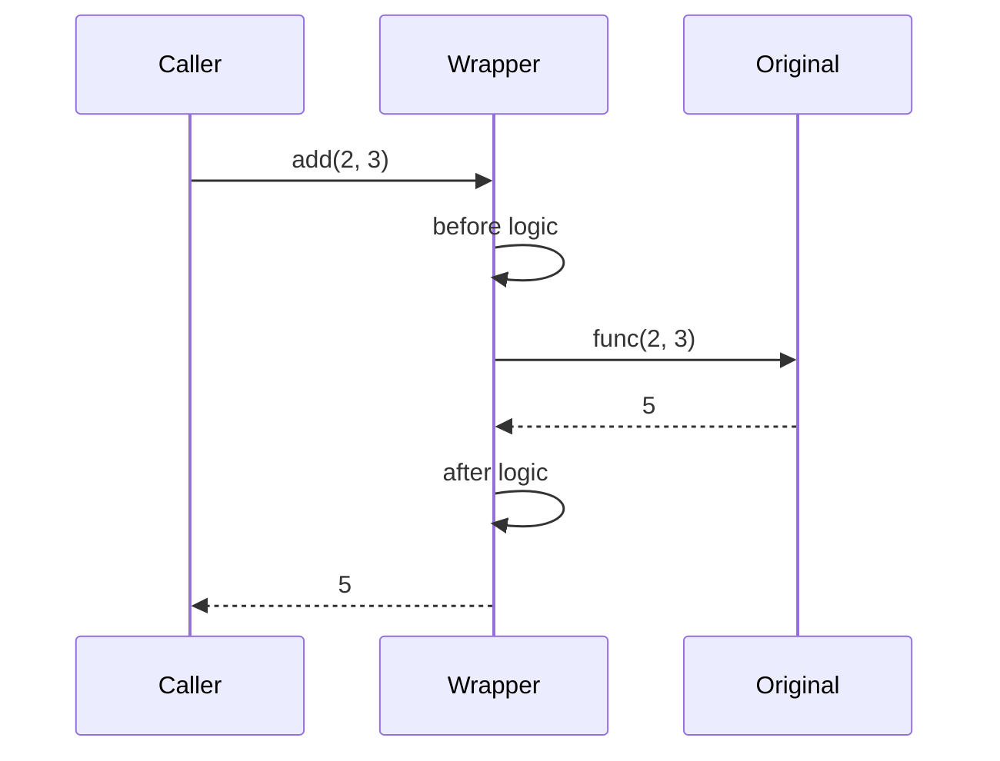

# Decorators and functools

> **Before this lesson:** you must be comfortable with closures (an inner function that remembers variables of the function it was created in) from [Scope, closures and lambdas](#/lesson/python/py-scope-closures), and with `*args`, `**kwargs` and "functions are objects you can pass and return" from [Functions and arguments](#/lesson/python/py-functions-args). A few examples use a small class; [Classes: modelling things with objects](#/lesson/python/py-start-classes) is enough for those.

## In plain words

A **decorator** is a function that takes another function and gives back an improved version of it. You write the improvement once and then attach it to as many functions as you like with one line, `@name`, placed above each `def`.

Think of gift-wrapping at a shop. The present inside is not altered; the shop puts a layer around it. Whoever receives the parcel deals with the wrapping first and the present second. A decorator wraps a function in the same way: callers now call the wrapping, the wrapping can do something before and after (start a stopwatch, write a log line, check a password, look in a cache), and in the middle it calls the original function.

Why this matters: decorators are how Python programs add the same behaviour to many functions without copying code. You cannot read modern Python without them: `@property`, `@staticmethod`, `@dataclass`, the web frameworks' `@app.get("/")`, the test tool's `@pytest.fixture` and the one-line cache `@lru_cache` are all decorators. "Write a decorator that times a function, caches its results, or retries on failure" is a standard live-coding interview task, and this lesson builds each of those from nothing. The second half tours `functools`, the standard-library module of ready-made tools for working with functions.

One word used throughout: a **callable** is anything you can call with parentheses, most often a function.

## The `@` syntax is shorthand

```python
@decorator
def f(...):
    ...
```

means exactly

```python
def f(...):
    ...
f = decorator(f)
```

Programmers call such a shorthand *syntactic sugar*: a nicer way of writing something the language could already do. Two consequences follow from the long form. The decorator runs **once, at the moment the function is defined**, not each time it is called. And whatever the decorator returns is what the name `f` refers to from then on. Usually it returns a new function, called a **wrapper**, that calls the original somewhere in its body.

```python-run
def announce(func):
    print(f"decorating {func.__name__}")        # runs at definition time
    def wrapper(*args, **kwargs):
        print(f"-> calling {func.__name__}{args}")
        result = func(*args, **kwargs)
        print(f"<- {func.__name__} returned {result!r}")
        return result
    return wrapper

@announce
def add(a, b):
    return a + b

print("defined")
add(2, 3)
```

**Reading this code line by line**

- `announce(func)` is the decorator. Its parameter `func` receives the function being decorated.
- The first `print` is in the decorator's own body, so it runs once, when `@announce` is applied. That is why `decorating add` appears in the output *before* `defined`.
- `wrapper` is defined inside `announce`, so it is a closure: it remembers `func`.
- `wrapper(*args, **kwargs)` accepts any arguments at all and passes them on unchanged with `func(*args, **kwargs)`. That is what lets one decorator work for every function, whatever its parameters.
- The wrapper stores the original's result, prints it, and returns it. Forgetting that `return` is the most common decorator bug: every call would then give `None`.
- `return wrapper` hands back the wrapper function itself (no parentheses), which becomes the new `add`.
- `add(2, 3)` therefore calls the wrapper, which prints the two arrow lines around the real addition.

The diagram shows the same call as a conversation between the caller, the wrapper and the original function:



## Preserving metadata with `functools.wraps`

The name `add` now refers to the wrapper, so anything that asks the function about itself gets the wrapper's answers: its name is `wrapper`, its docstring is empty, and its parameter list is `(*args, **kwargs)`. Such descriptive information about a function is called its **metadata**. Losing it hurts debugging and `help()`, and it breaks frameworks that read parameter lists to decide what to pass (FastAPI does).

`functools.wraps` repairs this. It is itself a decorator, applied to the wrapper, and it copies the original's `__name__`, `__qualname__`, `__doc__`, `__module__` and attribute dictionary onto the wrapper, and stores the original function in a new attribute, `__wrapped__`:

```python-run
import functools, inspect

def plain(func):
    def wrapper(*args, **kwargs):
        return func(*args, **kwargs)
    return wrapper

def proper(func):
    @functools.wraps(func)
    def wrapper(*args, **kwargs):
        return func(*args, **kwargs)
    return wrapper

@plain
def a(x: int) -> int:
    "Docstring of a."
    return x

@proper
def b(x: int) -> int:
    "Docstring of b."
    return x

print(a.__name__, a.__doc__)
print(b.__name__, b.__doc__, inspect.signature(b), b.__wrapped__)
```

The two decorators are identical except for the `@functools.wraps(func)` line. The first print shows what `plain` did to `a`: `wrapper None`. The second shows `b` keeping its identity: its name, its docstring, the signature `(x: int) -> int`, and the original function available as `b.__wrapped__`.

**Always put `@functools.wraps(func)` on your wrapper.** It is the first thing a code reviewer looks for.

## Common decorator recipes

### Timing

```python-run
import functools, time

def timed(func):
    @functools.wraps(func)
    def wrapper(*args, **kwargs):
        start = time.perf_counter()
        try:
            return func(*args, **kwargs)
        finally:                          # report even if func raises
            ms = (time.perf_counter() - start) * 1000
            print(f"{func.__name__} took {ms:.2f} ms")
    return wrapper

@timed
def busy(n):
    return sum(i * i for i in range(n))

busy(200_000)
```

`time.perf_counter()` reads a precise clock. The wrapper notes the time, runs the function, and reports the difference in milliseconds. The `try` / `finally` pair guarantees that the report is printed even if the function fails with an error: a `finally` block always runs on the way out.

### Counting calls (state on the wrapper)

```python-run
import functools

def count_calls(func):
    @functools.wraps(func)
    def wrapper(*args, **kwargs):
        wrapper.calls += 1
        return func(*args, **kwargs)
    wrapper.calls = 0
    return wrapper

@count_calls
def hello():
    return "hi"

for _ in range(3):
    hello()
print(hello.calls)
```

A function is an object, so you can attach your own attributes to it. `wrapper.calls = 0` creates a counter on the wrapper when the decorator runs, and each call adds one; after three calls `hello.calls` is 3. Attributes are a tidy place for a decorator's data because they can be read from outside. A variable in the enclosing scope updated with `nonlocal` also works, but nobody outside can see it.

## Decorators with arguments

Sometimes the decorator itself needs settings: "retry *three* times". In `@retry(times=3)` there are parentheses after the name, so Python first *calls* `retry(times=3)`, and whatever that call returns is then used as the decorator. That requires one more layer of nesting, three functions in all. The outermost one, which takes the settings and returns a decorator, is called a **decorator factory**:

```python-run
import functools

def retry(times=3, exceptions=(Exception,)):
    def decorator(func):
        @functools.wraps(func)
        def wrapper(*args, **kwargs):
            last = None
            for attempt in range(1, times + 1):
                try:
                    return func(*args, **kwargs)
                except exceptions as e:
                    last = e
                    print(f"attempt {attempt} failed: {e}")
            raise last
        return wrapper
    return decorator

attempts = iter([ValueError("flaky"), ValueError("still flaky"), "ok"])

@retry(times=3, exceptions=(ValueError,))
def fetch():
    r = next(attempts)
    if isinstance(r, Exception):
        raise r
    return r

print(fetch())
```

**Reading the three layers**

- `retry(times, exceptions)` is the factory. It receives the settings and returns `decorator`.
- `decorator(func)` is an ordinary decorator. It receives the function and returns `wrapper`.
- `wrapper(*args, **kwargs)` runs on every call. It tries the function up to `times` times. If a call succeeds, `return` ends the loop at once. If it raises one of the listed error types, the error is remembered and the loop tries again. If every attempt fails, the last error is raised again for the caller.

The test function `fetch` fails twice and then succeeds, so the output shows two failed attempts and then `ok`.

Reading `@retry(times=3)` as `fetch = retry(times=3)(fetch)` makes the layers visible. A common mistake is to write `@retry` without parentheses on a factory: then `retry` receives the function as its `times` argument and everything goes wrong later. Some libraries accept both spellings by checking whether their first argument is callable.

## Stacking decorators

When several decorators sit above one function, they are applied from the **bottom up** (the one nearest the `def` first). At call time the outermost wrapper runs first, so the wrappers execute from the **top down**:

```python-run
def tag(name):
    def deco(func):
        def wrapper(*a, **k):
            return f"<{name}>{func(*a, **k)}</{name}>"
        return wrapper
    return deco

@tag("b")
@tag("i")
def greet(who):
    return f"hi {who}"

print(greet("Brook"))    # greet = tag("b")(tag("i")(greet))
```

The output is `<b><i>hi Brook</i></b>`. `tag("i")` wrapped the function first and is therefore the inner layer; `tag("b")` wrapped that result and is the outer layer.

## Class decorators and decorators as classes

Two more combinations exist. A decorator can *be* a class: creating an object of the class receives the function (in `__init__`, the method that sets up a new object), and the special method `__call__` makes the object callable, so it runs on every call. And a decorator can be *applied to* a class: it then receives the class itself, as `@dataclass` does.

```python-run
import functools

class CountCalls:
    def __init__(self, func):
        functools.update_wrapper(self, func)
        self.func = func
        self.calls = 0
    def __call__(self, *args, **kwargs):
        self.calls += 1
        return self.func(*args, **kwargs)

@CountCalls
def ping():
    return "pong"

ping(); ping()
print(ping.calls, ping.__name__)

def register(cls):            # class decorator: registry pattern
    REGISTRY[cls.__name__] = cls
    return cls

REGISTRY = {}
@register
class Plugin: pass
print(REGISTRY)
```

`CountCalls` stores the function and a counter on the object; `functools.update_wrapper(self, func)` is the plain-function form of `wraps` and copies the metadata. After two calls, `ping.calls` is 2 and the name is still `ping`. The second half shows a class decorator that makes no change at all to the class: `register` records it in a dictionary under its name and returns it as it was.

One caveat: a class-based decorator placed on a *method* does not automatically receive the object the method belongs to (`self`), because Python's mechanism for binding methods works on functions, not on arbitrary callable objects. Function-based decorators do not have this problem, which is one reason they are the usual choice.

## functools tour

### `lru_cache` and `cache`

`@functools.lru_cache(maxsize=128)` **memoises** a function, which means it remembers results: each result is stored in a dictionary under the arguments that produced it, and a later call with the same arguments returns the stored result without running the function. "LRU" stands for *least recently used*: once more than `maxsize` results are stored, the one that has gone unused for longest is thrown out. `maxsize=None`, or the shorter `@functools.cache` (Python 3.9+), means "never throw anything out". Because the arguments become a dictionary key, they must be **hashable**.

```python-run
from functools import lru_cache, cache

@cache
def grid_paths(r, c):
    if r == 0 or c == 0:
        return 1
    return grid_paths(r - 1, c) + grid_paths(r, c - 1)

print(grid_paths(16, 16), grid_paths.cache_info())

@lru_cache(maxsize=2)
def sq(n):
    return n * n
for n in [1, 2, 1, 3, 2]:
    sq(n)
print(sq.cache_info())
sq.cache_clear()
```

`grid_paths(r, c)` counts the routes through a grid when you may only move in two directions; each call asks two smaller questions, and without a cache the same questions would be asked hundreds of millions of times. With `@cache` every distinct pair `(r, c)` is computed once. `cache_info()` reports the evidence: `hits` (answers served from the cache), `misses` (answers that had to be computed) and the current size. The second function has room for only two results, so feeding it 1, 2, 1, 3, 2 gives one hit (the second 1) and four misses: storing 3 pushed out 2, the least recently used entry at that moment.

In interviews, `@cache` turns a slow recursive solution into what is called top-down *dynamic programming* (solving each sub-problem once and reusing the answer) with one line. Three cautions: the recursion-depth limit still applies; putting it on a method stores `self` in the cache as part of the key and so keeps every object alive; and passing a list raises `TypeError: unhashable type`, so convert lists to tuples first.

### `partial`

`functools.partial(func, *args, **kwargs)` takes a function and some arguments and returns a new callable in which those arguments are already filled in:

```python-run
from functools import partial
int_from_binary = partial(int, base=2)
print(int_from_binary("1011"))
pow2 = partial(pow, 2)
print([pow2(e) for e in range(5)])
p = partial(print, sep=" | ")
p("a", "b", "c")
```

`int_from_binary` is `int` with `base=2` fixed, so `"1011"` becomes 11. `pow2` is `pow` with its first argument fixed at 2, giving the powers `[1, 2, 4, 8, 16]`. `p` is `print` with a different separator. Unlike lambdas, `partial` objects can be saved and sent to another process (they are *picklable*), which matters for the `multiprocessing` module.

### `reduce`

`reduce(f, iterable, initial)` boils a sequence down to one value by combining a running result with each item in turn: `reduce(f, [a, b, c], x)` is `f(f(f(x, a), b), c)`. This operation is known as a *fold*. Prefer `sum`, `math.prod`, `max`, `any` or `"".join` when one of them fits; use `reduce` for a custom combination.

```python-run
from functools import reduce
import operator
print(reduce(operator.mul, range(1, 6), 1), reduce(lambda acc, d: acc * 10 + d, [4, 2, 7], 0))
```

The first call multiplies 1 × 1 × 2 × 3 × 4 × 5 = 120. The second turns the digits 4, 2, 7 into the number 427: at each step the running value is multiplied by 10 and the next digit added.

### `total_ordering`, `singledispatch`, `cached_property`

```python-run
from functools import total_ordering, singledispatch, cached_property

@total_ordering
class Version:
    def __init__(self, s): self.parts = tuple(map(int, s.split(".")))
    def __eq__(self, o): return self.parts == o.parts
    def __lt__(self, o): return self.parts < o.parts     # the rest are derived

print(Version("1.10.0") > Version("1.9.3"), Version("2.0") >= Version("2.0"))

@singledispatch
def describe(x):
    return f"something: {x!r}"
@describe.register
def _(x: int):
    return f"an int: {x}"
@describe.register
def _(x: list):
    return f"a list of {len(x)}"
print(describe(3), describe([1, 2]), describe("s"))

class Report:
    @cached_property
    def heavy(self):
        print("computing...")
        return 42
r = Report()
print(r.heavy, r.heavy)       # computed once per instance
```

Three more tools, one per block of the demo:

- `@total_ordering` is a class decorator. You define `__eq__` (equal) and one ordering method such as `__lt__` (less than), and it writes `>`, `>=` and `<=` for you. Here versions compare as tuples of numbers, so 1.10.0 is correctly greater than 1.9.3 (as text, "1.10" would sort before "1.9").
- `@singledispatch` lets one function name have different bodies chosen by the *type* of the first argument. The undecorated body is the fallback; each `@describe.register` adds a body for the type named in its annotation. The output is `an int: 3`, `a list of 2` and the fallback for the string.
- `@cached_property` turns a method into an attribute that is computed on first use and then stored on the object, so `computing...` is printed once although `r.heavy` is read twice.

## Worked example: a validating decorator

A realistic example to finish the first half: a decorator that checks, on every call, that each argument has the type written in the function's annotations. It uses `inspect.signature` (which describes a function's parameters) together with `functools.wraps`.

```python-run
import functools, inspect

def enforce_types(func):
    sig = inspect.signature(func)
    @functools.wraps(func)
    def wrapper(*args, **kwargs):
        bound = sig.bind(*args, **kwargs)
        bound.apply_defaults()
        for name, value in bound.arguments.items():
            ann = sig.parameters[name].annotation
            if isinstance(ann, type) and not isinstance(value, ann):
                raise TypeError(f"{name} must be {ann.__name__}, got {type(value).__name__}")
        return func(*args, **kwargs)
    return wrapper

@enforce_types
def repeat(text: str, times: int = 2) -> str:
    return text * times

print(repeat("ab", 3))
try:
    repeat("ab", "3")
except TypeError as e:
    print("TypeError:", e)
```

**Reading this code line by line**

- `sig = inspect.signature(func)` is computed once, when the decorator is applied, and remembered by the closure.
- `sig.bind(*args, **kwargs)` matches the call's arguments to parameter names exactly as a real call would; `apply_defaults()` fills in defaults for the ones not supplied.
- The loop looks up each parameter's annotation. If the annotation is a type (such as `str` or `int`) and the value is not of that type, it raises a `TypeError` with a readable message.
- If every check passes, the original function is called and its result returned.

`repeat("ab", 3)` prints `ababab`. `repeat("ab", "3")` is rejected with `times must be int, got str`. This is a miniature of what the libraries Pydantic (`validate_call`) and FastAPI do when they check incoming data.

> [!INTERVIEW]
> "Write a decorator that caches results / times a function / retries on failure" is a standard live-coding question. Hit these points: (1) the wrapper takes `*args, **kwargs`; (2) use `@functools.wraps`; (3) for parameters, add the outer factory layer; (4) return the result of the wrapped call; (5) mention `lru_cache` for memoisation and that its arguments must be hashable.

## Decorators you already use

Several things you have already met, or soon will, are decorators. Seeing them as ordinary callables that receive a function removes the mystery:

| Decorator | What it returns |
|---|---|
| `@staticmethod`, `@classmethod` | special objects (descriptors) that change what is passed as the first argument |
| `@property` | an object that runs the function when the attribute is read |
| `@dataclass` | the *same class*, with generated methods added |
| `@functools.lru_cache` | a caching wrapper with `cache_info()` |
| `@contextlib.contextmanager` | a factory of context managers built from a generator |
| `@app.get("/items")` (FastAPI/Flask) | usually the original function, after **registering** it in a routing table |
| `@pytest.fixture`, `@pytest.mark.parametrize` | the function tagged with metadata for the framework |

Note the last two rows: a decorator does not have to wrap anything. A *registration* decorator records the function somewhere and returns it unchanged. That is how web frameworks build their table of addresses and handlers while the program is loading.

```python-run
ROUTES = {}

def route(path, method="GET"):
    def register(func):
        ROUTES[(method, path)] = func
        return func                      # unchanged: no wrapper, no overhead
    return register

@route("/")
def home():
    return "welcome"

@route("/items", method="POST")
def create_item():
    return "created"

def dispatch(method, path):
    handler = ROUTES.get((method, path))
    return handler() if handler else "404"

print(dispatch("GET", "/"), dispatch("POST", "/items"), dispatch("GET", "/nope"), home.__name__)
```

`route(path, method)` is a factory; its inner `register` stores the function in the `ROUTES` dictionary under the pair (method, path) and returns it untouched, which is why `home.__name__` is still `home`. `dispatch` looks a handler up and calls it, or answers `404` (the web's "not found" code) when nothing is registered.

## Decorating methods and coroutines

A function-based decorator works on methods without any change: the object arrives as the first item of `*args` and is passed along like every other argument. Two special cases need care.

**Order with other decorators.** `@property`, `@classmethod` and `@staticmethod` do not return plain functions; they return special objects called *descriptors* (the data model lesson explains them). Your decorator must therefore sit *below* them, so that it is applied first, to the plain function:

```python
class Report:
    @property          # outermost: turns the wrapped function into a property
    @timed             # innermost: wraps the plain function
    def total(self): ...
```

**Async functions.** A function defined with `async def` (see the asyncio lesson) does not run when called; the call returns a *coroutine object*, a paused piece of work that runs only when it is awaited. An ordinary wrapper around such a function gets that object back immediately. A timing decorator would measure a few microseconds, and a retry decorator would never see the error, because nothing has run yet. The wrapper itself must be `async` and must `await` the call:

```python-run
import asyncio, functools, inspect, time

def timed(func):
    if inspect.iscoroutinefunction(func):
        @functools.wraps(func)
        async def async_wrapper(*args, **kwargs):
            start = time.perf_counter()
            try:
                return await func(*args, **kwargs)       # await INSIDE the timing
            finally:
                async_wrapper.last = time.perf_counter() - start
        return async_wrapper

    @functools.wraps(func)
    def wrapper(*args, **kwargs):
        start = time.perf_counter()
        try:
            return func(*args, **kwargs)
        finally:
            wrapper.last = time.perf_counter() - start
    return wrapper

@timed
async def fetch():
    await asyncio.sleep(0.05)
    return "data"

@timed
def compute():
    return sum(range(100_000))

print(asyncio.run(fetch()), f"{fetch.last:.2f}s", compute() > 0, compute.last < 0.5)
```

`inspect.iscoroutinefunction(func)` tells the decorator which kind of function it was given, and it returns a matching wrapper. The async wrapper awaits *inside* the timed region, so the measured time for `fetch` is about 0.05 seconds, the length of its sleep.

## Debugging decorated code

- **"NoneType is not callable"** at the call site: your decorator (or factory layer) forgot to `return wrapper` / `return decorator`.
- **Every call returns `None`**: the wrapper forgot `return func(...)`.
- **Tracebacks full of `wrapper`**: add `functools.wraps`; then names and docstrings are right, and `func.__wrapped__` gives you the original for testing or for bypassing a cache.
- **Stale results from `lru_cache`**: the function isn't pure (it reads a file, the clock, a global). Call `func.cache_clear()`, or don't cache it. Mutating a cached *return value* (a list or dict) corrupts the cache for every later caller — return tuples or copies.
- **Unit-testing the undecorated logic**: call `decorated.__wrapped__(...)`.

```python-run
from functools import lru_cache

@lru_cache(maxsize=None)
def defaults():
    return ["a", "b"]            # a mutable object is cached and shared

first = defaults()
first.append("OOPS")
print(defaults())                # every caller now sees the mutation
print(defaults.__wrapped__())    # the original function, bypassing the cache
```

## When not to write a decorator

Decorators hide what happens on a call: a reader of `@cached @retried @logged def f()` cannot tell what a call does without reading three other functions. Use them for concerns that apply in the same way to many functions, known as **cross-cutting** concerns: logging, timing, caching, permission checks, registration, retries. For behaviour that belongs to one function, call a helper inside it. For setup and cleanup around a *block* of code, not a whole function, a context manager (see the context managers lesson) fits better, and `contextlib.ContextDecorator` lets one object serve as both.

## Pitfalls recap

- Forgetting to `return func(*args, **kwargs)` in the wrapper — every call returns `None`.
- Forgetting `@functools.wraps` — broken names, docs, signatures.
- Using a decorator factory without parentheses (`@retry` instead of `@retry()`).
- Calling the function instead of returning it: `return wrapper()` instead of `return wrapper`.
- `lru_cache` on functions with unhashable arguments or on methods (cache keeps `self` alive).
- Decorator side effects at import time (e.g., registration) surprise people who expect lazy behaviour.

## Summary

A decorator is a callable that receives a function (or class) and returns a replacement; `@d` is shorthand for `f = d(f)`. Wrappers are closures that take `*args, **kwargs`, and should carry `functools.wraps`. A decorator with arguments adds a factory layer; stacked decorators are applied from the bottom up. `functools` adds `lru_cache`/`cache`, `partial`, `reduce`, `total_ordering`, `singledispatch` and `cached_property`.

## Glossary

- **Callable** - anything that can be called with parentheses: a function, a class, an object with `__call__`.
- **Decorator** - a callable that takes a function (or class) and returns a replacement for it.
- **Wrapper** - the new function a decorator returns, which calls the original inside.
- **Syntactic sugar** - a shorter spelling of something the language can already express; `@d` for `f = d(f)`.
- **Metadata** - information about a function, such as its name, docstring and signature.
- **`functools.wraps`** - a helper that copies the original's metadata onto the wrapper and sets `__wrapped__`.
- **Decorator factory** - a function that takes settings and returns a decorator, used as `@name(...)`.
- **Stacking** - placing several decorators on one function; they apply bottom-up.
- **Registration decorator** - a decorator that records the function somewhere and returns it unchanged.
- **Memoise** - to store a function's results so repeated calls with the same arguments are answered from the store.
- **LRU cache** - a cache that discards the least recently used entry when it is full.
- **Cache hit / miss** - a call answered from the cache / a call that had to be computed.
- **`partial`** - a callable made from a function with some arguments filled in ahead of time.
- **Fold (`reduce`)** - combining a sequence into one value, item by item.
- **Single dispatch** - choosing a function body by the type of the first argument.
- **Cross-cutting concern** - behaviour, such as logging, that many unrelated functions need in the same form.
- **Coroutine function** - a function defined with `async def`; calling it returns a coroutine object that must be awaited.

```quiz
[
  {"q": "`@d` above `def f(): ...` is equivalent to:", "options": ["f = d", "f = d(f)", "d = f(d)", "f = d()"], "answer": 1,
   "explain": "The decorator is called with the function object and its return value is bound to the name f."},
  {"q": "When does the decorator function itself run?", "options": ["On every call of f", "Once, when the def statement executes", "Only on the first call", "At program exit"], "answer": 1,
   "explain": "Decoration happens at definition time; only the wrapper runs on each call."},
  {"q": "What does functools.wraps do?", "options": ["Caches results", "Copies __name__, __doc__ etc. onto the wrapper and sets __wrapped__", "Makes the function async", "Adds type checking"], "answer": 1,
   "explain": "It preserves the wrapped function's metadata so introspection and tracebacks still make sense."},
  {"q": "With `@a` above `@b` above `def f`, what is f?", "options": ["b(a(f))", "a(b(f))", "a(f) and b(f)", "Only a(f)"], "answer": 1,
   "explain": "Decorators apply bottom-up: b first, then a wraps the result."},
  {"q": "Why does `@lru_cache` fail with `f([1, 2])`?", "options": ["Lists are too long", "Cache keys are built from the arguments, which must be hashable", "lru_cache only accepts ints", "It does not fail"], "answer": 1,
   "explain": "Arguments form a dict key; lists are unhashable. Pass a tuple instead."},
  {"q": "How many nested function layers does a decorator that takes arguments, like @retry(times=3), normally have?", "options": ["1", "2", "3", "4"], "answer": 2,
   "explain": "Factory (takes options) -> decorator (takes func) -> wrapper (takes call arguments)."},
  {"q": "functools.partial(int, base=16)('ff') returns:", "options": ["'ff'", "255", "15", "TypeError"], "answer": 1,
   "explain": "partial freezes base=16, so the call becomes int('ff', base=16) = 255."}
]
```

> **Source:** Python docs, *Glossary* "decorator", *Language Reference* §8.7 (function definitions and decorators), *Library Reference* `functools` module; Goodrich, Tamassia & Goldwasser, *Data Structures and Algorithms in Python*, §1.5 (functions as first-class objects).
