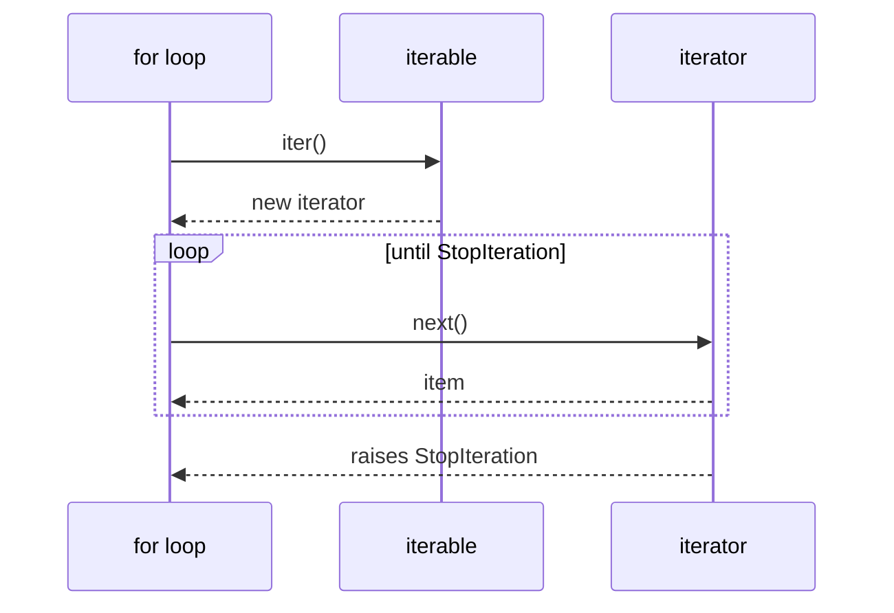

# The iterator protocol

> **Before this lesson:** you should have written `for` loops over lists, strings and dictionaries ([Lists and loops](#/lesson/python/py-start-lists-loops)), know what "lazy" means from [Comprehensions, unpacking and copying](#/lesson/python/py-comprehensions-copying), and be able to read a small class with `__init__` and methods ([Classes: modelling things with objects](#/lesson/python/py-start-classes)). `try` / `except` appears in several demos; [Files, errors and tests](#/lesson/python/py-start-files-tests) introduces it.

## In plain words

When you write `for x in something:`, Python needs a way to ask `something` for its items one after another. The agreement between the `for` loop and the object being looped over is called the **iterator protocol**. A **protocol**, in programming, is a small set of methods with agreed names and agreed behaviour; any object that provides them can take part, whatever else it is.

An everyday picture: a book and a bookmark. The book is the thing you can read through; programmers call such a thing an **iterable**. The bookmark records how far *one particular reading* has got; that is an **iterator**. One book can have several bookmarks in it at once, each at a different page, and they do not disturb each other. A bookmark only moves forward, and once it reaches the last page it is finished. If you want to read the book again, you take a new bookmark and start at page one.

Some things in Python are a bookmark with no book behind it: a stream of data that can be read through once and is then gone. That is why a `map` or `zip` result, or an open file, comes up empty the second time you loop over it, a daily source of confusing bugs.

Knowing the protocol pays off in three ways. You can make your own classes work with `for`, `sum`, `sorted`, `list` and every other tool that consumes items. You can explain "why can I loop over this only once?". And you can answer a favourite interview question: "what is the difference between an iterable and an iterator?"

The method names in this lesson begin and end with two underscores, such as `__iter__` and `__next__`. These are Python's **special methods** (nicknamed "dunder" methods, for double underscore). You rarely call them by name; Python calls them for you when you use the matching built-in function or statement.

## Iterables versus iterators

The two words look alike and mean different things:

- An **iterable** is anything you can loop over (the book). It has a method `__iter__` that returns a **fresh iterator** each time it is called. Lists, tuples, strings, dictionaries, sets, files and ranges are iterables. (There is an older fallback as well: an object with a `__getitem__` method that accepts 0, 1, 2, ... until it raises `IndexError` also counts. It is shown further down.)
- An **iterator** is the object that does the walking (the bookmark). It has a method `__next__` that returns the next item, or raises an error called `StopIteration` when there are no more. It also has an `__iter__` method, which returns **itself**.

Put differently: an iterator manages one *pass* over some data, and an iterable is the data that can start as many passes as you ask for. You do not call the special methods directly. The built-in function `iter(x)` calls `x.__iter__()`, and `next(it)` calls `it.__next__()`.

```python-run
nums = [10, 20, 30]           # iterable
it = iter(nums)               # calls nums.__iter__() -> a list_iterator
print(type(it).__name__)
print(next(it), next(it), next(it))   # next(it) calls it.__next__()
try:
    next(it)
except StopIteration:
    print("StopIteration: iterator exhausted")
print(iter(it) is it)         # an iterator's __iter__ returns itself
print(next(iter(nums)))       # a NEW iterator starts from the beginning
```

**Reading this code line by line**

- `iter(nums)` asks the list for an iterator. Its type prints as `list_iterator`: a small object that remembers the list and a position in it.
- Three calls of `next(it)` return 10, 20 and 30, each call moving the position forward.
- A fourth call has nothing left to return, so it raises `StopIteration`. This is not a failure; it is the agreed signal for "finished". The `try` / `except` catches it and prints a message.
- `iter(it) is it` is `True`: asking an iterator for an iterator gives back the same object.
- `next(iter(nums))` makes a second, new iterator, which starts again at the beginning and returns 10. The list itself was never used up.

## What `for` actually does

```python
for x in iterable:
    body(x)
```

The first form is what you write. Python carries it out roughly like the second form:

```python
_it = iter(iterable)
while True:
    try:
        x = next(_it)
    except StopIteration:
        break
    body(x)
```

In words: get an iterator once, then keep asking it for the next item and running the loop body, until `StopIteration` arrives; catch that signal quietly and leave the loop. The diagram shows the same exchange as messages.



The `for` statement is only one user of this protocol. `list(x)`, `tuple(x)`, `sum`, `max`, `sorted`, `zip`, `enumerate`, `map`, `filter`, unpacking (`a, b = x`), `"".join(x)`, comprehensions, `dict(pairs)` and the `in` test (for objects that do not define their own membership method, `__contains__`) all fetch items in exactly this way. An object that follows the protocol works with all of them.

## Single-pass iterators: the exhaustion trap

Because `iter()` on an iterator returns that same iterator, looping over it a second time starts where the first loop stopped, which is at the end. The second loop gets nothing. An iterator that has given out all its items is said to be **exhausted**. Many built-ins return iterators, not lists: `map`, `filter`, `zip`, `enumerate`, `reversed`, open files, generators, and everything in `itertools`.

```python-run
squares = map(lambda x: x * x, [1, 2, 3])
print(list(squares))
print(list(squares))     # [] — already consumed

pairs = zip("ab", [1, 2])
print(dict(pairs), dict(pairs))

z = zip([1, 2, 3], [4, 5, 6])
print(3 in z, list(z))   # 'in' consumed items up to the match
```

The first `list(squares)` prints `[1, 4, 9]`; the second prints `[]`, because the `map` object was used up. In the next pair, the first `dict(pairs)` receives both pairs and the second receives none: `{'a': 1, 'b': 2} {}`. The last line shows a quieter form of the same thing. The test `3 in z` has to pull items out of the `zip` to compare them; none of the pairs equals 3, so it pulls all of them, answers `False`, and leaves the iterator empty. Even a membership test consumes an iterator.

> [!WARNING]
> A function that walks through its argument twice (for example, computes `sum(xs)` and then loops again to divide each item by that sum) silently gives wrong results when handed an iterator: the second pass sees nothing. Either state in the docstring that a re-iterable collection is required, or store the items once with `xs = list(xs)`.

You can tell the two kinds apart in code: `iter(x) is x` is true for an iterator and false for a proper container.

## Writing an iterator class

To see the protocol from the inside, the next example builds a simplified version of the built-in `range`. It keeps the two roles in two classes: the **iterable** (the range object, which can be looped over many times) and the **iterator** (which tracks the position of one loop).

```python-run
class MyRange:
    """Iterable over start, start+step, ... stopping before stop."""
    def __init__(self, start, stop=None, step=1):
        if step == 0:
            raise ValueError("step cannot be 0")
        if stop is None:
            start, stop = 0, start
        self.start, self.stop, self.step = start, stop, step

    def __len__(self):
        return max(0, (self.stop - self.start + self.step - (1 if self.step > 0 else -1)) // self.step)

    def __getitem__(self, k):
        if k < 0:
            k += len(self)
        if not 0 <= k < len(self):
            raise IndexError("index out of range")
        return self.start + k * self.step

    def __iter__(self):
        return MyRangeIterator(self)        # fresh iterator every time

class MyRangeIterator:
    def __init__(self, r):
        self._r = r
        self._k = 0
    def __iter__(self):
        return self
    def __next__(self):
        if self._k >= len(self._r):
            raise StopIteration
        value = self._r[self._k]
        self._k += 1
        return value

r = MyRange(2, 11, 3)
print(list(r), list(r), len(r), r[-1])
print(list(MyRange(5)), list(MyRange(10, 0, -4)), list(MyRange(3, 3)))
print(sum(r), 8 in r, [x * 2 for x in r])
```

**Reading the two classes**

- `MyRange.__init__` stores `start`, `stop` and `step`. As with the real `range`, a single argument means "from 0 up to this number".
- `__len__` computes how many numbers the range contains, using floor division; Python calls it for `len(r)`.
- `__getitem__(k)` returns item number `k` by arithmetic, `start + k * step`, after handling negative positions and rejecting positions outside the range; Python calls it for `r[k]`.
- `__iter__` returns a **new** `MyRangeIterator` on every call. This one line is what makes the range re-iterable.
- `MyRangeIterator` holds a reference to the range and a position `_k`, starting at 0. Its `__iter__` returns itself. Its `__next__` raises `StopIteration` when the position has reached the length; otherwise it fetches the item, moves the position forward and returns the item.

The first print shows `[2, 5, 8] [2, 5, 8] 3 8`: the range can be listed twice, because each `list(r)` obtained its own iterator. The second line checks a plain count, a negative step (`[10, 6, 2]`) and an empty range. The third line shows that `sum`, `in` and a comprehension all work, although none of them was written for this class.

Note that `8 in r` works without a `__contains__` method: Python falls back to walking through the items and comparing. The real `range` implements `__contains__` with arithmetic in O(1), and this class could do the same.

## A class that is its own iterator

Sometimes the object *is* a stream that can be read once, like a file or a countdown. Then one class plays both roles, and its `__iter__` returns `self`:

```python-run
class Countdown:
    def __init__(self, n):
        self.n = n
    def __iter__(self):
        return self
    def __next__(self):
        if self.n <= 0:
            raise StopIteration
        self.n -= 1
        return self.n + 1

c = Countdown(3)
print(list(c), list(c))    # second pass is empty: it's an iterator
```

`list(c)` gives `[3, 2, 1]`, and the second `list(c)` gives `[]`. `n` has reached zero and nothing resets it. That is correct behaviour for an iterator, and the wrong behaviour for a container, as the pitfalls below explain.

In everyday code you would write either of these as a **generator function** (the next lesson), which builds the iterator object for you in three lines. Interviewers still like to check that you know the protocol underneath.

## The `__getitem__` fallback (legacy sequence protocol)

If a class has no `__iter__` but does have `__getitem__`, `iter()` builds an iterator that asks for `obj[0]`, `obj[1]`, `obj[2]` and so on until `IndexError` is raised. This is the older way of making a class loopable, kept so that old code still works (programmers call such leftovers *legacy* features). A class that supports indexing therefore becomes iterable without any extra code.

```python-run
class Squares:
    def __getitem__(self, i):
        if i >= 5:
            raise IndexError
        return i * i

print(list(Squares()), 9 in Squares())
```

`Squares` has only `__getitem__`, yet `list(Squares())` gives `[0, 1, 4, 9, 16]` and `9 in Squares()` is `True`.

## Two-argument `iter(callable, sentinel)`

`iter` has a second, less known form. `iter(f, sentinel)` takes a function `f` that needs no arguments and returns an iterator that calls `f()` again and again, stopping when the result equals `sentinel` (a value agreed to mean "stop"). It suits reading data in fixed-size pieces:

```python-run
import io
from functools import partial

stream = io.BytesIO(b"abcdefghij")
for chunk in iter(partial(stream.read, 4), b""):
    print(chunk)
```

`io.BytesIO` is an in-memory stand-in for a file of bytes. `partial(stream.read, 4)` is "call `stream.read(4)`", packaged as a function with no arguments. Each call returns the next four bytes; at the end of the data `read` returns the empty bytes object `b""`, which is the sentinel, and the loop ends. The output is `b'abcd'`, `b'efgh'`, `b'ij'`.

## `next` with a default

`next(it, default)` returns `default` when the iterator is exhausted, so no `StopIteration` is raised. Combined with a generator expression it is the idiom for "the first item that matches, or `None`":

```python-run
users = [{"name": "ana", "admin": False}, {"name": "ben", "admin": True}]
first_admin = next((u for u in users if u["admin"]), None)
print(first_admin)
print(next(iter([]), "empty"))
```

The generator expression produces the users who are admins, lazily; `next` takes the first one and stops looking. With no match it would return `None`. The last line shows the default at work on an empty list.

## Iterating dicts and files

- Looping over a dictionary gives its **keys**; use `.items()` for key-value pairs and `.values()` for values.
- Looping over a text file gives its **lines** (each ending in the line-break character `\n`), read from disk as the loop goes. A 50 GB log file can be processed while only one line is in memory.
- `enumerate(it, start)` and `zip(a, b)` wrap other iterators and are lazy themselves.

## Lazy versus eager

Iterators are **lazy**: each item is produced at the moment it is asked for. The opposite, building everything in advance as a list does, is called **eager**. Laziness buys three things:

1. **Memory**: a stream larger than the computer's memory can be processed, because only the current item exists.
2. **Endless sequences**: `itertools.count()` never ends; you take as many numbers as you need.
3. **Early exit**: `any`, `next` and `break` stop asking, and the remaining items are never computed.

The price: one pass only, no `len`, no indexing. Convert with `list(...)` when you need those.

```python-run
import itertools
evens = (n for n in itertools.count() if n % 2 == 0)     # infinite
print(list(itertools.islice(evens, 5)))
print(any(n > 10**6 for n in itertools.count()))         # stops at 1000001
```

`itertools.count()` produces 0, 1, 2, ... for ever. The generator expression `evens` filters that endless stream, and `islice(evens, 5)` takes the first five results: `[0, 2, 4, 6, 8]`. In the last line, `any` stops at the first number above one million and prints `True`; without laziness that line could never finish.

## Worked example: peekable iterator

A **parser** is code that reads text piece by piece (the pieces are called *tokens*) and works out its structure. Parsers often need to look at the next piece without taking it. Here is a wrapper that adds a `peek()` method to any iterator:

```python-run
class Peekable:
    _EMPTY = object()                # sentinel distinct from any real value (including None)

    def __init__(self, iterable):
        self._it = iter(iterable)
        self._buf = self._EMPTY

    def __iter__(self):
        return self

    def __next__(self):
        if self._buf is not self._EMPTY:
            v, self._buf = self._buf, self._EMPTY
            return v
        return next(self._it)

    def peek(self, default=None):
        if self._buf is self._EMPTY:
            try:
                self._buf = next(self._it)
            except StopIteration:
                return default
        return self._buf

p = Peekable([1, None, 3])
print(p.peek(), next(p), p.peek(), next(p), list(p), p.peek("done"))
```

**Reading this code line by line**

- The wrapper keeps the underlying iterator in `_it` and a one-item storage slot, `_buf`.
- `peek` fetches the next item early, if it has not already done so, and stores it in `_buf` without handing it out. If the stream is finished it returns the given default.
- `__next__` first checks the slot: if an item is waiting there, it hands that out and empties the slot; otherwise it takes a new item from the underlying iterator.
- `_EMPTY = object()` creates a unique object that means "the slot is empty". Using `None` for that purpose would fail here, because `None` is one of the real values in the test data.

The output is `1 1 None None [3] done`: peeking shows 1 without consuming it, `next` then returns that same 1, and the same happens for `None`. A private `object()` sentinel is a pattern worth remembering whenever `None` can be a legitimate value.

> [!INTERVIEW]
> "What's the difference between an iterable and an iterator?" — An iterable has `__iter__` returning a new iterator; an iterator has `__next__` (raising `StopIteration` at the end) and an `__iter__` that returns itself. Containers are iterables; iterators are single-pass cursors. Then show `m = map(...); list(m); list(m)` to demonstrate exhaustion.

## Under the hood: what the built-in iterators store

An iterator is a small object holding a reference to its source and a position marker, often called a **cursor**. For a list, the cursor is a plain index number, which explains exactly what goes wrong when a list is changed during a loop:

```python-run
nums = [10, 20, 30, 40]
it = iter(nums)
print(next(it), next(it))            # cursor is now at index 2
nums.insert(0, 5)                    # everything shifts right by one
print(next(it))                      # index 2 now holds 20 again: an item is repeated
nums.clear()
print(list(it))                      # index is past the end: iteration just stops

it = iter([1, 2, 3])
print(it.__length_hint__())          # iterators may offer a size *hint* (used by list() to pre-allocate)
```

After two `next` calls the cursor stands at index 2. Inserting 5 at the front shifts every item one place to the right, so index 2 now holds 20 again, and the next call returns 20 a second time. After `nums.clear()` the cursor is beyond the end of the (now empty) list, so the iterator reports that it is finished. The last two lines show an optional extra: an iterator may offer an estimate of how many items remain, which `list()` uses to reserve memory in advance.

Removing an item while looping has the mirror effect: the later items shift left, the index still moves forward, and one item is **skipped**, with no error. Dictionaries and sets, whose internal table may be rebuilt when items are added, detect the situation and raise `RuntimeError: ... changed size during iteration`.

Python compiles a `for` loop into two of its internal instructions (bytecode) around your loop body: `GET_ITER`, which calls `iter()`, and `FOR_ITER`, which calls `next()` and jumps out of the loop on `StopIteration`:

```python-run
import dis
def total(xs):
    t = 0
    for x in xs:
        t += x
    return t
print([i.opname for i in dis.get_instructions(total) if "ITER" in i.opname])
```

The `StopIteration` signal is handled inside the interpreter's own loop machinery, so reaching the end of a `for` loop is cheap. You only ever see the exception when you call `next()` yourself.

## Sharing one iterator on purpose

Since `iter(iterator)` returns the same object, several consumers can draw from one stream, each continuing where the previous one stopped. That is a feature you can use on purpose:

```python-run
from itertools import islice

lines = iter(["# header", "# units: m", "1.5", "2.5", "3.0"])

header = []
for line in lines:                   # consume the comment block...
    if not line.startswith("#"):
        first_value = line
        break
    header.append(line)
rest = [float(x) for x in lines]     # ...and continue where the first loop stopped
print(header, first_value, rest)

it = iter(range(10))
pairs = list(zip(it, it))            # the same iterator twice: consecutive pairs
print(pairs)

it = iter("abcdefg")
print([a + b + c for a, b, c in zip(it, it, it)], list(it))   # leftover 'g' was consumed by zip!
```

Three techniques are shown. First, one loop reads the header lines of some data and breaks at the first real value; a comprehension then continues with the *same* iterator and receives only the remaining values. Second, `zip(it, it)` takes two items per step from one iterator, which pairs up neighbours: `(0, 1), (2, 3), ...`. Third, `zip(it, it, it)` groups a string into threes.

The last line also shows a hidden cost: `zip` took `g` from its first argument before discovering that the second had nothing left, so `g` is lost and `list(it)` is empty. When leftovers matter, use `itertools.zip_longest` or `islice`.

## Iterable, iterator, sequence, generator: a comparison

| | `__iter__` | `__next__` | `len()` / indexing | re-iterable | lazy |
|---|---|---|---|---|---|
| **Sequence** (`list`, `tuple`, `str`, `range`) | new iterator | no | yes | yes | no (`range`: yes) |
| **Other containers** (`dict`, `set`) | new iterator | no | `len` only | yes | no |
| **Iterator** (`map`, `zip`, `enumerate`, file) | returns self | yes | no | **no** | yes |
| **Generator** (next lesson) | returns self | yes | no | **no** | yes |

The module `collections.abc` contains a named type for each of these roles, and `isinstance` checks an object against a role by looking at which special methods it has, not at what it inherits from:

```python-run
from collections.abc import Iterable, Iterator, Sequence, Sized
for obj in ([1, 2], (x for x in [1]), map(str, [1]), range(3), {1: 2}, "text", 42):
    print(f"{type(obj).__name__:<10} iterable={isinstance(obj, Iterable)!s:<5} "
          f"iterator={isinstance(obj, Iterator)!s:<5} sized={isinstance(obj, Sized)!s:<5} "
          f"sequence={isinstance(obj, Sequence)}")
```

The table it prints confirms the comparison above: a list is iterable, sized and a sequence but not an iterator; a generator and a `map` object are iterators with no size; a dictionary is iterable and sized but not a sequence; the integer 42 is none of these.

## Debugging iterator problems

- **A loop body never runs, or a result is unexpectedly empty**: something earlier already used up the iterator. A `print(list(it))` added while debugging is a classic way to *cause* this. Store the items once with `items = list(it)` and use the list for both purposes.
- **`TypeError: 'X' object is not iterable`**: the value is not what you think it is (often `None` or an `int`); print its type. **`'list' object is not an iterator`**: `next()` was called on a list; wrap it with `iter()` first.
- **`TypeError: object of type 'generator' has no len()`** or "not subscriptable": convert with `list()`, or use `itertools.islice` to take a slice lazily.
- **An endless loop in your own iterator class**: `__next__` never raises `StopIteration`.
- **Nested loops over your own container misbehave**: its `__iter__` returns `self`, so both loops share one cursor.

## Pitfalls recap

- Reusing an exhausted iterator (`map`, `zip`, `filter`, generators, files).
- Making a container's `__iter__` return `self`: it can then be looped over only once, and nested loops over it break.
- Forgetting to raise `StopIteration` (an endless loop), or raising it by hand inside a generator (Python turns that into `RuntimeError` since version 3.7).
- Calling `len()` on an iterator, which raises `TypeError`.
- Changing a collection while looping over it.

## Summary

`iter()` turns an iterable into an iterator; `next()` moves it forward; `StopIteration` ends it. `for` loops and almost every built-in that consumes items use this protocol. A container should return a fresh iterator from `__iter__`; an iterator returns itself. Iterators are lazy and single-pass, which saves memory and allows endless streams, at the cost of not being reusable.

## Glossary

- **Protocol** - a small set of methods with agreed names and behaviour that lets objects work with a language feature.
- **Special (dunder) method** - a method named with double underscores, such as `__iter__`, that Python calls for you.
- **Iterable** - an object that can be looped over; its `__iter__` returns an iterator.
- **Iterator** - an object that produces items one at a time through `__next__` and returns itself from `__iter__`.
- **`iter()` / `next()`** - the built-in functions that call `__iter__` / `__next__`.
- **`StopIteration`** - the exception an iterator raises to signal that it has no more items.
- **Exhausted** - said of an iterator that has given out all its items.
- **Single-pass** - able to be walked through only once.
- **Lazy / eager** - producing each item on demand / producing everything in advance.
- **Sentinel** - a special value that signals "stop" or "empty".
- **Cursor** - the position marker an iterator keeps.
- **Sequence protocol (legacy)** - iteration through `__getitem__` with 0, 1, 2, ... until `IndexError`.
- **Materialise** - to turn a lazy stream into a stored collection, for example with `list(it)`.
- **Parser / token** - code that works out the structure of text / one piece of that text.
- **`collections.abc`** - the standard module of role types such as `Iterable`, `Iterator` and `Sequence`.

```quiz
[
  {"q": "Which method must an iterator define to produce items?", "options": ["__iter__ only", "__next__", "__getitem__", "__len__"], "answer": 1,
   "explain": "__next__ returns the next item or raises StopIteration; iterators also define __iter__ returning self."},
  {"q": "`m = map(str, [1, 2]); list(m); list(m)` — what is the second list?", "options": ["['1', '2']", "[]", "None", "Error"], "answer": 1,
   "explain": "map returns an iterator; the first list() consumed it."},
  {"q": "For a container class, what should __iter__ return?", "options": ["self", "A new iterator object each call", "A list copy", "None"], "answer": 1,
   "explain": "Returning a fresh iterator lets the container be iterated many times and in nested loops."},
  {"q": "How does a for loop know to stop?", "options": ["It checks len()", "The iterator raises StopIteration", "It gets None", "It catches IndexError always"], "answer": 1,
   "explain": "The loop calls next() until StopIteration is raised, then exits quietly."},
  {"q": "`next((x for x in [] ), 'none')` returns:", "options": ["StopIteration", "'none'", "None", "[]"], "answer": 1,
   "explain": "The default argument of next() is returned when the iterator is exhausted."},
  {"q": "A class with only `__getitem__` (raising IndexError at the end):", "options": ["Can't be iterated", "Can be iterated via the legacy sequence protocol", "Needs __len__ too", "Is an iterator"], "answer": 1,
   "explain": "iter() falls back to calling __getitem__ with 0, 1, 2, ... until IndexError."},
  {"q": "Why is reading a file line by line with `for line in f` memory-efficient?", "options": ["Files are compressed", "The file object is a lazy iterator yielding one line at a time", "Python reads it into a list first", "It isn't"], "answer": 1,
   "explain": "File objects are iterators; only a buffer and the current line are in memory."}
]
```

> **Source:** Goodrich, Tamassia & Goldwasser, *Data Structures and Algorithms in Python*, §1.8 (Iterators and Generators), §2.3.4 (Iterators) and §2.3.5 (Example: Range Class); Python docs, *Library Reference* "Iterator Types" and *Tutorial* §9.8 "Iterators".
