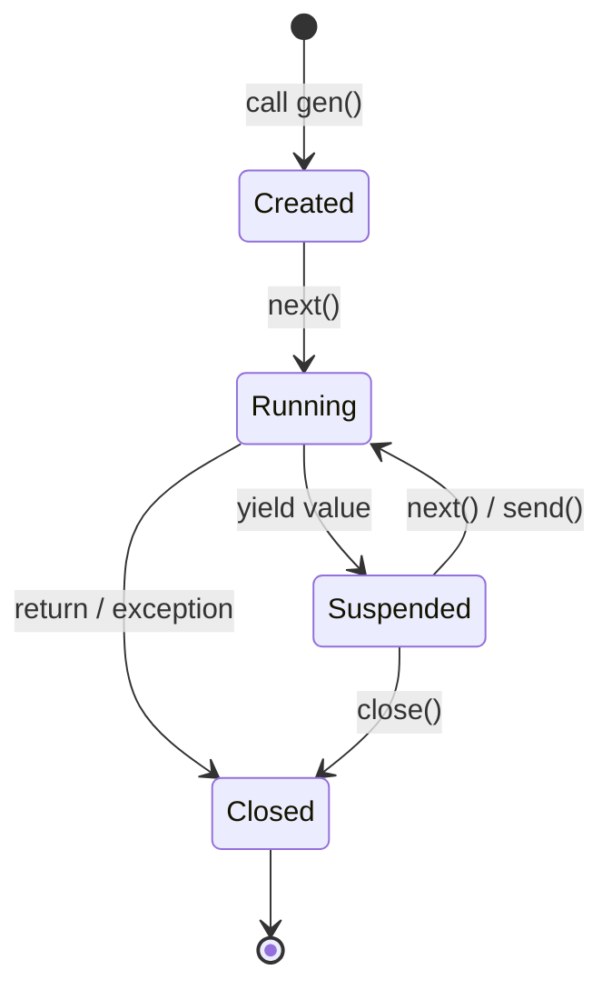

# Generators and yield from

> **Before this lesson:** read [The iterator protocol](#/lesson/python/py-iterator-protocol) first. You should know what an iterable and an iterator are, what `next()` does, and that `StopIteration` means "no more items". Functions and recursion come from [Functions and arguments](#/lesson/python/py-functions-args); `try` / `finally` is introduced in [Files, errors and tests](#/lesson/python/py-start-files-tests).

## In plain words

An ordinary function runs from its first line to its `return` and is then finished; everything it had in its local variables is thrown away. A **generator** is a function that can *pause*. It hands out one value, stops exactly where it is with all its variables kept, and continues from that spot when asked for the next value.

Think of someone reading out raffle numbers. An ordinary function would write all ten thousand numbers on a sheet and hand you the sheet. A generator is the person at the microphone: they read one number, wait until somebody says "next", read the following one, and so on. They only need to remember where they are on their list. If the audience leaves after five numbers, the other 9,995 are never read out, and no effort was spent on them.

The pause is written with the keyword **`yield`**. Writing an iterator by hand, as in the previous lesson, means a class with a position counter, a `__next__` method and a manual `StopIteration`. A generator gives you the same iterator from a few lines of ordinary-looking code, because Python does the bookkeeping.

Why this matters: generators let a program process files and data streams far larger than the computer's memory, one item at a time. They are also the foundation under two things you will meet later, the `contextlib.contextmanager` helper and Python's `async` / `await`. "What is a generator, and why would you use one?" is a standard interview question.

## Generator functions

Any function whose body contains the word `yield` is a **generator function**. Three rules describe its behaviour:

1. Calling it does **not** run the body. The call returns a **generator object**, which is an iterator.
2. Each `next()` on that object runs the body until it reaches a `yield`, hands out the value written after `yield`, and pauses there.
3. When the body reaches its end (or a `return`), Python raises `StopIteration` for you.

```python-run
def countdown(n):
    print("starting")
    while n > 0:
        yield n
        n -= 1
    print("done")

g = countdown(3)
print(type(g).__name__)      # nothing printed yet: the body hasn't started
print(next(g))               # runs to the first yield
print(next(g), next(g))
print(list(g))               # runs to the end; 'done' printed, list is empty
```

**Reading the output line by line**

- `g = countdown(3)` prints nothing, not even `starting`. The body has not begun; `g` is a generator object, as the first print shows.
- The first `next(g)` starts the body: `starting` is printed, the loop is entered, and `yield n` hands out 3 and pauses.
- The next two `next(g)` calls each continue after the `yield`, subtract one, go round the loop and pause again, handing out 2 and 1.
- `list(g)` asks for whatever is left. The body continues, `n` becomes 0, the loop ends, `done` is printed and the function finishes. No further values were yielded, so the list is `[]`.

Compare this with the `Countdown` iterator class from the previous lesson: the generator is a third of the length, and what the class had to store on `self` (the number, the position in the loop) is kept here in ordinary local variables.

A second example finds the factors of a number, the whole numbers that divide it exactly. A list-building version would collect every factor before returning anything. The generator version hands out each factor the moment it is found. It even delivers them in increasing order, by using the fact that factors come in pairs: if `k` divides `n`, so does `n // k`.

```python-run
def factors(n):
    k = 1
    large = []
    while k * k < n:
        if n % k == 0:
            yield k
            large.append(n // k)
        k += 1
    if k * k == n:
        yield k
    yield from reversed(large)

print(list(factors(100)), list(factors(13)))
```

The loop tries `k` = 1, 2, 3, ... while `k * k` is below `n`. Each time `k` divides `n` it yields `k` immediately and puts the partner `n // k` aside in the list `large`. If `n` is a perfect square, its square root is yielded once. Finally `yield from reversed(large)` hands out the saved large factors, smallest first (`yield from` is explained below; for now read it as "yield each item of this"). The output is `[1, 2, 4, 5, 10, 20, 25, 50, 100] [1, 13]`.

The diagram below shows the life of a generator object: created, then alternating between running and suspended (paused), and finally closed.



## Why generators matter

**Memory.** A generator holds one item at a time. `sum(x*x for x in range(10**7))` needs a few hundred bytes; building the same ten million squares as a list first needs hundreds of megabytes.

**Laziness.** Work is done only when a value is requested. The consumer can stop early, and a sequence that never ends is no problem:

```python-run
from itertools import islice

def fibonacci():
    a, b = 0, 1
    while True:            # infinite, but only computed on demand
        yield a
        a, b = b, a + b

print(list(islice(fibonacci(), 12)))
```

`while True` would be an endless loop in an ordinary function. Here each trip round the loop pauses at `yield a`, so the generator computes one Fibonacci number per request. `islice(fibonacci(), 12)` requests twelve and then stops asking: `[0, 1, 1, 2, 3, 5, 8, 13, 21, 34, 55, 89]`.

**Composability.** Generators can be connected into a **pipeline**: a chain of stages in which each stage takes items from the one before it, does one small job and passes the result on, in the manner of commands joined with `|` in a Unix terminal.

```python-run
import io
log = io.StringIO("""INFO start
ERROR disk full
INFO retry
ERROR disk full
WARN slow
ERROR timeout
""")

def read_lines(f):
    for line in f:
        yield line.rstrip("\n")

def grep(pattern, lines):
    return (ln for ln in lines if pattern in ln)

def messages(lines):
    for ln in lines:
        level, _, msg = ln.partition(" ")
        yield msg

errors = messages(grep("ERROR", read_lines(log)))
from collections import Counter
print(Counter(errors).most_common())
```

**Reading the pipeline**

- `io.StringIO(...)` is an in-memory stand-in for a log file with six lines.
- `read_lines` yields each line without its trailing line break.
- `grep` returns a generator expression that lets through only the lines containing the pattern.
- `messages` splits each line at the first space with `partition` and yields the part after it.
- `errors = messages(grep("ERROR", read_lines(log)))` connects the three stages. At this point **nothing has been read**; three paused generators have been created.
- `Counter(errors)` starts asking for items. Each request travels back through the chain, one line is read, and it flows through all three stages before the next line is touched.

The result is `[('disk full', 2), ('timeout', 1)]`. At no moment was the whole file in memory.

## Generator expressions

A generator expression `(expr for x in it if cond)` is a generator written in one line, without a name. Use it when the logic fits on a line; write a generator function when you need statements, several `yield`s, or `try` / `finally`.

```python-run
nums = [4, -1, 9, -16]
abs_sum = sum(abs(n) for n in nums)
first_negative = next((n for n in nums if n < 0), None)
print(abs_sum, first_negative)
```

The first expression adds up the absolute values, 30. The second is the "first match or `None`" idiom from the previous lesson; it finds −1 and looks no further.

## `yield from`: delegating to a sub-generator

`yield from iterable` hands out every item of `iterable`, as if you had written `for x in iterable: yield x`. Passing work on to another generator in this way is called **delegation**, and the other generator is the *sub-generator*. `yield from` does two more things that the plain loop does not: it passes `send()` and `throw()` (described below) through to the sub-generator, and the whole expression takes the value that the sub-generator returns. Its first benefit is that recursive generators become short and clear:

```python-run
def flatten(nested):
    for item in nested:
        if isinstance(item, (list, tuple)):
            yield from flatten(item)       # recurse lazily
        else:
            yield item

print(list(flatten([1, [2, [3, [4, (5, 6)]]], 7, []])))

def inorder(tree):                         # tree = (left, value, right) or None
    if tree:
        left, val, right = tree
        yield from inorder(left)
        yield val
        yield from inorder(right)

t = ((None, 1, None), 2, ((None, 3, None), 4, None))
print(list(inorder(t)))
```

`flatten` walks through a list that may contain lists within lists. An item that is itself a list or tuple is handed to a recursive call, and `yield from` passes along everything that call produces; any other item is yielded directly. The output is `[1, 2, 3, 4, 5, 6, 7]`.

`inorder` does the same for a small **binary tree**, a structure in which every node has a value and up to two children, written here as a tuple `(left, value, right)` with `None` for "no child". It yields everything in the left part, then the node's own value, then everything in the right part, which for this tree gives the values in increasing order: `[1, 2, 3, 4]`.

Strings need care in a function like `flatten`. A string is iterable, and looping over the one-character string `"a"` gives `"a"` again. A version that recursed into "anything iterable" would therefore never stop on a string. Always treat `str` and `bytes` as single items, as the `isinstance(item, (list, tuple))` test above does by listing only the types to open.

### Return values

A generator may contain `return value`. The value cannot be handed out the normal way, since `return` ends the generator; it is carried inside the `StopIteration` exception, and it becomes the value of a `yield from` expression in the generator that delegated:

```python-run
def read_block(lines):
    """Yield lines until a blank one; RETURN how many were read."""
    n = 0
    for ln in lines:
        if not ln:
            break
        yield ln
        n += 1
    return n

def report(lines):
    it = iter(lines)
    while True:
        count = yield from read_block(it)   # value of the sub-generator's return
        yield f"-- block of {count} lines --"
        if count == 0:
            return

for out in report(["a", "b", "", "c", "", ""]):
    print(out)

g = read_block(["x"])
next(g)
try:
    next(g)
except StopIteration as stop:
    print("return value travels in StopIteration.value:", stop.value)
```

`read_block` yields lines until it meets an empty one and then *returns* how many it yielded. `report` delegates to it repeatedly: `yield from read_block(it)` passes the lines through to the final consumer and, when the block ends, evaluates to the count, which `report` uses to emit a summary line. The output is `a`, `b`, `-- block of 2 lines --`, `c`, `-- block of 1 lines --`, `-- block of 0 lines --`. The last four lines of the demo drive a generator by hand to show where the returned value travels: in the `value` attribute of `StopIteration`.

## Advanced: `send`, `throw`, `close`

So far values have flowed out of the generator. They can also flow in. Three methods of a generator object do this:

- `gen.send(value)` resumes the generator, and the paused `yield` expression evaluates to `value` inside it. The call returns the next value the generator yields.
- `gen.throw(exc)` resumes the generator by raising the exception `exc` at the paused `yield`.
- `gen.close()` raises a special exception, `GeneratorExit`, at the paused `yield`, so that `finally` blocks get the chance to clean up.

A newly created generator has not reached a `yield` yet, so there is nowhere to deliver a value. It must first be advanced with `next(g)` (or `g.send(None)`); this first step is called **priming**.

```python-run
def running_max():
    best = None
    try:
        while True:
            x = yield best
            if best is None or x > best:
                best = x
    finally:
        print("cleanup: generator closed")

g = running_max()
next(g)                       # prime
print(g.send(3), g.send(1), g.send(7))
g.close()
```

`x = yield best` does two things at each pause: it hands out `best`, and when the generator is resumed with `send`, the sent value is stored in `x`. After priming, sending 3, 1 and 7 prints `3 3 7`, the largest value seen so far each time. `g.close()` then triggers the `finally` block, which prints the cleanup message.

A function that can be paused and resumed with values passed in and out is called a **coroutine**. Generators used this way were how the asyncio library worked before the keywords `async` and `await` were added in Python 3.5. You will rarely write `send`-based coroutines today, but having seen one makes asynchronous code much less mysterious.

## Cleanup and `try/finally` in generators

If a generator holds a **resource**, something that must be given back when you are done with it, such as an open file or a lock, put it inside a `with` block or a `try` / `finally` in the generator body. When the generator is closed, either explicitly or because it was abandoned and Python reclaimed it, the cleanup code runs:

```python-run
def numbered(lines):
    print("open")
    try:
        for i, ln in enumerate(lines, 1):
            yield f"{i}: {ln}"
    finally:
        print("closed")

g = numbered(["a", "b", "c"])
print(next(g))
del g                          # CPython refcount drops -> close() -> finally runs
```

The generator is advanced once (`open`, then `1: a`) and then abandoned with `del g`. In CPython the last reference disappearing destroys the object at once, which calls `close()`, which runs the `finally` block: `closed` is printed although the loop never finished.

## Generator gotchas

```python-run
# 1. Generators are single-use
g = (x for x in range(3))
print(sum(g), sum(g))

# 2. A generator function's body doesn't run until iterated — including argument validation!
def checked(n):
    if n < 0:
        raise ValueError("negative")
    yield from range(n)

g = checked(-1)                # no error yet...
try:
    next(g)
except ValueError as e:
    print("error only on first next():", e)

# fix: validate eagerly in a wrapper, then return an inner generator
def checked_eager(n):
    if n < 0:
        raise ValueError("negative")
    def gen():
        yield from range(n)
    return gen()
try:
    checked_eager(-1)
except ValueError as e:
    print("eager:", e)
```

The first block prints `3 0`: the second `sum` finds the generator exhausted. The second block shows that the check `if n < 0` sits in the generator body, so it does not run when `checked(-1)` is called; the error appears later, at the first `next()`, possibly far from the faulty call. The fix shown is to make the outer function an ordinary function that checks its arguments immediately and then returns a generator created by an inner generator function.

3. Raising `StopIteration` yourself inside a generator body is turned into a `RuntimeError` (the rule comes from the proposal PEP 479). To end a generator, use `return`.

4. A generator expression evaluates its *first* iterable immediately, when the expression is created, but everything else lazily. Variables mentioned in its condition or output may therefore have changed by the time it runs.

## Worked example: sliding windows

A classic generator exercise: produce every **window** (run of `k` neighbouring items) from any iterable, even an endless one. The tool is a `deque` (double-ended queue) created with `maxlen=k`: once it holds `k` items, appending a new one automatically drops the oldest, so each step costs O(1) on average.

```python-run
from collections import deque
from itertools import count, islice

def windows(iterable, k):
    it = iter(iterable)
    win = deque(islice(it, k), maxlen=k)
    if len(win) == k:
        yield tuple(win)
    for x in it:
        win.append(x)                # oldest drops out automatically
        yield tuple(win)

print(list(windows([1, 2, 3, 4, 5], 3)))
print(list(islice(windows(count(), 2), 4)))

def moving_average(iterable, k):
    it = iter(iterable)
    win = deque(maxlen=k)
    total = 0
    for x in it:
        if len(win) == k:
            total -= win[0]
        win.append(x)
        total += x
        if len(win) == k:
            yield total / k

print(list(moving_average([1, 2, 3, 4, 5, 6], 3)))
```

- `windows` fills the deque with the first `k` items and yields them as a tuple (if there were that many). For each further item it appends, which pushes the oldest out, and yields the new window. The first print is `[(1, 2, 3), (2, 3, 4), (3, 4, 5)]`; the second takes four windows from the endless counter `count()`.
- `moving_average` keeps a running `total` so that it never re-adds a whole window: before appending it subtracts the item about to fall out, then adds the new one. The averages of each three neighbours are `[2.0, 3.0, 4.0, 5.0]`.

> [!INTERVIEW]
> "What's a generator and why use one?" A function containing `yield`; calling it returns a lazy iterator that keeps its local variables between `next()` calls, uses O(1) memory for streams, can represent endless sequences, and combines into pipelines. Know the difference between `yield` (pause and hand out a value) and `return` (end the generator; the value travels in `StopIteration`), what `yield from` does (delegation plus the sub-generator's return value), and that generators are single-pass.

## Under the hood: a suspended frame

Each ordinary function call gets a **frame**: a record holding its local variables and its current position in the code. The call runs, and the frame is thrown away. A generator object *keeps* its frame. The local variables, the intermediate values and the position of the last executed instruction all survive between `next()` calls. The `inspect` module lets you look inside a paused generator, which is very helpful when debugging a pipeline:

```python-run
import inspect

def accumulate(values):
    total = 0
    for v in values:
        total += v
        yield total

g = accumulate([5, 10, 20])
print(inspect.getgeneratorstate(g))                # GEN_CREATED: body not started
next(g); next(g)
print(inspect.getgeneratorstate(g), inspect.getgeneratorlocals(g))
print("paused at line", g.gi_frame.f_lineno, "of", g.gi_code.co_name)
list(g)
print(inspect.getgeneratorstate(g), g.gi_frame)    # GEN_CLOSED: frame released
```

The output walks through the states. Before the first `next` the state is `GEN_CREATED`. After two steps it is `GEN_SUSPENDED`, and `getgeneratorlocals` shows the frozen variables, including `total` at 15 and `v` at 10, along with the line number where the generator is paused. After `list(g)` has drained it the state is `GEN_CLOSED` and the frame is `None`: it has been released.

The four states are `GEN_CREATED`, `GEN_RUNNING`, `GEN_SUSPENDED` and `GEN_CLOSED`. Resuming is cheap, because no new frame has to be built, which is why a generator is about as fast as a hand-written iterator class and much shorter. Functions defined with `async def` are built on the same machinery: `await` pauses a frame exactly as `yield` does, and a scheduler called the event loop plays the part of the code calling `next()`.

## Generator, list or iterator class?

| | List / comprehension | Generator | Iterator class |
|---|---|---|---|
| Memory | O(n) | O(1) | O(1) |
| Can iterate twice, index, `len()` | yes | no | only if you add it |
| Starts work | immediately | on first `next()` | on first `next()` |
| Infinite sequences | no | yes | yes |
| Extra methods / inspectable state | — | awkward | natural |
| Code size | smallest | small | largest |

Rules of thumb: return a **list** when the result is small and callers will index, sort, reuse or measure it. Write a **generator** when the data is large, arrives as a stream, may be endless, or is consumed once by the next stage. Write a **class** when the iterator needs extra methods (`peek`, `reset`) or data that outside code should be able to see. A function whose callers sometimes want a list can stay a generator; they write `list(gen())`.

Laziness also changes *when errors appear*. With a list, a bad record causes a failure while the list is being built. With a generator it causes a failure later, at whatever moment the consumer reaches that record, which may be far from the line where the pipeline was put together:

```python-run
def parse_all(rows):
    for r in rows:
        yield int(r)

numbers = parse_all(["1", "2", "x", "4"])     # no error here
print("pipeline built")
try:
    for n in numbers:
        print("got", n)
except ValueError as e:
    print("failed mid-stream:", e)
print("after the failure the generator is dead:", list(numbers))
```

`pipeline built` is printed without complaint. The loop then prints `got 1` and `got 2`, and fails on `"x"`, which `int` cannot convert. The last line shows that the generator is finished after the failure: listing it gives `[]`, and the valid `"4"` is never produced.

Two consequences are worth remembering. An exception **ends** the generator. And anything the generator depends on must still be usable when it finally runs. A generator that reads from a file opened in a `with` block is useless once that block has been left:

```python-run
import io

def read_lines():
    with io.StringIO("a\nb\n") as f:
        return (line.strip() for line in f)     # lazy: nothing has been read yet

try:
    print(list(read_lines()))
except ValueError as e:
    print("ValueError:", e)                     # I/O operation on closed file

def read_lines_ok():
    with io.StringIO("a\nb\n") as f:
        yield from (line.strip() for line in f)  # the with-block stays open while we iterate

print(list(read_lines_ok()))
```

`read_lines` returns a generator expression from inside the `with` block. Returning leaves the block, which closes the file, and only afterwards does `list(...)` try to read: `I/O operation on closed file`. `read_lines_ok` is itself a generator, so its body, `with` block included, stays paused and open while the caller is looping, and the file is closed when the loop is over. It prints `['a', 'b']`.

## Debugging lazy pipelines

- Add a pass-through "tap" stage that prints what flows by. Do not call `list()` on a stage in the middle, because that would consume it.
- Use `itertools.islice(gen, 5)` to look at the first few items of something huge or endless.
- If the output is empty, test each stage on its own with a small hand-written input, and check whether the source was already exhausted.
- In the debugger (pdb), `list(gen)` exhausts the generator you are inspecting; make a second copy with `itertools.tee` first, or restart.

```python-run
def tap(items, label):
    for item in items:
        print(f"  [{label}] {item!r}")
        yield item

data = ["3", "", "7"]
cleaned = (s for s in tap(data, "raw") if s)
print(sum(int(s) for s in tap(cleaned, "non-empty")))
```

The printed lines are interleaved: `[raw] '3'`, then `[non-empty] '3'`, then `[raw] ''`, and so on. That makes the order of execution visible. Each item is pulled through every stage before the next one is read; the empty string passes the first tap and is then dropped by the filter. The final sum is 10.

## Pitfalls recap

- Expecting a generator function's body to run when it is called.
- Reusing an exhausted generator.
- Endless recursion when flattening strings.
- Raising `StopIteration` by hand inside a generator (it becomes `RuntimeError`).
- Forgetting to prime a coroutine-style generator before `send()`.

## Summary

`yield` turns a function into a maker of lazy iterators that remember their local variables. A generator expression is the one-line form. `yield from` delegates to another iterable and passes back a sub-generator's return value. Generators give pipelines that run in constant memory and sequences without end, support two-way communication through `send`, `throw` and `close`, and clean up through `finally`.

## Glossary

- **Generator function** - a function containing `yield`; calling it returns a generator object without running the body.
- **Generator object** - the iterator returned by a generator function; it runs the body step by step.
- **`yield`** - hand out a value and pause, keeping all local variables.
- **Suspended** - paused at a `yield`, waiting for the next request.
- **Generator expression** - a one-line, nameless generator written in round brackets.
- **Pipeline** - a chain of stages, each pulling items from the previous one.
- **`yield from`** - hand out every item of another iterable and receive a sub-generator's return value.
- **Delegation / sub-generator** - passing the work of producing values to another generator / that generator.
- **`send` / `throw` / `close`** - resume a generator with a value / with an exception / tell it to finish and clean up.
- **Priming** - advancing a new generator to its first `yield` before using `send`.
- **Coroutine** - a function that can be paused and resumed, with values passed in and out.
- **`GeneratorExit`** - the exception raised inside a generator when it is closed.
- **Frame** - the record of one call's local variables and current position.
- **Resource** - something that must be released after use, such as an open file.
- **Window** - a run of neighbouring items of fixed length that slides along a sequence.
- **Binary tree** - a structure in which each node has a value and at most two children.

```quiz
[
  {"q": "What happens when you call a generator function?", "options": ["Its body runs to completion", "It returns a generator object without running the body", "It runs until the first yield", "It returns a list"], "answer": 1,
   "explain": "The body starts only on the first next() call."},
  {"q": "What does `yield from it` do?", "options": ["Returns it", "Yields each item of it and evaluates to its return value", "Converts it to a list", "Creates a thread"], "answer": 1,
   "explain": "It delegates to the sub-iterator, forwarding send/throw, and the expression's value is the sub-generator's return value."},
  {"q": "How do you end a generator early?", "options": ["raise StopIteration", "return", "break", "yield None"], "answer": 1,
   "explain": "return ends it cleanly; raising StopIteration inside a generator becomes RuntimeError since Python 3.7."},
  {"q": "Before calling g.send(5) on a fresh generator g, you must:", "options": ["Nothing", "Call next(g) (or g.send(None)) to advance it to the first yield", "Call g.close()", "Call iter(g)"], "answer": 1,
   "explain": "A just-created generator isn't paused at a yield yet, so there's nowhere to deliver the sent value."},
  {"q": "Memory used by `sum(x for x in range(10**8))` is roughly:", "options": ["O(1)", "O(n)", "O(n log n)", "O(sqrt n)"], "answer": 0,
   "explain": "Both range and the generator expression produce values one at a time."},
  {"q": "Why does a naive recursive flatten loop forever on ['ab']?", "options": ["Lists are infinite", "A 1-char string is iterable and yields itself, so recursion never bottoms out", "yield from is broken", "It doesn't"], "answer": 1,
   "explain": "Iterating 'a' yields 'a' again. Treat str/bytes as atoms."},
  {"q": "What runs the `finally` block of a suspended generator that you abandon?", "options": ["Nothing; it never runs", "close(), called explicitly or when the generator is garbage-collected", "The next call to the function", "sys.exit"], "answer": 1,
   "explain": "close() raises GeneratorExit at the paused yield, unwinding try/finally and with blocks."}
]
```

> **Source:** Goodrich, Tamassia & Goldwasser, *Data Structures and Algorithms in Python*, §1.8 (Iterators and Generators); Python docs, *Tutorial* §9.9–9.10 "Generators / Generator Expressions", *Language Reference* §6.2.9 "Yield expressions", PEP 380 (yield from) and PEP 479.
