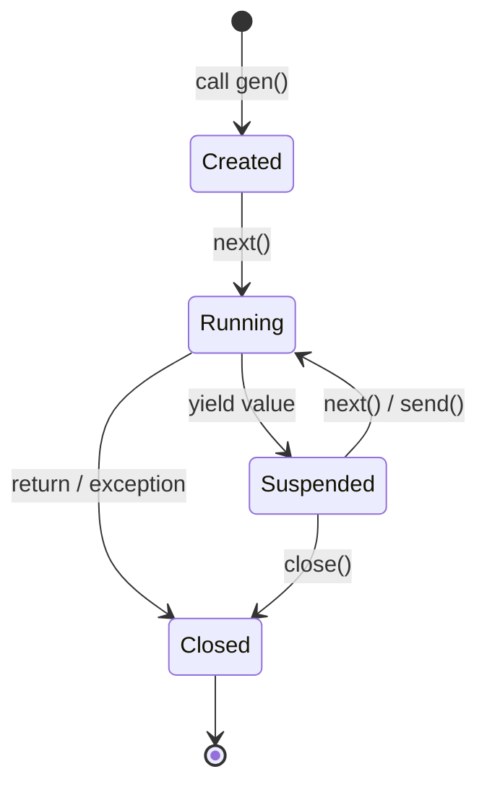

# Generators and yield from

Writing an iterator class means managing state by hand: a position counter, a `__next__` that remembers where it left off, and a manual `StopIteration`. **Generators** let Python do all of that for you. A generator function looks like a normal function but uses `yield`; calling it returns an iterator that runs the body lazily, pausing at each `yield` with its local variables frozen in place. They are the foundation of lazy pipelines, of `contextlib.contextmanager`, and historically of asyncio itself.

## Generator functions

Any function containing `yield` is a **generator function**. Calling it does *not* run the body; it returns a **generator object** (an iterator). Each `next()` runs the body until the next `yield`, hands out the yielded value, and suspends. When the body returns, `StopIteration` is raised automatically.

```python-run
def countdown(n):
    print("starting")
    while n > 0:
        yield n
        n -= 1
    print("done")

g = countdown(3)
print(type(g).__name__)      # nothing printed yet: the body hasn't started
print(next(g))               # runs to the first yield
print(next(g), next(g))
print(list(g))               # runs to the end; 'done' printed, list is empty
```

Compare with the `Countdown` iterator class from the previous lesson: the generator is a third of the code, and the state (`n`, the position in the loop) is just ordinary local variables.

Goodrich's classic example (§1.8) computes factors of a number. The list version builds everything up front; the generator version yields each factor as found, and can even yield them in increasing order by pairing small and large divisors:

```python-run
def factors(n):
    k = 1
    large = []
    while k * k < n:
        if n % k == 0:
            yield k
            large.append(n // k)
        k += 1
    if k * k == n:
        yield k
    yield from reversed(large)

print(list(factors(100)), list(factors(13)))
```



## Why generators matter

**Memory.** A generator holds one item at a time. `sum(x*x for x in range(10**7))` uses a few hundred bytes; the list version uses hundreds of megabytes.

**Laziness.** Work is done only when requested. You can stop early, and infinite sequences are natural:

```python-run
from itertools import islice

def fibonacci():
    a, b = 0, 1
    while True:            # infinite, but only computed on demand
        yield a
        a, b = b, a + b

print(list(islice(fibonacci(), 12)))
```

**Composability.** Generators chain into pipelines where each stage pulls from the previous one, like Unix pipes:

```python-run
import io
log = io.StringIO("""INFO start
ERROR disk full
INFO retry
ERROR disk full
WARN slow
ERROR timeout
""")

def read_lines(f):
    for line in f:
        yield line.rstrip("\n")

def grep(pattern, lines):
    return (ln for ln in lines if pattern in ln)

def messages(lines):
    for ln in lines:
        level, _, msg = ln.partition(" ")
        yield msg

errors = messages(grep("ERROR", read_lines(log)))
from collections import Counter
print(Counter(errors).most_common())
```

Nothing is read until `Counter` starts pulling; each line flows through all three stages before the next is read.

## Generator expressions

A generator expression `(expr for x in it if cond)` is a compact anonymous generator. Use it when the logic fits on one line; use a generator function when you need statements, multiple yields, or try/finally.

```python-run
nums = [4, -1, 9, -16]
abs_sum = sum(abs(n) for n in nums)
first_negative = next((n for n in nums if n < 0), None)
print(abs_sum, first_negative)
```

## `yield from`: delegating to a sub-generator

`yield from iterable` yields every item from `iterable`, as if you'd written `for x in iterable: yield x` — and more: it also forwards `send()`/`throw()` to the sub-generator and evaluates to the sub-generator's `return` value. It makes recursive generators clean:

```python-run
def flatten(nested):
    for item in nested:
        if isinstance(item, (list, tuple)):
            yield from flatten(item)       # recurse lazily
        else:
            yield item

print(list(flatten([1, [2, [3, [4, (5, 6)]]], 7, []])))

def inorder(tree):                         # tree = (left, value, right) or None
    if tree:
        left, val, right = tree
        yield from inorder(left)
        yield val
        yield from inorder(right)

t = ((None, 1, None), 2, ((None, 3, None), 4, None))
print(list(inorder(t)))
```

Strings deserve care in `flatten`: a one-character string is iterable and contains itself, so naive "flatten anything iterable" recursion never terminates on strings. Always special-case `str`/`bytes`.

### Return values

A generator may `return value`; the value travels inside the `StopIteration` exception and becomes the result of a `yield from` expression:

```python-run
def read_block(lines):
    """Yield lines until a blank one; RETURN how many were read."""
    n = 0
    for ln in lines:
        if not ln:
            break
        yield ln
        n += 1
    return n

def report(lines):
    it = iter(lines)
    while True:
        count = yield from read_block(it)   # value of the sub-generator's return
        yield f"-- block of {count} lines --"
        if count == 0:
            return

for out in report(["a", "b", "", "c", "", ""]):
    print(out)

g = read_block(["x"])
next(g)
try:
    next(g)
except StopIteration as stop:
    print("return value travels in StopIteration.value:", stop.value)
```

## Advanced: `send`, `throw`, `close`

Generators are two-way. `gen.send(value)` resumes the generator and makes the paused `yield` expression evaluate to `value`. `gen.throw(exc)` raises an exception at the paused `yield`. `gen.close()` raises `GeneratorExit` there, giving `finally` blocks a chance to clean up. A fresh generator must be primed with `next(g)` (or `g.send(None)`) before you can send a non-None value.

```python-run
def running_max():
    best = None
    try:
        while True:
            x = yield best
            if best is None or x > best:
                best = x
    finally:
        print("cleanup: generator closed")

g = running_max()
next(g)                       # prime
print(g.send(3), g.send(1), g.send(7))
g.close()
```

These "coroutine" generators were how asyncio worked before `async`/`await` existed (3.5). Today you rarely write `send`-based coroutines, but understanding them demystifies async code.

## Cleanup and `try/finally` in generators

If a generator holds a resource (an open file, a lock), put the resource inside `with` or `try/finally` in the generator body. When the generator is closed — explicitly, or by garbage collection when abandoned — the cleanup runs:

```python-run
def numbered(lines):
    print("open")
    try:
        for i, ln in enumerate(lines, 1):
            yield f"{i}: {ln}"
    finally:
        print("closed")

g = numbered(["a", "b", "c"])
print(next(g))
del g                          # CPython refcount drops -> close() -> finally runs
```

## Generator gotchas

```python-run
# 1. Generators are single-use
g = (x for x in range(3))
print(sum(g), sum(g))

# 2. A generator function's body doesn't run until iterated — including argument validation!
def checked(n):
    if n < 0:
        raise ValueError("negative")
    yield from range(n)

g = checked(-1)                # no error yet...
try:
    next(g)
except ValueError as e:
    print("error only on first next():", e)

# fix: validate eagerly in a wrapper, then return an inner generator
def checked_eager(n):
    if n < 0:
        raise ValueError("negative")
    def gen():
        yield from range(n)
    return gen()
try:
    checked_eager(-1)
except ValueError as e:
    print("eager:", e)
```

3. Raising `StopIteration` inside a generator body is converted to `RuntimeError` (PEP 479). To end a generator, just `return`.

4. Generator expressions bind the *first* iterable immediately but evaluate everything else lazily, so variables they mention may change before they run.

## Worked example: sliding windows

A classic generator exercise: yield every window of size `k` from any iterable (even an infinite one) in O(1) amortised time per window, using a `deque` with `maxlen`:

```python-run
from collections import deque
from itertools import count, islice

def windows(iterable, k):
    it = iter(iterable)
    win = deque(islice(it, k), maxlen=k)
    if len(win) == k:
        yield tuple(win)
    for x in it:
        win.append(x)                # oldest drops out automatically
        yield tuple(win)

print(list(windows([1, 2, 3, 4, 5], 3)))
print(list(islice(windows(count(), 2), 4)))

def moving_average(iterable, k):
    it = iter(iterable)
    win = deque(maxlen=k)
    total = 0
    for x in it:
        if len(win) == k:
            total -= win[0]
        win.append(x)
        total += x
        if len(win) == k:
            yield total / k

print(list(moving_average([1, 2, 3, 4, 5, 6], 3)))
```

> [!INTERVIEW]
> "What's a generator and why use one?" — a function with `yield` that returns a lazy iterator; it keeps its local state between `next()` calls, uses O(1) memory for streams, supports infinite sequences, and composes into pipelines. Know the difference between `return` (ends the generator, value carried in `StopIteration`) and `yield`, what `yield from` does (delegation + return value), and that generators are single-pass.

## Under the hood: a suspended frame

An ordinary call creates a frame, runs it, and throws it away. A generator object *keeps* its frame: local variables, the value stack and the position of the last executed instruction all survive between `next()` calls. `inspect` lets you look inside a paused generator — invaluable when debugging a pipeline:

```python-run
import inspect

def accumulate(values):
    total = 0
    for v in values:
        total += v
        yield total

g = accumulate([5, 10, 20])
print(inspect.getgeneratorstate(g))                # GEN_CREATED: body not started
next(g); next(g)
print(inspect.getgeneratorstate(g), inspect.getgeneratorlocals(g))
print("paused at line", g.gi_frame.f_lineno, "of", g.gi_code.co_name)
list(g)
print(inspect.getgeneratorstate(g), g.gi_frame)    # GEN_CLOSED: frame released
```

The four states are `GEN_CREATED`, `GEN_RUNNING`, `GEN_SUSPENDED` and `GEN_CLOSED`. Resuming is cheap — no new frame is built — which is why a generator loop is competitive with a hand-written iterator class and far shorter. Native coroutines (`async def`) are built on the same machinery: `await` suspends a frame exactly as `yield` does, and the event loop plays the role of the code calling `next()`.

## Generator, list or iterator class?

| | List / comprehension | Generator | Iterator class |
|---|---|---|---|
| Memory | O(n) | O(1) | O(1) |
| Can iterate twice, index, `len()` | yes | no | only if you add it |
| Starts work | immediately | on first `next()` | on first `next()` |
| Infinite sequences | no | yes | yes |
| Extra methods / inspectable state | — | awkward | natural |
| Code size | smallest | small | largest |

Rules of thumb: return a **list** when the result is small and callers will index, sort, reuse or measure it; write a **generator** when data is large, streamed, possibly infinite, or consumed once by the next stage; write a **class** when the iterator needs extra methods (`peek`, `reset`) or externally visible state. A function that sometimes needs both can expose a generator and let callers write `list(gen())`.

Laziness also changes *when errors appear*. With a list, a bad record fails at construction; with a generator, it fails later, at whatever point the consumer reaches it — far from where the pipeline was assembled:

```python-run
def parse_all(rows):
    for r in rows:
        yield int(r)

numbers = parse_all(["1", "2", "x", "4"])     # no error here
print("pipeline built")
try:
    for n in numbers:
        print("got", n)
except ValueError as e:
    print("failed mid-stream:", e)
print("after the failure the generator is dead:", list(numbers))
```

Two consequences worth remembering: an exception **terminates** the generator (the remaining item `4` is never produced), and resources or variables the generator depends on must still be valid when it finally runs. A generator that reads from a file opened in a `with` block is useless after that block exits:

```python-run
import io

def read_lines():
    with io.StringIO("a\nb\n") as f:
        return (line.strip() for line in f)     # lazy: nothing has been read yet

try:
    print(list(read_lines()))
except ValueError as e:
    print("ValueError:", e)                     # I/O operation on closed file

def read_lines_ok():
    with io.StringIO("a\nb\n") as f:
        yield from (line.strip() for line in f)  # the with-block stays open while we iterate

print(list(read_lines_ok()))
```

## Debugging lazy pipelines

- Insert a pass-through "tap" stage that prints what flows by, instead of calling `list()` on an intermediate stage (which would consume it).
- Use `itertools.islice(gen, 5)` to look at the first few items of something huge or infinite.
- If output is empty, check each stage separately with a small literal input, and check for an already-exhausted source.
- In pdb, `list(gen)` exhausts the generator you are inspecting; copy with `itertools.tee` first, or restart.

```python-run
def tap(items, label):
    for item in items:
        print(f"  [{label}] {item!r}")
        yield item

data = ["3", "", "7"]
cleaned = (s for s in tap(data, "raw") if s)
print(sum(int(s) for s in tap(cleaned, "non-empty")))
```

The interleaved output also makes the pull-based execution order visible: each item travels through every stage before the next one is read.

## Pitfalls recap

- Expecting a generator function's body to run when called.
- Reusing an exhausted generator.
- Infinite recursion when flattening strings.
- Raising `StopIteration` manually inside a generator (becomes `RuntimeError`).
- Forgetting to prime a coroutine-style generator before `send()`.

## Summary

`yield` turns a function into a factory of lazy iterators that remember their local state. Generator expressions are the one-line form. `yield from` delegates to sub-iterators and forwards their return value. Generators give constant-memory pipelines and infinite sequences, support two-way communication with `send`/`throw`/`close`, and clean up via `finally`.

```quiz
[
  {"q": "What happens when you call a generator function?", "options": ["Its body runs to completion", "It returns a generator object without running the body", "It runs until the first yield", "It returns a list"], "answer": 1,
   "explain": "The body starts only on the first next() call."},
  {"q": "What does `yield from it` do?", "options": ["Returns it", "Yields each item of it and evaluates to its return value", "Converts it to a list", "Creates a thread"], "answer": 1,
   "explain": "It delegates to the sub-iterator, forwarding send/throw, and the expression's value is the sub-generator's return value."},
  {"q": "How do you end a generator early?", "options": ["raise StopIteration", "return", "break", "yield None"], "answer": 1,
   "explain": "return ends it cleanly; raising StopIteration inside a generator becomes RuntimeError since Python 3.7."},
  {"q": "Before calling g.send(5) on a fresh generator g, you must:", "options": ["Nothing", "Call next(g) (or g.send(None)) to advance it to the first yield", "Call g.close()", "Call iter(g)"], "answer": 1,
   "explain": "A just-created generator isn't paused at a yield yet, so there's nowhere to deliver the sent value."},
  {"q": "Memory used by `sum(x for x in range(10**8))` is roughly:", "options": ["O(1)", "O(n)", "O(n log n)", "O(sqrt n)"], "answer": 0,
   "explain": "Both range and the generator expression produce values one at a time."},
  {"q": "Why does a naive recursive flatten loop forever on ['ab']?", "options": ["Lists are infinite", "A 1-char string is iterable and yields itself, so recursion never bottoms out", "yield from is broken", "It doesn't"], "answer": 1,
   "explain": "Iterating 'a' yields 'a' again. Treat str/bytes as atoms."},
  {"q": "What runs the `finally` block of a suspended generator that you abandon?", "options": ["Nothing; it never runs", "close(), called explicitly or when the generator is garbage-collected", "The next call to the function", "sys.exit"], "answer": 1,
   "explain": "close() raises GeneratorExit at the paused yield, unwinding try/finally and with blocks."}
]
```

> **Source:** Goodrich, Tamassia & Goldwasser, *Data Structures and Algorithms in Python*, §1.8 (Iterators and Generators); Python docs, *Tutorial* §9.9–9.10 "Generators / Generator Expressions", *Language Reference* §6.2.9 "Yield expressions", PEP 380 (yield from) and PEP 479.
