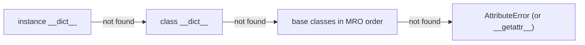

# Classes and instances

Python is object-oriented from the ground up: every value is an instance of some class. Writing your own classes lets you bundle data with the behaviour that operates on it, hide implementation details behind a clean interface, and plug into Python's syntax (`+`, `len`, `for`, `with`) through special methods. This lesson covers the mechanics — `class`, `__init__`, `self`, attributes and methods — and the design ideas behind them.

## Why objects? Goals and principles

Goodrich (§2.1) frames object-oriented design around three goals: **robustness** (handle unexpected input gracefully), **adaptability** (evolve as requirements change) and **reusability** (use the same code in many contexts). Three principles serve those goals:

- **Modularity** — split a system into self-contained units with clear responsibilities.
- **Abstraction** — expose *what* an object does (its interface), not *how*.
- **Encapsulation** — keep internal state private so you can change the implementation without breaking users.

Python supports all three but enforces encapsulation by *convention* rather than by the compiler: "we're all consenting adults here".

## A first class

```python-run
class CreditCard:
    """A consumer credit card (after Goodrich et al., §2.3.1)."""

    def __init__(self, customer, bank, account, limit):
        """Create a new card with a zero balance."""
        self._customer = customer
        self._bank = bank
        self._account = account
        self._limit = limit
        self._balance = 0

    def get_balance(self):
        return self._balance

    def charge(self, price):
        """Charge price if it fits within the limit. Return True if accepted."""
        if price + self._balance > self._limit:
            return False
        self._balance += price
        return True

    def make_payment(self, amount):
        self._balance -= amount

card = CreditCard("Brook", "Thriller Bank", "5391 0375 9387 5309", 1000)
print(card.charge(300), card.charge(800), card.get_balance())
card.make_payment(100)
print(card.get_balance())
```

What's happening:

- `class CreditCard:` executes the class body and creates a **class object**, bound to the name `CreditCard`. Functions defined inside become **methods**.
- `CreditCard(...)` **instantiates** the class: Python creates a blank instance (via `__new__`) and calls `__init__(instance, ...)` to initialise it. `__init__` is an *initialiser*, not a constructor in the C++ sense, and must return `None`.
- `self` is the instance the method was called on. `card.charge(300)` is translated to `CreditCard.charge(card, 300)`. The name `self` is a convention, but a universal one.
- `self._balance = 0` creates an **instance attribute** stored in the instance's own `__dict__`.

```python-run
class Point:
    def __init__(self, x, y):
        self.x = x
        self.y = y
    def norm(self):
        return (self.x ** 2 + self.y ** 2) ** 0.5

p = Point(3, 4)
print(p.__dict__, p.norm(), Point.norm(p))      # two spellings of the same call
print(type(p.norm).__name__, type(Point.norm).__name__)
```

`p.norm` is a **bound method** (the function with `p` pre-attached as `self`); `Point.norm` is a plain function.

## Instance attributes versus class attributes

Attributes assigned on `self` belong to one instance. Attributes assigned in the class body belong to the class and are **shared** by all instances. Lookup `obj.attr` checks the instance `__dict__` first, then the class (and its bases).

```python-run
class Ship:
    fleet_size = 0               # class attribute, shared
    crew = []                    # DANGER: shared mutable class attribute

    def __init__(self, name):
        self.name = name         # instance attribute
        Ship.fleet_size += 1

a, b = Ship("Sunny"), Ship("Merry")
print(Ship.fleet_size, a.fleet_size)       # found on the class

a.crew.append("Luffy")                     # mutates the ONE shared list
print(b.crew)

a.fleet_size = 99                          # creates an instance attribute that SHADOWS
print(a.fleet_size, b.fleet_size, Ship.fleet_size)
```

Class attributes are good for constants and counters (updated via the class name). Never use a mutable class attribute as per-instance storage — that's the class-level version of the mutable-default bug. Initialise per-instance containers in `__init__`.

Goodrich (§2.5) describes this as two namespaces: the **instance namespace** holds per-object state, and the **class namespace** holds methods and shared data. Name resolution walks instance → class → superclasses.



## Encapsulation by convention

| Spelling | Meaning |
|---|---|
| `name` | public API |
| `_name` | internal: "don't touch unless you know what you're doing" (not enforced) |
| `__name` | **name mangling**: becomes `_ClassName__name`, to avoid clashes in subclasses |
| `__name__` | special ("dunder") names reserved for Python |

```python-run
class Account:
    def __init__(self):
        self._balance = 0          # internal by convention
        self.__secret = "pin"      # mangled

acct = Account()
print(acct._balance)               # allowed, just impolite
print(acct.__dict__)               # see the mangled name
try:
    acct.__secret
except AttributeError as e:
    print("AttributeError:", e)
```

Name mangling is not security; it only prevents accidental overriding in subclasses. Python programmers expose state as plain attributes and switch to **properties** (lesson 15) when validation or computation is needed — no `getX/setX` boilerplate required.

## Methods: instance, class and static

```python-run
from datetime import date

class Person:
    species = "human"

    def __init__(self, name, born):
        self.name, self.born = name, born

    def age(self, today=date(2026, 1, 1)):          # instance method: gets self
        return today.year - self.born

    @classmethod
    def from_string(cls, s):                         # gets the class: alternative constructor
        name, born = s.split(",")
        return cls(name.strip(), int(born))

    @staticmethod
    def is_valid_name(name):                         # gets neither: a namespaced function
        return name.isalpha()

p = Person.from_string("Robin, 1996")
print(p.name, p.age(), Person.is_valid_name("Robin"), Person.is_valid_name("R2D2"))
```

- **Instance methods** receive `self` and operate on one object.
- **Class methods** receive `cls` — the class they're called on, *including subclasses* — and are the idiomatic way to write alternative constructors (`dict.fromkeys`, `datetime.fromisoformat`).
- **Static methods** receive nothing special; they're plain functions that live in the class namespace for organisation.

## `__repr__` and `__str__`

Every class should define `__repr__`, the unambiguous developer-facing representation used in the REPL, in containers, and in debuggers. `__str__` is the friendly form used by `print` and `str()`; it defaults to `__repr__`.

```python-run
class Money:
    def __init__(self, amount, currency="EUR"):
        self.amount, self.currency = amount, currency
    def __repr__(self):
        return f"Money({self.amount!r}, {self.currency!r})"
    def __str__(self):
        return f"{self.amount:.2f} {self.currency}"

m = Money(12.5)
print(m, repr(m), [m])
```

A good `__repr__` looks like the code that would recreate the object.

## Equality and hashing

By default, `==` on instances compares identity, and instances hash by identity. Define `__eq__` for value equality — and, if objects are immutable and should work in sets/dicts, `__hash__` consistent with it:

```python-run
class Card:
    def __init__(self, rank, suit):
        self.rank, self.suit = rank, suit
    def __eq__(self, other):
        if not isinstance(other, Card):
            return NotImplemented          # let Python try the other side / fall back
        return (self.rank, self.suit) == (other.rank, other.suit)
    def __hash__(self):
        return hash((self.rank, self.suit))
    def __repr__(self):
        return f"Card({self.rank!r}, {self.suit!r})"

print(Card("A", "spades") == Card("A", "spades"), len({Card("A", "s"), Card("A", "s")}))
print(Card("A", "s") == "As")
```

Returning `NotImplemented` (not raising, not returning `False`) is the protocol for "I don't know how to compare with that type".

## Everything is dynamic

Classes and instances are mutable objects. You can add attributes to instances at any time (unless the class uses `__slots__`), and even add methods to a class after creation. `getattr`, `setattr`, `hasattr` and `delattr` access attributes by name:

```python-run
class Bag: pass
b = Bag()
b.anything = 1
setattr(b, "color", "red")
print(vars(b), getattr(b, "missing", "default"), hasattr(b, "color"))
Bag.describe = lambda self: f"bag with {vars(self)}"
print(b.describe())
```

This flexibility is powerful for frameworks but should be used with restraint in application code.

## `__slots__`

Declaring `__slots__ = ("x", "y")` tells Python to reserve fixed storage for those attributes instead of a per-instance `__dict__`. Instances become smaller (often about half the memory) and attribute access is slightly faster; the trade-off is you can't add other attributes.

```python-run
import sys
class P1:
    def __init__(self, x, y): self.x, self.y = x, y
class P2:
    __slots__ = ("x", "y")
    def __init__(self, x, y): self.x, self.y = x, y

a, b = P1(1, 2), P2(1, 2)
print(sys.getsizeof(a) + sys.getsizeof(a.__dict__), sys.getsizeof(b))
try:
    b.z = 3
except AttributeError as e:
    print("AttributeError:", e)
```

Use slots when you create millions of small objects (nodes, points, events).

## Worked example: a linked-list node and stack

Interview data structures are where small classes shine:

```python-run
class Node:
    __slots__ = ("val", "next")
    def __init__(self, val, next=None):
        self.val, self.next = val, next

class LinkedStack:
    """LIFO stack backed by a singly linked list (Goodrich ch. 7 style)."""
    def __init__(self):
        self._head = None
        self._size = 0
    def __len__(self):
        return self._size
    def is_empty(self):
        return self._size == 0
    def push(self, v):
        self._head = Node(v, self._head)
        self._size += 1
    def top(self):
        if self.is_empty():
            raise IndexError("stack is empty")
        return self._head.val
    def pop(self):
        v = self.top()
        self._head = self._head.next
        self._size -= 1
        return v
    def __repr__(self):
        vals, n = [], self._head
        while n:
            vals.append(n.val); n = n.next
        return f"LinkedStack(top->{vals})"

s = LinkedStack()
for ch in "abc":
    s.push(ch)
print(s, len(s), s.pop(), s.top(), s)
```

Defining `__len__` makes `len(s)` work *and* makes empty stacks falsy — a small taste of the data model (lesson 14).

> [!INTERVIEW]
> Common questions: "What is `self`?" (the instance, passed explicitly as the first parameter; `obj.m(x)` is `Cls.m(obj, x)`). "Class vs instance attribute?" (shared vs per-object; lookup goes instance then class). "classmethod vs staticmethod?" (cls vs nothing; classmethods for alternative constructors that respect subclasses). "How do you make a field private?" (convention `_x`; `__x` mangles; properties for controlled access).

## Pitfalls recap

- Forgetting `self` as the first parameter → `TypeError: takes 0 positional arguments but 1 was given`.
- Forgetting `self.` when reading an attribute → `NameError`.
- Mutable class attributes used as per-instance state.
- Assigning to `obj.class_attr` creates a shadowing instance attribute instead of updating the shared one.
- Defining `__eq__` without `__hash__` makes instances unhashable.
- Returning a value from `__init__` → `TypeError`.

## Summary

A class statement builds a class object; calling it creates instances initialised by `__init__`. Methods receive the instance as `self`; `@classmethod` and `@staticmethod` change that. Attribute lookup goes instance → class → bases. Encapsulation is by naming convention, and `__repr__`, `__eq__`, `__hash__` and `__slots__` are the first special members worth adding to your classes.

```quiz
[
  {"q": "`obj.method(5)` is equivalent to:", "options": ["method(5)", "type(obj).method(obj, 5)", "obj.method(obj, 5)", "method(obj)"], "answer": 1,
   "explain": "Looking up a function through an instance produces a bound method that passes the instance as the first argument."},
  {"q": "Two instances share a list defined as `items = []` in the class body. Why?", "options": ["Python copies class attributes lazily", "It's a class attribute: one list object stored on the class and found via lookup", "Lists are always global", "Because of __slots__"], "answer": 1,
   "explain": "Class attributes are created once with the class; appending through any instance mutates that single object."},
  {"q": "What is the idiomatic use of @classmethod?", "options": ["Private helpers", "Alternative constructors like from_string that work for subclasses", "Making methods faster", "Abstract methods"], "answer": 1,
   "explain": "cls is the class the method was called on, so `return cls(...)` builds the right subclass."},
  {"q": "What does `self.__token = 1` inside class Api store?", "options": ["A truly private attribute", "An attribute named _Api__token (name mangling)", "A class attribute", "Nothing"], "answer": 1,
   "explain": "Double-underscore names are mangled with the class name to avoid subclass clashes; they're still accessible."},
  {"q": "Which method should every class define for debugging output?", "options": ["__str__", "__repr__", "__format__", "__doc__"], "answer": 1,
   "explain": "__repr__ is used by the REPL, containers and debuggers; __str__ falls back to it."},
  {"q": "What should __eq__ return when given an unsupported type?", "options": ["False", "raise TypeError", "NotImplemented", "None"], "answer": 2,
   "explain": "NotImplemented tells Python to try the reflected operation on the other operand and then fall back to identity."},
  {"q": "Main benefit of __slots__?", "options": ["Thread safety", "Smaller instances and faster attribute access by removing the per-instance __dict__", "Private attributes", "Automatic __repr__"], "answer": 1,
   "explain": "Slots reserve fixed storage; the trade-off is no arbitrary new attributes."}
]
```

> **Source:** Goodrich, Tamassia & Goldwasser, *Data Structures and Algorithms in Python*, §2.1 (Goals, Principles, Patterns), §2.3.1 (CreditCard Class) and §2.5 (Namespaces and Object-Orientation); Python docs, *Tutorial* ch. 9 "Classes".
