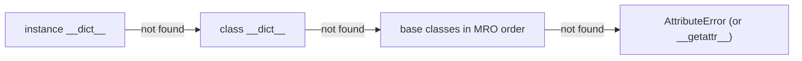
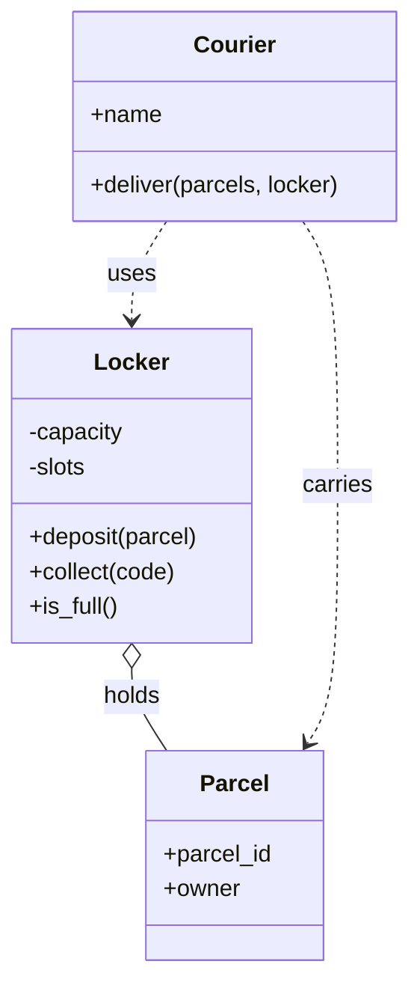

# Classes and instances

> **Before this lesson:** you should have written a first class with `__init__` and a method or two, as in [Classes: modelling things with objects](#/lesson/python/py-start-classes). This lesson revisits that ground more carefully and then goes deeper. You also need names and references from [Objects, names, types and mutability](#/lesson/python/py-objects-names), functions from [Functions and arguments](#/lesson/python/py-functions-args), and hashing from [Dictionaries and sets](#/lesson/python/py-dicts-sets).

## In plain words

So far you have used types that Python provides: numbers, strings, lists, dictionaries. A **class** lets you define a type of your own. It describes two things together: what data each thing of that type holds, and what can be done with it.

Think of a class as a cookie cutter and of the objects made from it as the cookies. The cutter fixes the shape; you can stamp out as many cookies as you like, and each cookie is a separate thing that can be decorated differently. In programming terms the cookies are **instances** of the class. Each instance has its own data (its **attributes**), and all instances share the same behaviour (the **methods**, which are functions defined inside the class).

Why bother? Without classes, the data about one thing (say, a bank account's owner, balance and limit) lives in loose variables or a dictionary, and the rules about it ("the balance may not exceed the limit") are scattered through every function that touches it. A class puts the data and its rules in one place and gives the outside world a small, safe set of operations.

Why it matters for a job: nearly all real Python code is organised in classes, every library you use hands you objects, and interviewers ask you both to design small classes (a stack, a cache, a parking lot) and to explain the mechanics: what `self` is, how a class attribute differs from an instance attribute, what `@classmethod` is for. This lesson covers the mechanics from the beginning and then looks under the hood.

## Why objects? Goals and principles

**Object-oriented programming** (OOP) is the style of building a program out of objects that hold data and offer operations on it. Textbooks on software design usually name three goals for well-built software: **robustness** (it copes sensibly with unexpected input), **adaptability** (it can be changed as requirements change) and **reusability** (the same code serves in several places). Three principles of object-oriented design serve those goals:

- **Modularity**: divide a system into self-contained units, each with one clear job.
- **Abstraction**: show the outside world *what* an object does (its **interface**, the set of operations it offers), not *how* it does it.
- **Encapsulation**: keep the internal data private, so that the insides can be changed without breaking the code that uses the object.

Python supports all three. Unlike Java or C++, it does not *force* privacy; it relies on a naming convention and on programmers respecting it. The community's phrase for this attitude is "we're all consenting adults here".

## A first class

```python-run
class WaterTank:
    """A tank that holds water up to a fixed capacity, in litres."""

    def __init__(self, owner, capacity):
        """Create an empty tank."""
        self._owner = owner
        self._capacity = capacity
        self._level = 0

    def level(self):
        return self._level

    def fill(self, litres):
        """Add water if it fits. Return True if accepted, False if it would overflow."""
        if self._level + litres > self._capacity:
            return False
        self._level += litres
        return True

    def drain(self, litres):
        self._level -= litres

tank = WaterTank("Brook", 1000)
print(tank.fill(300), tank.fill(800), tank.level())
tank.drain(100)
print(tank.level())
```

The program prints `True False 300` and then `200`. The first `fill` is accepted. The second would bring the level to 1,100 litres, above the capacity, so it is refused and the level stays at 300. Draining 100 leaves 200. Now the mechanics, piece by piece:

- `class WaterTank:` runs the indented block once and creates a **class object**, tied to the name `WaterTank`. The functions defined in the block become the class's **methods**.
- `WaterTank("Brook", 1000)` creates an instance; programmers say it **instantiates** the class. Python first makes a blank object (a step handled by a method called `__new__`, which you rarely touch) and then calls `__init__` on it with your arguments. `__init__` is the *initialiser*: it fills in the new object's starting data. It must not return a value.
- `self` is the instance the method is working on. When you write `tank.fill(300)`, Python turns it into `WaterTank.fill(tank, 300)`, so inside the method `self` is `tank`. The name `self` is only a convention, but everyone follows it.
- `self._level = 0` creates an **instance attribute**: a piece of data stored on this one object. Each object keeps its attributes in a dictionary of its own, reachable as `obj.__dict__`.
- The other methods read and change those attributes through `self`. `fill` contains the rule of this class: water that does not fit is refused.

```python-run
class Point:
    def __init__(self, x, y):
        self.x = x
        self.y = y
    def norm(self):
        return (self.x ** 2 + self.y ** 2) ** 0.5

p = Point(3, 4)
print(p.__dict__, p.norm(), Point.norm(p))      # two spellings of the same call
print(type(p.norm).__name__, type(Point.norm).__name__)
```

`p.__dict__` shows the instance's own data, `{'x': 3, 'y': 4}`. `p.norm()` and `Point.norm(p)` are the same call written two ways, and both give `5.0`. The second line prints `method function`: `p.norm` (without parentheses) is a **bound method**, the function with `p` already attached as its `self`, while `Point.norm` is the plain function, which needs to be given an instance.

## Instance attributes versus class attributes

An attribute assigned on `self` belongs to one instance. A variable assigned directly in the class body, outside any method, belongs to the class itself and is **shared** by every instance; it is a **class attribute**. When you read `obj.attr`, Python looks in the instance's own dictionary first, and if the name is not there, in the class (and then in the classes it is derived from).

```python-run
class Ship:
    fleet_size = 0               # class attribute, shared
    crew = []                    # DANGER: shared mutable class attribute

    def __init__(self, name):
        self.name = name         # instance attribute
        Ship.fleet_size += 1

a, b = Ship("Sunny"), Ship("Merry")
print(Ship.fleet_size, a.fleet_size)       # found on the class

a.crew.append("Luffy")                     # mutates the ONE shared list
print(b.crew)

a.fleet_size = 99                          # creates an instance attribute that SHADOWS
print(a.fleet_size, b.fleet_size, Ship.fleet_size)
```

**Reading this code line by line**

- `fleet_size` and `crew` are class attributes: one of each exists, stored on `Ship`.
- `__init__` gives each ship its own `name` and adds one to the shared counter, through the class name.
- After two ships are created, `Ship.fleet_size` and `a.fleet_size` both print 2. The instance has no `fleet_size` of its own, so the lookup continues to the class.
- `a.crew.append("Luffy")` reads `crew` (found on the class) and changes that one list. `b.crew` shows `['Luffy']` too, although nobody added anything to ship `b`.
- `a.fleet_size = 99` is an *assignment*, and assignment through an instance always creates or changes an attribute **on the instance**. Ship `a` now has its own `fleet_size`, which hides the class's; `b` and the class still say 2. The output is `99 2 2`.

Class attributes are right for constants and for counters (updated through the class name). Never use a mutable class attribute as storage that each instance is supposed to have for itself; that is the class-level cousin of the mutable-default bug. Create per-instance lists and dictionaries inside `__init__`.

In terms of the previous lessons, there are two namespaces: the **instance namespace** holds the data of one object, and the **class namespace** holds the methods and the shared data. Looking up a name goes from the instance to the class to the classes it inherits from (the order of those is called the MRO, for method resolution order, the subject of the next lesson):



## Encapsulation by convention

**Encapsulation** means hiding an object's internal details. Python signals what is internal through the way a name is spelled:

| Spelling | Meaning |
|---|---|
| `name` | public API |
| `_name` | internal: "don't touch unless you know what you're doing" (not enforced) |
| `__name` | **name mangling**: becomes `_ClassName__name`, to avoid clashes in subclasses |
| `__name__` | special ("dunder") names reserved for Python |

```python-run
class Account:
    def __init__(self):
        self._balance = 0          # internal by convention
        self.__secret = "pin"      # mangled

acct = Account()
print(acct._balance)               # allowed, just impolite
print(acct.__dict__)               # see the mangled name
try:
    acct.__secret
except AttributeError as e:
    print("AttributeError:", e)
```

The single-underscore attribute can be read from outside; nothing stops you, it is only considered bad manners. The dictionary printed on the next line reveals what happened to `__secret`: it is stored under the name `_Account__secret`. That renaming is **name mangling**. Asking for `acct.__secret` from outside the class therefore fails with `AttributeError`.

Name mangling is not a security feature; anyone can still write `acct._Account__secret`. Its purpose is to stop a class and a class derived from it from accidentally using the same attribute name. In practice Python programmers expose data as plain attributes and switch to **properties** (covered in a later lesson of this module) when a value needs checking or computing. Java-style `getX()` / `setX()` methods are not needed.

## Methods: instance, class and static

A class can contain three kinds of method, which differ in what Python passes as the first argument:

```python-run
from datetime import date

class Person:
    species = "human"

    def __init__(self, name, born):
        self.name, self.born = name, born

    def age(self, today=date(2026, 1, 1)):          # instance method: gets self
        return today.year - self.born

    @classmethod
    def from_string(cls, s):                         # gets the class: alternative constructor
        name, born = s.split(",")
        return cls(name.strip(), int(born))

    @staticmethod
    def is_valid_name(name):                         # gets neither: a namespaced function
        return name.isalpha()

p = Person.from_string("Robin, 1996")
print(p.name, p.age(), Person.is_valid_name("Robin"), Person.is_valid_name("R2D2"))
```

- **Instance methods** are the normal kind. They receive the instance as `self` and work on one object. Here `age` computes a person's age from their birth year.
- **Class methods** are marked with the decorator `@classmethod` and receive the *class* as their first argument, by convention called `cls`. Their main use is the **alternative constructor**: a second way of creating an instance from different input. `from_string` splits the text `"Robin, 1996"` and then calls `cls(...)`, which creates the object. Because `cls` is whichever class the method was called on, the same method creates the right kind of object for derived classes too. Built-in examples are `dict.fromkeys` and `datetime.fromisoformat`.
- **Static methods** are marked with `@staticmethod` and receive nothing automatically. They are ordinary functions kept inside the class because they belong with it logically. `is_valid_name` needs neither an instance nor the class.

The demo prints `Robin 30 True False`.

## `__repr__` and `__str__`

By default, printing an object of your class shows something like `<__main__.Money object at 0x7f...>`, which tells you nothing. Two special methods fix that. `__repr__` returns the precise, developer-facing text, used by the interactive prompt, inside containers and by debuggers; every class should define it. `__str__` returns the friendly text used by `print` and `str()`; if it is missing, Python uses `__repr__`.

```python-run
class Money:
    def __init__(self, amount, currency="EUR"):
        self.amount, self.currency = amount, currency
    def __repr__(self):
        return f"Money({self.amount!r}, {self.currency!r})"
    def __str__(self):
        return f"{self.amount:.2f} {self.currency}"

m = Money(12.5)
print(m, repr(m), [m])
```

The output is `12.50 EUR Money(12.5, 'EUR') [Money(12.5, 'EUR')]`: `print` uses `__str__`, `repr()` uses `__repr__`, and a list shows its items with `__repr__`. The `!r` inside the f-string means "insert the `repr` of this value", which is why the currency appears in quotes. A good `__repr__` looks like the code that would recreate the object.

## Equality and hashing

By default, two instances of your class are equal only if they are the very same object, and they are hashed by identity. To make equality depend on the contents, define `__eq__`. If the objects never change and should work as dictionary keys or set members, also define `__hash__`, computed from the same fields:

```python-run
class Card:
    def __init__(self, rank, suit):
        self.rank, self.suit = rank, suit
    def __eq__(self, other):
        if not isinstance(other, Card):
            return NotImplemented          # let Python try the other side / fall back
        return (self.rank, self.suit) == (other.rank, other.suit)
    def __hash__(self):
        return hash((self.rank, self.suit))
    def __repr__(self):
        return f"Card({self.rank!r}, {self.suit!r})"

print(Card("A", "spades") == Card("A", "spades"), len({Card("A", "s"), Card("A", "s")}))
print(Card("A", "s") == "As")
```

Two separately created aces of spades are now equal, and a set treats them as one item: the first line prints `True 1`. Comparing a card with a string prints `False`.

Look at the first lines of `__eq__`. When the other object is not a `Card`, the method returns the special value `NotImplemented`. It does not raise an error and it does not return `False`. `NotImplemented` is the agreed way of saying "I do not know how to compare myself with that"; Python then gives the other object a chance to do the comparison and, if that fails too, falls back to "not equal".

## Everything is dynamic

Classes and instances are themselves mutable objects. You may add attributes to an instance at any time (unless the class uses `__slots__`, below), and even add methods to a class after it has been created. Four built-in functions work with attributes whose names are given as strings: `getattr`, `setattr`, `hasattr` and `delattr`.

```python-run
class Bag: pass
b = Bag()
b.anything = 1
setattr(b, "color", "red")
print(vars(b), getattr(b, "missing", "default"), hasattr(b, "color"))
Bag.describe = lambda self: f"bag with {vars(self)}"
print(b.describe())
```

`vars(b)` returns the instance's attribute dictionary, here `{'anything': 1, 'color': 'red'}`. `getattr` with a third argument returns that default when the attribute is missing. The last two lines attach a new method to the class, and the existing instance `b` can use it at once, because methods are looked up on the class at the moment of the call. This flexibility is what frameworks are built on; in ordinary application code, use it with restraint.

## `__slots__`

Normally each instance carries its own dictionary for attributes, which is flexible but costs memory. Declaring `__slots__ = ("x", "y")` in the class body tells Python to reserve fixed storage for exactly those attributes and to leave the per-instance dictionary out. Instances become smaller (often about half the memory) and attribute access a little faster. The price: no other attributes can be added.

```python-run
import sys
class P1:
    def __init__(self, x, y): self.x, self.y = x, y
class P2:
    __slots__ = ("x", "y")
    def __init__(self, x, y): self.x, self.y = x, y

a, b = P1(1, 2), P2(1, 2)
print(sys.getsizeof(a) + sys.getsizeof(a.__dict__), sys.getsizeof(b))
try:
    b.z = 3
except AttributeError as e:
    print("AttributeError:", e)
```

The first line prints two sizes in bytes: the ordinary object together with its dictionary, and the much smaller slotted object. Trying to set `b.z` on the slotted object fails with `AttributeError`. Use slots when a program creates millions of small objects (nodes, points, events).

## Designing classes before coding them: CRC cards and a tiny UML diagram

Writing a class is the easy part. Deciding *which* classes to have, and who does what, is the real design work. Two cheap tools help you decide before you type any code, and interviewers like candidates who sketch first.

**Step 1: read the description for nouns and verbs.** Take the problem statement: "A courier delivers parcels to a parcel locker. The locker holds parcels, gives out a pickup code, and releases a parcel when someone enters the right code." The **nouns** (courier, parcel, locker, code) are candidate classes or attributes. The **verbs** (deliver, hold, give out, release) are candidate methods. A noun deserves its own class when it has behaviour or rules of its own; a pickup code is just a number, so it stays plain data.

**Step 2: a CRC card for each class.** CRC stands for **Class, Responsibility, Collaborator**. Originally these were index cards: you write the class name at the top, list what it is responsible for on the left, and name the other classes it must work with on the right. You can use a three-column table instead:

| Class | Responsibilities (what it knows or does) | Collaborators (who it works with) |
|---|---|---|
| `Parcel` | knows its id and its owner | none |
| `Locker` | knows its capacity and what it holds; accepts a parcel and returns a code; releases a parcel for a correct code | `Parcel` |
| `Courier` | carries parcels to a locker; reports what could not be delivered | `Locker`, `Parcel` |

Two habits make cards useful. Give each class one clear job, and if a card needs a long list, split it. And walk through scenarios by hand ("the locker is full; what happens?"), moving a finger from card to card. A responsibility nobody owns, or a card that talks to every other card, shows a design problem while it is still cheap to fix.

**Step 3: a small UML diagram.** **UML** (Unified Modelling Language) is a standard way of drawing designs. For classes you only need three things: a box per class showing its name, its data and its operations; a prefix on each member (`+` public, `-` internal by convention); and lines showing relationships. Python has no enforced privacy, so `-` simply matches the leading underscore convention from earlier in this lesson. Mermaid, the diagram language this site uses, can draw it from text:



How to read the lines:

- A solid line with an open diamond (`o--`) is **aggregation**: the locker is made up of parcels it holds, but a parcel can exist without it.
- A dashed arrow (`..>`) is a **dependency**: the courier uses the locker (it calls `deposit`) but does not keep it as part of itself.
- Inheritance, drawn with a hollow triangle (`<|--`), is the subject of the next lesson.

**Step 4: translate to code.** Each box becomes a class, each `+` or `-` attribute becomes an attribute set in `__init__`, each operation becomes a method, and each collaborator becomes either an argument (a dependency, like `locker` passed to `deliver`) or an attribute (like the locker's own `_slots`). The design runs below:

```python-run
class Parcel:
    def __init__(self, parcel_id, owner):
        self.parcel_id = parcel_id
        self.owner = owner

    def __repr__(self):
        return f"Parcel({self.parcel_id!r}, {self.owner!r})"


class Locker:
    """Responsibilities: hold parcels, hand out pickup codes, release a parcel for the right code."""

    def __init__(self, capacity):
        self._capacity = capacity
        self._slots = {}                 # pickup code -> Parcel
        self._next_code = 1000

    def is_full(self):
        return len(self._slots) >= self._capacity

    def deposit(self, parcel):
        """Collaborates with Parcel. Returns a pickup code, or None when full."""
        if self.is_full():
            return None
        code = self._next_code
        self._next_code += 1
        self._slots[code] = parcel
        return code

    def collect(self, code):
        """Returns the parcel for this code and frees the slot, or None for a wrong code."""
        return self._slots.pop(code, None)


class Courier:
    """Responsibilities: carry parcels to a locker and report what could not be delivered."""

    def __init__(self, name):
        self.name = name

    def deliver(self, parcels, locker):
        codes, failed = {}, []
        for parcel in parcels:
            code = locker.deposit(parcel)
            if code is None:
                failed.append(parcel)
            else:
                codes[parcel.parcel_id] = code
        return codes, failed


locker = Locker(capacity=2)
courier = Courier("Mina")
parcels = [Parcel("P1", "Ana"), Parcel("P2", "Bo"), Parcel("P3", "Cy")]

codes, failed = courier.deliver(parcels, locker)
print("codes:", codes)
print("could not deliver:", failed)
print(locker.collect(1001))      # right code
print(locker.collect(1001))      # already collected
print(locker.is_full())
```

**Reading the demo**

- The locker has capacity 2 and the courier brings 3 parcels, so the third deposit returns `None` and the courier reports it as undelivered; the card said the courier "reports what could not be delivered".
- `collect(1001)` hands back `P2` the first time. The second call gets `None`, because `pop` removed it: a code works once.
- After one parcel is collected, `is_full()` is `False`. Only `Locker` knows about slots and codes; `Courier` never touches them, which is the kind of separation the cards were meant to produce.

> [!TIP]
> In an interview, say the design aloud in the same order: nouns and verbs, then a card or a sentence per class, then the main relationships, and only then the code.

## Worked example: a linked-list node and stack

Small classes are the building material of interview data structures. A **linked list** is a chain of small objects called nodes, each holding one value and a reference to the next node. A **stack** is a pile in which the last item put on is the first taken off (LIFO, "last in, first out"). Here is a stack built on a linked list:

```python-run
class Node:
    __slots__ = ("val", "next")
    def __init__(self, val, next=None):
        self.val, self.next = val, next

class LinkedStack:
    """LIFO stack backed by a singly linked list."""
    def __init__(self):
        self._head = None
        self._size = 0
    def __len__(self):
        return self._size
    def is_empty(self):
        return self._size == 0
    def push(self, v):
        self._head = Node(v, self._head)
        self._size += 1
    def top(self):
        if self.is_empty():
            raise IndexError("stack is empty")
        return self._head.val
    def pop(self):
        v = self.top()
        self._head = self._head.next
        self._size -= 1
        return v
    def __repr__(self):
        vals, n = [], self._head
        while n:
            vals.append(n.val); n = n.next
        return f"LinkedStack(top->{vals})"

s = LinkedStack()
for ch in "abc":
    s.push(ch)
print(s, len(s), s.pop(), s.top(), s)
```

**Reading this code**

- A `Node` holds a value and a reference to the next node (`None` at the end of the chain).
- `LinkedStack` remembers the top node in `_head` and keeps a count in `_size`.
- `push(v)` creates a node whose `next` is the old top and makes it the new top.
- `top()` returns the top value, raising `IndexError` when the stack is empty; `pop()` returns it and moves `_head` on to the next node.
- `__repr__` walks the chain to show the values.

After pushing `a`, `b`, `c`, the output shows the stack with `c` on top, a length of 3, then `c` popped, `b` as the new top, and the stack reduced to `['b', 'a']`. (As in an earlier lesson, the first and last arguments of that `print` are the same object, so both show its final state.)

Defining `__len__` makes `len(s)` work *and* makes an empty stack falsy in an `if`, a first taste of the data model lesson.

> [!INTERVIEW]
> Common questions: "What is `self`?" (the instance, passed as the first argument; `obj.m(x)` is `Cls.m(obj, x)`). "Class attribute versus instance attribute?" (shared versus per object; lookup goes to the instance first, then the class). "classmethod versus staticmethod?" (receives `cls` versus nothing; class methods for alternative constructors that respect subclasses). "How do you make a field private?" (the `_x` convention; `__x` is name-mangled; properties for controlled access).

## Under the hood: how a method gets its `self`

There is no special keyword behind `self`; an ordinary mechanism supplies it. A **descriptor** is an object with a method named `__get__`, which Python calls when the object is found as an attribute of a class. Functions are descriptors. When you read an attribute through an instance and the lookup finds a function *on the class*, Python calls `function.__get__(instance, cls)`, and the result is a **bound method**: a small object that pairs the function with the instance.

```python-run
class Greeter:
    def __init__(self, name):
        self.name = name
    def hello(self, punct="!"):
        return f"hello from {self.name}{punct}"

g = Greeter("Brook")
func = Greeter.__dict__["hello"]                 # the plain function stored in the class
bound = func.__get__(g, Greeter)                 # what g.hello does for you
print(bound("?"), bound.__self__ is g, bound.__func__ is func)

say = g.hello                                    # bound methods are first-class values
print(say(), [m("...") for m in (g.hello, Greeter("Robin").hello)])

g.hello = lambda: "instance attribute shadows the method"   # stored in g.__dict__
print(g.hello())
del g.hello
print(g.hello())
```

- `Greeter.__dict__["hello"]` fetches the plain function straight out of the class's dictionary, bypassing the normal lookup.
- `func.__get__(g, Greeter)` does by hand what `g.hello` does automatically. The result can be called without supplying `self`; its `__self__` is `g` and its `__func__` is the original function.
- A bound method is a value like any other: it can be stored in a variable (`say`) or put in a list, and it remembers its instance.
- Assigning a function to `g.hello` stores it in the *instance's* dictionary, where it hides the method. Functions found on an instance are not bound, so this lambda takes no `self`. Deleting it uncovers the class's method again.

This one mechanism explains three things: why `obj.method` can be handed around as a callback (it carries its instance with it); why a function stored directly on an *instance* is **not** bound (descriptors are consulted only on the class); and how `classmethod`, `staticmethod` and `property` work, namely as descriptors whose `__get__` behaves differently.

### The full lookup order for `obj.attr`

1. Search the class of `obj` and the classes it inherits from for `attr`. If it is found there and is a **data descriptor** (a descriptor that also defines `__set__`, such as a `property`), use it.
2. Otherwise look in the instance's own dictionary, `obj.__dict__`.
3. Otherwise use what step 1 found on the class (a method or a plain class attribute), binding it if it is a function.
4. Otherwise call the class's `__getattr__(obj, "attr")` method if it has one; if not, raise `AttributeError`.

*Assignment* (`obj.attr = v`) is simpler: unless a data descriptor steps in, it always writes to the **instance's** dictionary. That is why `a.fleet_size = 99` created a hiding instance attribute earlier and left the class alone.

```python-run
class Config:
    retries = 3                      # class attribute: the shared default

a, b = Config(), Config()
a.retries += 1                       # read 3 from the class, WRITE 4 to the instance
print(a.retries, b.retries, Config.retries, vars(a), vars(b))
Config.retries = 10                  # changing the default affects instances without their own value
print(a.retries, b.retries)
```

`a.retries += 1` means `a.retries = a.retries + 1`. The read finds 3 on the class; the write stores 4 on instance `a`. The first print is `4 3 3 {'retries': 4} {}`. Changing the class attribute afterwards affects only instances without a value of their own: `4 10`.

Using a class attribute as a default and an instance attribute as an override is legitimate and common, for **immutable** defaults. It is precisely the mutable ones (lists, dictionaries) that cause trouble, because `a.items.append(x)` reads the shared object and changes it without ever assigning.

## Debugging class problems

| Symptom | Cause |
|---|---|
| `TypeError: m() takes 0 positional arguments but 1 was given` | `self` missing from the method definition |
| `TypeError: m() missing 1 required positional argument: 'self'` | called on the class (`Cls.m()`) instead of an instance; or forgot the parentheses when creating: `obj = Cls` |
| `AttributeError: 'X' object has no attribute 'y'` | attribute never set in `__init__` (typo, or only set on some code path); or `__init__` of the parent never called |
| `NameError: name 'y' is not defined` inside a method | wrote `y` instead of `self.y` |
| changing one object changes another | shared mutable class attribute, or both hold the same list/dict passed to their constructors |
| `print(obj)` shows `<__main__.X object at 0x...>` | no `__repr__` defined |

Tools for looking inside: `vars(obj)` (the instance's attributes), `vars(type(obj))` (the class's attributes and methods), `type(obj).__mro__` (the chain of classes searched), `dir(obj)` (every name reachable), and `isinstance` / `hasattr`.

## Class or something lighter?

Not everything needs a class. A rough guide:

| Situation | Reach for |
|---|---|
| a one-off bundle of related values | tuple, dict, or `namedtuple` |
| named fields, maybe defaults, mostly data | `@dataclass` |
| one operation with a little remembered state | closure or `functools.partial` |
| a group of stateless helper functions | a module (not a class full of static methods) |
| state **plus** several operations and invariants to protect | a class |

A class is worth writing when it protects an **invariant**: a promise about its data that must always hold, such as "the level never exceeds the capacity" in `WaterTank`. If the same data were a bare dictionary changed from all over the program, the promise would be easy to break.

## Pitfalls recap

- Forgetting `self` as the first parameter, which gives `TypeError: takes 0 positional arguments but 1 was given`.
- Forgetting `self.` when reading an attribute, which gives `NameError`.
- Mutable class attributes used as per-instance data.
- Assigning to `obj.class_attr` creates a hiding instance attribute; it does not update the shared one.
- Defining `__eq__` without `__hash__` makes instances unhashable.
- Returning a value from `__init__`, which gives `TypeError`.

## Summary

A `class` statement builds a class object; calling it creates instances, which `__init__` initialises. Methods receive the instance as `self`; `@classmethod` and `@staticmethod` change what is passed. Attribute lookup goes from the instance to the class to its base classes. Encapsulation works by naming convention, and `__repr__`, `__eq__`, `__hash__` and `__slots__` are the first special members worth adding to your classes.

## Glossary

- **Class** - a user-defined type: a description of the data and behaviour its objects have.
- **Instance** - one object created from a class.
- **Instantiate** - to create an instance by calling the class.
- **Attribute** - a named piece of data (or a method) reached with `obj.name`.
- **Method** - a function defined in a class.
- **`self`** - the conventional name of a method's first parameter: the instance being worked on.
- **`__init__`** - the initialiser, called on each new instance to set up its data.
- **Instance attribute / class attribute** - data stored on one object / on the class and shared by all instances.
- **Bound method** - a method paired with the instance it will receive as `self`.
- **Interface** - the set of operations an object offers to its users.
- **Encapsulation** - keeping an object's internal details hidden behind its interface.
- **Name mangling** - the automatic renaming of `__name` to `_ClassName__name`.
- **Class method / static method** - a method that receives the class (`cls`) / receives nothing automatically.
- **Alternative constructor** - a class method that builds an instance from a different kind of input.
- **`__repr__` / `__str__`** - the developer-facing / user-facing text form of an object.
- **`__slots__`** - a declaration that fixes the set of attributes and removes the per-instance dictionary.
- **Descriptor** - an object with `__get__` that controls what attribute access returns.
- **Invariant** - a condition about an object's data that must always be true.
- **Linked list / node** - a chain of small objects, each pointing to the next / one such object.
- **CRC card** - an index card (or table row) listing a class, its responsibilities and its collaborators, used to plan a design.
- **Responsibility** - something a class knows or does.
- **Collaborator** - another class that a class needs help from.
- **UML** - Unified Modelling Language, a standard notation for drawing designs.
- **Aggregation / dependency** - "is made up of parts it holds" / "uses another class without holding it".

```quiz
[
  {"q": "`obj.method(5)` is equivalent to:", "options": ["method(5)", "type(obj).method(obj, 5)", "obj.method(obj, 5)", "method(obj)"], "answer": 1,
   "explain": "Looking up a function through an instance produces a bound method that passes the instance as the first argument."},
  {"q": "Two instances share a list defined as `items = []` in the class body. Why?", "options": ["Python copies class attributes lazily", "It's a class attribute: one list object stored on the class and found via lookup", "Lists are always global", "Because of __slots__"], "answer": 1,
   "explain": "Class attributes are created once with the class; appending through any instance mutates that single object."},
  {"q": "What is the idiomatic use of @classmethod?", "options": ["Private helpers", "Alternative constructors like from_string that work for subclasses", "Making methods faster", "Abstract methods"], "answer": 1,
   "explain": "cls is the class the method was called on, so `return cls(...)` builds the right subclass."},
  {"q": "What does `self.__token = 1` inside class Api store?", "options": ["A truly private attribute", "An attribute named _Api__token (name mangling)", "A class attribute", "Nothing"], "answer": 1,
   "explain": "Double-underscore names are mangled with the class name to avoid subclass clashes; they're still accessible."},
  {"q": "Which method should every class define for debugging output?", "options": ["__str__", "__repr__", "__format__", "__doc__"], "answer": 1,
   "explain": "__repr__ is used by the REPL, containers and debuggers; __str__ falls back to it."},
  {"q": "What should __eq__ return when given an unsupported type?", "options": ["False", "raise TypeError", "NotImplemented", "None"], "answer": 2,
   "explain": "NotImplemented tells Python to try the reflected operation on the other operand and then fall back to identity."},
  {"q": "Main benefit of __slots__?", "options": ["Thread safety", "Smaller instances and faster attribute access by removing the per-instance __dict__", "Private attributes", "Automatic __repr__"], "answer": 1,
   "explain": "Slots reserve fixed storage; the trade-off is no arbitrary new attributes."},
  {"q": "In the design sentence 'The locker releases a parcel when the right code is entered', what do the verb and the noun usually become?", "options": ["The verb a method, the noun a candidate class or attribute", "The verb a class, the noun a method", "Both become global variables", "Neither is useful"], "answer": 0, "explain": "Verbs suggest operations (methods) and nouns suggest classes or data. A noun becomes a class only if it has behaviour or rules of its own."},
  {"q": "What does the C in CRC card stand for in its last position: Class, Responsibility, ...?", "options": ["Constructor", "Collaborator", "Container", "Condition"], "answer": 1, "explain": "A collaborator is another class this class works with. Lots of collaborators on one card is a hint the class is doing too much."}
]
```

> **Source:** Goodrich, Tamassia & Goldwasser, *Data Structures and Algorithms in Python*, §2.1 (Goals, Principles, Patterns), §2.3 (Class Definitions) and §2.5 (Namespaces and Object-Orientation), restated in original wording with new examples; Python docs, *Tutorial* ch. 9 "Classes".
